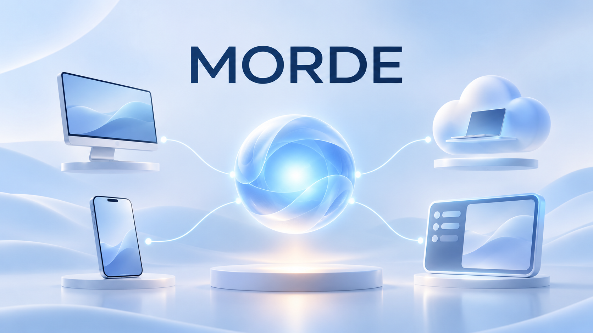
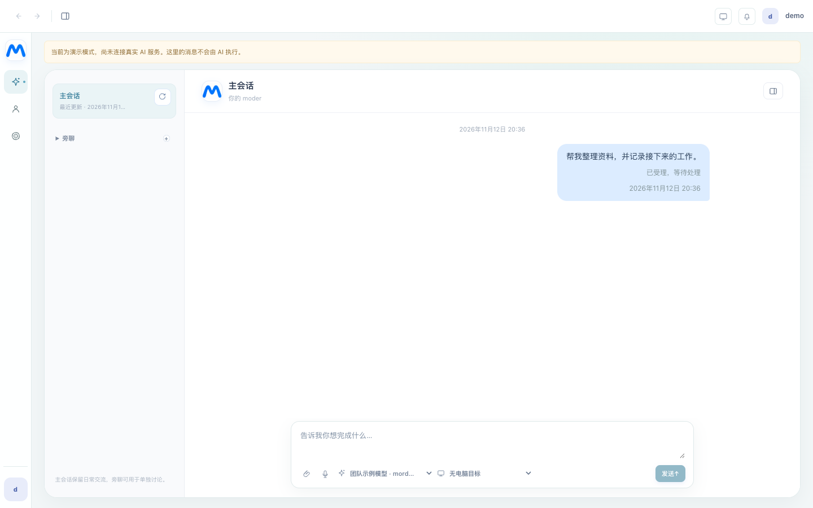
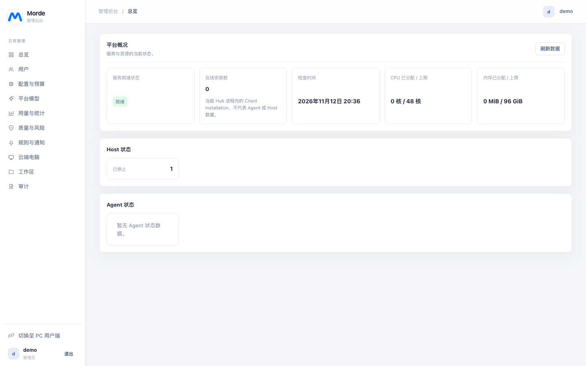
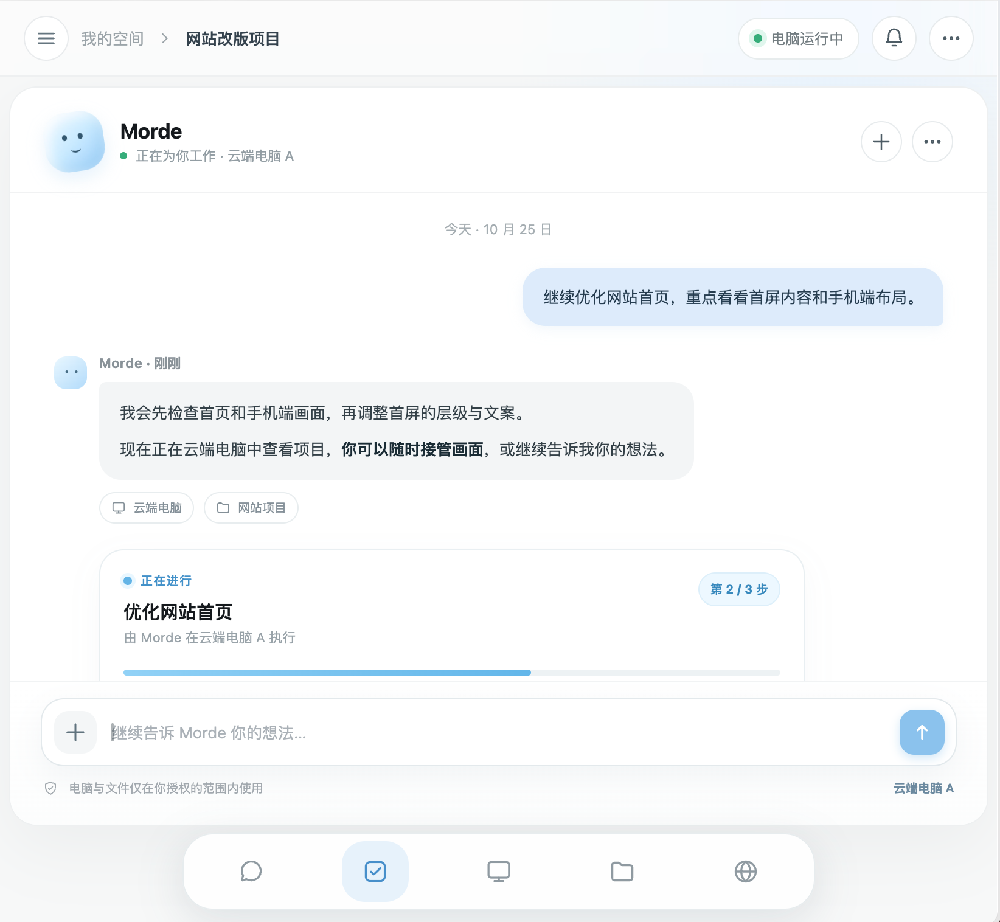
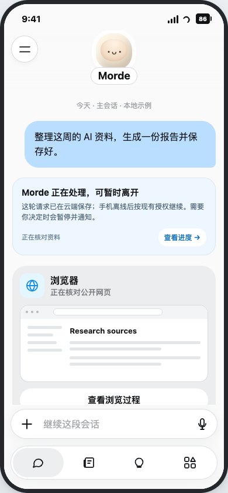
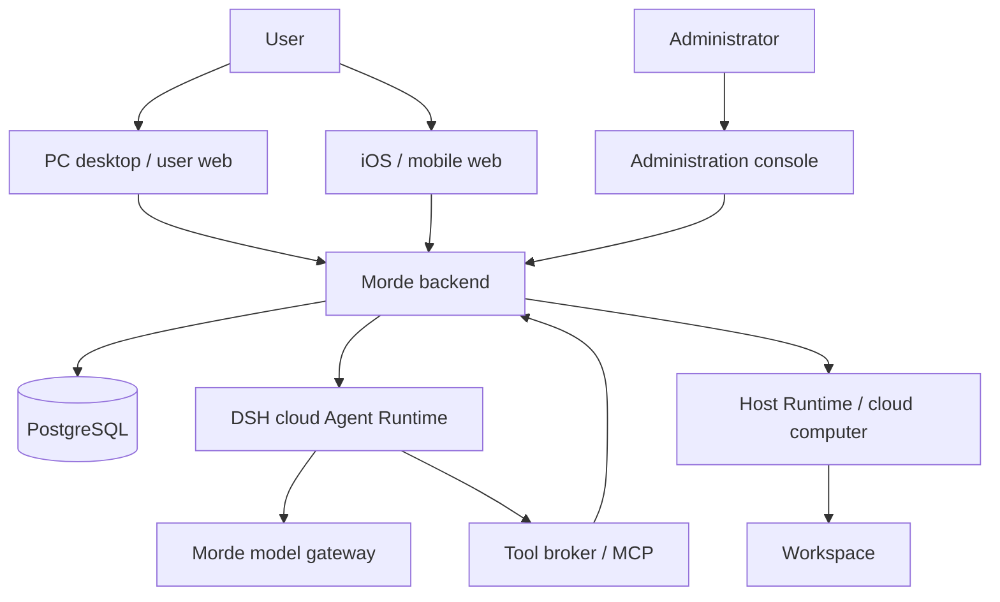

# Morde

[简体中文](README.md) | [English](README.en.md) | [日本語](README.ja.md)



<div align="center">

**A real place for AI to work.**

PC desktop · iOS and mobile web · Administration console · Cloud services and Agent Runtime

</div>

Morde is a multi-device cloud workspace built around AI agents. It brings conversations, tasks, cloud computers, workspaces, and administration together in one product, so users can collaborate with AI from a computer or phone and follow the progress and results of its work.

Morde draws on Muse's interaction principles: **start with a conversation, use tools and computers when needed, and give work a visible process, a result, and clear authorization boundaries.** The project brings the user experience together with server, runtime, and administration infrastructure to build a complete product that can evolve over time.

> **Project status: in development.** The cloud computer, workbench, and core services have local Linux validation records. Multi-device conversations, DSH sub-agents, task recovery, and manual folder synchronization have implementations and local tests. First-milestone acceptance is still incomplete for real models, the designated cloud computer, PC/iOS continuity, and actual file transfers. Project upload is disabled by default. See the [first-milestone requirements](AGENTS.md) and [acceptance record](docs/实施/Morde第一里程碑收口三会话并行实施/A-云端Agent与公共合同实施任务todo清单文档.md).

## One platform, multiple interfaces

| Component | Role and implementation |
| --- | --- |
| **PC desktop** | An Electron desktop client combined with the user web interface, with entry points for conversations, tasks, cloud computers, and local folder synchronization. |
| **Mobile** | A native iOS project built on shared nanoMuse source, plus a mobile web interface for conversations, progress, approvals, and personal resources. Client integration is ongoing. |
| **Administration console** | Manages users and registration reviews, cloud computers, workspaces, models, configuration, usage, and audit records through the shared backend and permission system. |
| **Backend** | Go services handle accounts, APIs, tasks, data, authorization, gateways, and background work; PostgreSQL stores business data. |
| **Cloud runtime** | DSH provides the cloud Agent Runtime, while the Host Runtime and workspace synchronization components connect cloud computers and workspaces. |

All of these components live in this repository, from user-facing clients to the infrastructure that runs and administers the platform.

## Capabilities

### Conversations, tasks, and ongoing collaboration

- **Conversation as the entry point:** Clients include interfaces for conversations, messages, task progress, and approvals. The backend persists messages and task state and supports reconnection recovery, message deduplication, and isolation between conversations.
- **Long conversations:** DSH context compaction and authorized retrieval and pagination of original conversation history are implemented; original messages remain available to view. Cross-device scenarios exceeding a real model's context window are still awaiting acceptance.
- **Main agent and sub-agents:** A main agent can coordinate sub-sessions for complex work. Parallel execution, result handoff, checkpoints, and recovery have local test coverage; complete collaboration driven by a real model is still awaiting acceptance.
- **Interaction during execution:** Message routing distinguishes follow-up questions, changes, status requests, stop requests, and independent tasks. Ambiguous associations require clarification. The related concurrency and cancellation boundaries have local tests.

### Cloud computers and tools

- **Cloud computers and workspaces:** Host creation, management, and gateway access are implemented, along with a workbench providing remote desktop, terminal, files, and VS Code entry points. Workspace data is independent of the Host lifecycle.
- **Tools and models:** Cloud agents access models through the Morde model gateway and capabilities through the tool broker and MCP. Search sources, project file access, and authorization boundaries for designated-computer operations have been tested with local substitutes; real-world capabilities depend on deployment configuration and acceptance.
- **Personal workspace:** The repository includes pages or backend capabilities for profiles, memory, feed, ideas, a library, goals, schedules, and notifications. Morde will continue integrating Muse-inspired personalization, automation, skills, connectors, and artifacts; coverage depends on implementation and acceptance.
- **Authorization and administration:** Access to users, conversations, tasks, and computers follows the existing permission boundaries. The relevant services and clients handle operation approvals, audit records, and credentials.

## Experience preview

The first row shows the current PC user interface and administration console in local demo mode with simulated data. The second row shows AI assistant and iOS design concepts. The screenshots are in Chinese; they do not demonstrate completed real tasks or acceptance.

<table>
  <tr>
    <td align="center"><br /><strong>PC interface · local demo</strong></td>
    <td align="center"><br /><strong>Administration console · local demo</strong></td>
  </tr>
  <tr>
    <td align="center"><br /><strong>AI assistant · design concept</strong></td>
    <td align="center"><br /><strong>iOS client · target design concept</strong></td>
  </tr>
</table>

More design references: [PC workbench](images/readme/pc-workspace.png) · [Cloud computer](images/readme/cloud-computer.png) · [iOS interaction design](docs/设计图/Morde-nanoMuse融合后iOS手机端目标态设计稿.html).

## Architecture



Cloud agents use **DeepSeek Harness (DSH)** as their single Agent Runtime, connecting models, tools, sessions, and checkpoints through existing project plugins and adapters. Main agents and sub-agents do not introduce a second Agent Runtime. Task authorization, approvals, credentials, and operation records remain subject to Morde's business boundaries.

**Technology:** Electron, React, TypeScript · Swift / iOS · Go, PostgreSQL · DSH, MCP · Docker, OpenSandbox, runsc.

## First milestone

The current priority is the **foundational PC, iOS, and cloud-agent workflow**:

1. **Continuity across devices:** Converse on PC and iOS and see real replies, task progress, and results. After closing a client or a brief disconnection, users can resume viewing accepted tasks; retries must not repeat execution.
2. **Long and multiple conversations:** Preserve original chat history and use authorized history. Keep messages, tasks, and results isolated across conversations and accounts.
3. **Computers and tools:** Perform an observable interface operation and a terminal command on the designated authorized cloud computer. Search results provide verifiable sources, and unavailable resources are reported accurately.
4. **Agent collaboration:** The main agent coordinates multiple sub-agents as needed, checks and summarizes their actual results, and accepts follow-up questions, changes, or requests to stop a specified task during execution.
5. **PC folder synchronization:** After the user confirms the local folder, target computer, project name, and scope, manually synchronize to `~/workspace/project/<project-name>/` while preserving relative directories. The project name defaults to the local folder name. Each synchronization is user-initiated; local additions, changes, and deletions are applied only after another click. Deletions affect only the corresponding previously synchronized content, and cloud changes are not synchronized back to the PC. Conflicts or an inaccessible root preserve affected content and prompt the user.

These are **goals and acceptance requirements**, not a list of completed features. The synchronization flow has local tests for its entry point, conflicts, and recovery, but actual file transfers, devices, and failure scenarios are still awaiting acceptance. Until acceptance passes, `project_upload_enabled` remains disabled. See [AGENTS.md](AGENTS.md) for the full requirements, the [first-milestone design](docs/Morde第一里程碑收口技术设计方案.md), and its [acceptance record](docs/实施/Morde第一里程碑收口三会话并行实施/A-云端Agent与公共合同实施任务todo清单文档.md).

## Repository structure

| Path | Contents |
| --- | --- |
| [`clients/desktop/`](clients/desktop/) | PC desktop client, local bridges, and desktop components |
| [`clients/nanoMuse/`](clients/nanoMuse/) | Native iOS project, shared nanoMuse source, and third-party notices |
| [`web/portal/`](web/portal/) | User web interface and administration console |
| [`web/mobile/`](web/mobile/) | Mobile web client |
| [`web/workbench/`](web/workbench/) | Cloud-computer web workbench |
| [`server/`](server/) | Go services, APIs, Gateway, MCP, background tasks, and database migrations |
| [`runtime/morde-cloud-runtime/`](runtime/morde-cloud-runtime/) | DSH cloud Agent Runtime and locked dependencies |
| [`runtime/morde-runtime/`](runtime/morde-runtime/) · [`runtime/morde-sync/`](runtime/morde-sync/) | Host Runtime and Workspace synchronization engine |
| [`images/`](images/) · [`deploy/`](deploy/) | Runtime images and deployment configuration |
| [`docs/`](docs/) · [`examples/`](examples/) | Design, implementation, and acceptance documentation, plus integration examples |

## Development and deployment

### Preview the user interface and administration console locally

With Node.js 24, run the following from the repository root:

```sh
npm --prefix web/portal ci
VITE_MOCK_API=1 npm --prefix web/portal run dev
```

Open `http://127.0.0.1:5173/` for the user interface or `http://127.0.0.1:5173/admin/login` for the administration console. The local demo username and password are both `demo`. Demo mode uses simulated data and does not connect to a real AI service or cloud computer.

### Continue development

- **iOS:** macOS and Xcode are required. See the [iOS development guide](clients/nanoMuse/docs/ios.md) for the project, build, and signing instructions.
- **Backend and deployment:** See the [single-machine deployment guide](deploy/single/README.md) for the target environment and its Docker, runsc, networking, storage, and security prerequisites. The [cloud DSH runtime guide](deploy/cloud-dsh/README.md) covers the runtime environment. Cloud DSH and project upload are disabled by default in the current deployment configuration; complete their respective environment and security acceptance before enabling them.
- **Interfaces and collaboration:** The [OpenAPI contract](server/openapi/portal.yaml) defines the HTTP interfaces. See [server/AGENTS.md](server/AGENTS.md) for backend conventions and the [Agent example](examples/agent/README.md) for MCP integration.

Most linked project documentation is currently in Chinese.
