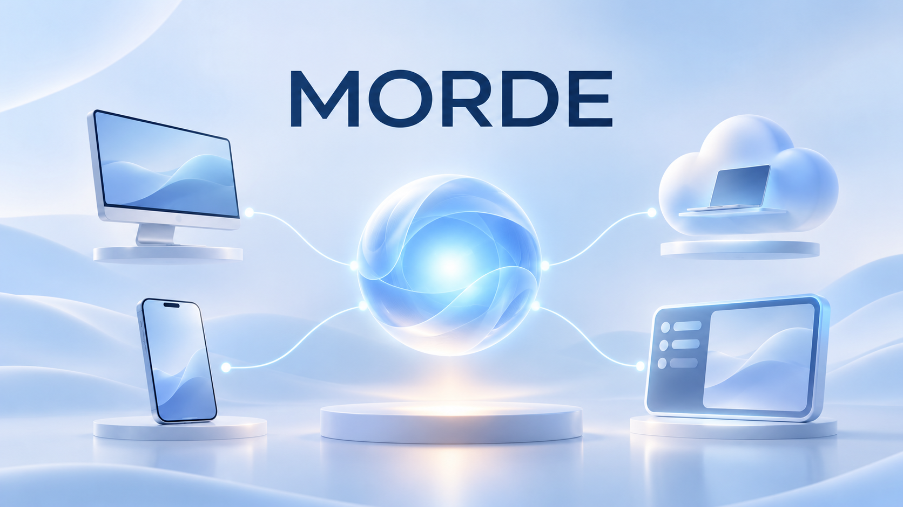
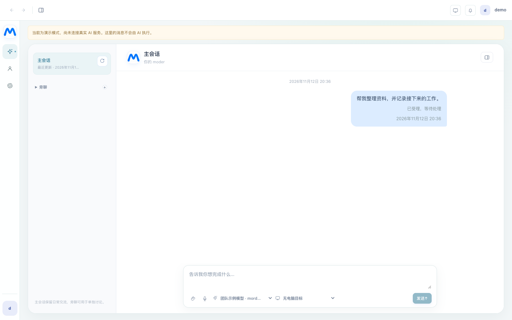
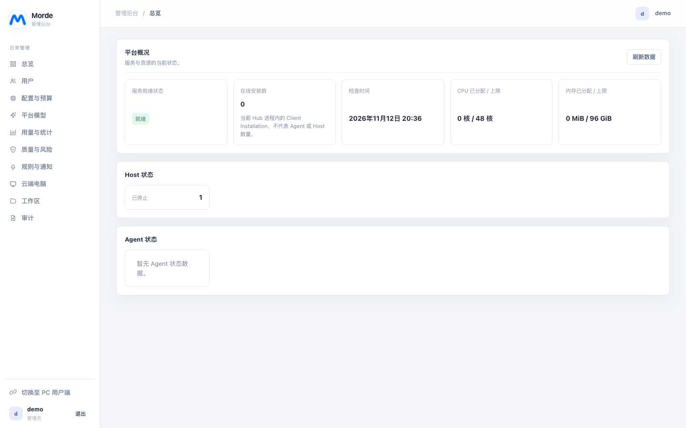
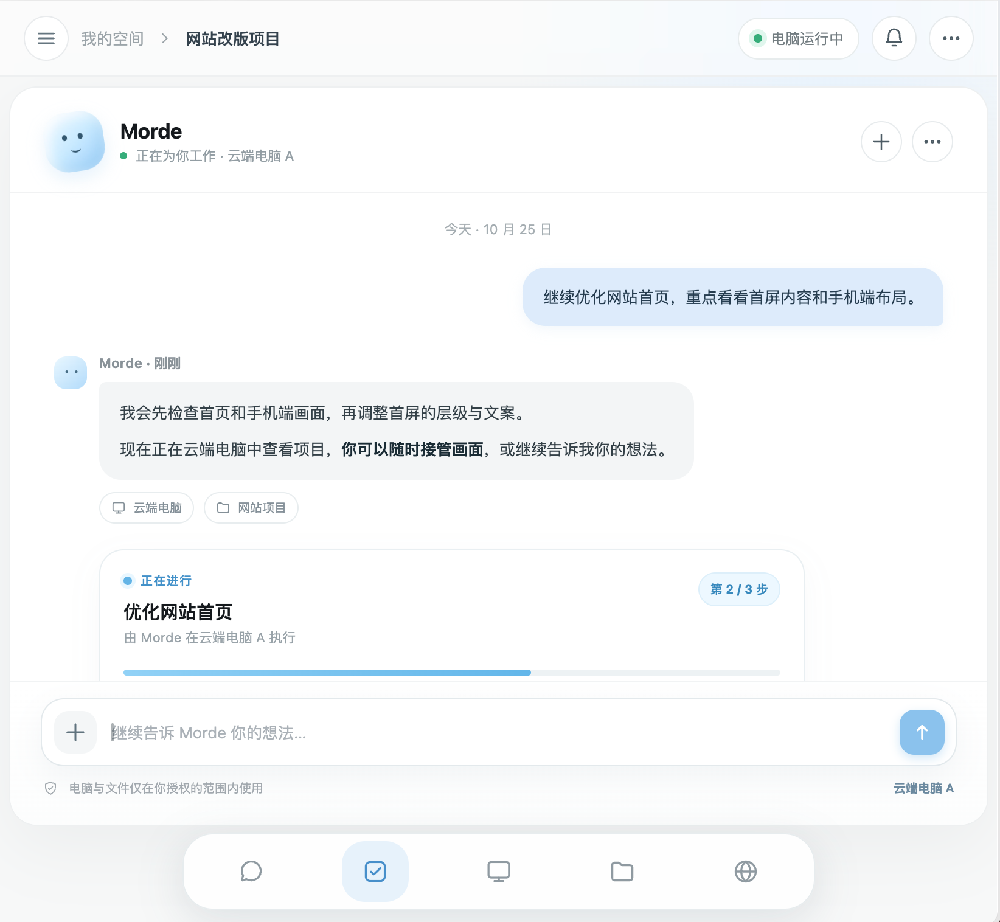
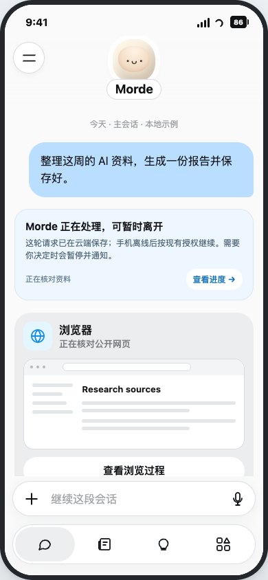
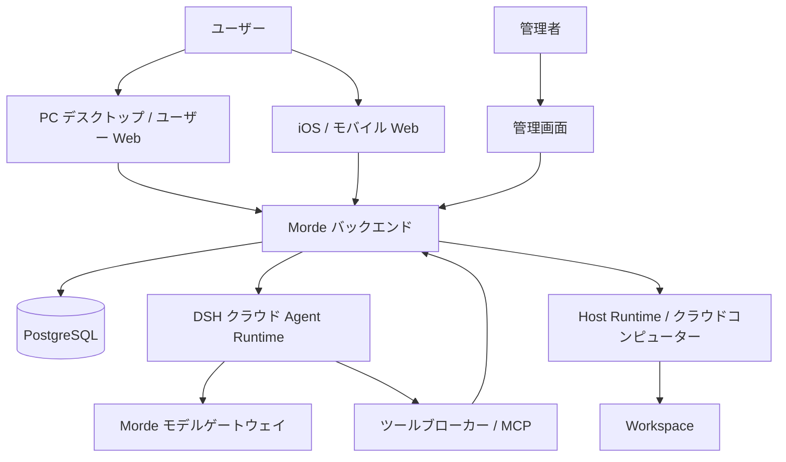

# Morde

[简体中文](README.md) | [English](README.en.md) | [日本語](README.ja.md)



<div align="center">

**AI が実際に仕事をするための場所。**

PC デスクトップ · iOS・モバイル Web · 管理画面 · クラウドサービスと Agent Runtime

</div>

Morde は、AI エージェントを中心に据えたマルチデバイス対応のクラウドワークスペースです。会話、タスク、クラウドコンピューター、ワークスペース、管理機能を一つの製品にまとめ、PC やスマートフォンから AI と協働し、作業の進捗と結果を継続的に確認できます。

Morde は Muse の対話体験を参考にしています。**会話から始め、必要に応じてツールやコンピューターを使い、作業の過程と結果、権限の境界を明確にします。** ユーザー体験に加え、サーバー、実行環境、管理画面などの基盤も重視し、継続的に発展できる製品を目指しています。

> **プロジェクトの状態：開発中。** クラウドコンピューター、ワークベンチ、基盤サービスにはローカル Linux 環境での検証記録があります。マルチデバイスでの会話、DSH サブエージェント、タスクの復旧、手動フォルダー同期などは実装とローカルテストがあります。実際のモデル、指定コンピューター、PC・iOS 間の引き継ぎ、実ファイルの転送については、第1マイルストーンの総合受け入れがまだ完了していません。プロジェクトアップロードはデフォルトで無効です。[第1マイルストーンの要件](AGENTS.md)と[受け入れ記録](docs/实施/Morde第一里程碑收口三会话并行实施/A-云端Agent与公共合同实施任务todo清单文档.md)を参照してください。

## 一つのプラットフォームを複数の画面から

| 構成 | 役割と実装 |
| --- | --- |
| **PC デスクトップ** | Electron ベースのデスクトップクライアントとユーザー向け Web 画面で、会話、タスク、クラウドコンピューター、ローカルフォルダー同期への入口を提供します。 |
| **モバイル** | nanoMuse の共通ソースを利用した iOS ネイティブプロジェクトとモバイル Web 画面で、会話、進捗、承認、個人リソースを確認できます。クライアントの統合は進行中です。 |
| **管理画面** | 共通のバックエンドと権限体系を使用し、ユーザーと登録審査、クラウドコンピューター、ワークスペース、モデル、設定、利用状況、監査などを管理します。 |
| **バックエンド** | Go サービスがアカウント、API、タスク、データ、権限、ゲートウェイ、バックグラウンド処理を担当し、PostgreSQL が業務データを保存します。 |
| **クラウド実行環境** | DSH がクラウド Agent Runtime を担い、Host Runtime とワークスペース同期コンポーネントがクラウドコンピューターとワークスペースを接続します。 |

ユーザー向けクライアントから運用・管理を支える基盤まで、これらの構成要素はすべてこのリポジトリに含まれています。

## 主な機能

### 会話、タスク、継続的な協働

- **会話を入口に：** クライアントには会話、メッセージ、タスク進捗、承認の画面があります。バックエンドはメッセージとタスクの状態を保存し、再接続時の復旧、メッセージの重複排除、会話間の分離に対応しています。
- **長い会話：** DSH のコンテキスト圧縮と、権限の範囲内での元の会話履歴の検索・続きの取得を実装しています。元のメッセージも閲覧できます。実際のモデルのコンテキスト長を超えるマルチデバイスのシナリオは、まだ受け入れ待ちです。
- **メインエージェントとサブエージェント：** 複雑な作業では、メインエージェントがサブセッションを調整できます。並列実行、結果の引き渡し、チェックポイント、復旧はローカルテストで検証されていますが、実際のモデルによる一連の協働は受け入れ待ちです。
- **実行中も対話：** メッセージの振り分けで、追加質問、変更、状態確認、停止、独立したタスクを区別します。関連が不明確な場合は確認を求めます。並行処理とキャンセルの境界についてはローカルテストがあります。

### クラウドコンピューターとツール

- **クラウドコンピューターとワークスペース：** Host の作成、管理、ゲートウェイ経由のアクセスと、リモートデスクトップ、ターミナル、ファイル、VS Code などへの入口を備えた Workbench があります。Workspace のデータは Host のライフサイクルから独立しています。
- **ツールとモデル：** クラウドエージェントは Morde のモデルゲートウェイを介してモデルに接続し、ツールブローカーと MCP を介して機能を利用します。検索の出典、プロジェクトファイルの読み書き、指定コンピューター操作の権限境界はローカルの代替環境でテストされています。実環境での利用可能な機能は、デプロイ設定と受け入れ結果によって異なります。
- **個人用ワークスペース：** プロフィール、記憶、フィード、アイデア、ライブラリ、目標、予定、通知などの画面またはバックエンド機能がリポジトリにあります。今後も Muse を参考に、パーソナライズ、自動化、スキル、コネクター、成果物の体験を統合していきます。対応範囲は実装と受け入れ状況に基づきます。
- **権限と管理：** ユーザー、会話、タスク、コンピューターへのアクセスは既存の権限境界に従います。操作の承認、監査記録、認証情報は対応するサービスとクライアントで扱います。

## 画面プレビュー

1 行目はローカルデモモードで表示した現在の PC ユーザー画面と管理画面で、データは模擬データです。2 行目は AI アシスタントと iOS のデザイン案です。画面内の文字は中国語であり、実際のタスク実行や機能の受け入れ完了を示すものではありません。

<table>
  <tr>
    <td align="center"><br /><strong>PC ユーザー画面 · ローカルデモ</strong></td>
    <td align="center"><br /><strong>管理画面 · ローカルデモ</strong></td>
  </tr>
  <tr>
    <td align="center"><br /><strong>AI アシスタント · デザイン案</strong></td>
    <td align="center"><br /><strong>iOS クライアント · 目標デザイン案</strong></td>
  </tr>
</table>

その他のデザイン参考：[PC ワークベンチ](images/readme/pc-workspace.png) · [クラウドコンピューター](images/readme/cloud-computer.png) · [iOS の操作デザイン](docs/设计图/Morde-nanoMuse融合后iOS手机端目标态设计稿.html)。

## システム構成



クラウドエージェントは **DeepSeek Harness（DSH）** を唯一の Agent Runtime として使用し、既存のプラグインとアダプターを通じてモデル、ツール、セッション、チェックポイントを接続します。メインエージェントとサブエージェントのために別の Agent Runtime を導入しません。タスクの権限、承認、認証情報、操作記録は Morde の業務上の境界に従います。

**技術構成：** Electron、React、TypeScript · Swift / iOS · Go、PostgreSQL · DSH、MCP · Docker、OpenSandbox、runsc。

## 第1マイルストーン

現在は、**PC、iOS、クラウドエージェントの基礎的な一連の流れ**の完成を優先しています。

1. **デバイス間での引き継ぎ：** PC と iOS で対話し、実際の応答、タスクの進捗と結果を確認します。クライアントを閉じたり短時間切断されたりした後も、受理済みのタスクを再確認でき、再試行によって処理を重複実行しません。
2. **長い会話と複数の会話：** 元のチャット履歴を保持し、許可された範囲で履歴を利用します。メッセージ、タスク、結果は会話とアカウントごとに分離します。
3. **コンピューターとツール：** 指定された許可済みのクラウドコンピューターで、確認可能な画面操作とターミナルコマンドを実行します。検索結果には検証可能な出典を示し、リソースを利用できない場合は正確に伝えます。
4. **エージェントの協働：** メインエージェントが必要に応じて複数のサブエージェントを調整し、実際の結果を確認・集約します。実行中は追加質問、変更、指定タスクの停止を行えます。
5. **PC フォルダーの同期：** ローカルフォルダー、対象コンピューター、プロジェクト名、範囲を確認した後、相対ディレクトリ構造を保持して `~/workspace/project/<プロジェクト名>/` に手動で同期します。プロジェクト名の初期値はローカルフォルダー名です。同期は毎回ユーザーがクリックして開始し、ローカルの追加・変更・削除は再度クリックしたときに適用します。削除の対象は対応する同期済みの内容のみで、クラウド側の変更は PC に逆同期しません。競合やルートディレクトリへのアクセス不可が発生した場合は、影響を受ける内容を保持して通知します。

以上は**目標と受け入れ要件**であり、すべてが完成済みという意味ではありません。同期には入口、競合、復旧などのローカルテストがありますが、実ファイルの転送、デバイス、障害時のシナリオはまだ受け入れ待ちです。受け入れに合格するまで `project_upload_enabled` は無効のままにします。詳細は [AGENTS.md](AGENTS.md)、[第1マイルストーンの設計](docs/Morde第一里程碑收口技术设计方案.md)、[受け入れ記録](docs/实施/Morde第一里程碑收口三会话并行实施/A-云端Agent与公共合同实施任务todo清单文档.md)を参照してください。

## リポジトリ構成

| パス | 内容 |
| --- | --- |
| [`clients/desktop/`](clients/desktop/) | PC デスクトップクライアント、ローカルブリッジ、デスクトップ関連コンポーネント |
| [`clients/nanoMuse/`](clients/nanoMuse/) | iOS ネイティブプロジェクト、nanoMuse の共通ソース、サードパーティーに関する表記 |
| [`web/portal/`](web/portal/) | ユーザー向け Web 画面と管理画面 |
| [`web/mobile/`](web/mobile/) | モバイル Web クライアント |
| [`web/workbench/`](web/workbench/) | クラウドコンピューターの Web ワークベンチ |
| [`server/`](server/) | Go サービス、API、Gateway、MCP、バックグラウンドタスク、データベースマイグレーション |
| [`runtime/morde-cloud-runtime/`](runtime/morde-cloud-runtime/) | DSH クラウド Agent Runtime と固定された依存関係 |
| [`runtime/morde-runtime/`](runtime/morde-runtime/) · [`runtime/morde-sync/`](runtime/morde-sync/) | Host Runtime と Workspace 同期エンジン |
| [`images/`](images/) · [`deploy/`](deploy/) | 実行環境のイメージとデプロイ設定 |
| [`docs/`](docs/) · [`examples/`](examples/) | 設計・実装・受け入れ文書、および連携例 |

## 開発とデプロイ

### ユーザー画面と管理画面のローカルプレビュー

Node.js 24 を使用し、リポジトリのルートで次を実行します。

```sh
npm --prefix web/portal ci
VITE_MOCK_API=1 npm --prefix web/portal run dev
```

ユーザー画面は `http://127.0.0.1:5173/`、管理画面は `http://127.0.0.1:5173/admin/login` で開きます。ローカルデモのユーザー名とパスワードはいずれも `demo` です。デモモードでは模擬データを使用し、実際の AI サービスやクラウドコンピューターには接続しません。

### 開発を続ける

- **iOS：** macOS と Xcode が必要です。プロジェクト、ビルド、署名については [iOS 開発ガイド](clients/nanoMuse/docs/ios.md)を参照してください。
- **バックエンドとデプロイ：** 対象環境と Docker、runsc、ネットワーク、ストレージ、セキュリティの前提条件は[単一マシンへのデプロイガイド](deploy/single/README.md)を、クラウド DSH の実行環境は[実行パッケージの説明](deploy/cloud-dsh/README.md)を参照してください。現在のデプロイ設定ではクラウド DSH とプロジェクトアップロードはデフォルトで無効です。有効化する前に、それぞれの環境とセキュリティの受け入れを完了してください。
- **インターフェースと開発上の約束：** HTTP インターフェースは [OpenAPI 契約](server/openapi/portal.yaml)を基準とします。バックエンドの開発規約は [server/AGENTS.md](server/AGENTS.md)、MCP 連携は [Agent の例](examples/agent/README.md)を参照してください。

リンク先のプロジェクト文書の多くは現在、中国語で記載されています。
