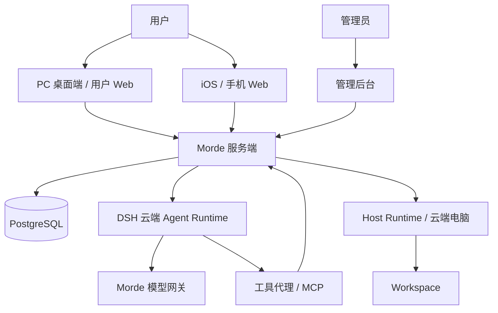

# Morde

[简体中文](README.md) | [English](README.en.md) | [日本語](README.ja.md)


<div align="center">

**让 AI 有一个真正工作的地方。**

PC 桌面端 · iOS 与手机 Web · 管理后台 · 云端服务与 Agent Runtime

</div>

Morde 是一套以 AI Agent 为核心的多端云端工作平台。它把对话、任务、云端电脑、工作区和管理能力放在同一个产品里，让用户可以在电脑或手机上与 AI 协作，并持续跟进工作的进展和结果。

Morde 参考 Muse 的交互理念：**从对话开始，根据需要使用工具和电脑，让工作有过程、有结果，也有清晰的授权边界。** 项目既关注个人使用体验，也重视服务端、运行环境与管理后台等基础设施，目标是形成可持续演进的完整产品。

> **项目状态：持续开发中。** 云端电脑、工作台与基础服务已有本机 Linux 验证记录；多端对话、DSH 子 Agent、任务恢复及手动文件夹同步等已有实现和本地测试。第一里程碑的真实模型、指定电脑、PC/iOS 跨端及文件数据面尚未完成整体验收，项目上传开关默认关闭。详见[第一里程碑约定](AGENTS.md)与[验收记录](docs/实施/Morde第一里程碑收口三会话并行实施/A-云端Agent与公共合同实施任务todo清单文档.md)。

## 一套平台，多端协同

| 产品组成 | 职责与实现 |
| --- | --- |
| **PC 桌面端** | 基于 Electron 的桌面客户端，结合用户 Web 界面，提供对话、任务、云端电脑和本地文件夹同步入口。 |
| **移动端** | 基于 nanoMuse 共享源码的 iOS 原生工程，以及手机 Web 入口，用于查看会话、进度、审批和个人资源；客户端整合仍在进行。 |
| **管理后台** | 管理用户与注册审核、云端电脑、工作区、模型、配置、用量和审计等，使用统一服务端和权限体系。 |
| **服务端** | Go 服务负责账号、API、任务、数据、授权、网关和后台工作；PostgreSQL 承载业务数据。 |
| **云端运行环境** | DSH 负责云端 Agent Runtime，Host Runtime 和 Workspace 同步组件连接云端电脑与工作区。 |

这些组成部分都在本仓库中：既有面向用户的客户端，也有支撑运行与管理的服务端基础设施。

## 能力概览

### 对话、任务与持续协作

- **对话即入口：** 客户端已有会话、消息、任务进度和审批界面；服务端保存消息与任务状态，支持断线恢复、消息去重和多会话隔离。
- **长会话：** 已接入 DSH 上下文压缩，并实现授权范围内的历史原文检索与续查；原始消息仍可查看。超过真实模型上下文窗口的跨端场景仍待验收。
- **主 Agent 与子 Agent：** 复杂工作可由主 Agent 协调子会话；并行执行、结果回传、检查点与恢复已有本地测试，实际模型驱动的完整协作仍待验收。
- **执行中继续交互：** 消息路由区分追问、修改、状态查询、停止和独立任务；关联不明确时需要澄清。相关并发与取消边界已有本地测试。

### 云端电脑与工具

- **云端电脑与工作区：** 已有 Host 创建、管理和网关访问，以及包含远程桌面、终端、文件和 VS Code 等入口的 Workbench；Workspace 数据与 Host 生命周期分离。
- **工具与模型：** 云端 Agent 通过 Morde 模型网关接入模型，并通过工具代理和 MCP 接入能力。搜索来源、项目文件读写与指定电脑操作的授权边界已有本地替身测试；真实环境能力取决于部署配置和验收结果。
- **个人工作空间：** 仓库中已有个人资料、记忆、动态、灵感、资源库、目标、计划与通知等页面或服务端能力。Morde 将继续围绕 Muse 式的个人化、自动化、技能、连接器与产物体验完善整合，具体覆盖范围以实现和验收为准。
- **授权与管理：** 用户、会话、任务和电脑的访问遵循现有权限边界；操作审批、审计记录和凭据管理由相应服务与客户端共同处理。

## 体验预览

第一行的 PC 用户端与管理后台截图来自本地演示模式，展示当前页面和模拟数据；第二行是 AI 助手与 iOS 的设计示意。它们不代表真实任务已经执行或功能已经验收。

<table>
  <tr>
    <td align="center"><br /><strong>PC 用户端 · 本地演示</strong></td>
    <td align="center"><br /><strong>管理后台 · 本地演示</strong></td>
  </tr>
  <tr>
    <td align="center"><br /><strong>AI 助手 · 设计示意</strong></td>
    <td align="center"><br /><strong>iOS 客户端 · 目标设计示意</strong></td>
  </tr>
</table>

更多设计参考：[PC 工作台](images/readme/pc-workspace.png) · [云端电脑](images/readme/cloud-computer.png) · [iOS 交互设计稿](docs/设计图/Morde-nanoMuse融合后iOS手机端目标态设计稿.html)。

## 系统架构



云端 Agent 统一使用 **DeepSeek Harness（DSH）**，通过项目已有的插件和适配机制接入模型、工具、会话与检查点；主 Agent 和子 Agent 不另外引入第二套 Agent Runtime。任务授权、审批、凭据和操作记录仍由 Morde 的业务边界约束。

**技术构成：** Electron、React、TypeScript · Swift / iOS · Go、PostgreSQL · DSH、MCP · Docker、OpenSandbox、runsc。

## 第一里程碑

当前优先收口 **PC、iOS 与云端 Agent 的基础闭环**：

1. **两端接续：** 在 PC 和 iOS 对话，查看真实回复、任务进度与结果；关闭客户端或短暂断网后，已受理任务可恢复查看，重试不重复执行。
2. **长会话与多会话：** 保留原始聊天记录，在授权范围内利用历史；会话和账号之间的消息、任务和结果保持隔离。
3. **电脑与工具：** 在指定且已授权的云端电脑上完成可观察的操作和终端命令；搜索结果提供可核查来源，资源不可用时如实反馈。
4. **Agent 协作：** 主 Agent 根据任务需要协调多个子 Agent，检查并汇总实际结果；执行中可以追问、修改或停止指定任务。
5. **PC 文件夹同步：** 用户确认本地目录、目标电脑、项目名与范围后，手动同步到 `~/workspace/project/<项目名>/`，保留相对目录结构；项目名默认取本地文件夹名。每次同步都由用户点击触发，本机增改删须再次点击才会应用，删除只影响对应的已同步内容，云端变化不反向写入 PC；冲突或目录不可访问时保留受影响内容并提示。

上述内容是**目标与验收要求**，不是全部已完成的功能清单。同步链路已有入口、冲突和恢复等本地测试，但真实文件传输、设备和故障场景仍待验收；在验收通过前，`project_upload_enabled` 保持关闭。完整规则见 [AGENTS.md](AGENTS.md)，实施进度见[第一里程碑收口设计](docs/Morde第一里程碑收口技术设计方案.md)及其[验收记录](docs/实施/Morde第一里程碑收口三会话并行实施/A-云端Agent与公共合同实施任务todo清单文档.md)。

## 仓库结构

| 路径 | 内容 |
| --- | --- |
| [`clients/desktop/`](clients/desktop/) | PC 桌面客户端、本地桥接和桌面相关组件 |
| [`clients/nanoMuse/`](clients/nanoMuse/) | iOS 原生工程 |
| [`web/portal/`](web/portal/) | 用户 Web 和管理后台 |
| [`web/mobile/`](web/mobile/) | 手机 Web 客户端 |
| [`web/workbench/`](web/workbench/) | 云端电脑网页工作台 |
| [`server/`](server/) | Go 服务、API、Gateway、MCP、后台任务与数据库迁移 |
| [`runtime/morde-cloud-runtime/`](runtime/morde-cloud-runtime/) | DSH 云端 Agent Runtime 及锁定依赖 |
| [`runtime/morde-runtime/`](runtime/morde-runtime/) · [`runtime/morde-sync/`](runtime/morde-sync/) | Host Runtime 与 Workspace 同步引擎 |
| [`images/`](images/) · [`deploy/`](deploy/) | 运行环境镜像与部署配置 |
| [`docs/`](docs/) · [`examples/`](examples/) | 设计、实施与验收文档，以及接入示例 |

## 开发与部署

### 本地预览用户端和管理后台

使用 Node.js 24，在仓库根目录执行：

```sh
npm --prefix web/portal ci
VITE_MOCK_API=1 npm --prefix web/portal run dev
```

打开 `http://127.0.0.1:5173/` 查看用户端，或打开 `http://127.0.0.1:5173/admin/login` 查看管理后台。本地演示账号和密码均为 `demo`。演示模式使用模拟数据，不连接真实 AI 或云端电脑。

### 继续开发

- **iOS：** 需要 macOS 和 Xcode；工程入口、构建与签名说明见 [iOS 开发文档](clients/nanoMuse/docs/ios.md)。
- **服务端与部署：** 目标环境及其 Docker、runsc、网络、存储和安全前置条件见[单机部署指南](deploy/single/README.md)；云端 DSH 运行环境见[运行包说明](deploy/cloud-dsh/README.md)。当前部署配置中的云端 DSH 和项目上传功能默认关闭，启用前须完成各自的环境与安全验收。
- **接口与协作：** HTTP 接口以 [OpenAPI 契约](server/openapi/portal.yaml)为准；后端开发约定见 [server/AGENTS.md](server/AGENTS.md)，MCP 接入参考 [Agent 示例](examples/agent/README.md)。
