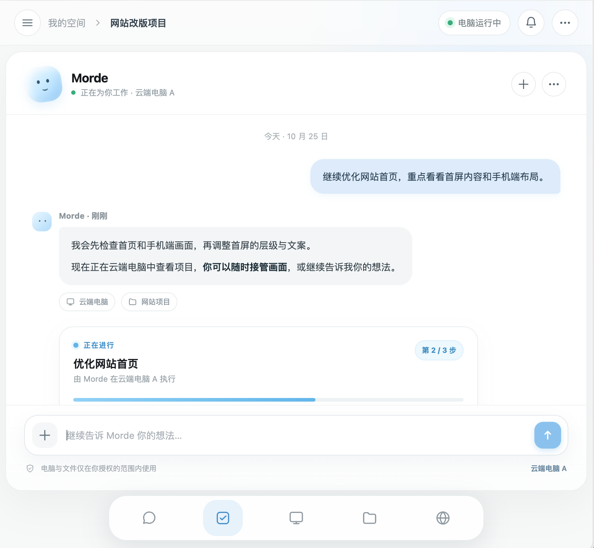
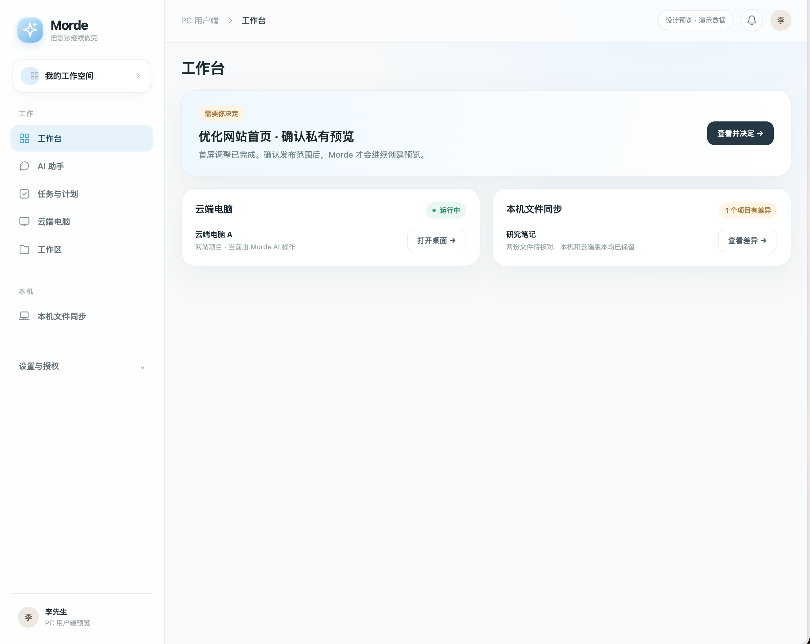
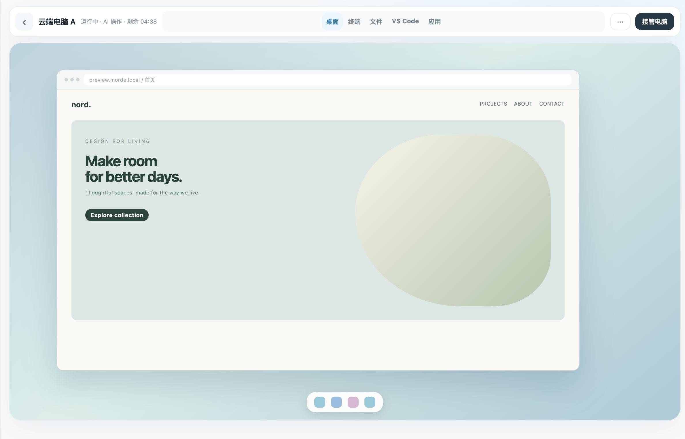

# Morde

Morde 是一个让用户和 AI 共用云端电脑与工作区的平台。它在单台 Linux 服务器上管理隔离的 Host，提供网页门户、主机工作台、平台 MCP 和私有预览；工作区数据独立于 Host 保存，便于释放计算资源后继续使用。

## 主要能力

- **云端电脑：** 创建、进入、续期和删除 Host；在 Workbench 使用桌面浏览器、终端、文件和 VS Code。
- **共享工作区：** 管理 Workspace 与 Host 绑定；本机与云端的同步和接回流程正在按 MVP 清单验收。
- **AI 接入：** 通过受限 API Key 连接平台 MCP，在授权范围内操作同一 Host；门户提供会话、任务与通知入口。
- **管理与隔离：** 用户 Web 支持注册并等待管理员审核；固定超级管理员 `admin` 首次初始化后必须修改默认密码，后台支持审核、禁用/恢复及管理员角色调整。Gateway 对 Host 与私有预览进行鉴权，运行环境使用 OpenSandbox、Docker 和 runsc。

## 界面预览

以下图片展示 AI 助手、PC 工作台和云端电脑的界面设计。图片中的任务与数据用于演示，实际功能完成情况见下方「当前状态」。

### AI 助手

### PC 工作台

### 云端电脑

## 仓库目录

| 路径 | 内容 |
|---|---|
| `server/` | Go 服务、Portal API、Gateway、MCP、后台任务、数据库迁移与 OpenAPI 契约 |
| `web/portal/` | 用户 PC Web 与管理后台 Web |
| `web/workbench/` | Host 内的网页工作台 |
|  |
| `images/`、`deploy/single/` | Host 镜像与单机部署文件 |
| `examples/agent/` | Codex 平台 MCP 接入示例 |
| `docs/` | 需求、实施合同、设计与验证记录 |

## 从哪里开始

- **接入 AI：** 按 [Codex MCP 示例](examples/agent/README.md)配置平台地址和本机环境变量中的 API Key。
- **了解接口与架构：** 阅读 [实施总览与公共约定](docs/实施/00-总览与公共约定.md)；HTTP 接口以 [OpenAPI 契约](server/openapi/portal.yaml) 为准，后端开发规则见 [server/AGENTS.md](server/AGENTS.md)。

## 当前状态

基础 Host、Workbench、Gateway 与 MCP 链路已有本机 Linux 验证记录。本轮聚焦 Morde 服务端、用户 Web 和管理后台 Web 的真实服务联验；正式 PC/手机客户端基于 `project/nanoMuse` 二次开发，独立 Desktop 原型不作为交付。页面模拟数据和本地构建通过不等于真实 Host 或跨端同步已验收。最新范围、阻塞项和完成情况以 [MVP 清单](docs/实施/21-Morde-MVP剩余实施任务todo清单文档.md) 为准。
