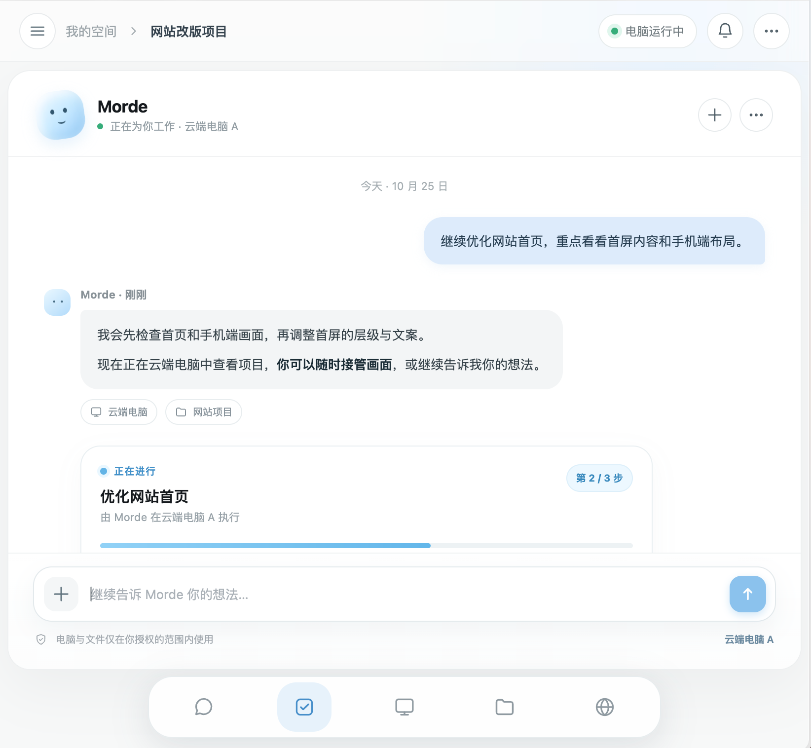
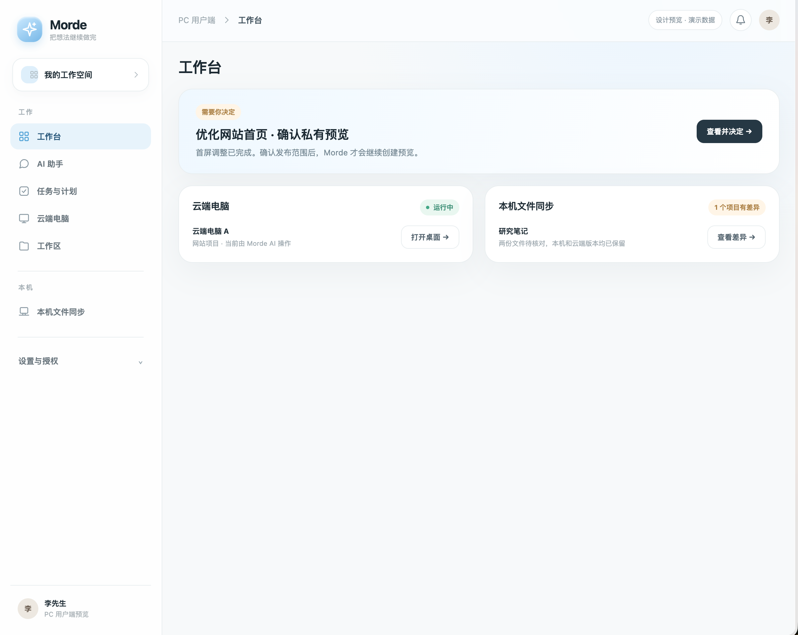
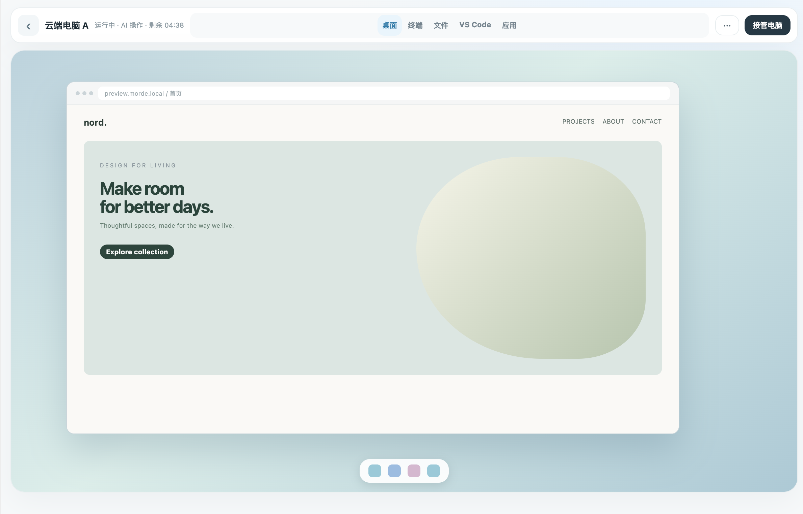

# Morde

Morde 是一个让用户和 AI 共用云端电脑与工作区的平台。它在单台 Linux 服务器上管理隔离的 Host，提供网页门户、主机工作台、平台 MCP 和私有预览；工作区数据独立于 Host 保存，便于释放计算资源后继续使用。

当前个人使用主线见 [Morde 个人 Muse 需求与架构设计方案](docs/Morde个人Muse需求与架构设计方案.md)：以 Morde 为唯一服务端，沿用 DSH 云端运行，补齐主 Agent 协调并发任务、iOS/PC 接续和 PC 授权文件夹按需读取。该文档区分现有实现与待补齐能力，并给出分阶段顺序；它是目标方案，不表示已经开发或验收完成。

## 客户端与服务端的唯一归属

**目标是一个产品、一套客户端和一套服务端。** Morde 的 iOS 原生工程保留在 `clients/nanoMuse/`；PC 桌面客户端及其本地运行组件位于 `clients/desktop/`，手机 Web 位于 `web/mobile/`。服务端以本仓库 `server/` 为唯一业务实现与部署入口；客户端内运行的本机 Agent 或桥接进程仍属于客户端，不是第二套对外业务服务。

当前仓库仍处于整合阶段：nanoMuse 目录内的独立 Morde iOS 工程是当前 iOS 实现，但最终不得作为另一套手机产品交付；Morde 手机端应逐步并入 nanoMuse 应用，同时保留 nanoMuse 原有能力。现有用户 Web 和工作台界面也须随客户端整合收敛，不能与 nanoMuse PC 端长期并行维护两套用户功能；管理后台是服务端的管理界面，不算第二个用户客户端。

具体范围和验收见 [nanoMuse 客户端与 Morde 服务端合并需求文档](docs/nanoMuse客户端与Morde服务端合并需求文档.md)。此前文档中关于“独立 Morde 客户端为最终工程”或“停用 nanoMuse 原有能力”的描述，以这份新需求为准修订；本段描述的是目标，不表示合并已经完成。

## 手机端设计参考

后续开发 Morde 手机端时，以用户提供的 Meta Muse 操作截图为视觉和交互参考，先看[可交互 HTML 设计稿](docs/设计图/Morde-Meta-Muse手机端参考设计稿.html)和[视觉与交互设计方案](docs/Morde参考MetaMuse手机端视觉与交互设计方案.md)。设计稿覆盖聊天、任务进度、浏览器接管、助手详情、审核记录、记忆和侧边栏；其中的内容与按钮仅作本地演示，不表示功能已实现。功能取舍、数据归属和原 nanoMuse 能力保留仍以[合并需求](docs/nanoMuse客户端与Morde服务端合并需求文档.md)为准。

按照[融合技术架构设计方案](docs/nanoMuse客户端与Morde服务端融合技术架构设计方案.md)绘制的[融合后 iOS 目标态 HTML](docs/设计图/Morde-nanoMuse融合后iOS手机端目标态设计稿.html)，以聊天、动态、点子、资源库四栏接入 Morde 云端处理、电脑、工作区与审批；动态展示 Muse 短内容，点子提供灵感入口，资源库展示生成产物，长期目标与例程从点子进入。用户直接在会话中发消息，界面没有“发送新任务”入口；服务端仍保存每轮执行记录。常用电脑和工作区只在资源库选择，聊天页不展示所选名称；这是尚未实现的目标界面。

## 主要能力

- **云端电脑：** 创建、进入、续期和删除 Host；在 Workbench 使用桌面浏览器、终端、文件和 VS Code。
- **共享工作区：** 管理 Workspace 与 Host 绑定；本机与云端的同步和接回流程正在按 MVP 清单验收。
- **AI 接入：** 通过受限 API Key 连接平台 MCP，在授权范围内操作同一 Host；门户提供会话、任务与通知入口。
- **管理与隔离：** 用户 Web 支持注册并等待管理员审核；固定超级管理员 `admin` 首次初始化后必须修改默认密码，后台支持审核、禁用/恢复及管理员角色调整。Gateway 对 Host 与私有预览进行鉴权，运行环境使用 OpenSandbox、Docker 和 runsc。

## 界面预览

以下图片展示 AI 助手、PC 工作台和云端电脑的界面设计。图片中的任务与数据用于演示，实际功能完成情况见下方「当前状态」。

### AI 助手

### PC 工作台

### 云端电脑

## 仓库目录

| 路径 | 内容 |
|---|---|
| `server/` | Go 服务、Portal API、Gateway、MCP、后台任务、数据库迁移与 OpenAPI 契约 |
| `clients/nanoMuse/` | Morde iOS 原生工程及其 iOS 源码、资源和许可文件 |
| `clients/desktop/` | Morde PC 桌面客户端、桌面 DSH 插件与本地运行组件 |
| `runtime/morde-cloud-runtime/` | 云端 DSH Runtime 镜像源码与锁定依赖 |
| `runtime/morde-runtime/`、`runtime/morde-sync/` | Host Runtime 与 Workspace 同步引擎 |
| `web/mobile/` | 手机 Web 客户端，部署到 Portal 同源 `/app/` |
| `web/portal/` | 用户 Web 与管理后台 Web |
| `web/workbench/` | 当前 Host 网页工作台；用户界面需随客户端整合收敛 |
| `images/`、`deploy/single/` | Host 镜像与单机部署文件 |
| `examples/agent/` | Codex 平台 MCP 接入示例 |
| `docs/` | 需求、实施合同、设计与验证记录 |

## 从哪里开始

- **初始化 iOS 原生依赖：** 克隆仓库后运行 `git submodule update --init --recursive`；iOS 所需的 iSH 版本由 `.gitmodules` 固定。
- **接入 AI：** 按 [Codex MCP 示例](examples/agent/README.md)配置平台地址和本机环境变量中的 API Key。
- **了解接口与架构：** 阅读 [实施总览与公共约定](docs/实施/00-总览与公共约定.md)；HTTP 接口以 [OpenAPI 契约](server/openapi/portal.yaml) 为准，后端开发规则见 [server/AGENTS.md](server/AGENTS.md)。

## 当前状态

基础 Host、Workbench、Gateway 与 MCP 链路已有本机 Linux 验证记录。PC/iOS 目前仍存在独立 Morde 实现，nanoMuse 服务端能力也尚未并入 `server/`，因此尚未达到上文的单一产品目标。页面模拟数据和本地构建通过不等于真实 Host、原有 nanoMuse 功能或跨端同步已验收。当前实施进度见 [MVP 清单](docs/实施/21-Morde-MVP剩余实施任务todo清单文档.md)；最终整合范围以 [合并需求](docs/nanoMuse客户端与Morde服务端合并需求文档.md) 为准。
