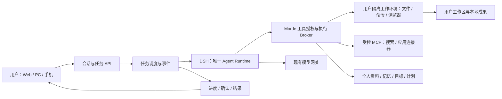

# Meta Muse 能力对齐与 Morde 开源复用方案

调研日期：2026-11-06。目标：以 **Meta Muse** 为产品参照，让 Morde 的 AI 助手能够持续理解用户、并发处理任务、使用工具工作，并在对话中报告过程和结果。能力范围不局限于搜索；实施时优先复用现有 Morde 和开源组件，保持 **DSH 为唯一的 Agent Runtime**。

2026-11-07 补充：本文中的 Morde 现状是调研日的历史快照；同会话多任务及无 Host 内置搜索等已出现后续进展，但尚需端到端验收。当前 DSH 插件选型与实施状态以[运行时设计方案](./Morde-Agent-Runtime与AI能力设计方案.md)和[实施清单](./实施/Morde-Agent-Runtime与AI能力实施任务todo清单文档.md)为准。

本文覆盖 Meta 官方截至调研日公开描述的能力和已公布的方向；Meta Muse 的完整源码及未公开功能无法核验，因此不能保证列出其内部全部能力。本文是方案和验收目标，不表示能力已经在 Morde 接通。前一份[开源能力调研报告](./Morde-Agent-Runtime开源能力调研报告.md)保留搜索问题及四个项目的详细分析。

本次研究只在本地读取与修改文件，没有外发文件或本地数据。产品对齐中涉及的文件分享、外部服务和消息发送是需要另行接入、授权和验证的目标；本次不会执行真实外发。当前用户明确要求不外发或发送文件，当前工作及验收均遵守该限制。

## 1. 结论

1. **继续使用 DSH，补工具和执行环境，不再接入第二套 Agent。** 一套 Runtime 实现可以服务多个用户和多个任务；任务可以使用各自的 DSH 会话或子进程，并不意味着要启动多种 Runtime。
2. **目标是完整个人 Agent。** 除搜索和网页阅读，还包括电脑操作、文件和代码、持久记忆、计划、事件触发、多任务并发、第三方连接器、语音与头像、多设备和可视化成果。
3. **优先接通现成组件，而不是重写工具。** Morde 已有模型网关、DSH 适配器、任务、部分工具、MCP、个人资料和调度基础；用隔离执行环境及经授权的工具接入它们。开源项目并非全部提供可即插即用的 MCP 接口，仍需适配、版本和许可证验证。
4. **必须补同一会话内并行。** Meta Muse 允许连续发起不同任务，而 Morde 目前的数据库索引、任务提交和页面只支持同一对话一个活动任务。这是产品能力差距，不仅是工具未配置。
5. **Meta 的商业合作与内部安全系统无法直接移植。** 可以复用开源浏览器、工具和隔离组件，实现相应功能；但支付、特定应用、硬件及其内部安全能力依赖第三方接口、授权、运行环境及额外工程验证。

## 2. Meta Muse 能力清单与 Morde 差距

说明：表中的“基础”表示源码中已有相关实现，不代表页面到工具的完整链路已验证。“待接入”表示尚未在本次检查中确认完整链路。开源来源的具体接入方式见第 3 节。

### 对话与工作方式

| 能力 | Meta Muse 公开描述 | Morde 当前情况 | 对齐目标和复用方式 |
| --- | --- | --- | --- |
| 自然对话与执行 | 一个长期主对话，可以直接交代事情。 | 已有 AI 助手、DSH 和模型连接。 | 保留现有页面和 DSH；用户无需理解 Runtime 或手动启动任务环境。 |
| 同一对话并发任务 | 上一个任务未完成时，可继续提交不同任务并打断。 | 数据库和页面按一个活动任务处理；不同任务在 Worker 层有并发基础。 | 同一会话允许多个独立活动任务，每个任务有独立上下文、进度和停止操作；补充消息可明确关联已有任务。 |
| 主对话与侧边话题 | 主对话之外支持 side chats；记忆可跨对话。 | 已有多个对话和用户个人数据基础。 | 新话题有独立上下文；允许按用户授权使用共同记忆。保留此前要求：不显示“设为主会话”按钮。 |
| 过程、结果与打断 | 后台工作可继续进行，用户可查看活动和权限。 | 已有任务事件、流式更新和停止机制。 | 进度显示在对应消息附近，最终结果明确归属任务；停止按钮紧邻发送区域，不重新添加暂停按钮，不在输入框下方插入会使布局跳动的提示。 |
| 多 Agent 分工 | 可并发委派子任务。 | DSH 任务内已有委派及后台子会话相关工具，受父任务权限约束。 | 复用 DSH 子会话，只使用同一 Runtime；子任务不能越权、跨用户串数据，父任务汇总结果。 |

Meta 对同一对话并发、侧边对话、活动记录及可见记忆的描述见 [How We Designed Muse](https://muse.ai/blog/how-we-designed-muse)。

### 真正执行任务

| 能力 | Meta Muse 公开描述 | Morde 当前情况 | 对齐目标和复用方式 |
| --- | --- | --- | --- |
| 独立电脑与持续工作目录 | 每人有独立电脑、文件系统、终端和浏览器。 | 按账号管理 DSH 运行环境；Host 和 Workspace 具备部分基础。没有选择 Host 时，现有 Host 工具不会自动提供。 | 为每个用户提供隔离且可恢复的工作环境；复用 Host/Workspace，补无 Host 的工作环境和生命周期。macOS 本地运行需要合适的本地容器或虚拟机。 |
| 终端、代码、文件 | AI 可运行命令、编写代码、创建或修改文件。 | 有 Host 的 `shell_exec` 和文件工具；是否能用取决于目标、授权及 Host 状态。 | 先接现有工具，按需评估 DSH 文件/终端工具或 Filesystem MCP；运行在受限工作目录，不能拿到主服务进程权限。 |
| 搜索与网页阅读 | 查询网络、阅读网页并结合来源回答。 | 当前截图对应的无 Host 对话没有搜索工具，模型本身不会自动获得联网能力。 | 接入 mcp-searxng + 自部署 SearXNG；处理网页内容、时效、来源、失败与无网状态。 |
| 浏览器操作 | 导航、点击、填写表单，配合用户完成登录、预订等。 | Host 工具包含浏览器操作，但须选中并授权可用 Host。 | 接通现有 Host 浏览器；无 Host 时评估 Playwright MCP。浏览器与用户/任务隔离，敏感动作经明确授权。 |
| 屏幕与桌面应用 | 使用专属电脑，必要时让用户接管。 | Host 提供桌面截图、窗口与输入等工具定义；需目标设备和权限。 | 复用 Host，参考 nanoMuse Hands 接口及 GUI 控制方式；提供可见的接管与恢复过程。 |
| 文档与成果 | 可生成文档、PDF、网页、交互式看板等 Artifact。 | 有 Workspace、任务产物和部分媒体预览/保存代码；不代表所有文档生成及交互展示已打通。 | 复用现有产物和工作区；使用现成文档库和隔离预览，聊天中展示、打开、编辑并保存在本地工作区。 |
| 自建工具与技能 | 可写代码、为用户定制工具和工作流程。 | 有只读技能目录及技能读取工具；技能说明本身不授予执行能力。 | 优先安装和配置已有工具；新增技能/脚本须经过版本固定、权限审查和隔离执行，不能绕开授权。 |

Meta 对电脑、浏览器、产物及背景工作的公开描述见 [How We Designed Muse](https://muse.ai/blog/how-we-designed-muse) 和 [Muse 安全架构](https://research.meta.ai/blog/security-and-safety-for-ai-agents-our-approach-with-muse)。

### 记忆、计划与主动服务

| 能力 | Meta Muse 公开描述 | Morde 当前情况 | 对齐目标和复用方式 |
| --- | --- | --- | --- |
| 跨对话了解用户 | 记住用户背景、偏好和对话，记忆可查看、修改。 | 有个人资料、记忆、目标更新和有上限的个人上下文；当前对话历史也有长度上限。 | 基于现有用户数据补授权检索、摘要、删除与纠错；按用户隔离，可关闭或限制记忆；历史不能无限制塞进提示词。 |
| 目标与长期计划 | 将目标拆成行动，并持续推进。 | 有目标及计划页面、调度服务，个人上下文含部分目标。 | 让 AI 在授权下创建、查询和更新目标及计划；用户可查看、调整或停止。 |
| 定时与后台运行 | 关闭页面后仍可按计划执行任务。 | 已有计划存储、到期处理和恢复相关代码；AI 自然语言创建到执行的端到端链路待接。 | 复用现有调度服务，不另造调度器；加入 AI 工具入口、幂等执行、超时与恢复。 |
| 事件触发与主动提醒 | 根据事件和目标继续工作，只在有意义变化时通知。 | 有通知与计划基础；本次未确认跨外部事件的完整触发链。 | 参考 nanoMuse 的 Triggers；建立授权的邮件、日历、Webhook 等事件源，控制频率、去重和退订。 |
| Ideas 与个性化建议 | 根据目标和上下文产生建议，并可调整主动程度。 | 有个人数据基础，本次未发现与 Muse Ideas 等价的完整功能。 | 基于用户明确授权的记忆和目标生成可关闭的建议；无变化时不骚扰。 |
| 名称、性格与头像 | 用户可自定义身份和外观。 | 个人数据支持 Profile/SOUL 等对象；个性化界面与完整体验待验证。 | 复用现有个人数据，增加可编辑配置；外观与音色单独授权和管理。 |

以上目标、主动提醒、Ideas 和个人化参照 [How We Designed Muse](https://muse.ai/blog/how-we-designed-muse)。

### 外部应用、媒体与设备

| 能力 | Meta Muse 公开描述 | Morde 当前情况 | 对齐目标和复用方式 |
| --- | --- | --- | --- |
| 邮件、日历、联系人 | 连接用户常用应用，结合上下文处理事情。 | 有 MCP 连接器和授权框架；对话默认不自动携带连接器授权。 | 接入对应服务的 MCP/API/CLI，逐用户 OAuth 和作用域；参考 nanoMuse 的邮件、日历、联系人工具。外发消息必须由相应用户明确授权。 |
| 企业应用和协作 | 官方列出 Asana、Box、Canva、Dropbox、Figma、Granola、HighLevel、QuickBooks、Klaviyo、Lovable、Notion、Shopify、Slack、Stripe、Zoom 及 Facebook、Instagram 等。 | 可按授权接 MCP；现有技能文件不是这些应用的连接权限。 | 建连接器目录，逐个对接可用的官方 MCP、API 或 CLI；先具备明确的账号授权与读写范围，无法用一个开源工具保证覆盖全部伙伴。 |
| 软件开发协作 | 官方列出 GitHub 等工作连接器。 | 有 MCP 基础。 | 可评估 GitHub 官方 MCP Server，初始配置可限制工具集和只读模式；写操作需单独授权。 |
| 购物、预订与支付 | 可搜索、整理和发起预订/购买；合作范围依商户和地区。 | 浏览器及敏感操作有部分基础；未确认商户或支付连接已接通。 | 通过可用网站或商户 API，价格、收货人、金额和动作由用户明确确认；具体商户、支付方式及可用地区取决于服务商。 |
| 家居、车辆及其他设备 | Meta 的安全架构提及连接家居和车辆系统，但未公开保证所有品牌和操作均支持。 | 已有设备 Hub 基础，未确认家居/车辆供应商集成。 | 以可用的厂商 API 或现成开源连接器接入，按设备与动作授权；危险动作需明确确认，不把通用设备 Hub 当成现成车控能力。 |
| 即时消息入口 | Muse 可通过其应用或 WhatsApp 交互。 | Morde 有 Web 与客户端、设备动作基础；本次未确认 WhatsApp 接入。 | 参考 nanoMuse 的飞书、钉钉、企业微信、Telegram 接入；WhatsApp 需可用官方接口和账号，通道身份必须映射到正确用户。 |
| 语音对话与打断 | Meta 于 2026-11-05 宣布在手机、Web、Mac 逐步推出实时语音，可打断并在对话时继续工作。 | 已有部分图像、音视频预览/保存的数据结构；不代表已有实时语音对话。 | 评估 Pipecat 的音频管线、Whisper 语音识别及 Piper 语音合成；保持 DSH 负责任务，补实时传输、打断、VAD 和本地模型，实际延迟需测试。 |
| 动态头像 | Meta 公布能随说话和倾听作表情、动作的头像。 | 有个人资料与媒体能力基础；未确认实时表情头像链路。 | 参考 nanoMuse 头像方案并评估开源渲染/驱动组件；图片或视频生成依模型、授权及运行资源，不假定实现同等品质。 |
| 看图、画面理解与媒体创作 | Meta 公布眼镜理解所见画面的方向；相关的 Muse Image 模型已用于 Meta AI，但不能据此断言 Muse Agent 中的每项图像功能均已上线。 | 有图片路由及部分媒体预览、保存基础；端到端生成与理解待验证。 | 接入可用的视觉、图片/视频生成模型及本地预览工具；与任务权限、模型实际能力和本次不外发文件的要求一致，不能仅凭模型配置宣称可用。 |
| 多设备及硬件 | Web、手机、Mac；Meta 公布 AI 眼镜和 Muse Charm 方向。 | 有 Web/客户端和设备 Hub 基础，具体平台能力不同。 | 先统一登录、对话、任务和审批；参考 nanoMuse 的设备连接。眼镜/硬件需对应 SDK、设备和权限，不能由 Morde 单方面保证。 |
| Agent 专属邮箱 | Meta Connect 公布将提供 Muse 自己的邮箱地址。 | 未确认 Morde 已有等价功能。 | 作为目标保留，需邮箱服务、域名、账号和反滥用配置；不能把公开计划当作当前已验证的 Morde 能力。 |

Meta 的官方来源：[Muse 发布](https://about.fb.com/news/2026/09/introducing-muse-personal-ai-agent/)、[Muse for Small Business](https://about.fb.com/news/2026/09/introducing-muse-small-business/)、[Meta Connect](https://about.fb.com/news/2026/09/the-biggest-news-from-connect-2026/)、[Muse Image 与 Meta AI](https://about.fb.com/news/2026/07/introducing-muse-image-meta-ai/) 和 [语音与动态头像发布](https://about.fb.com/news/2026/11/introducing-muse-ai-voice-expressive-avatars/)。其中 11 月的语音发布说明是逐步推出，眼镜和 Charm 的语音仍为后续方向；专属邮箱在 Connect 文章中为公布计划，本文未验证后续上线状态。Meta 的[新加坡发布](https://about.fb.com/news/2026/10/muse-is-now-available-in-singapore-the-worlds-first-personal-ai-agent-built-for-everyone/)还列出 Shopee、Grab、Singapore Airlines、Agoda、ShopBack、Klook、Trip.com、Lazada 等地区合作方，具体连接器逐步开放。

## 3. 可以复用什么，怎样接入

| 组件 | 复用的具体能力 | 接入方式及边界 |
| --- | --- | --- |
| **现有 DSH + Morde** | Agent 循环、工具调用、任务与子会话、模型网关、进度事件、授权。 | 继续作为唯一 Runtime；Morde 负责用户身份、任务分发、授权、工具和持久化。当前集成 DSH `0.2.0-rc.2`；上游调研版本为 `0.2.2-rc.1`，升级或引入插件前需验证兼容性。 |
| [mcp-searxng](https://github.com/ihor-sokoliuk/mcp-searxng) + [SearXNG](https://github.com/searxng/searxng) | 搜索、网页读取。 | 独立部署工具服务，通过 Morde 的受控内置 MCP 通道及任务授权调用；SearXNG 仍需网络和可用搜索来源。配置好缓存时效、日志及用户隔离，避免把私人上下文直接拼进搜索请求。 |
| [官方 MCP Filesystem](https://github.com/modelcontextprotocol/servers/tree/main/src/filesystem) 或 DSH 文件工具 | 在受限目录中读写和搜索文件。 | 优先复用现有 Host 文件工具；无 Host 场景才评估接入现成文件工具。Filesystem MCP 不提供 Shell，目录根和符号链接等必须由隔离层限制。 |
| [Playwright MCP](https://github.com/microsoft/playwright-mcp) | 浏览器导航、表单、截图和交互。 | 优先复用现有 Host 浏览器；无 Host 时将 Playwright 放进独立环境，按用户区分浏览器状态。该项目明确说明自己不是安全边界；危险的任意脚本能力不能默认开放。 |
| [nanoMuse](https://github.com/nano-muse/nanoMuse/tree/8b32d43c946db2bbef6fae39c48a9fc608ebd8e9) | Hands 电脑控制、邮件/日历/联系人、提醒、触发器、记忆、技能、通道和头像设计。 | 其 [Python 工具注册](https://github.com/nano-muse/nanoMuse/blob/8b32d43c946db2bbef6fae39c48a9fc608ebd8e9/nanomuse/app.py#L306-L353)和 DSH Desktop 的能力并非完全相同。Hands [MCP 桥](https://github.com/nano-muse/nanoMuse/blob/8b32d43c946db2bbef6fae39c48a9fc608ebd8e9/nanomuse/bridge/mcp_server.py#L1-L20)主要暴露屏幕/操作及可选连接器，不会自动带来所有 Python 工具。按模块适配，而不引入另一套 Agent。其旧数据导入组件不恢复。 |
| [Hermes 工具集](https://github.com/NousResearch/hermes-agent/blob/ca4360692055bdb4df3a695c164646e528891da8/toolsets.py#L11-L36) | 文件、终端、网页、记忆、技能、任务、语音和可选媒体工具。 | 选择独立实现可复用的工具或设计；源码依赖 Hermes 工具注册、环境及上下文，不能假定复制文件即能供 DSH 调用。 |
| [OpenClaw](https://github.com/openclaw/openclaw/tree/f6bb06e7982f8cf191d58019d26d8a049611828b) | 搜索、网页抽取、会话工具与沙箱策略。 | 参考其 provider 和隔离设计；工具依赖其插件/运行时，需单独适配，不部署 OpenClaw Agent 来替代 DSH。 |
| [GitHub MCP Server](https://github.com/github/github-mcp-server) | GitHub 仓库、Issue、PR 等能力。 | 使用工具集和只读模式控制范围，接入 Morde 用户授权；写操作另行限制。 |
| [Google Workspace CLI](https://github.com/googleworkspace/cli) | Gmail、Calendar、Drive、Docs、Sheets 等 API 的命令入口。 | 候选工具，需按固定版本适配 CLI 和 OAuth；该仓库注明并非 Google 官方支持产品，且仍可能发生破坏性变更。不要假定它已具备当前版本可用的 MCP 接口。 |
| [python-docx](https://github.com/python-openxml/python-docx)、[openpyxl](https://openpyxl.readthedocs.io/)、[PptxGenJS](https://github.com/gitbrent/PptxGenJS) | 文档、表格、演示文稿生成。 | 在隔离环境调用成熟库，生成到该用户的工作区；PDF 转换和互动网页预览还需配套工具，禁止把生成文件自动外发。 |
| [pgvector](https://github.com/pgvector/pgvector) 或现有 PostgreSQL 检索 | 长期记忆的关键词/向量检索。 | 先使用现有 PostgreSQL 和 ACL；有语义检索必要时再评估 pgvector 与本地 embedding 模型。不能把不同用户的记忆混检。 |
| [Pipecat](https://github.com/pipecat-ai/pipecat)、[Whisper](https://github.com/openai/whisper)、[Piper](https://github.com/OHF-Voice/piper1-gpl) | 音频管线、语音识别、本地语音合成。 | Pipecat 只作为音频适配层，不运行另一套 Agent；Whisper/Piper 分别处理识别/合成，并不单独构成完整低延迟语音对话。需要 VAD、流式传输、打断、中文效果和设备资源验证。 |

nanoMuse 当前版本已移除早期的实时语音/视频通话，只保留语音输入；这部分不能直接当作 Muse 实时语音对话复用，见其[通话说明](https://github.com/nano-muse/nanoMuse/blob/8b32d43c946db2bbef6fae39c48a9fc608ebd8e9/docs/calls.md#L1-L14)。

**许可证与兼容性：** 上游 nanoMuse 是 GPL-3.0-or-later；mcp-searxng、DSH、Hermes、OpenClaw 的本次调研版本为 MIT；SearXNG 为 AGPL-3.0-or-later；Playwright MCP 和 Google Workspace CLI 为 Apache-2.0；Piper 为 GPL-3.0-or-later。将源码拷贝、修改或随产品分发前，必须分别核验许可证和依赖；独立进程不自动消除许可证义务。上述组件不是都已安装或验证可运行。

## 4. Morde 现有代码证据与关键缺口

1. **唯一 Runtime 已经存在。** [DSH 适配器](/Users/zhongxuan_li/Desktop/morde/project/nanoMuse/harness/morde-cloud-runtime/src/engine.mjs:1)引入 DSH；[账号 Runtime 管理器](/Users/zhongxuan_li/Desktop/morde/server/internal/worker/cloud_dsh_account_runtime.go:76)按 owner 管理环境，[账号进程](/Users/zhongxuan_li/Desktop/morde/project/nanoMuse/harness/morde-cloud-runtime/src/account-runtime.mjs:219)按任务启动进程。每用户的运行环境可以包含多个相互隔离的任务会话；这不等于每次对话必须用不同 Runtime 产品。
2. **同一会话多任务目前被拦截。** [任务提交](/Users/zhongxuan_li/Desktop/morde/server/internal/store/postgres/task_conversation.go:858)查询并拒绝已有活动任务；[数据库唯一索引](/Users/zhongxuan_li/Desktop/morde/server/migrations/00111_paused_task_conversation_exclusivity.sql:3)也限制同一会话一个活动任务；[页面](/Users/zhongxuan_li/Desktop/morde/web/portal/src/routes/Assistant.tsx:299)围绕一个活动任务处理状态。要同时修改 API、存储、迁移、页面与测试；不能只调大 Worker 并发数。
3. **工具暴露有条件。** [Broker](/Users/zhongxuan_li/Desktop/morde/server/internal/app/cloud_dsh_tool_broker.go:131)只有任务带 Host 时才加载 Host 工具，MCP 也要有任务授权；[Host 工具](/Users/zhongxuan_li/Desktop/morde/server/internal/app/runtime_tool_executor.go:32)已有文件、命令、浏览器和桌面能力。无 Host 的聊天不能假定有电脑工具。
4. **本机 MCP 不是直接填地址就能连。** [连接器校验](/Users/zhongxuan_li/Desktop/morde/server/internal/app/mcp_connectors.go:318)及[网络客户端](/Users/zhongxuan_li/Desktop/morde/server/internal/mcpconnector/client.go:293)限制用户自定义连接器访问内网。应设计管理员控制的内置服务专用通道，不能整体放宽公网连接器校验；[对话 API](/Users/zhongxuan_li/Desktop/morde/server/internal/api/conversations.go:74)虽支持连接器 ID，页面还要接通实际选择和授权。
5. **MCP 媒体结果需要适配。** [MCP 客户端](/Users/zhongxuan_li/Desktop/morde/server/internal/mcpconnector/client.go:115)当前主要接受文本和结构化内容，非文本结果会标记为不支持。nanoMuse Hands 有截图等非文本结果；需补类型化媒体传递、大小限制、所有权与会话授权，不能宣称直接接上桥就能控制电脑。
6. **有记忆和目标基础，但不是完整长期检索。** [个人上下文](/Users/zhongxuan_li/Desktop/morde/server/internal/app/cloud_dsh_personal_data.go:22)支持有限数量和大小的资料快照、用户信息更新；[对话历史](/Users/zhongxuan_li/Desktop/morde/server/internal/store/postgres/task_conversation_context.go:20)最多读取约 128 条和 32 KiB。需要按用户范围检索、摘要、删除和跨对话关联。
7. **有调度和子任务基础。** [调度服务](/Users/zhongxuan_li/Desktop/morde/server/internal/app/schedule_service.go:75)支持创建与到期处理；[DSH 子会话](/Users/zhongxuan_li/Desktop/morde/server/internal/worker/cloud_dsh_session_tree.go:266)提供任务内分工。已有单元测试不能证明真实多用户端到端吞吐或同一会话多任务已支持。
8. **有部分媒体与成果基础。** [媒体预览](/Users/zhongxuan_li/Desktop/morde/server/internal/app/task_media_preview.go:42)和[媒体保存](/Users/zhongxuan_li/Desktop/morde/server/internal/app/task_media_publish.go:39)处理部分图像、音频或视频产物；实际生成、语音流、前端交互和模型能力仍须逐项联调。

## 5. 推荐架构

- 每个用户有独立身份、工作区、授权和受限运行环境；每个会话内的独立任务有自己的 `task_id`、DSH 会话、上下文与事件流。相同用户可共享经授权的个人记忆，不同用户不能共享凭据、文件、浏览器登录态或结果。
- 继续支持用户自己的模型和平台模型；沿用用户已有要求：个人模型密钥由服务端持久化，个人模型不套用平台模型配额，平台模型按已配置的规则计量。工具权限不能因为使用个人模型而绕过。
- 同一会话中连续输入既可能是“给当前任务补充信息”，也可能是“开始新任务”。API 必须能明确表达目标任务或新建任务；交互上优先做简单可理解的选择，语义不清时澄清，不能仅靠模型猜测而把消息送错任务。
- 多任务共享工作区时，同一文件、浏览器会话及个人记忆更新要做并发控制和冲突检测；取消、审批和回复绑定具体任务。重试需幂等，网络断开后从事件游标继续，不重复执行外部动作。
- 工具输出、网页和外部消息均为不可信内容；不能因为网页文字或模型输出就授予权限。敏感操作的确认应绑定用户、任务、目标、参数和有效期，凭据由专门服务持有，不能放入提示词或日志。
- Meta 描述的 Sentinel、数据流追踪和运行隔离属于其内部实现，不能直接复用，也不能宣称普通 Docker 或 Playwright 达到同等安全性。Morde 应复用现有授权 Broker，再补操作系统/容器级网络边界和受控密钥注入；具体隔离强度需通过测试验证。
- nanoMuse MCP 桥在缺少确认密钥时可能信任模型传来的 `confirmed: true`；Morde 不应使用这种模式，必须由 Morde 的真实用户确认链签发并绑定对应调用。
- 当前任务要求本地处理，不上传/发送本地文件。即使设计列出分享或第三方连接能力，也不在本次调研调用这些操作；未来产品的真实外发必须遵循届时明确的用户指令、权限和策略。

## 6. 分阶段落地：完整范围，不以搜索为终点

| 阶段 | 完成内容 | 完成标准 |
| --- | --- | --- |
| **P0：能同时做事** | 现有 DSH + 账号隔离环境；修复同会话多任务；接入搜索、网页、文件、命令、浏览器基础；稳定进度、停止、失败和恢复。 | 同一对话同时发起两个不同任务，均有对应过程与结果；两个用户互不串数据；无 Host 时也能在受限环境完成本地文件任务。 |
| **P1：记得住、做得完** | 长期记忆检索与管理、跨会话上下文、目标、定时与后台任务、文档和工作区成果。 | 换对话后在授权范围内记住偏好；关闭页面后定时任务可完成；生成的文件可在本地预览且重启后保留。 |
| **P2：连接常用工具** | 邮件/日历/联系人、GitHub 和选定的办公连接器；事件触发与可配置主动提醒；用户登录接管。 | 仅访问本用户授权的账号；撤销授权立即生效；敏感操作和用户确认准确绑定；连接失败不阻塞其他任务。 |
| **P3：全渠道与多模态** | 实时语音和打断、可配置头像、手机/桌面设备协作、Ideas、更多商业与设备连接器。 | 语音可与正在运行的任务同时工作并可打断；设备、账号和进度正确关联；商户/硬件能力明确列出依赖与可用范围。 |

阶段顺序只是处理依赖和验证风险，不代表 P2/P3 被排除。商业伙伴、购买支付、硬件 SDK、地区可用性和第三方费用不由开源代码单方面解决；具体接口不可用时应明确显示限制，不能模拟成功。

## 7. 用户体验示例

1. **查询新闻**：用户问“最近有什么 AI 新闻”；AI 先说开始搜索，调用搜索和网页读取，汇总发布时间、来源与结果；没有网络时明确告知。
2. **同时处理两件事**：新闻查询过程中又说“帮我整理一份本地周计划”；两个独立任务并发，分别显示进度和结果，停止一个不影响另一个。
3. **长期记忆与提醒**：用户允许记录偏好并设置每周任务；新对话在授权范围内能使用偏好，关闭页面后计划到期执行，用户能查看、修改或删除。
4. **邮件和日历**：用户连接账号后，AI 可在权限范围内读取和草拟；需要发送、创建事件等操作时，展示具体动作并等待用户明确授权。本次不发送消息或文件。
5. **制作成果**：用户要求整理成表格或 PDF，AI 在自己的隔离工作区生成并预览，本次仅保存在本地。
6. **浏览器和线下操作**：需要登录、填写资料或购买时，AI 展示要做的事并允许用户接管登录；实际商户、权限和支付接入可用后才能完成。

## 8. 验收测试清单

1. **工具闭环**：无 Host 会话可搜索并读取结果，回答含来源；搜索、网页或模型不可用时给出真实失败，不编造结果。
2. **同会话多任务**：同一会话连续提交两个独立任务，两者并行并各自产生事件和回复；向指定任务补充信息时不能落到另一个任务。
3. **不同用户隔离**：并发检索、文件、浏览器、MCP、记忆、事件与产物均只属于正确用户；伪造其他用户的 ID 或连接器授权必须拒绝。
4. **停止与审批**：停止一个任务不影响另一个；一个任务等待用户确认时其他任务继续；过期、撤销或篡改参数的审批不能复用。
5. **恢复与幂等**：断线、页面刷新、Worker 重启、重复提交、确认响应丢失时，能恢复展示，外部副作用不重复执行；不确定结果需要明确标识。
6. **工作区冲突**：并发任务修改同一文件或个人记忆时检测冲突，避免静默覆盖；路径越界、符号链接逃逸、其他用户目录访问被拒绝。
7. **连接器安全**：公网连接器拒绝内网/重定向绕过；内置 MCP 走独立可信通道；网页提示注入不能扩大权限；MCP 文本和图片结果按大小及归属校验。
8. **记忆管理**：跨会话记住授权信息，支持查看、修正、删除；删除后不能通过摘要或检索结果再次泄露，其他用户和项目不得读取。
9. **定时与触发**：关闭页面后按时触发；时区、重启补跑、重复事件、停用和授权撤销得到正确处理，提醒可关闭且不重复轰炸。
10. **成果与媒体**：本地生成和预览文档，保存后重启仍可读取；媒体输入和输出受模型能力、类型、大小与用户授权约束；本次不真实外发文件。
11. **语音、多设备**：连续说话、停止或打断后任务与音频状态一致；不同设备登录同一用户可看到正确进度；不同用户设备不能接收对方消息。
12. **无网与未配置**：本地离线模式能使用已具备的本地能力；需要联网、第三方账号或特定模型时明确说明，不能将技能文档当成实际工具。

## 9. 本次验证范围

在本机只读核对了 DSH、Hermes、OpenClaw、nanoMuse、MCP 搜索服务和 Morde 相关源码；开源源码研究目录保存在 `.local/agent-runtime-study.l1K52T/`。除更新原报告和新增本文外，没有修改产品代码。

本次使用 `GOPROXY=off GOSUMDB=off GOTOOLCHAIN=local` 运行 `server/internal/app` 与 `server/internal/worker` 的 8 个定向 Go 测试，覆盖定时任务的幂等/补跑、无 Host 限制、子任务权限与取消范围、账号隔离、Worker 并发上限以及 MCP 不支持结果的恢复；两个包通过。它们是现有单元测试，不是上述目标的完整验收。

未启动上游工具服务或真实第三方账号，未发送文件、邮件或调用外部模型，未测试真实多用户端到端并发、视觉操作、实时语音及商业连接器，也未做吞吐压测。实际接入仍需固定版本、检查许可证并逐阶段完成上面的验收。
