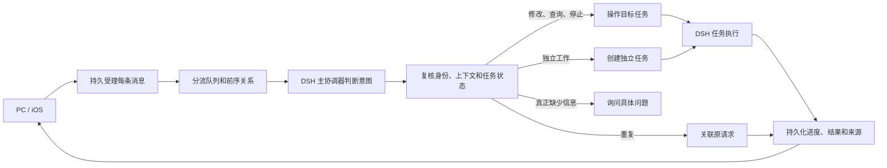

# Morde AI 助手对话与任务执行体验优化设计方案

日期：2026-11-13

依据 [AI 助手对话与任务执行体验需求](<Morde AI助手对话与任务执行体验需求文档.md>)，覆盖 PC、iOS 和服务端的消息受理、主 Agent 判断、任务执行与结果展示。本文重点设计新补充的连续消息判断；输入框布局、长消息分片及已有结果聚合等未改变的细节沿用[原设计](<Morde AI助手对话与任务执行体验设计方案.md>)，与新需求或本文冲突的关联判断和澄清规则以本文为准。本文描述拟议方案，不代表已实现或已验证。

## 1. 目标与现状

同一会话里，用户连续发送相同请求时，主 Agent 应识别为同一项工作：保留所有用户消息，关联同一个请求和任务，只执行一次并共享真实进度和结果。追问、修改、独立任务和明确要求重做仍按各自意图处理；只有关键信息确实不足时才问具体问题。

当前已有的基础可以继续使用：

- [消息受理](../server/internal/store/postgres/conversation_message_routing.go)持久化用户消息和分流记录，以客户端消息 ID 对同一次发送重试去重；每次主动发送仍是新消息。
- [主协调器](../server/internal/worker/cloud_dsh_coordinator.go)经 DSH 和模型网关判断消息；[分流动作](../server/internal/app/conversation_route_decision.go)已有 `new`、`update`、`status`、`stop`、`clarify`、`reply`，没有表达重复关联的动作。
- [动作提交](../server/internal/store/postgres/conversation_route_actions.go)会重新核对快照；不一致时目前通常改成通用确认。该校验能防止过期判断误操作，问题在于后续处理方式，不应删除校验。
- [任务消息投递](../server/internal/store/postgres/agent_checkpoint.go)会读取关联任务且 `delivery_status=pending` 的用户消息。把重复消息直接写入任务并保持待投递，会让 DSH 再次收到相同指令；把它直接标为已投递，又可能虚报 Agent 已消费。
- 分流模型调用和 DSH 检查点分别按原消息及上下文记录，不能在上下文变化后简单重放旧判断。截图没有提供当时的调用记录，无法仅凭截图断定是否创建了多个任务或工具为何不可用。

## 2. 总体结构与 DSH 复用



DSH 仍是唯一 Agent Runtime。按 [package.json](../runtime/morde-cloud-runtime/package.json) 和 [锁文件](../runtime/morde-cloud-runtime/package-lock.json)，当前接入的 Agent、Agent Loop、Session、检查点、工具和 MCP 组件为 `0.2.2-rc.1`；使用现有模型网关、授权、操作账本和任务恢复机制。本机已安装的 DSH Agent Loop 提供 `followup`、`steer` 和 `inject`，上游源码也有对应的消息队列与步骤边界；现有 [engine.mjs](../runtime/morde-cloud-runtime/src/engine.mjs) 已使用 `followup`/`inject`。它们不负责判断 Morde 的跨消息任务关系，也不能替代服务端权限、持久化及副作用围栏。本方案不增加插件或升级依赖，不新增另一套 Agent 循环；若后续接入其他插件，先按仓库约定核对版本、许可证和恢复行为。

主协调器继续负责理解意图、组织回答和协调任务，模型不能直接改任务状态。它自身的分流调用可以保持无工具；需要工具的工作须进入有相应授权和能力的 DSH 任务，不能因为分流调用无工具就直接判定整个系统没有工具。普通问答直接回复，不依赖云端电脑。

## 3. 消息受理与意图判断

### 3.1 先受理，再判断

1. PC 和 iOS 每次主动发送生成新的客户端消息 ID，先在所属服务实例、账号、会话的本地待发送队列保存，再使用既有消息接口提交；同一条消息网络重试保留原 ID 和内容。服务端在受理事务中写入消息、顺序及分流记录，确认后才显示已发送。
2. 发送和附件上传状态与分流、任务状态分开。附件尚未就绪时保留文字和附件状态，等待该消息的必要附件；其他消息不受影响。只有已明确确认账号没有任何云端模型配置时，iOS 提示配置并保留输入；模型状态未知、电脑离线或上一条消息未完成不能禁止发送。
3. 同设备保留前序消息标识和因果顺序；不同设备没有因果引用时，以服务端持久受理顺序为判断顺序。前序未到达且无法判断关联时先等待核对；确实可判定的独立请求仍可执行，不能为了等待前序把整个会话锁住。

### 3.2 主 Agent 的判断结果

在现有动作中增加内部动作 `join`，以一个已受理用户消息 ID 作为关联目标；目标任务 ID 由服务端从该消息的实际关联推导。示例：

```json
{"action":"join","target_message_id":"m1234567","task_id":"","question":"","reply":"","dependency_task_ids":[]}
```

`join`、其他动作及候选对象均是内部主协调契约，不是客户端可直接指定的权限。`join` 必须携带候选中的 `target_message_id` 且不携带任务控制参数；其他动作的该字段为空。`new` 增加布尔字段 `explicit_new`，仅表示模型判断用户明确要求另做或重新执行，供并发保护使用，不是新增操作授权。模型输出仍须解析、校验并经过服务端事务提交。普通自然语言、附件和历史均作为待分析数据，不能当作系统指令。

| 判断 | 判断依据 | 提交后的行为 |
| --- | --- | --- |
| 重复 `join` | 同一请求的目标、范围及关键条件一致，用户没有要求重新执行；同义表述也需识别 | 关联原请求，不创建任务、不修订、不向 DSH 再投递；共享原请求的真实状态和结果 |
| 追问 `status` / `reply` | 明确询问某任务进度或现有事实 | 用该任务的已确认状态或上下文作答，不中断或修改；结果尚未产生时如实说明 |
| 补充或修改 `update` | 用户确实改变了某项既有工作的要求 | 仅更新目标任务；需要改变进行中的工作时，在安全边界停止旧修订并继续新修订 |
| 独立任务 `new` | 目标或关键条件不同，且上下文表明是另一项工作；明确要求重做也属于新执行 | 创建独立任务；资源不冲突时并行，其他任务不受影响 |
| 停止 `stop` | 用户明确要求停止，且可确定目标 | 只请求停止目标，区分已请求与实际停止 |
| 澄清 `clarify` | 目标或执行所需条件确实不能从授权上下文确定 | 问具体缺少的信息，不修改可能涉及的任务 |

模型输入包含当前消息、授权的相关历史、可操作任务及其来源请求、必要的未完成前序消息；还应包括近期有确切结果的同会话任务，使任务在分流期间完成时仍能关联。候选至少限定服务实例、会话、owner 和 actor；项目会话中只能操作当前发起人的任务，其他成员已授权发布的内容只可作为背景，不能作为关联或控制目标。

判断时考虑项目、范围、显式电脑/工作区目标、附件、连接和其他会改变工作内容的条件。现有 `host_id`、`workspace_id`、`application_id` 在普通发送中可能只是新任务选择提示；按现有契约，只有明确的目标变更意图及 `change_task_target` 才能改动已有任务，不能把输入框的默认选择自动变成修改。附件必须能验证为相同的授权内容及相关元数据才可合并；仅同名或无法核验不算相同。用户明确说“重新分析一次”时不按重复处理。

不得只按主题相似、时间接近或最近任务自动合并。相同文字和可核验条件只用于下文的并发等待保护，不代替语义判断；模型对同义句的判断不是形式化保证，须覆盖真实模型验收。候选历史不完整时，不能假称已经看过全部历史或猜测缺失内容；对无法安全判断的请求保留等待/失败，或在确有业务歧义时问具体问题。

## 4. 重复请求的持久关联

### 4.1 数据与接口

在现有 `conversation_message_routes` 上增加可空的 `duplicate_of_message_id`，指向同一服务实例、owner、actor 和会话内的原始用户消息；为路由记录增加覆盖上述范围和消息 ID 的唯一约束，以复合外键和提交事务共同校验关联范围。它只表达同一请求的关联，不改原消息内容，不创建第二套消息表。

- 目标若本身是重复消息，沿已验证的关联链找到原始消息；事务内检查无自环、无环及权限有效。通常只允许关联较早受理的消息；同设备前序晚到时，只有服务端验证的前序链能证明其因果上更早，才允许关联较大的服务端序号。关联链不完整或循环时不得猜测。
- 重复消息的数据库 `conversation_messages.task_id` 保持为空，因此不会被现有任务 inbox 当作新输入，也不会改变任务的原始消息和结果来源。实际关联任务通过原始消息查询；已完成、失败、停止、等待审批等都以原任务的实际状态为准。
- 保留现有 `delivery_status` 枚举：重复消息在原请求尚未被 DSH 消费或直接答复前为 `pending`；原请求的输入经检查点确认或直接答复完成后同步为 `applied`；原请求投递结果未知时同步为 `unknown`。这里的 `applied` 表示该重复请求通过原请求得到应用，不表示重复文本又被投递了一次。状态变化及必要的账号变更记录在同一事务内写入。
- 在个人和项目对话的消息读取、按客户端 ID 对账及同步响应中，新增可选 `duplicate_of_message_id` 和 `related_task_id`；后者从原请求的当前任务映射得到，未产生任务时省略。原 `task_id` 仍表示实际投递到任务的消息，避免改变任务上下文、附件权限和结果来源的含义。字段读取重新校验当前访问权限，不向其他账号或项目成员暴露未授权任务。
- 原请求失败时，重复消息显示同一失败原因；原请求需要真实澄清或审批时，指向原有问题，不为每条重复消息创建确认。对重复消息的“重试处理”转到同一个原请求，仍检查原调用与操作是否可安全恢复，不重新投递或重建任务。

上述字段是对现有消息接口的可选扩展，不新增聊天接口或客户端状态枚举。需同步 [OpenAPI](../server/openapi/portal.yaml)、领域模型、消息读写和同步投影、PC 类型及 iOS 解码；旧客户端忽略新增字段，仍能解析现有状态。上线前验证旧客户端不会把重复消息错误当成可独立重试的任务。

### 4.2 原请求尚未完成分流

当主 Agent 确认新消息重复一条尚未产生任务的请求，先持久化 `duplicate_of_message_id`，保持可恢复的等待状态；不让等待关联的消息被普通分流队列反复认领。原请求完成分流后，同一事务或可恢复的后续投影使重复消息指向原请求和任务，并更新对应消息变更记录。原请求失败、需要用户参与或被停止时，重复消息跟随实际状态，不再分别发同一条提示。

为处理同一会话并发分流：

1. 模型在数据库事务外判断；提交时使用现有会话受理范围锁，重新读取消息、前序、候选任务、授权及修订。多个独立任务的模型调用和执行仍可并行，不在锁内请求模型或运行工具。
2. 对判为 `new` 的消息，若同范围内有因果上更早的相同请求，原文和可核验的关键条件完全相同、本次没有明确重做意图，且原请求仍在判断或执行，或是在本消息受理后才结束，则不立即创建新任务：前序仍在判断时等待；已有任务时重新提供原请求和最新任务状态并重判。这只是防止并发重复创建的窄保护；不对不同文字按相似度直接合并，也不让明确的重做请求被拦截。相同检查不得直接复用包含消息 ID 或前序 ID 的受理请求摘要。
3. 对模型判为 `join` 的消息，提交时核对目标存在、属于授权候选、请求条件没有冲突、原任务仍可被当前用户访问；若目标或状态已变化，按第 5 节重判。前序消息最终为普通文字答复时，只有该答复确实满足请求才复用；无工具的未完成答复不能当作项目分析结果。

若原请求此前被误分流为纯文字答复，服务端能确认它从未创建任务或执行工具，且用户再次请求的工作仍需执行、工具和授权均可用，则保留先前答复及账本，在原请求上开启新的分流尝试并创建唯一的实际任务。事务内把原消息绑定到该任务，将该消息及其重复消息的投递状态更新为 `pending`，待任务输入经检查点确认后再变为 `applied`；状态变化通知两端。此前已有执行或结果未知时不走此路径，先核实原任务状态，避免把补救变成重复执行。

跨端近同时发送时，服务端顺序为两个请求提供共同判断依据；同设备乱序到达按已验证前序恢复。不能只依赖现有最近八条消息窗口：待判断前序及其关联必须能进入候选；若候选因大小或权限无法完整取得，应保留消息并说明实际等待或失败，不能把缺失信息当作不存在。

## 5. 快照变化、重新判断与恢复

现有 `ApplyConversationRoute` 在模型判断后重新读取快照。保留授权、租约、目标和修订的复核；快照变化时不输出“继续原任务还是开始新任务”，而是让这条已受理消息基于新快照重新判断。无关状态变化也不能使旧判断绕过校验；如果新状态已足以确认原任务完成，使用已确认结果，不重复执行。

重新判断需要一个持久化的分流尝试号，而不是覆盖原调用：

1. 在原分流记录保存 `route_attempt` 和自动重试计数；在现有 `conversation_route_model_calls` 增加 `attempt` 并将唯一身份扩展为消息、阶段和尝试号，原记录迁为尝试 0。保留每个已结算判断和用量，不另建计费账本，并保留同一消息最多一个 `reserved`、`dispatched` 或 `unknown` 调用的约束。现有 `normal`、`missing_predecessor` 和结果回传阶段的含义不变。
2. 首次判断、进程恢复或同一调用重试使用相同尝试号、请求摘要、模型版本和调用 ID，复用已保存结果。只有旧调用已结算、或尚未派发的预留已安全释放，且需要根据变化后的上下文重新分类时，才在持锁事务中推进尝试号。
3. 将尝试号纳入 DSH 主协调会话及模型调用身份。迁移来的尝试 0 保持原会话 ID、调用 ID、提示词版本和摘要算法：优先恢复已保存的决定或与原输入摘要一致的检查点；无法核实原输入时保留待对账状态，不能用新提示词冒充原调用。尝试号大于 0 时使用新的稳定会话 ID 和调用 ID，并绑定新的上下文摘要。结果回传原有的重试身份继续保持独立语义。同一尝试恢复使用原身份；旧检查点、旧决定和账本保留，不能把旧上下文检查点当成新上下文恢复，也不能让旧结果提交新动作。
4. 已派发但结果或用量未知的调用先按现有账本对账，不能换新 ID 盲目重发；同一消息等待期间不阻塞无关任务。模型返回格式无效但调用与用量已知时，记录真实结算并有限次重试；这属于处理失败，不是用户意图含糊。
5. 连续三次因状态冲突或模型输出无效无法取得可提交判断时，停止自动重试并记录现有的分流失败原因，允许用户在状态可确认后重试。自动重试计数持久化，用户显式重试时重置计数，但尝试号继续递增且未知调用仍须先对账。不得永久显示处理中，也不要求用户回答原任务/新任务的通用问题。

模型输出无效、前序不可用和旧任务不可恢复分别显示可理解的等待或失败原因。真正的歧义例如两个任务都可能是“修改那个”，才询问“要修改哪项任务”；在得到答案前不停止任何候选任务。

## 6. 任务、工具和结果

- **修订与停止。** 沿用 `task_revision_intents`、任务修订号、租约和 DSH 检查点。确需修改已执行工作时，只停止目标任务及其子执行上下文；核对在途操作，再按因果顺序应用已受理的修改。已确认操作和产物保留，旧修订迟到输出不能覆盖新修订。结果未知的有副作用操作先核实，不盲目重复；停止请求确认前不显示已停止。
- **工具选择。** 主协调器把明确需要查看、搜索、读写或操作的请求交给 DSH 任务；执行端根据用户授权、所选模型工具能力及实际可用工具集合调用相应能力。云端电脑和 Workspace 只在任务确需使用时解析；未选择电脑不等于不能使用已授权的搜索或其他工具。项目位置、权限或工具确实不可用时说明具体原因，不声称已经查看。不能因为出现仓库名就假定其地址、公开性或访问权。
- **进度与结果。** 继续使用任务事件、持久化消息和现有结果来源记录，主 Agent 组织有证据的回复；重复消息不单独触发完成消息或结果聚合。任务已完成但结果尚在整理时显示真实状态；结果可以在满足当前请求且来源、授权、修订仍有效时复用，用户明确重做或需要新数据则按新要求执行。重复消息应始终能定位原请求及其结果，不复制结果作为第二个任务产物。
- **审批和隔离。** `join` 本身不增加权限，也不继承已撤销的访问权；原任务的工具调用继续独立检查授权、审批和操作账本。不同会话、不同账号或同项目不同发起人不因内容相同自动关联；个人历史跨会话使用仍按已有授权规则。

## 7. 客户端与状态展示

PC 的 [Assistant](../web/portal/src/routes/Assistant.tsx)、[消息状态](../web/portal/src/app/message-status.ts) 和 [发送队列](../web/portal/src/app/message-outbox.ts)，以及 iOS 的 [对话实现](../clients/nanoMuse/android/src/ios/Morde/MordeApp.swift) 和 [消息队列与状态投影](../clients/nanoMuse/android/src/ios/Morde/MordeCredentialExpiry.swift)，读取同一服务端消息和任务状态：

| 状态来源 | 用户看到的状态 |
| --- | --- |
| 本地未确认受理 | 待发送、发送中、待核对或发送失败；保留内容 |
| 服务端已受理、前序尚未确定 | 已发送，等待处理；不是等待用户确认 |
| 已关联，原任务排队或执行 | 已关联到同一请求，等待处理或正在处理 |
| 原请求需要审批、补充、失败或停止 | 展示原请求的实际状态及对应入口，不重复插入问题 |
| 任务完成、结果整理中或已发布 | 分别展示真实状态及同一份结果；不因为消息关联就宣称完成 |

客户端不得按文本去重或隐藏用户气泡。刷新、断网恢复、跨端打开和消息分页时，按消息 ID、关联信息及任务事件恢复，关联目标不在当前页时通过服务端提供的关联信息查询；本地消息不能跨服务实例或账号重放。服务端只在确有阶段变化、结果或用户参与需要时写进度，避免每条重复消息都生成一条助手回复。

## 8. 变更边界与验证

涉及的主要边界是：主协调模型提示和动作解析、分流 worker 与事务提交、消息路由关联和唤醒、模型调用账本及协调检查点身份、个人/项目消息与同步投影、PC 和 iOS 的消息展示与重试。现有 `task_revision_intents`、任务 inbox、结果聚合与来源查询要验证重复消息不会进入任务输入或成为新的原始来源；任务审批、检查点、取消和恢复继续使用现有权威实现。

新增迁移只扩展既有记录：历史记录的关联为空、尝试号为 0；不根据历史相似文本事后猜测并合并任务，不删除已发送消息、结果或账本。包含未处理消息、运行任务及已派发/未知模型调用的升级与回退须保留原记录；无法安全回退时阻止回退并说明，不清空数据。接口、迁移、权威公共约定和测试在实际开发时同步更新。

验收至少覆盖：

1. PC 和 iOS 在同一会话各自及近同时连续发送四条相同或同义项目分析请求，分别覆盖首次仍在分流、任务已运行、提交后任务先完成；四条消息均可见，只产生一个任务和一次实际分析，一份最终结果可追溯，不出现通用确认。两个设备看到一致状态。
2. 两个 worker 并发判断 `new`、结果按相反顺序提交，或服务在关联提交前后重启：重复请求最多产生一个任务；不同项目、不同附件、明确重做和独立工作不被错误合并。关联的重复消息不进入 DSH inbox，也不改变原任务消息或结果来源。
3. 判断后任务状态或修订变化：旧动作不能提交，已结算调用以新尝试和新上下文重新判断；未派发可安全释放，已派发或未知调用不重复请求。升级前尝试 0 的调用 ID、提示词、摘要和检查点仍能按原身份恢复；无法核实原输入时不伪造恢复。崩溃恢复、租约过期、连续冲突达到上限及重试时，账本、检查点和可见状态一致。
4. 追问进度不停止任务；连续修改只作用于目标且按因果顺序生效；独立任务并行；两个目标确实无法区分时提出具体问题。原任务失败、停止、等待审批或结果未知时不伪报完成、不重复副作用，重试重复消息仍落到原请求。
5. 可用工具和授权存在时实际读取或搜索项目并返回有依据的结果；无电脑但其他工具可用时仍可工作。若原请求只产生过无工具的文字答复、未创建任务，重复请求应保留旧答复并进入一次实际任务，不能把旧答复当作结果。权限撤销、工具不可用、上下文不全、附件不同或模型不支持工具时如实反馈，不能声称完成或绕过审批。
6. 验证 iOS 非空输入、输入法组合、明确无模型、网络断开、账户切换、附件上传和消息重试；PC / iOS 刷新、分页和跨端恢复不丢消息，不把处理失败当成发送失败；个人会话、项目成员和不同账号的数据均隔离。

这些验收应结合现有 Go 单元及 PostgreSQL 集成测试、DSH 恢复测试和 PC/iOS 客户端测试执行；语义识别再以实际可用模型和工具做端到端验证。本文尚未执行这些测试，也不将模型的判断能力等同于绝对正确。
