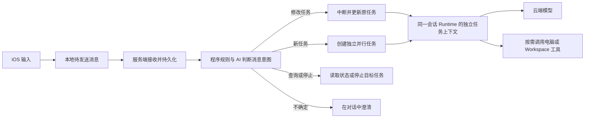

# Morde AI 助手对话与任务执行体验设计方案

日期：2026-11-07；最近更新：2026-11-09（补充消息与活动任务的判定方式）。依据[对话与任务执行体验需求](<Morde AI助手对话与任务执行体验需求文档.md>)。本文是目标设计；消息发送、自动分流和工具按需使用与旧方案不一致时，以本文及需求为准，其他能力沿用[现有 Agent Runtime 设计](<Morde-Agent-Runtime与AI能力设计方案.md>)。

参考：[用户提供的 Muse 对话截图](<参考图/Muse-连续消息与分段回复-f6460447.jpg>)。图中连续保留了两个用户问题，助手在一条消息中分段回答，先回答后一个提醒问题，再补充解释前一个问题；上方还有已选择的选项卡片。截图只展示界面效果，不能据此判断后台是否并行、提醒是否真正创建或其内部实现。

## 1. 范围与现状

iOS 负责输入、消息暂存和状态展示；服务端负责消息持久化、关联判断、任务管理与云端 Agent 执行。现有实现将模型列表、任务加载、电脑和 Workspace 状态合并为发送门禁，同一账号也只能有一条未确认发送；消息接口还要求客户端预先选择新任务或追加任务。要满足需求，需先接收消息，再判断如何处理，不能只修改按钮样式。

仍以 Morde 为账号、会话、消息和任务的业务权威。**唯一 Agent Runtime 确定使用 DSH**；当前接入版本为 `0.2.2-rc.1`，复用其 Agent 循环、会话、工具调用和检查点。新增官方插件需要统一版本时，按[运行时实施清单](./实施/Morde-Agent-Runtime与AI能力实施任务todo清单文档.md) T17 先验证兼容、恢复及回退，再决定升级。Morde 负责身份、消息分流、任务修订、授权和持久化；模型仍通过 Morde 模型网关选择用户配置的 GPT、DeepSeek 等模型。

每条对话按需启动或恢复一个活动的逻辑 Runtime 实例，以服务实例和对话 ID 保证唯一；同一实例内的并行任务分别使用自己的 DSH 会话、执行上下文、检查点和取消控制。多个逻辑实例可复用物理进程或运行环境，但必须保证任务、授权和数据隔离；隔离条件不足时使用独立进程。现有实现按账号复用 Runtime，需改为上述会话范围；共享项目对话仍按每个任务的发起人分别校验权限。

## 2. iOS 发送与状态

- 输入有非空白文字时发送按钮可点击。点击时先按系统输入法规则提交组合文字；只有服务端已明确确认当前账号没有任何个人或平台云端模型配置，才提示前往配置并保留输入。模型状态未取得、旧缓存失效、模型暂时不可用或不支持工具时，均不按“未配置”处理。
- 其他情况先把文字、附件引用、所属服务实例/账号/会话、客户端消息 ID 和顺序安全写入本机待发送列表，成功后清空输入框并显示消息。每次发送独立保存；一条请求未返回不限制发送下一条。写入本机失败时保留输入并提示。
- 超过现有接口长度上限的文字按同一消息分片上传，每片以消息 ID 和片序去重，服务端校验完整内容后才确认受理；不能静默截断或拆成多个任务。分片可按原消息 ID 恢复，其他消息仍可发送；模型上下文不足作为消息受理后的处理问题提示。
- 在对应消息旁显示“待发送、发送中、结果待确认、发送失败或已发送”；只有服务端确认持久受理才显示“已发送”。Agent 的“等待处理、处理中、等待确认、失败、完成”单独显示。重试沿用原消息 ID；响应丢失时先查询或以相同请求重放确认，不能产生重复消息或任务。
- 断网、服务不可达或登录过期时仍能发送到本机待发送列表；恢复网络或原账号重新登录后继续发送或允许重试。原账号或会话暂时无法确认时，保留内容并标记待确认，核实归属后再提交；切换账号或服务实例时不能把待发送内容带到其他范围。附件上传中先保留文字和附件状态，不静默丢弃附件；确需附件的执行等待附件就绪，其他消息和任务不受影响。

### 对话界面

参考截图的阅读方式：白色背景，用户消息右侧浅蓝气泡，助手消息左侧浅灰气泡；连续发送的消息分别保留，助手长回复按话题分段，时间按需要居中显示，不在每个助手气泡重复显示名称。顶部保留 Morde 头像与菜单，输入框位于现有四个功能入口之上；滚离最新消息时提供回到底部按钮。截图中的电话、礼物及第五个入口不自动成为新功能。视觉细节沿用[现有 Muse 风格方案](<Morde参考MetaMuse手机端视觉与交互设计方案.md>)。

顶部栏、输入框、键盘和底部导航均按安全区域布局，不遮挡首尾消息；键盘出现时输入框随之上移。按钮触控区域至少 44 × 44 pt，并适配系统文字大小。选项卡可用于澄清或确认，选中只表示用户作出选择，不代表后续操作已经成功。

## 3. 服务端消息接收

将现有 `POST /api/conversations/{id}/messages` 统一切换为自动分流，个人及项目对话调用方同步迁移，不保留 `new` / `append` 两套发送逻辑。请求携带客户端消息 ID、文字、附件状态及可选的明确引用；同一 ID 同时作为稳定的幂等键。鉴权和会话归属检查通过后，在一个事务内写入消息、会话顺序、幂等记录和待分流记录，再以 202 返回消息 ID、顺序及“待分流”状态；此时任务 ID 可以尚未产生。接收阶段不检查电脑、Workspace 或模型运行健康状态。后台按消息 ID 认领并恢复待分流记录，分流结果、目标任务及中断意图原子提交，重启或重复认领不产生重复任务。

本地待发送消息在提交、对账、分片及附件写入时携带原账号和服务实例标识；服务端将原账号与该次请求的鉴权身份比较，并在写入事务内核对服务实例。待发送消息触发的新会话创建也使用同一围栏和稳定幂等键，避免其他标签页切换账号或服务后将原消息写入错误范围。

附件使用稳定的客户端附件标识占位；上传完成后以该标识幂等关联服务端文件，上传失败保留失败状态。文字受理与附件完成分别确认并展示，不能把附件仍在上传的消息显示为完整交付；重试消息时不因附件稍后完成而改变原请求的身份或内容。

服务端能明确确认没有配置云端模型时返回配置提示；若消息已在本机暂存，则保留该条消息，配置后可重试。模型状态未知或已配置但调用失败时仍先受理消息，后续将处理失败或等待原因记录在对话中。自动分流通过服务能力声明和 OpenAPI 契约启用，接收、分流和任务隔离都具备后才声明支持；服务尚不支持时，iOS 保留待发送消息并提示服务待升级，不冒充成功或回退到其他发送逻辑。

复用会话消息表和事件，不建立第二套对话权威；按服务实例、发送账号和会话约束客户端消息 ID 唯一，增加分流状态和目标任务/修订信息。列表或查询接口可按客户端消息 ID 对账，同一键和相同内容返回原结果，不同内容返回冲突。现有的 Agent 消息消费状态与客户端到服务端的发送状态分别保存，避免把“已受理”误当成“Agent 已处理”。

## 4. 关联判断、任务更新与并行

### 程序与 AI 的分工

**程序只直接处理已有结构化目标；自然语言里的任务关联由 AI 判断。** 程序不根据关键词、话题相似度或消息时间猜测关联，也不让 AI 直接控制任务。判断发生在消息受理后，不能成为发送门禁；无需为此训练新模型。

### 如何判定消息与活动任务的关系

判断分为“程序确定边界、AI 理解语义、程序执行校验”三步，不能把自然语言关联简化成规则匹配，也不能把任务控制权交给 AI：

1. **先形成受限候选集。** 消息先按原账号、服务实例和会话完成持久受理；后台只向分类模型提供当前消息、必要的近期对话，以及发送者有权操作的活动任务摘要。个人会话只包含该用户的任务；项目会话中的可操作任务仍限定为发送者发起的任务，其他成员的已发布结果只能作为经服务端证明的共享上下文。
2. **程序只在请求已明确结构化时直接定位。** 点击任务卡上的停止、回答特定澄清或审批卡片等操作，携带服务端绑定的任务 ID，可由程序按该 ID 处理。普通文字即使带有 `reference_task_id`，它也只限定可关联的目标；“修改、查询、停止还是另起任务”仍由 AI 理解。不能仅因某任务最近运行、名称相似或消息到达较近，就自动把文字关联到该任务。
3. **AI 只分类自然语言意图和关系。** 模型在候选集及授权上下文内判断消息属于 `update`、`new`、`status`、`stop` 或 `clarify`，并在需要时提出一个候选任务 ID。多个任务都可能匹配、目标已结束、前序消息尚未核实或模型无法确定时，应返回澄清；程序不以“最近的任务”兜底。
4. **程序核验后才改变状态。** 校验意图格式、发送者权限、目标是否属于候选集、任务当前状态、目标引用和修订号。全部通过后才更新或停止任务、创建并行任务或返回状态；校验失败时保留已受理消息并澄清/重试，不中断任何已有任务。

| 用户输入 | 关系判断 | 程序动作 |
|---|---|---|
| 在任务卡上点击“停止” | 结构化任务 ID 已明确 | 校验权限和状态后只停止该任务 |
| “把刚才的预算改成 200” | AI 根据当前消息、上下文和候选任务判断是否为修改 | 校验目标及修订后中断并更新该任务 |
| “顺便查一下天气” | AI 判断为独立请求 | 创建新任务，与已有任务并行 |
| “现在做到哪一步了？” | AI 判断为状态查询 | 读取目标任务状态，不中断执行 |
| “把那个改一下”，且存在多个活动任务 | AI 无法可靠确定目标 | 保留消息并询问用户，不选最近任务 |

判定按以下顺序进行：

1. **已有明确操作时由程序路由。** 例如用户在界面选中某个任务后点击“停止”，或回复服务端已绑定目标任务的澄清/审批卡片。程序依据受信任的结构化操作和任务 ID 直接执行，不需要 AI 再猜。
2. **普通文字由 AI 做语义分类。** 服务端将新消息、必要的近期对话和用户有权访问的活动任务摘要交给已配置模型。模型返回处理意图和候选目标任务 ID；AI 不能确定目标或用户意图（如“把那个改一下”）时返回澄清。用户从“补充任务”入口发送时，客户端以 `reference_task_id` 标记明确目标；AI 仍判断新文字属于修改、查询还是新任务，程序再校验分类目标没有偏离这个引用。
3. **程序校验后才执行。** 程序检查模型输出格式、候选任务范围、权限、任务状态和修订号，再执行中断更新、创建并行任务、查询或停止。AI 只提出分类结果，不调用工具、不改变任务状态；无效或多义结果转为澄清，已有任务继续运行。模型暂时不可用时，消息仍保持已受理和待分流状态，不用关键词或相似度规则兜底猜测。

分类结果至少包含 `update`（修改任务）、`new`（新任务）、`status`（查询状态）、`stop`（停止任务）或 `clarify`（需要澄清）之一；需要关联任务时同时返回任务 ID。可用普通文本 JSON 并由程序解析，不要求模型支持工具调用或专有结构化输出。文本中提到的任务名仍由 AI 判断是否指向活动任务；没有活动任务且不存在待核实的前序消息时，可直接创建新任务。涉及已完成任务时结合授权的历史上下文继续处理，不伪报中断。分类只使用必要的授权上下文并遵守模型授权和预算，AI 自报置信度不能替代程序校验。

例如，正在整理苹果公司财报时，“只看收入和净利润”可判断为修改该任务；“顺便查一下苹果公司的股价”可判断为独立新任务；“现在做到哪一步了”是查询状态，不中断执行。“把那个改一下”无法确定目标或修改内容时，应先询问。模型判定的准确率和耗时需使用实际消息及歧义场景验证。

Hermes Agent 的官方消息文档描述的是按配置选择忙碌消息策略：默认重定向当前回合，也可配置为排队或 steer；这是程序根据模式处理消息，不是 AI 自动判断每条消息与活动任务的语义关系。Hermes 的后台任务则通过显式 `/bg` 创建独立会话。Morde 借鉴其不中断收消息、显式排队/引导及独立后台任务等运行机制；“自然语言是否属于现有任务”的语义分类属于 Morde 新增设计。参考：[Hermes 消息策略](https://github.com/NousResearch/hermes-agent/blob/main/website/docs/user-guide/messaging/index.md#queue-vs-interrupt-vs-steer-busy-input-mode)、[Hermes 后台会话](https://github.com/NousResearch/hermes-agent/blob/main/website/docs/user-guide/messaging/index.md#background-sessions)。需求文档中的源码版本和实现定位见[Hermes Agent 源码参考](<Morde AI助手对话与任务执行体验需求文档.md#hermes-agent-源码参考>)。

- **修改目标任务：** 将新消息关联到目标任务并递增任务修订号，向该任务的旧执行发出中断；确认旧执行停止且在途工具操作达到可核实的安全状态后，用原任务上下文、已完成结果和新要求启动最新版。修改后的操作重新校验授权和审批，旧审批不能自动扩大到新操作；不能用单纯排队或只追加提示词代替中断重执行。
- **新任务：** 创建新的任务 ID 和独立执行上下文，在资源正常时与已有任务并行；停止、失败或修改一个任务不影响其他任务。共享电脑或 Workspace 的实际工具操作仍遵守各自授权和冲突控制。
- **查询或停止：** 查询直接读取并返回目标任务的真实状态，不中断任务；停止只作用于用户指定的目标，按安全边界确认停止，不自动重新执行。
- **并发与恢复：** 分类在事务外进行，提交结果时重新核对任务状态和修订号；目标发生变化时重新判断或询问，目标已结束时按历史上下文继续，不伪报中断。连续关联修改按顺序合并到最新版，每条消息仍单独保留。任务执行使用任务 ID、修订号和现有租约/代次进行隔离；工具派发与结果提交均校验当前版本，旧版本的迟到结果不能覆盖最新版。

同设备的消息保留本机顺序及前序引用；服务端可先受理乱序到达的消息，关联修改在目标任务内按顺序生效，无关任务不等待前一条响应。前序消息尚未受理且无法确定关联时，等待核对或请用户确认，不猜测目标。跨设备无因果关系的消息以服务端持久化顺序为准，明确引用优先。对于已经派出、不可中断或结果未知的外部操作，先核实或向用户提示；不能仅凭本地中断状态重复执行已有副作用。

### DSH 任务修订与恢复

1. **保存修订意图：** 消息受理后，分流服务将关联修改及其顺序持久化；在同一事务内更新目标任务的期望修订号并记录中断意图。任务进入“调整中”，不把修改任务当成用户停止任务；旧修订即刻不能再派发新操作或发布最终结果。
2. **停止旧执行：** 仅向目标 DSH 任务发出取消，等待该任务及其子会话的停止确认，并核对在途工具操作。已确认完成的操作和产物保留；结果未知的操作先核实或提示用户，不自动重复。其他任务继续执行。
3. **启动新修订：** 在服务端事务中固定本次修订要使用的已确认检查点、历史结果和按顺序归属该任务的修改消息，再由持有有效租约的唯一执行者恢复 DSH 会话。停止期间收到的关联修改合并到本次快照；新修订开始后再收到的关联修改进入下一修订。新要求必须在恢复后的首次模型请求前进入上下文。
4. **提交结果：** 模型输出、工具派发、进度和结果均校验任务 ID、修订号及租约/代次。旧执行的迟到结果不能覆盖新修订；审批针对新操作重新校验，重复恢复不重复发布消息或已确认的操作。

当前 DSH 适配器在取消后会清空待处理 inbox，并拒绝以 `aborted` 结尾的检查点恢复；恢复流程还可能额外追加一次通用继续指令。这些都是本次需要修改的接入问题。修订消息以 Morde 服务端的持久记录为准，不能只保存在 DSH inbox；允许恢复前必须验证停止证明、检查点和工具账本。启动前先备齐本次修订的全部消息，再唤醒 DSH，避免第一条消息使模型提前运行；每个恢复代次只安排一次启动输入，不额外追加通用继续请求。重启后的再次接管仍需依靠租约、修订和操作账本去重。上述机制需通过有工具副作用、连续修改及重启的测试后才视为完成。

### 相近完成的结果合并展示

- 按用户确认的方式：无关任务仍独立并行，仅将相近时间完成的结果组合成一条助手消息，不合并任务本身。有多个并行任务时先展示各自进度；第一个结果就绪且其他任务仍在进行时，暂缓展示该最终回复，建议等待最多 **2 秒**，收集同一会话内随后就绪的结果。2 秒是本方案的可配置初始值，不是截图可证明的 Muse 行为。没有其他进行中的任务时立即回复，超过窗口的任务各自完成后再回复，不能等所有任务结束；需要用户立即处理的澄清、审批等交互及时展示。单任务按原有方式流式回复。
- 一条回复内按任务分段，内容可以按完成顺序组织，例如先说明提醒设置结果，再以“另外”回答另一问题。组合已确认的任务结果，不凭空补充事实；某项失败就说明该项失败，不能将整条消息都描述为成功。已经向用户展示的流式最终文本不为凑合并而重写或重复发送。
- 服务端持久化一条组合消息及各段的来源：用户消息、任务 ID、任务修订和结果或事件 ID。沿用任务各自的状态、事件和产物，组合前重新校验修订；已被中断或替代的旧结果不能混入。组合及来源关联以幂等方式提交，服务重启、重连或重复事件不会漏发或重复展示。现有消息只有单个可选 `task_id`，需扩展多来源字段并统一客户端消息视图；处理任务快照时避免同一结果出现两次。
- 流式输出的第一段即以稳定消息 ID 和会话序号持久化，后续只追加同一消息；中断时保留已显示文本并标记中断，完成时以任务修订和结果事件核实后沿用原消息。用户修改任务后，旧片段保持原顺序，新修订使用独立消息；未完成片段不作为已确认结果提供给后续模型。模型的流式能力需对当前连接版本单独验证，检查会产生一次模型调用；能力未知或不支持时仍正常使用非流式回复，不因已派发请求盲目重试。可能调用工具的流式回合还需验证工具事件，并将调用工具前的文字作为工作进度处理，不能误标为最终答复。

## 5. 云端模型与工具

由已认证的模型配置接口区分“已配置、明确未配置、未知”，不通过模型健康或工具能力推断是否配置；状态按当前账号和服务实例缓存，配置变化或缓存失效后重新确认。已配置但暂时不可用，在消息受理后显示处理失败或等待，不能在输入前拦截。仅支持文字的模型走同一 Agent 引擎的文字路径，不因缺少工具调用能力阻止普通对话。

电脑和 Workspace 只作为工具目标。普通消息接收、关联判断和不需要它们的模型调用不读取其可用状态，也不预先绑定 Workspace 快照；Agent 确实要调用时才解析目标并校验权限、控制权和状态。用户要求的目标不可用时在对应任务中说明，不静默切换其他电脑或运行环境。

任务使用本会话上下文及当前用户有权访问的个人资料和历史；其他并行任务的未完成内容不当作本任务指令，已删除或撤权内容不能继续读取。沿用服务端任务事件、检查点和产物记录：进度与结果按任务、修订及事件序号显示并去重，关闭页面不停止已受理任务，重连后按游标或快照恢复；只有确认完成的操作和文件才显示为成功。PC 与 iOS 读取同一份服务端记录。

截图中的价格提醒仅作为交互例子。若用户要求定时提醒，应复用现有调度和通知能力，并检查具体提醒所需的数据来源和授权；只有服务端确认实际创建成功后才可回复“已设置”。条件不足、需澄清或创建失败时如实说明，不能把选中卡片当作创建成功，也不据此新增自动交易行为。

## 6. 验证重点

- 在有文字、输入法组合、长文本、无模型配置、模型不可用、断网、登录过期和旧服务版本等场景，验证按钮可点击、内容保留及发送状态真实；分片恢复和响应丢失重试不会重复或截断。
- A 运行时发送关联修改，验证仅 A 中断并按最新要求重启；连续修改和乱序送达保持原有顺序，旧版本迟到结果不能覆盖新版，未知副作用不重做。
- A 运行时发送无关 B，验证 B 在 A 结束前开始，停止 B 不影响 A；关联不明确时只询问，不误停任务。重启服务和跨端重连后可恢复各自记录。
- 验证同一话题的修改、独立新请求、状态查询及多任务歧义能够区分；模型返回无效目标、判断失败或暂时不可用时，消息仍保留，已有任务不被误停，并显示澄清、等待或重试状态。
- 电脑或 Workspace 不存在、离线或无权时，普通对话仍可进行；实际调用失败才提示对应工具问题。验证单个会话 Runtime 内的并行、任务级停止与隔离，以及文字模型无工具调用的路径。
- 两个无关任务在合并窗口内完成时，保留两条用户消息并展示一条分段回复；来源和各任务状态可核对，停止其中一项不影响另一项。另一项超过窗口时先回复已完成项，稍后单独回复剩余项；失败和等待确认分别如实显示。
- 验证组合过程中修订更新、服务重启、重复事件、跨端重连和已显示的流式内容，不产生过期、丢失或重复回复；提醒只有在真实创建成功后才显示“已设置”。
- 在不同屏幕宽度、系统文字大小和键盘状态下检查气泡、输入框和导航，确保文字可读、按钮可触达，消息不被遮挡。
