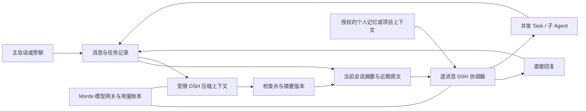

# Morde AI 对话上下文压缩与长期记忆设计方案

日期：2026-11-10。本文根据当前工作区源码及本地 DSH 上游 `fcc0ad462172522aaf5c93a7b2e01f6b9f0b0159` 快照编写，是**目标设计**，不是已交付功能或实施任务清单。项目代码和既有设计可能继续变化，实施前须重新核对。

本文补充 [Agent Runtime 与 AI 能力设计](<./Morde-Agent-Runtime与AI能力设计方案.md>)、[对话与任务执行体验设计](<./Morde AI助手对话与任务执行体验设计方案.md>)及 [Muse 系统提示词调整设计](./Morde基于Muse系统提示词的Agent-Runtime调整设计方案.md)。实现如果改变跨模块合同、状态机、数据库或 HTTP API，须在同一变更中同步 [公共约定](./实施/00-总览与公共约定.md)、[OpenAPI](../server/openapi/portal.yaml)、实现和测试；本文不另立第二套协议权威。

## 1. 目标和边界

1. 每个账号在同一服务实例中有一个当前个人主会话，同时可以拥有多个旁聊。主会话和旁聊都支持持续接收消息、恢复历史、自动压缩和按需找回原文；压缩不创建新的用户可见会话，不改变主会话指针。
2. 会话摘要按会话隔离；长期记忆是经授权保存的账号数据，可以在允许的个人会话中使用。项目对话按项目、成员和任务发起人权限处理，不自动读取个人记忆。
3. 同一会话内可以继续发起独立任务。消息先持久受理，再异步分流；任务、子 Agent 和不同会话仍可并发。压缩不能拿着数据库事务等待模型，也不能阻塞消息接收。
4. DSH 继续是唯一 Agent Runtime，模型调用走 Morde 模型网关。优先复用 DSH 插件及现有 Morde 会话、权限、任务、记忆、检查点和账本，不新增另一套 Agent 循环。
5. 原始消息、任务记录和操作回执仍是事实来源；摘要是有损的上下文投影。压缩不得删除原始聊天记录，也不能把模型生成的摘要当作操作已经成功的证据。

“一直聊天”指会话不因历史轮数增长而必然触及固定上下文或单个 DSH 恢复日志上限；它不表示模型能逐字记住全部历史，也不取消单条消息、模型窗口、授权、存储和预算限制。

## 2. 当前代码基线

| 方面 | 当前实现与限制 |
| --- | --- |
| 主会话 | `account_main_conversations` 按服务实例和账号保存至多一个主会话指针；其他 Conversation 仍可存在。见 [主会话迁移](../server/migrations/00104_main_conversation.sql)。 |
| 路由协调器 | 当前 DSH 协调器以服务实例、账号、会话和**消息 ID**生成独立 session，做无工具的消息分类或简短回复，并非同一条长期运行的 DSH 对话。见 [协调器身份](../server/internal/worker/cloud_dsh_coordinator.go)。 |
| 对话历史 | 当前路由快照只取符合条件的最近 8 条、单条不超过 4 KiB 的消息；新任务的历史快照最多 128 条、约 32 KiB。这是截取，并非摘要压缩。见 [路由历史](../server/internal/store/postgres/conversation_route_actions.go)和 [任务历史快照](../server/internal/store/postgres/task_conversation_context.go)。 |
| DSH 组件 | [package.json](../runtime/morde-cloud-runtime/package.json) 和锁文件固定上游 DSH 包 `0.2.2-rc.1`；实际插件列表尚未挂载压缩器或 token meter。Morde 的 `ENGINE_VERSION` `0.2.0-rc.2` 是检查点/协议兼容标识，不等于上游包版本。 |
| 持久化恢复 | DSH 压缩只替换模型可见的历史投影，不删除底层事件；Morde 当前恢复限制为 8 MiB、100,000 个事件，并拒绝带 seed 的检查点。见 [Runtime 恢复逻辑](../runtime/morde-cloud-runtime/src/engine.mjs)和 [DSH session 说明](../project/deepseek-harness/packages/core/session/README.zh.md)。 |
| 记忆与检索 | 个人资料、SOUL、目标和授权记忆可进入任务上下文，并有记忆设置和版本证明。现有跨个人会话历史检索会排除当前会话、项目会话及部分不合条件的记录；不可当作本会话的完整历史检索。见 [个人上下文](../server/internal/app/cloud_dsh_personal_data.go)和 [历史检索](../server/internal/app/cloud_dsh_history_tools.go)。 |
| 上限与错误 | 网关按 UTF-8 字节和请求项开销估算输入预留，并以 `128 << 10` 为当前内部上限；这不是模型实际 token 窗口。上下文溢出时当前会保留原文并提示用户缩短内容。 |

已有代码或插件不等于真实部署已开启或完整验收。本文所述新增能力在实现与验证前均为待接入。

## 3. 总体方案

产品中的 Conversation 是持续聊天的唯一业务身份；一个聊天可以在不同时间使用多个内部 DSH 执行上下文。继续保留现有逐消息协调器及每个 Task 的独立 DSH Session，另按 Conversation 维护有版本、有来源的摘要。达到预算时在同一个 DSH Runtime 内建立**短期、有界、无工具**的压缩上下文，复用 DSH 压缩服务；压缩完成后只让后续处理读取已提交的摘要版本。

这比把每条聊天强行改成永久不分段的单个 DSH Session 更贴近现有消息并发和恢复模型，也避免一个不断增长的 DSH 原始事件日志最终超过恢复上限。短期压缩 Session 是同一聊天的内部维护上下文，不是第二种 Runtime、第二个用户会话或聊天历史权威。单个长期运行的 Task 仍有自己的事件和恢复上限，其工具结果压缩需另行接入与验收。

## 4. DSH 可复用能力

| 组件 | 本方案决定 | Morde 需要做的适配 |
| --- | --- | --- |
| [`dsh-compaction`](../project/deepseek-harness/packages/compaction/compaction/README.zh.md)、[`dsh-compaction-basic`](../project/deepseek-harness/packages/compaction/compaction-basic/README.zh.md) | 复用压缩服务、范围选择、压缩事件、失败和取消机制。首期由 Morde 判断压力并程序化调用 `compactNow`，不要求用户输入命令。 | 把已授权、带来源的消息批次装入有界 DSH 上下文；通过上游 `summarize()` 扩展点适配日常对话摘要，模型调用和检查点仍走 Morde 围栏。 |
| [`dsh-token-meter`](../project/deepseek-harness/packages/llm/token-meter/README.zh.md) | 复用会话压力估算和压缩计量。 | 与 Morde 网关自己的输入预留分别校验；DSH 文本启发式并非精确分词，中文可能低估，须保留余量。 |
| 已接入的 session、persistence、projection、checkpoint policy | 继续使用 DSH 会话语义及 Morde 持久化。 | 严格验证 `compaction/start`、`compaction/summary`、替换消息和 `compaction/end` 的来源、顺序与恢复；不能仅放宽现有校验。 |
| [`dsh-compaction-tool-result-pruner`](../project/deepseek-harness/packages/compaction/compaction-tool-result-pruner/README.zh.md) | 第二阶段评估，用于长任务的超大工具结果。 | 当前 [Morde 任务检查点校验](../server/internal/worker/cloud_dsh_checkpoint_history.go)只接受原始工具结果追加；需保留原始调用和回执，验证安全替换与恢复后才能开启。 |
| `dsh-command-compact`、`dsh-compaction-image-offload` | 首期不接 UI 命令和图片省略。 | 如后续需要，再分别验证命令体验、附件授权、图片引用及恢复。 |

本地上游上述压缩包的源码元数据为 `0.2.2-rc.1`、MIT；这不证明发布包和 Morde 当前组合已经兼容。实施前须核对 npm 发布包、直接及传递依赖、许可证和锁文件，并在固定版本上验证。DSH 上游默认摘要提示词偏向英文编程任务；Morde 应通过 `summarize()` 扩展点提供适合个人与项目聊天的摘要指令，而不是复制整套压缩引擎。相关源码见 [摘要器](../project/deepseek-harness/packages/compaction/compaction-basic/src/summarizer.ts)和 [压缩服务](../project/deepseek-harness/packages/compaction/compaction-basic/src/index.ts)。

### 4.1 DSH 源码复用与后续同步

- 压缩范围选择、摘要事件、投影、token 估算及 Session 语义优先使用本地 [DSH 上游源码](../project/deepseek-harness/)对应的原始实现和相关测试，不在 Morde 重写同一套逻辑。Morde 特有的模型网关、权限、隔离、来源证明和账本放在现有 provider/Broker/Worker 边界，通过扩展点接入；例如用 `summarize()` 适配聊天摘要。
- 可用的上游发布包若能核对与固定源码版本及依赖兼容，优先直接使用其实现；需要从源码构建、发布包不匹配或确需改动时，迁入必要的上游源码和依赖闭包，尽量保留原包目录、公开接口、版权及许可证。对上游代码的必要修改单独记录为可追溯补丁及原因，避免与 Morde 业务适配混写。
- 为每个实际引入的 DSH 包记录上游仓库、提交、源码路径、版本、许可证、Morde 中的使用位置及验证结果；使用发布包时还要记录锁文件的完整性信息，迁入源码时还要记录源码校验值及本地补丁。当前观察到的上游提交为 `fcc0ad462172522aaf5c93a7b2e01f6b9f0b0159`，但不能仅凭相同版本号认定发布包由该提交构建。
- 本地 `project/deepseek-harness/` 是独立仓库，当前没有作为 Morde Runtime 的受版本控制依赖；现有镜像构建上下文仅包含 `runtime/morde-cloud-runtime/`。如果迁入源码，需将可复现构建所需文件纳入 Morde 受版本控制的交付，并调整 `package.json`、锁文件和镜像构建；不得依赖开发机上未跟踪的路径或符号链接。上游源码使用 TypeScript、`workspace:*` 和跨包构建引用，不能假定直接复制目录后 `npm ci` 就能运行。
- 后续更新 DSH 时，以记录的旧提交为基线比较新上游源码和本地补丁，先判断能否移除已被上游吸收的补丁，再同步版本、依赖、许可证、构建及测试；核验 Session 事件、压缩投影、检查点与已存在任务的取消和恢复。无法安全读取旧检查点时必须停稳并采取明确的恢复或回退方案，不得静默跳过。`ENGINE_VERSION` 是 Morde 的检查点/协议兼容标识，不随上游包版本机械修改。

## 5. 上下文构成和压缩策略

每次分流或执行新任务时，按授权组装：

1. Morde 固定身份和安全规则、本次用户消息、任务修订及实际工具 schema；这些内容不能为了凑窗口而静默删除。
2. 与**当前 Conversation**对应、经来源和权限验证的最新有效摘要。
3. 摘要覆盖范围之后的近期原文和已确认的任务结果；不得重复加入已经被摘要覆盖的消息。
4. 当前场景允许的资料、SOUL、长期记忆、目标和实时任务状态。摘要只描述过去；可操作的任务身份、修订、状态和权限必须从当前服务端记录重新读取。

摘要、历史、附件、工具输出和项目材料均为带来源的上下文数据，不因被摘要而成为系统指令、授权或可重复执行的操作。项目成员或资料撤权时重新验证，不能继续使用旧摘要或旧 Task 检查点绕过撤权。

### 5.1 压缩触发

- 网关为已选模型提供可信的上下文窗口及来源，DSH 适配器通过 `resolveModel` 提供 `contextWindow`；当前适配器没有提供该值，需要补齐。模型窗口缺失时使用已验证、保守的配置；没有可靠边界时不能假称自动压缩能避免溢出。
- 同时检查模型窗口和 Morde 网关输入预留：任一接近安全阈值时，从可授权历史中选取旧批次生成或更新摘要。两种计量单位不同，分别比较，不直接把字节当 token 相加。
- 初始策略可按模型配置使用 DSH 的 `thresholdRatio`、近期保留比例、输出预留和 `headroomTokens`。例如对已确认的 32,768 token 窗口，预留 2,048 输出及 4,096 余量、阈值比例 0.8 时，DSH 的计算阈值约为 26,214 token；这是调参示例，不是已验证的生产默认值。
- 上游默认额外余量为 65,536 token，摘要输出默认也跟随该数；小窗口可能无法满足压力预算，且 Morde 通用网关有输出上限，因此不能直接沿用默认值。模型切换到更小窗口时按目标模型重新检查并按需压缩。
- 摘要模型调用应有独立、有限的输出预算。单条当前消息、固定规则或一个不能拆分的输入本身超限时，压缩旧历史无法解决；保留原文并给出明确的处理提示。

### 5.2 压缩流程

1. 在当前授权和有效路由租约下固定压缩输入：上一版有效摘要、将要纳入的旧消息及其来源、覆盖边界和摘要基准版本。历史批次采用分页、有界大小；旧的长消息需安全分片并保留来源和顺序，不能因超过 4 KiB 直接丢弃。
2. 创建独立的有界 DSH 压缩上下文，不提供执行工具。将授权消息作为带 `message_id`、角色、顺序等来源的数据导入；不得伪造工具调用或已执行副作用。上一版摘要作为明确标记的旧摘要输入。
3. 使用 `dsh-token-meter` 与 Morde 网关预算检查，调用 `ctx.compaction.compactNow()`。DSH 产生压缩开始、摘要、surface 替换和结束事件，并通过已配置的持久化屏障保存。摘要请求不得执行工具。
4. 模型输出通过 Morde 网关记录用量并验证格式、非空、大小和有效性。重新核对会话、来源、租约、项目成员/记忆版本及摘要基准；只有压缩结果与检查点都已确认，才以 CAS 提交新摘要头和来源。网络调用期间不持有数据库行锁。
5. 新消息可继续受理；摘要范围之外的新消息作为尾部参与后续请求。压缩失败、取消或权限变化时保留旧的有效摘要和原文；旧摘要加尾部仍放不进模型时，安全等待或提示用户处理，不伪装压缩成功。

每次只恢复和处理当前有界压缩上下文，不把所有历史压缩 Session 串成一个必须完整恢复的大 Session。原始消息、摘要版本和必要的检查点及审计仍按现有存储、访问和保留规则保存；不能简单提高 8 MiB 上限作为长期方案。DSH 插件对本方案的独立维护上下文、事件导入及恢复的实际兼容性，需要先做定向验证。

## 6. 摘要版本、并发和恢复

持久化合同至少要能表示：服务实例、owner、Conversation、个人或项目作用域、适用的 actor/权限版本；摘要 ID 和递增版本；密文摘要；前一摘要版本；本次覆盖的消息/结果来源、版本或摘要，以及来源清单摘要；DSH 压缩操作 ID、检查点和模型调用结果。实际表名、索引及迁移由实现合同确定；既有迁移只增不改。

- 单个聊天的摘要头只有一个有效版本；压缩操作以稳定操作 ID、输入摘要及基准版本去重。多个 Worker 可以并发处理其他聊天和独立消息，但同一摘要提交必须由租约及 CAS 防止双写。
- 摘要来源要能追溯到原始消息和已确认结果；继承上一摘要时保留传递来源关系。来源、权限或被抑制内容发生变化时，使受影响的摘要及其后继版本失效，重新构建或等待处理。
- 当前消息只能使用其**允许看到的因果历史**。不能仅凭 `sequence <= watermark` 判断安全：迟到消息可能使因果后代拥有更小服务端序号。摘要读取须检查来源集合与现有前序、后代和项目可见性规则；不匹配时选择较早的有效版本并补充允许的尾部，无法证明时不使用该摘要。
- 摘要版本、来源证明和相关授权版本进入路由快照及其摘要/调用指纹。模型派发前和应用路由动作前沿用现有租约、前序、任务修订与授权重验；在途摘要变化不能使旧决定误操作任务。
- 新 Task 固定提交时可用的摘要版本、来源和授权证明；其后其他消息或摘要更新不改变正在执行任务的输入。恢复时重新验证证明和记忆/项目权限，无法证明安全则沿用现有等待用户或恢复失败机制。
- 模型已派发但结果或计费未知时记录 `unknown` 并走对账；不能把不确定调用当作未发生而无限重试。压缩中途崩溃时，从已确认的 DSH 检查点和模型账本恢复；旧摘要在新版本完整提交前保持有效。

## 7. 记忆与原文找回

| 类型 | 用途 | 权威来源和规则 |
| --- | --- | --- |
| 会话摘要 | 保留本聊天较早的目标、约定、进展和待处理事项。 | 每个聊天独立，来源可追溯；它可能遗漏细节，不能当作完整聊天记录。 |
| 授权长期记忆 | 保存用户授权的稳定偏好或资料，供允许的个人聊天使用。 | 复用 Morde 个人对象、记忆设置、版本和 mutation 回执；用户可查看、修改、删除或关闭，不把摘要自动写成长期记忆。 |
| 对话原文检索 | 用户追问精确内容、摘要不足或结果需要证据时读取原始消息。 | 复用现有消息存储及授权过滤，返回带消息 ID、时间和是否部分结果的有界片段；不把检索片段当成操作授权。 |

记忆保存继续遵守用户授权；可在已有开关和授权规则下生成候选，但开关开启本身不能替代对具体写入权限的校验。记忆与个人资料在模型派发前按最新设置及对象版本验证，不能把个人记忆永久混入无法失效的摘要。

现有 `morde_conversation_history_search` 主要搜索其他个人会话，且受记忆开关限制。为找回本会话被摘要遮蔽的细节，应复用现有消息存储和查询逻辑，提供一个**仅当前会话**的受控历史检索工具；个人和项目会话分别做原有身份、成员、来源及删除过滤。协调器当前没有工具：当请求需要核对摘要以外的原文时，应走现有新 Task 路径，由 DSH 任务通过 Broker 调用该工具，而不是直接凭摘要编造细节。现有跨会话工具及其授权语义保持不变。

删除或关闭记忆时，除现有对象版本校验外，还必须使含该记忆对象或关联来源的摘要、索引及派发缓存失效；在途请求和恢复需重验。新增记忆写入应记录可核实的来源关联。现有删除历史过滤主要按原文内容匹配，不能证明识别了所有改写或旧摘要；来源不明时应采取保守失效及安全重建/等待策略，不承诺仅靠字符串匹配就能清除所有语义复述。原始聊天记录的删除和保留继续遵守现有用户操作与数据合同。

## 8. 网关、协议和数据边界

1. 给压缩维护请求增加服务端识别的用途和稳定调用身份，绑定 `compaction_id`、会话、actor、来源摘要、租约/授权、模型及尝试次数；不能伪造 Task ID，也不能由模型自行决定用途或扩大权限。
2. 当前协调器只接受一次普通路由结果，[路由模型调用表](../server/migrations/00149_conversation_route_model_calls.sql)以消息 ID 为主键并要求保存路由决定。摘要调用应有独立的可恢复记录，但复用现有模型网关预留、实际用量结算、账号/项目预算和未知结果对账，不把摘要当成路由 JSON。
3. Runtime 当前 `WorkerModel` 未传递 `purpose`，IPC 和服务端帧字段严格校验；需同步修改两端内部合同，将安全的上下文溢出类别传回 DSH，支持有限次压缩后重试，不能传递原始敏感 provider 错误。任何调用仍须绑定已确认检查点及最新授权。
4. 对压缩产生的 DSH 事件分别验证身份、连续序号、来源、可替换范围、完整结束和持久化；摘要不得替代原始工具操作账本。第一阶段压缩上下文无工具，因此不必为通过测试而放宽 Task 工具结果校验。
5. 摘要和来源可能包含敏感对话，按现有加密、访问控制、删除与保留要求保存；普通日志和指标只记录有界状态、计数、耗时和错误类别，不记录摘要正文、凭据或完整提示词。

## 9. 迁移和回退

- 使用新增迁移保存摘要、来源及压缩调用所需的版本和状态；保留既有 Conversation、主会话指针、消息、Task、账本和旧检查点。摘要属于派生数据，不能覆盖原始消息。
- 老会话首次接入时，以固定的授权历史边界分页建立初始摘要，再按批次向前滚动；不把现有 8 条/32 KiB 截断结果当成完整旧历史。历史长短影响首次处理时间和模型用量；未完成的部分应标识为不完整，不能假称已记住全部内容。
- 升级期间按现有 Runtime 切换要求停稳旧执行者，并处理已认领消息、在途压缩、未结算模型调用和未知副作用，避免新旧 Worker 同时提交。已有按消息的协调器检查点继续按其原身份和围栏安全恢复，不能强制映射成新摘要或伪造成功。
- 回退时先停稳新压缩执行并保留摘要、账本及原始记录；未完成或结果未知的调用先对账。旧版本若不能识别新合同，不得读取不兼容检查点或重复派发；回退到旧的有界历史行为时，应如实说明长聊能力受限。

## 10. 修改范围与验收

预计涉及以下现有边界，具体接口先在公共合同中冻结：

| 边界 | 主要修改 |
| --- | --- |
| `runtime/morde-cloud-runtime/` | 固定并挂载 DSH 压缩及计量插件；增加受限维护上下文、模型容量和压缩用途的 IPC；验证事件、检查点、取消和恢复。 |
| `server/internal/worker/` | 将摘要纳入路由/任务快照；编排有界压缩、并发去重、授权和安全恢复，保持既有并行任务能力。 |
| `server/internal/app/` | 扩展模型网关的压缩调用及用量结算；复用个人记忆授权；通过 Broker 增加当前会话的受控原文检索。 |
| `server/internal/store/postgres/`、`server/migrations/` | 保存摘要版本、来源、有效状态和调用记录；实现条件提交、依赖失效与按权限读取；通过新增迁移调整合同。 |
| 客户端、OpenAPI、公共约定 | 如需新增等待/失败状态或管理入口，统一同步服务端、契约及 PC/iOS；不要求用户手工切换新聊天来避开上下文限制。 |

验收至少覆盖：

1. 主会话及至少两个旁聊分别连续聊天；多轮、三次以上压缩后仍使用各自摘要，历史总量超过当前 8 MiB 恢复门槛后重启仍能继续；原始消息可分页读取。
2. 独立任务并发、任务结果回传、压缩时新消息受理、不同设备并发发送，以及迟到前序/后代消息；不丢消息、不串上下文、不重复创建任务或操作。
3. 摘要输出为空、过长、未缩小、模型超限、调用中断、结果未知、持久化失败、CAS 冲突及重启；旧摘要和原文保留，账本与状态可解释。
4. 小窗口模型、模型切换、中文及大型工具 schema、模型窗口未知、单条不可压缩超长输入；模型和网关两种预算均受控，不静默删除用户要求。
5. 账号隔离、主会话与旁聊隔离、项目成员撤权、记忆关闭/修改/删除、源消息被抑制；不从失效摘要、索引、缓存或旧检查点召回未授权数据。
6. 摘要不足时能检索当前聊天的授权原文并说明部分结果；工具调用和 Task 恢复仍经过 Morde 原有授权、审批、操作回执和取消围栏。
7. DSH 固定版本的压缩事件、模型网关计费、检查点、取消和恢复均有自动测试；本机合成模型与隔离数据库完成端到端后，才按授权条件验证真实模型。插件安装成功或单元测试通过不等于端到端完成。

开发与验证遵循用户约束：**只在本地修改，不外发或发送文件**；测试优先使用本地合成数据和替身，不发送用户文件或附件。
