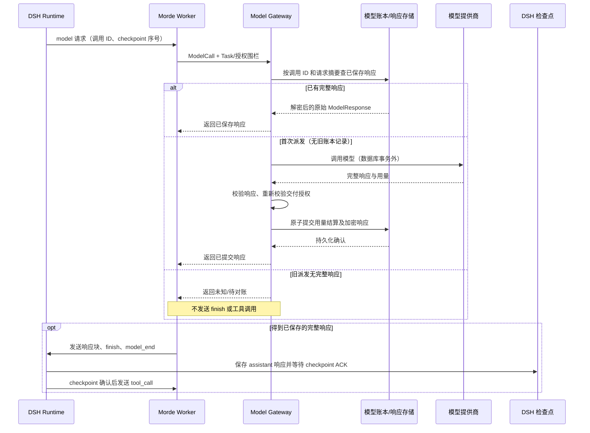

# Morde DSH 任务模型响应持久化与恢复设计方案

> 目标：落实[需求文档](Morde%20DSH任务模型响应持久化与恢复需求文档.md)，补齐 DSH Task 模型响应在网关结算后、检查点保存前中断时无法恢复的问题。本文为精简设计，不代表已经实施。

## 设计结论

只改 Morde 的模型网关、持久化、任务恢复适配，以及必要的 Account Runtime 启动锁范围；不引入 DBOS，不改 DSH 上游源码或 Agent Loop。继续使用 DSH 现有 IPC 和检查点协议；网关在返回模型结果前确保完整响应已提交，Worker 再按现有协议交付给 DSH。

压缩摘要和路由决策保留现有专用恢复实现。新增能力只覆盖 `source='task'` 的 DSH 模型调用。

## 核心流程

已有调用若处于 `dispatched/unknown` 状态但没有完整响应，走未知用量与对账流程，不重新请求提供商。缓存命中时不触发提供商调用，也不重复结算用量。

## 改动边界

1. **模型网关**：在 Task 模型调用派发前增加响应恢复查询。查询命中时，校验当前 Task、用户、模型选择、请求摘要、session 和 checkpoint 前缀，再通过现有任务交付授权检查后返回原 `ModelResponse`。只有确认不存在旧派发记录的新调用才继续解析连接、预留额度和请求提供商。
2. **模型账本与加密响应**：新增 Task 响应表（例如 `task_model_call_responses`），仅存加密响应、摘要和调用身份；`model_call_ledger` 仍是唯一用量账本。响应行与 `settled` 用量状态在同一事务提交。账号模型和项目模型均须在各自现有结算事务中完成，避免预算、账本和响应出现部分成功。复用 Morde 现有加密密钥管理，密文关联数据绑定 owner、task、call ID、request digest、model/provider、session、checkpoint 序号及授权版本；摘要调用仍使用其现有专用字段。
3. **恢复身份**：`call ID` 继续由 Task、DSH session 和模型请求前的 checkpoint 序号确定。存储记录绑定原执行代次；重启后的新代次只有在数据库中的旧 Agent 实例已确认停止、当前 Agent 租约有效且恢复的是同一 session/checkpoint 前缀与授权版本时，才可读取该结果。原代次仍活动时还须匹配原 Agent 实例。Task 修订、授权版本、模型连接版本或请求前缀变化时不得复用。
4. **DSH/流式处理**：Worker 的 `writeCloudDSHModel`、IPC 帧格式、DSH 插件及检查点事件格式保持不变。缓存恢复返回同一响应，经原路径写入检查点；已有工具 Broker 和工具结果账本继续负责防止副作用重放。缓存命中不重发文本增量；已有部分流按现有中断/完成路径收口，最终 DSH 结果作为权威输出。

## 多用户、多会话并发

- Account Runtime 继续按用户/会话隔离，每个会话复用自己的 Runtime 租约，并遵守 `max_concurrent_tasks`。不同用户或会话在配额内可以并行冷启动和执行；同一会话的竞争启动仍只产生一个有效 Runtime。
- 当前 `CloudDSHAccountRuntimeManager.Acquire` 持有管理器级互斥锁完成 Runtime 状态读取、进程启动和 ready 握手，`renewIdleSessions` 也在管理器锁内续租，会把同一 Worker 上不同会话的冷启动/续租串行化。本方案要求将全局锁缩小到内存映射读写，并用按用户/会话的启动协调防止同会话重复启动；不得在全局锁下等待容器、控制服务或 IPC。
- 模型响应读取、写入和结算按单次调用身份落库；用户额度事务只做短期账本操作，provider 请求仍在事务外。不同用户、会话和调用不可共享缓存键、结果、账本状态或工具副作用。
- 验收至少并发启动两个用户、每个用户多个会话，并在单会话并发多个 Task；一个 Runtime 的启动失败/延迟/续租不阻塞其他会话。同一 call ID 的并发请求最多一个派发 provider，其他请求等待或安全失败，提交后重试命中相同响应且只结算一次；达到会话 Task 容量时按现有容量错误/排队规则处理，不超配。

## 故障与兼容

- 提供商成功但持久化失败：不发送模型完成帧或工具调用；账本保留已知用量或按当前规则标记未知。后续先核查事务是否提交，未找到完整响应时禁止自动重发。
- 持久化提交结果不确定：使用同一 call ID 查询密文和结算状态；仅在完整响应校验成功后恢复。
- 旧账本行没有响应正文：维持现有恢复/对账结果，不尝试补造响应。
- 保留响应至少覆盖 Task 可恢复期；终态清理响应密文时保留现有用量和审计记录。
- 外部 API 仍是可能重复收费的边界：如果提供商已处理请求但 Morde 未能持久化响应，系统只能安全阻止盲目重试，不能保证只收费一次。

## 实施验收重点

用合成提供商和隔离 PostgreSQL 注入中断：分别覆盖“提供商返回后、响应提交前”“响应提交后、Worker 交付前”“DSH 检查点确认前”。恢复成功时模型调用不增加、响应和用量一致，工具只在检查点确认后执行；无响应或身份变化时不得交付或执行工具。另回归个人/项目预算、压缩摘要恢复、路由恢复、取消及权限撤销。

涉及上游行为的参考为 [DBOS 固定提交模型响应持久化实现](https://github.com/dbos-inc/dbos-vercel-ai/blob/607a2de41a6bd6d98fd6eebdf3f634eaa0eb6d7f/src/middleware.ts#L188-L265)；这里只移植“已保存结果优先恢复”语义，不移植其 Runtime 或自动重试保证。
