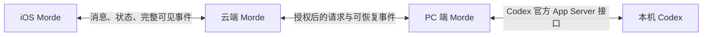

# Morde PC 端 Codex 会话接续需求文档

## 目标与范围

用户离开电脑后，可从 Morde iOS 查看并继续该电脑上获授权的 Codex 会话。Codex 仍在用户 PC 上运行，使用该机的项目文件和本地登录；云端 Morde 负责鉴权、消息与事件转发、会话记录和断线恢复，不替 Codex 执行任务，也不把请求转交给云端 DSH Agent。

本需求只覆盖 PC 上的 Codex 接入，不包含其他编程 Agent、屏幕 OCR 或模拟键鼠、项目文件同步，以及把 Codex 登录凭证或本机文件上传到云端。Morde 会话与 Codex 原生线程须保留各自身份，并显示可追溯的关联；不得把两套历史合并成一条虚构对话。

## T3code 参考结论

T3code 的远端模型是：承载环境拥有 provider、执行进程、文件和持久状态，Web、桌面和手机客户端通过 HTTP/WebSocket 连接该环境。其 Codex provider 使用本机 Codex 安装和已有登录，由服务端启动 Codex App Server，再通过官方协议创建或恢复线程、发送 turn、读取线程快照并接收流式事件与审批请求。见 [Codex provider 说明](../project/T3code/docs/user/providers-codex.md)、[Codex 适配器](../project/T3code/apps/server/src/orchestration-v2/Adapters/CodexAdapterV2.ts)和[远端架构](../project/T3code/docs/internals/remote.md)。

T3 Connect 主要负责环境关联和访问凭据；客户端应用流量经环境隧道到达环境，不由 relay 代转。Morde 本需求的链路明确经过云端 Morde，因此云端要承担消息与事件的鉴权转发及持久化；PC 端通过主动建立的受保护连接保持在线，不开放公网控制端口。见 [T3 Connect 信任边界](../project/T3code/docs/internals/t3-connect.md)。

T3code 的源码证明了由其服务启动和管理的 Codex App Server 会话可以远程交互，但不能据此认定它能直接附着到任意已打开的 Codex 桌面窗口，或监听其他进程发起的所有对话。不得把私有会话数据库、日志扫描或屏幕识别当作默认接入方式；既有 GUI 会话能否接入须通过下列验收单独证明。

## 功能与规则

### 1. PC 连接与授权

- 用户在 PC 端 Morde 明确选择 Codex 安装及本地登录/数据目录（如 `CODEX_HOME`），再选择允许接续的会话或项目并授权连接到自己的 Morde 账号。不得默认读取电脑上的所有项目、账号或文件。
- 读取会话、接收实时更新、发送消息、中断执行、响应 Codex 审批是不同权限。用户可查看当前 PC、Codex 实例、权限、连接状态及授权范围，并可撤销授权。
- Codex 登录材料留在 PC。本功能不把 `auth` 文件、访问令牌或其他凭证传到云端，也不因连接失败切换到其他 PC、Codex 账号或 Morde 云端 Agent。

### 2. 会话发现与完整可见信息

- 在用户授权的 Codex 实例范围内，Morde 展示官方接口实际可读取的线程列表、标题、项目/工作目录标识、最近更新时间和运行状态；打开线程时加载该接口提供的可用历史，并以 Codex 原生线程 ID 保持映射。
- 对已接续线程，PC 端持续接收并转发 Codex 接口公开的完整事件，包括用户与助手消息及增量、助手最终回复、可见的计划/推理摘要、工具或命令调用与输出、文件变更信息、子 Agent 活动、问题与审批请求、运行状态、错误和结束结果。Codex 未提供的字段不得伪造或标成完整。
- “完整信息”指 Codex 官方接口提供给客户端的用户可见信息，不包括隐藏思维链、未公开的模型内部数据、系统凭证、无关进程日志或授权范围外的文件。事件中包含的路径和输出仍按敏感对话内容处理。
- 从 PC 上其他 Codex 客户端发起的消息或操作，只有在官方接口确实能读取或推送时才显示为同一线程更新；无法观察时须标明来源或能力限制，不能伪称实时监控。

### 3. iOS 发送与双向事件流

- iOS 选择一个已授权的本机 Codex 线程后发送消息。请求按“iOS → 云端 Morde → PC 端 Morde → Codex”转发；回复、进度和其他可见事件按相反方向返回。Codex 对本机文件的读写和命令执行仍发生在该 PC。
- 每条消息和事件带有稳定身份、线程归属及顺序游标。云端先确认收到，再显示已送达；状态至少区分等待 PC、已转发、Codex 执行中、等待审批、已完成、失败和结果未知。流式增量归并到对应消息，不能重复、串线或乱序。
- 网络重试复用原消息身份。已受理的请求在断线、刷新或客户端关闭后不重复创建 turn；结果不确定时先读取 Codex 和云端状态再决定是否重试。
- Codex 能接受当前 turn 内追加消息时，Morde 可显示“正在处理并已发送”；不支持时应明确显示排队或下一轮发送。中断只作用于指定 PC、实例和线程，且以 Codex 实际确认的状态为准。

### 4. 审批、断线与撤销

- Codex 发出的命令、文件变更或权限审批请求可在 iOS 展示原始操作对象和影响。用户批准/拒绝须绑定该请求及其版本；超时、撤销或请求已变化时拒绝旧响应。普通聊天文本不能替代审批。
- iOS 离线或关闭不会取消 PC 上已开始的 Codex turn。PC 与云端断开时，PC 可继续本地执行并在恢复连接后补发尚未确认的事件；PC 睡眠或关机时显示离线/状态未知，不声称任务仍在运行。重连后先对齐原生线程状态和事件游标。
- 撤销授权后立即拒绝新的读取、发送与控制请求并关闭实时转发。已在 PC 开始的 Codex 操作是否停止须按用户单独的中断操作及 Codex 实际结果显示，不能把撤销云端连接误报为本机进程已停止。
- 云端记录遵循 Morde 现有会话数据的用户隔离、访问控制、持久化及删除规则；不同用户无法读取彼此的 Codex 线程、消息、事件或审批。云端服务或 PC 不可用时保留明确失败/等待状态，不静默转交给其他执行者。

## 验收条件

- 在 PC 端绑定已登录的 Codex 实例并授予指定范围后，iOS 能看到该范围内可访问的线程；选中一条线程后，iOS 发送消息，PC 上对应 Codex 线程收到消息并给出真实回复，完整可见事件沿原链路返回。
- 在 Codex 继续输出时，iOS 能看到同一条回复的增量、计划/状态、工具调用与接口提供的输出、审批或提问、结束结果；PC 端操作该线程时，若官方接口支持事件通知，iOS 也能看到对应更新。历史、实时事件和重连补发后顺序一致且无重复。
- 断开 iOS 网络、关闭 iOS、或短暂断开 PC 与云端连接后，重连可恢复同一线程和实际状态；重复发送同一请求不会创建第二个 turn。PC 离线时，新消息显示等待或失败，不显示已执行。
- 从 iOS 响应一个 Codex 审批后，只有对应操作继续；撤销授权后新的读取和发送被拒绝，其他用户不能访问该线程。
- 若目标是已打开的 Codex 桌面应用会话，需证明其线程能通过受支持接口读取、接收实时更新并由 iOS 继续；若不能，界面明确显示“不可接续/仅可查看”等真实能力，不得把另起的新线程称为原会话。此项未通过前，不得宣称已实现对电脑上现有 Codex 对话的完整监控与接续。

## 待确认

- 首期是否必须接入用户正在使用的 Codex 桌面应用中的既有活动线程，还是接受由 PC 端 Morde 启动、使用同一本地 Codex 登录的 App Server 线程。T3code 参考实现只证明后者，二者不能默认等同。
- 云端保存的 Codex 历史是否完全采用 Morde 现有会话保留与删除策略；若现行策略没有覆盖这类对话，需在实现前确定保留期限和用户删除入口。
