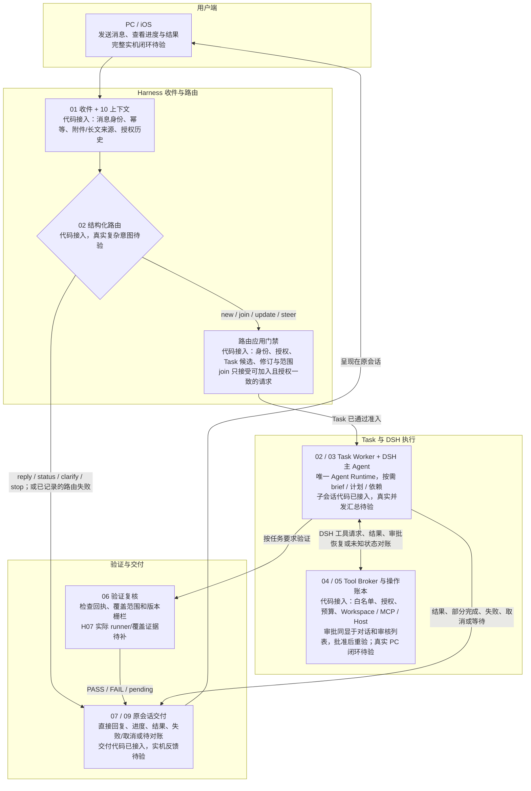

# Morde 复刻 Muse：最终流程与开发设计

> 本文是 Harness 的精简总览：上半部分描述当前源码流程，下半部分列出 Muse 体验差距和实施入口。Muse 内部未被逆向材料证实的机制不作事实陈述。
>
> **源码基线：**本轮 PC 交互移植开工时 HEAD `8c87122f`；本地存在未提交候选改动。图中“代码接入”表示有对应源码路径，不代表已部署或端到端验收通过。逐项进度以[实施任务总大纲](实施任务TODO/00-总大纲.md)、分步 TODO 和[PC 交互移植 TODO](<design/Muse Desktop PC交互移植实施任务TODO（Morde审查修订版）.md>)为准。

## Morde Harness 总览 · 收件到交付

**图例：**“代码接入”表示源代码落点存在，“待验”表示真实 PC/DSH 交互链路尚无完整证据，“待补”表示关键验证证据本身缺失。箭头表示可能的数据流，不代表每条消息都经过全部节点。步骤号对应下方 11 步表。分类、DSH 和必要的终态说明调用共用 Model Gateway；该网关不是另一个 Agent Runtime。PC 文件夹同步是独立的用户手动单向路径，授权 Workspace 的读取仍经 Broker；细节见[步骤 04](实施任务TODO/04-工具执行与工作项.md)。所有公开网页搜索和页面读取都由 DSH Task Agent 在授权工具范围内执行、核验并综合回答；路由层不直接返回原始网页工具结果。实际搜索服务可用性与模型执行仍待验。

**路由动作**包括 `reply`、`status`、`new`、`join`、`update`、`steer`、`stop`、`stop_all` 和 `clarify`。公开网页搜索/页面读取会转交 DSH Task Agent；旧式 `tool` 输出只有在上下文完整且参数有效时才会被提升为 Task，否则要求澄清。分类服务失败或返回无效结果时先保留原消息并持久记录；只有确认可安全重试时才重新处理。

**模型预算状态（2026-11-28）：** B02 能力元数据与当前源码 PC 本地构建已通过；本轮 PC 的测试门户会话无法续期，代理隧道后的上游探测超时，真实目录读写仍未验。锁定 DSH 已接入 opt-in 的逐次预算请求钩子与 Worker/Runtime 计划协议；预算账本、单次 plan 和基于精确并发限额的容量等待由服务端 PostgreSQL 路径实现。等待事务持久化 Task/Agent/call/checkpoint fence 并清除 lease；reconciler 核对旧 Agent stop receipt 后重新检查额度并唤醒或安全暂停。恢复 attempt 持久化独立的 DSH frame ID 与 ledger call ID。migration 00270 按 `BudgetCallID` 保存首次容量等待时间和 deadline：单次调用最多等待 5 分钟，同一调用 requeue 后不会重置；成功 prepare 与 inactive Task 清理会删除 marker。migration 00272 为有效 FIFO waiter 保留一个后续账户并发槽，普通新请求不能插队占用；waiter 成功 prepare 后清除 claim，过期等待不占槽。动态 PG 用例证明策略与项目费率改变后会丢弃旧计划、按当前值重算，容量唤醒后也会按当前费率重新定价。migration 00273 与现有管理员未知用量页面支持自适应 Task overage 核对：管理员提交供应商证据和确认用量后，账户/项目账本按实际用量结算并保留审计；这不增加预算，也不恢复丢失回复，当前仅完成本地代码验证。另有 B05 的 40,000 signed-cap 本地链路，验证 DSH final frame、PG reservation 与 fake provider HTTP 一致；旧路径 cap 保持；Portal planner bootstrap 与 exact-route 资格门控已接入，但部署配置为 false；共享 endpoint resolver 会按当前 exact route/version 清除过期的输出/上下文目录值。B06 本地已增加有界长正文传输：fake SSE 512 KiB、PostgreSQL durable delta 超过旧 32 KiB、2 MiB 累计上限与超限拒绝均有定向验证；助手正文持久化上限为 2 MiB、delta 不超过 32 KiB、DSH frame 不超过 4 MiB，Task 模型总时限 10 分钟且正文空闲时限 60 秒。这些是假 provider/本地 PG 证据，不代表真实 provider 或 PC 已验；测试 PC 会话无法续期，实际刷新重连交付仍待验，B05/B06 不勾选。Worker plan binding、ModelGateway reservation、响应密封/回放均验证 prepare ledger ID 与最终 DSH frame ID；本地 DSH runtime → PostgreSQL → ModelGateway → fake HTTP 整链通过，确认一个 3,072 cap、8/6 usage 入账，settled replay 后 provider 仍仅被调用一次；timeout、503、派发后 cancel 均阻止同键二次派发。另有真实锁定 DSH + Worker 子进程在 DB 派发提交后、fake HTTP 前被 SIGKILL 的用例：恢复标记 ledger 为 `unknown`，相同调用 replay 被拒绝且 HTTP 仍为 0。它不代表运行中的 Portal 二进制或真实 provider 已验。Portal bootstrap 已接入但部署配置为 false，发送上限未改变。完整状态与验证命令见[模型预算自适应实施 TODO](../design/Morde-模型生成预算自适应实施任务todo清单文档.md)。

B03 另实现默认关闭的 Task-only 影子路径：用只读 repeatable-read PG 快照计算账户、Task 和项目额度余量，不写/释放 reservation、不改 Task、不调整 provider cap；unknown limit 保持未知。精确 HTTPS 路由和采样率由配置控制，trace 记录 route fingerprint、策略版本、候选预算与 provider 用量，低基数 metrics 不带 route/version label；Gateway tests 证明 cap、账本 reserve/dispatch 和返回值与影子关闭时一致。shadow resource ceiling 已与 adaptive 协议上限统一，并以 40,000 token 目标验证可预演高于旧 32,768 边界的计划，同时保持 live legacy cap 不变；`content_filtered` 失败类别也保留在低基数指标中。当前只有子 Agent 与工具步骤可可靠标阶段，root text-only 标为 unknown；没有生产采样和真实流量质量/首字延迟对照，影子配置保持关闭。PG trigger 和合成传输错误验证事务回滚、settled replay no-duplicate 与 unknown/no-replay；另有锁定 DSH + Worker 子进程在派发提交后、fake HTTP 前被 SIGKILL 的本地恢复用例，不是 Portal 二进制或真实 provider 验收。该 dispatch trigger 目前只覆盖 Store 事务边界，通过 `Gateway.Complete` 注入并断言 provider HTTP=0 的联合用例仍待补。migration 00272 的 FIFO slot claim 与动态策略/费率重算定向 PG 用例通过；migration 00273 的管理员 overage 核对/结算本地 PG 与 API/UI 定向验证通过，长期压力公平性、部署后供应商账单流程仍待验。Portal bootstrap 已接入但部署 admission 关闭，生产模型请求仍走现有上限；生产策略、真实 provider 计费和影子核验通过前不开放 cap，当前发送上限未改变。完整状态与验证命令见[模型预算自适应实施 TODO](../design/Morde-模型生成预算自适应实施任务todo清单文档.md)。

**模型截断与有限续写状态（2026-11-28）：** 自适应签约 Task 才能把“已知用量 + provider 明确 `length` + 无工具调用的纯文本”密封保存并映射为 DSH `max-tokens`。DSH 通过 `agent/turn-stopping` 在原会话最多排两次续写，每次新 turn 重新请求预算计划；已确认前文保留在请求上下文。模型派发前发现新用户消息时跳过续写；派发后新消息由 delivery-version fence 丢弃旧结果并随后处理，provider 可能已收到那次在途请求。恢复时重排已持久化的续写 inbox；若同时有较新的用户输入，则移除旧续写并先处理新输入，不追加通用 recovery prompt。带工具请求、过滤、超时、取消或未知用量不会自动续写，两次后仍截断则以部分失败状态返回。锁定 DSH Runtime、Worker、应用层和隔离 PostgreSQL 自动化验证通过；全套 Runtime 298/298 通过，含续写入队后崩溃并恢复的用例。B07 的本地实现已完成，整体仍受 B05/B06 和 PC 刷新/重连验收门禁限制。planner bootstrap 已接入但部署关闭，普通与旧 Task cap 未改变。状态和验证证据见[模型预算自适应实施 TODO](../design/Morde-模型生成预算自适应实施任务todo清单文档.md) 第 19 节。

**显式无 Task 长回复状态（2026-11-28）：** personal/project 会话消息通过 `response_mode=long_form` 在分类模型前分流，短答仍走原快路径；长回复使用已验证的模型上下文窗/输出上限和当前 route 账本，发起一次无工具、纯文本请求，最长 4 分钟。取消标记持久化，迟到结果受状态 fence 约束；明确 `length` 时只保存并展示部分结果，未知用量不报成功。每条无 Task 回复先限制为一次 provider 调用，避免在没有持久化回复级累计预算/调用数之前自动叠加预留；用户可在新消息中决定是否续问。Portal 已有模式切换、纯文本约束和取消状态。当前源码 `make pc` 构建、启动成功；实际客户端点击重试并等待 15 秒仍显示云端会话无法续期，未进入助手页面。`/healthz` HTTPS 请求 8 秒超时，SSH TCP 可达但 banner exchange 超时；因此 PC 消息/取消/刷新重连、真实 provider 与生产账单尚未验收。Go app/API/Worker、隔离 PostgreSQL 定向测试及 Portal 364 项测试/类型检查通过；未调用真实 provider、未部署。B08 本地实现已完成但整体验收未通过。状态和验证证据见[模型预算自适应实施 TODO](../design/Morde-模型生成预算自适应实施任务todo清单文档.md) 第 21 节。

**按图执行时的关键分支：**

- 普通问答、进度、澄清和停止可直接回到对话；复杂工作才通过准入后建立或修订 Task。合并只发生在 prior request 明确 `joinable` 且作用范围与授权匹配时。
- Broker 负责工具准入、审批绑定、操作记录和结果对账。结果未知时先恢复/核对，不盲目重放；审批决定返回后重新检查当前授权和版本。
- 验证是按任务要求执行的门，不是每条普通对话都要跑测试。缺少 runner 实际清单或覆盖范围证据时，结果保持 pending；不能把命令成功或摘要当成完整覆盖证明。
- 超长消息的 receipt/reference 保留原文身份；预览或摘要不能证明模型已读取全文。实际理解范围要以授权来源读取及模型结果核验。

## 四层与代码落点

| 层 | 当前实现 | 与 Muse 体验的主要差距 |
|---|---|---|
| **L1 路由** | Agent 输出结构化动作；代码校验消息身份、任务引用、控制范围、授权、修订和幂等。支持直接回复、状态、任务新建/关联/修改/停止和澄清；公开网页搜索与读取由 DSH Task Agent 完成。 | 真实 PC + 模型下的复杂意图、追问和新闻请求仍需验证；分类失败虽会保留消息并可安全重试，用户端失败体验仍要实测。 |
| **L2 合并** | 仅对显式 `joinable` 的先前请求开放加入；同一执行范围、控制范围、授权及其他关键输入需匹配。可将同一工作的补充消息纳入 Task。 | 主题相似不能作为合并依据；需要继续验收并发消息、不同授权/项目和独立请求不会误合并。 |
| **L3 Task** | Task 保存目标、brief/计划、步骤、依赖、修订、工具调用和结果；复杂任务按需使用计划，不要求普通问答创建 Task。 | 部分计划与验证门禁仍在收口；计划完整不代表执行完成，缺少真实结果时不能提前报成功。 |
| **L4 协调** | Task Worker 驱动 DSH 会话；DSH 子会话树支持按需委派、依赖和结果回传。DSH 是唯一 Agent Runtime。 | 代码有子会话和恢复路径，但真实 PC + DSH 的并行执行、阻塞恢复及主 Agent 汇总尚未完整验收。独立的“每目标 watch-loop”不视为已实现。 |

## 11 步现状与实施入口

| 步骤 | 当前代码边界与待补体验 | 实施任务 |
|---|---|---|
| **01 收件与会话** | 消息持久化/幂等：[conversation_message_routing.go](../../../server/internal/store/postgres/conversation_message_routing.go)；PC 发件箱与分块：[message-outbox.ts](../../../web/portal/src/app/message-outbox.ts)、[message-upload.ts](../../../web/portal/src/app/message-upload.ts)。跨端接续和断线恢复仍需端到端核验。 | [01 TODO](实施任务TODO/01-收件与会话.md) |
| **02 意图路由与任务拆分** | 结构化动作：[conversation_route_decision.go](../../../server/internal/app/conversation_route_decision.go)；消费与失败记录：[conversation_route_worker.go](../../../server/internal/worker/conversation_route_worker.go)；任务应用校验：[conversation_route_actions.go](../../../server/internal/store/postgres/conversation_route_actions.go)。真实复杂意图、新闻来源与追问绑定继续待验。 | [02 TODO](实施任务TODO/02-意图路由与任务拆分.md) |
| **03 并发与协调** | [task_worker.go](../../../server/internal/worker/task_worker.go)、[cloud_dsh_session_tree.go](../../../server/internal/worker/cloud_dsh_session_tree.go)、[agent_sessions.go](../../../server/internal/app/agent_sessions.go)。实际并发、结果汇总和恢复闭环待验。 | [03 TODO](实施任务TODO/03-并发派发与协调.md) |
| **04 工具与工作项** | 工具准入与账本：[cloud_dsh_tool_broker.go](../../../server/internal/app/cloud_dsh_tool_broker.go)；只读查询：[conversation_route_internal_tool_executor.go](../../../server/internal/worker/conversation_route_internal_tool_executor.go)；PC 同步入口：[morde-main.ts](../../../clients/desktop/harness/desktop/src/morde-main.ts)。真实工具/云电脑结果、同步冲突及 PC 体验待验。 | [04 TODO](实施任务TODO/04-工具执行与工作项.md) |
| **05 授权与审批** | [task_approvals.go](../../../server/internal/app/task_approvals.go)、[TaskApprovalCard.tsx](../../../web/portal/src/components/TaskApprovalCard.tsx)、[Reviews.tsx](../../../web/portal/src/routes/Reviews.tsx)。撤权、过期、重连后的真实 PC 闭环待验。任务动态只展示工作信息，不承担审批。 | [05 TODO](实施任务TODO/05-审批.md) |
| **06 验证** | [task_validation_review_worker.go](../../../server/internal/worker/task_validation_review_worker.go) 负责复核检查回执、范围和版本栅栏。缺少 runner 实际 package/test inventory 或实际覆盖证明时，H07 必须保持 pending。 | [06 TODO](实施任务TODO/06-验证.md) |
| **07 交付与提问** | [task_terminal_delivery_worker.go](../../../server/internal/worker/task_terminal_delivery_worker.go) 读取成功、失败、取消和部分等待事实并发布到原会话。未知恢复状态会把服务端 allowlist 诊断事实交给无工具说明模型；说明模型也无法确认时，同一 outbox 持久化一条确定性说明，且晚到模型结果不能覆盖或重复发布。现有记录无法确定中断原因时，说明会同时讲明原因未知、上一步是否完成也无法确认。PC 自然语言仍待实机验收。 | [07 TODO](实施任务TODO/07-交付与提问.md) |
| **08 记忆与纠正** | [cloud_dsh_history_tools.go](../../../server/internal/app/cloud_dsh_history_tools.go)、[conversation_summary_maintenance.go](../../../server/internal/worker/conversation_summary_maintenance.go)。授权历史检索和摘要维护有代码；跨会话使用、撤权与长期语义仍需真实体验验收。 | [08 TODO](实施任务TODO/08-记忆与纠正沉淀.md) |
| **09 失败、限流与恢复** | [cloud_dsh_tool_broker.go](../../../server/internal/app/cloud_dsh_tool_broker.go)、[conversation_message_retry.go](../../../server/internal/app/conversation_message_retry.go)、[task_terminal_delivery_worker.go](../../../server/internal/worker/task_terminal_delivery_worker.go)。模型请求无法确认时先尝试已有的受控恢复路径；未能安全恢复则暂停，保留失败分类，禁止盲目重放未知工具操作。只读模型恢复绑定 checkpoint 与工具集；恢复重放开始前发现新的 follow-up/steer 输入时会拒绝按旧 checkpoint 自动重放。恢复模型已运行期间收到 steer 时，交付新输入并用“重新评估当前任务”的提示取代旧结果。回告模型失败时向原会话交付安全的系统说明；具体事故原因仍需关联任务事件与模型账本。 | [09 TODO](实施任务TODO/09-失败限流与恢复.md) |
| **10 上下文管理** | 收件：[conversation_message_upload.go](../../../server/internal/app/conversation_message_upload.go)；路由引用：[conversation_route_decision.go](../../../server/internal/app/conversation_route_decision.go)；DSH 引用与摘要：[engine.mjs](../../../runtime/morde-cloud-runtime/src/engine.mjs)。长文接收不代表模型完整读懂；超长语义与跨窗口追问仍待验。 | [10 TODO](实施任务TODO/10-上下文管理.md) |
| **11 Bug 处理** | 复现、定位、修复、按需回归和如实记录是开发方法，不是每条用户任务都必须经过的产品步骤。 | [11 TODO](实施任务TODO/11-Bug发现与处理.md) |

## 与 Muse 体验对齐时不能越过的边界

- 普通问答直接在对话中回复；公开网页搜索和页面读取由 DSH Task Agent 执行并综合来源；其他复杂工作按范围创建或关联 Task。
- 只有明确可加入且范围、授权一致时才合并；合并运行不算任务失败。独立目标不能因主题相似而合并。
- 工具调用先经过 Morde Broker 的身份、权限、范围、审批、预算和操作记录检查。批准后再次校验当前授权与版本。
- 用户审批在对话 MCP App 和审核列表中呈现同一请求；任务动态是只读进度与工作项。
- 成功、失败、取消、待用户输入和结果未知必须区分。结果未知先恢复或对账；无可信验证证据时标记待验证，不能报 PASS。
- 长输入需保留原文身份与来源。摘要或预览不能代替未读取的原文；模型窗口/预算不足时须明确说明覆盖范围。
- 代码与自动化测试不是 PC 用户验收。普通用户交互按项目约定使用源码 `morde-pc`；未能实测的路径标为待验。

## 当前优先收口项

1. 用源码 `morde-pc` 建立可复验的登录、同会话消息、进度和交付闭环；保留无法绑定到确定窗口/profile 的验收为未完成。
2. 打通真实新闻搜索配置与来源核验；上游不可达时不伪造结果、不关闭 TLS 验证，并让失败原因回到对话。
3. 补齐 H07 的实际 runner、测试清单与覆盖范围证据；没有这些证据时不把任务标为验证通过。
4. 完成真实 DSH 下的追问/任务关联、审批恢复、未知结果对账、长上下文理解、并发委派及默认 Workspace 同步验收。

## 本轮结构化追问移植状态（2026-11-28）

M05–M07 已在本地代码中形成同一条持久化路径：`task.ClarificationRequest` 保存单题或结构化题组、稳定题目/选项 ID、版本与答案格式；PostgreSQL 写入时同步持久化 `answer_format` 并校验其与题组一致，`POST /api/v2/tasks/{id}/clarifications/{clarification_id}/responses` 将答复绑定请求版本和幂等键；`CloudDSHToolBroker` 在原 `ask_user` DSH 调用下创建或恢复待答项，答复返回时校验原 CallID、题组和版本。旧单题 schema 与旧 checkpoint 仍保留兼容；PG16 定向 E2E 已覆盖旧 checkpoint 恢复。PC 聊天气泡提供单选、多选、自填、可跳过和提交/冲突/失败/结果未知状态，侧栏仅展示只读详情。

没有直接加载上游 `dsh-tool-ask-user`：本地 DSH 版本没有 Morde 所需的结构化问答 provider seam；该插件通过 `ctx.userQuestions`/answerer 交互，无法替代 Morde 已持久化的 PG Request、原工具调用 ID 和恢复合同（参见 DSH [官方工具目录](https://github.com/deepseek-ai/deepseek-harness/blob/master/docs/tool-catalog.md) 和 [ask-user 插件源码](https://github.com/deepseek-ai/deepseek-harness/blob/master/packages/interaction/tool-ask-user/src/index.ts)）。实现只适配 Morde Broker，没有增加第二套 Agent Runtime，也没有调整 DSH 依赖/锁文件。仓库引用的 `docs/muse_docs/muse_steps/` 上游归档目录当前不存在；本节以本文件、设计方案和实际代码为准。

本地验证记录：M05 domain/app/API 包测试通过，结构化答复版本绑定、幂等和用户隔离 PostgreSQL 集成用例在隔离工作树通过；M06 DSH Runtime 全套 `node --test --test-concurrency=1 test/runtime.test.mjs` 通过 235/235。真实 `TaskWorker + DSH + CloudDSHToolBroker + PostgreSQL 16` 四项定向 E2E（Worker 重启、等待 Task 取消、双 Task 并发隔离、旧 checkpoint 兼容）4/4 通过；主恢复用例 `-count=3` 3/3，覆盖过期版本冲突、答复持久化/重排队、Worker 重启恢复原 session/CallID、一次 reconciliation 及 assistant message 和 `task.result` 各一次。全量 `go test ./internal/worker -count=1 -v` 499 PASS / 2 FAIL（345.612s）；失败在退出未知并行 suite 后单独重跑仍复现：`TestConversationSummaryDSHMainAndSideChatsContinueAfterLongHistoryRestart` summary version 2→3 不匹配，`TestCloudDSHModelBudgetPostgresHTTPWorkerProcessKilledBeforeProviderHTTP` stale recovery marked=0。M07 Portal 路由/API 定向组合测试 421/421 且 typecheck 通过；此前 Go app/API/worker 联测通过。上述为本地代码/隔离测试证据，不代表服务端已部署或真实 PC + DSH 跨端闭环已验；结构化追问仍列为真实 `morde-pc` 验收待办。

桌面通知增量（M10）已实现：所有任务通知和来源通知在各自插入事务内锁定同一账号的 sequence 行，再写通知并提交序号；增量读以该已提交顺序为准，不按时间戳排序。`GET /api/notifications/incremental` 首次无游标请求只建立基线、不回补历史；续页游标签名并绑定账号，30 天后过期，扫描会跨越已撤权的项目通知推进游标。为避免完成摘要进入 Electron 主进程，增量记录只返回通知 `id` 和 `kind`；现有站内列表和已读合同未变。隔离 PostgreSQL 16 集成测试通过 3 项，覆盖反向时间戳的双连接提交顺序、分页/断线续读、基线、过期重建、撤权过滤及 Task completed 通知。M11 的 Electron 轮询、默认关闭的按账号设置、凭据安全存储、去重、过期游标恢复与通用通知文案已接入；桌面逻辑 51/51、Portal 设置 3/3、类型检查和 desktop build 通过。签名 macOS 包的真实系统弹窗仍待验收。

## 本轮 Muse Desktop PC 交互移植状态（2026-11-28）

M01 活动折叠、M08 附件草稿拖放、M07 结构化追问卡片、M09a 语音取消和 M09b 默认关闭的真波形已在代码/自动化层实现；Portal 定向组合测试 421/421、Portal 类型检查通过。新增的超限合成图片用例确认 M08 的 picker/drop 两个入口给出同样的拒绝结果且不上传、不发送。M09b 设备电平未验：此前本机 macOS 会话报告未获麦克风权限，未接受系统权限提示。M01/M07/M08/M09a 的源码候选入口尚未完成真实 `morde-pc` 交互验收。

M02 长输出已有 opt-in Runtime/client sideband transport 和 Server 闭环：默认不发 capture descriptor；Shell 旧 `Operation.Result` 与执行次数保持不变。Broker/RuntimeToolExecutor 仅在显式开启时读取有界 spill；运行时重启对账同一 operation，不重跑命令。Shell stdout/stderr 在新结果落库及回给 DSH 前脱敏；捕获原始前缀只留请求内存，与 spill 合并后全流脱敏，再加密分页保存。M03 增加五类完整/截断/未记录/失败状态、授权分页 API/OpenAPI、Project 成员授权版本校验、原子收据及密文页、周期清理；不完整状态不返回字节。PG16 集成测试验证分页读回、跨用户拒绝、授权版本撤销、不完整状态仅元数据及过期清理。每账号最多保留 10,000 个 receipt/status，状态达到上限会淘汰最旧元数据。M04 PC 页面已实现 lazy page fetch、UTF-8/字节偏移验证、请求取消、状态提示和切账号清内容；Portal 自动化通过。

本次续做基线为本地 `release@79eb5c73`，当时 `origin/release@ee618bed`；代码实现已提交为本地 `release@09bbde23`，该分支还包含本任务之前的本地提交。OS macOS 27.0.1（Build 26A434，arm64），Morde PC `0.1.0` / Electron `44.7.0`。Portal 定向组合测试 421/421、Portal typecheck 通过；Desktop 全量 `npm test` 308/308 和 typecheck，以及之前记录的通知/桥接 51/51 通过。Go `internal/app`/`internal/api` 全量包测试通过；M02 Runtime Go、runtimeclient、HTTPS Runner、Broker/recovery 定向测试通过，DSH Runtime 235/235；PG16 输出捕获集成测试通过。Desktop 全量套件此前曾发现 Session mock 缺少 `setPermissionCheckHandler`，夹具补齐后 `morde-main-path` 2/2、`morde-main-recovery` 63/63 和全量套件通过。`MORDE_TEST_USER_DATA=/tmp/morde-pc-output-capture-acceptance make pc` 完成 Portal、Workbench、Desktop 构建并启动隔离用户目录的源码客户端；CUA 通过精确 Electron app path 检查了该候选 `morde-pc` 窗口的对话页。仅确认启动和渲染，尚未验证输出分页；停止该隔离实例时 Ctrl-C 返回 130。未向会话发送消息；未部署测试服务器或生产服务端更改。视觉规范文件 `docs/design/ice-cream-blue/morde-icecream-blue-ui-spec.html` 当前不存在，外观对照待核对。详情见[PC 交互移植 TODO 的 M12 记录](<design/Muse Desktop PC交互移植实施任务TODO（Morde审查修订版）.md>)。
