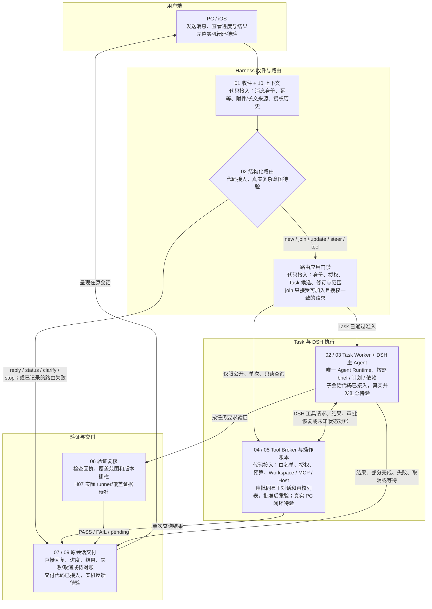

# Morde 复刻 Muse：最终流程与开发设计

> 本文是 Harness 的精简总览：上半部分描述当前源码流程，下半部分列出 Muse 体验差距和实施入口。Muse 内部未被逆向材料证实的机制不作事实陈述。
>
> **源码基线：**2026-11-27，本地 `release`，HEAD `e60cba15`。图中“代码接入”表示有对应源码路径，不代表已部署或端到端验收通过。逐项进度以[实施任务总大纲](实施任务TODO/00-总大纲.md)和分步 TODO 为准。

## Morde Harness 总览 · 收件到交付

**图例：**“代码接入”表示源代码落点存在，“待验”表示真实 PC/DSH 交互链路尚无完整证据，“待补”表示关键验证证据本身缺失。箭头表示可能的数据流，不代表每条消息都经过全部节点。步骤号对应下方 11 步表。分类、DSH 和必要的终态说明调用共用 Model Gateway；该网关不是另一个 Agent Runtime。PC 文件夹同步是独立的用户手动单向路径，授权 Workspace 的读取仍经 Broker；细节见[步骤 04](实施任务TODO/04-工具执行与工作项.md)。路由策略要求新闻和需要引用来源的请求走 Task Agent 搜索、读取并核对来源；实际搜索服务可用性与模型执行仍待验。单次 `tool` 路径只返回受限只读工具结果，不负责生成完整新闻综述。

**路由动作**包括 `reply`、`status`、`new`、`join`、`update`、`steer`、`stop`、`stop_all`、`clarify` 和受限 `tool`。分类服务失败或返回无效结果时先保留原消息并持久记录；只有确认可安全重试时才重新处理。

**模型预算状态（2026-11-28）：** 锁定 DSH 已接入 opt-in 的逐次预算请求钩子与 Worker/Runtime 计划协议；预算账本、单次 plan 和基于精确并发限额的容量等待由服务端 PostgreSQL 路径实现。等待事务持久化 Task/Agent/call/checkpoint fence，清除 lease；reconciler 核对旧 Agent stop receipt 后重新检查额度并唤醒或安全暂停。恢复 attempt 持久化了独立的 DSH frame ID 与 ledger call ID，容量等待定向 PG 组通过；固定场景的 deferred waiter 轮转通过，但释放后未预留并发槽，持续负载公平仍待验证。每个 wait row 有 5 分钟期限，但 requeue 删除 wait row，同一调用再次被挡住会新建期限，整体等待上限尚待设计；活跃 reservation 检查仍用入队时的最低预算。尚无统一 DSH runtime → PostgreSQL → fake provider 进程级验收；默认 Worker 未注入 planner，生产模型请求仍走现有上限。只有 DSH、账本、取消/恢复、期限、动态预算、公平性与端到端 provider 门禁验收后，才能接入生产策略；当前发送上限未改变。

**按图执行时的关键分支：**

- 普通问答、进度、澄清和停止可直接回到对话；复杂工作才通过准入后建立或修订 Task。合并只发生在 prior request 明确 `joinable` 且作用范围与授权匹配时。
- Broker 负责工具准入、审批绑定、操作记录和结果对账。结果未知时先恢复/核对，不盲目重放；审批决定返回后重新检查当前授权和版本。
- 验证是按任务要求执行的门，不是每条普通对话都要跑测试。缺少 runner 实际清单或覆盖范围证据时，结果保持 pending；不能把命令成功或摘要当成完整覆盖证明。
- 超长消息的 receipt/reference 保留原文身份；预览或摘要不能证明模型已读取全文。实际理解范围要以授权来源读取及模型结果核验。

## 四层与代码落点

| 层 | 当前实现 | 与 Muse 体验的主要差距 |
|---|---|---|
| **L1 路由** | Agent 输出结构化动作；代码校验消息身份、任务引用、控制范围、授权、修订和幂等。支持直接回复、状态、任务新建/关联/修改/停止、澄清及受限只读工具。 | 真实 PC + 模型下的复杂意图、追问和新闻请求仍需验证；分类失败虽会保留消息并可安全重试，用户端失败体验仍要实测。 |
| **L2 合并** | 仅对显式 `joinable` 的先前请求开放加入；同一执行范围、控制范围、授权及其他关键输入需匹配。可将同一工作的补充消息纳入 Task。 | 主题相似不能作为合并依据；需要继续验收并发消息、不同授权/项目和独立请求不会误合并。 |
| **L3 Task** | Task 保存目标、brief/计划、步骤、依赖、修订、工具调用和结果；复杂任务按需使用计划，不要求普通问答创建 Task。 | 部分计划与验证门禁仍在收口；计划完整不代表执行完成，缺少真实结果时不能提前报成功。 |
| **L4 协调** | Task Worker 驱动 DSH 会话；DSH 子会话树支持按需委派、依赖和结果回传。DSH 是唯一 Agent Runtime。 | 代码有子会话和恢复路径，但真实 PC + DSH 的并行执行、阻塞恢复及主 Agent 汇总尚未完整验收。独立的“每目标 watch-loop”不视为已实现。 |

## 11 步现状与实施入口

| 步骤 | 当前代码边界与待补体验 | 实施任务 |
|---|---|---|
| **01 收件与会话** | 消息持久化/幂等：[conversation_message_routing.go](../../../server/internal/store/postgres/conversation_message_routing.go)；PC 发件箱与分块：[message-outbox.ts](../../../web/portal/src/app/message-outbox.ts)、[message-upload.ts](../../../web/portal/src/app/message-upload.ts)。跨端接续和断线恢复仍需端到端核验。 | [01 TODO](实施任务TODO/01-收件与会话.md) |
| **02 意图路由与任务拆分** | 结构化动作：[conversation_route_decision.go](../../../server/internal/app/conversation_route_decision.go)；消费与失败记录：[conversation_route_worker.go](../../../server/internal/worker/conversation_route_worker.go)；任务应用校验：[conversation_route_actions.go](../../../server/internal/store/postgres/conversation_route_actions.go)。真实复杂意图、新闻来源与追问绑定继续待验。 | [02 TODO](实施任务TODO/02-意图路由与任务拆分.md) |
| **03 并发与协调** | [task_worker.go](../../../server/internal/worker/task_worker.go)、[cloud_dsh_session_tree.go](../../../server/internal/worker/cloud_dsh_session_tree.go)、[agent_sessions.go](../../../server/internal/app/agent_sessions.go)。实际并发、结果汇总和恢复闭环待验。 | [03 TODO](实施任务TODO/03-并发派发与协调.md) |
| **04 工具与工作项** | 工具准入与账本：[cloud_dsh_tool_broker.go](../../../server/internal/app/cloud_dsh_tool_broker.go)；只读查询：[conversation_route_internal_tool_executor.go](../../../server/internal/worker/conversation_route_internal_tool_executor.go)；PC 同步入口：[morde-main.ts](../../../clients/desktop/harness/desktop/src/morde-main.ts)。真实工具/云电脑结果、同步冲突及 PC 体验待验。 | [04 TODO](实施任务TODO/04-工具执行与工作项.md) |
| **05 授权与审批** | [task_approvals.go](../../../server/internal/app/task_approvals.go)、[TaskApprovalCard.tsx](../../../web/portal/src/components/TaskApprovalCard.tsx)、[Reviews.tsx](../../../web/portal/src/routes/Reviews.tsx)。撤权、过期、重连后的真实 PC 闭环待验。任务动态只展示工作信息，不承担审批。 | [05 TODO](实施任务TODO/05-审批.md) |
| **06 验证** | [task_validation_review_worker.go](../../../server/internal/worker/task_validation_review_worker.go) 负责复核检查回执、范围和版本栅栏。缺少 runner 实际 package/test inventory 或实际覆盖证明时，H07 必须保持 pending。 | [06 TODO](实施任务TODO/06-验证.md) |
| **07 交付与提问** | [task_terminal_delivery_worker.go](../../../server/internal/worker/task_terminal_delivery_worker.go) 读取成功、失败、取消和部分等待事实并发布到原会话。未知恢复状态会把服务端 allowlist 诊断事实交给无工具说明模型；说明模型也无法确认时，同一 outbox 持久化一条确定性说明，且晚到模型结果不能覆盖或重复发布。PC 自然语言仍待实机验收。 | [07 TODO](实施任务TODO/07-交付与提问.md) |
| **08 记忆与纠正** | [cloud_dsh_history_tools.go](../../../server/internal/app/cloud_dsh_history_tools.go)、[conversation_summary_maintenance.go](../../../server/internal/worker/conversation_summary_maintenance.go)。授权历史检索和摘要维护有代码；跨会话使用、撤权与长期语义仍需真实体验验收。 | [08 TODO](实施任务TODO/08-记忆与纠正沉淀.md) |
| **09 失败、限流与恢复** | [cloud_dsh_tool_broker.go](../../../server/internal/app/cloud_dsh_tool_broker.go)、[conversation_message_retry.go](../../../server/internal/app/conversation_message_retry.go)、[task_terminal_delivery_worker.go](../../../server/internal/worker/task_terminal_delivery_worker.go)。模型请求无法确认时先尝试已有的受控恢复路径；未能安全恢复则暂停，保留失败分类，禁止盲目重放未知工具操作。回告模型失败时向原会话交付安全的系统说明；具体事故原因仍需关联任务事件与模型账本。 | [09 TODO](实施任务TODO/09-失败限流与恢复.md) |
| **10 上下文管理** | 收件：[conversation_message_upload.go](../../../server/internal/app/conversation_message_upload.go)；路由引用：[conversation_route_decision.go](../../../server/internal/app/conversation_route_decision.go)；DSH 引用与摘要：[engine.mjs](../../../runtime/morde-cloud-runtime/src/engine.mjs)。长文接收不代表模型完整读懂；超长语义与跨窗口追问仍待验。 | [10 TODO](实施任务TODO/10-上下文管理.md) |
| **11 Bug 处理** | 复现、定位、修复、按需回归和如实记录是开发方法，不是每条用户任务都必须经过的产品步骤。 | [11 TODO](实施任务TODO/11-Bug发现与处理.md) |

## 与 Muse 体验对齐时不能越过的边界

- 普通问答直接在对话中回复；简单查询仅在受限工具范围内直返；复杂工作才创建或关联 Task。
- 只有明确可加入且范围、授权一致时才合并；合并运行不算任务失败。独立目标不能因主题相似而合并。
- 工具调用先经过 Morde Broker 的身份、权限、范围、审批、预算和操作记录检查。批准后再次校验当前授权与版本。
- 用户审批在对话 MCP App 和审核列表中呈现同一请求；任务动态是只读进度与工作项。
- 成功、失败、取消、待用户输入和结果未知必须区分。结果未知先恢复或对账；无可信验证证据时标记待验证，不能报 PASS。
- 长输入需保留原文身份与来源。摘要或预览不能代替未读取的原文；模型窗口/预算不足时须明确说明覆盖范围。
- 代码与自动化测试不是 PC 用户验收。普通用户交互按项目约定使用源码 `morde-pc`；未能实测的路径标为待验。

## 当前优先收口项

1. 用源码 `morde-pc` 建立可复验的登录、同会话消息、进度和交付闭环；保留无法绑定到确定窗口/profile 的验收为未完成。
2. 打通真实新闻搜索配置与来源核验；上游不可达时不伪造结果、不关闭 TLS 验证，并让失败原因回到对话。
3. 补齐 H07 的实际 runner、测试清单与覆盖范围证据；没有这些证据时不把任务标为验证通过。
4. 完成真实 DSH 下的追问/任务关联、审批恢复、未知结果对账、长上下文理解、并发委派及默认 Workspace 同步验收。

