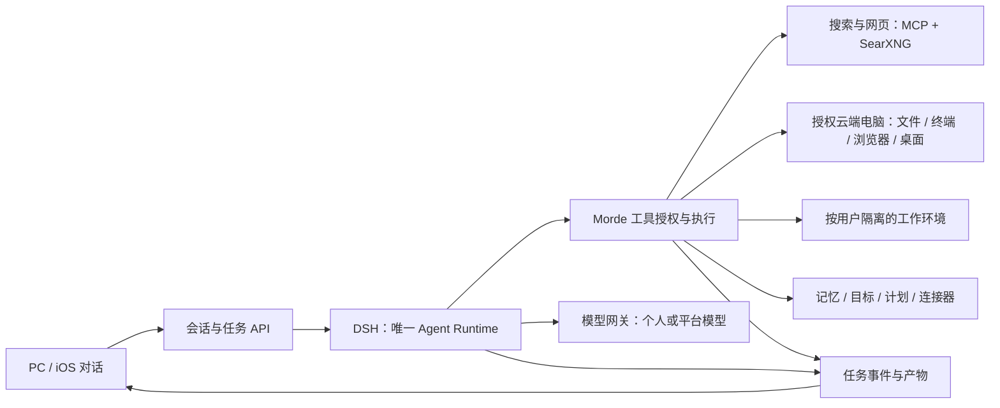

# Morde Agent Runtime 与 AI 能力设计方案

日期：2026-11-06。依据 [Meta Muse 能力对齐方案](./Meta-Muse能力对齐与Morde开源复用方案.md)、[开源能力调研报告](./Morde-Agent-Runtime开源能力调研报告.md)及当前源码。配套：[实施任务 TODO](./实施/Morde-Agent-Runtime与AI能力实施任务todo清单文档.md)。本文为目标设计，不能代表尚未验收的能力已经可用。

## 1. 目标

用户直接用自然语言交代问题或任务，Morde 自动调用模型和工具，像 Muse 一样边工作边说明进度，最后交付结果。用户可以在同一对话里连续提出多项任务、查看每项真实工作链，并按任务停止或补充信息。AI 能了解授权范围内的用户信息和历史，能够搜索最新信息、操作用户授权的云端电脑。

保留一个 Agent Runtime 实现：**现有 DSH**。优先使用 Morde 已有的 Host、Workspace、模型网关、任务和权限服务，再接入成熟开源工具；不另写 Agent 循环或同时接入 Hermes/OpenClaw Agent。完整对齐范围仍包括目标、计划、连接器、语音、头像和多设备，分阶段交付。

当前资料中“同一对话最多一个活动任务”的旧约束由本方案覆盖。用户之前要求删除的“设为主会话”和“暂停任务”按钮不恢复；输入框下方不增加随状态变化的提示。

## 2. 总体架构

Morde 是账号、会话、任务、授权、事件和成果的唯一业务权威。一个用户有隔离的运行环境；每条对话按需启动或恢复一个独立的逻辑 Runtime 实例，同一对话只关联一个此类实例，每个并发任务有自己的 DSH session、任务 ID、上下文和执行记录。同一账号的多个实例可复用物理环境或进程，但须先验证隔离；无法隔离时使用独立进程。**不增加另一种 Runtime，也不把云电脑当作 Runtime 宿主**。

截至 2026-11-08，DSH 核心组件、Host 工具、任务事件和个人数据已有基础；后端和页面已有同会话多任务的实现，内置搜索也可在满足配置和授权时提供给无 Host 的任务。Conversation Runtime 已按会话创建、续租和隔离；迁移 00145 保留并要求先由 Guardian 确认停止旧账号级 Runtime，再启用会话级实例。真实 GPT 工具对话和已授权云电脑操作仍需完整端到端验收。

## 3. 关键设计

### 3.1 自然对话与并发

- 发送后自动创建服务端任务并按需启动 DSH；关闭页面不取消已受理任务。只有任务开始运行才显示正在处理；排队、不可用、等待确认和失败均如实说明，不能静默卡住。
- 消息先由服务端持久化，再自动判断是新任务、原任务的修改或补充、状态查询还是澄清；目标任务要明确关联 `task_id`，避免串投。消息分流与相近完成结果的展示规则，以较新的[对话与任务执行体验设计](<./Morde AI助手对话与任务执行体验设计方案.md>)为准。
- 新任务读取提交时刻的授权会话快照；其他任务的内容保留来源和状态，不作为本任务的新指令。按用户/会话/任务隔离消息、工具、结果、浏览器状态和取消；共享工作区的并发写入做冲突检查。
- 复杂任务可复用 DSH 子会话并行分工，由父任务汇总；子会话继承且不能扩大父任务授权，其步骤和结果归属父任务的工作链。
- 每个任务单独遵守租约、并发容量与幂等键；重试返回原任务。结果不明的外部操作先核对，不能自动重复执行。历史及旧任务保留，不因去掉单任务限制而删除。

### 3.2 模型、人格与记忆

- 默认沿用用户上次选择的可用模型，只有一个可用模型时自动选中；不可用时提示配置或切换。个人 API Key 继续服务端加密持久化，重启后可用，不返回给客户端或写入日志。个人模型不要求配置或扣减平台模型额度；平台模型继续使用平台预算。服务端并发容量控制对所有任务生效，用户无需手动设置个人模型配额。
- 使用已接入的 [Morde SOUL.md](/Users/zhongxuan_li/Desktop/morde/project/nanoMuse/harness/morde-cloud-runtime/src/SOUL.md) 作为默认人格，服务端嵌入副本须通过回归测试保持一致；模型网关发现 DSH 已注入相同 SOUL 时不重复附加。用户授权的个人 SOUL、资料和偏好可补充。AI 默认称自己为 Morde；被明确问到实际模型或厂商时，根据已知信息如实回答。变更用户个人 SOUL 成功后告知用户。
- 复用个人资料、记忆和会话存储；按当前任务检索有权访问的相关历史，长度受限并保留原始记录。用户可查看、修改、删除或关闭记忆；删除后不再通过摘要、索引或缓存召回。个人信息不能进入未授权项目或其他用户的对话。

### 3.3 工具与云端电脑

| 能力 | 默认实现 | 必要条件 |
| --- | --- | --- |
| 最新新闻与网页 | `mcp-searxng` 的 `searxng_web_search`、`web_url_read` + 自部署 SearXNG。 | 内置服务地址固定、任务级授权；外部搜索和网页需要网络。搜索词只包含必要信息，不包含密钥或无关个人资料；答复给来源及可核实日期，失败时如实说明。 |
| 云电脑 | 优先复用现有 Host 的 `shell_exec`、`file_*`、`browser_*`、`desktop_*`，由 Broker 调用。 | 使用用户选定或明确设置的默认 Host/Workspace；无可用目标或授权时询问，不静默操作其他电脑或自动创建付费资源。 |
| 无 Host 的文件/命令 | 复用可用的 DSH 文件/终端组件或 Filesystem MCP，并运行在用户隔离的工具环境。 | 只访问授权工作目录；Filesystem MCP 不提供 Shell，需单独接终端执行环境；不把主服务进程或 DSH 运行容器当作用户 Shell。 |
| 图形与网页操作 | 复用 Host 桌面/浏览器；无 Host 时按需评估 Playwright MCP；参考 nanoMuse Hands。 | 支持查看、点击、输入和用户接管；图像经所有权与大小校验。Playwright 本身不是隔离边界；Morde 当前 MCP 客户端对图片结果还需适配。 |
| 产物与技能 | 复用 Workspace 和任务产物；文档使用现成开源库，技能参考 nanoMuse/DSH。 | 文件保存、预览有真实存储结果；技能说明不等于可执行工具和权限。 |

模型只收到任务当前实际可用的工具；缺少工具、视觉能力或目标时明确说明。GPT 和 DeepSeek 可共用工具链；普通对话允许只支持文字的模型，工具或图像任务则要求模型具备相应能力。MCP 内置服务通过受控内部通道访问，用户自定义 MCP 的 HTTPS 和内网地址防护不放宽；网页和工具返回内容视为不可信数据，不得凭其中的指令扩大授权。

### 3.3.1 优先复用 DSH 插件

DSH 是唯一 Agent 引擎，插件负责可复用的执行能力；Morde 负责用户、会话、任务、授权、模型网关、操作账本和产品界面。如下是**目标选型**，不代表插件已经安装或完成集成。对照的 [DSH 上游源码](https://github.com/deepseek-ai/deepseek-harness)本地快照为 `fcc0ad462172522aaf5c93a7b2e01f6b9f0b0159`，Runtime 的上游 DSH 包锁定 `0.2.2-rc.1`；Morde 数据库使用的 Runtime 协议/检查点兼容标识仍为 `0.2.0-rc.2`，不得仅因依赖升级而改变。

| Muse / Morde 能力 | 优先复用的 DSH 能力 | Morde 接入和边界 |
| --- | --- | --- |
| 对话、连续工作及恢复 | 已使用 `dsh-agent`、`dsh-agent-loop`、`dsh-session`、`dsh-session-persistence`、`dsh-session-checkpoint-policy`、`dsh-tools`。 | 沿用 Morde 持久存储和模型网关；按对话创建逻辑 Runtime，按任务隔离会话、消息、取消和恢复。DSH 的 inbox、检查点不能替代消息修订与操作账本。 |
| 并行分工 | 优先使用 `dsh-subagent`、`dsh-subagent-spawn-in-process`、`dsh-tool-subagent` 和 `dsh-tool-subagent-control`；需要已完成对话快照时使用 `dsh-subagent-fork-in-process`。 | 与现有 DSH 子会话委派对照，验证授权、预算、父子停止、检查点和事件归属后替换重复逻辑。spawn 从空对话开始，由 Morde 按授权提供所需上下文；fork 的历史和新工具作用域须重新授权。子 Agent 仍属于同一种 DSH Runtime。 |
| 文件与代码 | `dsh-tool-fs`、`dsh-tool-fs-search`、`dsh-fs-observation-policy`，包括读取、写入、编辑、补丁、搜索和可选图片读取。 | 绑定用户授权的 Workspace 或任务隔离环境，记录写入回执并检测冲突；适配现有 Host/Workspace 服务，避免绕过 Broker。图片读取还需附件存储与支持视觉的模型。 |
| 终端及脚本 | `dsh-tool-bash`、`dsh-shell`、`dsh-bash-sandbox` 及可用的沙箱后端。 | 在独立、限资源的任务容器或等效隔离环境执行；由 Morde 管理目录、取消、网络及产物。不能把主服务或目前共享的账号 Runtime 直接作为用户 Shell。 |
| 搜索和读网页 | 优先使用 `dsh-web`、`dsh-tool-web` 的搜索与抓取接口，接入 Morde 受控 Provider。 | 复用已有 `mcp-searxng` + SearXNG 后端，在 GPT、DeepSeek 等模型间共享并保留权限及记录。DSH 的 DeepSeek 搜索 Provider 另需对应凭据；HTTP 抓取后端允许内网地址，不能直接用于公共抓取。新接口完成前沿用当前已接入的工具路径。 |
| 技能、Office 产物 | `dsh-skill`、`dsh-skill-filesystem`、`dsh-tool-skill`；文档、表格、演示文稿优先评估 `dsh-skill-office`。 | 技能按权限发现、加载；Office 技能需要同一隔离环境中具备它依赖的解释器、库和文件/终端工具。技能说明不等于工具已接通；成果须保存到授权 Workspace。 |
| 云电脑、浏览器和桌面 | DSH 工具注册与 Agent 循环。 | 复用 Morde 现有 Host 的 Shell、文件、浏览器及截图/键鼠接口作为 DSH 工具，继承目标电脑授权、用户接管和操作记录。DSH 插件本身不提供 Morde 云电脑。 |
| 外部应用与 MCP | 评估 `dsh-mcp-client`、`dsh-mcp-manager`、`dsh-mcp-resources`，接入可用的开源 MCP 服务。 | Morde 现有连接器、OAuth、授权版本、审批与账本继续生效；直接挂载前必须证明每次调用都经过相同权限和幂等门禁，同一能力只保留一条受控执行路径。 |
| 批量、多步骤工具调用 | 后续评估 `dsh-tool-executor-ptc` 及兼容的 PTC 运行环境，让模型用程序组织已授权工具。 | PTC 只改变工具调度方式，不增加模型权限；嵌套调用也需纳入预算、停止、操作账本和工作链，并在隔离环境运行。基础工具链验收前不依赖它。 |
| 会话导航与真实工作链 | 可评估 `dsh-session-projection`、`dsh-session-turn-outline` 和工具执行事件。 | DSH 事件映射到 Morde 持久化的任务消息、工具开始/结束、审批和结果；按任务与事件序号推送、续读。轮次大纲不等于工具工作链，尽力投递的遥测也不能作为权威事件源。 |
| 长期记忆、人格、计划和提醒 | `dsh-system-prompt` 注入现有 Morde SOUL；DSH 工具调用访问业务能力。 | 保留 Morde 的用户资料、历史检索、记忆开关、目标、计划和通知服务；用户隔离、删除与撤权由 Morde 保证，DSH 会话历史不自动等于跨对话记忆。 |

工具插件先纳入任务可用工具清单，再通过 `tools/pre-execute` 等钩子与 Morde 的执行代理衔接；所有副作用仍须经过对应任务的授权、取消、持久化回执和重放规则。当前接入仅允许任务下发名单中的工具，直接 `ctx.plugin()` 新工具会被该门禁拒绝，不能通过取消检查来接入。注意 `dsh-fs-sandbox` 的围栏主要限制**写入**，不隔离读取；需要进程/容器和文件权限共同隔离。循环提醒插件只是建议，工具超时插件依赖下游配合取消，均不能替代任务级停止与资源限制。

实时语音、头像、移动设备、消息渠道、邮箱、购物支付及第三方账号权限还需要各自的客户端或服务连接；DSH 可以编排调用，但安装插件本身不会产生这些服务。暂不启用向外上报会话的遥测插件；本次调研和验证仅在本地进行，不外发文件。

### 3.4 可见的工作链

- 复用任务的 `task.message`、`task.step`、`task.operation`、`task.waiting_user`、`task.result` 等已持久化事件和 SSE。每项带所属 `task_id`、任务内递增序号及时间；消息、真实工具开始/结束、结果和确认卡片关联同一任务。
- 用户先看到简短确认，随后在对应消息附近看到例如“正在搜索”“正在读取来源”“正在操作云端电脑”；点开工作链可查看实际步骤及结果摘要。进度必须来自已发生的事件，不虚构工具调用，不展示内部推理、密钥或原始敏感参数。
- 同一对话的多个任务分别订阅并按各自序号去重；断线从游标续读，游标过期回读任务快照。取消、审批和追问只作用于指定任务；停止按钮放在发送按钮旁，多任务时先选择要停止的任务，不新增暂停按钮或输入框下方跳动区域。
- 只在确有疑问或敏感操作时请求用户参与；确认绑定操作对象、参数、任务和版本。操作失败、拒绝、取消或结果未知时明确告知，不宣称已完成。

### 3.5 其他 Muse 能力

在核心对话、搜索和云电脑闭环完成后，复用现有目标、计划、通知和个人数据服务，接入定时/事件触发与可关闭的 Ideas 主动建议；接入用户授权的邮件、日历、联系人及办公、开发等连接器，支持在隔离环境中配置技能。再扩展即时消息入口、专属邮箱、购物预订、实时语音及打断、头像/媒体和多设备。具体商业服务、硬件和支付受供应商接口、账号及地区条件约束，订单对象与金额等敏感操作须由用户确认。参考项目与候选组件见两份调研报告，逐项固定版本、确认许可证和兼容性。

## 4. 实施顺序与验收

1. **核心闭环**：会话多任务、Morde 人格、进度链、搜索、云电脑操作和用户隔离；输入框稳定，不要求用户配置 Runtime。
2. **持续工作**：长期记忆、无 Host 隔离工作环境、文件成果、目标与计划；任务在页面关闭后可继续、恢复与查询。
3. **能力扩展**：授权连接器、即时消息、专属邮箱及购物预订，再扩展语音、头像和多设备；具体服务按接口可用性逐个验收。

核心验收示例：用户问“最近有什么 AI 新闻”，先收到确认，看到真实搜索和阅读步骤，最后获得带来源的答复；随后交代 AI 在授权云电脑处理一个本地文件，看到操作步骤和已核验成果；期间再发另一任务，两个任务各自推进，停止一个不影响另一个。刷新页面或换客户端后进度和结果可恢复。另用两个用户验证消息、授权文件、浏览器和工具结果不串；长期记忆在对应阶段另行验证隔离与删除。

开发与验收遵循当前用户约束：仅在本地修改，不外发或发送文件；连接器及文件外发场景使用本地替身和合成数据验证，不实际发送用户文件或附件。
