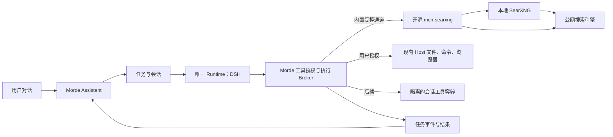

# Morde Agent Runtime 开源能力调研报告

调研日期：2026-11-06。目标是在保持一个 Agent Runtime 的前提下，让用户在 AI 助手里直接对话、联网查询、执行任务，并看到过程和结果；能力和工具优先直接使用开源项目。

> 范围更新：用户已确认参照对象是 Meta Muse，目标覆盖其公开的完整能力，而不只限于搜索。请以[Meta Muse 能力对齐与 Morde 开源复用方案](./Meta-Muse能力对齐与Morde开源复用方案.md)为后续范围和并发设计的依据；本报告的搜索优先顺序仅是最初的落地切片。

## 1. 结论与建议

**保留已经接入的 DSH 作为唯一 Agent Runtime，优先通过 MCP 复用现成工具。第一步接入 `mcp-searxng` 和自部署 SearXNG，解决无云电脑时不能搜索、阅读网页的问题；文件、命令和浏览器能力复用 Morde 已有 Host 工具，随后为无 Host 场景补充隔离执行环境。**

这不是重写 Agent 循环。Morde 只需要把现成工具接入现有的授权、任务、事件和恢复链路。Hermes、OpenClaw、nanoMuse 中的工具和设计可按能力复用，但不应同时启动四套 Agent 来处理同一次对话。

需要区分三个不同的东西：**模型**负责判断和生成回复；**DSH Runtime**驱动模型、工具和会话；**工具服务**负责实际搜索、读网页或操作文件。把 GPT/DeepSeek API Key 填好只能连接模型，不会自动产生搜索引擎。

## 2. 当前问题的代码证据

1. **当前不是完全没有工具。** [Morde 工具注册](/Users/zhongxuan_li/Desktop/morde/server/internal/app/cloud_dsh_tool_broker.go:131)仅在任务有 `HostID` 时加载 Host 工具；同时按条件加载 MCP、个人资料、附件、技能和提问工具。[Host 工具定义](/Users/zhongxuan_li/Desktop/morde/server/internal/app/runtime_tool_executor.go:32)已有 `shell_exec`、文件读写、浏览器及桌面操作，但还需要目标电脑、相应权限和 Host 能力可用。
2. **截图里的任务没有搜索工具。** 本地只读检查显示，截图对应的 12:57 任务在服务端完成，未选择 Host，记录的工具调用次数为 0，任务 MCP 授权数也为 0。工具注册处没有直接提供通用 `web_search` 或 `web_fetch`。因此模型回复“没有实时联网工具”符合该任务实际能力；不能由此推断 DSH 没启动或所有任务都没有工具。
3. **技能说明不是可执行工具。** [技能读取实现](/Users/zhongxuan_li/Desktop/morde/server/internal/app/cloud_dsh_skills.go:106)明确说明技能不增加权限；同文件要求不存在 `web_search`、`web_fetch` 时不能虚构能力。加入飞书或新闻技能说明，不等于接入了飞书或搜索。
4. **MCP 基础已存在，但当前对话没有自动挂载。** [对话 API](/Users/zhongxuan_li/Desktop/morde/server/internal/api/conversations.go:74)支持 `mcp_connector_ids`；[Assistant 提交逻辑](/Users/zhongxuan_li/Desktop/morde/web/portal/src/routes/Assistant.tsx:357)没有传该字段。[任务授权存储](/Users/zhongxuan_li/Desktop/morde/server/internal/store/postgres/mcp_connector_grants.go:32)支持用户自己的连接器，项目任务还有项目授权；[Broker](/Users/zhongxuan_li/Desktop/morde/server/internal/app/cloud_dsh_mcp.go:43)只暴露已授权且目录一致的工具。不能假定只部署一个 MCP 服务就会自动进入每个对话。
5. **直接把本地 MCP 地址填到现有连接器不可行。** [连接器校验](/Users/zhongxuan_li/Desktop/morde/server/internal/app/mcp_connectors.go:318)要求公网 DNS 的 HTTPS 443；[网络客户端](/Users/zhongxuan_li/Desktop/morde/server/internal/mcpconnector/client.go:293)还会拒绝解析到内网地址。应增加仅供系统内置服务使用的固定可信通道，不能放宽用户自定义连接器的限制。
6. **Morde 已使用 DSH。** [运行适配器](/Users/zhongxuan_li/Desktop/morde/project/nanoMuse/harness/morde-cloud-runtime/src/engine.mjs:1)引入 DSH Agent、Agent Loop、Session 和 Tools；[工具注册及 IPC 分发](/Users/zhongxuan_li/Desktop/morde/project/nanoMuse/harness/morde-cloud-runtime/src/engine.mjs:680)由 Morde 负责授权工具的适配。当前固定版本是 `0.2.0-rc.2`。上游本次调研版本是 `0.2.2-rc.1`，不能直接假定新插件与现有版本兼容。
7. **已有会话上下文，但不是无限长期记忆。** 最近对话按最多 128 条及约 32 KiB 截取，见[对话上下文](/Users/zhongxuan_li/Desktop/morde/server/internal/store/postgres/task_conversation_context.go:20)；个人资料按授权加载，见[个人上下文](/Users/zhongxuan_li/Desktop/morde/server/internal/app/cloud_dsh_personal_data.go:22)。旧对话的长期检索、摘要和用户可管理记忆仍需进一步完善。

## 3. 四个项目的源码对比

以下均为源码及文档分析，不代表已在 Morde 中完成移植或线上压测。对应仓库已经下载到本机 `.local/agent-runtime-study.l1K52T/`；只检出本次分析涉及的目录。

| 项目 | 运行与工具的实际做法 | 值得复用的部分 | 接入 Morde 的判断 |
| --- | --- | --- | --- |
| **DSH** | Agent Loop 选择模型和工具并推进会话；`dsh-tool-web` 定义搜索、抓取工具，底层搜索/抓取 provider 另行挂载；还提供文件、Shell、MCP、会话等包。 | 继续使用现有 DSH Agent Loop；参考或复用其工具、会话和取消机制。 | 与现有栈最接近。新版本 web 插件不能直接宣称可用于当前 `0.2.0-rc.2`，需要同版本验证；联网请求仍要经过 Morde 的授权与执行边界。 |
| **Hermes Agent** | 自带 Python Agent、工具集、`web_search`/`web_extract`、文件、终端、浏览器、记忆。搜索后端包括 SearXNG 及其他 provider；终端有本地和 Docker 等后端。 | 搜索后端选择、工具进度回调、每用户 memory provider 的隔离契约，以及按任务区分执行环境的做法。 | 内置工具依赖 Hermes 自身注册、配置和上下文，不能当作已兼容 DSH/MCP 的独立包直接加载。更适合作为能力参考，只有验证其独立服务接口后才复用实现；不建议再引入整套 Agent。 |
| **OpenClaw** | `web_search` 是统一工具，provider 通过插件提供；`web_fetch` 做网页抽取；还提供会话和沙箱机制。 | 搜索的可用性判断、网页内容视为不可信输入、进度事件、会话级沙箱与权限策略。 | 工具依赖 OpenClaw 的运行时与插件配置，不是现有 Morde 可直接调用的 MCP 服务。保留为设计和实现参考，避免把第二套 Runtime 塞进 Morde。 |
| **nanoMuse** | Desktop 使用 DSH；其独立 Python Agent 也实现了工具循环、网络搜索/阅读和记忆检索。Desktop 用 MCP 把电脑操作和连接器挂到 DSH。 | MCP 挂载方式、搜索与网页读取的交互、中文工具进度文案、关键词/可选语义记忆。 | 可借鉴其 DSH 集成路径；上游 Python 搜索工具属于另一套运行时，并非已装进 Morde。Desktop 操作工具仍需要可用电脑，不能直接解决当前无 Host 搜索。 |

核心源码：

- DSH：[Agent Loop](https://github.com/deepseek-ai/deepseek-harness/blob/fcc0ad462172522aaf5c93a7b2e01f6b9f0b0159/packages/core/agent-loop/src/agent.ts#L288-L297)、[Web 工具与 Provider 分层](https://github.com/deepseek-ai/deepseek-harness/blob/fcc0ad462172522aaf5c93a7b2e01f6b9f0b0159/packages/web/README.md#L10-L33)、[文件工具](https://github.com/deepseek-ai/deepseek-harness/blob/fcc0ad462172522aaf5c93a7b2e01f6b9f0b0159/packages/fs/tool-fs/README.md#L10-L12)。
- Hermes：[工具集](https://github.com/NousResearch/hermes-agent/blob/ca4360692055bdb4df3a695c164646e528891da8/toolsets.py#L11-L22)、[搜索和网页读取](https://github.com/NousResearch/hermes-agent/blob/ca4360692055bdb4df3a695c164646e528891da8/tools/web_tools.py#L302-L306)、[进度回调](https://github.com/NousResearch/hermes-agent/blob/ca4360692055bdb4df3a695c164646e528891da8/agent/tool_executor.py#L1023-L1030)、[用户记忆隔离契约](https://github.com/NousResearch/hermes-agent/blob/ca4360692055bdb4df3a695c164646e528891da8/agent/memory_provider.py#L84-L102)。
- OpenClaw：[搜索工具源码](https://github.com/openclaw/openclaw/blob/f6bb06e7982f8cf191d58019d26d8a049611828b/src/agents/tools/web-search.ts#L79-L151)、[搜索服务配置](https://github.com/openclaw/openclaw/blob/f6bb06e7982f8cf191d58019d26d8a049611828b/docs/tools/web.md#L66-L99)、[抓取进度](https://github.com/openclaw/openclaw/blob/f6bb06e7982f8cf191d58019d26d8a049611828b/src/agents/tools/web-fetch.ts#L580-L587)。
- nanoMuse：[Desktop 基于 DSH](https://github.com/nano-muse/nanoMuse/blob/8b32d43c946db2bbef6fae39c48a9fc608ebd8e9/docs/desktop.md#L1-L9)、[Python 网络工具](https://github.com/nano-muse/nanoMuse/blob/8b32d43c946db2bbef6fae39c48a9fc608ebd8e9/nanomuse/tools/web.py#L130-L151)、[MCP 连接器挂载](https://github.com/nano-muse/nanoMuse/blob/8b32d43c946db2bbef6fae39c48a9fc608ebd8e9/harness/dsh-nanomuse/src/connectors-tools.ts#L1-L15)。

## 4. 优先直接复用的工具清单

| 能力 | 优先选用 | 复用方式及前提 |
| --- | --- | --- |
| 联网搜索、读取网页 | [mcp-searxng](https://github.com/ihor-sokoliuk/mcp-searxng/blob/c2429d9def2235a69c60fabae2bf7f36bffe6805/README.md#L23-L28) + [SearXNG](https://github.com/searxng/searxng) | 直接运行开源 MCP 服务：`searxng_web_search` 搜索，`web_url_read` 读取正文。MCP 服务与 SearXNG 是两个组件，后者需开启 JSON 搜索。适合本地自部署，不需要搜索 API Key，但仍需互联网及可用上游搜索引擎。 |
| 文件与终端，有 Host | Morde 现有 `file_*`、`shell_exec` | 继续经 Host/Workspace 授权和操作账本调用；先修复环境不可用的可见提示，不再重复开发同类工具。 |
| 文件与终端，无 Host | DSH 的 [`dsh-tool-fs`](https://github.com/deepseek-ai/deepseek-harness/blob/fcc0ad462172522aaf5c93a7b2e01f6b9f0b0159/packages/fs/tool-fs/README.md#L25-L42) / [`dsh-bash-sandbox`](https://github.com/deepseek-ai/deepseek-harness/blob/fcc0ad462172522aaf5c93a7b2e01f6b9f0b0159/packages/shell/bash-sandbox/README.md#L42-L64)，或官方 [Filesystem MCP](https://github.com/modelcontextprotocol/servers/tree/36380287ed3b15d115b55f546617d723072b1296/src/filesystem) | 在独立、受限的会话工作目录和执行容器中使用，接回 Morde 的任务授权、取消、操作记录及产物保存；先做与当前 DSH 版本的兼容验证，不能直接给主服务进程开放本机文件和 shell。Filesystem MCP 本身也不提供终端。 |
| 浏览器操作 | Morde 现有 Host 浏览器；无 Host 时评估 [Playwright MCP](https://github.com/microsoft/playwright-mcp) | 使用隔离浏览器与独立登录态。Playwright MCP 自身声明不是安全边界，需要外围网络、文件和身份隔离；不能默认接管用户已有浏览器。 |
| 需要登录的外部系统 | 对应厂商官方 MCP / API，复用 Morde MCP 连接器 | 按用户或项目分别授权、保存凭据并固定任务工具清单；没有连接器时明确说明，技能文档不能冒充权限。 |
| 记忆与对话历史 | Morde 已有数据库、个人资料与会话上下文；参考 Hermes/nanoMuse 的检索方式 | 先使用现有存储和权限，补充按用户/会话过滤的检索、摘要和管理能力。语义检索后续可选择本地开源组件；避免默认把完整历史发往外部检索服务。 |

### 为什么首选 mcp-searxng

本次查看的版本为 `2.10.0`，源码提交 `c2429d9def2235a69c60fabae2bf7f36bffe6805`，MIT 许可。它同时提供搜索和网页读取，支持 STDIO 与 Streamable HTTP；[源码](https://github.com/ihor-sokoliuk/mcp-searxng/blob/c2429d9def2235a69c60fabae2bf7f36bffe6805/src/url-reader.ts#L746-L765)对网页跳转做校验，[DNS 连接逻辑](https://github.com/ihor-sokoliuk/mcp-searxng/blob/c2429d9def2235a69c60fabae2bf7f36bffe6805/src/proxy.ts#L113-L145)检查解析地址。它是**待集成候选**，本次尚未实际部署联调，不能保证所有站点、模型和上游搜索引擎都可用。

上线前需要特别处理：

- 默认搜索与网页缓存为 **24 小时**；新闻场景建议配置较短 TTL，例如 5 分钟，且不能把缓存当作实时结果。输出日期缺失时应如实显示未知。[配置源码](https://github.com/ihor-sokoliuk/mcp-searxng/blob/c2429d9def2235a69c60fabae2bf7f36bffe6805/CONFIGURATION.md#L95-L104)
- 搜索代码会记录查询文本，且有进程级缓存；多用户部署需要关闭或限制敏感日志、评估缓存隔离，避免泄露查询和结果。[搜索代码](https://github.com/ihor-sokoliuk/mcp-searxng/blob/c2429d9def2235a69c60fabae2bf7f36bffe6805/src/search.ts#L1030-L1065)
- `MCP_HTTP_ALLOW_PRIVATE_URLS` 保持关闭；MCP 到固定 SearXNG 后端的内部访问与模型指定 URL 的网页抓取应是不同权限。不要为连接本地服务而全局关闭 SSRF 防护。
- 如改用 DSH 上游 HTTP 抓取实现，其当前 provider 明确支持内网和回环地址，不能直接作为多用户公共网页读取的安全边界。[DSH provider 源码](https://github.com/deepseek-ai/deepseek-harness/blob/fcc0ad462172522aaf5c93a7b2e01f6b9f0b0159/packages/web/web-fetch-http/src/provider.ts#L32-L39)
- 官方 [Fetch MCP](https://github.com/modelcontextprotocol/servers/blob/36380287ed3b15d115b55f546617d723072b1296/src/fetch/README.md#L11-L14)可作为备选，但其文档明确提示 DNS 重绑定限制；不能仅因其为官方项目就省略外围网络隔离。

## 5. 推荐接入架构

**对接工作保持最小，但不能跳过：**

1. 在 macOS 启动脚本及服务部署中固定并启动 MCP 服务和 SearXNG，检查两者就绪；工具服务留在内网。固定版本/镜像摘要，避免启动时自动追随 `latest`。
2. 为平台内置的 MCP 服务增加独立的、固定目标的内部连接方式。普通用户仍只能配置现有公网 HTTPS 连接器；内部地址不能由模型参数或用户自定义 URL 决定。
3. 在创建个人对话任务时自动附带系统允许的搜索工具，并赋予任务级授权；项目任务遵守项目授权。复用已有 MCP 工具目录固定、调用记录、取消和失败处理；不要让 DSH 子进程绕过 Broker 直接访问服务。现有个人连接器按 owner 建立授权，因此平台内置服务的归属和授权需要明确实现，不能只改前端传一个 ID。
4. 只暴露搜索和网页读取所需工具；由服务端持有工具服务凭据。模型密钥继续留在现有模型网关，工具服务不接触模型密钥。GPT 和 DeepSeek 走相同工具接口，但前提是该模型连接确实支持工具调用。
5. 将任务事件转换成对话中的自然进度，例如“收到，我先搜索”“找到几条来源，正在阅读”；来源和最终答复进入对话。复用现有 SSE 事件通道，避免在输入框下方增减提示造成布局移动；不展示内部推理或密钥。
6. 为请求设置超时、响应大小与调用次数限制；未配置或服务不可用时让模型如实说明，不能编造搜索结果。搜索只发送完成请求所需的查询；遵守当前用户“不外发文件”的要求，不把本地文件或完整历史随搜索发送出去。

### 用户示例的目标流程

用户：“帮我搜索一下最近有什么 AI 新闻。”

1. DSH 先在对话中回复“收到，我先搜索最近的 AI 新闻”。
2. 调用 `searxng_web_search`，选择相关结果，再用 `web_url_read` 读取可访问的来源。
3. 对话中显示“正在阅读来源”；结束后给出新闻摘要、实际发布日期或未知，以及可点击来源链接。
4. 搜索失败或访问受限时说明原因；不能把缓存、搜索摘要或模型已有知识伪装成已经核实的最新消息。

## 6. 多用户、并发与持续工作

- **一个 Runtime 实现，多份隔离会话。** 当前 [Runtime 管理器](/Users/zhongxuan_li/Desktop/morde/server/internal/worker/cloud_dsh_account_runtime.go:76)按 owner 维护账号运行环境；[账号进程](/Users/zhongxuan_li/Desktop/morde/project/nanoMuse/harness/morde-cloud-runtime/src/account-runtime.mjs:219)按任务启动独立子进程并限制并发。[Worker 配置](/Users/zhongxuan_li/Desktop/morde/server/cmd/portal/main.go:879)已有全局及每用户并发上限。这里是源码设计和单元测试证据，不是对实际吞吐量的保证。
- 当前任务创建和数据库索引限制同一对话同时只能有一个活动任务，不同对话可受限并发；这与 Meta Muse 在同一对话中并行处理多个独立任务的体验有差距。后续需要按补充方案改造任务路由、数据库约束与事件展示，并保留同一任务内的消息顺序。当前实现是每账号容器管理多个任务进程，不能表述为每个对话都已有长期独占容器；如产品要求物理独占，需另外设计并评估资源成本。
- 工具调用、工作目录、附件、浏览器 Cookie、记忆读取均按用户及任务授权；项目数据再按项目权限过滤。共享工具服务不能持有用户浏览器状态，也不能让一个用户取到另一个用户的工具结果或缓存数据。
- 保留 Morde 已有的任务租约、授权版本、checkpoint 和操作账本。重启恢复时读取已确认结果；写操作结果未知时暂停核对，不盲目重放。停止任务要终止工具执行，并确保不会产生迟到的跨会话结果。
- 个人记忆建议分为近期本会话上下文、用户明确保存的资料、历史摘要/按需检索三层；提供查看、更正和删除，个人对话及项目对话分别授权。不要把“该用户历史全部自动灌入模型”当作隔离方案。

## 7. 实施顺序与验收

### P0：让无云电脑对话能搜索和回答

部署 `mcp-searxng` + SearXNG；补内置安全通道和任务授权；把搜索/读取事件展示在消息流中；确保来源链接、异常和停止按钮可用。主要触点为 `scripts/start-macos.sh`、服务端 MCP 客户端与 Broker、任务创建授权，以及 `web/portal/src/routes/Assistant.tsx`。这是集成现成组件，仍需必要的 Morde 适配及测试。

验收：用户只配置可用模型，选择“无电脑目标”，询问最新 AI 新闻；能看到至少一次真实搜索与网页读取进度，最终答复引用实际来源。服务未启动、上游限流、模型不支持工具调用时分别给出可理解的失败信息，不造假。

### P1：让 AI 在隔离环境中完成文件和命令任务

先打通已有 Host 工具；随后给无 Host 任务提供隔离会话工作目录和现成文件/终端工具，生成结果后通过 Morde 的产物机制交付。复用 DSH 或 MCP 工具前完成版本兼容、安全隔离及操作账本的集成验证。动态网页或需要登录的网站再接入隔离浏览器。

验收：两个用户并发生成并修改各自文件，分别读取正确结果；任务取消后停止执行；重启恢复不重复写入；无权限或工具环境不可用时明确失败。不得读取其他用户文件或运行在 Morde 主服务权限下。

### P2：跨会话记忆与更多连接器

在现有个人数据上补充长期记忆检索、纠错和删除；按需接入厂商维护的 MCP/API。只启用已经完成授权及验证的工具，连接凭据变化后更新授权快照。

验收：用户 A 保存偏好后在新对话能够找回；用户 B 和无权限的项目对话不能读到 A 的偏好；删除后不再被召回。外部连接器授权撤销后不得继续调用。

### 必须覆盖的集成测试

1. GPT、DeepSeek 各用一个支持 function calling 的实际模型，验证工具声明 → 模型发起 → 执行 → 结果回传 → 最终答复；模型 API Key 不出现在工具进程、日志和响应中。
2. 多用户多会话并发，验证会话历史、工具结果、缓存、浏览器状态、产物、事件均不串；超过并发限额时提示排队或稍后重试。
3. 内网、回环、云元数据地址、DNS 重绑定和跳转均被公共抓取路径拒绝；模型不能把任意地址伪装成内置 MCP 后端；网页中的指令不覆盖用户授权。
4. 模拟搜索不可用、超时、429、缓存命中和内容过大；验证可取消、可恢复、无虚构来源。对写操作验证故障和重试不造成重复执行。
5. 启动、停止、重启后再次对话；检查历史、记忆和授权按预期保留，停止按钮在发送按钮旁且输入框位置稳定。

## 8. 开源许可与本次验证范围

本次查看的 Hermes、OpenClaw、DSH 和 `mcp-searxng` 根许可为 MIT；nanoMuse 为 GPL-3.0-or-later；SearXNG 为 AGPL-3.0-or-later。正式分发或修改前应核对各组件及依赖的实际许可义务，不把独立部署自动等同于没有许可义务。

已在本地以 `GOPROXY=off GOSUMDB=off` 运行 Morde 现有定向 Go 测试，涉及 hostless 技能、MCP 授权与恢复、个人资料授权、账号隔离、对话上下文上限和 MCP 地址校验，四个相关包均通过。没有启动或安装上游服务，没有调用真实模型或真实搜索，因此上述 P0/P1/P2 是建议和验收目标，不是已经实现的功能，也不能据此判断真实并发性能。
