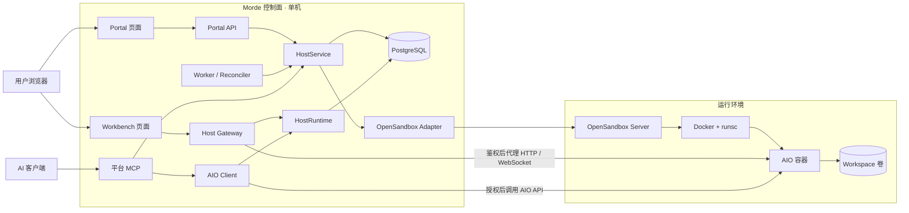

# Morde 架构与功能说明

> 更新日期：2026-10-20。本文描述当前**单机基础版**，以 [00 总览与公共约定](实施/00-总览与公共约定.md) 为接口和范围准绳；功能状态以实施清单及验证记录为准。

## 1. 产品定位

**AIO 是一台容器内部的计算机，Morde 是管理这些计算机的平台。** AIO 提供浏览器桌面、noVNC、Shell、文件和底层 MCP；OpenSandbox 负责创建和运行容器。Morde 提供用户与主机管理、工作目录保留、权限和凭证隔离、网页入口、私有预览，以及面向 AI 的平台 MCP。

如果只需要自己操作一台容器，直接使用 AIO 已能完成许多任务。Morde 的价值在于让多个用户安全、持续地使用各自的主机，并让网页和 AI 在同一权限规则下访问同一台主机。基础版部署在**一台 Linux 服务器**上；它尚不是多节点平台。

| 组件 | 负责什么 | 不负责什么 |
|---|---|---|
| AIO 容器 | 容器内的浏览器、noVNC 桌面、Shell、文件及原生 MCP/API | 平台用户、跨主机权限、主机生命周期和持久工作目录的归属 |
| OpenSandbox + Docker/runsc | 按模板创建、查询、续期和删除隔离容器 | 门户登录、业务配额及用户工作流 |
| Morde Portal/API/Worker | 登录、用户配额、Host 与 Workspace 生命周期、自动回收、审计 | 重写 AIO 的浏览器或 Shell |
| Morde Gateway/Workbench | 鉴权后进入主机、代理 AIO 页面与长连接、文件和终端操作入口、私有端口预览 | 实现另一套 noVNC |
| Morde 平台 MCP | 用平台 API Key 选择并授权某台 Host，提供有界的主机、Shell、文件、浏览器工具 | 向 AI 返回 AIO 密钥或绕过 Host 权限 |

## 2. 基础版架构图

部署时 Caddy 承接 HTTPS 并按 Portal、Host 和私有预览域名转发；图中省略了这一层。图中两条访问路径有不同用途：**用户浏览器**通过一次性 ticket 换取 Host Cookie，再经 Gateway 查看 Workbench 和 AIO；**AI 客户端**用平台 API Key 访问 `/mcp`，Morde 校验用户、Host 所有权和状态后经 `RuntimeControl` 调用受管运行端。AIO 密钥留在服务端，只供 Gateway 和非 AI 管理调用。当前本地开发代理可让 `5174` 工作台直接显示 AIO 的 noVNC，这只是演示连接，不等于正式 Gateway 流程已验收。

## 3. 主流程与功能

| 功能 | 基础版行为 | 主要归属 |
|---|---|---|
| 登录与身份 | Portal 会话、用户与管理员、API Key；用户只能访问自己的 Host/Workspace | Morde Portal/API |
| 主机管理 | 使用唯一模板 `std-2c4g` 创建、查询、进入、续期和删除 Host；状态只有 `creating/running/failed/deleting/deleted` | Morde HostService + OpenSandbox |
| 工作目录 | Workspace 独立于 Host；删除 Host 默认保留目录，之后可挂到新 Host；同一目录不能同时挂到两台 Host | Morde + PostgreSQL + Docker 卷 |
| 网页工作台 | 浏览器、终端、文件与 VSCode；VSCode 仅在用户接管电脑时开放，浏览器显示 AIO 提供的 noVNC | Morde Workbench + Gateway + AIO |
| 私有预览 | 把容器内允许的非 8080 端口映射为需要登录的私有预览地址 | Morde Gateway |
| AI 操作 | 平台 MCP 当前注册 31 个工具：Host 5 个、任务 7 个、受控运行端电脑工具 18 个、私有预览 1 个；原生桌面工具包含有界截图、窗口列表/激活、绑定可见窗口的点击/文本/按键 | Morde MCP + RuntimeControl |
| 回收与审计 | Worker 处理续期、显式计算释放和对账；释放保留 Host、Workspace 与 runtime 数据，自动空闲释放暂禁用；记录脱敏审计和指标 | Morde Worker/API |
| 隔离与凭证 | 目标运行时为 runsc；Gateway 校验 Host Cookie 与 Origin，并在转发前移除客户端凭证、注入服务端 AIO 密钥 | Morde Gateway + 部署配置 |

### 一次完整使用

1. 用户登录 Portal，创建 Host；Morde 持久化 Host 与 Workspace，Worker 通过 OpenSandbox 启动 AIO 容器。
2. Host 变为 `running` 后，用户点击进入；Gateway 消费一次性 ticket，建立该 Host 的浏览器会话。
3. Workbench 经 Gateway 使用 AIO 的浏览器、终端和文件能力。AI 则用平台 MCP 操作同一 Host，受到相同的所有权和状态限制。
4. 用户可访问需要登录的私有预览；删除 Host 时默认保留 Workspace，供下一台 Host 重挂。

基础版**不含**暂停/恢复、公开预览、Host 直连令牌、通知/交接或 Kubernetes 多节点调度。参见 [00 的基础版合同](实施/00-总览与公共约定.md)及 [06 平台 MCP 工具表](实施/06-AI接入.md)。

## 4. 当前实施状态与可体验范围

截至2026-10-20，基础版已经在本机Linux VM连接真实PostgreSQL、固定OpenSandbox/runsc/AIO完成验收；具体任务状态见 [00进度表](实施/00-总览与公共约定.md)。

| 已验证结果 | 证据 |
|---|---|
| 登录、Host创建/进入/续期/删除、Workspace保留重挂 | 真实Playwright和内置浏览器；中文文件同卷读回 |
| Workbench浏览器、终端、文件 | 同一Host的VNC、终端命令、中文保存/下载、目录操作 |
| 平台MCP | 17工具脚本通过；真实Codex同Host操作及65秒会话复用 |
| 私有预览 | 页面/资源/WS HMR通过，后台进程在Shell返回后继续服务 |
| 安全边界 | runsc资源限制、宿主网络阻断、跨用户/Host拒绝、ticket重放与Origin检查 |

这是Host/Workspace/Gateway/MCP基础版。云端Agent运行器等完整助理能力属于后续产品范围；生产目标机整栈部署、数据盘保护和公网DNS/受信TLS条件见 [汇总](实施/实施阻塞项与决策项汇总.md)。

## 5. 部署、云端任务、主机归属与使用

### 5.1 拿到一台物理机，怎样让 Morde 创建 AIO？

当前基础版只接收**一台 Linux 服务器**作为部署节点，不能把任意 macOS/Linux 机器注册为工作节点。macOS 上可用 Docker Desktop 演示单个 AIO，但正式的 OpenSandbox + Docker/runsc 隔离和多用户验收以 Linux 为目标；新增物理工作节点属于后续集群化范围。

在 Linux 上，管理员按 [单机部署说明](../deploy/single/README.md)完成以下步骤：

1. 安装 Docker 24+ 并注册 `runsc`；规划 Docker 与 PostgreSQL 数据目录，配置域名、Caddy HTTPS、容量和仅回环监听的管理端口。先对固定 AIO 镜像做 runsc 浏览器/Shell/VNC 烟测。
2. 在目标机本地准备权限为 0600 的环境文件和独立的数据加密密钥、Cookie 密钥；构建 Host 镜像、Portal 二进制及两个前端。不要把密钥写入仓库或交给用户浏览器。
3. 安装受保护的OSB/DNS/guard配置并由root apply宿主网络策略，再用仓库提供的 Compose 启动 PostgreSQL、OpenSandbox Server、Caddy，执行guard check；执行 `portal migrate up` 后运行 `portal serve`。空库首次启动自动创建 `admin/admin` 超级管理员，首次改密须经本机回环地址或受信任的 SSH 本地隧道；普通用户在 Web 注册并经后台审核。Portal 进程必须由服务器持续运行，基础版未提供自动安装器或 systemd 单元。
4. 用户在 Portal 创建 Host。Morde 记录 Host/Workspace 和配额；Worker 调 OpenSandbox 在**这台 Linux 服务器**上创建 AIO 容器，完成 Ready 检查后把 Host 标为 `running`。管理员通过 Portal、审计/指标和本地验证脚本管理用户、容量与故障；不要直接改数据库或随意删除 Docker 卷。

这里的“物理机”是部署节点；Portal 里的每台“Host”则是该节点上的一个 AIO 容器及其独立 Workspace。本机Linux已验真实创建、删除、卷重挂与runsc安全链路；每个生产目标仍须按部署说明重验。

### 5.2 要像 dot 一样在本机关机后继续跑 AI 任务，还缺什么？

**Morde 基础版的职责是提供云端主机和平台 MCP 工具，不包含云端 AI 运行器；主机与MCP端到端链路已验。** 如果模型和工具调用循环仍运行在用户笔记本上，笔记本离线后任务就不能继续。OpenAI 官方文档描述的 dot 云端计算机可在设备离线时继续工作并保留状态，任务还可按时间或支持的事件恢复；Codex Cloud 的每个任务也有独立云端工作区。这些是目标体验的参照，不是 Morde 现有功能。参见 [dot 的云端计算机](https://learn.chatgpt.com/docs/dots/computers-and-apps)、[dot 的任务与记忆](https://learn.chatgpt.com/docs/dots/tasks-and-memory)和 [Codex Cloud 环境](https://learn.chatgpt.com/docs/environments/cloud-environments)。

最小路径是让**一个运行在云端的 AI 客户端**访问 Morde 的受保护 `/mcp`，并实测该客户端是否支持连接自建 MCP；AI 会话本身不依赖用户电脑。若希望 Morde **自己**提供 dot 式持续任务，还需另建：

- 云端 Agent 运行器（模型调用、工具循环、任务隔离），而非只提供 AIO 容器；
- 持久任务记录、队列、后台 Worker、心跳、失败恢复，以及定时/事件触发；
- 任务与 `user_id`、`host_id`、`workspace_id` 绑定，自动创建和续期 Host；任务活动会阻止显式释放，自动空闲回收待跨实例活动租约实现后再启用；
- 云端输入、代码和依赖准备，凭证保管，进度、日志、结果、人工决策与通知入口。

这些属于当前基础版之外的**云端任务层**。当前单机真实Host、Gateway和MCP链路已验；后续单独设计这一层，避免把“有云端容器”误认为“有持续运行的云端 AI”。

### 5.3 用户怎样知道有哪些 Host？归属如何记录？

普通用户登录后在 Portal 主机列表查看自己的 Host；AI 客户端使用平台 MCP 的 `host_list`，并用 `host_get` 读取状态。数据库中 `hosts.owner_id` 指向 `users.id`：**一个用户可拥有多台 Host，一台 Host 只有一个 owner**。`workspaces.owner_id` 同样绑定用户；一份 Workspace 同时最多挂到一台 Host，Host 删除后可保留为 `detached` 再重挂。普通用户不能查看或操作其他人的 Host，管理员可按管理权限查看。创建还受用户 Host/CPU/内存配额和单机容量限制；默认用户 Host 配额为 3，不保证服务器一定有足够容量创建 3 台。

### 5.4 用户怎样使用自己的云端 Host？

1. 打开正式 Portal 并登录，在“我的主机”创建 Host，选择新 Workspace 或本人已分离的 Workspace；等待状态从 `creating` 到 `running`。
2. 点击“进入”，由一次性 ticket 建立 Host Cookie 后进入 Workbench。浏览器标签使用 AIO noVNC，终端和文件通过同源 Gateway；开发服务可使用已认证的私有预览。用户不需要也不应取得 AIO API Key 或直连容器端口。
3. 需要 AI 操作时，在 Portal 创建只显示一次的平台 API Key，按 [Codex MCP 示例](../examples/agent/codex/config.toml)连接 Morde `/mcp`。AI 可用 `host_list` 找到 Host ID，再调用 Shell、文件和浏览器工具；其操作同样受 Host 所有权约束。
4. 到期前可续期；删除 Host 默认保留 Workspace，之后创建新 Host 时选择重挂。当前基础版没有 SSH 直连、公开预览、暂停或自动唤醒。

本地 `127.0.0.1:5174` 仍是独立演示工作台；本轮真实全链路使用 `portal.localhost` 与本机Linux栈验收。

## 6. 相关文档

- [Morde 与 Cua 源码对比及超越路线](Morde与Cua源码对比及超越路线.md)：产品定位、运行与权限机制、许可证边界、可借鉴设计及对照验收建议；不代表功能已实现。
- [00 总览与公共约定](实施/00-总览与公共约定.md)：当前基础版唯一接口、数据和范围合同。
- [01 环境基线与主机镜像](实施/01-环境基线与主机镜像.md)、[02 编排适配层](实施/02-编排适配层.md)、[03 Portal API 与工作目录](实施/03-Portal-API数据层与工作目录.md)：运行环境与主机生命周期。
- [04 主机网关](实施/04-主机网关.md)、[05 Web 前端](实施/05-Web前端.md)、[06 AI 接入](实施/06-AI接入.md)：用户与 AI 的访问路径。
- [05 Web 验证记录](验证记录/05-Web前端.md)：真实内置浏览器、Playwright与mock各自的验收证据。
