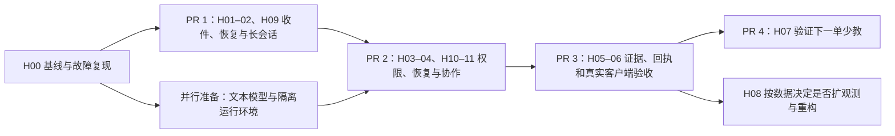

# Morde Harness 实施任务 TODO

**给负责修改 `lizhongxuan/morde` 的开发 AI。** 本清单把[最终流程与实现规格](Morde_Harness_最终流程与实现规格.md)拆成四批可评审改动，并吸收此前 Hermes 对照与长会话测试方案中的有效用例。以下任务均未按本清单完成验收；当前代码中已有的能力应先核对，不重复实现。只修当前 Harness 和现有链路，不在这里新接生产发布或 GitHub 写入。

**源码参考：** [Morde 5f97110](https://github.com/lizhongxuan/morde/tree/5f97110cf74ffe57aefc9be4664d713de3fbd62d) · [Hermes 0d49d6d9](https://github.com/NousResearch/hermes-agent/tree/0d49d6d9d20e461155d49ba9d188687079c811af)。以实现工作区实际 HEAD、`AGENTS.md` 和依赖锁为准；当前核对的 DSH 锁定版本为 `0.2.2-rc.1`，部署状态须单独核实。保留用户未提交的改动。规格定义目标行为，本清单定义实施顺序和验收；若二者不一致，先同步修正文档。旧设计仅作参考，其 H01–H07 编号与本清单编号不通用。

**边界与状态：** 本清单覆盖服务端会话、路由、任务、DSH Runtime，以及受影响的 PC/iOS 消息状态和实际验收。只在本地读写；测试使用隔离数据库和合成内容，不上传或发送文件。每项使用 `未开始 / 进行中 / 待验证 / 完成 / 阻塞`；只有实现及该项验收完成才勾选。

## 现有接口与状态边界

| 接口或状态 | 实施合同及调用方 |
|---|---|
| `TaskService.AcceptConversationMessage` / `AcceptProjectMessage` | 复用 `client_message_id` 与幂等键；同身份、同内容的重试返回原记录，ID 相同但内容/附件/选项冲突不得当作成功。服务端路由和 PC/iOS 调用方不得把受理当成任务完成。 |
| `ConversationRouteClassifier.ClassifyConversationRoute` 与路由 Worker | H01/H02 在现有消息、路由租约和快照约束下做一次无工具修复；新调用必须独立预订和结算，并在应用前复核身份与授权。若新增内部参数或模型调用阶段，同步更新调用方和账本对账。 |
| `message_delivery` v3 与 `delivery_status` | H10 复用既有 Task/Owner/Session/代次/授权、消息 ID、内容/附件及 `mode`；任务消息的 `pending` / `applied` / `unknown` 与根 Session 检查点对应。默认不加公开枚举；确需变更 API 时，同步 OpenAPI、客户端与测试。 |
| 跨 Task 摘要、历史搜索及 DSH Session 压缩 | H09 复用已有来源版本、授权查询和检查点，超预算沿用明确失败语义。摘要与当前 Task Session 的压缩分别检查，不能用其中一层替代另一层。 |
| Task 证据与原会话发布 | H05 核对现有验证 Worker、结果快照和发布事务的时序；修订/来源不匹配时不放行。若改变状态或接口，在同一改动更新现有服务端契约及 PC/iOS 调用方。 |

## P0：先让对话正常，再防误执行和误交付

- [ ] **H00｜记录基线，复现原问题，不动生产。**（未开始）
  - **做什么：** 记录 Morde HEAD、未提交改动、DSH 锁文件、实际 PC 客户端构建和测试环境。Hermes 如有独立 checkout 则记录其 HEAD；当前 `project/hermes-agent/` 无独立 Git 元数据，须记录实际关键文件 SHA-256 和许可来源，并与固定提交核对，不能把外层 Morde HEAD 记作 Hermes 版本。用现有夹具复现「分类器回自然语言」「文本模型不可用」「DSH 运行环境缺失」「目标云电脑不可用」以及长历史、超时/空响应。DSH 运行环境和目标电脑按实际需要检查；不要把云电脑准备变成普通问答的前置。
  - **完成条件：** 上述原因能分别定位；用可用文本模型完成一轮正常问答。缺真实目标环境时，标注「真实任务未验证」，不拿夹具冒充实测。附件的历史错误次数不当作当前性能基线。

### PR 1：消息受理、意图分流、模型回复

- [ ] **H01｜先持久收件，再分流。**（未开始）
  - **改哪里：** `server/internal/app/conversation_message_routing.go`、`server/internal/worker/cloud_dsh_coordinator.go` 及对应测试。复用消息 ID、原回执和 Task 关联；把「已收件」与「已建 Task」分开。普通问答直回；状态追问读取已有任务；修改、停止必须命中具体 Task；复杂工作才持久建单。简单工具优先沿用现有受控执行路径；若技术上要建内部记录，不在 UI 把它伪装成长任务，也不绕过 Broker。
  - **验收：** 双端重送同一消息只受理一次，相同 ID 不同内容/选项被拒绝；分类输出不符协议时最多一次无工具修复，缺目标时问必要问题，模型/服务不可用时明确失败。修复结果重新校验租约、目标和授权，不得因关键词或上一个任务猜测而写入。A 在执行、B 在复核时，普通提问拿到回复，修改 A 不改 B。对应原稿 CLS、MRG 和 early result，但不延迟保存已收件消息。
- [ ] **H02｜加有界模型恢复，明确退出原因。**（未开始）
  - **改哪里：** 现有模型网关和 DSH 响应适配，先明确哪个层拥有重试，避免多层相乘。按需翻译 Hermes `agent/retry_utils.py` 的 `parse_retry_after_seconds`、`jittered_backoff`，移植其边界测试；从 `check_api_response`、`recover_empty_response` 借状态表，不搬整个函数。
  - **验收：** 区分结构非法、空输出、截断、可重试上游错误和永久错误；受预算、超时与取消约束。路由修复和普通模型重试各有唯一拥有方，调用身份、预订及结算可对账；账单或请求状态未知先对账。分别模拟首响应超过当前 45 秒、流中断和取消，保留已显示内容及真实状态；不得用上轮文字冒充本轮。关闭云端执行、配置可用文本模型，必须收到**真实回复**，不只测发送和收件。对应 REC。
- [ ] **H09｜保障长历史与两层上下文恢复。**（未开始）
  - **依赖：** H00、H01、H02；在 PR 1 内完成。服务端摘要和 DSH Session 压缩先分别核对，涉及共享 Runtime 文件时按顺序与 H10 集成。
  - **改哪里：** `server/internal/worker/conversation_route_worker.go`、`conversation_summary_maintenance.go`、`server/internal/app/cloud_dsh_history_tools.go`；`runtime/morde-cloud-runtime/src/engine.mjs` 与 `hermes-compaction-window.mjs` 及现有测试。复用模型窗口/输出预留、摘要来源证明、原文检索、TokenMeter、ToolResultPruner 和 DSH 检查点；摘要覆盖不足须明确标记。按需补规格 2.1 节的缺口，不重写已实现功能。
  - **验收：** 旧要求约 18 KB 后的短追问可继续；预算足够时，约 18 KB 当前输入的首、中、尾锚点均能被实际处理；4K 合成窗口至少 40 轮、至少两次压缩后仍保留早期锚点和最新消息。摘要空/截断、溢出、取消、并发提交和重启不会覆盖原文或提交半成品。跨两个账号/会话检索不串用；当前消息超预算须明确失败、已受理原文仍在。基于现有 `conversation_route_h01_integration_test.go`、`hermes-compaction-runtime.test.mjs`、`compaction-recovery.test.mjs` 和长历史重启 E2E 检查；真实客户端与真实模型验收交 H06。

### PR 2：审批、预算、工具意图和恢复

- [ ] **H03｜将执行许可和成本检查放在服务端。**（未开始）
  - **依赖：** H01、H02；H09 随 PR 1 一并完成后再集成 PR 2。
  - **改哪里：** `server/internal/app/cloud_dsh_tool_broker.go`、现有审批、用量账本和预算机制。先查哪些门禁已存在；对缺口补动作发起前的权限复核、适用额度预留和按请求结算。批准关联当前对象、动作和任务版本。审批卡有数据时显示本次预估、已累计、限额和未知项；四行样式可后做。涉及展示时同步实际 `morde-pc` 的 `TaskDetail.tsx` 及适用的 iOS 审批视图，不以 Portal 页面代替 PC。
  - **验收：** 审批拒绝、跨账号引用、执行前撤权、预算耗尽均不得派发；重启不重置预算，未知账单不显示为零。无交互时不得把沉默当同意；任何模型评分都不能批准本该由人批准的动作。对应 APR、CST。
- [ ] **H04｜先记意图，失败后先对账，再决定能否重跑。**（未开始）
  - **依赖：** H03。
  - **改哪里：** 复用 Broker 的 `Execute` / `Reconcile`、现有 operation ledger、`task_worker.go` 租约和 DSH 检查点。参考 Hermes `run_tool_round` 的持久化断点，以及 `TurnLivenessWatchdog` 的活动/代次重核测试；只移植行为，不移植 Python 循环或 SQLite。等待审批与实际无进展分开；同资源写入不默认并发。
  - **验收：** 存储失败零派发。模拟「动作已生效但回执丢失」：重启后先查真实状态，已生效就绑定旧回执，查不清保留「待对账」，不再次执行。旧代次结果不能覆盖新代次；同参数不同已授权操作不被误合并。区分模型、工具、子 Agent 的活动与等待审批，取消前重核租约代次和活动时间；健康任务不会因固定时长或过期观察被误杀。对应 REC、RPL。
- [ ] **H10｜运行中投递消息，隔离独立任务。**（未开始）
  - **依赖：** H01、H03、H04、H09；与 H11 顺序集成共享 Runtime 文件。
  - **改哪里：** `server/internal/app/conversation_route_decision.go`、`server/internal/store/postgres/conversation_route_actions.go`、`agent_checkpoint.go`、`server/internal/worker/cloud_dsh_session_tree.go`、`runtime/morde-cloud-runtime/src/engine.mjs` 及对应测试。复用现有 `message_delivery` v3、`steer` / `followup` 和消息/授权代次栅栏；仅明确、低风险补充进入 `steer`。计划、目标、权限和已派发副作用的修改走受控版本切换或等待，不静默截断、误投或中断其他任务。
  - **验收：** A 执行时发送补充、普通问题和独立 B；补充只投递 A，普通问题能回复，B 可继续；取消 A 不停止 B。根 Session 检查点分别证明消息入队和领取，只有领取后才标 `applied`；回执丢失、入队前/后崩溃、领取后重启时按消息 ID 和内容/模式对账，消息不重复，未知状态不伪装已送达。
- [ ] **H11｜验证主 Agent 的子 Agent 协作。**（未开始）
  - **依赖：** H03、H04、H10；在 PR 2 内与 H10 顺序集成共享 Runtime 文件。
  - **改哪里：** `server/internal/worker/cloud_dsh_executor.go`、`cloud_dsh_session_tree.go`、`runtime/morde-cloud-runtime/src/engine.mjs` 及子会话恢复测试；复用 DSH 委派、各自检查点和现有工具授权。只在实际闭环存在缺口时补接线。
  - **验收：** 一个复杂任务由主 Agent 实际委派至少两个资源不冲突的子 Agent 并行，返回各自结果或明确失败，主 Agent 据实汇总；依赖工作按完成顺序启动。子任务权限不超过父任务；子任务失败或结果未知不报整体成功，停止其中一个独立任务不影响其他任务。

### PR 3：当前证据验收、原会话交付

- [ ] **H05｜复用现有结果验证与发布，不另建审查管线。**（未开始）
  - **依赖：** H03、H04、H11；在 PR 3 内集成。
  - **改哪里：** `server/internal/worker/task_validation_review_worker.go`、`server/internal/store/postgres/conversation_result_review.go`。先核对异步验证与结果发布的时序，在现有路径内针对复杂任务检查当前任务修订、产物版本、证据来源和实际环境。独立模型复核可辅助，但不能覆盖服务端硬门禁。正式回执先持久化，再投回原会话；普通问答不加独立复核。
  - **验收：** 旧提交测试、错误环境、过时修订、只有模型自述都不能通过。失败和未验证分开显示；必要证据齐全才标验收通过。模拟重启、重连或晚到结果，最终只交一份回执。用工程候选和非工程来源报告各一例，证明底座不锁死在产研。对应 RPL 和 PC 回放类用例。
- [ ] **H06｜从实际入口跑 P0 冒烟，留下证据。**（未开始）
  - **依赖：** H01–H05、H09–H11 的实现和本地回归；H00 先记录基线。
  - **做什么：** 先跑现有 Go、DSH Node、前端及适用的隔离 PostgreSQL 测试，再跑真实 `morde-pc` 和 iOS 接续同一测试会话，不能用浏览器或 PC 结果代替。每条记录代码提交及工作树状态、模型及窗口、运行环境、实际客户端、预期、实际结果、证据位置。真实模型使用合成文本；测试数据和产物只保存在本地，不上传或发送文件。
  - **冒烟十项：** ① 正常文本回复；② 关闭云端执行仍真回复；③ 非法分类安全降级；④ 消息重发不重复建单；⑤ 后台运行时普通问答和定向追问正常；⑥ 拒绝或撤权不执行；⑦ 超预算不派发；⑧ 已生效但回执丢失不重复执行；⑨ 旧证据不得通过；⑩ 断线后原会话只显示一份可打开回执。**有失败不标通过。有阻塞写原因。** 这是本清单明确的十项；原稿 44 条用例先核对资产是否实际存在，再逐项映射为回归套件。
  - **专项验收：** 除十项冒烟外，按规格 2.4 节验证所选真实模型的累计历史超过其单次窗口、早期要求和原文可查；持续有可观察步骤的测试任务连续至少 60 分钟，同一会话分时追问并观察任务、续租、重连和恢复；至少两个 DSH 子 Agent 实际并行并汇总结果；两个账号和会话隔离。60 分钟是验收时长，不作为任务或单次模型调用的固定超时。没有实际 PC、iOS、真实模型或耐久结果时，各自标记待验证。

## P1：证明经验复用，再扩大改造

- [ ] **H07｜做一条可验证、可回退的任务经验（PR 4）。**（未开始）
  - **依赖：** H06 的 P0 验收。
  - **做什么：** 沿用记忆的版本、来源和授权模式，为一个已验证的流程保存带范围的规则。Agent 只提候选；正反例通过、人确认才启用，支持失效和回退。能机械拦截的真实错误优先补测试或代码门禁。例：测试服 Portal 更新手册，绑定项目、环境、组件及验收策略；不存凭据，不复用上次授权和绿灯。
  - **验收：** 两个新会话、相同输入与模型、有/无手册对比，记录追问和到正确计划的耗时；只做规划或独立只读预检。旧版本、错环境、撤销权限三个反例不误用。不触发正式部署；不把现有 `update.sh --dry-run` 当只读预检。
- [ ] **H08｜按证据扩评测与观测，不预先重构整个 Runtime。**（未开始）
  - **依赖：** H06 的 P0 验收；P0 期间 H01–H05 应沿用现有日志和指标保留必要诊断，本项再按证据扩展。
  - **做什么：** P0 保留脱敏的阶段、原因码、关联标识及耗时，就能分辨 **路由／模型／运行包／权限／证据**。规则化真假先用确定性断言，Judge 只评用词或质量。确需 OTel/Phoenix 时，先按 `server/AGENTS.md` 完成架构决策与依赖登记；其指向的 `docs/实施/00-总览与公共约定.md` 当前工作区未找到，应先确认权威登记位置。Inspect AI 也先核对依赖与评测资产。对已归因的失败生成去重的修复建议，不让评测自行改代码。长会话压缩与恢复属于 P0 H09/H10；工具 top-k、缓存、并发性能或拆 `engine.mjs` 各自用实测理由立小 PR。
  - **验收：** 一条失败能从已有诊断定位到阶段并定点重跑；可观测数据不默认带原始提示、工具参数或凭据。保留账号与任务边界；并发、成本或延迟优化有前后基线，不用 Hermes 的超时、并发数字或阈值直接当生产默认。

## 两份文档的取舍：不要两套都实现

- **保留：** DSH 唯一执行层、Go 服务端负责授权和验收、PC/iOS 共用一套逻辑、按阶段恢复、成本可追溯；沿用现有 Task、验证、事件和结果发布。
- **修改：** 已收件先持久化，不为缓存或租约延迟落盘。分类恢复不等于授权。审批不搬容器跳过、YOLO 或模型代批。成本台账不靠 turn 收尾才持久化。只给可验收任务设发布门禁，不给每条聊天加 Judge。多租户隔离是 P0 硬条件。
- **暂缓：** 拆整套 phase 循环、强制 top-k 或固定数字并发、全量事件迁移、Skill 自动启用、全量原文追踪。只有可复现实测问题才新增机制。
- **移植记录：** 每个 PR 写明 Hermes 上游 SHA、路径／函数、是否为逐函数翻译或测试借鉴；实质复制遵守上游许可与署名。第一批只优先审查小型退避函数和失败测试，避免无价值的移植。

**每批回报：** TODO 编号｜改了哪些文件｜实际测试和证据｜未测及阻塞｜风险与回退方式。遇到测试失败先保留证据和真实状态，不能靠放宽断言完成清单。不得据此安装生产凭据、改生产设置、上线或合并。
