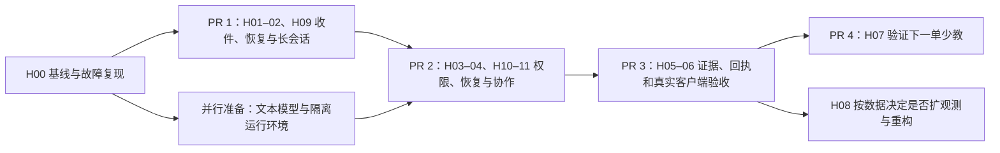

# Morde Harness 实施任务 TODO

**给负责修改 `lizhongxuan/morde` 的开发 AI。** 本清单把[最终流程与实现规格](Morde_Harness_最终流程与实现规格.md)拆成四批可评审改动。[《Morde AI 对话长会话测试方案》](design/Morde-AI对话长会话测试方案.md)是长会话的必执行验收方案，H09/H06 按 LC-01–LC-06 执行并将结果写入[验证记录](验证记录/Morde_Harness_最终流程测试用例.md)；规格定义行为边界，本清单定义实施状态和依赖。旧设计和流程图只作背景，不得据此省略测试方案中的验收项。以下任务均未按本清单完成验收；当前代码中已有的能力应先核对，不重复实现。只修当前 Harness 和现有链路，不在这里新接生产发布或 GitHub 写入。

**源码参考：** [Morde 5f97110](https://github.com/lizhongxuan/morde/tree/5f97110cf74ffe57aefc9be4664d713de3fbd62d) · [Hermes 0d49d6d9](https://github.com/NousResearch/hermes-agent/tree/0d49d6d9d20e461155d49ba9d188687079c811af)。以实现工作区实际 HEAD、`AGENTS.md` 和依赖锁为准；当前核对的 DSH 锁定版本为 `0.2.2-rc.1`，部署状态须单独核实。保留用户未提交的改动。规格定义目标行为，本清单定义实施顺序和验收；若二者不一致，先同步修正文档。旧设计仅作参考，其 H01–H07 编号与本清单编号不通用。

**并发会话拆分：** H00–H11 的任务正文、状态和验收仍以本文件为唯一事实来源；[并发实施总控与会话任务](Morde_Harness_并发实施/00-并发实施总控.md)只划分工作区、依赖和文件所有权。各会话不得复制或自行改写 H 项状态；由协调会话在整合并核验证据后更新本文件与验证记录。原下图是 PR 集成顺序，不表示所有任务必须串行开发。

**边界与状态：** 本清单覆盖服务端会话、路由、任务、DSH Runtime，以及受影响的 PC/iOS 消息状态和实际验收。源码与文档只在本地修改；自动化测试使用隔离数据库和合成内容，不上传或发送项目文件。H06 最终验收可由 S07 访问用户明确指定的测试站点，具体目标、秘密管理和管理员账号重置边界见[并发实施总控](Morde_Harness_并发实施/00-并发实施总控.md)及 S07 任务文档。每项使用 `未开始 / 进行中 / 待验证 / 完成 / 阻塞`；只有实现及该项验收完成才勾选。

**根因修复与模块边界：** 测试失败先保留稳定复现，再沿调用链检查是输入规模、上下文选取/压缩、协议或模型窗口、状态转换、重试还是持久化机制导致；不能只放大测试限制、截短输入或放宽断言。例如约 4K 上下文触发失败时，要确认单位（字符、字节或 token）并检查上下文预算、无关历史获取、压缩和 Provider 窗口处理；设计应能按模型实际窗口处理更长历史（如 100K/200K 的压力夹具），必要时检索/压缩并保留来源，超出能力时明确失败，不能伪装成功。复杂问题须把复现与证据、根因、备选方案和取舍、选定机制、模块/函数职责与接口、回归验收及未解风险记录到对应 H 项/方案文档；协调会话整合后保留，不能只留在聊天里。改代码前检查调用方和依赖，保持模块高内聚、低耦合、函数职责明确及状态/副作用归属清晰；跨 owner 的接口变化先提案，由对应 owner 修改。修复须通过能捕获根因的回归，不以扩大测试输入上限代替机制修复。

## 现有接口与状态边界

| 接口或状态 | 实施合同及调用方 |
|---|---|
| `TaskService.AcceptConversationMessage` / `AcceptProjectMessage` | 复用 `client_message_id` 与幂等键；同身份、同内容的重试返回原记录，ID 相同但内容/附件/选项冲突不得当作成功。沿用会话内服务端 `sequence` 确定跨端并发消息的历史顺序。服务端路由和 PC/iOS 调用方不得把受理当成任务完成。 |
| `ConversationRouteClassifier.ClassifyConversationRoute` 与路由 Worker | H01/H02 在现有消息、路由租约和快照约束下做一次无工具修复；新调用必须独立预订和结算，并在应用前复核身份与授权。若新增内部参数或模型调用阶段，同步更新调用方和账本对账。 |
| `message_delivery` v3 与 `delivery_status` | H10 复用既有 Task/Owner/Session/代次/授权、消息 ID、内容/附件及 `mode`；任务消息的 `pending` / `applied` / `unknown` 与根 Session 检查点对应，并持久记录消息被领取的 checkpoint through sequence，供旧调用与已 applied steer 比较。默认不加公开枚举；确需变更 API 时，同步 OpenAPI、客户端与测试。 |
| `TaskProgress` 完成 fence | H10 完成候选携带 root Session、Agent instance/代次、授权版本、checkpoint through 和 digest；`CommitTaskProgress` 在 Task 行锁下同时检查 fence、pending 输入及候选 fence 之后已 applied 的 steer，命中时返回带授权消息快照的 typed pending，不发布旧结果。普通进度和其它完成调用沿用原合同。 |
| 跨 Task 摘要、历史搜索及 DSH Session 压缩 | H09 复用已有来源版本、授权查询和检查点，超预算沿用明确失败语义。摘要与当前 Task Session 的压缩分别检查，不能用其中一层替代另一层。 |
| Task 证据与原会话发布 | H05 核对现有验证 Worker、结果快照和发布事务的时序；修订/来源不匹配时不放行。若改变状态或接口，在同一改动更新现有服务端契约及 PC/iOS 调用方。 |

## P0：先让对话正常，再防误执行和误交付

- [ ] **H00｜记录基线，复现原问题，不动生产。**（进行中）
  - **做什么：** 记录 Morde HEAD、未提交改动、DSH 锁文件、实际 Runtime 组合、PC 客户端构建和测试环境。Hermes 如有独立 checkout 则记录其 HEAD；当前 `project/hermes-agent/` 无独立 Git 元数据，须记录实际关键文件 SHA-256 和许可来源，并与固定提交核对，不能把外层 Morde HEAD 记作 Hermes 版本。按最终规格的 DSH 插件核对门禁，检查当前已接入组件和锁定版本对应的上游插件/扩展点，至少覆盖工具、MCP、Skill、子 Agent、Session/检查点、压缩和沙箱；对每项目标能力记实际是否挂载、版本/许可证、Morde 适配及功能测试，不以安装成功代替接通。用现有夹具复现「分类器回自然语言」「文本模型不可用」「DSH 运行环境缺失」「目标云电脑不可用」以及长历史、超时/空响应。复核旧设计记录的“约 4,096 字节历史候选导致短追问失败”症状；该数字仅用于定位旧回归，不视为当前限制。DSH 运行环境和目标电脑按实际需要检查；不要把云电脑准备变成普通问答的前置。
  - **完成条件：** 上述原因能分别定位；用可用文本模型完成一轮正常问答；DSH 能力盘点注明「已接入且验证」「有插件但未接入」或「无兼容插件」及选择理由。缺真实目标环境时，标注「真实任务未验证」，不拿夹具冒充实测。附件的历史错误次数不当作当前性能基线。
  - **当前进度（本地）：** 本段初盘时 `main` / `origin/main` 为 `a23d7e7572f349211992bdea69c541a31a29de5c`，当前主线状态见下方复核；DSH 锁定 `0.2.2-rc.1`。已按 `package.json`、锁文件与 `engine.mjs` 初盘：AgentLoop、Agent、Session/检查点、SystemPrompt、工具、LLM、TokenMeter、修剪及压缩包装已注册；`dsh-mcp-client` 仅在依赖中、未在 Runtime 注册，MCP 实际经 Morde Broker；Morde `dsh_delegate` 经服务端 IPC 创建持久子 Session，但 DSH `dsh-subagent` 与实验性 AgentTeam 未注册；Morde Skill catalog/read 已接入，DSH `dsh-skill`/consumer 未注册；DSH Sandbox、工具超时及重复调用提示包也未注册。已核对同锁定版本相关候选包元数据为 MIT 且核心 peer 版本匹配；包内文档显示 AgentTeam 是共享工作区、Lead Session 持久任务板，子 Agent 与沙箱均要求 Morde 适配授权/账本边界；详见[规格的接入快照](Morde_Harness_最终流程与实现规格.md#dsh-插件与扩展点核对门禁)。另审阅锁定版 `@deepseek-ai/dsh-llm-retry@0.2.2-rc.1`（MIT，peer dependency）：其默认策略可对多类错误重试最多 5 次，`always` 为无界，策略由 Provider 插件拥有；它不协调 Morde 的调用身份、用量账本、unknown 与已结算响应恢复，因此未挂载，避免与 Morde 的单一重试拥有方叠加。这只完成来源和接口初盘，功能兼容及集成验证未完成，故 H00 仍进行中。`project/hermes-agent/` 无独立 Git 元数据；对固定上游 `NousResearch/hermes-agent@0d49d6d9d20e461155d49ba9d188687079c811af` 的 S01–S04 清单中 16 个核心实现源文件及 `scripts/build/agent.py`、`LICENSE` 做逐文件 SHA-256 比较，18 项全部一致；明细见[验证记录](验证记录/Morde_Harness_最终流程测试用例.md#s00-h00-hermes-固定提交关键文件哈希核对-2026-11-22)。这确认被核对文件，不代表整个快照已逐文件核对。已用本机隔离 PostgreSQL 16 跑通路由、回执、检查点、长历史与修订恢复集成用例；真实模型、实际 PC/iOS、目标云电脑和 60 分钟耐久验收尚未完成，不把合成结果记作真实对话通过。
  - **本轮共同基线（2026-11-22）：** 原 Morde HEAD `e009815383daaa883ec7f2b40fe2ec7cdeb7397a` 的 35 个现有文件改动全部保留在本地 checkpoint `81e7304d53808c91b35249156ede5f24a5bb3e45`；未推送。工作树改动 SHA-256、DSH 锁版本和 Hermes 文件哈希及未匹配状态详见[并发总控](Morde_Harness_并发实施/00-并发实施总控.md#1-启动前置条件)。H00 仍进行中：Hermes 固定提交对应关系、真实客户端/模型、目标云电脑和耐久验收仍未完成。
  - **本轮 Harness 分支整合（2026-11-22）：** 用户指定的 19 个 `codex/harness-*` 分支已通过普通 merge 纳入 `main` 并推送到 `origin/main`，提交 `e631d4cdd9ec68e1143f93a46f5572a54702862f`；逐个祖先关系检查 `19/19` 通过。源码没有新增差异，冲突均保留当前较新实现；只更新了 S01 交接文档。H00 仍按真实运行环境和 DSH/Hermes 核对缺口保持进行中，合并分支不代表端到端验收完成。详细记录见[验证记录](验证记录/Morde_Harness_最终流程测试用例.md#s00-用户指定-harness-分支合并与验证-2026-11-22)。
  - **本轮主线状态复核（2026-11-22）：** `main` 与 `origin/main` 当前均为 `51cbe1375e02abfd780c9b9ee349d1fa85e79b99`；远端仅保留 `main`，截图分支合并记录中的 `a23d7e7` 是当前 HEAD 祖先，19 个分支合并结果仍在主线上。工作树的 7 个本地未提交改动及 DSH `0.2.2-rc.1` 锁定版本已复核，详见[并发总控](Morde_Harness_并发实施/00-并发实施总控.md)。17 个核心实现源文件和 LICENSE 与固定上游逐文件匹配；完整树对比发现本地快照缺 28 个上游文件、83 个共有文件内容不同，另有 27 个本地 Python 缓存文件，故快照并非该提交的完整副本。真实目标云电脑和耐久验收也未完成，H00 不勾选。
  - **本轮主线状态与 Go race 复验（2026-11-23）：** `main` 与 `origin/main` 仍为 `51cbe1375e02abfd780c9b9ee349d1fa85e79b99`，截图所列 19 个合并结果仍包含在主线。另两个本地分支 tip `codex/client-login-ordering-20261105`、`workspace-1` 经祖先关系核对均无独有提交，随后已删除；干净的 `workspace-1` worktree 也已清理。当前仅保留 main 工作区及其中 8 个未提交文件，未推送。`cd server && go test -race -count=1 ./...` 全部通过，app、worker 及 PostgreSQL 包均通过。它使旧集成快照 `fee63a35` 上报告的账号 Runtime 握手 race 失败未能在当前主线复现，但旧失败的具体握手字段根因仍未经证实。H00 的真实模型、PC/iOS、目标云电脑、Hermes 全树对应和耐久验收仍未完成。真实 Provider 请求未运行：会话中的明文 API 凭据按项目任务约定须先撤销/轮换；已请用户将新凭据只配置在本机环境变量或密钥存储中。

  - **本轮 main 冲突整合（2026-11-23）：** 冲突解决后的合并提交 `83e96a8f` 已核对存在于 GitHub `origin/main`；远端 `dev` tip `900bd6bc` 是主线祖先，`dev` 与 `main` 分支仍都存在。本轮保留 H01 来源/授权 fence 与 8 MiB 消息输入边界，合入 32 KiB/来源数预算及超限补充独立待路由、历史预览和分类失败安全回退。Worker 全量、10 项隔离 PostgreSQL 定向回归和 Runtime 白名单回归通过；真实模型、完整 H06 客户端/耐久验收仍待轮换凭据和实际环境，H00 不勾选。

### PR 1：消息受理、意图分流、模型回复

- [ ] **H01｜先持久收件，再分流。**（进行中：S01 路由/摘要/历史检索改动已集成；主工作区 app、14 项 PostgreSQL 整合及不完整历史/候选的 4K 窗口预算回归通过。修订重启 E2E 的本地合成模型/隔离 PostgreSQL 复验现已通过：Go start frame 携带持久 delivery mode，旧 mode-less Node 帧兼容为 `followup`；恢复时先核验并复用已提交的 personal mutation 收据，再检查较新的 steer，避免把已提交副作用误当作未执行或重复执行；结果未知时只持久化为未对账结果，不放行 Task 完成。本轮主线冲突整合后保留有序来源/授权 fence，并将超过 32 KiB 或来源项预算的补充解除关联、单独排队；Worker 与隔离 PostgreSQL 回归通过，精确命令见验证记录。本轮已在指定测试站验证 PC 与 iOS 的普通短文本真实回复及同一旁聊往返；Task 结果/进度、断线与重复投递等其余 H06 场景仍待验，故 H01 保持进行中）
  - **改哪里：** `server/internal/app/conversation_message_routing.go`、`server/internal/worker/cloud_dsh_coordinator.go` 及对应测试。复用消息 ID、原回执和 Task 关联；把「已收件」与「已建 Task」分开。普通问答直回；状态追问读取已有任务；修改、停止必须命中具体 Task；复杂工作才持久建单。简单工具优先沿用现有受控执行路径；若技术上要建内部记录，不在 UI 把它伪装成长任务，也不绕过 Broker。
  - **对象边界：** 一个 `conversation_id` 可有零个或多个用户 Task；同一 Task 的后续消息通过明确关联进入修订。每个 Task 有自己的根 DSH Session；工具调用和子 Agent 属于 Task 内部执行，不另建用户 Task。协调由持久化消息/结果事件重新触发，不依赖常驻进程或内存态；Task 结果持久化后回到原会话，Task 进度和子 Agent 执行记录仍归属于 Task。
  - **验收：** 双端重送同一消息只受理一次，相同 ID 不同内容/选项被拒绝；PC/iOS 并发发送不同消息时，以会话内服务端 `sequence` 决定历史顺序，不受路由完成顺序影响。分类输出不符协议时最多一次无工具修复，缺目标时问必要问题，模型/服务不可用时明确失败。修复结果重新校验租约、目标和授权，不得因关键词或上一个任务猜测而写入。A 在执行、B 在复核时，普通提问拿到回复，修改 A 不改 B；子 Agent、工具调用和 Task 结果不串成新的用户 Task 或错误会话。重启后重新投递一条已持久化消息或 Task 结果事件，协调仍回到原会话，且不依赖常驻进程或重复交付。对应原稿 CLS、MRG 和 early result，但不延迟保存已收件消息。
  - **当前进度（本地）：** Go app/worker 全量测试通过；本机 PostgreSQL 的路由修复、重复回执、上下文冲突、Task 目标及结果聚合集成用例通过。另补 `go test ./internal/api -run '^TestOversizedConversationMessageIsRejectedBeforeAcceptance$' -count=1`：超 API 请求上限的聊天请求返回 413，消息受理/建单服务均未调用。分类器对结构非法、截断或意外工具输出最多执行一次独立计量的无工具修复；第二次非法输出失败关闭。另修复自动重分类 16 次上限与旧数据库 3 次 CHECK 约束不一致。真实 Provider 回复及 PC/iOS 入口仍交 H06 验证。
- **本轮 H01 长历史提示复核（2026-11-22）：** 被截断的 prior message 已触发授权历史搜索提示；PostgreSQL 集成测试最初仍断言旧提示字样，已改为核对现行截断/no-inference/search-tool 契约。4 项 `TestH01Long*` 隔离 PostgreSQL 回归通过；真实 Provider、PC/iOS 长历史入口及其他 H06 场景仍未完成，H01 保持进行中。详见[验证记录](验证记录/Morde_Harness_最终流程测试用例.md#s00-h01-长前文截断与授权检索提示断言对齐2026-11-22本机隔离-postgresql)。
- **本轮 S00 当前消息来源校验补强（2026-11-23）：** 修正 rune-safe preview 在混合 Unicode 边界处因按实际预览字节数重算而拒绝原文的问题；只接受固定 2,048/1,024 字节预算生成且 SHA-256、字节数和 claim message ID 一致的预览。随后实现聚合消息有序来源清单，逐源绑定 message ID、sequence、原文字节数与 SHA-256；模型计费/派发前从 PostgreSQL 重载来源并核对授权、执行范围、聚合摘要及 2,048/1,024 字节预览。新任务目标保留选定 root 与全部补充内容，不再因 root 超过 4 KiB 而丢弃所选补充；误判聚合预览时提示完整源已保存，不要求用户重发。app、worker 全量及 6 组本机 PostgreSQL 路由/聚合回归通过。聚合总量仍受 32 KiB 上限约束，超限安全拒绝；未新增聚合原文分页读取接口。H01 仍待真实模型/客户端验收。详见[验证记录](验证记录/Morde_Harness_最终流程测试用例.md#s00-h01h04h09-本地实现与回归2026-11-23)。
- [ ] **H02｜加有界模型恢复，明确退出原因。**（进行中）
  - **改哪里：** 现有模型网关和 DSH 响应适配，先明确哪个层拥有重试，避免多层相乘。按需翻译 Hermes `agent/retry_utils.py` 的 `parse_retry_after_seconds`、`jittered_backoff`，移植其边界测试；从 `check_api_response`、`recover_empty_response` 借状态表，不搬整个函数。
  - **验收：** 按规格 2.3 的结果表区分结构非法、空输出、截断、明确未受理的暂时错误、派发后 `unknown`、上下文溢出、取消/撤权和有副作用工具结果未知。每类只有一个重试拥有方、明确尝试上限及调用身份/预算账本；未知先对账，不得重放不确定请求或工具。纯会话路由的 Provider 明确 429 最多三次总调用，尊重不超过两分钟的 `Retry-After`，缺失/无效时按有界退避；将明确 HTTP 429 记为无数字用量的 `rejected` 并释放账号/项目预留，不能记成 `unknown` 卡住后续会话；缺少用量的成功响应及传输不确定结果保持 `unknown` 和原预留，不推断为零。当前不自动重试 Task 空响应；任何未来新增的连续空响应恢复都须核对模型、Provider、退出原因及一致用量证据。分别模拟首响超过当前 45 秒、流中断和取消，保留已显示内容及真实状态；不得用上轮文字冒充本轮。关闭云端执行、配置可用文本模型，必须收到**真实回复**，不只测发送和收件。对应 REC。
  - **当前进度（本地）：** 分类结果结构非法、截断或意外工具调用仍最多触发一次独立计量的无工具修复。新增纯会话路由对明确 Provider 429 的 `Retry-After` 秒数/HTTP 日期解析，最大保留值 24 小时；自动恢复只接受两分钟内的提示，缺失/无效时采用 1/2/4 秒有界退避，最多三次总调用，独立 `route_attempt`/调用 ID，超两分钟直接失败。新增 `rejected` 状态，不伪造 token 数；账号与项目预留释放和下一次排队在同一数据库事务中完成。`go test ./internal/app ./internal/worker -count=1`、服务端 `go test ./...` 与隔离 PostgreSQL 端到端用例通过；完整 PostgreSQL 包测试达到 10 分钟仓库超时上限，停在 `TestPostgresTaskFileFetchTransferResumeContentLifecycleAndCancel` 的迁移初始化。本轮补跑模型客户端 deadline、流取消和 bounded `Retry-After` 4 项定向用例通过；Runtime 意外 child 退出码/信号的有界回传 Node 定向回归 1/1 通过（详见 S00 诊断记录）。这些是本地合成 transport/10ms deadline 与退出状态可观测证据；它们未验证实际 45 秒 Provider 首响超时、真实流中断或 H02 重试路径。真实 PC/iOS 普通短文本回复已有 H06 旁聊补测证据，但不能证明上述边界；H01 修订重启 E2E 根因仍待 H06/后续验收。
  - **本轮 Task 空/截断分类补充（2026-11-22）：** Gateway 仅在 Provider reported model 非空且合法、退出原因与已知有界用量相符时，才细分 `empty_response` / `truncated_response`；身份或用量证据缺失/模糊时仍是 `invalid_response`，未知用量继续按 `unknown` 对账。S02 Executor 仅透传这两个精确类别，S03 Broker 将其加入安全恢复类别；未知理由不会透传。路由已结算无效响应重放不会再次 reserve/dispatch。定向 App/Worker 用例、完整 App 包 `go test ./internal/app -count=1`（21.571 秒）与 `gofmt -d`、`git diff --check` 通过；未运行 PostgreSQL 持久层或真实 Provider 验收，故不改变 H02 未完成状态。细节见[验证记录](验证记录/Morde_Harness_最终流程测试用例.md#s00-h02-task-模型空截断响应分类-2026-11-22)。
- **本轮 H02 取消恢复补充（2026-11-22）：** Worker shutdown 恰逢已确认 Provider 429 时，以免取消的恢复 context 完成持久化，但仍保留已计算的 Retry-After，避免把可重试请求立即标成永久失败。Worker 定向用例及隔离 PostgreSQL 账本/路由恢复用例通过；真实 Provider 首响、流中断与 PC/iOS 入口仍未验，H02 保持进行中。详见[验证记录](验证记录/Morde_Harness_最终流程测试用例.md#s00-h02-确认-429-后的-worker-取消恢复2026-11-22本机隔离-postgresql)。
- **本轮 H02 流错误诊断补充（2026-11-23）：** 流式响应开始后，读取 deadline 现在映射为 `timeout`，底层 I/O 中断映射为 `transport`，畸形事件/缺失终止帧保持 `invalid_response`；原有取消优先级不变。OpenAI Responses 与 Z.ai 流均有中断后保留已交付文本增量的定向回归；App 侧再验证显式取消保留已显示增量、返回取消状态、用量保持 `unknown` 且只派发一次。App/Model 全量包通过。它们使用合成响应及 10ms deadline，不是实际 45 秒 Provider 首响或客户端验收；真实流中断、PC/iOS 展示与 H02 仍待 H06，故保持进行中。详见[验证记录](验证记录/Morde_Harness_最终流程测试用例.md#s00-h02-流错误分类与已显示增量保留-2026-11-23)。
- [ ] **H09｜保障长历史与两层上下文恢复。**（进行中：840 条历史 Node/PG 重启 E2E 和不完整历史/候选在 4K 路由窗口内保留安全边界的回归通过；路由预算修复及真实窗口边界见 S00 复验记录。真实模型窗口、PC/iOS 累计历史和耐久验收仍待 H06）
  - **依赖：** H00、H01、H02；在 PR 1 内完成。服务端摘要和 DSH Session 压缩先分别核对，涉及共享 Runtime 文件时按顺序与 H10 集成。
  - **本轮单条长消息入口补测（2026-11-23）：** Portal `message-upload.test.ts` 扩到 200 KiB+1 UTF-8 字节，覆盖分片上传、断线续传和字节精确重组（3/3 通过）；DSH Runtime 全量 `npm test` 191/191 通过。PostgreSQL HTTP 上传集成夹具扩到同一大小，但本轮未配置隔离 DSN，未执行 DB 断言。单测中的 8/16/200 KiB 是字节规模，不等于真实 Token 数；真实 Provider、PC/iOS 仍待 H06。
  - **改哪里：** `server/internal/worker/conversation_route_worker.go`、`conversation_summary_maintenance.go`、`server/internal/app/cloud_dsh_history_tools.go`；`runtime/morde-cloud-runtime/src/engine.mjs` 与 `hermes-compaction-window.mjs` 及现有测试。复用模型窗口/输出预留、多模态 Provider/DSH 估算、摘要来源证明、原文锚点分页检索、TokenMeter、ToolResultPruner 和 DSH 检查点；另对照 Hermes `gateway/run_turn_hygiene.py` 的入口检查、失败冷却及 `agent/context_compressor_window.py` 的窗口边界。摘要覆盖不足须明确标记；两层压缩不可互相替代或重复。按需补规格 2.1 节的缺口，不重写已实现功能。
  - **验收：** 旧要求后追加短追问可继续；4K 未知容量窗口下，即使短追问引用的运行中 Task 目标很长，也须保留 Task ID、明确标记目标截断并安全完成路由；路由历史包含当前授权范围内已送达的普通助手直接回复和已发布 Task 结果，不混入未完成或未授权消息，摘要/历史/任务文本保持不可信数据；用约 18 KiB 既存合成历史消息后接短追问，确认路由不因旧正文体积拒绝新消息且原文仍可检索；这项只验字节边界，不计为超过 8,192 tokens。真实单条当前输入必须由所选模型 tokenizer 或 Provider 实际用量证明超过 8,192 tokens；超过路由预览预算时用消息 ID/SHA-256 和有授权分段读取，逐段符合模型窗口预算，且首、中、尾锚点均实际处理。8 KiB、16 KiB、200 KiB 单测按字节计量，不等于 Token 数。另以 4K 合成窗口至少 40 轮、至少两次压缩后仍保留早期锚点和最新消息。超过 API/8 MiB 持久化限制时明确拒绝且不留下已受理消息/Task；单条原文超过 128 KiB 但不超过 8 MiB 时，路由只发有界预览/来源指针，DSH 按最多 8 KiB 片段读取并校验连续 Unicode 偏移和同一 SHA-256；超过 8 MiB 时明确拒绝。原文不可读、哈希变化、工具/Token 预算不足或单段超模型窗口时，保留原文、显示准确失败状态，不能同内容无效重试或伪称完整处理。固定前缀、系统提示、工具定义或不可分单段超过模型窗口时按 DSH 能力失败关闭。以上边界分开记录。摘要空/截断、窗口无进展、同 Session 重复失败冷却、Provider 明确溢出后最多一次恢复、取消、并发提交和重启不会覆盖原文或提交半成品；无进展时不能重复压缩或推进摘要覆盖水位。历史搜索必须返回原文来源和分页/不完整状态，授权撤销后不可继续返回原摘要或原文；跨两个账号/会话检索不串用，旧消息中的指令文本保持不可信数据。基于现有 `conversation_route_h01_integration_test.go`、`hermes-compaction-runtime.test.mjs`、`compaction-recovery.test.mjs` 和长历史重启 E2E 检查；真实客户端与真实模型验收交 H06。
  - **Hermes 对照验收：** 对固定 SHA 中的窗口规划、工具结果修剪、摘要失败冷却/提交、历史搜索分页等确定性行为，复用上游测试并整理最小输入/中间结果对照夹具；每个差异写明 Morde/DSH 适配理由并配本地回归。只比较目标行为，不把最终回答相似当作源码级移植证明；无法在 Hermes 运行环境复跑时注明夹具来自固定源码/测试推导。
  - **缺陷归因与规模回归：** 一旦在约 4K 上下文或其他边界复现错误，保留原失败样本并记录系统提示、工具定义、当前输入、近期历史、摘要/检索结果、输出预留及各层硬限制的 Token/字节预算；定位是无关历史过多、压缩/检索缺失或无进展、预算估算错误、不可分单条输入超限，还是 API/路由/DSH/IPC 限制。不得缩小失败输入、只抬高一个阈值或把错误测试改成通过。修复后须通过原复现和累计原文 4K、8K、100K、200K tokens 的合成回归：模型请求始终符合窗口预算，相关早期事实可通过摘要或授权检索找回并有来源，冗余历史不整体塞入请求，原始记录保持可查；单条输入超过硬限制时仍明确失败，除非另行实现可验证的分块覆盖与原文回查。
  - **当前进度（本地）：** Runtime 全套 155 项、18 KiB 字节级当前消息完整传入、40 轮/多次压缩锚点恢复、Token/源事件覆盖进展检查及无进展摘要提交前拒绝，以及服务端摘要并发、隔离与长历史重启 PostgreSQL 集成已通过。新增 `TestH09LongHistoryFollowupIsMarkedForAuthorizedSearch`，并运行 `TestH01LongPriorMessageUsesBoundedHistoryAndRequestPreviews` 与 `TestConversationSummaryDSHMainAndSideChatsContinueAfterLongHistoryRestart`；测试覆盖有界摘要提示、原文来源及 DSH 重启后的历史检索。修复路由快照漏掉已送达的普通助手直接回复：18 KiB 首条消息直接回复后再发短追问时，快照纳入前序助手答复、确认前序已完成并保留截断原文来源；缺失事实仍要求授权历史搜索。路由提示将摘要、会话历史和任务文本统一标为不可信数据。另强化 DSH E2E：840 条历史消息按 `PreviousClientMessageID` 串成连续 predecessor 链，测试断言从末条回溯恰好覆盖 840 条；本轮使用本机 `morde-local-postgres` 容器提供隔离 DSN 重跑，含真实 Node DSH Runtime 重启和授权历史检索，通过（33.58 秒）。测试还断言触发历史搜索的路由消息与实际执行 Task 关联一致。真实 DeepSeek Gateway 用例 `TestDeepSeekFlashDialogueThroughMordeModelGateway` 全套通过：Morde 网关收到 51,842 字节/800 条合成输入，Provider 报告 18,502 输入 tokens 并准确回答总数及首/中/尾锚点；路由从截断历史把 0400 追问转成新 Task；带完整前轮 user/assistant 历史的 Morde 网关普通文本追问报告 18,575 输入 tokens 并准确回答记录 0400。中文问答、格式要求、4 个复杂度路由、短多轮、流式和工具续接也通过。此前路由会仅因 4 KiB 预览中没有目标记录就直接回答“历史不可用”；已改为缺失历史细节先路由授权历史搜索 Task，搜索失败后才能说明不可用。Go transport 原先把系统 DNS 返回的 `198.18.0.62` 当作真实目标而拒绝；现对显式配置代理的固定白名单 DeepSeek 主机沿用 OpenAI 的代理 DNS 路径，保留目标主机校验和 TLS 证书验证。相应模型代理单测、H09 路由单测、`go test ./internal/app ./internal/model -count=1` 均通过。Provider 直连的两个 JSON 模式全历史追问探针曾返回 `completed` 但正文空白；实际 Morde 用户追问用普通文本通过，且实际路由 JSON 模式已通过。该网关测试使用本机显式配置的测试代理，不发送项目文件；它不替代 DSH 历史工具真实执行、服务端消息持久化、PC/iOS 接续验收。实际 `morde-pc` 的 42,603 字节首轮正确，但同会话历史追问约 50 秒无回复，重试一次后约 30 秒仍失败；测试服务未运行本地工作树，不能归因于本地实现。2026-11-22 的远端 PC 探测使用旧 128 KiB 路由/DSH 单条输入边界并观察到失败；该边界现不再限制会话原文，当前支持以来源指针和分段读取处理最多 8 MiB 的单条原文，DSH 各次协议载荷仍受 128 KiB 限制。主工作区合并 S02 后，Node Runtime/compaction/recovery/Hermes compaction 五组测试 178 项通过；840 条长历史 Runtime 重启与授权检索 E2E 45.623 秒通过。PC/iOS 接续、累计历史多次压缩、跨账号隔离和 60 分钟耐久仍交 H06。
  - **LC-01 短追问预算根因修复（2026-11-22）：** 新增 4K 未知容量窗口下“短追问 + 长被引用 Task 目标”和“短追问 + 长前序请求”回归。原实现只删除非目标候选，保护的 Task/消息正文预览仍可能占满最小窗口；现逐步缩短这些旧上下文预览，保留 Task/message ID、前序原文 SHA-256 和明确截断状态，当前消息不截断。Model Gateway 预检、Provider 溢出和 worker 拟合失败日志补充安全阶段/窗口字段。定向 App/Worker 回归通过；截图本身无消息 ID、服务端阶段或 Provider 用量，尚不能断言它就是该根因；隔离 PostgreSQL LC-01、真实 PC/iOS 和 Provider 复验待后续按[长会话测试方案](design/Morde-AI对话长会话测试方案.md)执行。完整根因证据见[验证记录](验证记录/Morde_Harness_最终流程测试用例.md#lc-01-短追问误报根因调查与修复-2026-11-22)。
  - **本轮 H09 累计规模补测（2026-11-22）：** 新增服务端合成摘要回归与 Runtime DSH TokenMeter 合成语料回归，分别覆盖累计 4K/8K/100K/200K tokens，验证模型请求窗口/输出预算、首中尾锚点、source proof、授权检索、原文可读、checkpoint 上限及重启去重。`go test ./internal/worker -run '^TestConversationRouteH09SyntheticTokenScaleCompaction$' -count=1 -v`、`go test ./internal/worker -count=1`（56.057 秒）、Runtime 指定文件 `node --test --test-concurrency=1 test/hermes-compaction-runtime.test.mjs`（6/6）及全套 `npm test`（181/181，Node 26.13.0）通过。Runtime 使用 DSH 固定 TokenMeter 估算器和 fake provider，不代表真实 tokenizer/Provider 用量；服务端规模数由测试估算器固定分配、原文来自本地 fixture，不是 PostgreSQL E2E。补测覆盖了累计合成历史的多次压缩；真实客户端/账号历史、实际模型窗口、Provider 实际 usage、跨账号隔离和耐久仍未验收，H09 保持进行中。详见[验证记录](验证记录/Morde_Harness_最终流程测试用例.md#s00-h09-累计-token-规模合成回归-2026-11-22)。
  - **单条长消息分段回查回归（2026-11-23）：** 新增 8 KiB+1、16 KiB+1、200 KiB+1 字节三档路由/4K 窗口用例，核对模型路由只收到有界首尾预览和原文 ID/字节长度/SHA-256；新增 200 KiB+1 字节 Task 来源指针、DSH 分段工具原文重建、Unicode 边界、连续偏移、SHA 不匹配失败及检查点重放不重复计费测试。PostgreSQL 增加 200 KiB Task 来源指针与范围读取集成回归；本轮仅编译通过，`CH_TEST_DATABASE_URL` 未配置，数据库执行跳过。完整 `go test ./internal/app -count=1` 和 `go test ./internal/worker -count=1` 通过；真实 Provider、PC/iOS 和隔离 PostgreSQL 实测仍未执行。测试尺寸按字节计量，不是 `>8,192` Token 的真实模型证据。

  - **本轮 S00 未知摘要模型容量与 4K 路由复验（2026-11-23）：** 未知 summary model 容量使用所选模型的保守 4,096-token 窗口；网关在计费预留/派发前按实际解析容量复核，容量缩小时拒绝超窗请求，容量增加时允许仍在旧 fence 内的保守请求。新增未知/增加/缩小容量表格回归；混合 Unicode 长消息预览使用原文哈希与固定预算校验。app、worker 全量通过；本轮补充的多源聚合预览/来源 fence 回归也通过。真实 tokenizer/Provider、跨端累计历史、账号隔离与 60 分钟耐久未验收，H09 不勾选。详见[验证记录](验证记录/Morde_Harness_最终流程测试用例.md#s00-h01h04h09-本地实现与回归2026-11-23)。

### PR 2：审批、预算、工具意图和恢复

- [ ] **H03｜将执行许可和成本检查放在服务端。**（本地复核与补证完成，待 H06 真实入口验收）
  - **依赖：** H01、H02；H09 随 PR 1 一并完成后再集成 PR 2。
  - **改哪里：** `server/internal/app/cloud_dsh_tool_broker.go`、现有审批、用量账本和预算机制。先查哪些门禁已存在；对缺口补动作发起前的权限复核、适用额度预留和按请求结算。批准关联当前对象、动作和任务版本。审批卡有数据时显示本次预估、已累计、限额和未知项；四行样式可后做。涉及展示时同步实际 `morde-pc` 的 `TaskDetail.tsx` 及适用的 iOS 审批视图，不以 Portal 页面代替 PC。
  - **验收：** 审批拒绝、跨账号引用、执行前撤权、预算耗尽均不得派发；重启不重置预算，未知账单不显示为零。无交互时不得把沉默当同意；任何模型评分都不能批准本该由人批准的动作。对应 APR、CST。
  - **当前进度（本地）：** Broker、精确审批绑定、执行前授权复核、模型/项目预算及未知用量台账均有实现和回归。本轮新增预算耗尽时 Host 动作零派发，以及跨账号响应审批被拒且审批/Task/租约状态不变的测试；app 与 PostgreSQL 定向测试通过。未改审批 UI；PC/iOS、真实账户与模型验收交 H06。
- [ ] **H04｜先记意图，失败后先对账，再决定能否重跑。**（进行中：副作用恢复、服务端活动提示、模型请求 45 秒停滞和工具等待期间活动帧持久化回归通过；工具/子 Agent 请求停滞语义、PC/iOS 实际入口和 H06 耐久验收待完成）
  - **依赖：** H03。
  - **改哪里：** 复用 Broker 的 `Execute` / `Reconcile`、现有 operation ledger、`task_worker.go` 租约和 DSH 检查点。参考 Hermes `run_tool_round` 的持久化断点、`TurnLivenessWatchdog` 的活动/代次重核测试，以及 `gateway/session_stall.py` 的停滞提示去重策略；只移植行为，不移植 Python 循环或 SQLite。已核对锁定版本同版 MIT 的 `dsh-repeat-tool-reminder` 与 `dsh-tool-call-timeout-policy`，但当前 Runtime 未注册；前者只提示，后者发协作取消，均不保证阻止副作用或强制终止。仅在 H04 测试发现明确缺口时再评估接入，并验证 cancellation、检查点和未知副作用对账；不能让插件替代 Broker、活动观察或对账。等待审批与实际无进展分开；同资源写入不默认并发。
  - **验收：** 存储失败零派发。模拟「动作已生效但回执丢失」：重启后先查真实状态，已生效就绑定旧回执，查不清保留「待对账」，不再次执行。旧代次结果不能覆盖新代次；同参数不同已授权操作不被误合并。区分模型、工具、子 Agent 的活动与等待审批，取消前重核租约代次和活动时间；有待处理输入且活动快照确认停滞时只提示一次，活动恢复后才清除，快照未知时保持未决；健康任务不会因固定时长或过期观察被误杀。对应 REC、RPL。
  - **当前进度（本地）：** Broker 执行/对账、持久操作意图、DSH 检查点恢复和未知结果暂停均已存在。本轮增加意图持久化失败零派发、预算耗尽零派发、同参数不同 Call ID 不合并及跨账号审批响应隔离测试；已有回执丢失对账、耗尽预算下只查不重跑、PostgreSQL 租约回收、worker 续租/失租取消测试通过。S02 已为根/子 Session 增加严格 status/activity/heartbeat 帧，携带当前 Task revision 与单调序号；S03 新增迁移 `00226_task_agent_activity_liveness.sql`，PostgreSQL 只接受匹配当前 Task/Agent lease、generation、revision 的观测。worker 每次成功续租后检查：存在 pending 用户输入，且当前活动心跳已知并超过 60 秒未更新时，按 Task/message 持久化一次通用 `task.step` 提示；活动恢复或消息离开 pending 后清除，未知状态保持未决，不自动取消任务。另复用现有 `activity_progressed_at`：当前 root/child Session 的 `model/started` 持续超过 `app.ModelCallTimeout`（45 秒）时，即使 Runtime heartbeat 新鲜也只提示一次；模型调用进入终态会清除提示。任一阶段若为 `started` 但 Session status 不是 `running`，快照保持 unknown，已有提示不清除；非模型阶段的旧 `activity_progressed_at` 不单独触发停滞。工具、子 Agent 与 checkpoint 没有新增请求级期限；提示不取消或重试任务。审批 `waiting_user` 仍是独立状态。隔离 PostgreSQL 16 回归 `TestPostgresTaskAgentModelCallStallUsesProgressDespiteFreshHeartbeat` 八个子用例及原 stale/clear 测试通过（10.944 秒），覆盖 root/child 的异常 `idle+started` 保留活动提示，以及新鲜工具 heartbeat 不因旧进展时间误报；此前 H03 app/PostgreSQL、H04 PostgreSQL/worker 定向测试通过，DSH Node Runtime 全量 156 项通过。静态核对确认：`morde-pc` 使用本地 Portal Assistant bundle，Portal Task 详情订阅服务端 Task SSE 并展示 Task steps；iOS Task Detail/Event Chain 也消费同一 `task.step` 数据。独立 Rooms `TaskDetail.tsx` 只显示本机 ActivityRecord，不是云端 Task 入口。实际 PC/iOS 入口收到并显示本次真实服务端停滞提示、真实工具进程、断线恢复和 60 分钟耐久任务仍待 H06/S07；H04 保持未完成。S03 原测试命令见[交接文档](Morde_Harness_并发实施/03-工具授权预算与执行恢复.md)，本轮复验见[验证记录](验证记录/Morde_Harness_最终流程测试用例.md#s00-h04-模型请求停滞提示-2026-11-22)。
  - **本轮 S00 工具停滞帧静态审计（修复前，2026-11-22）：** `cloud_dsh_session_tree.go` 的 `tool_call` 分支同步等待 `Tools.Execute` / `Reconcile`；活动帧由同一消费循环处理，期间不能持久化后续 heartbeat。静态审计确认工具/子 Agent 没有请求级 watchdog；为避免把不确定的副作用当作可取消/可重跑，本轮不新增固定超时或自动取消。工具等待期间活动帧的阻塞缺口已由下条补强；工具/子 Agent/checkpoint 的请求级停滞语义仍待解决与验收，详见[验证记录](验证记录/Morde_Harness_最终流程测试用例.md#s00-h04-工具执行期间活动帧静态审计-2026-11-22)。
  - **本轮 S00 工具等待期间活动帧补强（2026-11-22）：** worker 在 `Tools.Execute` 与恢复 `Reconcile` 执行期间继续接收并按既有身份、Task revision、活动状态和单调序号规则持久化 status/activity/heartbeat；非活动帧 FIFO 暂存，16 MiB 缓存阈值触发背压，不丢弃业务帧、不自动取消或重试副作用。定向 worker 用例分别阻塞普通工具执行和 checkpoint 恢复 `Reconcile`，验证两次 heartbeat 在释放操作前已记录；普通路径还验证暂存帧在工具结果后处理。worker 全量、两个 race 定向用例和 Runtime 全量 182/182 通过。真实 Host 工具/恢复调用、PC/iOS 入口及 60 分钟耐久仍待 H06，H04 不勾选。详见[验证记录](验证记录/Morde_Harness_最终流程测试用例.md#s00-h04-工具等待期间活动帧持久化补强-2026-11-22)。
  - **本轮 S00 未知操作恢复与跨包 race 复验（2026-11-23）：** 只读审计确认恢复链仅在同一 Runtime 实例、原 lease fence 查询得到精确 `AgentToolNotFound` 时重 arm 同一 operation ID；当前 Runtime 的持久 operation journal 先记录 accepted/running 再启动 handler，活跃 operation 查询返回记录，存储/服务错误不会映射为 NotFound。新增 Task lease 被回收而旧 dispatcher 仍运行的 app 回归：从原 runtime fence 读回既有结果，只调用一次 handler，不再 POST 派发。未发现需要改生产代码的缺陷。另复核 Go/Node account Runtime ready 握手字段一致；旧 race 报错无法在本轮复现，故不宣称旧快照根因已定位。定向回归和 `cd server && go test -race -count=1 ./...` 全部通过；H04 仍待真实工具、PC/iOS 和耐久验收。
- **本轮 S00 Task/Coordinator IPC 迟到响应隔离补强（2026-11-23）：** WorkerIPC 与 AccountRuntime 对 Task 超时/取消或退役响应保留有界 tombstone；`tool_result`、checkpoint ack/page、child session/settlement ack 只在完整 fence、runtime sequence 与请求摘要等精确匹配时消费一次。另将 Coordinator runtime sequence 贯穿 Go/Node 双向协议，Coordinator checkpoint ack/page 在进程退出窗口或退役后只允许精确匹配一次，重放、错误 payload/摘要或未知响应失败关闭；Coordinator 不开放工具/子 Agent。Runtime 定向用例、全量 192 项和 worker 全量通过。工具/子 Agent/checkpoint 请求级停滞期限、真实 Host 工具、PC/iOS 及 60 分钟耐久仍未完成，H04 保持进行中。详见[验证记录](验证记录/Morde_Harness_最终流程测试用例.md#s00-h01h04h09-本地实现与回归2026-11-23)。
- [ ] **H10｜运行中投递消息，隔离独立任务。**（进行中：S03 的接纳/最终派发与完成栅栏、S02 的同 Session 恢复已集成；child 取消/恢复、后台输出续接、Host generation、生命周期和长历史重启定向 E2E 通过。PC/iOS 实际入口、真实模型、独立 Task 并行及耐久仍待 H06）
  - **依赖：** H01、H03、H04、H09；与 H11 顺序集成共享 Runtime 文件。
  - **Hermes 行为映射：** 按最终规格第 3 节的迭代准备 8 项逐一核验适用实现与回归；重点验证新 steer 使旧推理结果失效、checkpoint 去重/领取、预算与取消、工具结果配对和当前输入锚点。不适用的 Hermes 免费 grace-call 和模型上下文预算提醒须记录边界，不能计作已复制；不另写 DSH 主循环。
  - **改哪里：** `server/internal/app/conversation_route_decision.go`、`server/internal/store/postgres/conversation_route_actions.go`、`agent_checkpoint.go`、`server/internal/worker/cloud_dsh_session_tree.go`、`runtime/morde-cloud-runtime/src/engine.mjs`、`server/internal/store/postgres/task_stream.go` 及对应测试。复用现有 `message_delivery` v3、`steer` / `followup` 和消息/授权代次栅栏；对照 Hermes `gateway/session_busy_controls.py` 及其测试中的 queue/steer/redirect、无 Agent 可接收、旧代次与送达确认行为，映射到现有受理/投递/受控修订，不复制 CLI 忙碌设置。在线消息只有明确、低风险补充进入实时 `steer`。Task 修订先安全停止旧代次，再按 DSH 实际 `next-step` / `next-turn` 位置写入对应账本模式并逐条确认检查点；不得借此绕过版本切换或权限复核。仅以解析后的稳定 DSH `session_id` 串行化 `[读历史 → 执行 → 写回检查点]`，用跨进程栅栏和 token/代次校验释放；租约等待不能阻止已持久化消息受理或其他 Session/Task 并行。持久 steer 到达后，服务端流式增量不得继续发布旧轮输出，直到 DSH inbox 完成领取；计划、目标、权限和已派发副作用的修改走受控版本切换或等待，不静默截断、误投或中断其他任务。
  - **验收：** A 执行时发送补充、普通问题和独立 B；补充只投递 A，普通问题能回复，B 可继续；取消 A 不停止 B。模型推理期间收到补充时，旧轮次的文本和工具调用都须在交付/执行前丢弃，并基于新输入重推理。跨端并发消息按会话服务端 `sequence` 保持历史顺序，不因分类或投递先完成而重排。根 Session 检查点分别证明消息入队和领取，只有领取后才标 `applied`；回执丢失、入队前/后崩溃、领取后重启时按消息 ID 和内容/模式对账，消息不重复，未知状态不伪装已送达。
  - **当前进度（本地，2026-11-22）：** 修复多条 Task 修订消息的 DSH 队列目标与 PostgreSQL 投递模式不一致，以及首个检查点失败后初始消息不能安全重绑的问题。已有模型调用期间旧响应/工具调用作废的 Go + Node Runtime 防护；此前 Node Runtime 五组回归 178 项、PostgreSQL `^TestCloudDSHStream`、worker `^TestCloudDSH` 和 840 条长历史重启 E2E 均通过，详见[验证记录](验证记录/Morde_Harness_最终流程测试用例.md)。本轮交错审计发现 admission 检查 pending 与最终副作用派发分处不同事务，且已 applied steer 的 checkpoint 可能晚于旧 tool frame；仅检查 pending 会漏掉旧调用。S03 已按 Task 行锁实现可恢复的 tool-call admission/supersession 记录，领取 steer 时同事务保存 root checkpoint through，并在主 operation、MCP、Hub action、file.fetch、child create/cancel、Hostless Workspace publish 和 Task 完成的最终事务门检查。Root 调用使用自身 `ThroughSequence`，child 使用创建时持久化的 root checkpoint baseline；历史 child baseline 无法证明且后续 steer 已 applied 时，返回终态 `AgentToolCallBaselineUnverifiable`，不作副作用派发。Task 完成候选携带 root Session、Agent instance/代次、授权版本及 checkpoint through/digest，锁内拒绝较新 applied steer 且不发布旧结果。S03 定向 PostgreSQL 组、Broker/app 回归与 worker 编译均通过（命令和结果见验证记录）。S02 已完成指定 superseded Agent 与 legacy child abort 的 Runtime/worker 恢复处理；主工作区合并后 `TestCloudDSHCompletionRaceRecoversPendingSteerOnSameSession`（旧 completion/回执零发布、单次副作用、同 Session 重推理及一份 revised receipt）、`TestAccountRuntimePostgresAndRealNodeContinueAfterFirstTaskContextEnds` 和 `TestConversationSummaryDSHMainAndSideChatsContinueAfterLongHistoryRestart` 组合回归通过。测试使用合成模型、本机隔离 PostgreSQL 和真实本地 Node Runtime。真实 PC/iOS 实际入口、Provider、独立 Task 实际并行与耐久验收仍待 H06；H10 不勾选。
- [ ] **H11｜验证主 Agent 的子 Agent 协作。**（本地闭环与恢复回归完成；本轮指定测试站的 PC 实际入口探针进入 `dsh_recovery_unresolved`，未观察到子 Agent，H11 实际验收未通过；证据见验证记录）
  - **依赖：** H03、H04、H10；在 PR 2 内与 H10 顺序集成共享 Runtime 文件。
  - **改哪里：** `server/internal/worker/cloud_dsh_executor.go`、`cloud_dsh_session_tree.go`、`runtime/morde-cloud-runtime/src/engine.mjs` 及子会话恢复测试；先沿用 Morde `dsh_delegate`、服务端 child-session IPC、各自检查点和工具子集。比较同锁定版本的 `dsh-subagent` provider seam 与实验性 `dsh-experimental-agent-team`：只有能保留 Morde Task/Session 身份、授权工具子集、预算、Broker 操作账本、取消和重启恢复时才考虑接入；AgentTeam 的 task board/write scope 不能代替 Morde 依赖或安全授权。只在实际闭环存在缺口且候选插件完整通过这些检查时补接线，不为追求插件覆盖率重写现有路径。
  - **验收：** 一个复杂任务由主 Agent 实际委派至少两个资源不冲突的子 Agent 并行，返回各自结果或明确失败，主 Agent 据实汇总；依赖工作按完成顺序启动。子任务权限不超过父任务；子任务失败或结果未知不报整体成功，停止其中一个独立任务不影响其他任务。
  - **当前进度（本地）：** Runtime 已有持久后台子会话与独立工具子集；两子 Agent 同时运行、分别结算后由主 Agent读取并汇总的 Node 测试通过，Go 侧子会话检查点、失败/未知结果及重启恢复测试通过。合并主工作区后 `go test ./internal/worker -run '^TestCloudDSH' -count=1` 通过；`TestCloudDSHBackgroundOutputContinuationAfterLeaseReclaim` 在前三次整组执行中前两次失败、隔离重跑和第三次整组重跑通过，记录为时序波动。实际模型下的工具授权、并行和主 Agent 汇总仍交 H06。

- **本轮 H11 取消隔离补充（2026-11-22）：** 将 Runtime 并行子 Agent 回归加强为“两个 child model 请求均在途后取消 A、确认只有 A 收到 model_cancel、B 继续完成并由 parent 读取/汇总”。Runtime 文件全量 `157/157` 通过；指定测试站探针此前仍停在 `dsh_recovery_unresolved`，本地回归不能替代真实入口验收，H11 保持未完成。详见[验证记录](验证记录/Morde_Harness_最终流程测试用例.md#s00-h11-并行子-agent-取消隔离回归-2026-11-22)。

### PR 3：当前证据验收、原会话交付

- [ ] **H05｜复用现有结果验证与发布，不另建审查管线。**（进行中：本地版本/结果/租约门禁、Artifact workspace revision/SHA-256 元数据绑定和单次发布回归通过；可信执行环境、产物内容验证、客户端分开展示和 H06 入口场景待补）
  - **依赖：** H03、H04、H11；在 PR 3 内集成。
  - **改哪里：** `server/internal/worker/task_validation_review_worker.go`、`server/internal/store/postgres/conversation_result_review.go`。先核对异步验证与结果发布的时序，在现有路径内针对复杂任务检查当前任务修订、产物版本、证据来源和实际环境。独立模型复核可辅助，但不能覆盖服务端硬门禁。正式回执先持久化，再投回原会话；普通问答不加独立复核。
  - **验收：** 旧提交测试、错误环境、过时修订、只有模型自述都不能通过。失败和未验证分开显示；必要证据齐全才标验收通过。模拟重启、重连或晚到结果，最终只交一份回执。用工程候选和非工程来源报告各一例，证明底座不锁死在产研。对应 RPL 和 PC 回放类用例。
  - **当前进度（本地，2026-11-22）：** `task.result`、validation review outbox 及适用的原会话结果源在提交事务中持久化；review Worker 以当前 revision、event sequence、result SHA-256、claim generation 和租约为栅栏，validation 由服务端事实计算。原会话批次发布前再次校验来源，并在事务中只插入一条有界 assistant 回执；正文标注“主助手整理，不代表独立验收”、Task `completed` 与各来源当前修订的 validation 状态，缺少匹配事实时标 `pending`。App verdict、PostgreSQL revision/result/event 栅栏与并发锁、单次发布、Worker review 定向测试通过，命令和结果见[验证记录](验证记录/Morde_Harness_最终流程测试用例.md)“H05 本地验证门禁”。Artifact 审核包现在绑定所属 Workspace 的不可变 revision、文件 SHA-256、大小、路径和持久解析到当前 Task 修订证据引用的 `source_call_id`；缺失/无效/超限元数据或 CallID fail closed 为 unavailable，未把 Artifact 字节送入模型，系统提示明确这些引用与 metadata 不能证明运行环境或产物内容正确。Task 投影仍分别提供 `Task.status`、`ResultReview.state` 和 validation；用户端分开展示及完整结果回执场景仍待 S05/S06/H06 验收。未验证事实保持 `pending`：执行类操作目前缺可信环境身份，Artifact 内容尚未作为复核输入。工程与非工程来源的真实场景、真实客户端、真实 Provider 和 60 分钟耐久仍待 H06/S07；H05 不勾选。
  - **本轮 S00 来源身份 SQL 静态审计（2026-11-22）：** 迁移 `00150_conversation_result_aggregation.sql` 的复合外键已把每个来源行绑定到批次的 owner、conversation、actor，并把 Task 绑定到 owner/conversation 与 owner/initiator；路由加载还会比较 batch、source 和当前授权版本。因此审计提出的错绑候选在现有约束下不能形成有效行，本轮不改查询或 schema。回执锁定 SQL 已对 review、Task、event 使用 `FOR SHARE`；现有集成回归直接验证 Task/event 锁。本轮补充对 review verdict 更新被阻塞至回执事务提交的断言，隔离 PostgreSQL 定向测试通过。详见[验证记录](验证记录/Morde_Harness_最终流程测试用例.md#s00-h05-来源身份-sql-静态审计-2026-11-22)。
  - **本轮 S00 H05 跨 owner 只读审计（2026-11-22）：** `TaskService.OpenTaskArtifactContent` 已经复用 Task/Host 授权和不可变 Workspace revision 内容校验，但 S04 review snapshot 接口没有 claim-bound Artifact 读取；单独按路径读取仍会绕过 Task/step/evidence 绑定。本仓库 `AGENTS.md` 要求文件留在本地、不向外发送；将 Artifact bytes 放进远程 reviewer 请求不符合此边界，因此本轮未接通内容读取或运行模型复核。内容哈希只证明字节完整，不能代替语义核验；在具备本地内容复核路径前，Artifact 内容结论保持 `insufficient`/`pending`。可信 Host/操作记录身份、工程与非工程真实场景及 H06 验收仍待补。只读审计未改生产代码、未调用外部环境；审计记录见[验证记录](验证记录/Morde_Harness_最终流程测试用例.md#s00-h05-证据读取边界审计-2026-11-22)。
- [ ] **H06｜从实际入口跑 P0 冒烟，留下证据。**（待验证：S05 内嵌 Portal 的实际 PC 失败原因显示证据与当前源相同；本轮 `morde-pc` 从设置进入文件同步页，显示默认电脑、固定项目路径及手动单向同步说明，75 项同步/恢复自动化、Portal 和 desktop 构建通过；原生目录选择器无法稳定定位隔离合成夹具，取消选择，未触发同步。S06 iOS 主 UI 7/7、审批披露 19/19，IOS03 选定回归 4/4；本轮 app、14 项 PostgreSQL 和 5 项 Worker/Node 定向复验通过，生命周期 E2E 与修复后的会话修订重启 E2E 均在本机合成模型/隔离 PostgreSQL 下通过。本轮 PC 指定站点登录与 DeepSeek Flash 短文本真实回复已通过；iOS 既有账号会话能打开同一旁聊并看到 PC 用户提示及回复；唯一 iOS 追问在重连后自动从“发送结果待确认”恢复为“已发送”，并收到 `IOS-REAL-OK`，未手动重试；Task 追问/恢复、双账号隔离、实际文件选择/同步、冲突/删除和耐久场景仍待验）
  - **依赖：** H01–H05、H09–H11 的实现和本地回归；H00 先记录基线。
  - **做什么：** 先跑现有 Go、DSH Node、前端及适用的隔离 PostgreSQL 测试，再跑真实 `morde-pc` 和 iOS 接续同一测试会话，不能用浏览器或 PC 结果代替。每条记录代码提交及工作树状态、模型及窗口、运行环境、实际客户端、预期、实际结果、证据位置。真实模型和用户指定测试站点只使用合成文本；项目源码/文件不上传或外发，凭据和验证产物留在本地。共享站点访问、管理员密码重置和秘密管理按 S07 任务文档执行。
  - **冒烟十项：** ① 正常文本回复；② 关闭云端执行仍真回复；③ 非法分类安全降级；④ 消息重发不重复建单；⑤ 后台运行时普通问答和定向追问正常；⑥ 拒绝或撤权不执行；⑦ 超预算不派发；⑧ 已生效但回执丢失不重复执行；⑨ 旧证据不得通过；⑩ 断线后原会话只显示一份可打开回执。**有失败不标通过。有阻塞写原因。** 此外，长会话须逐项执行[测试方案](design/Morde-AI对话长会话测试方案.md) LC-01–LC-06；未运行项保留为待验证/阻塞并写明原因，不以 MH-* 映射、单测或模拟器结果代替端到端验收。
  - **专项验收：** 除十项冒烟外，按规格 2.4 节验证所选真实模型的累计历史超过其单次窗口、早期要求和原文可查；同一会话和 Task 经历至少 60 分钟，分时追问并观察真实执行、等待、检查点、重连和恢复；记录墙钟时长与 `ActiveSeconds`，Task ID 不得变化。当前 `MaxActiveSeconds` 是 1,800 秒，故此项验收的是跨等待/恢复的长时间可用性，不代表单次连续运行 60 分钟。若产品要求单个 Task 连续活动超过 30 分钟，先单列调整预算上限、输入校验/默认值、结算与回归测试；不得绕过现有限额。另验证至少两个 DSH 子 Agent 实际并行并汇总结果，以及两个账号和会话隔离。没有实际 PC、iOS、真实模型或耐久结果时，各自标记待验证。
  - **当前进度（2026-11-22）：** `morde-pc` 短文本探针收到 DeepSeek Flash 的 `SHORT-OK`。此前 132,305 UTF-8 字节长消息及短追问超过当前工作树 128 KiB 路由/DSH 单条输入预算 1,233 字节；60 秒后没有助手回复或可见状态，不重发，单独记为超预算探测失败。另在实际 PC 客户端发送 42,603 UTF-8 字节的 800 条合成记录，助手正确返回首/中/尾锚点和记录总数 800，证明此真实测试服务处理了该字节级长输入；但同会话紧接的记录 0400 追问约 50 秒无回复，点击原消息“重新处理”一次后约 30 秒仍失败，未重复发送或继续重试。再次检查该 PC 窗口时，追问仍无助手回复，只显示重处理按钮；定位到 Assistant 页面曾隐藏除 `message_too_long` 外的路由失败原因。本地增加安全中文失败说明、覆盖重复失败路由，并通过 Assistant 全量 210 项、类型检查和 `build:pc`。首次强制刷新仍未读到失败文案；之后用 `--force-renderer-accessibility` 重启实际 `morde-pc`，搜索并打开同一合成旁聊，失败消息气泡内出现“消息上下文暂时无法读取”和重处理按钮，PC 的失败原因展示已验收。该同会话追问仍没有助手答案；后端服务未运行本地工作树，根因和模型用量仍待查。该 PC 请求没有 Provider 用量，不能据此判断其 token 数；远端测试服务也未运行本地工作树。新增 Morde Model Gateway + DeepSeek Provider live test 证明 18,502-token 单条输入、18,575-token 完整历史追问及截断历史时路由到授权搜索 Task，但不替代服务端消息持久化、DSH 历史工具实际执行或客户端验收。新增 H09 路由回归与 PostgreSQL/DSH 历史检索三项本地测试通过；另有桌面自动化测试 288 项通过。另在专用 iPhone 18 Pro / iOS 27.2 模拟器运行 `testUnknownCloudModelStatusDoesNotBlockMessageAcceptance`，XCUITest 1/1 通过；这只证明本地客户端 fixture 在云端模型状态未知时仍受理消息，不证明真实 Provider 回复或 PC/iOS 接续。实际 PC/iOS 入口的长消息接受、消息持久化、Task 执行期间追问与跨端接续、超过单次窗口的累计历史，以及 60 分钟耐久仍待验收。详见[验证记录](验证记录/Morde_Harness_最终流程测试用例.md)“实际 PC 探测记录”和“本地自动化及真实 Provider 探针”。

  - **本地 PC 长历史补测（2026-11-22）：** 使用本机隔离 PostgreSQL 与单独 user-data profile 启动当前工作树 `morde-pc`，连接仅监听 loopback 的临时 API。客户端在 840 条、每条约 10 KiB 的合成历史中分页到 `row=0000` 哨兵；UI 的“加载更早消息”入口随后消失。此项证明本地 PC 历史分页可到达最早记录，不证明 840 条同时可见或已进入模型上下文。测试夹具首轮因未及时写入临时停止标记而超时；立即停止的重跑在 13.779 秒通过夹具数据库断言。PC 界面显示“工具连接暂不可用”，故未在此夹具发送追问或声称真实 DSH 回复。详情见[验证记录](验证记录/Morde_Harness_最终流程测试用例.md)“本机 PC 长历史分页夹具”。
  - **本地 PC 运行中普通追问（2026-11-22）：** `TestConversationBrowserAcceptance` 使用本机隔离 PostgreSQL、本地 HTTP/API handlers、当前工作树 `morde-pc` 和合成模型/执行器。客户端先创建后台 Task，数据库确认其处于 `running` 后，再在同一会话发送普通快速问题并收到夹具回复；对应自动化测试通过。初次复现失败是浏览器模型夹具漏设协议要求的 `StopReason="stop"`，已修正夹具；不是产品解析器缺陷。仅证明后台运行期间普通对话未被阻塞，不证明真实 DSH、真实 Provider、Task 定向追问/停止、任务最终完成或长时间耐久。完整步骤和边界见[验证记录](验证记录/Morde_Harness_最终流程测试用例.md)“本机 PC 运行中普通追问夹具”。
  - **S05 PC 客户端（2026-11-22）：** PC 内嵌 Portal 的 Assistant 路由现将 `routingFailureText` 显示为可访问的错误状态，并保留原文和既有幂等重处理；`message_too_long` 仅提示缩短原文、不显示同内容重试。Assistant 210 项、类型检查、Portal PC 构建和桌面 TypeScript 构建通过。隔离 `morde-pc` 的本地合成夹具收到普通回复，并将两个已接单任务分别核验为 `failed` 与 `waiting_user`；`TestConversationBrowserAcceptance` 第二次运行通过（127.303 秒）。另一次客户端操作覆盖运行中状态追问及重启后重新读取会话/任务。超限长文本的真实客户端注入没有完成；路由失败文案和同内容重试由组件测试覆盖。S03 审计确认审批卡既有数据只提供费用已知/未知与累计项，服务端当前费用为未知，且无通用金额限额字段；因此没有新增 API/权限判断或伪造限额。未改文件夹同步入口；PC/iOS 接续、真实 Provider 和 H06 全链路仍待验收。详见[验证记录](验证记录/Morde_Harness_最终流程测试用例.md)“本机 PC S05 客户端验收”。

  - **本轮真实 PC 短文本回复（2026-11-22）：** 本机工作区 `a23d7e75` 构建的 `morde-pc` 使用临时隔离 profile 登录用户指定测试站点；在新建空旁聊中发送合成文本，DeepSeek Flash 返回 `PC-REAL-OK`。没有外发项目文件或修改远端数据库。只证明本地 PC build 的一次普通短文本真实回复；不证明远端运行版本、iOS 同会话接续、Task/停滞提示、跨账号隔离或耐久。详见[验证记录](验证记录/Morde_Harness_最终流程测试用例.md)“PC 短文本真实回复补充”。

  - **本轮 iOS 同会话补测（2026-11-22）：** 临时 XCTest 在当前工作树 `a23d7e75` 上 `build-for-testing` 成功；专用 iPhone 18 Pro / iOS 27.2 模拟器通过已有账号会话打开 PC 新建的旁聊行 `c66sqvzg`，实际时间线可见 PC 用户提示和 `PC-REAL-OK`。随后只发送一条合成 iOS 追问；应用重启后消息一度显示“发送结果待确认”并提供重试，未点击重试。等待约 15 秒后，实际 App 的恢复核对将其更新为“已发送”，并显示真实回复 `IOS-REAL-OK`。首次提示缺失是临时 XCTest 的大小写敏感断言误写（期望 `PC 验收探针`，实际文本为小写 `morde-pc 验收探针`）；只读消息 API 与之后精确匹配的 UI 回归均确认提示存在。临时 XCTest 与临时 scheme 环境变量已恢复，未留下源码改动。完整命令和 xcresult 见[验证记录](验证记录/Morde_Harness_最终流程测试用例.md)“S07 iOS 同会话真实服务补测”。

  - **本地 iOS 模拟器验收（2026-11-22）：** S06 隔离工作树基于 `e009815383daaa883ec7f2b40fe2ec7cdeb7397a`，提交 `d5e1aefb`，工作树干净。使用 iPhone 18 Pro / iOS 27.2、正常模拟器签名和 `Morde` scheme 的实际 `MordeUITests` 入口，7 个 loopback 合成服务 UI 用例 7/7 通过：顺序发送、失败原位重试、断网后重启恢复、App 重启后受理状态对账、运行任务期间追问及独立消息、204 后活跃任务时间线重连。回归结果包：`/tmp/MordeH06S06-regression-rerun2-20261122.xcresult`。204 重连用例首次失败（`/tmp/MordeH06S06-task-recovery-20261122.xcresult`），定位到动态任务详情没有订阅时间线；复用 `watchTimeline` 修复后，针对用例 1/1 及 7 项回归 7/7 通过。夹具验证序号 8、204、使用 `after=8` 重连收到序号 9 并刷新快照。outbox 持久化、`client_message_id` 幂等重试与会话消息/任务重载机制继续复用。在主工作区 `81e7304d` 的 iPhone 18 Pro / iOS 27.2 模拟器上，`Morde.xcodeproj` / `Morde` scheme 下同一组 7 个 UI 用例复验 7/7；结果包 `/tmp/MordeH06S06-main-ui-correct-20261122.xcresult`。`Minis.xcodeproj` 的 `MinisTests/MIFApprovalViewsTests` 另有 19/19 通过，结果包 `/tmp/MordeH06S06-approval-disclosure-corrected-20261122.xcresult`。补充本地账号/授权边界复测中，账号事件链切换、账号切换后的延迟任务页丢弃和普通加载错误刷新恢复通过；撤权分页用例未发现预期 `morde.tasks.loadError` 元素（结果包 `/tmp/MordeH06S06-main-isolation-ui-final2-20261122.xcresult`），不计通过。以上仅证明本地模拟器和 loopback/单测夹具；真实 Provider、真实服务端 Task 及 PC 创建会话的跨端续接未验证，H06 保持待验证。

  - **S01–S06 本地集成回归（2026-11-22）：** 独立工作树 `codex/harness-h06-integration`，最终基线 `fee63a35`。服务端 `go test ./...` 全包通过，worker 全量 53.765 秒；另用本机隔离 PostgreSQL 的 10 项 S01–S04/S02/S03 定向回归全部通过，H09 长历史 DSH 重启 E2E 通过（39.506 秒）。全包命令未设置 `CH_TEST_DATABASE_URL`，其余 PostgreSQL 钩子跳过。Runtime `npm test` 158/158、Portal Assistant 210/210、Portal TypeScript 检查和 PC 构建通过；构建有既有大 chunk 警告。S06 iOS UI 回归 7/7、审批披露单测 19/19，详见上条及验证记录。共享测试站未访问；真实 Provider、PC/iOS 同会话、两账号隔离、完整 PostgreSQL 套件、60 分钟耐久及完整 H06 仍未验收。

  - **S07 本轮集成验收（2026-11-22）：** 在干净基线 `fee63a35e2b944673ede57b5768a83e4853b05ac` 上复验。Go 全包非 race 有 2 个 worker 时序用例失败，隔离重跑 2/2 通过；全包 race 有 54 条 worker 失败记录、56 处 account Runtime handshake 错误及 DSH 工具链超时。只读诊断将握手失败定位到账号 Runtime 启动首帧校验附近，但日志未保留原始首帧/stderr，具体根因未证实；代表性用例隔离后仍失败。S00 已明确 S02 对 Go/Docker supervisor 和 browser/search worker chain 测试的 owner；若要改 Node startup producer，须先处理 S02 任务书对 `account-runtime.mjs` 的既有限定。PostgreSQL Agent 活动/停滞 4/4 通过。Runtime 在 Node 24 全量复验 158/158；Portal 在 Node 24 仍为 792/838（46 项失败），typecheck 通过；只读归因集中于共享 Toast/FloatingError 与 route 测试约定，`Assistant.test.tsx` 未失败。Desktop 288/288；iOS `Morde` loopback UI 7/7。19 项审批测试因该基线缺少本机生成配置与 XCFramework 未启动。聊天中提供的 Provider key 按已暴露处理且未使用；用户暂时无法配置本机安全凭据，因此没有远端登录、模型调用、PC→iOS 接续或 60 分钟验收。完整命令、报告及边界见[验证记录](验证记录/Morde_Harness_最终流程测试用例.md)“S07 本轮 P0 集成复验”。H06 不勾选。

  - **S05 PC Electron follow-up（2026-11-22）：** 独立 worktree 使用 `morde-pc` 0.1.0 / Electron 44.7.0 从客户端入口连接本机隔离合成 harness，短消息收到真实的合成回复；Assistant 210/210、Portal typecheck、PC build 与桌面端 build 均通过。140 KiB Accessibility 文本注入卡住 renderer，未实际提交消息，也未验证超长失败文案/重试 UI；只清理了本分支启动的 Electron、本地 PG 和临时 harness，工作树无代码改动。证据摘要 `/tmp/morde-s05-evidence-81e7/summary.txt`。

  - **iOS IOS03 定向复验（2026-11-22）：** 初始三项回归在专用 iPhone 18 Pro / iOS 27.2 模拟器上为 0/3，5 个断言失败；结果包 `/tmp/MordeS00H06-iOS03-selected-20261122.xcresult`。根因分别是测试选择了审批卡片容器而非详情动作、撤权夹具把本地展开行数与服务器分页混在一起、切换账号前未确认分页请求已发出。修正 selector/分页 fixture 与登录 helper 后，最终在隔离模拟器运行事件链账号隔离、撤权分页错误与刷新恢复、账号切换丢弃迟到分页、切换账号清空草稿四项，4/4 通过、0 失败，249.666 秒；结果包 `/tmp/MordeS06-IOS03-final3-20261122.xcresult`。撤权恢复用例另单独 1/1 通过（`/tmp/MordeS06-IOS03-permission-simplified-20261122.xcresult`）。修正后的两个 iOS 文件已与受测 S06 commit `3f891bfac34978547a74c611316859a77ed9cd59` 内容一致；`git diff --check` 通过。仅为本地 loopback 合成 fixture，不证明服务端授权、真实 Provider 或 PC→iOS 接续；H06 保持待验证。

- **本轮 PC 文件夹同步安全边界（2026-11-22）：** 当前可见的 `morde-pc` Electron 窗口无法确认是隔离 profile，本轮未对其执行 UI 操作；未打开目录选择器、未触发同步，也未外发文件。用户要求文件仅在本地修改，故远端真实同步验收继续待验证，H06 不勾选。详见[验证记录](验证记录/Morde_Harness_最终流程测试用例.md#s00-h06-pc-文件夹同步-ui-安全检查-2026-11-22未执行同步)。
- **本轮 S00 PC 上传删除链路审计（2026-11-22）：** LiveSync 仅对 Host 已确认来源基线且内容仍匹配的删除生成应用动作；项目上传由服务端按 `SourceBindingID` 的已应用清单推导本机删除，远端独立新增不进入删除集，变更冲突保留内容。未发现生产删除传播缺陷；既有 PostgreSQL 云端独立新增后空快照回归通过。本轮补入并通过“远端修改已同步文件且本地删除”的 PostgreSQL 冲突回归。嵌套不可读目录注入与真实 PC/Host 同步仍未直接验收，H06 不勾选。详见[验证记录](验证记录/Morde_Harness_最终流程测试用例.md#s00-h06-pc-项目上传删除来源审计-2026-11-22)。

## P1：证明经验复用，再扩大改造

- [ ] **H07｜做一条可验证、可回退的任务经验（PR 4）。**（未开始）
  - **依赖：** H06 的 P0 验收。
  - **做什么：** 沿用记忆的版本、来源和授权模式，为一个已验证的流程保存带范围的规则。Agent 只提候选；正反例通过、人确认才启用，支持失效和回退。能机械拦截的真实错误优先补测试或代码门禁。例：测试服 Portal 更新手册，绑定项目、环境、组件及验收策略；不存凭据，不复用上次授权和绿灯。
  - **验收：** 两个新会话、相同输入与模型、有/无手册对比，记录追问和到正确计划的耗时；只做规划或独立只读预检。旧版本、错环境、撤销权限三个反例不误用。不触发正式部署；不把现有 `update.sh --dry-run` 当只读预检。
- [ ] **H08｜按证据扩评测与观测，不预先重构整个 Runtime。**（未开始）
  - **依赖：** H06 的 P0 验收；P0 期间 H01–H05 应沿用现有日志和指标保留必要诊断，本项再按证据扩展。
  - **做什么：** P0 保留脱敏的阶段、原因码、关联标识及耗时，就能分辨 **路由／模型／运行包／权限／证据**。规则化真假先用确定性断言，Judge 只评用词或质量。确需 OTel/Phoenix 时，先按 `server/AGENTS.md` 完成架构决策与依赖登记；其指向的 `docs/实施/00-总览与公共约定.md` 当前工作区未找到，应先确认权威登记位置。Inspect AI 也先核对依赖与评测资产。对已归因的失败生成去重的修复建议，不让评测自行改代码。长会话压缩与恢复属于 P0 H09/H10；工具 top-k、缓存、并发性能或拆 `engine.mjs` 各自用实测理由立小 PR。为评估 Harness 取舍，维护固定任务样例；在条件允许时用相同输入、模型/Provider、工具授权与预算对照当前基线、固定版本 Hermes 与 Morde。环境或授权模型不可对齐时单列差异，不把它们混成总分。
  - **验收：** 一条失败能从已有诊断定位到阶段并定点重跑；可观测数据不默认带原始提示、工具参数或凭据。对照报告给出任务成功与约束满足、安全拒绝/错误副作用/重复副作用、恢复、延迟和用量/成本；没有可比证据时结论写「尚不能判断最优」。保留账号与任务边界；并发、成本或延迟优化有前后基线，不用 Hermes 的超时、并发数字或阈值直接当生产默认。

## 两份文档的取舍：不要两套都实现

- **保留：** DSH 唯一执行层、Go 服务端负责授权和验收、PC/iOS 共用一套逻辑、按阶段恢复、成本可追溯；沿用现有 Task、验证、事件和结果发布。
- **修改：** 已收件先持久化，不为缓存或租约延迟落盘。分类恢复不等于授权。审批不搬容器跳过、YOLO 或模型代批。成本台账不靠 turn 收尾才持久化。只给可验收任务设发布门禁，不给每条聊天加 Judge。多租户隔离是 P0 硬条件。
- **暂缓：** 拆整套 phase 循环、强制 top-k 或固定数字并发、全量事件迁移、Skill 自动启用、全量原文追踪。只有可复现实测问题才新增机制。
- **移植记录：** 19 阶段表是流程映射，函数表是重点清单，不等于 Hermes 全仓逐函数复制或行为全量等价。对 H01–H11 实际涉及的 Hermes 调用链和测试，逐项记录固定上游 SHA、路径/符号、A/B/C 分类、Morde/DSH 对应实现、行为差异、配对回归用例及许可处理；未核对的函数标为未核对，不推断为已覆盖。A 表示兼容时移植算法与边界测试，B 表示借鉴行为/测试并重接现有链路，C 表示保留 Morde 或确认不适用。实质复制遵守上游许可与署名；只优先移植能直接解决已验证缺口的部分，不以复制率或主观判断宣称最优。
- **效果比较：** 在声称本方案比原实现或 Hermes 更优前，按规格“方案评价边界”用同一组任务和尽可能一致的模型、工具权限、预算及环境比较成功/约束满足、误执行/重复副作用、恢复、延迟和成本。环境不能对齐的差异单列；这项比较不阻挡先修 P0 正确性缺陷，也不把主观质量分数当作最优证明。

**每批回报：** TODO 编号｜改了哪些文件｜实际测试和证据｜未测及阻塞｜风险与回退方式。遇到测试失败先保留证据和真实状态，不能靠放宽断言完成清单。不得据此安装生产凭据、改生产设置、上线或合并。
