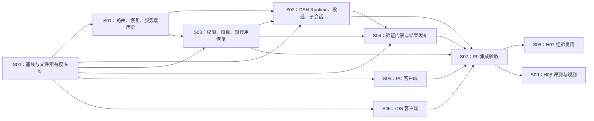

# Morde Harness 并发实施总控

**用途：** 将[最终流程规格](../Morde_Harness_最终流程与实现规格.md)和[事实任务 TODO](../Morde_Harness_实施任务_TODO.md)分配给多个独立开发会话。规格定义行为与约束，原 TODO 保留 H00–H11 的唯一状态和验收；本目录只定义会话边界、文件所有权和交接方式。

## 根因分析、方案留档与模块边界

- 测试失败先保留最小稳定复现，再沿入口、调用方、数据/状态转换、Runtime/Provider、持久化和客户端反馈追踪完整链路，判断根因属于哪个机制。测试阈值只是复现条件，不是修复目标；不能通过扩大测试限制、截短输入、吞掉错误或放宽断言来“修复”。
- 长上下文故障要区分字符、字节、协议请求上限和模型 token 窗口，检查历史检索是否过量、上下文预算、提示拼装、摘要/压缩、截断策略和 Provider 适配。约 4K 输入失败时，应验证根因机制在不同规模仍成立；用明确单位的 4K、100K、200K 合成压力样例覆盖选取/预算/压缩路径，同时按目标模型实际窗口判断端到端能力。超出单次窗口时应通过授权历史检索与有来源的压缩继续处理，关键历史确实不可用或无法安全压缩时清楚报告；不得假设模型能直接接收超窗内容，也不得静默丢失上下文。
- 复杂问题在改代码前形成简短方案并保留证据：复现及调用链、根因假设/验证、可行方案和取舍、选定机制、受影响模块/函数的职责与接口、状态和副作用归属、回归用例及剩余风险。将最终方案写入对应 H 项进度或获协调会话确认的设计文档；不能只留在会话对话里。修改流程/接口合同的，由协调会话同步规格或主 TODO。
- 修改模块前列出调用方和依赖，明确每个模块/函数的单一职责、输入/输出/错误语义及状态/副作用所有者；优先在现有 owner 的边界内修复，维持高内聚、低耦合，避免重复机制和隐式共享状态。跨 owner 变更先提最小接口提案，由文件 owner 实施；测试与夹具随对应 owner 管理。

## 1. 启动前置条件

1. 启动时以 `git status --short --untracked-files=all` 为准，逐项审阅并保留已有用户改动；不要假设本 TODO 记录的当前进度都已进入 HEAD，也不要从干净 HEAD 启动而漏掉实现。确认纳入并发开发的内容后，形成并记录一个共同的本地基线 SHA（可用本地 checkpoint commit，不推送远端）；未确认纳入的改动留在原工作区。多个会话不得直接编辑同一个工作目录。若无法安全形成共同基线，先只做只读审计。
2. 基线须记录 Morde commit、工作树差异、DSH 锁定版本、Hermes 源码来源/哈希和当前 H 项状态。原 TODO 已记录多项本地实现与自动化测试；各会话从现有证据继续，只补失败或未验证缺口，不按任务标题重写已有实现。`project/hermes-agent/` 没有独立 Git 元数据，因此本地快照只有在关键文件哈希与固定上游提交核对后才可称为对应源码。
3. 每个代码会话使用独立本地 worktree 和分支，全部从同一已保留基线创建。分支建议为 `codex/harness-s01` 至 `codex/harness-s09`。不推送远端，不通过外部渠道发送文件。若无法形成包含当前改动的共同基线，先只做只读审计，不启动并行写代码。
4. 会话只能修改自己的“独占文件”及对应测试。跨边界需求先向文件所有者提交接口/数据变更提案；不得为了方便直接编辑其他会话文件。
5. 只有协调会话可以改本文件和原 TODO。S07 独占[验证记录](../验证记录/Morde_Harness_最终流程测试用例.md)中的 H06 证据段；其他会话只提交结果，由 S07 记录。协调会话负责校对其余章节，避免文档冲突。
6. 迁移编号由协调会话分配；sqlc 生成物、共享 OpenAPI/接口清单、依赖清单与锁文件集中整合。会话先提交所需 Schema/API 变化提案，不得争用迁移编号或改其他会话的生成文件。
7. 修改 DSH 能力前读取根目录及目标目录的 `AGENTS.md`，按本规格的 DSH 插件核对门禁复核锁定版本、许可和实际功能。不得另写 AgentLoop，不得把安装插件当作接通。
8. S01–S06、S08、S09 使用本机隔离环境；共享远程测试站点仅由 S07 在合并基线后访问，避免多个会话相互污染。具体允许的主机、合成数据和管理员密码重置边界见 S07 任务文档及[会话提示词](10-各会话开发提示词.md)。

共同基线已建立后，可按此模板从仓库根创建隔离 worktree；把会话号与基线 SHA 替换成实际值：

```bash
git worktree add ../morde-harness-s01 -b codex/harness-s01 <共同基线SHA>
```

### 2026-11-22 本地共同基线

- 基线为 `e009815383daaa883ec7f2b40fe2ec7cdeb7397a`，父提交为 `501359d9df55dccbdaa5a23e03737a5c7a8cfb64`。checkpoint 保留了启动时已有的 `docs/Morde_Harness_实施任务_TODO.md`、`web/portal/src/routes/Assistant.test.tsx` 改动和 `docs/Morde_Harness_并发实施/` 文档；未推送。
- 各 worktree 由该基线创建。S01 本地实现提交为 `06c3c9e9`（coordinator 429 原子恢复）、`d507dacb`（失效摘要授权版本修复）、`f342bdb5`（历史工具检查点重放和分页）、`0e80020c`（重放时复核 history source authorization/suppression）。
- 基线 DSH 依赖锁定版本为 `0.2.2-rc.1`；部署状态未核实。`project/hermes-agent/` 无独立 Git 元数据，本地 retry、response-check、empty-response、gateway hygiene、session search 文件的哈希和配对关系记录于 [S01 交接](01-会话路由与服务端上下文.md#hermes-对照)；快照与固定 Hermes SHA 的精确对应未证明。快照根许可证为 MIT，许可结论仅适用于本地快照。
- 基线 H01/H09 为待验证，H02 为进行中，H10 已有本地自动化覆盖但仍待 H06 实际入口验收。S01 服务端本轮结果和未测范围以主 TODO 为准。

## 2. 会话与依赖

| 会话 | 流程图步骤 | 任务来源 | 独占领域 | 可开始时间 |
|---|---|---|---|---|
| S00 协调会话 | 启动门禁/整体集成 | H00、TODO 状态维护、共享集成 | 共同基线、worktree 创建、共享文档/迁移号/生成物整合 | S00 完成基线保全、Hermes 来源记录和所有权冻结后，才开放代码会话 |
| S01 会话路由与服务端上下文 | 01、01A、02、03、05 | H01、H02、H09 服务端部分、H10 路由/持久化部分 | app 路由、Go route worker、PostgreSQL conversation route/summary | 共同基线后；S01 拥有对应文件 |
| S02 DSH Runtime、消息投递与子会话 | 01A 的 DSH Session 部分、06 | H09 Runtime 部分、H10 Runtime 部分、H11 | Node DSH Runtime、DSH executor/session tree/checkpoint | 可先做独立 Runtime 审计/实现；H10/H11 集成须等 S01/S03 接口稳定 |
| S03 工具授权、预算与执行恢复 | 04、07、08 | H03、H04 | Go Broker、额度/用量账本、task worker 与操作对账 | 可并行审计；接口依赖 H01/H02，改动按已确认合同进行 |
| S04 结果验证与正式交付 | 09、10 | H05 | 验证 Worker、结果快照和 conversation result 发布 | 可并行审计；最终集成依赖 S02、S03、H11 |
| S05 PC 客户端 | 01、03、10 的 PC 用户入口 | H06 的 PC 部分 | `morde-pc` 和其内部 UI | UI 审计可并行；接入 API/状态须等 S01/S03 合同稳定，最终须实际操作 PC 客户端 |
| S06 iOS 客户端 | 01、03、10 的 iOS 用户入口 | H06 的 iOS 部分 | 原生 Morde iOS 工程 | UI 审计可并行；接入 API/状态须等 S01/S03 合同稳定，最终须实际操作 iOS 客户端 |
| S07 P0 集成验收 | 01–10 全链路 | H06 跨端、真实模型、长历史与耐久验收 | 只运行/记录验证，不改产品代码 | S01–S06 合并后 |
| S08 经验证的任务经验 | 11 的经验/Skill 部分 | H07 | Skill/经验版本、来源与授权 | S07 完成 P0 验收后 |
| S09 评测、可观测性与方案比较 | 11 的观测部分 | H08 | 现有 metrics/evaluation 资产 | S07 完成 P0 验收后；可与 S08 并行 |



箭头表示接口冻结/集成依赖，不阻止对独占文件的并行审计和实现：S01/S02/S03/S05/S06 可在共同基线后启动互不重叠的工作；S02 的 H09 Runtime 部分可先做，H10/H11 集成等 S01/S03 合同稳定。S05/S06 可并行审计 UI，但在 S01/S03 合同稳定前不改 API DTO 或自行假定状态。S04 可先审计和写本域测试；最终集成依赖 S02、S03、H11。S07 可提前准备测试清单，实际端到端验收须等 P0 实现合并。原 TODO 的 PR 1–4 是集成批次，不覆盖本并发图的文件所有权。

## 3. 文件所有权总表

| 会话 | 独占源文件边界（含同域新增测试） | 明确不编辑 |
|---|---|---|
| S00 | `docs/Morde_Harness_并发实施/00-并发实施总控.md`、`docs/Morde_Harness_实施任务_TODO.md`；[验证记录](../验证记录/Morde_Harness_最终流程测试用例.md)除 S07 的 H06 证据段以外的内容；集中整合迁移编号、共享 OpenAPI/接口清单、依赖与锁文件、Xcode 共享工程设置及 `sqlcgen/` | 各会话独占的产品源文件和测试；S07 的 H06 证据段（由 S07 写入，S00 只做最终校对） |
| S01 | `server/internal/app/conversation_message_routing.go`、`conversation_route_*.go`、`conversation_summaries*.go`、`cloud_dsh_history_tools*.go`、`model_gateway_route*.go`、`model_client.go`；`server/internal/model/responses*.go`；`server/internal/worker/conversation_route_*.go`、`conversation_summary_maintenance.go`、`cloud_dsh_coordinator*.go`；`server/internal/store/postgres/conversation_message_routing*.go`、`conversation_route_*.go`、`conversation_summaries*.go`、`conversation_summary_inputs*.go`、`model_usage_route*.go` | `engine.mjs`、`agent_checkpoint*.go`、`cloud_dsh_executor.go`、`cloud_dsh_tool_broker.go`、`task_worker.go`、客户端文件 |
| S02 | `runtime/morde-cloud-runtime/src/engine.mjs`、`hermes-compaction-window.mjs` 及同域 Runtime 测试；`server/internal/worker/cloud_dsh_executor*.go`、`cloud_dsh_session_tree*.go`、`conversation_context_dsh_e2e_integration_test.go`；`server/internal/app/agent_checkpoint*.go`；`server/internal/store/postgres/agent_checkpoint*.go` | S01 的 `conversation_route_*.go` 与 `conversation_summary_*.go`、S03 Broker/账本/`task_worker*.go`、客户端文件 |
| S03 | `server/internal/app/cloud_dsh_tool_broker*.go`、`model_usage_admin*.go`、`task_approvals*.go`、`runtime_operation_ledger*.go`、`project_budget*.go`、`model_budget_default*.go`；`server/internal/worker/task_worker*.go`；`server/internal/store/postgres/model_usage.go`、`model_usage_admin*.go`、`model_usage_recovery*.go`、`task_approvals*.go`、`runtime_operation_ledger*.go`、`mcp_connector_operations*.go`、`project_budget*.go`、`model_budget_default*.go` 及同域测试 | S01 的 `model_usage_route*.go`/conversation route、S02 Runtime/DSH executor/checkpoint、S04 review 文件 |
| S04 | `server/internal/app/task_validation_review*.go`、`task_validation*.go`；`server/internal/worker/task_validation_review_worker*.go`；`server/internal/store/postgres/task_validation_review*.go`、`conversation_result_review*.go`、`model_usage_review*.go` 及同域测试 | `task_worker*.go`、`cloud_dsh_tool_broker*.go`、DSH Runtime/checkpoint、客户端文件 |
| S05 | `clients/desktop/harness/desktop/**`、`clients/desktop/harness/dsh-nanomuse/src/client/**`；若某个 `web/portal` 组件实际由 morde-pc 内嵌使用，只允许修改该组件及其测试，并把它作为 PC 内部实现验收 | 服务端、Node Runtime、iOS 工程；不开发或验收独立普通用户 Web 端 |
| S06 | `clients/nanoMuse/android/src/ios/**`（遵守 iOS 目录许可证与本地化约定） | Android App、PC、服务端、Node Runtime |
| S07 | `docs/验证记录/Morde_Harness_最终流程测试用例.md` 的测试证据段；执行本地自动化/客户端验收 | 所有产品源文件、主 TODO 和并发总控（主 TODO 由协调会话更新） |
| S08 | `server/internal/app/cloud_dsh_skills.go`、对应只读 Skill/经验内容与 `server/internal/store/postgres/cloud_dsh_skill_reads*.go`；如需其他数据表先提案 | S01 历史/路由文件、S02 Runtime loop（需改 Runtime wiring 时提案给 S02）、S03 执行 Broker、S04 验收发布 |
| S09 | `server/internal/evaluation/**`、`server/internal/app/evaluation_blind.go`、`server/internal/worker/metrics.go`、`metrics_test.go`；需要其他模块埋点时提交给该模块 owner 提案 | H01–H06 功能文件、`engine.mjs`、依赖/锁文件、客户端功能 |

**所有权解释：** 同一目录的测试可以新增独立测试文件；不得为省文件而改别的会话正在维护的宽泛测试文件。发现同一文件需要跨会话修改时，以此表指定的唯一 owner 为准，其他会话通过最小补丁/测试需求交接。`go.mod`、pnpm/npm lockfile、Xcode 项目共享工程设置以及 `sqlcgen/` 由协调会话集中整合；确需改动时，先记录原因和具体版本/生成命令。

## 4. Hermes 代码与测试移植门禁

所有会话沿用规格第 3 节的固定 Hermes SHA `0d49d6d9d20e461155d49ba9d188687079c811af` 和 A/B/C 分类；固定 SHA 是核对锚点，不代表 `project/hermes-agent/` 快照已匹配。

1. **先找调用链与上游测试，再决定移植。** A 类可兼容时翻译确定性算法和边界测试；B 类复用行为/测试并接入 Morde/DSH 现有链路；C 类记录不移植原因。每个条目写源文件/符号、上游测试、快照哈希与许可、Morde 对应实现、差异和配对回归证据。
2. 用户要求优先复用 Hermes 已验证实现；因此遇到同功能时先检查能否移植最小确定性函数及测试。只有确有兼容/授权/持久化差异才改为行为适配，并说明差异。不得以“代码相似”跳过边界测试，也不得照搬单租户权限模型、SQLite、CLI、整套 Agent 循环或双层重试。
3. 各会话优先核对：S01：`agent/retry_utils.py`、`agent/turn_response_check.py`、`agent/turn_empty_response.py`、`gateway/run_turn_hygiene.py`、`tools/session_search_tool.py`；S02：`agent/turn_context.py`、`agent/context_compressor_window.py`、`agent/context_compressor.py`、`agent/turn_iteration_prep.py`、`gateway/session_busy_controls.py`、`gateway/turn_lease.py`；S03：`agent/turn_tool_round.py`、`agent/turn_liveness.py`、`gateway/session_stall.py`；S04：`agent/turn_stop_gates.py`、`agent/turn_final_response.py`。S08 核对规格列出的 Skill/经验注入对应实现；没有直接可移植函数就记录复用 DSH/Morde 机制的原因。S09 按规格的同任务集比较，不复制 Hermes 默认阈值作为生产配置；`agent/repetition_guard.py` 仅在复现了重复输出失败时再比较及移植，不默认加拦截。
4. `tools/approval.py` 的信任模型与 Morde 不同，默认标 C；不能移植绕过人工审批、宿主机直跑或全局 Profile 授权的代码。

## 5. 会话交接格式与合并规则

每个会话结束时只需向协调会话提供：

```text
会话 ID / 对应 H 编号：
共同基线 commit：
改动文件：
缺陷复现与根因链路（无缺陷时注明）：
复杂问题方案、取舍和留档位置：
模块/函数职责、接口、状态与副作用边界：
Hermes 核对表（SHA、文件/符号、A/B/C、许可、配对测试/未匹配原因）：
接口或 Schema 变化提案：
回归用例（原始复现、上下文规模/机制边界及其他回归）与实际命令/结果：
未测项/阻塞/风险：
是否需要协调会话更新迁移编号、sqlc 生成物或共享文档：
```

整合顺序：先 S01 与 S03 的服务端合同；再 S02 的 DSH/runtime 消息与恢复；随后 S04 结果门禁和 S05/S06 客户端；最后 S07 实际验收。P1 的 S08/S09 只有在 H06 的 P0 证据完成后才合并。冲突时按源文件 owner 解决，不通过放宽权限、验收断言或抹掉已有改动来消除冲突。

### 可复制的会话启动指令

S00 与 S01–S09 的专项提示词见[各会话开发提示词](10-各会话开发提示词.md)。每次启动时复制 S00 的基线提示词或目标 Sxx 提示词，并在同一基线的独立 worktree 中打开仓库；共享规则、根因修复要求、凭据边界和子 Agent 分工均写在该文件中。
