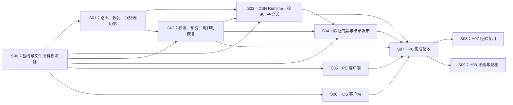

# Morde Harness 并发实施总控

**用途：** 将[最终流程规格](../Morde_Harness_最终流程与实现规格.md)和[事实任务 TODO](../Morde_Harness_实施任务_TODO.md)分配给多个独立开发会话。规格定义行为与约束，原 TODO 保留 H00–H11 的唯一状态和验收；本目录只定义会话边界、文件所有权和交接方式。

## 根因分析、方案留档与模块边界

- 测试失败先保留最小稳定复现，再沿入口、调用方、数据/状态转换、Runtime/Provider、持久化和客户端反馈追踪完整链路，判断根因属于哪个机制。测试阈值只是复现条件，不是修复目标；不能通过扩大测试限制、截短输入、吞掉错误或放宽断言来“修复”。
- 长上下文故障要区分字符、字节、协议请求上限和模型 token 窗口，检查历史检索是否过量、上下文预算、提示拼装、摘要/压缩、截断策略和 Provider 适配。约 4K 输入失败时，应验证根因机制在不同规模仍成立；用明确单位的 4K、100K、200K 合成压力样例覆盖选取/预算/压缩路径，同时按目标模型实际窗口判断端到端能力。超出单次窗口时应通过授权历史检索与有来源的压缩继续处理，关键历史确实不可用或无法安全压缩时清楚报告；不得假设模型能直接接收超窗内容，也不得静默丢失上下文。
- 复杂问题在改代码前形成简短方案并保留证据：复现及调用链、根因假设/验证、可行方案和取舍、选定机制、受影响模块/函数的职责与接口、状态和副作用归属、回归用例及剩余风险。将最终方案写入对应 H 项进度或获协调会话确认的设计文档；不能只留在会话对话里。修改流程/接口合同的，由协调会话同步规格或主 TODO。
- 修改模块前列出调用方和依赖，明确每个模块/函数的单一职责、输入/输出/错误语义及状态/副作用所有者；优先在现有 owner 的边界内修复，维持高内聚、低耦合，避免重复机制和隐式共享状态。跨 owner 变更先提最小接口提案，由文件 owner 实施；测试与夹具随对应 owner 管理。

## 1. 启动前置条件

1. 启动时以 `git status --short --untracked-files=all` 为准，逐项审阅并保留已有用户改动；不要假设本 TODO 记录的当前进度都已进入 HEAD，也不要从干净 HEAD 启动而漏掉实现。所有代码修改都在唯一的 `main` 工作区完成，不为会话建立分支或 worktree。并行任务共享该工作区时，先确认修改文件集合互不重叠；涉及同一文件、共享接口、迁移或公共文档的工作串行交给协调会话。无法保证文件边界时只做只读审计或串行处理。
2. 基线须记录 Morde commit、工作树差异、DSH 锁定版本、Hermes 源码来源/哈希和当前 H 项状态。原 TODO 已记录多项本地实现与自动化测试；各会话从现有证据继续，只补失败或未验证缺口，不按任务标题重写已有实现。`project/hermes-agent/` 没有独立 Git 元数据，因此本地快照只有在关键文件哈希与固定上游提交核对后才可称为对应源码。
3. 只在本地 `main` 上开发；不得创建、切换或合并实现分支，不创建并发开发 worktree。各 Agent 仅修改任务明确列出的独占文件及对应测试，协调会话统一集成、验证和更新 TODO。没有用户明确要求时不推送；不得通过外部渠道发送文件。
4. 会话只能修改自己的“独占文件”及对应测试。跨边界需求先向文件所有者提交接口/数据变更提案；不得为了方便直接编辑其他会话文件。
5. 只有协调会话可以改本文件和原 TODO。S07 独占[验证记录](../验证记录/Morde_Harness_最终流程测试用例.md)中的 H06 证据段；其他会话只提交结果，由 S07 记录。协调会话负责校对其余章节，避免文档冲突。
6. 迁移编号由协调会话分配；sqlc 生成物、共享 OpenAPI/接口清单、依赖清单与锁文件集中整合。会话先提交所需 Schema/API 变化提案，不得争用迁移编号或改其他会话的生成文件。
7. 修改 DSH 能力前读取根目录及目标目录的 `AGENTS.md`，按本规格的 DSH 插件核对门禁复核锁定版本、许可和实际功能。不得另写 AgentLoop，不得把安装插件当作接通。
8. S01–S06、S08、S09 使用本机隔离环境；共享远程测试站点仅由 S07 在合并基线后访问，避免多个会话相互污染。具体允许的主机、合成数据和管理员密码重置边界见 S07 任务文档及[会话提示词](10-各会话开发提示词.md)。

**当前执行方式：** 任务拆分须先列依赖、独占文件与验收命令；可并行的 Agent 共用 `main` 工作区，但只能写入互不重叠的文件集合。评审或共享接口变更由协调会话串行完成。历史 worktree/分支记录只用于追溯，不是后续开发步骤。

**本轮 S00 共同基线（2026-11-22）：** 原 Morde HEAD 为 `e009815383daaa883ec7f2b40fe2ec7cdeb7397a`。经逐项检查，将启动时已有的全部 35 个文件改动（包含 3 个新文件，2,006 行增加、155 行删除；相对原 HEAD 的二进制 diff SHA-256 为 `12c42cac7387a20208802f6eabd6643bc2fa03473a06fcc08f0a2b791dc1410f`）纳入本地 checkpoint `81e7304d53808c91b35249156ede5f24a5bb3e45`，未推送或外发文件。所有并行代码 worktree 均从该 SHA 创建；本轮分支为 `codex/harness-s02-review`、`codex/harness-s03-review` 和 `codex/harness-s05-review-2`。基线 DSH 依赖由 `package.json` 与锁文件固定为 `0.2.2-rc.1`。`project/hermes-agent/` 无独立 Git 元数据；`agent/retry_utils.py` SHA-256 为 `4c643880c012dd536dca08041f1bae93b6a58477186b5cf0b4e27ec3c640014c`，`scripts/build/agent.py` 为 `d3e1b6a4ed10c03945457ab81b5163715ac89fec5a8f5ec7d67c3652c848665d`，本地有 MIT LICENSE，但仍未证明快照与固定上游 SHA 完全匹配。各 H 项仍以主 TODO 在该共同基线中的状态为准；本轮不把尚缺真实客户端、Provider、隔离或耐久证据的项目视作完成。

**本轮 S00 主工作区整合（2026-11-22）：** S01 的 `215ddc17`、`57a3af3c`、`6f9951f4`、`4f5657b8`，S02 的恢复/测试提交 `ce4acc30`、`fd18564e`，S03 的 H10 门禁 `9d3ffac7`，S04 的验证回执与并发锁 `8aa94bef`、`b81d6164`，以及 S06 的 `4de96e23` 均已整合到本地 `main`；S02 另于 `af9c960b` 修正 E2E 对包裹回执的断言。S05 本轮无代码改动；嵌入 PC 的 Portal 助手文件与 S05 实际 `morde-pc` 测过失败提示的工作树逐文件无差异，因此既有 PC 实际显示证据仍适用于当前助手代码。测试基线为产品代码 `fd18564e` 加回执测试修正 `af9c960b`；`go test ./internal/app -count=1` 通过（22.636 秒），S01 路由/摘要 9 项与 S04 回执/并发锁 PostgreSQL 定向组分别通过（17.649 秒、39.187 秒），S02 completion race、Account Runtime 多 Task 与 840 条历史重启三个真实本地 Node + 隔离 PostgreSQL Worker E2E 组合通过（34.084 秒）。当前助手测试 210/210 与 Portal typecheck 也通过；本轮进程为 Node `26.13.0`，Portal 声明支持 `24.x`，故这两项只作补充证据，不替代受支持版本门禁。本轮只在本机临时 PostgreSQL 16 容器（loopback、无持久卷）验证；未部署、未访问共享测试站、未外发文件。H06 的真实 Provider、实际 PC→iOS 接续、账号隔离和耐久验收仍未闭合，P1 的 S08/S09 不启动。

**本轮截图分支合并与清理（2026-11-22）：** 截图所列 19 个分支均已合并进 `main` 并推送；合并记录时 `main` 与 `origin/main` 为 `a23d7e7572f349211992bdea69c541a31a29de5c`，远端仅保留 `main`。后续 `fix` 提交将两端推进至 `51cbe1375e02abfd780c9b9ee349d1fa85e79b99`；本轮复核确认 `a23d7e7` 是当前 HEAD 的祖先，远端当前仍仅有 `main`，因此原 19 个分支合并结果仍在远端主线。19 个本地源分支、对应 worktree 和临时整合分支/worktree 已清理。与截图无关的 `workspace-1`、`codex/client-login-ordering-20261105` 保留。后续修改遵守本节的 main-only 工作方式。

**本轮 S00 主线状态复核（2026-11-22）：** 当前工作区在 `main`，HEAD 与 `origin/main` 均为 `51cbe1375e02abfd780c9b9ee349d1fa85e79b99`（`fix`）；`git ls-remote --heads origin` 只返回 `refs/heads/main`。工作区 7 个未提交文件为 H04 worker/Runtime 测试及实现、H05/H06 定向 PostgreSQL 测试、总控/TODO 与验证记录；本地增量未推送。DSH 运行依赖仍由 `runtime/morde-cloud-runtime/package.json` 与锁文件固定在 `0.2.2-rc.1`。`workspace-1` 是独立的既有 worktree，没有纳入本轮改动。

**本轮 S00 Hermes 固定提交关键文件哈希复核（2026-11-22）：** `project/hermes-agent/` 无独立 Git 元数据。将 S01–S04 清单中的 16 个核心实现源文件、`scripts/build/agent.py` 及本地 `LICENSE` 的 SHA-256 分别与[上游固定提交 `0d49d6d9d20e461155d49ba9d188687079c811af`](https://github.com/NousResearch/hermes-agent/tree/0d49d6d9d20e461155d49ba9d188687079c811af)原始文件哈希比较，18 项均一致。另用 GitHub recursive tree 中的 Git blob SHA-1 与本地文件 blob SHA-1 对比：上游 27,298 个 blob、本地 27,297 个文件，27,187 项内容相同，28 个上游文件本地缺失，83 个共有文件内容不同；27 个本地额外文件均为 `__pycache__/*.pyc`。因此只可确认关键文件对应，不能把本地快照称作该提交的完整副本。验证命令、关键文件哈希与树差异见[验证记录](../验证记录/Morde_Harness_最终流程测试用例.md#s00-h00-hermes-固定提交关键文件哈希核对-2026-11-22)。读取上游源和树元数据期间未上传本地文件；H00 仍进行中。

**本轮 S00 主线 H04 对账复核（2026-11-23）：** app 恢复调用链只在对原 Runtime lease 的精确查询返回 `AgentToolNotFound` 时允许同 operation ID 重试；Runtime 在 handler 派发前持久记录 accepted/running，同一实例中活跃 operation 会返回既有记录，存储错误和服务故障 fail closed。新增 Task lease reclaim 与旧 dispatcher 并存的回归，确认恢复读取旧结果、handler 只执行一次且没有第二次 dispatch；未发现 app 边界生产缺陷。S02 同时核对 Go/Node Account Runtime ready 帧字段一致，旧集成快照的握手 race 失败未在当前主线复现，原失败字段仍未证实。`cd server && go test -race -count=1 ./...` 全量通过（app 42.532 秒、worker 65.795 秒）；H04 真实工具停滞、PC/iOS 入口和 60 分钟耐久验收仍待完成。复核截图 19 个分支的合并结果仍在主线，另有两个保留本地分支的 tip 也都是 `main` 祖先，没有独有提交。详细证据见[验证记录](../验证记录/Morde_Harness_最终流程测试用例.md#s00-h04-操作对账与跨包-race-复验-2026-11-23)。当前改动仍只在本机 `main`，未提交或推送。

**本轮 S00 合并后本地引用清理（2026-11-23）：** 对 `codex/client-login-ordering-20261105` 与 `workspace-1` 验证 `git merge-base --is-ancestor <branch> main` 均成功，`git log main..<branch>` 均为空；`workspace-1` 工作树干净。按总目标清理该 worktree 并删除两个本地分支引用。清理后 `git worktree list` 只列主工作区，`git branch -vv` 只列 `main`，`git ls-remote --heads origin` 只列远端 `main`。主工作区内 8 个未提交开发/验证文件保留且未推送。完整命令见[验证记录](../验证记录/Morde_Harness_最终流程测试用例.md#s00-合并后剩余本地分支与-worktree-清理-2026-11-23)。

## 2. 会话与依赖

| 会话 | 流程图步骤 | 任务来源 | 独占领域 | 可开始时间 |
|---|---|---|---|---|
| S00 协调会话 | 启动门禁/整体集成 | H00、TODO 状态维护、共享集成 | 共同基线、worktree 创建、共享文档/迁移号/生成物整合 | S00 完成基线保全、Hermes 来源记录和所有权冻结后，才开放代码会话 |
| S01 会话路由与服务端上下文 | 01、01A、02、03、05 | H01、H02、H09 服务端部分、H10 路由/持久化部分 | app 路由、Go route worker、PostgreSQL conversation route/summary | 共同基线后；S01 拥有对应文件 |
| S02 DSH Runtime、消息投递与子会话 | 01A 的 DSH Session 部分、06 | H09 Runtime 部分、H10 Runtime 部分、H11 | Node DSH Runtime、DSH executor/session tree/checkpoint | 可先做独立 Runtime 审计/实现；H10/H11 集成须等 S01/S03 接口稳定 |
| S03 工具授权、预算与执行恢复 | 04、07、08 | H03、H04 | Go Broker、额度/用量账本、task worker 与操作对账 | 可并行审计；接口依赖 H01/H02，改动按已确认合同进行 |
| S04 结果验证与正式交付 | 09、10 | H05 | 验证 Worker、结果快照和 conversation result 发布 | 可并行审计；最终集成依赖 S02、S03、H11 |
| S05 PC 客户端 | 01、03、10 的 PC 用户入口 | H06 的 PC 部分 | `morde-pc` 和其内部 UI | UI 审计可并行；接入 API/状态须等 S01/S03 合同稳定，最终须实际操作 PC 客户端 |
| S06 iOS 客户端 | 01、03、10 的 iOS 用户入口 | H06 的 iOS 部分 | 原生 Morde iOS 工程 | UI 审计可并行；接入 API/状态须等 S01/S03 合同稳定，最终须实际操作 iOS 客户端 |
| S07 P0 集成验收 | 01–10 全链路 | H06 跨端、真实模型、长历史与耐久验收 | 只运行/记录验证，不改产品代码 | S01–S06 合并后 |
| S08 经验证的任务经验 | 11 的经验/Skill 部分 | H07 | Skill/经验版本、来源与授权 | S07 完成 P0 验收后 |
| S09 评测、可观测性与方案比较 | 11 的观测部分 | H08 | 现有 metrics/evaluation 资产 | S07 完成 P0 验收后；可与 S08 并行 |



箭头表示接口冻结/集成依赖，不阻止对独占文件的并行审计和实现：S01/S02/S03/S05/S06 可在共同基线后启动互不重叠的工作；S02 的 H09 Runtime 部分可先做，H10/H11 集成等 S01/S03 合同稳定。S05/S06 可并行审计 UI，但在 S01/S03 合同稳定前不改 API DTO 或自行假定状态。S04 可先审计和写本域测试；最终集成依赖 S02、S03、H11。S07 可提前准备测试清单，实际端到端验收须等 P0 实现合并。原 TODO 的 PR 1–4 是集成批次，不覆盖本并发图的文件所有权。

## 3. 文件所有权总表

| 会话 | 独占源文件边界（含同域新增测试） | 明确不编辑 |
|---|---|---|
| S00 | `docs/Morde_Harness_并发实施/00-并发实施总控.md`、`docs/Morde_Harness_最终总流程图.md`、`docs/Morde_Harness_最终流程与实现规格.md`、`docs/Morde_Harness_实施任务_TODO.md`；[验证记录](../验证记录/Morde_Harness_最终流程测试用例.md)除 S07 的 H06 证据段以外的内容；集中整合迁移编号、共享 OpenAPI/接口清单、依赖与锁文件、Xcode 共享工程设置及 `sqlcgen/` | 各会话独占的产品源文件和测试；S07 的 H06 证据段（由 S07 写入，S00 只做最终校对） |
| S01 | `server/internal/app/conversation_message_routing.go`、`conversation_route_*.go`、`conversation_summaries*.go`、`cloud_dsh_history_tools*.go`、`model_gateway_route*.go`、`model_client.go`；`server/internal/model/responses*.go`；`server/internal/worker/conversation_route_*.go`、`conversation_summary_maintenance.go`、`cloud_dsh_coordinator*.go`；`server/internal/store/postgres/conversation_message_routing*.go`、`conversation_route_*.go`、`conversation_summaries*.go`、`conversation_summary_inputs*.go`、`model_usage_route*.go` | `engine.mjs`、`agent_checkpoint*.go`、`cloud_dsh_executor.go`、`cloud_dsh_tool_broker.go`、`task_worker.go`、客户端文件 |
| S02 | `runtime/morde-cloud-runtime/src/account-runtime.mjs`（Task Agent status/activity/heartbeat 帧校验，以及 Task 子进程退出码/信号的有界诊断回传）、`engine.mjs`、`ipc.mjs`、`hermes-compaction-window.mjs` 及同域 Runtime 测试；`server/internal/worker/cloud_dsh_executor*.go`、`cloud_dsh_account_runtime*.go`、`docker_cloud_dsh_account_runtime*.go`、`cloud_dsh_session_tree*.go`（仅传递与恢复 child 的 root checkpoint fence）、`cloud_dsh_jobs.go`（仅传递 job-cancel CallID）、`cloud_dsh_agent_status_test.go`、`browser_tool_worker_chain_integration_test.go`、`search_read_dsh_tool_worker_chain_integration_test.go`、`conversation_context_dsh_e2e_integration_test.go`；`server/internal/app/agent_checkpoint*.go`；`server/internal/store/postgres/agent_checkpoint*.go`（`agent_checkpoint.go` 的 root inbox applied-checkpoint fence 列由 S03 独占）；`task_stream.go` 与 `task_stream_integration_test.go`（仅用于阻止 pending Task 输入后的旧文本增量） | S01 的 `conversation_route_*.go` 与 `conversation_summary_*.go`、S03 Broker/账本/`task_worker*.go`、客户端文件 |
| S03 | `server/internal/app/cloud_dsh_tool_broker*.go`、`model_usage_admin*.go`、`task_approvals*.go`、`runtime_operation_ledger*.go`、`project_budget*.go`、`model_budget_default*.go`、`hub_task_actions.go`；`agent_sessions.go`（仅 child cancel CallID、root checkpoint fence 字段与 typed pending error）、`runtime_tool_executor.go`（仅 Workspace output verification 传播 typed pending error）、`cloud_dsh_workspace_tools.go`、`cloud_dsh_workspace_live.go`（仅传播 superseded 及锁内消息快照）、`agent_tools.go`（仅新增 `AgentToolResult.SupersedingMessages`）、`store.go`（仅新增 Task Workspace publish superseded 状态和 superseding message snapshot 字段）、`task_store.go`（Task Agent observation 合同及本轮明确交接的 Task completion fence）；`server/internal/worker/task_worker*.go`；`server/internal/store/postgres/model_usage.go`、`model_usage_admin*.go`、`model_usage_recovery*.go`、`task_approvals*.go`、`runtime_operation_ledger*.go`、`mcp_connector_operations*.go`、`hub_task_operations*.go`、`task_file_fetches.go`、`task_workspace_publish.go`、`agent_sessions.go`（仅 child root checkpoint fence、create/cancel steer fence 与恢复）、`agent_instances.go`（仅 root Agent Session 初始 root checkpoint baseline/known 字段写入与同域回归）、`agent_checkpoint.go`（仅 root inbox applied-checkpoint fence 列写入）、`project_budget*.go`、`model_budget_default*.go`、`task_execution.go`、`task_agent_activity*.go`、`task_agent_stall*.go` 及同域测试；获 S00 分配编号后的对应 SQL migration | S01 的 `model_usage_route*.go`/conversation route、S02 Runtime/DSH executor/checkpoint、S04 review 文件 |
| S04 | `server/internal/app/task_validation_review*.go`、`task_validation*.go`；`server/internal/worker/task_validation_review_worker*.go`；`server/internal/store/postgres/task_validation_review*.go`、`conversation_result_review*.go`、`model_usage_review*.go` 及同域测试；`conversation_result_aggregation_integration_test.go`、`conversation_result_aggregation_preservation_integration_test.go`（仅 S04 validation receipt 的前置路由 fixture 和分区状态断言） | `task_worker*.go`、`cloud_dsh_tool_broker*.go`、DSH Runtime/checkpoint、客户端文件；Conversation result aggregator 生产代码 |
| S05 | `clients/desktop/harness/desktop/**`、`clients/desktop/harness/dsh-nanomuse/src/client/**`；若某个 `web/portal` 组件实际由 morde-pc 内嵌使用，只允许修改该组件及其测试，并把它作为 PC 内部实现验收 | 服务端、Node Runtime、iOS 工程；不开发或验收独立普通用户 Web 端 |
| S06 | `clients/nanoMuse/android/src/ios/**`（遵守 iOS 目录许可证与本地化约定） | Android App、PC、服务端、Node Runtime |
| S07 | `docs/验证记录/Morde_Harness_最终流程测试用例.md` 的测试证据段；执行本地自动化/客户端验收 | 所有产品源文件、主 TODO 和并发总控（主 TODO 由协调会话更新） |
| S08 | `server/internal/app/cloud_dsh_skills.go`、对应只读 Skill/经验内容与 `server/internal/store/postgres/cloud_dsh_skill_reads*.go`；如需其他数据表先提案 | S01 历史/路由文件、S02 Runtime loop（需改 Runtime wiring 时提案给 S02）、S03 执行 Broker、S04 验收发布 |
| S09 | `server/internal/evaluation/**`、`server/internal/app/evaluation_blind.go`、`server/internal/worker/metrics.go`、`metrics_test.go`；需要其他模块埋点时提交给该模块 owner 提案 | H01–H06 功能文件、`engine.mjs`、依赖/锁文件、客户端功能 |

**所有权解释：** 同一目录的测试可以新增独立测试文件；不得为省文件而改别的会话正在维护的宽泛测试文件。发现同一文件需要跨会话修改时，以此表指定的唯一 owner 为准，其他会话通过最小补丁/测试需求交接。`go.mod`、pnpm/npm lockfile、Xcode 项目共享工程设置以及 `sqlcgen/` 由协调会话集中整合；确需改动时，先记录原因和具体版本/生成命令。

**Migration 分配：** `00226_task_agent_activity_liveness.sql` 分配给 S03，用于 H04 Task Agent revision/activity/heartbeat 与去重停滞提示记录。编号由 S00 统一分配，SQL 内容由 S03 按文件所有权维护。

**Migration 分配：** `00227_task_tool_supersession_fences.sql` 分配给 S03，用于将被 pending steer 阻止的 Workspace publish receipt 标为不可重放的 `superseded`，并按 Task/call key 幂等保存 superseding message IDs，覆盖 tool、child-create 和 job-cancel final gates；gate 提交后若 Worker 崩溃且 steer 已应用，可从现有授权消息记录按 ID 恢复正文与附件。S03 同时负责状态映射、取消/child 恢复及提交后重放回归测试。

**本轮 H04 文件所有权补充（2026-11-22）：** S03 同时拥有 `server/internal/app/hub_task_actions.go` 与 `server/internal/store/postgres/hub_task_operations*.go`、`server/internal/store/postgres/task_file_fetches.go` 及对应同域测试。检查发现 Hub 与 Task file fetch 是独立的副作用派发路径；S03 的 pending-steer 派发栅栏必须覆盖这些路径，避免只保护主 Broker/MCP ledger 而遗漏 Hub 操作。

**本轮 H04 文件所有权补充（2026-11-22）：** S03 还拥有 `server/internal/store/postgres/task_workspace_publish.go` 及对应同域测试。Hostless Workspace 工具直接在 publish 事务中提交 manifest revision；最终提交前须在相同 Task 行锁下检查 pending steer，Reserve 阶段的检查不能替代 Commit 阶段门禁。

**本轮 H10 文件所有权补充（2026-11-22）：** S02 同时拥有 `runtime/morde-cloud-runtime/src/ipc.mjs` 及同域测试。若相同消息 ID 先通过普通 `message_delivery` 帧投递、再由 supersede 帧标记需撤销正在生成的响应，IPC 去重必须允许该标志单向升级并通知 Runtime；不得把同 ID 的不同正文、附件或投递模式当作合法升级。

**本轮 H10/H11 文件所有权补充（2026-11-22）：** S02 拥有 `server/internal/worker/cloud_dsh_jobs.go` 仅用于把 `dsh_job_cancel` CallID 传入持久取消请求；S03 拥有 app/PostgreSQL `agent_sessions.go` 中对应 command/storage gate。DSH `child_create`/`dsh_delegate` 在创建 child Session 前、`dsh_job_cancel` 在持久请求取消前，都须与 Task 行锁下 pending-steer 检查线性化；steer 先到则 supersede 尚未发生的副作用，已创建 child 或已持久请求取消则视为已开始，恢复时继续对账，不因后续 steer 被取消或抹掉。S03 仅在 `runtime_tool_executor.go` 传播 Task Workspace output verification 阶段的 typed pending error；不把独立的已审批 media save 纳入本轮。

**本轮 H10 applied-steer 栅栏交接（2026-11-22）：** S03 获得对 S02 所有的 `server/internal/store/postgres/agent_checkpoint.go` 的窄文件交接，仅可在 root Session inbox 消息同事务置为 `applied` 时写入该消息对应的 `claimed_checkpoint_through_seq`。S03 在 00227 中新增/回填该列，并在工具接纳与副作用最终门禁中按 `claimed_checkpoint_through_seq > ModelTaskFence.ThroughSequence` 识别已应用但仍旧代次的 steer，按消息 ID 恢复授权正文与附件后持久 supersession。S02 不编辑该文件；该列写入以外的 checkpoint 逻辑仍归 S02。

**本轮 H10 child root-checkpoint fence 交接（2026-11-22）：** S03 在 `AgentChildSessionCommand`/PostgreSQL child session 中持久保存创建时 root Session checkpoint through；S02 在 `cloud_dsh_session_tree.go` 创建和恢复 child 时传递/读取该值。Child 工具调用的本地 `ThroughSequence` 不得与 root Session 的 applied steer sequence 直接比较；S03 的 admission/final gate 使用 child 的固定 root checkpoint baseline，根 Session 调用仍使用自身 `ThroughSequence`。

**本轮 H10 Task 完成 fence 窄交接（2026-11-22）：** S03 可在 `server/internal/app/task_store.go` 的 `TaskProgress` 中增加 Task 完成候选的根 Session、Agent instance/代次、授权版本、checkpoint through 与 digest fence，并由现有 Broker 完成路径写入；S03 在 PostgreSQL `CommitTaskProgress` 最终完成事务中校验该 fence，并把已 applied 且 `claimed_checkpoint_through_seq` 晚于候选 fence 的授权 steer 作为 `TaskInputPendingError` 返回。该事务命中时不得发布旧 Task result/assistant receipt；其它 TaskProgress 调用和 H04/H05 状态语义保持原样。`task_execution.go` 仍由 S03 独占；`task_store.go` 仅限上述 Task completion fence 字段与对应校验合同，不扩大到其它通用状态字段。

**本轮 H10 legacy child root-baseline 窄交接（2026-11-22）：** S03 在 app/PostgreSQL admission 合同中为迁移后仍缺少可证明 root checkpoint baseline 的旧 child 返回终态 `AgentToolCallBaselineUnverifiable`，并以 PG 回归证明不接纳副作用；S02 仅在 `cloud_dsh_executor.go` / `cloud_dsh_session_tree.go` 消费该状态，将 `child_abort{session_id,call_id,reason}` 发给 Runtime，Runtime 只取消匹配的 child 并沿现有 `child_settle` 将失败原因交回 parent，不写 `tool_result` 或无限重试，也不停止 root、其它 child 或独立 Task。新 child 使用持久化 `root_checkpoint_baseline_known=true` 和精确 through，沿用正常恢复。S02 的 v4 supersede 携带 `supersede_session_id`，只撤销产生旧 frame 的 Agent，保留 steer 后启动的新 child。S03 同时仅在 `server/internal/store/postgres/agent_instances.go` root Agent Session 初始记录处初始化 baseline/known 字段。

**本轮 S04 validation receipt 测试夹具窄扩权（2026-11-22）：** S04 可在 `conversation_result_aggregation_integration_test.go` 与 `conversation_result_aggregation_preservation_integration_test.go` 中只更新其验证回执测试所需的已应用前置路由 fixture 和摘要/完成/验收状态断言；不得修改 Conversation result aggregator 生产代码。S00 负责核对 receipt 标签与规格合同，并同步相关总控文档。

**本轮 S00 整包集成失败复核窄交接（2026-11-22）：** S02 仅可修改 `server/internal/worker/cloud_dsh_cancel_restart_e2e_integration_test.go` 中两项 Node 重启恢复用例，使它们在旧 Executor/Node 确认停止后读取最终 durable checkpoint、验证不低于停止前快照并以该值对账 reclaim；不改生产代码。S03 仅获以下范围：`server/internal/store/postgres/task_model_responses.go` 将可选空 `provider_reported_model` 写为 SQL NULL（不放宽 identity CHECK）；`task_agent_stall.go` 的普通 notice step 不单独写 `task_revision`；以及 `model_usage_integration_test.go`（空 provider model 回归）、`task_agent_activity_integration_test.go`（可空列 COALESCE）、`task_agent_stall_integration_test.go`、`project_budget_integration_test.go`（任务响应 ProviderEndpoint fixture）、`task_message_delivery_integration_test.go`（断言 `ErrTaskInputPending` 和锁内消息 ID）。S04 可只更新 `conversation_result_completion_integration_test.go` 的 `TestRoutedTaskCompletionPublishesOneCombinedConversationMessage` receipt 断言，以及 `model_usage_review_integration_test.go` 中该项目 review 测试的初始 project-scoped fixture；不得改生产授权/作用域校验。其它失败先由 S00 按 owner 再交接，不因整包失败放宽 schema、授权或结果门禁。

**本轮 H11 子会话重放基线窄交接（2026-11-22）：** `TestCloudDSHBackgroundOutputContinuationAfterLeaseReclaim` 复现：恢复重放既有 root child 的相同 `spawn_key` 时，root checkpoint 已推进，但 Worker 仍把当前 root head 当作 child 创建基线，导致 PostgreSQL 的 immutable root baseline 校验正确拒绝并使完成结果无法续接。S02 仅修改 `server/internal/worker/cloud_dsh_session_tree.go` 的 `createCloudDSHChildSession` 及 `cloud_dsh_cancel_restart_e2e_integration_test.go`，重放时从已列出的持久 child 复用其 `RootCheckpointThroughSequence`；新 child 仍使用当前 root checkpoint，并保留重启后后台结果续接断言。配对 S03 仅修改 `server/internal/store/postgres/agent_sessions.go` 的 `CreateAgentChildSession` 与 `task_agent_tool_supersession_integration_test.go`：先按既有 spawn key 校验已存 child baseline/请求哈希/工具 allowlist/执行模式；只有新 spawn 才要求请求 baseline 等于父 Session 当前 root head。Task、实例、租约、授权和 ancestry 校验保持在原事务中。此次跨 owner 顺序由 S00 复核，不允许放宽任一持久 fence。

**本轮 S03 Worker 测试适配窄交接（2026-11-22）：** `TestCloudTaskSurvivesClientDisconnectAndPublishesItsPrivateWorkspaceView` 使用的 `f01WorkspaceSyncCompletionGateTaskStore` 是 decorator，但未透传新增的 `app.AgentToolCallAdmissionStore`，使真实 Broker 无法执行持久 admission；S03 仅可在 `server/internal/worker/cloud_task_lifecycle_e2e_integration_test.go` 为该 decorator 转发 `AdmitAgentToolCall`。该 E2E 随后观察到合法 SSE 注释行 `: keep-alive`，测试读取器必须跳过注释、等待真正事件并保留 Task ID 与递增序号断言；不得更改生产 SSE 行为，也不得更改审批/授权断言。

**本轮 S02 child baseline 测试夹具窄交接（2026-11-22）：** `TestCloudTaskHostGenerationFencePreservesAgentChildCheckpoint` 在新建 root Session 后、任何 checkpoint 前创建 child；root baseline 实际为 `-1`。S02 仅可修改 `server/internal/worker/cloud_task_host_restart_agent_recovery_e2e_integration_test.go` 中该 child 创建命令，显式传 `RootCheckpointThroughSequence: -1`，保留 Host generation recovery 和 child checkpoint 断言，不改生产校验或其它 fixture。

**本轮 S07 握手失败文件归属补充（2026-11-22）：** Race 复验及只读调用链诊断指向账号 Runtime 启动首帧握手，但测试未保留原始 stdout frame/stderr，具体根因未证实。为后续最小复现明确由 S02 拥有 Go/Docker Account Runtime supervisor（`cloud_dsh_account_runtime*.go`、`docker_cloud_dsh_account_runtime*.go`）及 browser/search worker chain 集成测试。S02 任务书将 `account-runtime.mjs` 限定为 status/activity/heartbeat 帧职责；若根因要求改 Node startup producer，应由 S00 先修订其 owner/接口范围再实施。若定位到 S03 Broker/账本行为，再由 S02 提出接口交接，不跨 owner 改文件。

**本轮 S00 主工作区失败复核（2026-11-22，后续已复验修复）：** 本地 `main` HEAD `acbdfb67` 已整合 S01–S04 的首轮整包失败修正，以及 S02 child replay root-baseline、S03 生命周期测试 admission/SSE 适配。初次 `make it` 仍失败，PostgreSQL 包 15 项、Worker 包 5 项失败；随后对 14 项 PostgreSQL 回归、5 项 child/Host/A30/长历史 Worker/Node 用例和路由最小窗口组复验通过，`internal/app` 全量通过。S00 将路由提示中的重复 incomplete-history 规则收敛，并在 fit 前复制 History slice，避免预算修剪污染原始 snapshot。S02 在同一 HEAD 复验生命周期 E2E 通过；当时 `TestConversationRevisionStopsRealAgentAndRestartsWithLatestMessages` 连续两次报告 `child_exited_without_result`，后续通过 S00→S02 诊断和修复已在本机隔离 PostgreSQL 下通过（见下方记录）。本段记录的整包仍不等于后续定向回归通过；H06 仍待真实入口验收，H07/H08 继续不启动。

**本轮 S00→S02 窄范围诊断交接（2026-11-22，已完成）：** `account-runtime.mjs` 在 child `close` 回调已持有退出码/信号，原先 `task_terminated` 只发送通用 reason。S02 在既有 reason 中加入有界退出状态并补 Node 回归；该诊断字段仍不改变成功/失败判定、工具授权、Task 持久状态或公开 API。实际 E2E 的根因和复验结果见相邻修复记录。

**本轮 S00→S02 修订重启 E2E 修复（2026-11-22）：** 诊断确认 Go start frame 先前未传初始/修订消息的持久 delivery mode，导致 Node 将初始消息默认为 `followup`，而同 ID 的 v4 steer 被正确拒绝。S02 将 mode 带入 start，并保留旧 mode-less 帧兼容。修复后 E2E 继续暴露恢复顺序缺口：已经提交 personal mutation 的收据必须先于新的 steer 准入检查复核；否则恢复会把已发生的副作用误当成未派发。Runtime 另将缺少结果的 supersede 写为明确的 `TOOL_OUTCOME_UNKNOWN` 检查点，Go 校验并保存但不把它当成已对账。最终本机隔离 PostgreSQL `TestConversationRevisionStopsRealAgentAndRestartsWithLatestMessages` 通过；真实 Provider 与双端入口仍待 H06。临时 stderr/IPC 诊断均已移除，保留有界 child 退出码/信号回传。

**本轮 S00 Harness 分支合并（2026-11-22）：** 按用户指定分支清单，在从 `main` `ada69312946a235b9aa58577dcb754f7f7ae36ba` 创建的隔离集成 worktree 中逐一执行普通 `git merge`。19 个分支 tip 均可由集成分支到达；其中已包含的分支保持已有祖先关系，其余生成常规 merge commit。冲突逐项对照后保留当前集成树中较新的实现和测试，未将缺少后续安全 fence、结果校验或 iOS 回归的旧树覆盖到当前版本。合并后的产品源码树与起点一致；保留的唯一内容差异是 S01 交接文档状态及实现记录。合并已 fast-forward 到 `main` 并推送 `origin/main`，合并提交为 `e631d4cdd9ec68e1143f93a46f5572a54702862f`。随后 `main` 与 `origin/main` 前进到 `a23d7e7572f349211992bdea69c541a31a29de5c`（`fix: 优化harness`）；当前两者均在该提交，19/19 分支 tip 仍可由当前提交到达。逐分支结果和冲突路径见[合并与验证记录](../验证记录/Morde_Harness_最终流程测试用例.md#s00-用户指定-harness-分支合并与验证-2026-11-22)。H00/H06 的真实环境缺口不因 Git 合并而改变；修订重启 E2E 的后续修复和通过结果见上文。

**本轮 S00 H02 Task 空/截断分类窄合同（2026-11-22）：** S01 Gateway 仅在非空且合法的 Provider reported model 身份与已知、有界用量充分支持判断时产出 `empty_response` 或 `truncated_response`；模糊证据回落 `invalid_response`，未知用量仍为 `unknown`。S02 Executor 仅允许这两个精确原因进入安全分类；S03 Broker 仅将其作为安全恢复摘要保存。路由已结算的无效响应在重放时停在对账错误，不再次派发。锁定 DSH `dsh-llm-retry` 包的默认多错误重试/无界策略与 Morde 调用账本和恢复身份不兼容，故未挂载。定向验证见[验证记录](../验证记录/Morde_Harness_最终流程测试用例.md#s00-h02-task-模型空截断响应分类-2026-11-22)；真实 Provider、完整 PostgreSQL 与真实 45 秒超时尚未验证。

**本轮 S00 H02 文件边界补充（2026-11-22）：** 为完成上述窄合同，S01 临时拥有 `server/internal/app/model_task_response.go` 和 `model_gateway_test.go` 的 Task 响应分类/回归改动；`model_client.go` 沿用 S01 既有所有权。S02 仅改 `cloud_dsh_executor.go` 及对应测试的精确错误类别映射；S03 仅改 `cloud_dsh_tool_broker.go` 及对应测试的恢复摘要类别 allowlist。S00 维护共享 TODO、总控、规格与验证记录；没有 schema 或 Runtime 协议变化。

**本轮 S00 H04 模型请求停滞补强（2026-11-22）：** S03 只改 `server/internal/store/postgres/task_agent_stall.go` 与同域 PostgreSQL 测试，复用 `activity_progressed_at` 检查当前 fenced 的 `model/started` 是否超过 `app.ModelCallTimeout`（45 秒）；新鲜 Runtime heartbeat 不掩盖超期模型请求，终态/不一致状态不误报。续核还使所有阶段的 `started` 活动都要求 Session status 为 `running`；不一致快照保持 unknown，既有提示不被清除。工具、子 Agent 与 checkpoint 仍使用原 heartbeat 规则，不按旧进展时间误报；未新增 schema、自动取消或重试。隔离 PostgreSQL 定向回归通过；实际 Provider、工具请求级期限和 PC/iOS 展示仍待验证，详见[验证记录](../验证记录/Morde_Harness_最终流程测试用例.md#s00-h04-模型请求停滞提示-2026-11-22)。

**本轮 S00 H05 证据读取边界审计（2026-11-22）：** S04 review snapshot 仍只暴露 Artifact metadata，尚无绑定 review claim、Task evidence ref 与 step 的内容读取方法。通用 `TaskService.OpenTaskArtifactContent` 已复用 Task/Host 授权和固定 Workspace revision 的 manifest/block/整文件 SHA-256 校验；metadata/hash 只证明来源和字节完整性，不证明语义。把 Artifact bytes 放入远程模型请求违反仓库 `AGENTS.md` 的本地文件约束，因此本轮不接通内容传输，内容核验保持 `insufficient`/`pending`，直至有符合本地边界的复核路径。可信环境身份、H06 真实入口仍待验收；详见主 TODO 与[验证记录](../验证记录/Morde_Harness_最终流程测试用例.md#s00-h05-证据读取边界审计-2026-11-22)。

**本轮 S00 H09 累计 Token 规模合成回归（2026-11-22）：** 新增 Worker 摘要合成测试及 DSH Runtime scale 测试，覆盖 4K/8K/100K/200K 累计估算输入；检查 compaction 请求扣除输出预留后在 context window 内、摘要来源证明/原文可读、授权检索首中尾锚点、checkpoint 恢复界限及重启不重复写源/结果事件。Worker 全量通过（56.057 秒），Runtime 全量 181/181 通过。Runtime 使用 DSH TokenMeter 固定估算和 fake provider，服务端使用显式合成计数与 fixture；不替代真实 Provider usage、PostgreSQL 历史检索、PC/iOS 或耐久验收。H09 保持进行中；细节见[验证记录](../验证记录/Morde_Harness_最终流程测试用例.md#s00-h09-累计-token-规模合成回归-2026-11-22)。

## 4. Hermes 代码与测试移植门禁

所有会话沿用规格第 3 节的固定 Hermes SHA `0d49d6d9d20e461155d49ba9d188687079c811af` 和 A/B/C 分类；固定 SHA 是核对锚点，不代表 `project/hermes-agent/` 快照已匹配。

1. **先找调用链与上游测试，再决定移植。** A 类可兼容时翻译确定性算法和边界测试；B 类复用行为/测试并接入 Morde/DSH 现有链路；C 类记录不移植原因。每个条目写源文件/符号、上游测试、快照哈希与许可、Morde 对应实现、差异和配对回归证据。
2. 用户要求优先复用 Hermes 已验证实现；因此遇到同功能时先检查能否移植最小确定性函数及测试。只有确有兼容/授权/持久化差异才改为行为适配，并说明差异。不得以“代码相似”跳过边界测试，也不得照搬单租户权限模型、SQLite、CLI、整套 Agent 循环或双层重试。
3. 各会话优先核对：S01：`agent/retry_utils.py`、`agent/turn_response_check.py`、`agent/turn_empty_response.py`、`gateway/run_turn_hygiene.py`、`tools/session_search_tool.py`；S02：`agent/turn_context.py`、`agent/context_compressor_window.py`、`agent/context_compressor.py`、`agent/turn_iteration_prep.py`、`gateway/session_busy_controls.py`、`gateway/turn_lease.py`；S03：`agent/turn_tool_round.py`、`agent/turn_liveness.py`、`gateway/session_stall.py`；S04：`agent/turn_stop_gates.py`、`agent/turn_final_response.py`。S08 核对规格列出的 Skill/经验注入对应实现；没有直接可移植函数就记录复用 DSH/Morde 机制的原因。S09 按规格的同任务集比较，不复制 Hermes 默认阈值作为生产配置；`agent/repetition_guard.py` 仅在复现了重复输出失败时再比较及移植，不默认加拦截。
4. `tools/approval.py` 的信任模型与 Morde 不同，默认标 C；不能移植绕过人工审批、宿主机直跑或全局 Profile 授权的代码。

## 5. 会话交接格式与合并规则

每个会话结束时只需向协调会话提供：

```text
会话 ID / 对应 H 编号：
共同基线 commit：
改动文件：
缺陷复现与根因链路（无缺陷时注明）：
复杂问题方案、取舍和留档位置：
模块/函数职责、接口、状态与副作用边界：
Hermes 核对表（SHA、文件/符号、A/B/C、许可、配对测试/未匹配原因）：
接口或 Schema 变化提案：
回归用例（原始复现、上下文规模/机制边界及其他回归）与实际命令/结果：
未测项/阻塞/风险：
是否需要协调会话更新迁移编号、sqlc 生成物或共享文档：
```

整合顺序：先 S01 与 S03 的服务端合同；再 S02 的 DSH/runtime 消息与恢复；随后 S04 结果门禁和 S05/S06 客户端；最后 S07 实际验收。P1 的 S08/S09 只有在 H06 的 P0 证据完成后才合并。冲突时按源文件 owner 解决，不通过放宽权限、验收断言或抹掉已有改动来消除冲突。

### 可复制的会话启动指令

S00 与 S01–S09 的专项提示词见[各会话开发提示词](10-各会话开发提示词.md)。每次启动时复制 S00 的基线提示词或目标 Sxx 提示词，并在同一基线的独立 worktree 中打开仓库；共享规则、根因修复要求、凭据边界和子 Agent 分工均写在该文件中。
