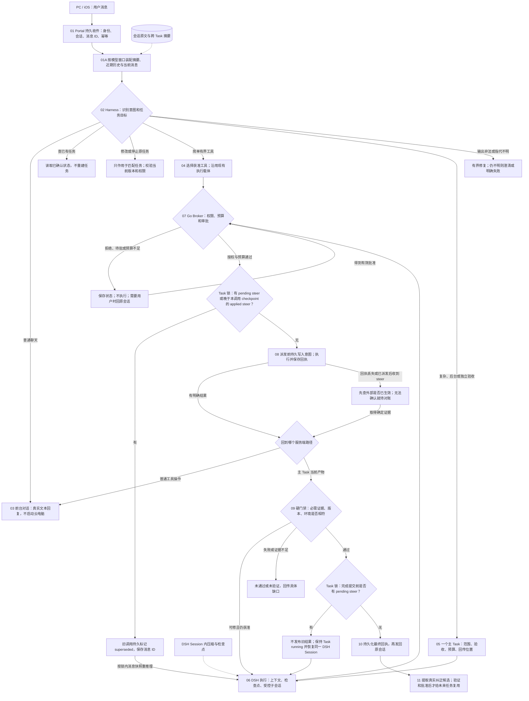

# Morde Harness 最终总流程图

**文档定位：** 本文集中维护 Morde Harness 的端到端总流程图及每一步的职责说明，作为跨会话、路由、工具执行、验收和交付的总览。它描述目标流程，不代表当前功能均已实现或验收通过。

**持续优化约定：** 本文是总流程图和高层步骤说明的维护入口；详细规则、实现落点和验收仍以[《Morde Harness 最终流程与实现规格》](Morde_Harness_最终流程与实现规格.md)及其关联 TODO 为准。调整流程分支、步骤边界或状态语义时，同步更新相关细节和验证记录，避免总图与实现规格分叉。

## 总流程图

## 步骤说明

### 用户入口

用户从 PC 或 iOS 客户端发消息。两个客户端共用服务端会话和任务事实；界面状态不能代替服务端的受理、执行和交付记录。

### 01｜Portal 持久收件

先校验账号身份、会话归属和消息内容，再持久化用户消息及稳定消息 ID。重复提交按幂等键返回原记录，不重复路由或建任务。收件表示服务端已保存消息，不代表 Task 已创建或工作已完成。

### 01A｜按窗口装配上下文

依据当前模型可用窗口，组合必要的会话摘要、近期历史和当前消息。超预算时先缩减可丢弃的旧候选、摘要和历史正文；为保持关联而保留的前序消息/Task 继续保留 ID、状态及完整原文哈希/来源引用，但其旧正文/目标可逐步缩成带不完整标记的预览。当前消息不得静默截断；剩余内容仍不能安全装入时明确失败或澄清。摘要与 DSH Session 内压缩各自有边界；原始会话仍可查，必要历史无法取回时应明确说明，不能编造。

### 02｜Harness 识别意图和目标

根据本轮消息选择普通聊天、查询已有任务、修改或停止指定任务、简单有界工具，或创建复杂后台任务。查询只读取已确认状态；修改和停止只作用于匹配的 Task，并复核当前版本与权限。路由输出非法时最多进行有界修复；目标仍不清楚就澄清或明确失败，不猜测目标、不触发副作用。

### 03｜前台对话

普通问答直接走文本模型并回到当前会话，无需启动云端电脑或等待后台 Task。模型不可用、回复中断等情况如实呈现，不拿旧回复冒充本轮结果。

### 04｜简单有界工具

对明确、短小且可控的操作，按请求选择现有且获准的工具和执行载体。简单操作沿用同一权限、预算和副作用控制；不为了使用工具而创建长期任务，也不私建 Broker 旁路。

### 05｜创建主 Task

复杂、需要后台运行或需要独立验收的工作创建一个主 Task，并记录目标、范围、验收条件、预算和原会话回传位置。只有实际需要时才要求仓库或环境信息；主 Agent 对用户负责，子任务的“已委派”不等于已完成。

### 06｜DSH 执行

主 Task 使用 DSH 运行时执行，复用其 AgentLoop、Session、检查点和上下文能力。工具调用与 `child_create` 在创建副作用前都须通过 Task 行锁下的 pending-steer 接纳；已经进入 `applied` 的 steer 也要与调用的 root checkpoint fence 比较，防止较旧的缓冲 tool_call 越过栅栏。根 Session 调用使用自身 `ThroughSequence`；child 调用使用创建 child 时持久化的 root checkpoint baseline，不能比较 child-local 与 root sequence。若新输入先到，保留锁内消息快照并按新要求推理。已派发的工具操作或已创建的 child 按真实状态对账，不伪报取消。需要时创建受控子会话并汇总真实结果；压缩与恢复不得丢失原文、当前要求或操作状态。服务重启后依据持久化状态恢复，不依赖内存中的任务记录。

### 07｜Go Broker 授权、预算和审批

所有工具副作用经过服务端 Broker，复核用户授权、目标、版本、预算和审批要求。对 DSH Task 的工具调用，以 Task 行锁下的 pending-steer 检查作为派发前接纳点；如果 steer 已标为 `applied`，仍按其 checkpoint through sequence 与本次调用的 root checkpoint fence 比较，较新的已领取输入也会使旧调用失效。根 Session 使用自己的 `ThroughSequence`，child Session 使用创建时持久化的 root checkpoint baseline。各持久化副作用入口还须在最终提交/派发事务中重检。若新 steer 先于派发到达，旧调用持久标记为 `superseded`，保存关联消息 ID，并按锁内消息快照重推理；不写旧 `tool_result` 或旧助手回执。拒绝、待审批或预算不足时持久化当前状态且不执行；获得有效批准后仍须通过 steer 栅栏。模型不能自行授予权限或把旧批准用于不同目标。

### 08｜记录意图、执行和对账

执行副作用前先持久化操作意图，再在最终 steer 栅栏通过后调用外部工具并记录结果回执。若 steer 到达前操作已处于 `dispatched` 或 `unknown`，不得伪报取消或丢弃副作用结果；先查询并据实对账，随后处理待 steer。回执丢失时同样先查询外部操作是否已生效；结果不明时停在待对账，不直接重放。普通工具的确定结果回到前台会话；主 Task 的当前产物进入证据门禁。

### 09｜验证证据门禁

检查验收所需证据是否真实、完整，并绑定当前 Task 修订、产物版本、来源和实际环境。证据不足或不匹配时标记未验证或失败并说明缺口；只有可修复且仍在授权范围内才返回执行。模型自述、Task 完成状态或摘要本身不能替代服务端门禁。

### 10｜持久化并交付

在 Task 行锁下重检 pending steer 后，将最终结果和验收状态持久化，再投递到原会话。若新输入先于完成提交，保持 Task running，不写旧结果或 assistant 回执，并恢复同一 DSH Session 处理待输入；重入时不能建新 Task 或重复副作用。回执应能区分工作完成与验收状态，包含相关产物、证据和未完成项；重连或重试时恢复同一回执，不能重复发布或执行。

### 11｜提取可复用经验

从真实纠正或结果中提取候选规则。候选需要经过验证，并由获授权用户批准后才可供未来任务使用；经验复用不得扩大权限、跳过审批或把旧环境规则套用到新环境。

## 图中辅助路径

- **会话原文与跨 Task 摘要：** 为 01A 提供有权限且有来源的历史信息；摘要不替代原始记录。
- **DSH Session 压缩与检查点：** 支持 06 的上下文管理和故障恢复；检查点需与任务及操作账本对账。
- **审批等待：** 07 未获批时保存状态并回到原会话。有效批准后重新经过 Broker 校验，再继续执行。
- **回执丢失：** 08 先对账；无法取得确定证据时保持待处理，不把超时等同于未执行。
- **最终回复与验证状态：** 10 先持久化再发布。前台对话、任务执行完成和验收通过是不同状态。

## 阅读与维护

问答和任务查询走前台，不应被后台任务阻塞；工具与 Task 执行共用受控入口。若现有 Broker 需要 Task 作为安全执行载体，应保留内部任务记录并保持界面轻量，不能为减少可见 Task 而绕过 Broker。是否能在无 Task 下安全完成有界工具调用，须单独验证。

流程细节和代码落点见[最终流程与实现规格](Morde_Harness_最终流程与实现规格.md)，实施进展和验证状态见[实施任务 TODO](Morde_Harness_实施任务_TODO.md)与[验证记录](验证记录/Morde_Harness_最终流程测试用例.md)。
