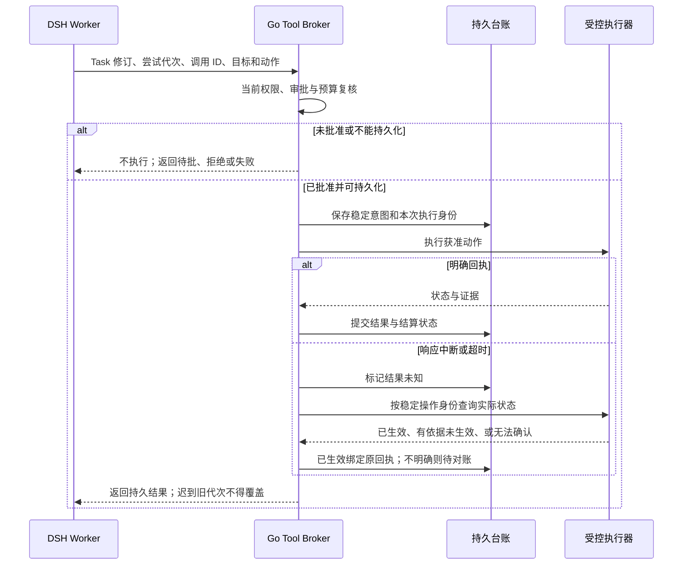

# Morde Harness 最终流程与实现规格

**交付对象：** 修改 `lizhongxuan/morde` 的实现 AI。本文是实施规格，不是上线声明。目标：**普通对话不被后台任务卡住；复杂任务可授权、可恢复、可验收；复用 Hermes 的成熟函数与测试，但不引入第二套 Runtime。**

**固定参考提交：** [Morde `5f97110`](https://github.com/lizhongxuan/morde/tree/5f97110cf74ffe57aefc9be4664d713de3fbd62d) · [Hermes `0d49d6d9`](https://github.com/NousResearch/hermes-agent/tree/0d49d6d9d20e461155d49ba9d188687079c811af)。这两个 SHA 是行为与源码对照锚点，不代表实施工作区或部署版本。实施前先读目标工作区的 `AGENTS.md`，核对 Morde HEAD、Hermes 源码来源与关键文件哈希、实际符号及 DSH 锁文件。本文路径针对上述参考提交；如果目标有未提交改动，先了解并保留，不能用本文件覆盖。所有新增名称如未注明现存，均为建议，不是既有接口。

**文档依据：** 本规格定义目标行为和约束，[实施任务 TODO](Morde_Harness_实施任务_TODO.md) 负责拆分与状态；长会话的可执行验收步骤和证据要求统一按[《Morde AI 对话长会话测试方案》](design/Morde-AI对话长会话测试方案.md) LC-01–LC-06 执行，并在[验证记录](验证记录/Morde_Harness_最终流程测试用例.md)逐项记录。根目录及相关子目录 `AGENTS.md` 的约定和本次用户授权优先。此前的 [Hermes 对照设计](morde-hermes-copy-design.md)和[对话流程图](Hermes%20与%20Morde%20对话流程图.html)仅作设计证据；流程行为以本规格为准，验收场景以长会话测试方案为准。两份新文档的结论是目标设计，不表示功能已上线或验收通过。

**方案评价边界：** 当前没有证据证明本方案或 Harness 取舍“最优”。是否优于现状，应在同一组任务、模型/Provider、工具授权、预算和测试环境下比较任务成功与约束满足、安全拒绝和重复副作用、故障恢复、延迟及用量/成本；无法对齐的 Hermes 单机能力与 Morde 多租户边界须单独标注，不能用总体主观评分掩盖。该比较用于评价方案，不替代下面的正确性与安全验收。

**2026-11-22 基线记录：** Morde 工作区开始核对时 HEAD 为 `7d001e757f83d498ee3950ad797e039a13ab73aa`，工作区干净；该基线与文首对照版本不同。之后的未提交实现改动不包含在该 HEAD 中，执行本规格时必须另行保留并检查。`project/hermes-agent/` 是无独立 Git 元数据的源码快照，不能将其归属到文首 Hermes 提交，见第 3 节。DSH 当时锁定 `0.2.2-rc.1`，实施前应重新核对当前锁文件及部署状态。

## 1. 最终总流程图

总图和逐步说明集中维护在[《Morde Harness 最终总流程图》](Morde_Harness_最终总流程图.md)，作为流程调整的持续维护入口。本文从第 2 节起说明各步骤的实现规则、代码落点和验收约束；修改流程时须同步检查两份文档，避免总览、实现合同和 TODO 不一致。

## 2. 每一步为什么这样设计、落到哪里

路径简写：**app**=`server/internal/app/`；**worker**=`server/internal/worker/`；**pg**=`server/internal/store/postgres/`；Node=`runtime/morde-cloud-runtime/src/engine.mjs`。

| 模块 | 源码落点与改法 | 为什么这样设计 |
|---|---|---|
| **01 持久收件** | **复用** app/`conversation_message_routing.go` 的 `AcceptConversationMessage` / `AcceptProjectMessage` 与原幂等机制。明确「未收件／已收件未路由／已路由」；重复消息返回原记录。 | Hermes 的早返回对它的本地会话有效，但不能让 Morde 已接收的消息只留内存或等到下一轮才存。收件不等于创建 Task。 |
| **01A 上下文与历史** | **复用并检验** worker/`conversation_route_worker.go` 的预算装配、worker/`conversation_summary_maintenance.go` 的跨 Task 摘要和 app/`cloud_dsh_history_tools.go` 的授权历史搜索。DSH Session 内压缩继续由 Node 的 `BasicCompactionEngine` 适配处理。 | 历史摘要和当前执行 Session 压缩是两个范围；摘要不替代会话原文。长历史不应让后续短消息因旧正文体积而失败。 |
| **02 意图路由** | **扩展现有** worker/`cloud_dsh_coordinator.go`、相应协议与 app 路由测试；按明确对象与动作校验路由，不信任模型提供的租户、权限和状态。非法输出允许一轮无副作用修复；分类调用失败或修复后仍非法时，按关键词与上次路由启发式兜底（明确控制问清任务、明确新任务开新任务、明确补充跟随上一个任务，其余澄清）；仍不确定则澄清。分别记录解析失败、修复成功和最终失败。 | 用户可以随时插话。无效 JSON 不应让一条普通消息整轮报错，也不能靠上次意图猜测要修改哪个任务。 |
| **03 前台回复** | **沿用**现有文本回复与零工具降级入口；校验配置可用的文本模型。把回复与原消息绑定；若流式中断，保留状态或明确中断，不能拿旧答案填。 | 「像 Muse」不是多几个 Agent，而是后台在工作、前台仍能聊天。文本执行关闭不等于文本模型不可用。 |
| **04 有界工具** | **沿用** Broker 与已授权工具目录。先按当前权限裁剪候选，再做检索；首版无需上 top-k。若没有批准的轻量执行入口，不私建旁路。 | 不能把读取一个页面的动作强制变成可见的长期任务，也不能把快速体验换成权限漏洞。 |
| **05 Task 立项** | **沿用** Task、事件和任务卡；固化目标、非目标、验收条件、能力范围、预算与原会话。app/`cloud_dsh_task_plan.go` 的建议计划不直接执行；真正依赖沿用 pg/`task_dependencies.go`。仓库、环境只在需要时必填。 | 一件事可以追问、停止、重试，且产研、部署、调研共用一套机制，不必为每个领域开新表与引擎。 |
| **06 DSH 运行** | **保留** Node 的 `runAgent`、`persistencePlugin` 与 DSH AgentLoop；沿用 worker/`task_worker.go`、消息投递和子会话能力。对运行中消息、检查点和活动检测按 2.2、2.3 节验证并补缺口；新增插件须先检查版本和许可。 | 不把 Go 控制面变成第二个模型循环，不用整条会话租约阻塞其他消息。简单任务可由单 Agent 完成；适合并行的复杂任务应支持主 Agent 委派至少两个互不冲突的子 Agent，并汇总各自实际结果。 |
| **07 授权与预算** | **复用并检验** app/`cloud_dsh_tool_broker.go` 的服务端授权/审批，以及已有用量和预算机制。模型路由与真实工具动作分开授权。批准绑定目标、版本和动作；变更重新核验。按适用额度原子预留、按请求结算并可恢复；未知用量明确标记。 | 隔离、授权、预算各管一件事。不能把容器隔离当授权，不能让模型授予权限，也不能因进程重启就恢复额度。 |
| **08 执行和对账** | **复用** `CloudDSHToolBroker.Execute`、`Reconcile` 和 `reconcileCheckpointedCall`，及现有 operation ledger。为新写适配器定义稳定操作身份、外部查询方式、响应未知时的状态。按稳定 ID 去重，不按工具名与参数一律合并。 | 已收到审批不等于已经执行；请求超时也不等于没执行。没有查询能力的外部动作必须能停在待对账，不能承诺外部严格一次。 |
| **09 证据门禁** | **扩展** worker/`task_validation_review_worker.go`、现有证据与判定。将证据绑定当前 Task 修订、尝试、产物版本及实际环境。先核对异步验证和会话发布的现有时序；本规格要求的通过门禁尚需验证接通。独立复核只能补判断，不能覆盖硬门禁。 | 编码看真实候选上的测试；部署看实际运行版本和真实对话；调研看来源。任务执行完和验收通过是两件事，验证未完成不能误报已通过。 |
| **10 交付** | **复用** pg/`conversation_result_review.go` 与原会话发布机制；Task 完成事务在 Task 行锁下重检 pending steer，并按完成候选携带的 root Session/Agent instance/代次/授权/checkpoint through+digest fence 检查候选之后已 applied 的 steer，只有 fence 仍匹配且没有更新输入时才持久化最终结果及 assistant 回执。若新输入先到，不提交旧 result/completed 状态，Task 保持 running 并由 lease recovery 恢复同一 DSH Session 处理 inbox，再生成当前结果。任务回执包含产物、证据、未验项和下一人动作；重连按回执恢复，不用流片段判成功。 | 用户不必去找子 Agent 或日志。任务等待、普通聊天流式文本和正式交付要有不同状态。 |
| **11 经验与观测** | **扩展** app/`cloud_dsh_skills.go` 现有只读加载及记忆、修订模式。仅授权用户可把经过验证的候选批准为启用版本；恢复原文时重新验范围。观测记录经脱敏的阶段、诊断码和时长，先不用整套 Phoenix。 | 下一次少教来自可验证规则，不是永久保存整段聊天。学习不能自己扩大权限、改动门禁或把过期规则用在另一环境。 |

### DSH 插件与扩展点核对门禁

改 Agent 能力前，先从 `runtime/morde-cloud-runtime/package.json`、锁文件和实际 Runtime 组合（尤其 `engine.mjs`）盘点已接入组件，再核对[同一锁定版本对应的 DSH 上游插件与扩展点](https://github.com/deepseek-ai/deepseek-harness)，至少覆盖工具、MCP、Skill、子 Agent、Session/检查点、上下文压缩和沙箱。对每项目标行为记录「已接入且有功能测试」「插件可用但未接入」或「无兼容能力」，同时记版本、许可证、Morde 适配边界和验证结果；优先复用兼容插件/provider，确无合适能力时才做最小适配。插件存在或安装成功不等于行为已接通，也不能绕过账号/会话/Task 隔离、授权、审批、凭据与操作台账。全程沿用 DSH AgentLoop，不另起 Runtime。

**当前源码接入快照（锁定版本 `0.2.2-rc.1`；不是全量功能验收）：**

| 能力 | Morde 当前接法 | 尚需验证的边界 |
|---|---|---|
| AgentLoop、Agent 注册、工具运行、SystemPrompt、LLM、TokenMeter | `engine.mjs` 挂载 DSH `AgentLoop`、`AgentRegistry`、`ToolRuntime`、`SystemPrompt`、`LlmRuntime`、`TokenMeter` 等插件；工具副作用仍由 Morde Broker 控制。 | 子 Agent 真并行、取消/恢复与跨 Task 隔离按 H06/H11 实测；注册插件本身不算验收。 |
| Session、持久化、投影、检查点 | 挂载 DSH Session 存储/投影/检查点策略和 Morde 持久化适配。 | 同 Session 租约、重启恢复、待投递消息和不同 Session 并行按 H09/H10 测试。 |
| 压缩与工具结果修剪 | 挂载 DSH `ToolResultPruner`；以 vendored `BasicCompactionEngine` 为基础接入 Morde 压缩包装。 | 固定前缀、工具定义、不可分单条内容仍不能缩减；覆盖、无进展和恢复失败须按 2.1、2.4 节验证。 |
| MCP | `dsh-mcp-client` 在依赖中，但未由当前 `engine.mjs` 注册；Morde 的 `mcp_discover`/`mcp_call` 走服务端 Broker。 | 直接接入 DSH MCP 客户端前，须证明能保留 Morde 授权、审批、凭据和操作台账；否则维持 Broker 适配。 |
| Skill | Morde 服务端维护 Skill catalog/read 工具；当前 Runtime 未依赖或注册 DSH Skill 包。 | 同版本有 MIT 的 `dsh-skill` 注册表、`dsh-tool-skill` 消费方及 filesystem provider；可评估用 Morde 授权 catalog 做 provider，但不得直接暴露本地文件系统 provider 或绕过用户/项目授权。 |
| 子 Agent 与 AgentTeam | Runtime 未注册 `dsh-subagent` 或实验性 AgentTeam 插件；Morde 通过 `dsh_delegate` 和服务端 IPC 创建持久 DSH 子 Session，受 Morde Task、工具子集和账本约束。 | 同版本有 MIT 的 `dsh-subagent`/`dsh-tool-subagent`/in-process provider，以及实验性 `dsh-experimental-agent-team`/tool 插件。先按 H11 比较其恢复、并行、工具范围和授权边界；不能把插件的任务板或子 Agent 创建当作 Morde Task/授权的替代。 |
| 沙箱 | Runtime 未注册独立 DSH sandbox；云端 Host、Task 执行环境和工具隔离由 Morde 执行边界承载。 | 同版本 MIT 的 `dsh-sandbox` 家族限制与宿主共享内核/文件系统的进程，不能替代 Morde 的云端电脑或容器隔离。仅在确有本地子进程需求时评估，且不得关闭 Morde Broker/授权。 |
| 工具超时与重复调用提示 | 当前 Runtime 未注册 `dsh-tool-call-timeout-policy` 或 `dsh-repeat-tool-reminder`。 | 同版本 MIT 包均可作为候选；前者通过协作取消处理单次工具时限，不能强杀不响应工具；后者只提醒完全相同的重复调用，不阻止执行且状态可能在恢复后重置。它们都不能替代活动监测、授权、操作账本或未知结果对账。 |

已核对的精确版本包：[AgentTeam](https://www.npmjs.com/package/@deepseek-ai/dsh-experimental-agent-team/v/0.2.2-rc.1)、[SubAgent seam](https://www.npmjs.com/package/@deepseek-ai/dsh-subagent/v/0.2.2-rc.1)、[Skill registry](https://www.npmjs.com/package/@deepseek-ai/dsh-skill/v/0.2.2-rc.1)、[Sandbox seam](https://www.npmjs.com/package/@deepseek-ai/dsh-sandbox/v/0.2.2-rc.1)、[tool timeout policy](https://www.npmjs.com/package/@deepseek-ai/dsh-tool-call-timeout-policy/v/0.2.2-rc.1) 和 [repeat-tool reminder](https://www.npmjs.com/package/@deepseek-ai/dsh-repeat-tool-reminder/v/0.2.2-rc.1)。候选包在 npm 元数据中均标为 MIT，核心 DSH peer dependency 与当前锁定版本相符；这是版本/许可证和源码接口核对，不是 Morde 集成或行为兼容的证明。AgentTeam 还要求持久 Session，并把团队 roster/task 写入 Lead Session；其共享工作区写入范围只是冲突提示，不是权限控制，也没有跨进程协调。SubAgent provider 则仍需由 Morde 负责身份、授权工具子集、预算、持久化及恢复适配。因此暂不因存在上游包而直接添加依赖或切换实现。

上述快照依据 `runtime/morde-cloud-runtime/package.json`、锁文件、`src/engine.mjs`、锁定版本对应的 npm 包元数据/包内文档及服务端 MCP/Skill Broker 源码；版本、注册方式变化时须重做盘点。

### 2.1 长会话与上下文合同

1. **两层上下文。** 服务端持久化消息及其 `sequence` 是会话 transcript 的事实源；路由近期历史与摘要来源应在当前身份/授权范围内包含已送达的普通助手直接回复和已发布 Task 结果，未完成或未授权消息不得混入。客户端投影、摘要和 DSH 检查点不能替代或改写原文。跨 Task 摘要由服务端按授权的消息和任务来源维护，记录版本、来源消息/序号范围及完整性；预算允许时保留目标、约束、决策、未完成事项、必要的用户原话和精确标识，标识符不得被摘要模型改写。DSH Session 内的压缩、工具结果修剪和检查点只管理当前执行上下文，二者不得互相冒充。保留期内的会话原文不因摘要或压缩被删除；需要旧细节时，获授权的历史检索应返回原文摘录、消息 ID/序号/时间、邻近上下文、分页游标及是否不完整。路由摘要或历史预览被截断时，不得据此断定旧细节不存在；若当前请求依赖未显示的旧信息且尚无授权原文结果，先路由一个 Task 使用授权的当前会话历史搜索。只有搜索无匹配、不可用或授权阻止时，才说明该细节无法取得；搜索结果分页或不完整时继续在授权范围内检索，或明确说明仍未完整。摘要、会话历史、任务文本和工具结果均按不可信数据处理；检索结果须带来源，不能升级为系统/开发指令或扩大当前工具权限。
2. **预算与边界。** 路由与执行均按所选模型的可用窗口计算系统提示、工具定义、当前输入、近期历史和输出预留；图像、附件和多模态内容按实际模型/Provider 的计量或 DSH 估算纳入预算，不能用字节数直接冒充 Token。未知容量沿用当前最小支持窗口的保守预检。回合开始前的入口检查与 DSH Session 内压缩分别处理跨 Task 投影和当前执行上下文，不得重复运行两套 in-loop 压缩器；具体阈值按所用模型和 DSH 能力验证，不直接把 Hermes 的 85%/50% 配置作为生产默认。当前用户消息先投影为带消息 ID/SHA-256 的有界预览；仍超预算时按可丢候选、历史首尾预览、移除历史正文、摘要的顺序缩减，最后才缩小当前消息预览。为安全关联而保留的前序消息或 Task 必须保留其 ID/状态，但其正文或目标可逐步缩成明确标记的不完整预览，前序完整原文哈希和来源引用仍须有效。同一工作的路由补充在 32 KiB 合并输入及最多 8 条补充来源内按序合并；超限补充解除关联、重置为待路由并独立处理，在当前合并输入注明未合并数量，原文不截断。当前用户输入不得静默截断；关键关联文本不足以安全判断时应澄清或走授权历史检索，不能猜测。**压缩能力有明确边界：当前 vendored `BasicCompactionEngine` 不能缩减系统提示、工具定义或固定会话前缀，也不能拆开不可分的单条消息；已挂载的 `ToolResultPruner` 只能裁剪其支持的大型工具结果。**因此固定前缀或不可分输入仍超窗口时必须明确失败，不得把“压缩已运行”当成“请求一定能装入”；升级或替换插件后按实际版本复核边界（见[当前 compaction-basic 说明](../runtime/morde-cloud-runtime/vendor/deepseek-harness/packages/compaction/compaction-basic/README.zh.md)）。**接口硬限制与模型窗口限制分开处理：**受理前超过 API 请求上限时明确拒绝，不得显示已受理或留下半条消息/Task；当前消息原文最多 8 MiB，超过时在受理/分片上传层明确拒绝。超过路由模型预算的已受理消息仍保留原文，路由只发有界预览与来源引用；创建新 Task 后，DSH 通过授权分段工具按原文 SHA-256 和 Unicode 字符偏移最多读取 8 KiB 原文片段，直到完整覆盖，不能把预览当成完整输入。路由/DSH 的 128 KiB 单次消息协议上限仍约束各次协议载荷，但不再约束会话数据库中保存的单条用户原文；单段输出仍须符合 DSH 模型窗口和工具调用预算。只有完成全片段覆盖、偏移连续、摘要一致时才能报告已处理；工具/Task 预算不足或原文校验失败时如实失败，保留原文。

   **单条长消息机制：** 单条会话原文可达 8 MiB，不能整条塞入路由或 DSH 模型请求。路由使用最多 2 KiB 首尾预览、消息 ID 和原文 SHA-256；仅在 `new` Task 目标中写入有界来源指针。DSH 工具只允许读取当前 Task 自身触发消息，逐段返回最多 8 KiB、带精确起止字符偏移、总字符数及源 SHA-256 的内容；下一段偏移必须等于上一段结束偏移，读取期间每段都校验相同摘要。分段不得越权读取其他会话或用户消息，返回文本仍是不可信用户数据。8 KiB/16 KiB/200 KiB 单测按 UTF-8 字节计量，不是 Token 数；真实 `>8,192` Token 的模型验收仍需所选 Provider/tokenizer 证据。超过 8 MiB 仍明确拒绝；单段读取或完整任务超过模型上下文、Token 或工具调用预算时须据实失败，不声称处理完整。

   **Hermes 机制对照（固定上游提交 `0d49d6d9`）：** Hermes 的 `GatewayTurnHygieneMixin._hmwa_hygiene_plan` 在新回合前用 Provider 实际 prompt 用量、持久 usage anchor 或保守估算，在默认 85% 窗口阈值或硬消息数上限触发压缩，并用持久失败冷却和进行中检查避免每轮重复撞同一故障；`ContextCompressor._plan_compaction_window` 先裁剪可安全重建的旧工具结果，再选取保留头部、最近尾部和完整工具调用组的摘要窗口。Morde 不照搬 Gateway/SQLite/辅助线程：跨 Task 原文有服务端授权摘要和历史检索，DSH Session 已基于 `BasicCompactionEngine` 接入适配的 Hermes 窗口预算/选窗/进展检查（`hermes-compaction-window.mjs`），保持 DSH 为唯一 Runtime。此次短追问缺口发生在独立路由分类器：被引用的旧请求/Task 正文有稳定 ID 需要保留，但旧预览可能占满最小窗口；路由预算现逐步缩短这些旧预览、保留原文哈希和不完整标记，并重新核算请求预算，当前输入不截断。这个路由专属适配与 DSH Session 压缩职责不同，不再复制第二套摘要循环；关键事实不足时通过 Morde 授权历史搜索取原文。

   **缺陷定位与机制回归：** 测试在约 4K 上下文失败时，保留原始失败输入和环境，先拆分实际 Token 预算（系统提示、工具定义、当前输入、近期历史、摘要/检索结果、输出预留），再核对模型窗口、Token 估算、相关历史筛选、压缩是否触发并产生进展、原文检索以及 API/路由/DSH/IPC 各自的硬边界。根因可能是无关历史装配过多、摘要/压缩或检索缺失、预算估算错误、单条不可分输入超限，或协议上限不一致；不能仅缩小测试输入、只调大一个阈值或仅凭“扩大上下文”结案。修复要解决对应机制并保留明确超限失败语义；确需调整硬上限时，需审查完整调用链与落盘/恢复边界。以累计会话原文 **4K、8K、100K、200K tokens** 做合成规模回归，尤其确认 100K/200K 的冗余历史不会整体塞进模型请求：请求按模型窗口预算装配，按需压缩或检索相关原文，关键事实带来源且原文仍可查。另以 **8 KiB、16 KiB、200 KiB** 单条消息做字节级路由和分段回查测试，验证有界预览、原文 ID/SHA-256、Unicode 偏移连续性、首中尾精确重建和 8 KiB 分段输出；这些字节级测试不等同于 Token 数，也不替代真实 `>8,192` Token 模型验收。
3. **安全提交与恢复。** 摘要先只读规划，再生成并在提交时重核身份、授权、摘要版本、来源范围和最新消息水位；失败、取消、空/截断结果或并发冲突不得提交半成品或覆盖新状态。压缩窗口须按完整消息及工具调用/结果组切分；从上下文修剪的大型工具结果须保留可回查原结果的稳定引用，无法回查时标明缺失。最新用户输入和可继续执行的状态须保留；恢复时对账检查点与已确认操作。
4. **隔离。** 摘要、历史搜索和检查点按账号、会话、项目和当前授权过滤；授权撤销后，即使摘要或索引先前已生成，也不得再向 Agent 返回相应内容。跨会话个人资料按原有授权处理。相同消息 ID 的幂等重试与独立发送的相同文本是两件事，不能仅按内容合并。

### 2.2 运行中消息与并行任务合同

- **会话、Task 与 DSH Session 的边界。** `conversation_id` 是 PC/iOS 共用的产品会话，一个会话可有多条消息和零个或多个用户 Task；一项 Task 可由多条明确关联的后续消息修订。每个 Task 的根 DSH Session、检查点和授权范围独立；工具调用与子 Agent 是 Task 内部执行，不自动变成新的用户 Task。协调职责由已持久化的消息和 Task 结果事件触发，服务重启后可以重新进入协调，不依赖某个常驻进程或内存状态。Task 进度保留在任务状态中；最终结果持久化后关联回原会话，不把子 Agent transcript 混入用户 transcript。
- 每条消息先持久化，并沿用会话内服务端 `sequence` 作为跨 PC/iOS 的确定顺序；并发到达或路由完成先后不同，不能改变已受理用户消息在历史投影和同任务修订中的顺序。目标明确且低风险的在线补充使用现有 `message_delivery` 的 `steer`，下一安全步骤领取；等待下一轮的消息使用 `followup`。更改目标、计划、授权、审批或已派发的副作用走受控修改/等待路径，先停止并栅栏旧代次，再启动新修订。新修订批次中的多条消息可按顺序进入 DSH 的 `next-step` / `next-turn` 队列，但账本 `mode` 必须与对应检查点目标一致；这条路径不能跳过修订版本、授权或副作用检查。目标不明时澄清，不中断其他任务。
- 对照 Hermes 忙碌会话 `queue` / `steer` / `redirect` 的语义映射到 Morde 现有的 `followup` / `steer` / 受控修订：没有可领取消息的活动 Agent 时，已受理消息仍须保留为可恢复的待处理状态，不能丢弃或误报 `applied`。只移植消息投递和代次校验行为，不增加 CLI 忙碌设置或把普通追问当作停止命令。
- 若安全补充在模型推理期间到达，该轮输出可能基于旧输入；在任何工具调用执行或结果交付前，必须核对消息投递版本。版本已变化时丢弃该轮文本及工具调用（保留用量记录），让 DSH 将待处理消息纳入下一轮重新推理；不得执行旧工具调用，也不得把旧回复当作最终结果。
- 现有 v3 投递帧绑定 Task、Owner、Session、Agent 代次、授权版本、消息 ID、内容/附件与 `mode`。根 Session 的 `agent/inbox/spliced` 检查点只能证明入队；相应 `user/message` 被领取并持久化后，才能将该任务消息标为 `delivery_status=applied`，并原子记录包含该消息的 checkpoint through sequence。工具调用接纳与最终派发门禁须将该值和模型调用的 `ThroughSequence` 比较：若 steer 已 applied 且其 checkpoint 晚于当前 tool call，仍须作废该旧调用，即使消息状态已不再是 pending。入队或领取均不表示工作完成；无法确认时保留 `unknown`。普通直接回复沿用既有 `applied` 语义。
- 恢复时按消息身份、内容/附件、模式、检查点和现有操作账本对账，回执丢失不等于没有投递或没有执行。只保护同一可变 Session/摘要的写入，不把整个产品会话或账号全局串行化。
- Session 租约只覆盖同一解析后稳定 DSH `session_id` 的 `[读取历史 → 执行 → 写回检查点]` 临界区；不同 Session/独立 Task 可并行。租约超时或代次变化只能阻止冲突写入，不能撤销已持久化消息或阻止其排队；释放时必须核对租约 token/代次。Morde 多 Worker 部署使用跨进程有效的存储栅栏，不能把 Hermes 进程内 `asyncio` 锁当作最终并发保证。
- 独立 Task 可以并行；停止或修改 A 不影响 B。复杂任务按授权可委派两个互不冲突的 DSH 子 Agent，并基于两个子任务的真实完成或失败状态汇总，委派不等于完成。

### 2.3 重试、活动和交付合同

- 非法路由输出最多做一次无工具修复；修复请求有独立可对账的模型调用身份和预算，返回后重新校验路由快照、目标与授权。身份或租约已变化时重新读取，不应用旧决定；缺明确目标时澄清；模型或服务不可用、或修复后仍非法时，按关键词与上次路由启发式兜底（明确控制问清任务、明确新任务开新任务、明确补充跟随上一个任务，其余澄清），不猜测目标、不触发副作用。2026-11-23 补记：分类协调器的上下文守卫曾要求全文等于原消息，与 2.1“路由只收有界预览”冲突，导致超过 2 KiB 的单条消息和所有聚合输入在模型调用前必以 invalid_argument 失败；现守卫改为身份校验（预览须指名本条消息：当前消息 ID 或聚合首来源），摘要与长度绑定仍由模型请求构造器校验。
- 模型错误由单一层负责有界重试，受取消、剩余时间和费用约束。请求或用量处于 `unknown` 时先按账本对账；已展示的流式文本要保留并标明中断，不能静默重播。工具结果未知时不得自动重放副作用。
- **当前明确允许的自动恢复范围：** 纯会话路由分类仅对 Provider 明确返回的 HTTP 429 限流作自动恢复，最多三次总调用（含首次），每次以新的 `route_attempt` 和模型调用 ID 单独记账；`Retry-After` 为正且不超过两分钟时遵循该值，缺失/无效时采用 1/2/4 秒有界退避，超过两分钟不自动重试。收到明确 Provider 429 时，账本记为 `rejected`，不写入虚构的 0 token 用量，并在同一事务中释放本次账号/项目预留，再排队下一次调用或失败结束；这只适用于表示请求未受理的 Provider 状态响应。缺少用量的成功响应、超时、断流、5xx 或任何无法证明 Provider 未受理的状态仍记为 `unknown`，继续保留预留并先对账。扩展到 DSH Task、摘要或 Review 前，必须先实现同样的独立调用身份、恢复/预算和流式交付证明，不能只把路由层策略外推。
- 摘要/压缩失败按 Session 记录可重试原因和有界冷却，避免每条新消息重复撞同一故障；旧摘要、原文和检查点不因此失效。只有 Provider 明确返回上下文溢出且仍未取消、尚有预算时，允许绕过常规冷却额外进行一次恢复压缩；重试仍失败就保留原文并明确报告，不能继续循环或缩短当前输入冒充成功。
- 每次压缩都必须证明有进展：上下文 Token 估值/实测下降，或摘要覆盖水位向前推进。两者都没有时不得再次用相同窗口循环；保留原文和旧摘要，记下原因并按有界冷却处理。进展检查不能把当前用户消息移出可恢复范围。
- 当前网关 `ModelCallTimeout` 是 45 秒，涵盖派发授权和单次 Provider 请求，不是整个 Task 的时长。应实测首响应慢、流式停顿与取消；需要更改时明确单次总时限和空闲时限，并验证调用对账，不能直接照搬 Hermes 的固定数值。
- Task 租约续期不证明有实际进展。对模型、工具、子 Agent 和检查点的可观察活动分别定义检测条件；等待审批或外部结果需单独标记。当前单个 Provider 请求的服务端总期限为 `ModelCallTimeout=45s`：匹配当前 Task/Session revision 的 `model/started` 若其开始/状态变化时间戳超过该期限仍未进入终态，即使 Runtime heartbeat 新鲜也可提示一次；heartbeat 不得刷新该请求时间。工具、子 Agent 和检查点需沿各自已定义期限/活动信号判断，不能直接套用模型期限。疑似卡住时先记录证据，取消前重校验任务/Session、租约代次与最近活动，取消后对账未知操作。600 秒只可作为实验参考，不直接作为统一强杀阈值。
- 若有已受理输入等待处理且活动快照证明确实停滞，可沿用现有状态回报一次可见的等待/停滞提示；持续轮询不得重复告警，只能在观察到有效活动后清除该提示。活动快照缺失或未知不能当作已经恢复，也不能仅凭提示时限杀掉任务。
- 已受理消息进入路由失败状态时，PC/iOS 对话应显示面向用户的失败原因；可重试失败保留幂等重试入口，超过输入上限的消息显示原文已保留及缩短建议且不提供相同内容的重试。不得把失败细节隐藏成一个无说明的重试图标，也不得向用户暴露内部错误或凭据。
- 结果验证与正式交付复用现有状态和发布路径；核对硬门禁、验证 Worker 与发布的实际先后关系。验证未完成可反馈实际进度或未验证结果，不能宣称验收通过。需要修正时受原授权及预算约束，重复恢复不得再次交付或重新执行已确认的副作用。

| 可观察结果 | 处理合同 | 禁止行为 |
|---|---|---|
| Provider 明确返回 HTTP 429 限流 | 将该次调用记为 `rejected`，不生成 0 token 用量记录；释放预留后由路由 Worker 在同一事务内有界重试或失败。 | 将明确拒绝误记为 `unknown` 并永久占住额度，或把其他未知 Provider 错误也当作可安全重放。 |
| 请求已派发后超时、连接中断，或请求/用量状态为 `unknown` | 先核对模型调用与用量账本；只有证明未被 Provider 接收且可安全重放时才重试。 | 把超时当作“没有执行”并直接再次派发。 |
| 回复为空、截断或结构非法 | 按协议分类；已展示文本保留并标记中断。只有规格明确允许的无副作用修复可有限重试；路由结构修复最多一次、无工具且单独计量。Task `empty_response` 仅在 Provider reported model 非空且合法、stop=`stop`、没有工具调用、text/reasoning 都为空、用量已知且输入 token 大于零、输出 token 为零时成立；`truncated_response` 仅在 Provider reported model 非空且合法、stop=`length`、输入和输出 token 都已知且为正并在协议范围内时成立。证据不完整或互相矛盾时归 `invalid_response`；缺少用量仍为 `unknown`。当前 Morde 不自动重试 Task 空响应；未来若增加连续空响应重试，必须比较模型、Provider、退出原因和一致用量证据，并确保只有一层拥有重试。 | 用上轮答案填补、把缺失用量当成零、静默丢弃已展示文本，或从不确定的工具调用位置重放整轮。 |
| Provider 明确返回上下文溢出 | 未取消且预算足够时，最多额外恢复压缩一次；失败后保留原文并明确说明。 | 无进展地反复压缩，或静默截短当前输入。 |
| 用户取消、授权撤回或已知永久错误 | 结束当前尝试或失败关闭；权限恢复后须重新读取授权与目标。 | 自动重试已取消请求，或借旧批准继续执行。 |
| 有副作用的工具结果未知 | 按操作身份查询现有台账/外部状态；无法确认则停在待对账。 | 重放工具副作用。 |

### 2.4 最低验收范围

- **长历史与失败恢复：** 旧要求后追加短追问；另用所选模型的 tokenizer 或 Provider 实际用量证明单条当前输入超过 8,192 tokens，并用开头、中间、末尾的不同锚点检查完整处理。若单条原文超过路由预算，按规格 2.1 通过消息 ID/SHA-256 和有授权分段读取处理，逐段计量且验证完整覆盖；不能以 128 KiB 协议上限拒绝原文，也不能把字节数当 Token 数。18 KiB 字节级合成夹具只证明原文传输完整，除非实测 Token 数超过阈值，不得记作 MH-CTX-001 通过。分别验证 (a) 受理前超 API/8 MiB 持久化限制时明确拒绝且无已受理消息/Task，(b) 原文存储成功但路由预览/分段读取失败时保留原文、在 PC/iOS 显示准确失败状态且不提供相同内容的无效重试，以及不派发错误模型请求，(c) 单段、系统提示、工具定义、固定前缀或累计任务输入超过所选模型可用 Token/Task 预算时明确失败且不截断/伪称完成；三种输入边界分开记录。以 4K 合成窗口连续 40 轮并至少压缩两次；对空/截断摘要、同 Session 重复失败冷却、Provider 明确溢出后的单次恢复、取消、重启和租约冲突注入故障。保留早期要求和最新追问、原始记录及工具配对，不重复调用或结算。再向旧消息加入明确标为用户原文的指令注入文本，确认历史检索仅提供带来源的数据，不提升为系统/开发指令或授权；并发跨端消息按服务端序号保持确定历史顺序。长会话具体步骤及证据按[《Morde AI 对话长会话测试方案》](design/Morde-AI对话长会话测试方案.md) LC-01–LC-06 执行；每项须通过或明确记为未执行/阻塞，不得因本节有 MH-* 映射而省略 LC 用例。结果记入[验证记录](验证记录/Morde_Harness_最终流程测试用例.md)。
- **真实窗口与长时间：** 使用测试账号和合成内容，在所选真实模型上构造累计历史超过其单次上下文窗口的会话，验证早期关键要求和原文可查；记录模型、窗口和统计方式。耐久测试持续至少 60 分钟，期间在同一会话中分时追问、插入普通问答，并让同一个可观察 Task 经历真实执行、必要等待和恢复；以 Task ID、检查点和结果证明任务没有被悄悄替换。分别记录墙钟时长与 Task 的 `ActiveSeconds`，等待不能冒充进展。

  **当前预算边界：** 本地代码的 `task.Budget.Validate` 将 `MaxActiveSeconds` 限为 1,800 秒，DSH 执行上下文也按 `Budget.ActiveSeconds` 设置超时。因此，60 分钟验收目前证明的是同一会话和 Task 的长时间可恢复性，不能宣称单次连续执行了 60 分钟。若产品要求单个 Task 连续活动超过 30 分钟，必须单独调整预算上限、输入校验/默认值及运行时预算结算，并加相应测试；不得在耐久用例中绕过现有限额。所有测试数据与产物只保存在本地，不上传或发送文件。
- **客户端与协作：** 实际 `morde-pc` 和 iOS 接续同一会话，分别验证记录、消息状态、进度和结果；复杂任务中两个互不冲突的子 Agent 实际并行，主 Agent 汇总结果。执行中追问、创建独立任务及停止指定任务均不串线；两个账号和两个会话相互隔离。

## 3. Hermes 19 环节覆盖与函数移植清单

下表逐项回应 Hermes 的 19 个对话环节。它记录目标方案与不照搬的边界，不代表实现或验收已完成；实施状态以 TODO 和验证记录为准。

| # | Hermes 环节 | Morde 的目标取舍 |
|---|---|---|
| 1 | 入口与消息分流 | H01 复用鉴权、幂等和持久收件；后台 Task 不阻塞普通回复。 |
| 2 | Slash 命令 | 不复制 CLI 命令系统；PC/iOS 通过自然语言路由状态、停止和修改意图，目标不明时澄清。 |
| 3 | Skill 注入 | 继续用 DSH 插件和 SystemPrompt；Skill 发现/跨会话使用遵循用户授权，写入需审批，列入 H07。 |
| 4 | Turn 入口与中断 | 消息收件、执行取消、状态持久化和客户端重连分开验证；断线不撤销已受理消息。 |
| 5 | Agent 创建与恢复 | 沿用 DSH Agent/Session、现有 Task Worker 和检查点；按身份、代次、授权撤销与损坏检查恢复。 |
| 6 | 线程与运行方式 | 用 Go Worker 和隔离 DSH 执行上下文承载并发；保留取消/恢复语义，不移植 Hermes Python 线程模型。 |
| 7 | Session 租约与早返回 | H10 仅对稳定 DSH `session_id` 的读历史、执行、写检查点加跨进程栅栏；租约等待不阻止消息持久受理，也不串行化其他 Session。 |
| 8 | 活动检测与看门狗 | H04 分别观察模型、工具、子 Agent、检查点和明确等待；取消前重核活动与代次，不按固定时长误杀。 |
| 9 | Turn 外层包装 | H02 明确唯一重试拥有方，调用、用量和结果沿用服务端账本；未知状态先对账。 |
| 10 | Turn setup | H09/H10 按授权和预算恢复 Session、组装上下文/工具、领取消息；不复制 Hermes SQLite 建行顺序。 |
| 11 | System prompt | 沿用 DSH SystemPrompt 与 Session 请求头；验证模型、授权、工具或恢复状态变化后内容正确，不承诺固定缓存。 |
| 12 | Agent 主循环 | 保留 DSH AgentLoop 与扩展点；不实现第二套 Harness 循环。 |
| 13 | 迭代准备 | H10 沿用 `steer`/`followup` 与检查点，逐项核验取消、预算、角色/工具配对及消息序列。 |
| 14 | 请求组装与预检 | H09 按模型窗口核算系统提示、工具定义、当前输入、多模态内容、近期历史与输出预留；不静默截断。 |
| 15 | 模型调用 | H02 沿用 Morde 网关的调用身份、用量预订/结算、取消与单次超时；实际首响和流式时限需实测。 |
| 16 | 响应、错误与空输出 | H02 区分空、截断、结构非法及 Provider 错误；仅允许明确安全的有界修复。判定连续空响应需有一致的模型、Provider、退出原因和用量证据；缺少用量是 `unknown`，不能当作零。流式部分输出保留，未知请求不重放。 |
| 17 | 工具轮 | H03/H04 沿用 Broker、审批、操作台账与对账；副作用先记意图，结果未知时不自动重执行。 |
| 18 | Stop gates | H05 复用现有 Task 验证和发布路径；只有验证 Worker 确实先于最终交付并阻断不合格结果，才可称为门禁。 |
| 19 | Turn finalizer | H05/H06 先持久化任务结果、状态、用量与原会话回执，再投递；重连不重复发布，完成不等于验收通过。 |

源码级对照先核对固定提交的函数及测试。只有 `project/hermes-agent/` 本身有独立 Git 元数据时才能用该 checkout 的 `git show`；当前本地目录只是快照，应记录实际文件的 SHA-256 和许可证来源，并与固定提交比对，不能把外层 Morde 的 HEAD 当 Hermes HEAD。下表的 19 项是流程阶段映射，后续函数表是与 H01–H11 目标行为相关的重点清单，**不是 Hermes 全仓逐函数复制清单，也不代表已达到全量行为等价**。实现期间须从固定提交核对每个相关目标行为的调用链和测试，将相关函数/测试分别标为：**A：兼容时移植算法与边界测试；B：只复用行为/测试，在 Morde/DSH 现有链路重接；C：保留现状或明确不适用**，记录差异、理由、回归用例和许可证处理。CLI、SQLite、Profile 或单租户安全模型等不属于目标的功能不为追求复制率而引入。无配对证据时，不得声称全量抄袭、完全等价或“最优”。不新增 Python 依赖或待机进程。对源代码的实质移植保留对应 MIT 许可与署名，提交说明记录上游 SHA、路径与测试差异。

对 A/B 类可确定的行为，验收不能只看最终回答“像不像”：优先从固定 Hermes 版本和对应上游测试形成最小输入/决策/输出对照夹具，比较窗口选择、消息/工具组边界、修剪后的原文引用、摘要覆盖/失败冷却、历史搜索分页和恢复状态；Morde/DSH 的差异逐项记理由并配回归测试。无法可靠复现 Hermes 运行环境时，以固定源码和测试推导夹具，明确标为行为对照，不声称跑过 Hermes。

| Hermes 文件与函数（固定提交） | 级别 | 具体移植合同 |
|---|---|---|
| [agent/retry_utils.py](https://github.com/NousResearch/hermes-agent/blob/0d49d6d9d20e461155d49ba9d188687079c811af/agent/retry_utils.py) · `jittered_backoff`、`parse_retry_after_seconds` | **A，优先核对现有实现** | 可把算法翻译到调用重试的单一拥有方，注入随机数和时钟便于测试。先确认模型网关是否已经重试，不能网关和 DSH 各重试一整层。尊重取消、剩余时限和服务端 Retry-After；默认常数不照抄，按实际前台/后台时限设定。移植 `tests/agent/test_retry_utils.py` 的边界用例。 |
| [agent/repetition_guard.py](https://github.com/NousResearch/hermes-agent/blob/0d49d6d9d20e461155d49ba9d188687079c811af/agent/repetition_guard.py) · `is_runaway_repetition`、`is_repetition_dominated` | **A，后置** | 有真实重复输出反例再翻译。用上游 `test_repetition_guard.py` 并加中文、代码块、列表等可能误报样本；先旁路记录、确认误报后再拦。不为此先换整套流式实现。 |
| [agent/turn_context.py](https://github.com/NousResearch/hermes-agent/blob/0d49d6d9d20e461155d49ba9d188687079c811af/agent/turn_context.py) · `_preflight_request_tokens`、`reanchor_current_turn_user_idx`、`compression_made_progress`、`build_turn_context`、`build_api_messages` | **A/B，按缺口** | 可借请求预检、多模态上下文组装、当前用户消息重锚点及「压缩是否产生进展」判定。消息边界优先用 Morde 稳定消息 ID；Morde 当前输入、附件和工具定义须按当前窗口预算完整计量。Hermes Profile 记忆注入不直接复制，DSH 上下文继续由现有 Provider 管。 |
| [agent/context_compressor_window.py](https://github.com/NousResearch/hermes-agent/blob/0d49d6d9d20e461155d49ba9d188687079c811af/agent/context_compressor_window.py) · `_plan_compaction_window`、`_compress_window` | **B，H09** | 本地已有 `runtime/morde-cloud-runtime/src/hermes-compaction-window.mjs` 的窗口适配；对照原文、最新用户消息、工具调用组和来源保留语义及失败测试，修缺口，不重新写第二个压缩器。Hermes Lean 尾部预算及 2.5%/10K/25K 等常量只列为待核对的上游默认，不作为 Morde 配置；跨 Task 摘要仍由服务端维护。 |
| [agent/context_compressor.py](https://github.com/NousResearch/hermes-agent/blob/0d49d6d9d20e461155d49ba9d188687079c811af/agent/context_compressor.py) · `ContextCompressor`、`_prune_old_tool_results`、`_generate_summary`、`_on_summary_failure`、`_finalize_compressed` | **B，H09** | 对照便宜的旧工具结果裁剪、工具调用/结果配对、摘要失败冷却、覆盖来源、提交前重核和 Session 结束时状态清理；能由 DSH `ToolResultPruner`/`BasicCompactionEngine` 表达的继续使用 DSH，不再加一套运行时。逐项列出本地 DSH 已覆盖、缺口和测试证据后再决定是否适配。 |
| [gateway/run_turn_hygiene.py](https://github.com/NousResearch/hermes-agent/blob/0d49d6d9d20e461155d49ba9d188687079c811af/gateway/run_turn_hygiene.py) · `GatewayTurnHygieneMixin._hmwa_hygiene_plan`、`_hmwa_hygiene_record_failure_cooldown`、`_hmwa_hygiene_apply_result` | **B，H09** | 补审回合开始前的入口 Hygiene：按 Token 用量/估算规划、避免摘要失败后每轮重复调用、只在来源与版本仍匹配时应用摘要。映射到 Morde 的服务端历史投影及 DSH 已有压缩事务；阈值、后台任务和持久状态用 Morde/DSH 机制，不搬 Hermes Gateway、SQLite 或第二套压缩循环。 |
| [tools/session_search_tool.py](https://github.com/NousResearch/hermes-agent/blob/0d49d6d9d20e461155d49ba9d188687079c811af/tools/session_search_tool.py) · `session_search`、`_discover`、`_read_session`、`_scroll` | **B，H09** | 借鉴会话发现、原文头尾视图、命中消息附近分页和压缩后恢复指针；复用 Morde 的 `morde_current_conversation_history_search`、带签名游标和账号/会话/项目/Task 授权。测试锚点读取、分页边界、越权拒绝和恶意旧消息保持不可信数据；不复制 Profile/SQLite 跨会话权限。 |
| [agent/turn_iteration_prep.py](https://github.com/NousResearch/hermes-agent/blob/0d49d6d9d20e461155d49ba9d188687079c811af/agent/turn_iteration_prep.py) · `prepare_iteration`、`begin_iteration` | **B，H10** | 对照消息领取、取消与预算检查、角色/工具序列和当前用户消息位置。已有 DSH `steer` / `followup` 与 checkpoint 先验证，再通过 DSH 扩展点或适配补实际缺口；不复制 Hermes Agent 状态机。 |
| [gateway/session_busy_controls.py](https://github.com/NousResearch/hermes-agent/blob/0d49d6d9d20e461155d49ba9d188687079c811af/gateway/session_busy_controls.py) · `busy_config`、`correct`；[`tests/gateway/test_session_busy_controls.py`](https://github.com/NousResearch/hermes-agent/blob/0d49d6d9d20e461155d49ba9d188687079c811af/tests/gateway/test_session_busy_controls.py) | **B，H10** | 对照运行中输入的 queue/steer/redirect、旧执行代次、无活动 Agent 和实际领取确认；分别映射到 Morde 的 `followup`、`steer` 和受控修订。复用消息持久化与投递状态，不复制 CLI 设置面或审批模式；已受理但未送达的输入须留在可恢复队列中。 |
| [agent/turn_response_check.py](https://github.com/NousResearch/hermes-agent/blob/0d49d6d9d20e461155d49ba9d188687079c811af/agent/turn_response_check.py) · `check_api_response`、`retry_invalid_response`；[agent/turn_empty_response.py](https://github.com/NousResearch/hermes-agent/blob/0d49d6d9d20e461155d49ba9d188687079c811af/agent/turn_empty_response.py) · `recover_empty_response` | **B，P0** | 提取一张状态表与测试：合法纯文本、合法工具请求、截断、空、结构非法、提供方错误。根据 Morde 的响应协议适配，不搬 provider 特判和旧文本复用。可从 `agent/empty_response_guard.py:deterministic_empty` 提取纯判断：仅同模型、同提供方、同退出原因的连续空回复且证据一致，才判定为重复空回应；缺用量不当作零用量。可重试必须同时满足：仍有预算、未取消、同一层负责、安全重放；已向客户端流出内容或外部写状态不明，不重跑整轮。 |
| [gateway/turn_lease.py](https://github.com/NousResearch/hermes-agent/blob/0d49d6d9d20e461155d49ba9d188687079c811af/gateway/turn_lease.py) · `SessionTurnLeaseRegistry.acquire`、`rebind`、`release`；[agent/turn_liveness.py](https://github.com/NousResearch/hermes-agent/blob/0d49d6d9d20e461155d49ba9d188687079c811af/agent/turn_liveness.py) · `TurnLivenessWatchdog`；[agent/turn_facade_lease.py](https://github.com/NousResearch/hermes-agent/blob/0d49d6d9d20e461155d49ba9d188687079c811af/agent/turn_facade_lease.py) · `DurableTurnLease`、`admit_durable_turn_lease` | **B** | 分别核对同 Session 读/执行/写租约和长回合活动看门狗，不混为一个锁/超时。移植「读取活动快照 → 超时 → 提交取消前重核代次与时间」及 token 绑定释放行为；以 Morde 跨进程任务/Session 栅栏为权威，不导入 SQLite、线程续约或下轮才保存用户消息。 |
| [gateway/session_stall.py](https://github.com/NousResearch/hermes-agent/blob/0d49d6d9d20e461155d49ba9d188687079c811af/gateway/session_stall.py) · `should_emit_session_stall_notification`、`should_clear_session_stall_notification`、`resolve_session_idle_seconds_from_activity`；[`tests/gateway/test_session_stall_watchdog.py`](https://github.com/NousResearch/hermes-agent/blob/0d49d6d9d20e461155d49ba9d188687079c811af/tests/gateway/test_session_stall_watchdog.py) | **B，H04** | 借鉴只在存在待处理输入且活动快照显示停滞时提示一次、观察到进展后清除的策略；活动未知时保留未决状态。把提示接入 Morde Task/消息状态，不移植 `/stop`、`/new` 或把通知超时当作杀任务阈值。 |
| [agent/turn_tool_round.py](https://github.com/NousResearch/hermes-agent/blob/0d49d6d9d20e461155d49ba9d188687079c811af/agent/turn_tool_round.py) · `run_tool_round`、`stage_tool_call_message`；[agent/turn_final_response.py](https://github.com/NousResearch/hermes-agent/blob/0d49d6d9d20e461155d49ba9d188687079c811af/agent/turn_final_response.py) · `finish_text_response` | **B/C** | 不移植整轮和收尾，只借「持久化失败不得执行」及「准备回复不等于完成」的边界。参考 `tests/agent/test_tool_call_incremental_persistence.py`，在 Morde Broker 和结果发布处做故障注入。避免重复写账、重复 stop-gate 和新的发布器。 |
| [agent/turn_stop_gates.py](https://github.com/NousResearch/hermes-agent/blob/0d49d6d9d20e461155d49ba9d188687079c811af/agent/turn_stop_gates.py) · `apply_stop_gates` | **B，H05** | 参考结束前检查和有界继续行为；先查 DSH `agent/turn-stopping` 与现有 Task 验证、发布的时序，复用现有证据门禁。不能因存在钩子或异步 Worker 就声称已阻断未验证交付。 |
| [tools/approval.py](https://github.com/NousResearch/hermes-agent/blob/0d49d6d9d20e461155d49ba9d188687079c811af/tools/approval.py) · `check_all_command_guards`；[SECURITY.md](https://github.com/NousResearch/hermes-agent/blob/0d49d6d9d20e461155d49ba9d188687079c811af/SECURITY.md) | **C，不搬** | Hermes 的单租户、终端信任模型和 Morde 不同。不能复制服务器审批跳过、模型代批、宿主机直跑或把规则存在全局 profile 的做法。 |

旧方案列出的 Hermes“迭代准备 8 项”按行为映射到 Morde 如下；表中映射是待验证合同，不表示每项已实现：

| Hermes 行为 | Morde 的映射与边界 | 验收落点 |
|---|---|---|
| Drain redirect | 用持久化 `steer`、`followup` 和受控修订表达；消息先受理，目标不清或需改权限/副作用时澄清或走版本切换，不复制 CLI redirect。 | H01/H10：无 Agent 可领取时消息仍可恢复；旧代次不能继续写入。 |
| 将 steer 作为新 user 行放到最新 tool result 后 | 用服务端 `sequence` 和 DSH `next-step`/`next-turn` inbox 表达，不手改 transcript；若新输入在模型推理期间到达，旧轮次文本和工具调用在交付/派发前作废，再按新输入推理。DSH Task 工具调用、`child_create` 及 `dsh_job_cancel` 以 Task 行锁下的 pending-steer 或“已 applied 且 claimed checkpoint through 晚于该调用根 Session fence”检查作为接纳线性化点；根 Session 调用使用其 `ThroughSequence`，child 调用使用创建 child 时持久化的 root checkpoint baseline，不能把 child-local sequence 与 root sequence 比较。旧 child 若缺少可证明 baseline，工具调用必须以终态失败关闭并零派发，不能用 `-1` 反复 supersede 或把当前 checkpoint 当成创建时 baseline。各副作用路径和持久 child-cancel 请求在最终派发/提交事务再检查。派发前命中时持久标记旧调用为 `superseded` 并保存 steer 消息 ID，按锁内快照重推理；恢复可按 ID 从授权消息表重建正文和附件。已创建的 child 按原 `spawn_key` 继续对账、已持久请求取消的 child 按真实取消状态恢复，不被后续 steer 撤销。最终 Task 完成事务用完成候选携带的 root Session/Agent instance/代次/授权/checkpoint through+digest fence，再检查 pending 和候选后已 applied 的 steer；命中时不发布旧结果，Task 保持 running 并恢复同一 DSH Session 处理 inbox。 | H10/H11/H04：检查 admission 与 final-gate 并发顺序、checkpoint 先标 applied 后旧调用到达时的失效、重启后消息已 applied 时的精确恢复、child 创建零副作用及已创建 child 恢复，以及尚未派发调用零副作用；已进入 `dispatched`/`unknown` 的操作必须继续对账真实结果，再处理 steer，不可伪报取消。完成门命中时旧 Task result/assistant receipt 零发布，同一 Session 恢复后处理新输入。 |
| 重置 checkpoint dedup | 沿用 DSH 检查点和消息 ID 去重；恢复时按已持久化的领取/回执状态对账，不能无条件清空去重状态来“允许新一轮”。 | H10：回执丢失及重启时同一消息只生效一次，状态未知不标 `applied`。 |
| 检查中断和预算；grace call 不消费预算 | 在模型调用和工具副作用边界重核取消、授权代次和持久预算；不引入绕过 Morde 账本的免费 grace call。 | H02/H03/H04/H10：预算耗尽或代次变化不得发起新副作用，取消仅影响指定 Task。 |
| 预算达 80% 时向最新 tool result 注入提醒 | 不把未定义的 Hermes 提醒文本注入模型上下文。若产品要对用户提示预算接近上限，应通过持久 Task 状态和既有进度交付定义，单独验收去重及剩余预算。 | H04/H06：只在相应产品行为纳入范围后验收，不计作当前已覆盖。 |
| 修复 tool 参数 | 先用 DSH 工具定义及 Broker 做结构、授权和参数校验；确有可安全修复的响应时走 H02 有界、计量的恢复，不能绕过审批或直接改写后派发。 | H02/H03：无效参数不触发副作用，修复调用有上限且重新校验。 |
| 修正角色交替 | 使用 DSH 的消息/工具调用结构和检查点验证；不靠猜测改写持久 transcript，无法证明配对正确就失败关闭。 | H10：工具调用与结果配对完整，恢复后不制造重复调用或孤立结果。 |
| 重锚 `current_turn_user_idx` | 不把 Hermes 的数组下标作为业务身份；以消息 ID、服务端 `sequence` 和 DSH 检查点定位当前输入，压缩、插入补充及恢复后重核锚点。 | H09/H10：最新已领取输入保持可见，旧消息不冒充当前要求。 |

## 4. 单个写入动作：最难也最值得验

**重放不是新操作。** 继续用同一个稳定动作 ID；必须再次执行时，要有可核查的未生效证据和当前授权，或由外部服务提供有对应合同的幂等保证。预算、权限、结果与重启恢复以服务端为准。部署和开 PR 的执行器属于领域适配器，不在本次 Harness 核心 PR 内偷偷接通。

**部署示例：** 「发布测试服的 Portal 到版本 X」走 05–10；你中途问「什么是迁移」走 03。部署前确认目标与授权，独立发布执行器回传实际运行版本、健康和真实对话证据。若重启后回执丢失，先对账，不因记录过期再重启一次。下一次只可复用已确认的手册，不能复用旧授权、旧健康结果。本例是验收场景，不要求本次改动连接生产服务器。

**三个状态不要合并：** Task 生命周期（例如运行、等待、失败）、外部操作状态（例如未派发、已确认、未知）、验收状态（通过、失败、未验证）。沿用现有字段或投影做映射，不为这份文档改造全部事件枚举。

`Task.status=completed` 只表示执行器已持久化任务结果；它不代表证据验收通过。原会话的 `ResultReview` 是对 Task 结果的摘要/回传，不是验收判定；只有当前修订绑定的服务端 `TaskValidationSummary` 才能表达 `PASS`、`PASS+NOTES`、`FAIL` 或 `pending`。面向用户的进度或结果回传不得把前两种状态混为一谈。

## 5. 给实现 AI 的提交顺序与验收清单

| 提交 | 先改什么 | 通过标准 |
|---|---|---|
| **PR 1 · 会话、路由与有界模型恢复** | 源码基线审计、测试夹具、H01/H02 的无工具路由恢复与模型错误分类，以及 H09 的两层上下文和长历史恢复。复用路由协议而不是另建 API。 | 相同消息重送只受理一次；非法路由能安全恢复或澄清，不调用工具；可重试错误有唯一拥有层、独立调用账本和有界上限，未知状态先对账；Task A 运行、B 复核时，普通提问仍收到真实文本回复；长历史、40 轮重复压缩和超限输入符合 2.4 节。停用执行但配置可用的文本模型，再测一次实际回答。 |
| **PR 2 · 工具与恢复** | Broker、任务租约、已有台账下的故障测试，以及 H10 的运行中消息和 H11 的子 Agent 协作；只补真实缺口。 | 拒绝、权限撤回、跨账号引用、超预算或落盘失败均不派发；相同操作回执丢失后查询而不重复执行；迟到旧代次不得写入新结果；追问仅进入指定 Task，等待审批不被误杀。确认没有模型请求重试放大；相同参数但不同授权操作 ID，不得误合并。 |
| **PR 3 · 验收和原会话回执** | 扩展现有校验与发布，加入一个非工程证据样例和一个工程证据样例。 | 模型说「完成」而缺证据只能未验证；旧提交、错误环境或过期修订不放行；重启或重连只交一份回执。PC 用真实 `morde-pc` 验；iOS 接续另在实际目标端验，并执行 2.4 节的长会话、长时间和子 Agent 验收。 |
| **PR 4 · 经验复用，前面稳定后做** | 一个类型化、可回退的规则或部署手册；只在有人纠正、且有证据时提候选。 | 两个新会话同模型、同候选、同工具，有/无批准版本只做只读计划对照；记录少问几个问题、到正确计划的耗时及采用版本。被替换的旧规则和其他环境都不能误用。 |

**交接要求：** 回报每个 PR 改动文件、兼容性影响、实际执行的测试命令和结果、未测项，以及是否存在需要迁移的状态。先用已有 Go、Node、前端测试做故障注入，再验证真实客户端。未经另行授权，不安装发布凭据、不执行生产发布、不自动合并，不拿模拟测试报真实通过。
