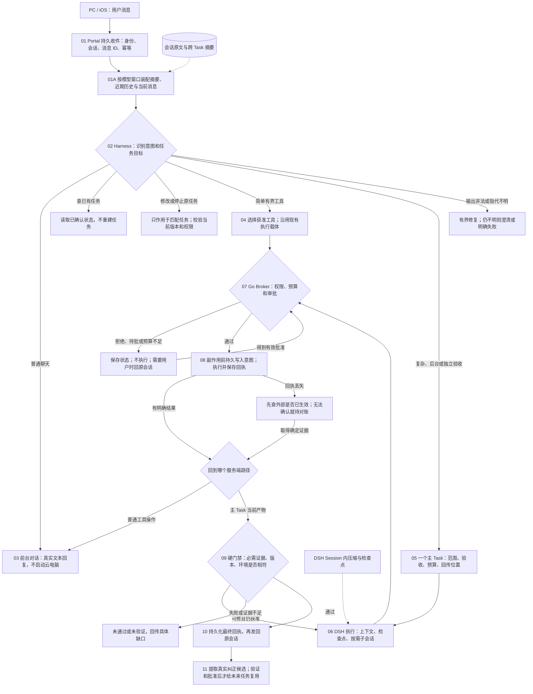
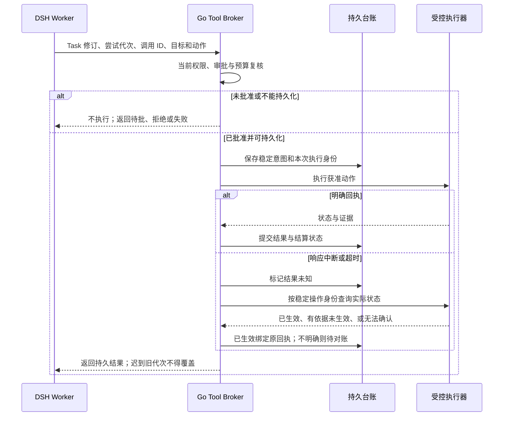

# Morde Harness 最终流程与实现规格

**交付对象：** 修改 `lizhongxuan/morde` 的实现 AI。本文是实施规格，不是上线声明。目标：**普通对话不被后台任务卡住；复杂任务可授权、可恢复、可验收；复用 Hermes 的成熟函数与测试，但不引入第二套 Runtime。**

**对照版本：** [Morde `5f97110`](https://github.com/lizhongxuan/morde/tree/5f97110cf74ffe57aefc9be4664d713de3fbd62d) · [Hermes `0d49d6d9`](https://github.com/NousResearch/hermes-agent/tree/0d49d6d9d20e461155d49ba9d188687079c811af)。实施前先读目标工作区的 `AGENTS.md`，核对 Morde HEAD、Hermes 源码来源与关键文件哈希、实际符号及 DSH 锁文件。本文路径针对上述基线；如果目标有未提交改动，先了解并保留，不能用本文件覆盖。所有新增名称如未注明现存，均为建议，不是既有接口。

**文档依据：** 本规格定义目标行为和约束，[实施任务 TODO](Morde_Harness_实施任务_TODO.md) 负责拆分、依赖和验收；两者须保持一致。根目录及相关子目录 `AGENTS.md` 的约定和本次用户授权优先。之前的 Hermes 设计、流程图和长会话测试方案可作证据及用例参考，冲突时不另起一套实现。两份新文档的结论是目标设计，不表示功能已上线或验收通过。

**2026-11-22 本地核对：** Morde 工作区 HEAD 为 `ba1386882d6823b0197cf69999348c24abf6fb98`，与最初对照版本不同；具体实现还要计入当时的未提交改动。`project/hermes-agent/` 是无独立 Git 元数据的源码快照，不能将其归属到文首 Hermes 提交，见第 3 节。DSH 当前锁定 `0.2.2-rc.1`，实施前应重新核对。

## 1. 最终总流程图

**读图顺序：** 问答、查单走上半部，不能被下面的任务阻塞。工具执行都走受控入口。后台任务才走独立验收。若现有工具 Broker 需要 Task 作为安全执行载体，先保留技术记录并保持界面轻量；不要为追求「零 Task 行」跳过 Broker。是否可以真正在无 Task 下完成一次有界工具调用，要单独验收。

## 2. 每一步为什么这样设计、落到哪里

路径简写：**app**=`server/internal/app/`；**worker**=`server/internal/worker/`；**pg**=`server/internal/store/postgres/`；Node=`runtime/morde-cloud-runtime/src/engine.mjs`。

| 模块 | 源码落点与改法 | 为什么这样设计 |
|---|---|---|
| **01 持久收件** | **复用** app/`conversation_message_routing.go` 的 `AcceptConversationMessage` / `AcceptProjectMessage` 与原幂等机制。明确「未收件／已收件未路由／已路由」；重复消息返回原记录。 | Hermes 的早返回对它的本地会话有效，但不能让 Morde 已接收的消息只留内存或等到下一轮才存。收件不等于创建 Task。 |
| **01A 上下文与历史** | **复用并检验** worker/`conversation_route_worker.go` 的预算装配、worker/`conversation_summary_maintenance.go` 的跨 Task 摘要和 app/`cloud_dsh_history_tools.go` 的授权历史搜索。DSH Session 内压缩继续由 Node 的 `BasicCompactionEngine` 适配处理。 | 历史摘要和当前执行 Session 压缩是两个范围；摘要不替代会话原文。长历史不应让后续短消息因旧正文体积而失败。 |
| **02 意图路由** | **扩展现有** worker/`cloud_dsh_coordinator.go`、相应协议与 app 路由测试；按明确对象与动作校验路由，不信任模型提供的租户、权限和状态。非法输出允许一轮无副作用修复；仍不确定则澄清。分别记录解析失败、修复成功和最终失败。 | 用户可以随时插话。无效 JSON 不应让一条普通消息整轮报错，也不能靠上次意图猜测要修改哪个任务。 |
| **03 前台回复** | **沿用**现有文本回复与零工具降级入口；校验配置可用的文本模型。把回复与原消息绑定；若流式中断，保留状态或明确中断，不能拿旧答案填。 | 「像 Muse」不是多几个 Agent，而是后台在工作、前台仍能聊天。文本执行关闭不等于文本模型不可用。 |
| **04 有界工具** | **沿用** Broker 与已授权工具目录。先按当前权限裁剪候选，再做检索；首版无需上 top-k。若没有批准的轻量执行入口，不私建旁路。 | 不能把读取一个页面的动作强制变成可见的长期任务，也不能把快速体验换成权限漏洞。 |
| **05 Task 立项** | **沿用** Task、事件和任务卡；固化目标、非目标、验收条件、能力范围、预算与原会话。app/`cloud_dsh_task_plan.go` 的建议计划不直接执行；真正依赖沿用 pg/`task_dependencies.go`。仓库、环境只在需要时必填。 | 一件事可以追问、停止、重试，且产研、部署、调研共用一套机制，不必为每个领域开新表与引擎。 |
| **06 DSH 运行** | **保留** Node 的 `runAgent`、`persistencePlugin` 与 DSH AgentLoop；沿用 worker/`task_worker.go`、消息投递和子会话能力。对运行中消息、检查点和活动检测按 2.2、2.3 节验证并补缺口；新增插件须先检查版本和许可。 | 不把 Go 控制面变成第二个模型循环，不用整条会话租约阻塞其他消息。简单任务可由单 Agent 完成；适合并行的复杂任务应支持主 Agent 委派至少两个互不冲突的子 Agent，并汇总各自实际结果。 |
| **07 授权与预算** | **复用并检验** app/`cloud_dsh_tool_broker.go` 的服务端授权/审批，以及已有用量和预算机制。模型路由与真实工具动作分开授权。批准绑定目标、版本和动作；变更重新核验。按适用额度原子预留、按请求结算并可恢复；未知用量明确标记。 | 隔离、授权、预算各管一件事。不能把容器隔离当授权，不能让模型授予权限，也不能因进程重启就恢复额度。 |
| **08 执行和对账** | **复用** `CloudDSHToolBroker.Execute`、`Reconcile` 和 `reconcileCheckpointedCall`，及现有 operation ledger。为新写适配器定义稳定操作身份、外部查询方式、响应未知时的状态。按稳定 ID 去重，不按工具名与参数一律合并。 | 已收到审批不等于已经执行；请求超时也不等于没执行。没有查询能力的外部动作必须能停在待对账，不能承诺外部严格一次。 |
| **09 证据门禁** | **扩展** worker/`task_validation_review_worker.go`、现有证据与判定。将证据绑定当前 Task 修订、尝试、产物版本及实际环境。先核对异步验证和会话发布的现有时序；本规格要求的通过门禁尚需验证接通。独立复核只能补判断，不能覆盖硬门禁。 | 编码看真实候选上的测试；部署看实际运行版本和真实对话；调研看来源。任务执行完和验收通过是两件事，验证未完成不能误报已通过。 |
| **10 交付** | **复用** pg/`conversation_result_review.go` 与原会话发布机制；持久化最终结果后再投递。任务回执包含产物、证据、未验项和下一人动作；重连按回执恢复，不用流片段判成功。 | 用户不必去找子 Agent 或日志。任务等待、普通聊天流式文本和正式交付要有不同状态。 |
| **11 经验与观测** | **扩展** app/`cloud_dsh_skills.go` 现有只读加载及记忆、修订模式。仅授权用户可把经过验证的候选批准为启用版本；恢复原文时重新验范围。观测记录经脱敏的阶段、诊断码和时长，先不用整套 Phoenix。 | 下一次少教来自可验证规则，不是永久保存整段聊天。学习不能自己扩大权限、改动门禁或把过期规则用在另一环境。 |

### 2.1 长会话与上下文合同

1. **两层上下文。** 跨 Task 的会话摘要由服务端按授权的消息和任务来源维护，记录版本、覆盖范围及来源校验；DSH Session 内的压缩、工具结果修剪和检查点只管理当前执行上下文。二者不得互相冒充。保留期内的会话原文不因摘要或压缩被删除，需要旧细节时从获授权的原文检索；摘要覆盖不足或历史不可用时明确说明。
2. **预算与边界。** 路由与执行均按所选模型的可用窗口计算系统提示、工具定义、当前输入、近期历史和输出预留；未知容量沿用当前最小支持窗口的保守预检。先处理可缩减的旧历史和摘要，不能把当前输入静默截断后当作完整请求处理。已受理但自身仍超预算的输入保留原文并返回明确限制；受理前超过接口限制则明确拒绝。自动分块处理需具备可核验的覆盖范围与原文回查后才能宣称支持。
3. **安全提交与恢复。** 摘要或 Session 压缩必须校验身份、授权、版本和来源；失败、取消、空/截断结果或并发冲突不得提交半成品或覆盖新状态。工具调用及结果保持配对，最新用户输入和可继续执行的状态须保留；恢复时对账检查点与已确认操作。
4. **隔离。** 摘要、历史搜索和检查点按账号、会话、项目和当前授权过滤；跨会话个人资料按原有授权处理。相同消息 ID 的幂等重试与独立发送的相同文本是两件事，不能仅按内容合并。

### 2.2 运行中消息与并行任务合同

- 每条消息先持久化。目标明确且低风险的补充使用现有 `message_delivery` 的 `steer`，下一安全步骤领取；等待下一轮的消息使用 `followup`。更改目标、计划、授权、审批或已派发的副作用走受控修改/等待路径；目标不明时澄清，不中断其他任务。
- 现有 v3 投递帧绑定 Task、Owner、Session、Agent 代次、授权版本、消息 ID、内容/附件与 `mode`。根 Session 的 `agent/inbox/spliced` 检查点只能证明入队；相应 `user/message` 被领取并持久化后，才能将该任务消息标为 `delivery_status=applied`。入队或领取均不表示工作完成；无法确认时保留 `unknown`。普通直接回复沿用既有 `applied` 语义。
- 恢复时按消息身份、内容/附件、模式、检查点和现有操作账本对账，回执丢失不等于没有投递或没有执行。只保护同一可变 Session/摘要的写入，不把整个产品会话或账号全局串行化。
- 独立 Task 可以并行；停止或修改 A 不影响 B。复杂任务按授权可委派两个互不冲突的 DSH 子 Agent，并基于两个子任务的真实完成或失败状态汇总，委派不等于完成。

### 2.3 重试、活动和交付合同

- 非法路由输出最多做一次无工具修复；修复请求有独立可对账的模型调用身份和预算，返回后重新校验路由快照、目标与授权。身份或租约已变化时重新读取，不应用旧决定；缺明确目标时澄清，模型或服务不可用时如实失败。
- 模型错误由单一层负责有界重试，受取消、剩余时间和费用约束。请求或用量处于 `unknown` 时先按账本对账；已展示的流式文本要保留并标明中断，不能静默重播。工具结果未知时不得自动重放副作用。
- 当前网关 `ModelCallTimeout` 是 45 秒，涵盖派发授权和单次 Provider 请求，不是整个 Task 的时长。应实测首响应慢、流式停顿与取消；需要更改时明确单次总时限和空闲时限，并验证调用对账，不能直接照搬 Hermes 的固定数值。
- Task 租约续期不证明有实际进展。对模型、工具、子 Agent 和检查点的可观察活动分别定义检测条件；等待审批或外部结果需单独标记。疑似卡住时先记录证据，取消前重校验任务/Session、租约代次与最近活动，取消后对账未知操作。600 秒只可作为实验参考，不直接作为统一强杀阈值。
- 结果验证与正式交付复用现有状态和发布路径；核对硬门禁、验证 Worker 与发布的实际先后关系。验证未完成可反馈实际进度或未验证结果，不能宣称验收通过。需要修正时受原授权及预算约束，重复恢复不得再次交付或重新执行已确认的副作用。

### 2.4 最低验收范围

- **长历史与失败恢复：** 约 18 KB 旧要求后追加短追问；另在预算足够的模型窗口中发送约 18 KB 当前输入，用开头、中间、末尾的不同锚点检查实际处理完整内容。以 4K 合成窗口连续 40 轮并至少压缩两次；对空/截断摘要、溢出、取消、重启和租约冲突注入故障。保留早期要求和最新追问、原始记录及工具配对，不重复调用或结算。参照[长会话测试方案](design/Morde-AI对话长会话测试方案.md)的 LC-01 至 LC-05，并以本节为准。
- **真实窗口与长时间：** 使用测试账号和合成内容，在所选真实模型上构造累计历史超过其单次上下文窗口的会话，验证早期关键要求和原文可查；记录模型、窗口和统计方式。耐久测试以连续至少 60 分钟为验收基线，使用持续有可观察步骤的测试任务，在同一会话中分时追问并观察任务进度、续租、重连和恢复；这是测试时长，不是任务超时阈值。所有测试数据与产物只保存在本地，不上传或发送文件。
- **客户端与协作：** 实际 `morde-pc` 和 iOS 接续同一会话，分别验证记录、消息状态、进度和结果；复杂任务中两个互不冲突的子 Agent 实际并行，主 Agent 汇总结果。执行中追问、创建独立任务及停止指定任务均不串线；两个账号和两个会话相互隔离。

## 3. Hermes 函数移植清单

先核对固定提交的函数及测试。只有 `project/hermes-agent/` 本身有独立 Git 元数据时才能用该 checkout 的 `git show`；当前本地目录只是快照，应记录实际文件的 SHA-256 和许可证来源，并与固定提交比对，不能把外层 Morde 的 HEAD 当 Hermes HEAD。**A：尽量逐函数翻译并移植测试；B：借函数内的行为/测试，按 Morde 重写状态接线；C：保留 Morde，不复制。** 不新增 Python 依赖或待机进程。对源代码的实质移植保留对应 MIT 许可与署名，提交说明记录上游 SHA、路径与测试差异。

| Hermes 文件与函数（固定提交） | 级别 | 具体移植合同 |
|---|---|---|
| [agent/retry_utils.py](https://github.com/NousResearch/hermes-agent/blob/0d49d6d9d20e461155d49ba9d188687079c811af/agent/retry_utils.py) · `jittered_backoff`、`parse_retry_after_seconds` | **A，优先核对现有实现** | 可把算法翻译到调用重试的单一拥有方，注入随机数和时钟便于测试。先确认模型网关是否已经重试，不能网关和 DSH 各重试一整层。尊重取消、剩余时限和服务端 Retry-After；默认常数不照抄，按实际前台/后台时限设定。移植 `tests/agent/test_retry_utils.py` 的边界用例。 |
| [agent/repetition_guard.py](https://github.com/NousResearch/hermes-agent/blob/0d49d6d9d20e461155d49ba9d188687079c811af/agent/repetition_guard.py) · `is_runaway_repetition`、`is_repetition_dominated` | **A，后置** | 有真实重复输出反例再翻译。用上游 `test_repetition_guard.py` 并加中文、代码块、列表等可能误报样本；先旁路记录、确认误报后再拦。不为此先换整套流式实现。 |
| [agent/turn_context.py](https://github.com/NousResearch/hermes-agent/blob/0d49d6d9d20e461155d49ba9d188687079c811af/agent/turn_context.py) · `reanchor_current_turn_user_idx`、`compression_made_progress`；`build_turn_context` | **A/B，按缺口** | 可借「压缩是否产生进展」判定。消息边界优先用 Morde 稳定消息 ID，不能照抄基于索引的身份假设。`build_turn_context` 本身不搬；它依赖 Hermes agent 状态及持久化，DSH 上下文继续由现有 provider 管。 |
| [agent/context_compressor_window.py](https://github.com/NousResearch/hermes-agent/blob/0d49d6d9d20e461155d49ba9d188687079c811af/agent/context_compressor_window.py) · `_plan_compaction_window`、`_compress_window` | **B，H09** | 本地已有 `runtime/morde-cloud-runtime/src/hermes-compaction-window.mjs` 的窗口适配；对照原文、最新用户消息、工具调用组和来源保留语义及失败测试，修缺口，不重新写第二个压缩器。跨 Task 摘要仍由服务端维护。 |
| [agent/turn_iteration_prep.py](https://github.com/NousResearch/hermes-agent/blob/0d49d6d9d20e461155d49ba9d188687079c811af/agent/turn_iteration_prep.py) · `prepare_iteration`、`begin_iteration` | **B，H10** | 对照消息领取、取消与预算检查、角色/工具序列和当前用户消息位置。已有 DSH `steer` / `followup` 与 checkpoint 先验证，再通过 DSH 扩展点或适配补实际缺口；不复制 Hermes Agent 状态机。 |
| [agent/turn_response_check.py](https://github.com/NousResearch/hermes-agent/blob/0d49d6d9d20e461155d49ba9d188687079c811af/agent/turn_response_check.py) · `check_api_response`、`retry_invalid_response`；[agent/turn_empty_response.py](https://github.com/NousResearch/hermes-agent/blob/0d49d6d9d20e461155d49ba9d188687079c811af/agent/turn_empty_response.py) · `recover_empty_response` | **B，P0** | 提取一张状态表与测试：合法纯文本、合法工具请求、截断、空、结构非法、提供方错误。根据 Morde 的响应协议适配，不搬 provider 特判和旧文本复用。可从 `agent/empty_response_guard.py:deterministic_empty` 提取纯判断：仅同模型、同提供方、同退出原因的连续空回复且证据一致，才判定为重复空回应；缺用量不当作零用量。可重试必须同时满足：仍有预算、未取消、同一层负责、安全重放；已向客户端流出内容或外部写状态不明，不重跑整轮。 |
| [agent/turn_liveness.py](https://github.com/NousResearch/hermes-agent/blob/0d49d6d9d20e461155d49ba9d188687079c811af/agent/turn_liveness.py) · `TurnLivenessWatchdog`；[agent/turn_facade_lease.py](https://github.com/NousResearch/hermes-agent/blob/0d49d6d9d20e461155d49ba9d188687079c811af/agent/turn_facade_lease.py) · `DurableTurnLease`、`admit_durable_turn_lease` | **B** | 可单独提取 `gateway/session_stall.py:should_emit_session_stall_notification` 与 `should_clear_session_stall_notification` 的布尔策略；移植「读取活动快照 → 超时 → 提交取消前重核代次与时间」行为及 `test_turn_liveness_watchdog.py` 的竞争测试。以 Morde 任务租约和存储为权威，不能再导入 SQLite、线程续约或下轮才保存用户消息。 |
| [agent/turn_tool_round.py](https://github.com/NousResearch/hermes-agent/blob/0d49d6d9d20e461155d49ba9d188687079c811af/agent/turn_tool_round.py) · `run_tool_round`、`stage_tool_call_message`；[agent/turn_final_response.py](https://github.com/NousResearch/hermes-agent/blob/0d49d6d9d20e461155d49ba9d188687079c811af/agent/turn_final_response.py) · `finish_text_response` | **B/C** | 不移植整轮和收尾，只借「持久化失败不得执行」及「准备回复不等于完成」的边界。参考 `tests/agent/test_tool_call_incremental_persistence.py`，在 Morde Broker 和结果发布处做故障注入。避免重复写账、重复 stop-gate 和新的发布器。 |
| [agent/turn_stop_gates.py](https://github.com/NousResearch/hermes-agent/blob/0d49d6d9d20e461155d49ba9d188687079c811af/agent/turn_stop_gates.py) · `apply_stop_gates` | **B，H05** | 参考结束前检查和有界继续行为；先查 DSH `agent/turn-stopping` 与现有 Task 验证、发布的时序，复用现有证据门禁。不能因存在钩子或异步 Worker 就声称已阻断未验证交付。 |
| [tools/approval.py](https://github.com/NousResearch/hermes-agent/blob/0d49d6d9d20e461155d49ba9d188687079c811af/tools/approval.py) · `check_all_command_guards`；[SECURITY.md](https://github.com/NousResearch/hermes-agent/blob/0d49d6d9d20e461155d49ba9d188687079c811af/SECURITY.md) | **C，不搬** | Hermes 的单租户、终端信任模型和 Morde 不同。不能复制服务器审批跳过、模型代批、宿主机直跑或把规则存在全局 profile 的做法。 |

## 4. 单个写入动作：最难也最值得验

**重放不是新操作。** 继续用同一个稳定动作 ID；必须再次执行时，要有可核查的未生效证据和当前授权，或由外部服务提供有对应合同的幂等保证。预算、权限、结果与重启恢复以服务端为准。部署和开 PR 的执行器属于领域适配器，不在本次 Harness 核心 PR 内偷偷接通。

**部署示例：** 「发布测试服的 Portal 到版本 X」走 05–10；你中途问「什么是迁移」走 03。部署前确认目标与授权，独立发布执行器回传实际运行版本、健康和真实对话证据。若重启后回执丢失，先对账，不因记录过期再重启一次。下一次只可复用已确认的手册，不能复用旧授权、旧健康结果。本例是验收场景，不要求本次改动连接生产服务器。

**三个状态不要合并：** Task 生命周期（例如运行、等待、失败）、外部操作状态（例如未派发、已确认、未知）、验收状态（通过、失败、未验证）。沿用现有字段或投影做映射，不为这份文档改造全部事件枚举。

## 5. 给实现 AI 的提交顺序与验收清单

| 提交 | 先改什么 | 通过标准 |
|---|---|---|
| **PR 1 · 会话与路由** | 源码基线审计、测试夹具、无工具路由兜底，以及 H09 的两层上下文和长历史恢复。复用路由协议而不是另建 API。 | 相同消息重送只受理一次；非法路由能安全恢复或澄清，不调用工具；Task A 运行、B 复核时，普通提问仍收到真实文本回复；长历史、40 轮重复压缩和超限输入符合 2.4 节。停用执行但配置可用的文本模型，再测一次实际回答。 |
| **PR 2 · 工具与恢复** | Broker、任务租约、已有台账下的故障测试，以及 H10 的运行中消息和 H11 的子 Agent 协作；只补真实缺口。 | 拒绝、权限撤回、跨账号引用、超预算或落盘失败均不派发；相同操作回执丢失后查询而不重复执行；迟到旧代次不得写入新结果；追问仅进入指定 Task，等待审批不被误杀。确认没有模型请求重试放大；相同参数但不同授权操作 ID，不得误合并。 |
| **PR 3 · 验收和原会话回执** | 扩展现有校验与发布，加入一个非工程证据样例和一个工程证据样例。 | 模型说「完成」而缺证据只能未验证；旧提交、错误环境或过期修订不放行；重启或重连只交一份回执。PC 用真实 `morde-pc` 验；iOS 接续另在实际目标端验，并执行 2.4 节的长会话、长时间和子 Agent 验收。 |
| **PR 4 · 经验复用，前面稳定后做** | 一个类型化、可回退的规则或部署手册；只在有人纠正、且有证据时提候选。 | 两个新会话同模型、同候选、同工具，有/无批准版本只做只读计划对照；记录少问几个问题、到正确计划的耗时及采用版本。被替换的旧规则和其他环境都不能误用。 |

**交接要求：** 回报每个 PR 改动文件、兼容性影响、实际执行的测试命令和结果、未测项，以及是否存在需要迁移的状态。先用已有 Go、Node、前端测试做故障注入，再验证真实客户端。未经另行授权，不安装发布凭据、不执行生产发布、不自动合并，不拿模拟测试报真实通过。
