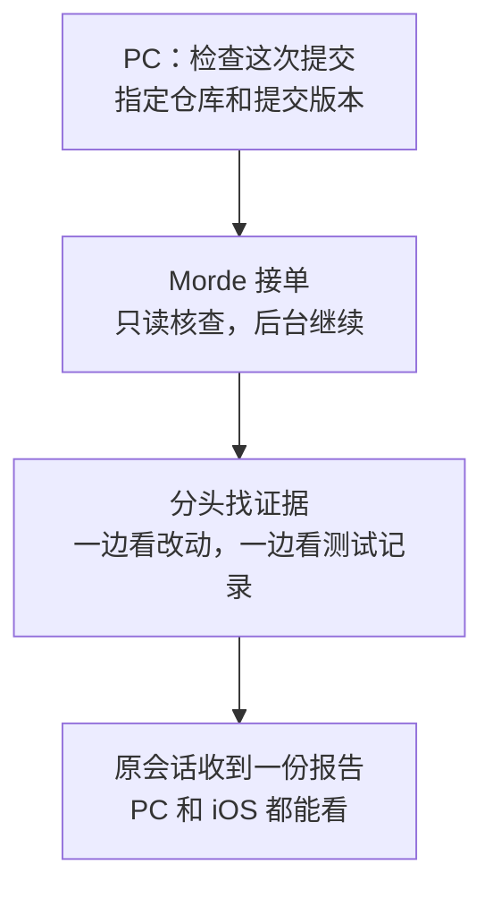
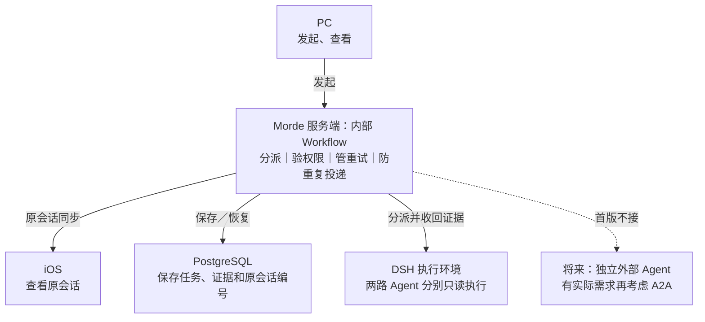
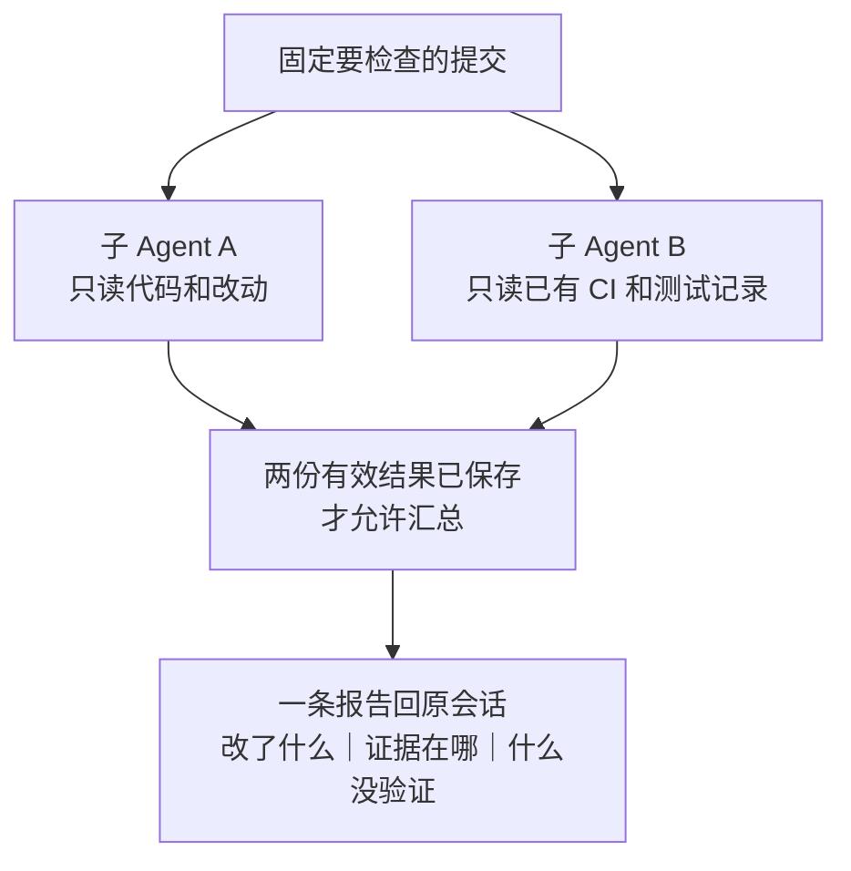
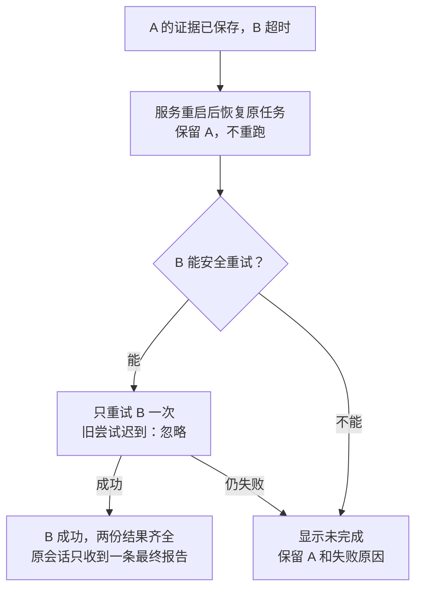
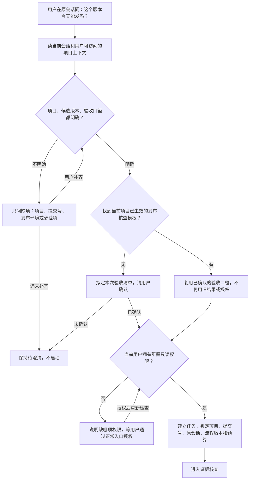
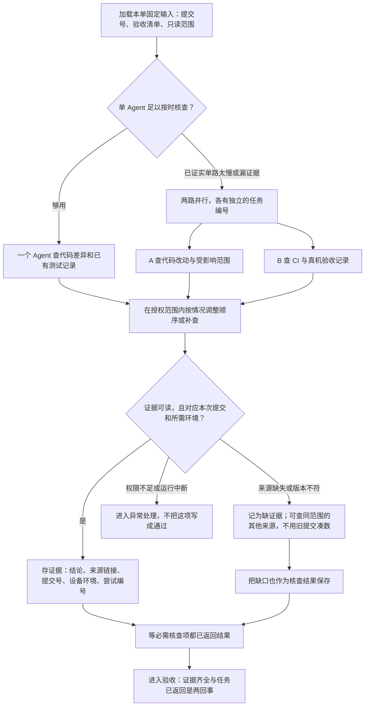
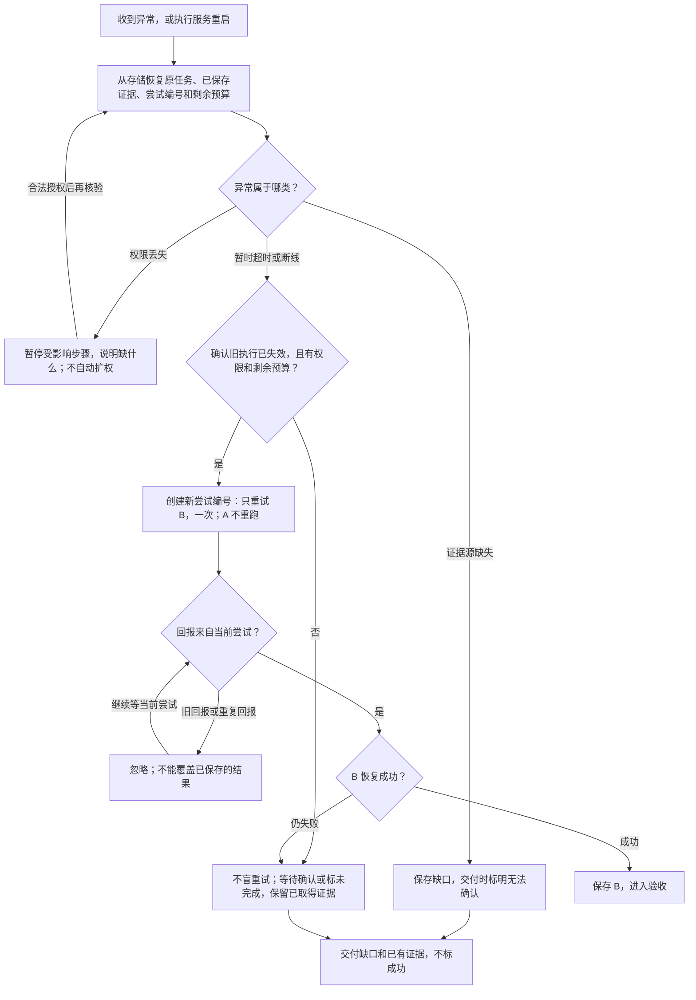
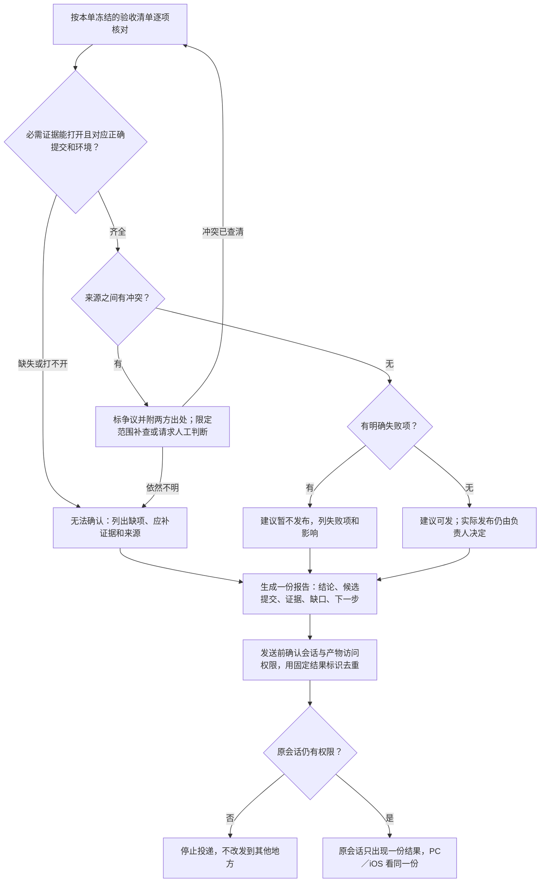
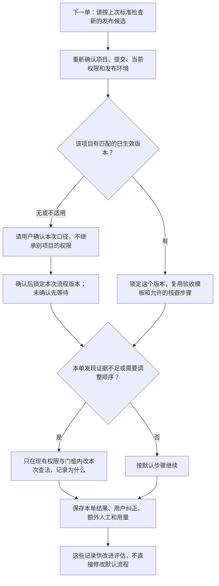
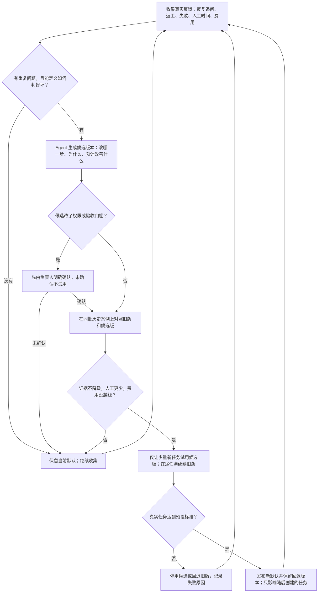

# Morde 首个产品里程碑：可验收、可恢复的工程委托

**版本：** 2026-11-20 · 图解版 v1.3 · 需求评审稿，不代表功能已上线  
**建议：** 值得做一次限时验证，不值得先做通用 Agent 平台。首版用 **Morde 内部 Workflow**，不引入 A2A。

## 先看四张图

四张图都用同一件事举例：**让 Morde 查一个固定提交改了什么、哪些内容有测试证据。** 图是首版设计，不是当前上线能力。若 Markdown 阅读器不显示 Mermaid，直接打开同消息的 PDF 图解。

### 图 1｜一眼看懂：我交代一次，结果回到原会话

从上往下看：PC 和 iOS 看的是同一个会话，不是两份任务。

### 图 2｜架构：谁负责什么

执行者找证据；Morde 服务端管状态、权限和投递。手机不承担后台执行。

### 图 3｜正常流程：两份证据齐了再汇总

没有证据的项目标「未验证」，不会因为报告已生成就变成「通过」。

### 图 4｜故障流程：重启不重做，结果不重复

恢复沿用原任务、原权限和剩余预算。旧尝试迟到，不得覆盖新结果。

## 详细流程图｜公司发布核查

同一个例子串起六张图。前四张回答「这一单怎么交付」，后两张回答「下一单怎么变好」。以下是设计方案，不代表已上线。

### 01｜从一句话到可执行的任务

工程负责人问「这个版本今天能发吗？」。先把这次到底查什么说清楚，再启动。

### 02｜先单 Agent，何时才加并行

单 Agent 是更轻的产品试验；双 Agent 是原需求里的并行和故障恢复验收，不等于所有任务都该并行。 各路分别核查、分别保存，最后才等齐。

### 03｜失败怎么处理：停、等授权，还是只重试一步

例：A 已存证；B 第一次超时，服务在回报前重启。

### 04｜验收怎么判，结果怎么送回去

若公司规定必须有真机记录，模拟器通过也只能证明模拟器通过。

### 05｜下一单怎么用：复用规则，不复用旧结论

任务开跑后固定流程版本；Agent 可以调整这一次的查询顺序，不会把临时改法静默变成默认。

### 06｜持续优化：提案、对照、小试、发布或回退

如果用户每次都追问「真机还是模拟器」，候选流程就把检查设备类型提到前面。

## 1. 为什么值得做，又为什么可能不值得

**定位：** Morde 是以对话为入口的常驻工作助理，不是另一个写代码的聊天框。它的第一份工作，是替经常在 PC 核对代码和测试的人接住一件能明确验收的事：**人离开窗口后工作还在继续；回来不用重讲；结果带着证据出现在原会话。**

首批用户是每周反复核对提交、测试结果和发布风险，且确实遇到过“等结果、找日志、断线后重来”的工程人员。首个任务只有一句话：**“这个提交改了什么？哪些关键行为已经验证，哪些还没有？”** 不把不常发生的故障演示当成日常价值。

并行 Agent、后台执行、日志截图和跨端访问都不是独家功能。[Codex](https://openai.com/index/introducing-the-codex-app/) 已有多 Agent 和工作树，[Cursor Cloud Agents](https://prod.cursor.com/help/ai-features/background-agents) 已有后台运行和可审阅产物。

### Morde 的护城河：让重复工作越交越省心

**价值不是多写代码，而是让用户放心交办：下次少交代，结果有证据，出错不用从头接手。** 潜在护城河有两项：用户确认过、可编辑复用的验收规则；以及把真实故障变成可重复验证的恢复测试。Agent 数量、Workflow 和 A2A 本身都不是护城河。

先挑一件每周真做几次的事，和现用工具比两周：**更省人工、证据不打折、用户主动再用**，才值得扩大；否则收窄为工作台的一项功能。

## 2. P0：只做一条完整流程

| 步骤 | 用户看到什么 | 必须做到 |
|---|---|---|
| 1. 接住委托 | 在 PC 原会话确认仓库、固定 commit 和本次范围；必要时只补问一次 | 建立唯一任务，绑定用户、工作区、会话、仓库和不可变 commit；不使用会随时间移动的分支作为证据锚点 |
| 2. 两路并行查证 | 同一任务卡上看到「变更核查」和「测试证据核查」各自的状态 | 两次真实模型执行，各有独立任务和运行记录。A 看 diff、受影响模块及风险；B 查已有 CI、日志或测试记录。只读；不增写、不运行未知代码、不提交或部署 |
| 3. 中断后继续 | 断线或关闭 PC 不等于取消；iOS 打开同一会话可看已有进度、失败原因和正在重试的项 | 服务端保存任务及已完成证据；执行服务重启后只恢复未完成且可安全重试的步骤。旧尝试超时返回时不得覆盖新尝试或重复汇报 |
| 4. 原会话验收 | 只看到一条最终汇总：改了什么、验证了什么、哪些未验证、下一步建议 | 两路有效结果齐备才发布完整结论；链接到该 commit 的文件/行及对应 CI 运行或日志。无证据就写「未验证」，不得把推断当实测。若重试耗尽则标「未完成」，保留已取得的部分证据，不标成功 |
| 5. 下次少教 | 同一工作区隔天能够再说「按上次标准检查这个提交」 | 复用用户确认过的模板（关注点、证据标准、输出格式），每次重新绑定 commit 并核验权限；旧结论、旧证据和旧授权不得沿用。用户可修改或关闭模板 |

**首版不做：** 外部 Agent 市场、A2A 接入、通用可视化编排、自动修代码或合并、定时扫描、默认长期学习全部历史。PC 可发起，PC/iOS 同一会话可查看；不要求首版 iOS 具备全部管理操作。

## 3. 采用 Workflow，不先接 A2A

**Workflow** 是这条链路的执行合同：哪两步并行、何时满足汇总条件、哪些步骤能重试、结果发到哪里。**A2A** 是不同系统的独立 Agent 如何交换任务、状态和产物的[协议](https://a2a-protocol.org/latest/specification/)，不会自动解决 Morde 的持久化、授权和客户端一致性。只有明确有一个外部 Agent 必须接入，且本地适配无法满足其信任或生命周期边界，再评估 A2A；两者不互斥。

建议沿用 Morde 现有 Go/PostgreSQL 任务存储与授权、DSH 模型执行，不建第二套调度：**模型负责找证据和解释；服务端负责状态、授权、预算、重试和投递**。发结果时，用绑定原会话的固定消息 ID 或等价去重机制；即使执行或投递可能重试，用户也只看到一个最终结果。每个步骤记录权限范围、输入版本、尝试次数、模型/用量、证据引用和错误原因。提议首版仅对短暂故障自动重试一次；权限撤销、证据源缺失、commit 不符或预算耗尽可见地停下，不静默扩大权限。

## 4. 逐项对照你发的「Agent 产品 · 价值验收单」

| 图片原项 | 判断 | 验收方法 |
|---|---|---|
| **交付结果：能不能真正验收？** | **需求上可以，现状未证实。** 验收对象是用户能复核的结论，不是出现「已完成」或两个头像。 | 给同一 commit 一份有记录的 CI 和一项没有证据的行为；第三人可从报告定位引用并复核。故意混入另一 commit 的通过记录，报告不得把该项标成已验证。 |
| **重复任务：还需要不需要从头教？** | **默认不能要求重教；只复用稳定规则。** 价值是减少重复交代，而非把历史全部注入。 | 在下一天的新会话对新 commit 用同一模板；只提供变化的输入。核对关注点与输出格式一致、引用全部指向新版本；撤销模板或更换工作区后不得误用。 |
| **出错处理：权限、追溯、恢复和成本** | **四项都要可测，任何一项都不能用“会重试”代替。** | **权限：** 撤销仓库访问后，读取或重试停止，结果/附件不向无权会话泄露。**追溯：** 可从结论查到 commit、产物和对应步骤/尝试。**恢复：** A 完成、B 失败后重启，只重试 B；补齐后只发一条，PC/iOS 同样可见；B 始终失败则显示部分证据而非成功。**成本：** 每单显示耗时、模型用量/可核计费用及重试开销；到上限停止并说明原因，对比时把失败单也计入。 |

## 5. 发布与止损：功能通过不等于值钱

**工程门槛，先过再试用。** 在同一候选版本、真实模型、真实 PC/iOS 会话上跑正常、失败重启、重复投递、权限撤销、预算耗尽和模板复用。正常/恢复成功时应且仅应有一份原会话汇总；失败时状态与证据可见。任何越权、串会话或把无证据说成通过，立即停试；演示录屏、两条真实模型运行记录和去重/恢复日志是验收材料。远程候选须重测，不能用模拟器或模型替身代替。

**价值门槛，建议两周小样本。** 找 3–5 位有此痛点的人，共至少 12 个真实任务；按难度配对，对照每位用户现在最顺手的做法（可包括现成 Agent，不只对照纯手工）。记录人实际投入的时间（交代＋追进度＋核证＋返工）、人工干预次数、到可用结果的 P50/P90、证据可核验率及每件成功任务的模型成本。提议通过线：

- 证据盲评可核验率至少 90%，且不低于对照；不容许虚构证据。
- 人工时间中位数降低至少 30%，且典型任务实际少花至少 3 分钟或少一次人工介入；不能靠明显增加等待或费用换取。试用前确定任务预算，失败重试也计费。抽一小组同难度任务与 Morde 单 Agent 版对照：如果双 Agent 不提升证据质量或时效却更贵，保留 Workflow，去掉默认双 Agent。
- 至少 3 位下周无提醒主动复用。若任务量或样本不足，不作通过结论；若两轮调整仍不省人力或无人主动复用，停止扩建，退回单 Agent 或工作台内置核查能力。

## 6. 现有证据与首个缺口

[Morde 项目 README](https://github.com/lizhongxuan/morde#readme)将 Morde 定位为对话优先的云工作空间，PC/iOS 为用户入口。已核对的[固定源码验收记录（ba649b1）](https://raw.githubusercontent.com/lizhongxuan/morde/ba649b1/docs/实施/Morde对话体验与DS-Bot融合实施任务todo清单文档.md)记载：T04 有本地模型替身/运行时测试；有 iOS 模拟器和局部验证；T08 的真实模型完整协作未获验收。[历史 PC-CHAT-008](https://raw.githubusercontent.com/lizhongxuan/morde/ba649b1/docs/验证记录/PC端AI对话测试用例-2026-11-12.md)还出现过主任务显示完成、两个子 Agent 实际未运行。所以要查持久子任务 ID、各自真实模型调用和独立证据，不能只看界面状态。这些是仓库记录，不是对当前部署的独立验证。**下一步不是补齐所有功能，而是先用同一版本和两个真实 Agent，把「恢复 → 去重 → 原会话跨端验收」录下来。** 再决定值不值得扩大。
