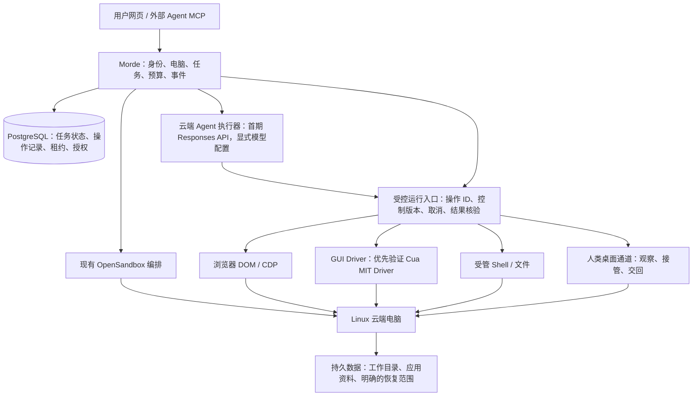

# Morde 与 Cua：源码对比、产品定位与超越路线

> 研究日期：2026-10-21。对象：本地 Morde 与 server/project/cua 源码副本，并核对 Cua 官方在线文档。
>
> 本文是产品与技术选型研究，包含建议，未改变现有需求优先级、实施状态或代码。所有产物保存在本地。本轮未启动 Cua、未创建云资源、未上传本地文件。
>
> 2026-10-21 补充：加入首次上手、管理员部署与普通用户体验要求，细化为 [32 项对照验证任务](实施/Morde与Cua对照验证任务清单.md)，并同步需求及 T13/T16 的验收口径；没有执行实验或将任何功能改为已完成。源码现状是带日期的快照，执行验证前应重读当前实现。
>
> 2026-10-21 19:11（UTC+8）再次核对，另补入 19:12 更新的 T12 清单：更新 T10/T11 的实际进展，修正 Linux ARM64 判断，补充完整产品的竞争取舍、三个优先场景、Driver 接入门槛及证据方法。本次只修改本研究和历史验证记录的更正说明；开发代码、实施 TODO 与运行环境由开发会话继续维护。下文引用已有测试记录，不表示本次重新运行通过。

## 1. 结论与建议

**继续以 Morde 为产品主线；优先验证 Cua MIT Driver 能否成为 Morde 的电脑操作组件。不要直接把整套 Cua Spaces 当作默认可自由商用的底座，也不要为了“自主可控”重写全部操作系统驱动。**

这里的 Morde 目标始终是：**让 Agent 直接使用一台长期可用的云端电脑，并把真实工作持续做完。** 用户网页、MCP、任务记录、文件和环境围绕这台电脑协作。

对比后最重要的判断：

1. **两者的核心方向高度重叠。** Cua 已经覆盖电脑操作、沙箱、共享桌面、持久 Agent、记忆、定时任务、通知、凭据与文件版本。Morde 增加这些功能，首先是在建立基本能力，不能直接称为差异化。
2. **Cua 最值得学的是执行接口的准确性。** 操作发出、动作效果可确认、任务真正完成，被明确区分；窗口与元素引用有身份和过期规则；不支持的动作明确拒绝。
3. **Morde 最有机会做出优势的，是持续工作的可信度。** 包括批量任务恢复、外部操作结果核实、真正可撤销的人机接管、可恢复的个人电脑状态，以及能复现的成果交付。
4. **这些是 Morde 可以建立的优势，目前还不是已证实优势。** 现有运行验证已经暴露取消、权限和持久化缺口，应先修好这些核心承诺。
5. **“都有完整功能”时，不能仅凭架构或清单判定谁更有价值。** 对频繁切换设备、操作多种桌面应用的人，Cua 的覆盖面很有吸引力；对把长期工作交给云端 Agent、要求离线执行和恢复结果的用户，Morde 若把全程体验做得更可靠，就有明确购买理由。
6. **超越应先限定在一组真实工作上。** 建议先聚焦 Linux 云端电脑上的开发、资料处理与浏览器业务流程，证明更高的任务完成率、更少的人工介入和更低的每成功任务成本，再扩大系统与应用覆盖面。
7. **易上手必须和持续可靠一起交付。** 用户应先通过“打开网页 → 选择示例或交办 → 获得真实结果”理解价值。名称/偏好可跳过，管理员已配好模型时无需再次填写 Key，MCP 为进阶入口。长期任务能力只有被普通用户用起来才有价值；配置、首次成果和异常恢复的人工时间也要进入比较。

推荐第一阶段的产品表达：

> 打开网页，把工作交给 Agent 的云端电脑：先完成第一件事，之后持续执行，需要时接手，成果和工作环境可以找回。

这句话中的每个结果都要有验收证据。仅有聊天窗口、远程桌面或更多工具，支撑不了这项承诺。

## 2. 研究口径与需要纠正的判断

### 2.1 证据分类

| 标记 | 含义 | 本文如何使用 |
|---|---|---|
| 源码 | 已读到实现或相关测试源码 | 证明存在设计及实现路径；不代表运行测试通过、已经发布或所有平台都可用 |
| 文档 | 本地或官方产品说明 | 用于确认定位、使用方式与明确限制；与源码矛盾时单列 |
| 既有实测 | Morde 仓库已经保存的验证记录 | 保留原版本、路径和环境范围；本轮没有重跑这些实验 |
| 开发测试记录 | 实施文档记录的单测、集成测试、mock 验收 | 用于识别开发进展；模拟 transport、测试替身和跳过的集成项均不等于真实模型与电脑全链路验收 |
| 建议 | 基于以上证据的产品或工程判断 | 不写成当前能力，也不据此勾选 TODO |

本地 Cua 目录没有独立 .git，不能从父目录 Morde 的 Git 状态推断 Cua 提交。记录到的 VERSION 文件：cua SDK 0.6.0、Driver 0.38.0、spacesd 0.6.0、macOS Spaces 0.12.1、Lume 0.6.1。它们只是这份副本的版本声明，不等于在线发布版本；关键文件指纹见附录。

本次重点追踪：Driver 的观察/动作/授权、spacesd 的进程与会话、窗口租约、撤权连接、持久 Agent、调度、Volume、Keyvault、BYOC、许可证，以及 Morde 的 Host/Workspace、Worker、Gateway、MCP、模板和运行验证。未做全仓安全审计或逐个平台运行验收。

**本次更新后的 Morde 基线如下。此前只读验证记录中的“未实现”是更早的快照，不能继续作为当前判断。**

| 范围 | 当前读到的实现与记录 | 仍不能据此宣称 |
|---|---|---|
| T10.01–T10.05 | 文档均标完成；Task/Conversation/API/SSE、事务、幂等、租约版本、操作记录和 Host 集合+操作 scope 的 Key 已实现；有临时 PostgreSQL 等测试记录 | 所有电脑操作已受运行层约束、真实云端任务已打通 |
| T11.01 | Responses API 客户端、加密模型连接、出站允许范围、文本/工具/图片能力探测及 API 已实现；记录了隔离 transport 与数据库测试 | 真实供应商联调已通过、普通用户已有模型设置页面 |
| T11.02 | Agent 观察/操作/核验循环已实现；调用前授权和预算检查，先持久登记 operation_id 再交给 ToolExecutor，完成前独立核验 | 生产 ToolExecutor 已存在、模型说完成就能直接完成任务 |
| T11.03–T11.05 | TaskWorker 核心与测试已存在；失租取消、unknown 暂停和预算保护有代码 | TaskWorker 已在生产装配启动；批量逐项恢复、用户答复、暂停/取消/全停 API 已完成 |
| T12 | T12.01 运行合同已冻结；19:12 更新的清单将 T12.02 标为进行中，Host 凭证/实例及启动引导路径正在实现，T12.03–T12.09 尚未完成 | 凭证隔离与 runsc 验收已通过、协议文档已变成完整运行服务、可靠停止/私密接管/电脑恢复已通过 |
| T13 | 首次体验、网页任务与模型设置、接管和 MCP 委派仍待实施 | 用户已经能从网页完成整条目标流程 |

证据：[T10][M09]、[T11][M10]、[T12][M11]、[Agent][M12]、[工具边界][M12b]、[TaskWorker][M13]、[持久操作][M14]、[生产装配][M15]。其中 Agent 遇到已有步骤会进入 `recovery_requires_reconciliation`，这证明它避免盲目重放，尚未证明能自动恢复。生产装配已接 TaskService 与 ModelConnectionService，尚未接 NewAgent/NewTaskWorker。

### 2.2 不能继续沿用的比较方式

| 容易出现的判断 | 本次核对后的结论 |
|---|---|
| Cua 是操作工具，Morde 才是长期 Agent 产品 | Cua 有真实的 ACP Agent runner、持久 Agent supervisor、记忆、routines 和通知；只是不同层的许可证和职责不同。[C05][C06][C07] |
| Morde 能给 Agent 云电脑，所以与 Cua 定位完全不同 | 两者都能以此为目标；Cua 还支持自有机器与 AWS/GCP/Modal。应比较完成真实工作的体验和约束。[C01] |
| Cua 没有人机协作/撤销权限 | Cua 有窗口输入租约、viewer 权限、按 Agent 授权，以及撤权后切断连接的实现。[C08][C09][C10] |
| Cua 中继默认一定能读到所有会话 | 本地 mesh 策略默认 Prefer，双方支持时使用端到端加密；HTTPS 回退路径仍由中继终止 TLS。浏览器等路径需单独判断。[C14] |
| Cua 不保存电脑，Morde 才有持久性 | Cua 有 Volume 版本与 Agent home；AWS/GCP stop/start 保留磁盘。删除电脑、恢复记忆、恢复应用、恢复执行中的进程是不同保证。[C01][C11] |
| Cua 没有审计导出 | 文档存在层次差异：Teams 页面仍称未包含，relay 文档已列导出端点。不能笼统把“无审计导出”当竞争点。[C14b][C18] |
| 仓库根目录 MIT，整套都可直接用于托管商业产品 | Spaces、spacesd、relay、持久 Agent 扩展、Volume、Keyvault 和串流组件等有 FSL 子目录许可。[C15][C16] |
| Worker 已有，因此 Morde 只差聊天框 | Host Worker 与新 TaskWorker 职责不同。T10 和 Agent 核心已有实现，TaskWorker 生产接线仍等运行端凭证、ToolExecutor 与 ControlService；恢复和接管仍是主要工程工作。[M03][M10][M11][M13][M15] |

截至本次在线核对，官方迁移页写明 **Cua Cloud/Fleets 于 2026-10-18 结束**；自带算力、BYOC 与 Spaces 仍可用。仓库中的历史 Fleet 代码不能当作当前托管服务承诺。这里不把赠送云机器、补贴或停止补贴作为价值判断依据。[官方迁移说明](https://cua.ai/docs/cua-sdk/guides/cua-cloud-ended)

## 3. 假设双方功能完整，产品定位怎么比较

### 3.1 价值重心

| 问题 | Cua 当前体现出的重心 | Morde 应主动选择的重心 |
|---|---|---|
| 用户把什么交给产品？ | 自己的电脑、应用及使用它们的 Agent；跨设备访问和协作 | 一项需要电脑环境、可能持续很久的工作，以及长期使用的个人/项目电脑 |
| 最小有价值体验 | 连接或创建电脑，Agent 能准确操作，人能看见和协作 | 交办任务，离开后继续执行，需要时接手，回来得到已核验结果 |
| 主要技术资产 | 多平台 Driver、统一 SDK/协议、桌面串流、机器连接、应用状态搬迁 | 任务与电脑生命周期统一、恢复语义、权限与操作控制、成果和环境连续性 |
| 用户长期留下来的原因 | 常用应用可操作、设备间体验一致、已配置的连接与授权 | 长期任务/环境/资料可以持续复用，问题能恢复，成果可交付且可复现 |
| 主要成本压力 | 多 OS、多原生客户端、驱动兼容性、媒体及网络协议 | 持续在线运行、存储备份、模型调用、任务失败处理与服务运维 |
| 成功的衡量方式 | 支持范围、动作可靠性、响应速度、协作体验 | 同样重视动作可靠性，并进一步衡量整项任务完成率、恢复正确率与人工时间 |

这是基于源码及产品资料的**定位建议**，不是说 Cua 不做完整任务，或者 Morde 不能做跨设备访问。两者竞争会越来越直接。

### 3.2 哪个更有价值，要看服务谁

- **Agent 开发者要一个跨系统电脑操作工具包**：Cua 的现有能力与工程积累更贴近需求。Morde 仅提供相同截图/点击 API，很难形成独特价值。
- **个人用户要一台能一直替自己工作的云电脑**：双方都能争取。价值来自可用率、操作正确性、状态保留、接管体验和成本；Morde 没有天然获胜理由，也没有天然劣势。
- **小团队要把开发、测试、资料处理长期放在自己服务器上**：Morde 可以优先把部署、权限、任务记录、可复现环境和交付连成一条简单路径。
- **重度 macOS/Windows 原生应用与跨设备协作**：Cua 的适配积累更有价值。Morde 不宜在首阶段同时追求所有系统和所有原生交互。

因此，建议优先争取“愿意把工作持续交给云端电脑的个人与小团队”。开发与资料处理只是第一批可验收场景，电脑的能力保持通用，避免过早做成单一网站的脚本产品。

### 3.3 易用性应该成为产品定位的一部分

**Morde 的目标体验：用户会描述工作就能开始使用；管理员集中处理部署和模型，产品帮助用户找到结果、处理异常并继续。** “用户能理解所有主机、模型和工具概念”不应成为首次使用的前提。

当前 Portal 默认进入主机列表，主要入口是主机、工作目录、API Key；部署说明还要求多步配置、构建、迁移和启动，并明确没有一键安装器。这说明简单上手是需要做出的改进，不能写成当前优势。[M08][M08b]

Cua 已有应用、Web viewer 和连接能力。它的 Quickstart 还包含 Agent 自动配置、权限检查、首个请求、可选的新 Space、后台创建进度和失败重试。因此“快速开始”也需要对标；官方“约五分钟”是文档描述，本轮未实测。官网称本地起步可不登录，Quickstart 的账号准备步骤尚未同步，应在实际版本中确认，不能用该差异推断整个产品难用。[C19][官方 Quickstart](https://cua.ai/docs/spaces/quickstart)[官方首页](https://cua.ai/)

Morde 的机会是让已部署环境中的普通用户直接交办任务，并由产品承担默认电脑、模型和异常续接的组织工作。下列是产品要求与可验证机会，双方尚未做真人上手对照。

| 使用者/时刻 | 应呈现的最短流程 | 产品应承担的工作 |
|---|---|---|
| 已有部署的普通用户 | 登录 → 选示例或描述任务 → 看进展与结果 | 使用获授权的默认模型；准备或恢复默认电脑；结果可直接打开；名称和偏好可跳过 |
| 首次自行部署的个人/管理员 | 一份快速开始 → 初始化检查 → 配置模型 → 体验首个任务 | 给一条默认安装路径，收敛必填项；检查环境、数据、容量与访问；明确失败阶段和修复入口 |
| 想用自己模型的用户 | 进入模型设置 → 填配置 → 验证能力 → 使用 | 明确兼容协议、工具/图片能力和消耗；不静默换模型，不向其他用户暴露凭证 |
| 从外部 Agent 接入的开发者 | 进入连接页 → 配置地址与限权 Key → 选择电脑 → 操作或委派 | 按选定客户端提供真实配置，引导选择最小权限，说明客户端退出后的行为 |
| 出错或需要登录的用户 | 看懂原因 → 接管/重试/补资料 → 继续原任务 | 保存已有进度和成果，不要求重建整台电脑；显示控制权和仍需处理的部分 |

个人自部署者同时承担管理员与普通用户角色，两段体验都必须简化。网页路径容易不能掩盖安装困难；安装简短也不能掩盖任务没有结果。服务器算力、可用模型和凭证仍是实际前提，不暗示免费云机器或免模型配置。

### 3.4 首次体验：先完成一件无需额外账号的真实工作

建议首屏仅突出任务输入、三个真实示例和默认电脑状态；详细配置及 MCP 放到设置/连接入口。已有多台电脑且目标不明确时，先选清目标，不能为了少一步而默默选错电脑。

1. **打开即可理解。** 展示“你想让电脑做什么”、当前可用模型/电脑以及一个明确开始入口。助理名称和偏好有默认值，可稍后改。
2. **提供三个无需第三方账号的示例。** 可用本地合成资料整理成报告、整理表格并核对结果、操作合成网页/桌面并生成文件。至少一个真正使用浏览器或桌面。示例必须走正式任务、权限、预算和结果核验流程；不用预置成功结果冒充 Agent 完成。
3. **默认准备电脑。** 创建/恢复进度可见，刷新和重复点击不重复创建或提交；容量不足给下一步。电脑 ready、任务已接收、模型执行中、成果已核验分别表达。
4. **把第一个成果交到用户手里。** 结果卡展示完成内容、可打开的文件/预览和对应电脑；允许继续修改、查看桌面、接管后交回。不要让用户自己到容器目录寻找文件。
5. **按真实状态引导。** 管理员已提供可用模型时直接开始；缺模型时引导配置或联系管理员；模型不可用时解释原因，不能让用户先提交后一直等待。出错后保留已填任务与已有产物。

先用简单任务让用户理解能力，再让其交付长任务。示例成功后，用户应能换成自己的任务继续使用同一条流程，不能只有演示专用路径好用。

### 3.5 管理员快速开始：减少装配和排错工作

沿用现有 Linux/Compose/Go/PostgreSQL 的默认方案，先收敛为一份入口清晰、可重复执行的快速开始。首阶段无需做多套安装器或把所有运行参数暴露成向导选项。

- **先检查，再启动。** 分项检查运行时/架构、隔离配置、数据目录、磁盘、访问地址及模型能力；错误指出应修改的项目，普通用户看到可理解的等待/不可用状态。
- **把构建与普通安装分开说明。** 当前需要本地构建就如实列出；未来提供匹配版本的安装产物时，再验证是否能免开发工具安装。不要先写一条实际不存在的安装命令。
- **重复执行不破坏数据。** 保存既有密钥，明确迁移、升级、备份和恢复步骤，重启后服务可恢复。简化安装不能靠关闭 runsc、网络隔离或开放内部服务。
- **分别度量等待。** 下载/构建、服务启动、模型配置、电脑冷启动、首个任务分开计时；先找实际最慢和最易出错的环节，再决定是否需要预构建产物、缓存或预热。未测之前不承诺“几秒部署”。

这一层的可借鉴点是 Cua 的统一入口、能力发现与明确错误合同；Morde 应结合现有部署边界缩短流程，不把多平台复杂度和高级选项一并带给新用户。

### 3.6 易用性怎么验收

复用 [现有需求][M07] 的建议目标，不重新编一套分数；这些目标尚未实测达成。

| 指标 | 条件与目标 | 验证项 |
|---|---|---|
| 首次任务提交时间 | 部署与模型已就绪，从登录到提交 ≤5 分钟 | V28/V31 |
| 独立完成核心流程 | 5 名未参与开发的真人中，至少 4 名无口头指导完成交办、找结果和接管 | V31 |
| 操作反馈 | 提交/暂停/接管点击 ≤1 秒显示接收或错误；真实生效等待服务端确认 | V29 |
| 桌面首帧 | 电脑已就绪、RTT≤100ms 时目标 ≤5 秒；冷启动另记 | V29 |
| 桌面布局与输入 | 1280×720、1920×1080 无主操作遮挡/溢出，键盘和缩放输入可用 | V29 |
| 安装与配置负担 | 记录必填项、命令、文档跳转、卡点、人工介入与耗时；先建立基线再定改进目标 | V26/V27/V30 |
| 首次真实成果 | 单独记录从提交到可用成果的时间、完成率与放弃位置；提交快不代表出成果快 | V28/V31/V32 |

详细步骤见 [对照验证清单](实施/Morde与Cua对照验证任务清单.md)。AI 可以验证界面功能、计时和异常分支；真人易用性试验必须由真实参与者完成，不能由 AI 代填“用户会用”。

### 3.7 功能都完整以后，仍然会有的产品取舍

“都有云电脑、Agent、记忆和定时”只说明功能集合接近。用户还会根据默认流程、工作适配、失败处理和维护负担选择产品。**如果连这些体验、结果、成本也完全相同，就没有证据说 Morde 天然更有价值。**

| 长期取舍 | Cua 已展示的选择/能力 | Morde 值得坚持的选择 | Morde 要付出的代价 |
|---|---|---|---|
| 从哪里开始 | 连接已有电脑和 Agent，也能新建 Space | 已部署用户打开网页即可提交第一项工作；外部 Agent 同样可接入 | 要承担模型设置、任务理解、等待与异常处理的完整体验 |
| 支持多广 | 多系统、不同原生应用、既有设备与自有云 | 先把一套 Linux 环境和一批常用应用验证充分 | 需要 macOS/Windows 专属软件的用户会优先选 Cua |
| 如何协作 | 窗口级输入协调，允许不同窗口协作 | 首阶段整台电脑明确观察/AI/人工控制；登录和纠错时可验证停读停写 | 同一电脑并发度较低，接管需要等待真实停止 |
| 如何继续工作 | harness 会话、Agent home、Volume、routines 已实现 | 任务、每个批量项、外部操作、结果和电脑代次都能对账 | 更多状态边界；未知结果有时必须等待核实 |
| 如何保留环境 | 保盘、指定文件版本、受支持应用 Teleport | 用户认得的电脑入口与明确恢复清单贯穿任务生命周期 | 存储、升级、备份和兼容性成为长期运营责任 |
| 如何交付 | 桌面共享、镜像、文件版本与设备连接 | 默认关联任务、产物、环境版本和核验结果 | 需要领域验证器；任意开放任务仍不能全自动判断正确 |
| 如何运维 | 广泛设备与多后端能力 | 先收敛 Linux 单节点部署、升级、恢复与排错路径 | 暂时不能满足大规模调度、跨地域和全平台诉求 |

这些选择都允许 Cua 继续发展同类能力。Morde 的优势应积累在特定工作的结果、恢复经验和低人工成本上。自有 Go 代码、数据库事务和对产品方向的控制，是团队的研发资产；只有转化为用户少配置、少重做、少监督，才成为购买理由。

**优先用户建议：** 需要把重复资料处理、浏览器流程、项目开发与验证持续交给电脑的个人和小团队，愿意使用 Linux 云端环境。跨系统桌面工具开发者、依赖特定本地专业软件的用户、重视多人同时操作同一桌面的团队，现阶段更贴近 Cua 的强项。对纯 API 即可完成的简单流程，Morde 应支持直接完成，避免为展示 GUI 能力增加耗时。

价值验证应问“下一周是否还愿意交办第二个真实任务、是否减少了监督时间、谁愿意承担部署与费用”，而不只问用户是否喜欢演示。这里尚无访谈、留存或付费数据，因此不推断市场规模和收入。

## 4. 两套系统实际如何工作

### 4.1 Cua 的主要层次

| 层 | 作用与已确认机制 | 关键边界 |
|---|---|---|
| Driver | 调用 OS 无障碍接口、浏览器 DOM/CDP、像素/键鼠路径；窗口/元素身份、动作结果与有限后置条件验证 | 不负责定义业务任务是否完成；平台与应用能力不同 |
| SDK/CLI/daemon | 创建/连接沙箱、选择运行位置、提供统一协议与语言入口 | MIT 客户端有接口，不代表所有服务端能力也属于 MIT |
| spacesd | 电脑内的服务，gRPC/gRPC-Web、MCP、进程、文件、窗口、媒体、隧道 | 服务端 FSL；调用者身份、viewer 范围、票据在这里实施 |
| 媒体与 relay/mesh | 桌面/窗口 H.264、音频 Opus、输入序号、会话、远端连接 | 串流组件与 relay 有独立许可；加密路径与回退路径不同 |
| Agent runner | 在电脑内启动支持的 harness，经 ACP 规范事件、后续输入、恢复与停止 | 可脱离启动客户端；恢复程度依赖 harness 和保留下来的状态 |
| Spaces 扩展 | Agent home、单写租约、routines、通知、Volume 与 Keyvault | 大部分长期 Agent 产品能力在 FSL 扩展中 |
| Spaces 应用 | 人类查看、连接、协作与授权界面 | 有网页和原生客户端，不能把“有网页”视为 Morde 独占 |

证据：[spacesd 服务说明][C02]、[Agent runs][C05]、[persistent supervisor][C06]、[许可分层][C16]。

### 4.2 Morde 当前链路与建议演进

现有电脑链路：Portal / MCP → Go app 服务 → PostgreSQL 中的 Host/Workspace/身份 → OpenSandbox → Linux AIO 容器。Gateway 注入 AIO key、代理 noVNC/终端/文件与私有端口预览；Host Worker 管理主机生命周期。[M01][M02][M03][M04]

新增任务链路已具备 Task/Conversation/API/SSE、模型连接、持久 operation、Agent 核心和 TaskWorker 核心。生产装配尚未启动 TaskWorker；缺少真实运行端及可信凭证、ToolExecutor、控制服务和恢复闭环。接下来应把这些既有实现接到同一条受控执行链，避免再次从零建设任务层。[M09][M10][M11][M12][M13][M15]

建议在既有边界上演进：

图表示完整目标链路，不表示所有箭头已接通。任务存储、模型客户端、Agent/TaskWorker 核心已有代码；受控运行端、生产装配、接管与完整恢复仍待完成。Cua Driver 仅为候选组件，尚未安装或接入。首阶段沿用现有数据库和 OpenSandbox。

## 5. 全面对比

### 5.1 电脑与执行能力

| 维度 | Cua 的优点与限制 | Morde 的现状与机会 |
|---|---|---|
| 原生桌面操作 | Driver 有窗口、无障碍树、元素引用、键鼠及不同交付路径；对 OS/应用支持边界明确 | 原有 MCP 以主机、Shell、文件、网页为主，AIO 另有 GUI 工具；仍需统一桌面身份与结构化观察。旧记录中的工具数不作为当前能力指标 |
| 浏览器操作 | DOM/CDP 与 GUI 路径可协作；过期引用与结果不确定性有契约 | 已有 elements/markdown/evaluate 等；保留结构化路线，避免退化成每步全屏截图 |
| 动作可靠性 | 区分 confirmed、partial、unverifiable、suspected_noop、refused；还提供独立 verify_state | 应从 HTTP 成功、工具调用成功进一步走到可核验效果；这是必须学习的核心 |
| 长命令与断线 | ProcessService 有 detached、重连、输出 offset、信号、超时与进程组处理 | shell_exec 入口较简单；已有验证显示脱离 session 的子进程不一定被 kill，REPL 超时后代码仍会运行 |
| Agent 执行 | ACP runner 支持多 harness、事件文件、后续输入、interrupt、会话恢复尝试 | T10 任务层、Responses API 和 Agent 核心已有实现；TaskWorker 生产接线等待 T12 运行与控制适配 |
| 中断恢复 | 持久状态、resume/load、home 恢复已经存在；恢复失败可建立新会话 | 已有存储、租约与 unknown 保护；已有步骤暂时停在待核实。逐项恢复与真实运行端查询仍待实现 |
| 定时任务 | daemon 运行，应用关闭仍可调度；busy/paused 跳过；本地时间日/周/间隔结构 | 可做显式时区、错过策略、排队/跳过可选与审计。但先用现有 PostgreSQL 落地一种策略 |
| 多 OS / 算力位置 | Linux、macOS、Windows 与多 runtime/BYOC 覆盖广；不支持路径会拒绝 | 先兑现 Linux 云端电脑；跨 OS 暂不作为首阶段竞争目标 |
| 人机输入 | 每窗口输入租约，允许不同窗口并发；共享角色和撤权处理已有实现 | 应先交付单电脑唯一输入者和明确接管，再考虑并发窗口；这在体验上有取舍 |
| 媒体 | 原生串流、音频、输入确认与窗口目标体系完整；仍有硬件编码/平台限制 | noVNC 足以验证首个流程；在实测延迟/带宽不达标后再引入媒体升级 |

### 5.2 持久性、权限、交付与运营

| 维度 | Cua 的优点与限制 | Morde 的现状与机会 |
|---|---|---|
| 文件与记忆 | Volume 有版本、删除标记、访问授权、单写租约；Agent home 跨运行保存 | Workspace 与 Host 已分离；需补普通用户写权限、版本与备份策略 |
| 电脑环境连续性 | AWS/GCP stop/start 保磁盘，Volume 保存指定内容，Teleport 迁移受支持应用状态 | workspace 并不等于完整电脑；浏览器 profile、应用配置、安装范围需要逐项定义和恢复测试 |
| 凭据 | Keyvault 将保存、审批、注入、审计独立出来，网站登录检查 exact origin | 当前 AIO key 加密保管不是用户账号凭据管理；先做好私密人工登录，再判断是否引入自动注入 |
| 权限与隔离 | viewer、账号/设备、按 Agent 授权、会话票据、撤权连接等较细；同一 Space 的 Agent 仍共享 OS 用户 | Host owner、Key 的 Host 集合/操作范围、任务调用前重新授权已有实现；运行端在途操作与全部人机通道的撤权仍待接通 |
| 网络隐私 | 可直连、自托管 relay、使用 mesh；HTTPS 回退仍信任中继；需按实际通道判定 | 自有服务器与 Gateway 可简化信任边界，但管理员仍可访问服务端内容，不能据此声称天然端到端加密 |
| Web 体验 | 已有 Web UI/HTML5 viewer，不能把浏览器入口当差异 | 机会是配置一次后，交办、观察、待处理、接管、结果在一个短流程内完成 |
| 团队 | 已有团队电脑、角色、设备审批与共享 | 可围绕固定环境版本、成员独立副本、开发测试交接、结果回放做深；“团队功能”本身不独特 |
| SDK 与集成 | CLI/MCP、Rust 核心及语言 SDK，接口覆盖广；某些实现需 Spaces 扩展 | 保持平台 MCP 与网页使用同一权限/状态；先稳定合同，没必要立即写多语言 SDK |
| 私有部署 | 基础 MIT 模块与 FSL 内部自托管可选；完整产品有较多组件与许可边界 | Go/PostgreSQL/Linux 单节点范围较小，适合做简洁交付；仍需升级、备份恢复和完整首次运行验证 |
| 运维与规模 | 多后端、设备与连接管理积累多；当前 Cloud/Fleets 托管服务已结束 | 当前单节点不等于大规模调度平台；先有容量/任务/资源账单，再按真实瓶颈扩展 |
| 成本 | 自有机器可复用；BYOC 实例、模型、存储、连接服务有各自成本 | 多容器共享服务器可能提高密度，但隔离、闲置、模型失败重试会决定实际成本；目前无对比数据 |
| 商业二开 | MIT Driver/SDK 可作为候选；Spaces 关键能力为 FSL，有商业许可条件 | 可以选择自己的产品许可和服务模式，但仍要核对全部上游依赖；“开源”标签本身不能证明自由度 |

这些表不能变成“Cua 多少分、Morde 多少分”的伪精确结论。两者在同一模型、任务和环境下的完成率、延迟及成本尚未测量。

### 5.3 双方各自真正的优势与代价

**Cua 的优势**：电脑操作的细节深度、多平台支持、统一合同和错误语义、已有的长期 Agent 运行机制、较完整的共享与设备连接体系。它已经处理了很多只有真正操作桌面才会遇到的问题，例如窗口歧义、坐标过期、输入按键释放、能力拒绝和会话撤销。

**Cua 的代价与边界**：完整产品横跨 Rust、原生平台、媒体、网络与应用层，二开维护面广；功能虽多，但具体 OS/应用/运行位置的支持并不相同；商业二开必须跨越 MIT/FSL 边界。源码中的会话恢复不能单独证明业务副作用恢复正确；产品文档、历史设计与版本发布状态也需要分别核对。

**Morde 当前可保留的优势**：Host/Workspace 已分离，用户所有权、资源配额、服务端密钥保管和网关入口有自己的实现；新任务层已有事务、租约、持久操作和限权 Key，Agent 核心已经执行授权/预算检查与独立结果核验合同。Go/PostgreSQL/Linux 单节点范围相对集中，适合把任务、控制和数据规则放进一套产品合同。这是值得保留的研发基础，尚不是完成率优于 Cua 的实测结论。[M01][M02][M04][M09][M12][M14]

**Morde 当前的代价与边界**：桌面执行深度很大程度依赖 AIO；固定镜像不等于掌握完整运行服务源码；已测出的停止、读写权限和持久化问题正好影响核心承诺。自有产品代码也不能自动带来更低成本、更高隔离或更可靠恢复。路线图范围较广，若同时推进多 OS、移动端、市场与复杂编排，最重要的连续执行体验容易被稀释。

因此，保留 Morde 的理由是它适合承载你要定义的完整工作流程；吸收 Cua 的理由是电脑操作本身已有值得复用的技术。两项判断可以同时成立。

## 6. 源码中最有价值的发现

### 6.1 Cua 对“操作成功”的定义，比简单自动点击更值得借鉴

Driver 的动作结果给出使用的路线、交付方式和有限证据。confirmed 需要可信读回或窗口变化证据；仅 API 接受、事件送到或图片变化，并不自动证明动作效果。verify_state 进一步返回 satisfied / unsatisfied / unknown，而且只检查调用者定义的有限条件。[C03]

对 Morde 的启发：

- tool transport success、action effect、task result 分别记录，不能合并成一个 success。
- 页面文本、进程退出码、文件内容、真实应用状态都可以作为证据；模型自称“完成”不能独自决定完成状态。
- suspected_noop/unknown 先观察，再判断是否重试。对提交、发送等有副作用的操作，盲目重试可能重复执行。
- 返回短的错误码、原因与安全的下一次观察建议，减少 Agent 猜测和反复截图。

这项能力直接决定 Agent 是否值得托付电脑，是优先级最高的借鉴之一。

### 6.2 窗口身份、元素引用与坐标新鲜度，是 Agent 操作电脑的基础

Driver 的 element_token 绑定 snapshot，过期后要求重新观察；多个窗口时不会随便挑一个。spacesd 对截图尺寸变化有 stale geometry 检查。[C03][C04][C08b]

Morde 应至少有稳定的 computer/window/tab 身份，以及观察版本。点击必须对应最近一次合法观察；窗口变化或分辨率变化时重新定位。不能用一次成功的 GUI 点击证明整套定位已经可靠。

**不要误把 element token 当授权令牌。** Driver 的 session_authorization 明确区分生命周期标识与凭据，当前普通 daemon 的委派 transport 仍有限制；Morde 需要自己把外部认证身份绑定到可信调用上下文。[C04b]

### 6.3 Cua 的长期 Agent 已经具有实质实现

cua-agents 在 guest 内使用独立进程与运行目录，保存 meta、state、events 和 inbox；ACP runner 原子替换 state.json，记录规范化事件，尝试 session resume/load，失败时发 notice 并新建会话。persistent supervisor 再处理 Agent home、租约、保存、通知和 routines。[C05][C06]

因此，不能把 Cua 描述成“只启动脚本，不支持持续 Agent”。

Morde 可以做得更深的部分是：恢复的单位从“一次聊天/运行”提升到“用户委派的工作项”。例如处理 100 项资料，第 61 项中断，恢复后应知道前 60 项的证据与产物，第 61 项是否已经提交，而不是把原始提示重新发送一次。

### 6.4 调度可借鉴，但要选择适合云端产品的语义

当前 routines 的日/周时间使用 chrono::Local；结构中未提供每条 routine 的 IANA 时区。busy/paused 会记录拒绝并推进上次触发时间；触发和记录不是一个跨进程数据库事务。[C07]

这不等于 Cua 调度“一定重复”或“一定不可靠”。它提示 Morde 应明确：

- 计划跟随哪个时区，夏令时如何处理；
- 错过后跳过、补一次，还是逐项补跑；
- 一台电脑正在运行另一项任务时，是排队还是跳过；
- schedule_id + planned_at 去重与 Worker 租约如何配合；
- 外部副作用仍需要核实，数据库幂等键不能保证网页操作 exactly-once。

先把已有 T14 的一种明确策略做实即可，不必提前构造通用工作流平台。

### 6.5 Cua 已有输入协调与撤权，但“私密接管”要按更强标准验证

已看到的实现包括：

- 窗口 InputLeases 默认空闲 5 秒释放；同一窗口输入者互斥，不同窗口可以并发。[C08]
- viewer grant 限制服务范围；token 轮换可断开现有连接。[C09]
- relay 在共享者被移除或角色变化时切断客户端连接。[C09]
- persistent Agent 的电脑授权在每次 computer_call 前检查；官方说明撤销作用于下一次调用。[C10]

**这些是 Cua 的真实优点。** 它们未在本次证据中形成一个覆盖 GUI、持续截图、CDP、文件、Shell、脱离进程及晚到结果的统一“接管完成屏障”。应把完整覆盖列为待对照实验，不能直接断言 Cua 必然泄漏或 Morde 已领先。

Morde 的机会是把“我来操作”做成可验证的协议：确认进入人工模式之后，旧 Agent 既不能继续写，也不能通过其他通道继续看。

### 6.6 进程组终止比客户端超时好，但仍不等于所有后代归零

spacesd 会启动独立进程组，超时发送组级 SIGTERM，等待后再 SIGKILL；具有输出重连与退出记录。[C13]

这值得借鉴。与此同时，脱离原组的进程、另开的会话、应用自己的后台服务，需要更强的执行域管理与实测。不能仅看到 killpg 或 cancel 方法，就宣称所有后台执行都停止。

Morde 已有实测更直接：AIO session kill 后合成子进程仍存活，REPL timeout 后延迟写入仍发生。[M06] “取消按钮变灰”不能视为任务停止。

### 6.7 持久电脑需要声明保存范围

Cua Volume 保存指定数据并保留版本；Agent home 主动排除凭据、session/log/cache 等。AWS/GCP 的 stop/start 又是另一种保磁盘能力。Teleport 按应用、平台和敏感数据类别迁移，不是任何程序任意跨系统搬家。[C01][C11][C12]

Morde 至少应区分：

| 状态类别 | 保存与恢复要求 |
|---|---|
| 用户文件 | 路径、所有权、普通用户可写、备份和恢复点 |
| 浏览器 profile | profile 位置、浏览器版本、SQLite/锁文件一致性；登录可能被网站要求重新验证 |
| 应用配置与数据 | 仅承诺应用支持清单内的路径；架构和应用版本兼容 |
| 软件环境 | 镜像 digest、安装清单、用户级安装位置；临时安装不能假装可重建 |
| 运行中的进程 | 停止后重启、进程内存快照、任务恢复是不同层次；第一阶段不承诺通用内存恢复 |
| 模型上下文与任务记录 | 可恢复目标、已完成项、证据和未决动作；不依赖唯一浏览器会话 |
| 凭据 | 单独授权与保管；不默认进入副本、模板、任务日志或模型上下文 |

最新固定 AIO/OSB 探测中，workspace 卷 root:root 755，gem UID 1000 无写权限；root 标记能跨重建保留；Chrome profile 在 /home/gem/.config/browser，未随 workspace 保存。[M06]

该探测直接经 OpenSandbox 创建，**不是重跑完整 Morde HostService/派生镜像链路**。早期 Morde 记录存在文件与卷重挂通过的证据，不能把不同创建路径混成一个结论。当前代码与模板未见明确的卷 UID/GID 初始化或独立 profile 挂载，因此应把这项作为两条路径都要复验的高优先级缺口。[M02][M05]

### 6.8 凭据与网络隐私不能只看“本地/云端”标签

Keyvault 的关键设计是：Agent 发请求，可信组件核实调用者与目标，用户批准后注入，返回掩码结果；site_login 会核对登录页 exact origin。[C12]

可学习这种职责分离，但“不把密码放进工具返回值”不等于拥有任意同用户 Shell 的 Agent 永远无法获取浏览器状态。Morde 要把凭据、profile、运行身份和工具权限一起设计。

Cua 当前 mesh 默认 Prefer，支持 Require/Off；HTTPS 回退路径仍可被中继读取。自托管 Morde 同样有 Gateway、宿主机和模型服务的信任边界。应让用户知道任务数据流向哪里，不用“私有化”三个字替代实际权限设计。[C14][C14b]

### 6.9 Linux 支持要细到显示服务、应用和交互方式

这会直接决定 Driver 值不值得接入。Cua 自己按平台和工具包声明边界，不能把“支持 Linux”读成固定 AIO/runsc 环境全部可用。[C20][C20b]

| 已读到的边界 | 对 Morde 的含义 |
|---|---|
| X11 有窗口发现、捕获和 AT-SPI 等路径；原始后台输入依赖应用工具包 | 先在实际固定镜像内测常用应用，不从宿主机桌面成功推定容器成功 |
| Linux X11 Chromium 的可信后台指针路径会拒绝，部分对话框需要前台 | 语义 DOM 操作和原生输入要分开验收，拒绝后不能默默切到可能干扰用户的输入路径 |
| Sway、GNOME、KDE、Hyprland 的能力和验证程度不同 | 更换桌面环境会改变合同；不能拿 Sway 的通过结果替代 GNOME/KDE |
| real Xorg 的 MPX/uinput、部分 DRM/EGL 渲染仍有未完成的验证 | Morde 若不需要这些路径，可以明确收窄支持范围；不能以降低隔离或增加特权来制造成功结果 |

**修正 ARM64 判断：** Python README 的表格只列 Linux x86_64，但本地 `cd-rust-cua-driver.yml` 已列 `aarch64-unknown-linux-gnu`，`cd-py-cua-driver.yml` 也有 Linux ARM64 job，`build_wheel.py` 有 `manylinux_2_31_aarch64` 标签。可以确认源码存在 ARM64 构建/打包路径，不能再把 README 缺行作为架构不支持的证据；发行产物是否可取得、原生依赖是否齐全、runsc 下行为是否正确，仍属于 V02/V03。[C21][C21b][C21c]

### 6.10 权限嵌入与 Computer History 的边界很值得借鉴

Driver 的普通运行权限模式在进程启动时决定；嵌入方可以提供 `DriverAuthorizationHost`。授权请求绑定 nonce、generation、daemon instance、资源、有效期和 digest，可信宿主返回绑定请求的决定。这能帮助 Morde 设计“用户批准的确实是刚才那件事”，但不会替 Morde 决定用户、Host、任务范围或撤权规则。[C22]

`session_authorization.rs` 明确写出：公开 session 字符串不是凭据；普通 daemon 没有对应的认证动作 transport 时，调用仍使用进程级上下文，委派创建关闭。**把多个 Morde 用户的请求仅附上不同 session_id 后交给同一个 Driver，不能视为已建立用户隔离。** 接入必须服从 Morde 的可信入口和运行身份边界。[C04b]

另一个易被高估的能力是 Computer History。它是默认关闭的实验预览，记录 Driver 动作的有限元数据，做本地加密和权限控制；Agent 可读获授权的历史，不能通过这些工具开启录制、导出或取得密钥。预览不记录截图、输入正文、剪贴板、原始参数/结果、URL 等敏感正文。README 标题仍写 macOS，而预览指南扩展到三平台，应按安装版本验证。[C23][C23b]

Morde 可借鉴其**采集最少必要信息、读取也需授权、留存与删除可解释**的原则。动作历史能辅助解释经过，不能代替 task/operation 的事务记录，也不能单独判断某次外部提交是否成功。需要保存的任务证据应限定范围、保留期和访问权；不应为了回放而默认永久录制用户桌面。

### 6.11 Cua 的质量方法比测试数量更值得学

Cua Driver 的核心验收要求：在固定源码身份下，用独立应用或桌面状态验证动作效果；不支持项断言具体拒绝码；环境不满足就记录环境失败，不能删掉失败格子得到较小的全绿矩阵。发布证据还区分行为通过、截图/轨迹/视频是否齐全。[C24][C20b]

它也有专门的文档首次运行 smoke workflow，能把快速开始说明与安装行为一起检查。**Morde 用户指南应成为可复现体验的入口**：一旦安装或默认路径改变，至少核对真实命令、模型配置、电脑创建、首个任务和结果入口，不能只检查 Markdown 链接。[C24b]

Morde 可以在现有 V 清单和 T09–T16 验收上采用同样的证据纪律：版本/镜像/模型明确，测试应用给出独立结果，模拟测试与真实模型/电脑分开，真实故障形成长期回归用例。无需复制整个多平台测试体系；先把支持的那套 Linux 环境证明充分。本轮只读研究未执行这些测试。

### 6.12 Morde 接下来最重要的三个技术判定

1. **数据库围栏必须延伸到真正执行动作的位置。** T10 的 lease_version 能拒绝旧 Worker 写库，T11 也会检查 Host fence；如果旧请求已排到浏览器或进程里，仅靠这两处检查仍挡不住动作。T12 必须在执行与结果返回边界校验代次、控制版本和实例，完成 quiesce 后才开放人工接管。[M11][M12][M14]
2. **操作幂等与业务幂等分开。** 持久 operation_id 可以识别同一次派发重试；模型重新规划生成另一调用，或外部网站不支持幂等键时，仍可能产生第二次业务效果。恢复要先查可信回执/目标状态，无法判定就保留 unknown 并让用户核实。不能承诺任意 GUI 操作全局 exactly-once；“有一张操作表”不足以证明不重复。[M12][M14]
3. **证据必须对应用户真正的验收条件。** Cua 的 effect 与 Morde 的 ToolExecutor.Verify 都提供了正确的接口方向；具体执行器仍要把“文件存在”推进为“内容、记录数或预览版本符合目标”。开放任务允许用户确认或明确无法验证，不能一律以生成成功话术收尾。[C03][M12b]

这三个边界决定 Morde 的可靠性目标能否成为实际优势，比提前增加第二种模型协议或更多设置页更直接。

## 7. Morde 应怎样超越：四个优先方向

下面都是**竞争假设与可执行建议**。实现后必须用第 10 节的对照测试证明。

### 7.1 第一方向：更可靠地把长任务做完

**用户价值：减少守着 Agent、重说任务和检查漏项的时间。**

优先做：

1. 复用已落地的任务持久化，将 Agent Worker 接入服务生命周期；Agent 和模型调用由持续在线的服务端发起，模型服务可为获授权的外部端点或自部署端点。
2. 每次执行有 task/run/operation 身份；记录输入版本、产物、操作阶段、结果与证据。
3. 遇到模型错误、Worker 重启、网络中断时，从明确状态恢复；不可确认的外部动作先核实。
4. 批量任务逐项保存结果，只继续未完成项；用户能看部分成果。
5. 任务预算覆盖模型与工具时间；预算触顶成为可恢复状态，不是无限重试。
6. 重要结果有业务验证器或用户确认，不能让 Agent 自报完成就结束。

**为什么比“更多 Agent/更长提示词”更有价值：** 用户付出的最大隐性成本常在失败后的重做和监督。具体节省多少仍需用户实验，不能凭感觉填百分比。

**与 Cua 对照的重点：** 同样的 harness 会话恢复，哪一方更少重复副作用、更准确保留已完成项、对失败原因和继续入口表达更清楚。

### 7.2 第二方向：可以放心接手的同一台电脑

**用户价值：登录、纠错或处理异常时，不需要退出任务、换环境或担心 Agent 抢操作。**

首版建议区分三个状态：Agent 工作、用户观察、用户接管。私密人工接管使用更强的停止标准；简单观察不能开放文件写入、终端或剪贴板输入。

一个可验收的接管顺序：

1. 服务端改变控制版本，停止接收旧版本 Agent 的新操作。
2. 通知执行器取消或冻结，收回屏幕/录屏、CDP、Shell、文件与凭据通道权限。
3. 撤销现有长连接和旧票据；晚到的工具输出也重新检查权限，不能回送敏感画面。
4. 等待运行层报告可证实的 drained 状态，再显示“可以操作”。
5. 无法证明已停止时显示接管未完成，并执行已定义的隔离或终止策略。
6. 交回后创建新控制版本，重新观察电脑状态，再继续原任务。

**关键限制：** 只在 Gateway 挡新 HTTP 请求不够。若 Agent 有同一桌面用户的任意执行能力、可绕过网关访问 X11/CDP、可逃出受管进程域，必须调整执行身份和本地访问控制。普通任务不应获得 root 或可更改控制服务的权限。

可以使用受限的 Linux 执行域/cgroup 管理任务进程，但这是一项需验证的实现选择，不能代替威胁边界。已经发送的外部请求无法靠取消倒回；Agent 已见过的信息也无法“撤回”。

**与 Cua 对照的重点：** Cua 的窗口并发体验可能更灵活；Morde 首版选择整机独占接管，会牺牲并发度。只有停止覆盖与交回体验更可靠，才构成真实优势。

### 7.3 第三方向：用户认得、信得过的长期电脑

**用户价值：第二天回来仍是能继续工作的环境，不需要反复安装、登录或寻找文件。**

- 给电脑稳定的产品身份，把底层 sandbox 重建作为内部变化。
- 任务占用、空闲暂停和存储保留联动；不能因无网页流量把后台任务当成空闲。
- 先保证工作目录与一个浏览器 profile 的连续性，再扩大支持应用。
- 保存点有明确范围和时间；恢复报告说明成功、失败、需要重新登录的部分。
- 软件安装采用经过声明的镜像/用户级路径；不为方便把整个环境永久开放 root。
- 开发预览附当前运行/代码版本信息；旧服务仍在运行时不能冒充新修改已生效。

**与 Cua 对照的重点：** Cua 已有保磁盘、Volume 和 Teleport。Morde 要比较的是用户完成恢复需要多少步骤、保留率、失败说明与整个电脑生命周期的一致性。

### 7.4 第四方向：能交接和复现的工作成果

**用户价值：Agent 做出的东西可以继续开发、交给测试、与同事共享，不只留下一段聊天。**

面向第一批开发/资料处理场景，关联以下对象即可：

- 目标与输入版本；
- 代码或文件产物；
- 环境镜像 digest 与必要配置；
- 验证过程、结果和已知限制；
- 可用的私有预览或复现入口。

团队成员从固定基线创建**独立电脑和数据副本**，避免把一个带登录态的整盘复制给所有人。共享模板与敏感用户状态必须分开。

这与现有 T15/T17/T18 一致。Cua 已经有镜像、共享和版本化文件，Morde 的机会在把“哪次任务产生哪个可运行成果”变成更直接的默认流程。

### 7.5 哪些暂时不足以成为护城河

聊天、MCP、云电脑、记忆、定时、通知、多模型、团队、网页入口、中文界面都很有用，但 Cua 已覆盖很多，其他产品也容易补齐。

更可能积累长期价值的是：

- 真实失败类型和恢复用例组成的回归集；
- 受支持应用与环境恢复的可靠清单；
- 可审计的任务/操作记录和用户可导出的长期工作资料；
- 用户反复验证过的交付流程；
- 低维护成本的私有部署、升级与恢复能力。

这些优势需要实际使用积累。只增加页面与数据库表，不会自动形成。

### 7.6 先在哪三种工作上证明优势

以下是建议的首批场景，不是新增已完成需求。它们共用现有电脑、任务、权限与恢复链路，第一轮采用本地合成资料和应用。

| 场景 | 用户可感知的完整结果 | Cua 也应获得的合理配置 | Morde 要证明的优势 |
|---|---|---|---|
| 批量资料整理 | 处理 100 项输入，产出汇总与逐项来源；中断后保留已完成项，只处理剩余项 | 持久 Agent、home/Volume、相同模型和可用工具；不能只启动一次裸 SDK | 完成项没有遗漏或重复，部分成果可见，恢复更少人工核对 |
| 浏览器流程与人工纠错 | 在合成业务页执行有状态操作；需要时接管、修改，再交回继续；响应丢失时先核实结果 | 正常共享/授权/恢复能力；使用同等观察与输入权限 | 确认接管后无越权读写；恢复不盲目重复提交；用户知道该处理哪一项 |
| 项目修改与运行验证 | 改一个合成项目，运行服务，给出与本次修改匹配的预览和核验；重连后继续 | 持久环境、文件和 Agent 会话；同等构建与预览条件 | 任务、代码、运行版本和结果对应清楚，重新开始和交接耗时更少 |

第一天的示例可用这些场景的缩小版本快速出结果，后续扩大到长任务和故障恢复。最终电脑能力仍通用，示例与正式任务使用同一条实现路径。

**长期积累方式：** 经授权、脱敏后的失败类型 → 合成可复现用例 → 驱动/恢复修正 → 下一版本同条件回归 → 更少人工介入。评测材料可以保留本地；不要依赖收集用户原始桌面来建立技术优势。若 Cua 在同样配置下完成得更好，应该继续借鉴或调整场景，不以“目标更大”代替结果。

## 8. 借鉴清单与代码复用边界

> 2026-10-21 设计补充：完整借鉴项扩展为 B01–B20，逐模块的语言、依赖、许可、可复制范围和采用门槛见 [Cua 可复用模块与借鉴清单](/Users/zhongxuan_li/Desktop/morde‌/docs/Cua可复用模块与借鉴清单.md)；接入、动作证据、恢复、接管和首次体验的增量设计见 [基于 Cua 优化 Morde 的设计方案](/Users/zhongxuan_li/Desktop/morde‌/docs/基于Cua优化Morde的设计方案.md)。两文只给设计与复用决定，不改变实施状态或冻结运行合同。

| 编号 | 值得借鉴的点 | Morde 的最小落点 | 复用方式/边界 | 对应现有工作 |
|---|---|---|---|---|
| B01 | 动作 effect 与任务验证分离 | 统一工具结果、步骤证据、unknown 处理 | 优先研究/验证 MIT Driver 合同与实现 | T10/T11/T12 |
| B02 | window/tab/element 身份与 stale 拒绝 | GUI 定位、分辨率变化与重新观察 | MIT Driver 可作组件候选；spacesd 适配不能顺手混入 | T12/T13 |
| B03 | capability discovery 与明确 unsupported | 按实际镜像/应用公布能力 | 借鉴原则，自有运行入口实现最小集合 | T09/T12 |
| B04 | 安全的下一步观察建议 | Agent 遇到错误时少猜测 | Driver 的错误结果和 recovery hints | T11 |
| B05 | detached process、输出 cursor、退出记录 | Shell/任务断线重连 | 参考服务契约；spacesd 实现为 FSL，不默认复制 | T11/T12 |
| B06 | Agent home 单写租约、版本保存 | 用户资料/任务状态单写与恢复 | Volume/persistent 实现 FSL；在现有 PostgreSQL/存储边界实现必要规则 | T10/T12/T15 |
| B07 | ACP 规范化 harness 事件 | 首个可替换的模型或 harness 入口 | cua-agents 标 MIT，但现有运行链依赖 spacesd 服务；评估改造量后才采用 | T11 |
| B08 | viewer 服务端限制、角色变更切断旧连接 | Gateway/终端/noVNC 统一撤权 | 学习行为，保留现有 Go 权限层；不把前端 viewOnly 当安全措施 | T10/T12/T13 |
| B09 | 凭据请求/批准/注入/掩码结果 | 先私密登录，后受限凭据代理 | Keyvault FSL；先定义同等安全目标，不必首版造密码管理器 | T12/T13，后续扩展 |
| B10 | 应用安装清单、架构与 checksum | 支持应用的安装/恢复矩阵 | Teleport FSL；借鉴声明范围的方法，首版仅少量应用 | T12/T17 |
| B11 | 任务环境、执行轨迹、独立 evaluator | 本地对照测试与回归资料 | cua-bench MIT；Driver Bench FSL；逐项核对数据集和镜像许可 | T13/T16 |
| B12 | mesh/直连/回退的可解释状态 | 展示实际连接与数据边界 | cua-mesh MIT，但当前 Linux 单节点无需立刻引入整个网络体系 | T16，后续节点接入 |
| B13 | 首次运行检查、真实示例、后台创建和失败续接 | 默认网页流程与管理员快速开始 | 借鉴 Quickstart 体验；Spaces UI 是 FSL，使用 Morde 自有页面实现。[C19] | T13/T16；V26–V31 |
| B14 | 有限历史、读取授权、明确留存/删除 | 任务证据和回放的数据范围 | Driver History 为实验能力；优先借鉴数据最小化，不先复制另一套历史库。[C23] | T11/T15；V18/V20 |
| B15 | 独立应用结果、具体拒绝码、固定版本的验收矩阵 | 动作、恢复与用户指南回归 | 采用测试方法；实际复用区分 MIT cua-bench、FSL Driver Bench 及素材许可。[C24] | T09/T12/T13/T16；V01/V04/V32 |

实施优先级建议：**先落实 B01/B02/B03/B08 的执行与权限合同，并把 B13 的最短体验和 B15 的证据要求纳入验收。** Driver 代码是否采用由下面的门槛决定。B05/B06 只补现有状态与存储中确实缺失的部分；B07 不要求把已经实现的 Responses Agent 改成 ACP；B09/B10/B12/B14 随实际场景需要再深化。

### 8.1 许可证结论

以目录 LICENSE、文件声明和 package 元数据为准，不能只看仓库首页。商业用途也不只是“是否闭源”。

| 组件 | 本地许可证据 | 对 Morde 的影响 |
|---|---|---|
| Cua Driver、SDK/CLI/daemon、Lume、cua-bench | MIT，第三方素材另算 | 可优先评估复用，保留适用声明并检查传递依赖 |
| cua-agents、通用 cua-proto、cua-mesh | MIT | 接口或客户端可复用，不自动带来 FSL 服务端的使用权 |
| Spaces 应用、spacesd、relay | FSL-1.1-MIT | 内部使用/自托管与向别人提供托管竞争产品的条件不同 |
| Volume、Keyvault、Teleport、persistent 扩展 | FSL-1.1-MIT | 这些恰是完整长期电脑产品的重要组成，不能当 MIT SDK 附赠代码 |
| media-protocol、media-transport、client/codec/viewer 等 | FSL-1.1-MIT | 自写界面但沿用串流实现，仍需核对相关许可 |
| Driver Bench | FSL-1.1-MIT | 官方允许内部评估商业产品；提供商业评测产品/服务有额外条件 |
| Driver 可选 perception 的模型等 | 有单独第三方声明，含 AGPL-3.0-only 项 | 不把 Driver 的 MIT 标签扩展到所有可选模型资产 |

官方 COMMERCIAL 明确：使用 Spaces 或基于它的产品向他人提供 hosted/managed computer environments，需要商业许可；每个版本发布两年后转 MIT。FSL 的 Competing Use 条款比“只要开源就可以”更复杂。[官方商业说明](https://github.com/trycua/cua/blob/main/legal/COMMERCIAL.md)

许可地图还声明并以检查脚本约束“非 FSL 包不依赖 FSL 包”，包括可选、开发和构建依赖。这使选择 MIT Driver 作为独立组件有明确的上游边界，但实际采用的版本、可选模型、打包文件和本方适配仍要逐项检查；不能因源码依赖方向正确就跳过最终产物清单。[C16]

选型时可执行的规则：**MIT 组件先验证；FSL 产品能力先核对具体业务授权；设计借鉴与复制实现分开登记。** 本文没有给 Morde 选定最终发行许可证，也不把两年后的转换当作今天的授权。

### 8.2 三条技术路线怎么选

| 路线 | 优点 | 主要代价 | 建议 |
|---|---|---|---|
| A：Morde + 现有 AIO/OSB，所有新增执行能力自行补 | 与现有代码最接近，容易保持当前部署路径 | AIO 完整服务源码/构建链仍有不确定性；窗口、验证、停止等能力可能越补越重 | 作为现有可回退基线，先修已证实缺口 |
| B：Morde + OSB + 自有运行控制，按需接入 Cua MIT Driver | 保留产品与权限主导权，复用昂贵的桌面适配；源码边界较清楚 | 需验证 Linux/gVisor、显示服务、D-Bus/AT-SPI、身份和停止链路 | **优先做小范围验证的推荐方向** |
| C：Morde 产品层 + 获授权的完整 Cua Spaces 运行体系 | 最快获得较完整的多平台电脑能力 | 商业许可、Rust/多组件运维、版本升级与深度集成成本；与 Morde 服务职责可能重叠 | 仅当时间/平台覆盖收益明确且许可可接受时采用 |

选择 B 不意味着立即移除 AIO、不意味着整仓 fork Cua，也不意味着把全部 Driver 工具原样暴露给外部 Agent。先验证一个真实需要的窗口/浏览器流程，保留清晰回退路径。

如果 Driver 在固定 Linux 镜像里带来的成功率改善很小，或者无法满足受控执行要求，就继续 A 并修最小缺口。不能因为上游规模大就盲目替换。

### 8.3 复用 Driver 前的四个门槛

| 门槛 | 最小确认内容 | 未通过时的决策 |
|---|---|---|
| 产物与许可 | 固定源版本/指纹、架构、依赖、许可与二进制校验；确认 ARM64 实际产物路径 | 继续用现有执行路线，不把“CI 有 job”记为可部署 |
| 实际行为 | 在固定 AIO 派生镜像、显示服务、普通运行身份和 runsc 下，验证窗口、DOM/GUI、stale、中文输入、缩放及明确 refusal | 缩小支持范围或暂缓接入；按 V03/V04 记录具体不兼容 |
| 受控边界 | 经同一 ToolExecutor/RuntimeControl 使用；可信调用方绑定 Host/task/control/instance/operation；撤权、读写、晚到输出和后台进程可控 | 不能作为正式 Agent 直连通道；只保留隔离试验结果 |
| 用户收益 | 与 AIO 基线比同一任务的正确率、人工介入、每成功任务成本，计入额外构建、冷启动和维护负担 | 只有可重复的收益或必需能力才引入；否则保留设计借鉴 |

接口上复用现有 `ToolExecutor`、任务存储和预算体系。Driver 的 effect 作为动作证据参与核验，不直接替代 Morde 任务终态；窗口/元素 ID 也不替代 Morde 的用户授权。需要等待用户决定时，把请求绑定对象、内容、控制版本和有效期，防止旧批准用于新操作。[M12b][C03][C22]

本阶段仅选择一种适配方式和少量必要工具。运行端持有 Driver，平台持有业务授权，Agent 无权绕过入口。只有实际接入成本明显低于复用完整 Spaces、且需要的能力边界可验证时，路线 B 才成立；推荐研究它不等于已决定替换运行栈。

## 9. 推进顺序：接到已有 TODO 上

**按本次源码状态，当前关键路径是：**

`T10 已完成 + T11.01/.02 已有实现 → T12.02 运行产物与逐 Host 凭证 → T12.03/.04 受管执行与持久/输入权限 → T12.05/.06 运行适配与控制 → T11.03 生产装配 → T11.04/.05 恢复与任务动作 → T11.06/T12.09 真实验证 → T13.07 完整体验`。

T12.07/.08 的稳定电脑与 Gateway 接管同属完整体验前置。T13 的页面与引导可以先开发，但 mock 演示不能作为全链路交付证据。T11 文档指出 Host 运行凭证、实例状态和生产运行适配是前置；19:12 更新的 T12.02 已开始实现凭证与引导路径，仍需真实隔离验收。TaskWorker 应等依赖可用后装配，避免认领后无法执行。[M10][M11]

以下四阶段是对既有 TODO 的产品解释，未重排或勾选开发状态。顺序依据依赖和验证门槛，不虚构工期。

### 阶段一：兑现电脑基础承诺

归属 T09 → T10/T12，当前验证已发现问题，不必重复把“盘点”当实现。

- 校正 workspace UID/GID 初始化；按最终运行镜像的普通身份验证创建、写入、重建、重挂，保留 T09 gem 用户作为旧基线。
- 固定浏览器 profile 持久路径；清楚记录哪些应用/状态支持恢复。
- 按已冻结的 T12.01 合同实现 operation/control version/取消/结果语义，并固定可重建产物。
- 覆盖旧 WebSocket、终端、录屏、后台子进程与晚到结果。
- 最小 Driver 试验：同一固定 Linux 环境，窗口枚举、原生输入、DOM 操作、stale 拒绝、后置条件、取消各一条。
- 试验必须经 Morde 的受控边界，不能让 Agent 同时绕过入口调用 AIO GUI/Driver/CDP。

**退出门槛：** 能可靠保存资料；不能再用客户端超时或 UI 按钮状态当作停止证据；明确选择 A/B/C 中的近期执行路线。

### 阶段二：一个用户、一个 Agent、一台电脑，完成真实长任务

归属 T10/T11/T12/T13 的 M1。

- 首期使用已定的 Responses API 协议和显式模型配置，网页与 MCP 委派到同一任务服务；首个外部客户端为 Codex Desktop。
- 网页首屏可跳过名称/偏好，使用管理员模型与默认电脑；三个无第三方账号的真实示例帮助用户立即体验，MCP 配置不阻塞网页使用。
- 用户退出网页后继续；重连可续读事件。
- 模型错误与 Worker 重启后可恢复。
- 用户接管、修正、交回；重新观察再继续。
- 任务结束给产物及核验结果；加入第二用户验证隔离。

**退出门槛：** 通过固定任务与注入故障回归，实际量出首次提交和首次成果时间；默认网页路径不要求用户处理底层 ID、端口或 Key。M1 仍不是完整 P0，也不等于本机关机后的真实云端运行已验收。

### 阶段三：做出持续使用理由

归属 T14/T15/T16。

- 最小定时与通知：明确时区、忙碌/错过策略、待处理入口。
- 资料/记忆/笔记有来源与范围，不跨用户或项目混用。
- 预览验证实际运行版本。
- 部署、升级、备份和恢复成闭环。
- 用干净环境复验管理员快速开始，并由真实非开发者完成首次使用测试；把卡点回写到 T13/T16 修正。
- 记录每成功任务的模型、机器、存储和人工时间成本。

**退出门槛：** 用户隔天回来能继续真实工作；故障后能恢复；知道消耗、结果和仍需处理的部分。

### 阶段四：形成团队交付优势

沿 T17 → T18 → T19。

先固定版本交付和独立副本，再做兼容节点迁移，最后手机端。迁移涉及跨节点能力，但在当前“只在本地修改、不外发文件”的工作限制下，本研究不执行跨机复制或远端测试。

暂不优先投入：全平台同时追齐、自研视频协议、完整密码管理器、技能市场、复杂多 Agent 编排、大规模集群调度。它们可作为后续机会，不改变现有已约定目标。

## 10. 怎样证明真的超过 Cua

### 10.1 两种比较，避免混淆变量

**执行层比较：** 同一模型/harness、相同提示和预算、同 OS/架构/应用版本/任务数据/网络约束，比较 AIO 基线与候选 Driver 路线。隔离级别要记录，不能用弱隔离换速度却不说明。

**产品比较：** 各自使用合理的原生完整流程，比较部署/配置、首次交办、获得结果、出错恢复和再次使用的体验。管理员和普通用户分别计时；同时报告冷启动与已就绪条件。Cua 应启用相应的持久 Agent/Volume/恢复能力，不能只选裸 SDK 与完整 Morde 比，也不能只把一方的预配置演示与另一方的干净安装相比。

对于无法做到完全相同的镜像或接口，把差异列出来，分组报告。真实用户任务失败归因分开：模型决策、观察/动作、运行环境、控制协议、产品交互。

### 10.2 首批 24 项测试建议

以下为建议任务集，**尚未创建或执行**。首轮可用每项 5 次作筛选，重要差异再增加样本；不要把小样本偶然差异宣传成领先。

这 24 项是核心行为场景，不等于全部验证工作。执行任务、依赖及证据要求已整理为 [V01–V32 清单](实施/Morde与Cua对照验证任务清单.md)；额外加入管理员与普通用户上手验收。场景与清单的对应范围：操作 V03/V04；长任务 V12–V16；接管 V08–V11；持久电脑 V06/V07/V22；权限与副作用 V16/V18；成果 V15/V21/V23；体验 V26–V31；最终比较 V32。

| 类别 | 4 项具体测试 |
|---|---|
| 桌面/浏览器操作 | 同应用多窗口精确选择；窗口缩放后点击；原生文件选择框；DOM 失败后合理回退 GUI |
| 长任务/恢复 | 关闭网页后执行；Worker 重启；模型限流后恢复；批量 100 项中断只继续未完成项 |
| 人工接管 | 排队 GUI 动作；录屏/截图流；终端与脱离进程；接管期间读文件/CDP 和晚到输出 |
| 持久电脑 | 普通用户写目录；浏览器 profile 重建；受支持应用配置恢复；镜像升级失败回退 |
| 权限/外部副作用 | 第二用户越权；Key 限权与撤销旧连接；模拟提交成功但响应丢失；敏感状态不进入普通日志/模板 |
| 实际成果 | 修改项目并核验预览版本；本地资料批处理；失败项重跑；固定环境副本复现验证结果 |

采用本地合成网站、测试账号占位数据与假外部提交服务，避免测试本身发送真实消息或泄露文件。真实云端连续性应在用户另行准备并允许的环境下验证；本机服务在线不能证明笔记本关机后仍执行。

### 10.3 指标及口径

| 指标 | 口径 | 价值 |
|---|---|---|
| 首次任务通过率 | 独立 evaluator 通过的首次运行 / 总运行，不用模型自评 | 用户一次交办能否得到结果 |
| 无人介入通过率 | 没有额外人工纠错且通过的运行 / 总运行；预先约定的登录审批单列 | 是否减少监督 |
| 故障恢复正确率 | 注入故障后正确完成，且无不允许的重复副作用 / 故障运行 | 是否可以持续托付 |
| 接管越界次数 | 服务端确认接管后，旧 Agent 的未授权观察/写入/晚到数据次数 | 在已定义边界内应为 0；有限测试不是绝对安全证明 |
| 状态保留率 | 声明持久项目中，恢复后内容及权限正确的项目 / 总项目 | “同一台电脑”是否兑现 |
| 任务耗时与接管耗时 | 中位数、P95，另报失败/超时；接管从请求到 drained 确认 | 速度与等待体验 |
| 每成功任务总成本 | 全部尝试的模型+计算+存储+网络费用 / 成功数；人工分钟另报 | 不用低单价掩盖失败重试 |
| 部署/恢复成本 | 首次成功交办所需操作与时间；升级/备份恢复演练结果 | 私有部署能否真正使用 |
| 首次上手与成果 | 管理员/普通用户分开记录，含配置项、步骤、首次提交/成果用时、独立完成率与求助 | 用户能否快速理解并获得价值 |
| 结果可复现率 | 独立副本中重新核验通过 / 交付样本 | 团队交接是否有价值 |

领先标准建议：先满足权限与数据正确性的硬门槛，再在目标场景取得稳定的完成率、人工时间或成本改善，同时公开限制。没有数据前不填写“快 3 倍”“便宜 80%”之类结论。

### 10.4 什么证据足以支持“超越”

- **先约定同一项工作怎样算完成。** 输入范围、目标应用、允许的人工登录、预算、产物内容和副作用都提前固定；盲评可用结果，不比较模型自评或工具数量。
- **把正确暂停和成功完成分开。** 遇到 unknown 停止重试是正确控制行为，应单独记分；如果仍需用户查明才能继续，就不能算自动恢复成功。
- **记录全部失败成本。** 从配置到成果的总时间、人工分钟、放弃次数和失败后的算力/模型消耗一并报告。已配置普通用户与干净自部署用户分两组，避免把管理员劳动隐藏起来。
- **先赢一组场景，再扩大结论。** 第 7.6 节三个场景允许分批达成。有限任务和五名用户的试验用于发现问题；不能推断所有行业、应用或用户都领先。
- **用第二次使用验证持续价值。** 第一次演示完成后，让用户带着自己的合法测试任务回来，观察是否能复用电脑和资料、是否仍需要逐步指导；未收集之前不填写留存率。
- **升级也要保住结果。** 采用的 Driver、运行镜像或模型变化后，重跑受影响的核心用例。曾经通过的版本不能自动替新版本背书。

可对外表达的结论应类似“在列明版本和预算下，某类任务的恢复正确率/人工时间优于对照”，并附样本与失败情况。Morde 的产品目标可以广泛，领先声明必须与证据范围一致。

## 11. 待验证事项与下一步

完整安排见 [Morde 与 Cua 对照验证任务清单](实施/Morde与Cua对照验证任务清单.md)：共 32 项，每项含时机、关联实施任务、动作、通过标准与证据要求，可按 V 编号逐个交给 AI。功能未实现、真实模型不可本地使用、缺少真人或独立云环境时，分别登记前提，不能用模拟结果替代。

| 问题 | 本次已知 | 对应验证 |
|---|---|---|
| Driver 与固定 AIO/runsc 镜像是否兼容，动作是否更可靠 | Rust/Python 发布配置均有 Linux ARM64；实际产物、原生依赖、显示会话与 runsc 行为仍未验证 | V01/V03/V04 |
| 最小集成与商业分发边界是否清楚 | 已核对 MIT/FSL 分层，实际构建依赖仍需固定 | V02；必要时 V05 |
| 两者接管与撤权实际覆盖哪些通道 | Morde 有已知缺口，Cua 有窗口租约与撤权实现 | V08–V11/V18 |
| Morde 两条创建链与持久电脑是否可靠 | 原始 OSB 失败不能直接替代完整 HostService 结论 | V06/V07/V22 |
| 长任务、恢复与未知副作用是否正确 | T10 完成、T11.01/.02 已实现；Worker 核心与预算有代码，生产执行、逐项恢复和真实停止仍等运行端 | V12–V17 |
| 持续使用、成果交付与迁移是否兑现 | 有既定需求，不能以文档代替能力 | V19–V24 |
| 管理员和普通用户能否快速开始 | 模型后端已实现，真实供应商联调和模型设置/首个网页任务仍待验证；门户仍以主机管理为中心 | V26–V30 |
| 非开发者能否无指导完成核心流程 | 尚无真人结果 | V31，需真实参与者 |
| 本机关机后是否继续云端运行 | 本地实验不能证明，独立远端前提待满足 | V25，当前阻塞 |
| 哪方更可靠、更省钱、更省用户时间 | 没有同条件数据 | V32，包含失败成本、配置与人工时间 |

建议将研究验证与开发关键路径分别管理：Driver 按固定版本 → 依赖 → 兼容和动作（V01–V04）形成是否采用的证据；Morde 按第 9 节完成运行端与接线，并复验工作目录、profile、停止和接管（V06–V10）。V12 可引用已有 T10 测试进展但需匹配当前源码，不能再写“完全未实现”；V27 同样区分模型后端与真实配置体验。本会话仍只读源码、不操作共享开发环境；其余验证按前置条件安排。

**最终建议：Morde 保留产品主线与持续工作语义，按验证结果借鉴 Cua 的电脑操作设计与可用组件。把“第一次容易用、出错容易继续、长期成果能找回”做成连贯体验，以可恢复任务、可信接管、长期电脑和可复现成果争取优势；是否超越用实际用户任务与上手数据判断。**

## 附录 A：主要证据索引

本地链接定位到本次阅读的文件。行号仅指这份副本；后续文件更新可能变化。

| 编号 | 证据 | 用途 |
|---|---|---|
| M01 | [初始数据库][M01] | 初始 Host/Workspace/token/audit 模型；不代表后续迁移全貌 |
| M02 | [Host 创建][M02]、[Docker 存储][M02b] | workspace 挂载、所有权与当前存储职责 |
| M03 | [Host Worker][M03] | 创建/对账/活动刷新；新 TaskWorker 另见 M13 |
| M04 | [Gateway proxy][M04]、[WebSocket 跟踪][M04b]、[平台 MCP 工具][M04c] | 当前入口与权限执行路径 |
| M05 | [主机镜像][M05]、[标准模板][M05b] | AIO 版本、workspace、TTL 与显式释放/恢复（自动空闲释放暂禁用） |
| M06 | [运行能力验证][M06] | 停止、权限、文件与 profile 的既有实测 |
| M07 | [产品需求][M07]、[实施总览][M07b] | Morde 目标、T09–T19 与验收顺序 |
| M08 | [Portal 路由][M08]、[部署说明][M08b] | 当前首次入口、手工部署与尚无一键安装器的边界 |
| M09 | [任务实施合同][M09] | T10 当前进展、模型协议、客户端与预算选择 |
| M10–M11 | [Agent 实施][M10]、[运行与接管实施][M11] | 当前完成/阻塞范围、已有测试记录、运行端与生产接线前置 |
| M12 | [Agent 主循环][M12]、[ToolExecutor][M12b] | 已有步骤的核实暂停、操作 ID、预算、独立结果核验 |
| M13 | [TaskWorker][M13] | 服务生命周期、租约续期、失租取消与等待 |
| M14 | [任务执行存储][M14]、[提交事务][M14b] | fencing、operation、事件与事务边界 |
| M15–M16 | [Portal 装配][M15]、[调用时授权][M16] | 已接服务、尚未装配的 TaskWorker、Key 最新状态检查 |
| C01 | [运行位置与 BYOC][C01] | 自有算力、云实例、stop/start、TTL |
| C02 | [spacesd README][C02] | 服务、媒体、平台、能力发现 |
| C03 | [动作结果契约][C03]、[verify_state 类型][C03b] | 动作证据与任务语义区分 |
| C04 | [element token][C04]、[session authorization][C04b] | 身份、新鲜度与授权边界 |
| C05 | [Agent runs][C05]、[ACP runner][C05b]、[harness][C05c] | 实际执行、事件、恢复和模型入口 |
| C06 | [persistent supervisor][C06] | 持久 Agent、保存、pause/resume、tick |
| C07 | [routines][C07] | 调度结构、时区、触发与记录 |
| C08 | [窗口输入租约][C08]、[Computer gRPC][C08b] | 窗口互斥、坐标新鲜度 |
| C09 | [服务认证][C09]、[连接撤销][C09b]、[relay 角色变化][C09c] | viewer 与旧连接撤权 |
| C10 | [Agent 授权][C10]、[computer_call bridge][C10b] | 按 Agent/机器授权和每次调用检查 |
| C11 | [home 单写租约][C11]、[Volume 说明][C11b] | CAS、数据范围与版本 |
| C12 | [site_login 实现][C12]、[Keyvault 说明][C12b]、[Teleport 范围][C12c] | 凭据注入、origin 与状态迁移边界 |
| C13 | [ProcessService][C13]、[spawn][C13b] | detached 进程、超时、进程组 |
| C14 | [mesh policy][C14]、[relay 隐私说明][C14b] | 默认 Prefer 与 HTTPS 回退 |
| C15 | [商业许可][C15] | 托管商业产品限制 |
| C16 | [许可地图][C16] | MIT/FSL 组件边界 |
| C17 | [Bench README][C17] | 环境固定、结果与轨迹 |
| C18 | [Teams 说明][C18] | 产品共享范围及审计文档差异 |
| C19 | [Spaces Quickstart][C19] | Agent 配置、首次体验、后台创建和失败重试 |
| C20 | [平台支持][C20]、[Linux 验证边界][C20b] | 显示服务、工具包、refusal 与未完成的运行验证 |
| C21 | [Rust 发布矩阵][C21]、[Python 发布矩阵][C21b]、[wheel 标签][C21c] | Linux ARM64 构建/打包路径，纠正 README 表格不完整的判断 |
| C22 | [可信宿主授权回调][C22] | 请求身份、代次、资源、摘要、有效期与决定绑定 |
| C23 | [History 预览][C23]、[History 类型实现][C23b] | 有限历史、读取授权、加密、留存与删除边界 |
| C24 | [测试指南][C24]、[文档首次运行 workflow][C24b] | 独立结果证据、完整矩阵、首次体验回归 |

## 附录 B：源码指纹

SHA-256 用于辨认本次读到的文件，不能替代提交来源、完整依赖锁或可复现构建。

| 文件（相对于 server/project/cua） | SHA-256 |
|---|---|
| legal/COMMERCIAL.md | dc03506fa88109f3c72b6720032745607393d6b669e389a4b6f4ca93293a282c |
| legal/LICENSING.md | 01fcae69d654fcd8323bfcda39a1d0360f2c07c1f970951ce63a54acdb323170 |
| libs/cua/crates/cua-spaces-ext/src/persistent/mod.rs | de1d0d450ad2181f84c0ec29b1fc46fdaf0ceb0b152c9a71a548c78c42c0f6c6 |
| libs/cua/crates/cua-spaces/src/routines.rs | 8f128e0768e942316af5762806f4681314391a9e7445c1600fb6d3ac06f56a17 |
| libs/cua/crates/cua-mesh/src/policy.rs | fef3e4bb45be1663e648d1a58e620d2fe7a4a8b597466dfb6315cd1ac9ec4fd3 |
| libs/cua-driver/rust/crates/cua-driver-core/src/session_authorization.rs | 7926bfe6f604ec35eb102dc20b38e25ba4d968fcce420a6f7a31d115d07292fc |
| libs/cua-spacesd/crates/cua-spacesd-session/src/media/leases.rs | f4477db1928fa57f70c315c7cb18febbe0242a43a9e42a6827b8eba10e0c8ae1 |
| libs/cua-driver/docs/action-result-contract.md | 798ab5f143d8c990a05c9f43800c8b4d0bc3ef278d99774b88d32789d570cd38 |
| .github/workflows/cd-rust-cua-driver.yml | e0f003a4e5f2ec741424a0f3f073e22a4973a1aa2b6f116fb0d6619b1e545e2b |
| .github/workflows/cd-py-cua-driver.yml | 80d9f0773e86fa9c1c5b9d013cdd4de5a9ee63536d25c11274486fe1c8c8903c |
| libs/cua-driver/rust/crates/cua-driver-sdk/src/authorization_host.rs | cf5a1263a9d8cadc38753cc965e21f58a481aa0cb21fc013b9446b95d8c63f1e |
| libs/cua-driver/docs/computer-history-preview.md | 55a44b5a40e7ded87a47c1cd05eb9f1c9875058558a0b8da2c5b4bb9642123d6 |

Morde 以下文件在 2026-10-21 19:11（UTC+8）读取，T12 清单另复核并记录了 19:12 更新的版本；开发会话仍在继续，后续变更不自动包含在本次判断中。单文件指纹不代表整套可部署版本。

| 文件（相对于 Morde 根目录） | SHA-256 |
|---|---|
| docs/实施/10-任务契约与持久化实施任务todo清单文档.md | 22e316f2e049b483ac9a8a42f39132798d263c08f8922e7fec7bc084b7dc9d14 |
| docs/实施/11-云端Agent与任务执行实施任务todo清单文档.md | 289f83c9928b735acc15ef14fabc76f09006e6de1e4d01d041e9b06d8bc23f7e |
| docs/实施/12-运行扩展与电脑接管实施任务todo清单文档.md | c89c2b294eac9b3f17316bd00a155b01da9ad48bbb2f705e9493cc28763eb3f3 |
| server/internal/app/agent.go | fc07979a1a7c7285de81dcc38a6880bba63091c4b460bd5fc3f771ab4180d47c |
| server/internal/app/agent_tools.go | 472ec7530a8b1a53ab6c99f262677d0704e44cd58249ed6fe7214821e23b3337 |
| server/internal/worker/task_worker.go | dd5a0aaae4992418fd97170e6c1766dea56bd83cba4106b4497adab7a949147b |
| server/internal/store/postgres/task_execution.go | a4d98ba67b9d44279113ef0650a0728d53c2f738730667d4d9216ad090e9b8d0 |
| server/cmd/portal/main.go | da6b576505769d051a67b65cddf719a058434f49e9fed57bd6b4878581fa992f |

[M01]: /Users/zhongxuan_li/Desktop/morde‌/server/migrations/00001_init.sql:1
[M02]: /Users/zhongxuan_li/Desktop/morde‌/server/internal/app/host_create.go:362
[M02b]: /Users/zhongxuan_li/Desktop/morde‌/server/internal/storage/docker.go:116
[M03]: /Users/zhongxuan_li/Desktop/morde‌/server/internal/worker/worker.go:24
[M04]: /Users/zhongxuan_li/Desktop/morde‌/server/internal/gateway/proxy.go:40
[M04b]: /Users/zhongxuan_li/Desktop/morde‌/server/internal/gateway/ws.go:15
[M04c]: /Users/zhongxuan_li/Desktop/morde‌/server/internal/mcp/tools.go:23
[M05]: /Users/zhongxuan_li/Desktop/morde‌/images/host/Dockerfile:1
[M05b]: /Users/zhongxuan_li/Desktop/morde‌/deploy/single/templates/std-2c4g.yaml:9
[M06]: /Users/zhongxuan_li/Desktop/morde‌/docs/验证记录/09-运行能力验证.md:39
[M07]: /Users/zhongxuan_li/Desktop/morde‌/docs/AI与用户共用云端主机需求文档.md:5
[M07b]: /Users/zhongxuan_li/Desktop/morde‌/docs/实施/08-云端电脑实施总览.md:46
[M08]: /Users/zhongxuan_li/Desktop/morde‌/web/portal/src/App.tsx:25
[M08b]: /Users/zhongxuan_li/Desktop/morde‌/deploy/single/README.md:1
[M09]: /Users/zhongxuan_li/Desktop/morde‌/docs/实施/10-任务契约与持久化实施任务todo清单文档.md:1
[M10]: /Users/zhongxuan_li/Desktop/morde‌/docs/实施/11-云端Agent与任务执行实施任务todo清单文档.md:1
[M11]: /Users/zhongxuan_li/Desktop/morde‌/docs/实施/12-运行扩展与电脑接管实施任务todo清单文档.md:1
[M12]: /Users/zhongxuan_li/Desktop/morde‌/server/internal/app/agent.go:86
[M12b]: /Users/zhongxuan_li/Desktop/morde‌/server/internal/app/agent_tools.go:101
[M13]: /Users/zhongxuan_li/Desktop/morde‌/server/internal/worker/task_worker.go:78
[M14]: /Users/zhongxuan_li/Desktop/morde‌/server/internal/store/postgres/task_execution.go:257
[M14b]: /Users/zhongxuan_li/Desktop/morde‌/server/internal/store/postgres/task_conversation.go:117
[M15]: /Users/zhongxuan_li/Desktop/morde‌/server/cmd/portal/main.go:158
[M16]: /Users/zhongxuan_li/Desktop/morde‌/server/internal/app/credentials.go:172
[C01]: /Users/zhongxuan_li/Desktop/morde‌/server/project/cua/docs/content/docs/cua-sdk/guides/local-runtimes.mdx:87
[C02]: /Users/zhongxuan_li/Desktop/morde‌/server/project/cua/libs/cua-spacesd/README.md:3
[C03]: /Users/zhongxuan_li/Desktop/morde‌/server/project/cua/libs/cua-driver/docs/action-result-contract.md:1
[C03b]: /Users/zhongxuan_li/Desktop/morde‌/server/project/cua/libs/cua-driver/rust/crates/cua-driver-contract/src/verification.rs:4
[C04]: /Users/zhongxuan_li/Desktop/morde‌/server/project/cua/libs/cua-driver/rust/crates/cua-driver-core/src/element_token.rs:4
[C04b]: /Users/zhongxuan_li/Desktop/morde‌/server/project/cua/libs/cua-driver/rust/crates/cua-driver-core/src/session_authorization.rs:1
[C05]: /Users/zhongxuan_li/Desktop/morde‌/server/project/cua/libs/cua/crates/cua-agents/src/runs.rs:1
[C05b]: /Users/zhongxuan_li/Desktop/morde‌/server/project/cua/libs/cua/crates/cua-agents/runner/acp-runner.mjs:331
[C05c]: /Users/zhongxuan_li/Desktop/morde‌/server/project/cua/libs/cua/crates/cua-agents/src/harness.rs:38
[C06]: /Users/zhongxuan_li/Desktop/morde‌/server/project/cua/libs/cua/crates/cua-spaces-ext/src/persistent/mod.rs:7
[C07]: /Users/zhongxuan_li/Desktop/morde‌/server/project/cua/libs/cua/crates/cua-spaces/src/routines.rs:33
[C08]: /Users/zhongxuan_li/Desktop/morde‌/server/project/cua/libs/cua-spacesd/crates/cua-spacesd-session/src/media/leases.rs:4
[C08b]: /Users/zhongxuan_li/Desktop/morde‌/server/project/cua/libs/cua-spacesd/crates/cua-spacesd-desktop/src/grpc/computer.rs:178
[C09]: /Users/zhongxuan_li/Desktop/morde‌/server/project/cua/libs/cua-spacesd/crates/cua-spacesd-server/src/auth.rs:102
[C09b]: /Users/zhongxuan_li/Desktop/morde‌/server/project/cua/libs/cua-spacesd/crates/cua-spacesd-server/src/server.rs:493
[C09c]: /Users/zhongxuan_li/Desktop/morde‌/server/project/cua/libs/cua-spacesd/crates/cua-relay/src/api.rs:663
[C10]: /Users/zhongxuan_li/Desktop/morde‌/server/project/cua/libs/cua/crates/cua-spaces-ext/src/persistent/access.rs:4
[C10b]: /Users/zhongxuan_li/Desktop/morde‌/server/project/cua/libs/cua/crates/cua-spaces-ext/src/persistent/bridge.rs:318
[C11]: /Users/zhongxuan_li/Desktop/morde‌/server/project/cua/libs/cua/crates/cua-volume/src/lease.rs:4
[C11b]: /Users/zhongxuan_li/Desktop/morde‌/server/project/cua/docs/content/docs/spaces/guides/cua-volume.mdx:9
[C12]: /Users/zhongxuan_li/Desktop/morde‌/server/project/cua/libs/cua/crates/cua-spaces-ext/src/daemon/site_login.rs:274
[C12b]: /Users/zhongxuan_li/Desktop/morde‌/server/project/cua/docs/content/docs/spaces/guides/keyvault.mdx:8
[C12c]: /Users/zhongxuan_li/Desktop/morde‌/server/project/cua/docs/content/docs/spaces/guides/teleport-an-app.mdx:9
[C13]: /Users/zhongxuan_li/Desktop/morde‌/server/project/cua/libs/cua-spacesd/crates/cua-spacesd-server/src/process/mod.rs:654
[C13b]: /Users/zhongxuan_li/Desktop/morde‌/server/project/cua/libs/cua-spacesd/crates/cua-spacesd-server/src/process/spawn.rs:193
[C14]: /Users/zhongxuan_li/Desktop/morde‌/server/project/cua/libs/cua/crates/cua-mesh/src/policy.rs:4
[C14b]: /Users/zhongxuan_li/Desktop/morde‌/server/project/cua/docs/content/docs/spaces/guides/relay-security.mdx:32
[C15]: /Users/zhongxuan_li/Desktop/morde‌/server/project/cua/legal/COMMERCIAL.md:3
[C16]: /Users/zhongxuan_li/Desktop/morde‌/server/project/cua/legal/LICENSING.md:5
[C17]: /Users/zhongxuan_li/Desktop/morde‌/server/project/cua/libs/cua-bench/README.md:20
[C18]: /Users/zhongxuan_li/Desktop/morde‌/server/project/cua/docs/content/docs/spaces/guides/teams.mdx:21
[C19]: /Users/zhongxuan_li/Desktop/morde‌/server/project/cua/docs/content/docs/spaces/quickstart.mdx:1
[C20]: /Users/zhongxuan_li/Desktop/morde‌/server/project/cua/docs/content/docs/cua-driver/concepts/platform-support.mdx:1
[C20b]: /Users/zhongxuan_li/Desktop/morde‌/server/project/cua/libs/cua-driver/docs/linux-desktop-validation.md:1
[C21]: /Users/zhongxuan_li/Desktop/morde‌/server/project/cua/.github/workflows/cd-rust-cua-driver.yml:188
[C21b]: /Users/zhongxuan_li/Desktop/morde‌/server/project/cua/.github/workflows/cd-py-cua-driver.yml:128
[C21c]: /Users/zhongxuan_li/Desktop/morde‌/server/project/cua/libs/cua-driver/python/build_wheel.py:79
[C22]: /Users/zhongxuan_li/Desktop/morde‌/server/project/cua/libs/cua-driver/rust/crates/cua-driver-sdk/src/authorization_host.rs:1
[C23]: /Users/zhongxuan_li/Desktop/morde‌/server/project/cua/libs/cua-driver/docs/computer-history-preview.md:1
[C23b]: /Users/zhongxuan_li/Desktop/morde‌/server/project/cua/libs/cua-driver/rust/crates/cua-driver-core/src/history.rs:426
[C24]: /Users/zhongxuan_li/Desktop/morde‌/server/project/cua/libs/cua-driver/docs/test-harnesses-guide.md:1
[C24b]: /Users/zhongxuan_li/Desktop/morde‌/server/project/cua/.github/workflows/docs-driver-first-run-smoke.yml:1

