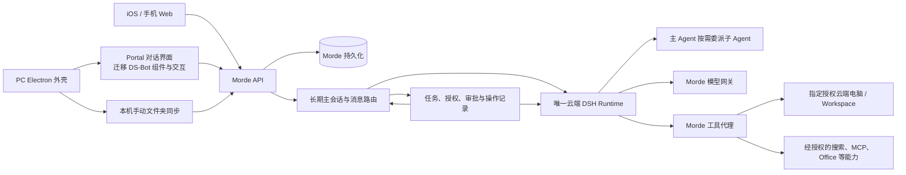

# Morde 与 DS-Bot 功能对比及迁移评估报告

> 调研与更新日期：2026-11-13。DS-Bot 本地检出为 `v0.3.6`，提交 `a66cc737cfb6c3d8a2597e748cded6cab1206dd3`；Morde 参考当前工作区，HEAD 为 `4d7444cd465c`。本报告通过源码、项目文档和仓库截图分析，没有启动两个产品进行实测。功能“有代码”不等于已在真实环境验收。

## 一、结论

**建议以 Morde 为基础，移植 DS-Bot 中有价值的前端组件、交互和部分后端能力。** Morde 对标 Muse 的个人 Agent 体验：用户主要与一个长期的主 Agent 对话，主 Agent 根据需要使用工具、协调任务和委派子 Agent，最终向用户汇总实际结果。PC 对话界面可以较大幅度向 DS-Bot 靠拢，云端账号、会话、任务、授权、模型网关、云端电脑和持久化继续由 Morde 负责。

本报告的产品边界是：**不移植 DS-Bot 的 Bot 群聊、Bot 团队、多个可独立聊天的 Bot、IM 或本地 Agent CLI。** Morde 以主会话为持续交流入口；已有多会话和旁聊仍遵循项目第一里程碑要求，不用把子 Agent 做成侧栏里的独立聊天对象。

这不意味着只能借鉴样式：DS-Bot 是开源的，其部分 React 组件、布局计算、交互逻辑、Office 处理代码可以作为实际代码移植对象。但大部分组件使用 DS-Bot 的会话、状态和 API，接入 Morde 时需要改造。**同样使用 DSH，不代表整个 DS-Bot 插件可以直接装进 Morde 就获得已授权、可恢复的云端功能。**

DS-Bot 最值得 Morde 吸收的是：

1. **以对话为中心的 PC 工作界面**：突出主会话、简洁的消息区、右侧任务/电脑详情、紧凑输入框和一致的视觉动效。
2. **工作过程的可见性**：主 Agent 和子任务当前在做什么、哪些工作在等待、卡片需要什么操作、结果来自哪里；接 Morde 的真实任务事件。
3. **长期使用体验**：对话搜索、记忆来源与变更历史、记忆恢复、定时任务和用量的就近展示。
4. **有实际产出的能力**：Office 文件创建、编辑、检查和渲染，以及对话内表格、图表、选择和表单。
5. **浏览器和电脑的人机交接体验**：以清晰的卡片、状态提示和接管入口包装 Morde 已有的远端能力。

Morde 已有长期主会话、消息路由、DSH 子会话派发、后台结果回收和任务过程展示的一版实现。DS-Bot 的长期对话、派活、结果回传和异常恢复可以用来检查并优化这些实现；这些是对现有主 Agent/子 Agent 链路的完善，不需要新增长期 Bot 身份或 Bot 间聊天产品。

## 二、两种迁移方向怎么选

| 方向 | 做法 | 优点 | 主要成本与风险 | 建议 |
| --- | --- | --- | --- | --- |
| 方案 1A：以 DS-Bot 的 PC 界面为壳，接入 Morde 后端 | 改造 DS-Bot 主对话相关 React 界面，将会话、任务、审批、文件和电脑操作映射到 Morde API | 更容易追求与 DS-Bot 接近的界面，早期能快速做出视觉原型 | DS-Bot 页面依赖 DSH UI 插槽、会话投影、`/api/bot` 和 Bot/群组数据；Morde 的多会话、任务、设备、项目、iOS 状态需要逐项适配 | **可做局部原型**。仅使用主对话所需部分，若能保持完整 Morde 功能且维护成本有证据更低，可作为 PC 对话界面的实现选择 |
| 方案 1B：以 DS-Bot 全栈为主，把 Morde 功能迁进去 | 使用 DS-Bot 的 Electron、DSH 插件和本机团队存储，再加入 Morde 的服务端、云端电脑、账号和跨端能力 | 前期保留更多 DS-Bot 现成代码 | 需要剔除不需要的产品功能，并重做或桥接云端多用户数据、任务调度、授权、检查点、断线恢复、模型网关、iOS 和工作区 | **不建议作为 Morde 主线** |
| 方案 2：以 Morde 为主，迁移 DS-Bot 功能 | 保留 Morde 服务和 PC 外壳，在 Portal 对话页迁移 DS-Bot 的视觉、组件和有价值的能力 | 与 Muse 式主 Agent 体验、PC/iOS 共用的后端、现有授权和第一里程碑目标一致；可按功能分批上线 | 界面组件需要解绑 DS-Bot 状态；记忆历史、Office 产物等能力仍需检查或补齐后端 | **推荐** |

方案 2 也可以做出很像 DS-Bot 的 PC 体验，不应把它理解成只改配色。Morde PC 登录后展示的是 Portal 页面；改善 [Portal 对话页](../web/portal/src/routes/Assistant.tsx) 就会直接改善 PC 的主要工作区。桌面专属的目录选择和同步仍由 [Morde Electron 客户端](../clients/desktop/harness/desktop/MORDE.md)承载。

如果希望尽量保留 DS-Bot 的页面观感，可先做一个**不接真实生产数据的对话界面原型**：接入 Morde 的主会话、历史、发送、任务事件和审批；然后验证 PC 关闭重连、iOS 接续、目标电脑选择和同步入口。只有这几个场景都能保持正确，才有依据决定是否将 DS-Bot 页面作为 Morde PC 对话壳。

## 三、两边的基础架构差异

| 方面 | DS-Bot v0.3.6 | 当前 Morde |
| --- | --- | --- |
| 产品重心 | 本机长期 Bot 团队；独立 Electron 应用或 DSH 插件 | 多端使用云端 Agent、云端电脑和工作区的平台 |
| Agent | Bot 和群成员使用 DSH Session；Bot 可互相发消息和派活，也处理 DSH 子 Agent 结果 | 云端主 Agent 和子 Agent 使用 DSH；任务由服务端协调、记录和恢复 |
| 数据 | 桌面版主要保存在本机 `DSH_HOME`；团队状态使用 `state.json`，另有群组 ledger、会话和记忆文件 | 服务端使用 PostgreSQL 等持久化会话、任务、授权和业务数据；Workspace 与 Host 生命周期分离 |
| PC | Electron + DSH Web 插件界面，包含本机浏览器、电脑操控等 | Electron 外壳 + Portal，另有本机目录同步和云端 Workbench |
| 手机 | Android 手机应用已有 beta 版本，通过加密中继连接运行中的电脑；仓库有 iOS 代码，不能仅凭代码断言 iOS 发布或验收状态 | iOS 原生工程和手机 Web 对接 Morde 服务；跨端完整体验仍待验收 |
| 电脑和浏览器 | 主要操作用户授权的本机应用；每个 Bot 可有独立浏览器 profile | 面向指定的已授权云端 Host；已有按任务隔离的浏览器上下文和接管工具代码 |
| 运行条件 | 桌面版的任务依赖该电脑上的 DS-Bot 运行；另有 Docker 形态 | 目标是已受理云端任务不依赖 PC/iOS 保持打开 |

依据：[DS-Bot 插件入口](../project/DS-Bot/ds-bot/index.js)、[DS-Bot 团队存储](../project/DS-Bot/ds-bot/src/host/store.js)、[DS-Bot Android 版本说明](../project/DS-Bot/CHANGELOG.md)、[手机连接实现](../project/DS-Bot/mobile/src/connection.ts)、[Morde 架构及当前状态](../README.md)、[Morde 浏览器控制器](../runtime/morde-runtime/runtimebrowser/handler.go)。

Muse 的参照重点是个人主对话、长期上下文、执行中继续交流、按需委派、可接管的云端电脑和真实结果交付。可参考本仓库的 [Muse 总览](muse_docs/00-README-总览.md)、[对话与记忆](muse_docs/03-对话-记忆-目标系统.md)和[工具与子 Agent](muse_docs/06-工具执行-子Agent-浏览器.md)；这些资料本身说明了已观察行为、推测和未公开内容的区别。Morde 的具体边界以当前用户要求和 [第一里程碑约定](../AGENTS.md)为准。

两边版本有一个积极条件：DS-Bot 桌面应用固定 DSH `0.2.2-rc.1`，Morde 云端 Runtime 的核心 DSH 依赖也是 `0.2.2-rc.1`。但它们加载的服务集合不同：DS-Bot 插件要求 `sessionController`、`workspaceRegistry`、`connection` 等服务；Morde 当前加载的是服务端专用的 DSH 组件和持久化适配。版本一致只能说明值得尝试，**不能证明插件依赖、状态语义和授权已经兼容**。参见 [DS-Bot 依赖](../project/DS-Bot/app/package.json)、[DS-Bot 插件注入](../project/DS-Bot/ds-bot/index.js)、[Morde 依赖](../runtime/morde-cloud-runtime/package.json) 和 [Morde Runtime 加载](../runtime/morde-cloud-runtime/src/engine.mjs)。

## 四、功能对比：哪些有价值

下表中的“已有”指找到实现或接口，不代表当前部署已经启用或完成真实场景验收。“未发现”仅表示本次调研未发现对应的完整产品入口，不代表仓库绝对没有相关代码。

| 功能 | DS-Bot 的表现 | Morde 当前基础 | 对 Morde 的价值与建议 |
| --- | --- | --- | --- |
| PC 对话界面 | 宽敞的对话区、顶部身份、右侧详情、紧凑输入框，视觉和动效较统一 | 已有主会话、旁聊、消息、任务和电脑侧栏，但页面更偏平台工作台 | **高**。迁移消息、布局和视觉组织，突出用户与主 Agent 的对话 |
| 长期主会话与历史 | 长期 Bot 对话有最近消息和历史定位 | 有主会话、旁聊、分页和预览；会话列表 API 支持标题查询 | **高**。强化主会话入口、历史定位和最近活动；继续使用 Morde 会话存储 |
| 进行中交互 | 工作时可继续接收用户消息 | 已有主会话、独立旁聊及追问/修改/状态/停止/独立任务的路由代码 | **高**。优先改善主会话内的消息关联和状态提示，验证新消息不会误停其他任务 |
| 主 Agent 与子 Agent | 有持续对话、工作委派、结果回传和恢复机制 | 已有主会话协调、DSH 子会话派发、后台结果回收及步骤展示代码；真实模型驱动的完整协作待验收 | **高**。对照 DS-Bot 优化现有派发、并行、回传、恢复及展示，不新增独立 Bot 聊天入口 |
| 工作进度与审批 | 工作状态、工具、问题、审批和浏览器接管以卡片及侧栏呈现 | 已有任务状态、主/子 Agent 步骤、审批、补充信息、暂停/停止和产物展示 | **高**。移植展示和交互，使用服务端真实事件；未知、失败、等待用户都要如实显示 |
| 长对话 | 按上下文情况生成检查点或开启新对话分段，旧内容可搜索；使用 SQLite FTS5 索引 | 已接 DSH 压缩及授权历史读取；原始消息保留，超窗口跨端场景待验收 | **高**。吸收搜索、定位和续聊体验；不要直接替换 Morde 已有压缩与检查点机制 |
| 长期记忆 | 记忆面板支持来源、摘要、自动整理、变更历史及撤销 | 已有个人记忆增删改、使用开关、授权和版本校验；项目对话与个人记忆隔离 | **高**。优先补来源、变更记录和恢复；自动整理须遵守 Morde 的授权和个人/项目边界 |
| 云端/本机浏览器 | 每个 Bot 的浏览器和登录状态，页面阅读、操作插件、用户接管 | 已有按任务隔离的云端浏览器、打开/观察/点击/输入/交接代码和电脑侧栏 | **高**。先增强可见性和接管体验；跨任务保留登录态属于后续能力，需明确账号、授权和生命周期 |
| 电脑操控 | 按 Bot 设本机应用与权限，顶部提示、暂停/接管；对同一应用或前台资源做互斥 | 已有云端 Host 操作、用户接管和控制栅栏代码；真实指定电脑场景待验收 | **高**。借鉴提示条和资源占用展示；本机进程内锁不能直接承担云端多任务的控制仲裁 |
| Office | 桌面版提供 Word、Excel、PowerPoint 的创建、检查、编辑及页面渲染 | 有 Office 附件的文本提取及手动文本预览；不应因此视为已具备完整 Office 编辑/渲染闭环 | **高**。优先评估 DSH Office 插件及 DS-Bot 的 Office 工具，在授权 Workspace 中生成可验证产物 |
| 图表和表单 | `show_view` 可展示表格、图表、选项、确认和表单；部分内容可交互 | 有 Markdown、审批和补充信息；本次未发现等价的通用 `show_view` 产品链路 | **中高**。先做受限的数据表、图表和选择表单，再视需要评估 HTML |
| 定时任务与目标 | 页面显示计划内容、状态和下次运行 | 已有目标/计划页面、Schedule API 和后台执行代码 | **中高**。优先把已有计划状态带回主会话和任务详情，不重复造本机调度器 |
| 连接器与技能 | 提供远程 MCP 和连接状态管理等入口 | 已有个人及共享模型配置、GitHub/Google Workspace/自定义 MCP 入口，以及按任务授权代码 | **中**。先改进配置和状态体验；确有需求再增加具体连接器，沿用 Morde 凭据和审批体系 |
| 用量 | 按时间和模型等维度展示 Token；README 明确说明不计算费用 | 已有管理侧模型用量、项目预算和账本等代码 | **中**。可增加用户自己的任务/会话/模型用量视图；费用须有可靠费率和实际结算依据 |
| 隐私和授权提示 | 提供记忆、文件和外部分享的授权提示 | 已有账号、个人数据、项目及任务授权边界 | **中**。吸收“范围清楚、分享要确认”的体验，继续使用 Morde 的授权和隔离 |

功能依据：[DS-Bot 功能说明](../project/DS-Bot/README.zh.md)、[DS-Bot 详细插件说明](../project/DS-Bot/ds-bot/README.md)、[Morde 对话页](../web/portal/src/routes/Assistant.tsx)、[记忆页](../web/portal/src/routes/PersonalData.tsx)、[目标与计划页](../web/portal/src/routes/GoalsAndSchedules.tsx)、[连接器页](../web/portal/src/routes/MCPConnectorsPanel.tsx)、[Office 预览接口](../server/openapi/portal.yaml)、[云端浏览器工具](../server/internal/app/runtime_tool_executor.go)。

## 五、PC 界面：具体哪些可以迁移

### 5.1 先看现有视觉

- [DS-Bot 主 Bot 对话截图](../project/DS-Bot/docs/images/team.zh.png)、[右侧详情截图](../project/DS-Bot/docs/images/details.zh.png)。截图中出现的其他 Bot 和群聊仅用于理解原布局，Morde 的目标页面不采用这些入口。
- [Morde PC 演示截图](../images/readme/pc-mock.png)：该图来自演示模式，显示的是模拟数据和较空的会话，不代表真实任务体验。

从这几张静态图和对应代码看，DS-Bot 的优势是对话占据视觉中心、身份与上下文集中在顶部和右侧、控件风格比较一致。Morde 已有三列结构和任务侧栏，弱点更偏**信息密度、层级和整体一致性**。这里的视觉判断带有主观性，且未做同等数据量、同窗口尺寸的交互对比。

Morde 的目标布局可按以下方式组织：

1. **左侧**突出一个长期主会话和必要的产品导航；保留现有多会话入口，不展示 Bot 团队或群聊。
2. **中间**显示用户与主 Agent 的持续对话；正在进行、等待用户、失败和完成等实际进展在相关消息附近可见。输入框始终面向主 Agent，用户可直接追问、修改或停止工作。
3. **右侧**按需展开当前任务、实际子任务、文件/产物和指定云端电脑；子 Agent 作为任务执行过程展示，而不是单独对话对象。
4. **主 Agent 负责结果**：子任务的派发、并行和结果回传发生在现有任务体系内，最终由主 Agent 汇总并在原会话交付。需要用户确认或接管时，在当前工作附近给出入口。

### 5.2 迁移等级

| 等级 | 含义 |
| --- | --- |
| A：低耦合代码 | 可作为源码复制候选，保留许可和署名后，按 Morde 的尺寸、样式或状态做少量调整；仍需检查依赖与行为 |
| B：组件可复用 | 可以复用 React 组件和样式的较大部分，但必须替换数据、事件、文案或状态接口 |
| C：按功能重接 | 原代码与 DSH 服务、本机文件、Electron 或 DS-Bot 数据模型紧耦合；借用设计或局部逻辑，通过 Morde 接口重新接通 |

“A”不承诺零修改或无需测试；“B”也不是把文件复制进来就完成。两个项目使用相近的 React/Vite 技术栈，便于组件移植，但 DS-Bot 的界面入口依赖 DSH 的 `sessions`、`slots`、`layout` 等注入，客户端请求使用 `/api/bot`，和 Morde Portal API 不同。参见 [DS-Bot UI 入口](../project/DS-Bot/ds-bot/src/client/index.js) 和 [请求封装](../project/DS-Bot/ds-bot/src/client/api.js)。

| 移植对象 | DS-Bot 源码 | Morde 落点 | 等级及具体工作 |
| --- | --- | --- | --- |
| 三列布局与侧栏宽度计算 | [frame-layout.js](../project/DS-Bot/ds-bot/src/client/frame-layout.js)、[right-panel.js](../project/DS-Bot/ds-bot/src/client/right-panel.js) | [PortalLayout.tsx](../web/portal/src/components/PortalLayout.tsx)、[Assistant.tsx](../web/portal/src/routes/Assistant.tsx)、[AssistantSidebar.css](../web/portal/src/routes/AssistantSidebar.css) | **A/B**。`frameLayout` 等纯布局计算可复用；适配 Morde 的导航、最小宽度、存储键与右侧电脑面板 |
| 主题、颜色、圆角和动效 | [UI 规范](../project/DS-Bot/docs/design/ui-standard.md)、[themes.js](../project/DS-Bot/ds-bot/src/client/themes.js)、[motion.js](../project/DS-Bot/ds-bot/src/client/motion.js)、[styles.js](../project/DS-Bot/ds-bot/src/client/styles.js) | Portal 样式与组件 | **A/B**。可移植部分变量、弹簧/减少动效处理及组件样式；需改选择器、主题变量和 Morde 标识，避免全局 CSS 冲突 |
| 消息和输入体验 | [cells.js](../project/DS-Bot/ds-bot/src/client/cells.js)、[composer.js](../project/DS-Bot/ds-bot/src/client/composer.js)、[enter-key.js](../project/DS-Bot/ds-bot/src/client/enter-key.js) | Assistant 和 [ChatMarkdown](../web/portal/src/components/ChatMarkdown.tsx) | **A/B**。输入键规则、长消息和工具卡样式可以迁移；发送、附件、输入法和流式状态接 Morde 数据 |
| 排队消息与子任务状态 | [queue-dock.js](../project/DS-Bot/ds-bot/src/client/queue-dock.js)、[member-status.js](../project/DS-Bot/ds-bot/src/client/member-status.js) | Assistant 的消息发件箱和任务详情 | **B/C**。借用卡片和状态展示，替换 DSH projection/roster 为 Morde 消息与任务事件；仅显示实际任务和子 Agent |
| 审批、提问、交接卡 | [questions.js](../project/DS-Bot/ds-bot/src/client/questions.js)、[handoff-card.js](../project/DS-Bot/ds-bot/src/client/handoff-card.js)、[computer.js](../project/DS-Bot/ds-bot/src/client/computer.js) | Assistant 中的待审批、补充信息与云端电脑区域 | **B**。保留 Morde 任务、请求版本和幂等键；交接卡指向当前授权 Host |
| 记忆面板 | [memory-panel.js](../project/DS-Bot/ds-bot/src/client/memory-panel.js) | PersonalData 与 Assistant 详情面板 | **B/C**。列表、历史、撤销的 UI 可复用；历史记录和恢复需要 Morde 后端提供对应能力 |
| 对话内图表/表单 | [widget-cell.js](../project/DS-Bot/ds-bot/src/client/widget-cell.js)、`deep-view` | Assistant 的消息渲染 | **B/C**。先确认依赖许可和数据协议，增加 Morde 持久化及回答接口；HTML 内容需要隔离处理 |
| 独立浏览器面板 | [browser-pane.js](../project/DS-Bot/ds-bot/src/client/browser-pane.js)、[bot-browsers.js](../project/DS-Bot/ds-bot/src/client/bot-browsers.js) | Assistant 电脑侧栏与 Workbench | **C**。DS-Bot 绑定本机 Electron 浏览器视图；Morde 需要显示所选云端 Host 的浏览器和接管状态 |

建议首批采用 DS-Bot 的布局节奏、消息和卡片样式，以及右侧面板的组织方式，同时保留 Morde 品牌、中文文案、云端电脑和现有功能入口。界面采用 Muse 式个人主 Agent 的信息结构。

## 六、后端如何移植

| DS-Bot 后端对象 | 可复用程度 | 接入 Morde 的必要工作 |
| --- | --- | --- |
| [memory-search.js](../project/DS-Bot/ds-bot/src/host/memory-search.js) 等记忆匹配逻辑 | **A/B**：排序和匹配代码可单独评估复用 | 输入须先由 Morde 过滤出当前任务有权读取的记忆；适配 Morde 的记录格式，不沿用团队 Markdown 存储 |
| [Office CLI](../project/DS-Bot/ds-bot/src/office/cli.js) 和格式处理模块 | **B**：可复用部分原始文件处理代码 | 配齐 Node 与依赖，在授权的执行环境运行，通过 Morde 文件和产物链路交付；按格式分别验证 |
| [web-search.js](../project/DS-Bot/ds-bot/web-search.js) | **B/C**：它是独立 DSH 搜索插件，但不是 Morde 即插即用的搜索实现 | 它会使用 DSH 当前模型路由和自己的搜索回退；必须适配 Morde 模型网关、出站和工具授权，且先比较已有搜索链路 |
| [派发与投递](../project/DS-Bot/ds-bot/src/host/delivery.js)、[结果回传](../project/DS-Bot/ds-bot/src/host/handoffs.js)、[恢复](../project/DS-Bot/ds-bot/src/host/resume.js) | **C**：结果完整性、投递与恢复行为可作为现有实现的对照 | 对照 Morde 已有子会话、任务和数据库；沿用其事务、幂等、权限、取消与恢复，不引入 DS-Bot 的独立 Bot 和聊天模型 |
| [会话索引](../project/DS-Bot/ds-bot/src/host/chat-index.js) | **C**：历史定位和匹配算法可参考 | Morde 用自身授权消息数据实现搜索；不能把本机 SQLite 文件直接当云端事实 |
| [电脑租约](../project/DS-Bot/ds-bot/src/host/computer/leases.js)、[浏览器插件](../project/DS-Bot/browser-plugins/README.md) | **C**：本机资源管理和工具设计可参考 | 与 Morde Host 控制栅栏及按任务授权接合；不能直接复用单进程锁处理分布式云端控制 |
| [ds-bot 整体插件](../project/DS-Bot/ds-bot/index.js) | **C**：它与 Morde 使用相同 DSH 版本，但包含不在本次范围内的功能 | 不作为整体迁移对象；若复用其中的单一模块，需检查服务依赖并对接模型、工具、存储和用户隔离 |

### 6.1 长期主 Agent 与子 Agent：已有基础及优化点

Morde 面向用户的主 Agent 是一个持续对话和交付结果的产品身份，不要求内部始终有同一个常驻进程。当前代码为持久消息路由运行隔离的 DSH 协调回合；执行任务时有相应的 DSH 执行上下文和子会话。不要把“不同执行上下文”误判成需要创建多个长期 Bot。依据：[主会话与任务页面](../web/portal/src/routes/Assistant.tsx)、[消息路由](../server/internal/app/conversation_route_decision.go)和[会话协调器](../server/internal/worker/cloud_dsh_coordinator.go)。

| 已有实现 | 源码证据 | 对照 DS-Bot 的优化重点 |
| --- | --- | --- |
| 主会话与消息关系 | [Assistant.tsx](../web/portal/src/routes/Assistant.tsx)读取主会话、消息和任务；[消息路由](../server/internal/app/conversation_route_decision.go)区分回复、追问、更新、状态、停止、独立任务及需澄清的情况 | 参考执行中插话的交互，让用户看到新消息属于哪个任务、是否已受理以及何时需要澄清；不要因同一话题就错误合并任务 |
| 子 Agent 派发 | [engine.mjs](../runtime/morde-cloud-runtime/src/engine.mjs)定义 `dsh_delegate`、后台任务工具及子会话授权检查 | 优化任务说明、允许工具范围和资源冲突判断；有依赖时衔接结果，无冲突时允许并行 |
| 子任务结果与恢复 | [cloud_dsh_session_tree.go](../server/internal/worker/cloud_dsh_session_tree.go)处理子会话创建、检查点、结果落定与后台输出续读 | 参考 DS-Bot 的 [handoffs.js](../project/DS-Bot/ds-bot/src/host/handoffs.js) 和 [resume.js](../project/DS-Bot/ds-bot/src/host/resume.js)，核对长结果完整性、迟到结果、异常中断及结果未知的处理 |
| 工作过程呈现 | [Assistant.tsx](../web/portal/src/routes/Assistant.tsx)按主/子 Agent 及步骤组织任务活动，并提供审批、任务控制和产物入口 | 参考 DS-Bot 的状态卡片，把实际子任务、当前动作、等待原因及结果呈现在原会话或任务侧栏 |

以上是当前代码中可见的基础能力；本次没有执行端到端测试，不能据此声称真实模型、PC/iOS、并行及重启恢复都已验收。DS-Bot 的 [delivery.js](../project/DS-Bot/ds-bot/src/host/delivery.js)和本机状态文件体现的是另一套运行环境；应对照其行为检查缺口，而不是复制为第二套 Morde 状态或运行时。

优先验证和完善以下场景：

1. 用户在主会话提出较复杂的工作，主 Agent 将两个互不冲突的子任务并行派出；有依赖的子任务等待所需结果。
2. 子任务的完整结果和失败原因回到发起它的主 Agent；主 Agent 检查后在原会话汇总，已派发不等于已完成。
3. 工作期间用户追问、修改、提出独立任务或停止指定任务，系统关联正确；取消一个任务不误停其他任务。
4. PC 关闭、网络断开或运行环境重启后，已受理工作和结果可恢复查看；重复消息或重试不会重复执行已确认完成的操作。
5. 电脑或工作区被占用、授权失效、结果未知或子任务失败时，显示真实等待/失败状态；不同账号和会话的数据保持隔离。

### 6.2 长对话、搜索和记忆

DS-Bot 的 [chat-index.js](../project/DS-Bot/ds-bot/src/host/chat-index.js)为本机会话分段建立 SQLite FTS5 索引，并保留结果附近的上下文；其 [记忆实现](../project/DS-Bot/ds-bot/src/host/memory.js)使用本机 Markdown 并记录变更历史。Morde 已有 [个人记忆开关和编辑](../web/portal/src/routes/PersonalData.tsx)以及[授权和版本校验](../server/internal/app/cloud_dsh_personal_data.go)。

建议先将 Morde 已有的会话标题查询接入 PC 搜索框；如果需要搜索消息正文，再为 Morde 的授权消息数据建立服务端索引，支持结果定位、权限变化和删除后的清理。不能直接让多用户云服务读取 DS-Bot 的本机 SQLite 文件。

记忆优先增加“这条记忆来自哪里、何时修改、谁修改、恢复哪一版”。自动记忆整理可借鉴 DS-Bot，但 Morde 当前工具要求只保存用户授权的记忆；个人、项目、会话的使用范围、敏感信息过滤以及修改冲突都要继续执行现有规则。DS-Bot 对 Bot 长对话采用自己的分段/检查点策略，并说明不运行 DSH 常规自动压缩；Morde 已接入 DSH 压缩和恢复，不能把这两套策略同时无条件开启。

### 6.3 Office 与对话内结果

这是最有价值的新增能力之一：用户让 Agent 处理报告、表格或演示文稿时，Morde 可以返回真正可打开的文件，而不只返回一段文本。

- 先评估上游 [DSH Office 插件](../project/deepseek-harness/packages/skill/skill-office/package.json)：当前本地上游包版本为 `0.2.2-rc.1`，声明 MIT；它是技能提供方，仍需要配套文件工具和运行环境。
- 再评估 DS-Bot 的 [Office 技能注册](../project/DS-Bot/ds-bot/src/host/office-skills.js)与 [Office CLI](../project/DS-Bot/ds-bot/src/office/cli.js)。后者提供 OOXML 检查及部分格式的读取、编辑操作，可作为具体代码复用候选；完整从零创建及渲染还依赖相应运行环境，不能只复制 CLI 就声称全部 Office 功能已接通。
- 所有输入、命令执行、输出和预览都应走 Morde 已授权的任务与 Workspace；产物以 Morde 的文件记录和校验结果交付，PC/iOS 可查看同一结果。
- 表格、图表、选择表单可评估 DS-Bot 的 [deep-view 接入](../project/DS-Bot/ds-bot/src/client/widget-cell.js)。先支持有明确结构的数据，确认来源、体积、回答状态和重连恢复；若启用模型生成的 HTML，还要单独验证隔离、消息通信和脚本权限。

### 6.4 浏览器、电脑与连接器

Morde 已有 [浏览器工具](../server/internal/app/runtime_tool_executor.go)和[按任务隔离的浏览器上下文](../runtime/morde-runtime/runtimebrowser/handler.go)，包括登录交接。DS-Bot 的长处是每 Bot 的浏览器资料、页面阅读、设置和交接入口。建议先移植界面与用户交接流程，再按需求设计云端持久登录态；不要未经授权导入本机 Cookie，也不要把本机 Electron 浏览器当成指定云端电脑。

DS-Bot 的 [电脑租约](../project/DS-Bot/ds-bot/src/host/computer/leases.js)明确是单进程内存状态，适合其本机 Bot 的资源互斥。Morde 的多任务、重启和远端 Host 需要使用现有控制栅栏、任务租约与操作账本，不能把该 Map 作为云端仲裁的最终依据。

连接器方面，可移植 DS-Bot 的配置卡、状态和接管流程；服务端仍使用 Morde 的[任务 MCP 授权](../server/internal/app/cloud_dsh_mcp.go)、凭据管理和调用记录。比如当前 GitHub 远程 MCP 代码有服务端只读工具白名单；引入 DS-Bot 的写能力并不自动改变这一限制。

## 七、Morde 相对薄弱的地方

1. **第一里程碑的整体验收还不够**。README 明确写明真实模型、指定电脑、PC/iOS 跨端及文件数据面尚未完成整体验收；部署示例中的 `cloud_dsh.enabled` 和 `project_upload_enabled` 默认关闭。界面做漂亮不能替代这条闭环。参见 [README](../README.md) 和 [部署配置](../deploy/single/portal.yaml)。
2. **PC 对话体验还不够集中**。当前已有任务、文件和电脑侧栏，但 DS-Bot 更强调对话主体、上下文和轻量卡片；Morde 页面可以进一步减少跳转并统一视觉语言。
3. **主 Agent 连续交互与委派的整体验收仍不足**。Morde 已有主会话、消息分流、子会话派发和后台结果回收代码；仍需用真实模型和多端场景检验持续对话、并行结果回传、插话以及中断恢复是否组成稳定闭环。DS-Bot 的派活和恢复机制可作为对照。
4. **记忆的可解释性有提升空间**。已有开关与编辑，但当前记忆页主要展示内容和分类；DS-Bot 在来源、变更历史、撤销、分层方面提供了更完整的管理体验。
5. **Office 交付能力需要形成闭环**。当前可对 Office 内容做受限的文本提取和预览；与 DS-Bot 桌面版的创建、编辑、检查、渲染体验相比，Morde 还需要明确运行环境、文件生成、预览和产物交付。
6. **子任务和操作过程可以更直观**。Morde 已有状态、步骤和审批代码，但可以借鉴 DS-Bot 的状态与就地卡片，让用户更快看懂当前工作、为何等待以及如何接管。
7. **面向用户的使用反馈可以更完整**。例如按会话定位历史、看到记忆何时变化，以及在对应任务附近查看计划和可核对用量。是否已有部分后台数据，不等于用户端已经形成完整体验。

这些是基于仓库现状的产品与实现判断，**不是基于双方线上用户规模、性能或稳定性的实测排名**。Morde 的基础在云端持久任务、多账号、授权电脑、跨端目标和工作区；DS-Bot 有较完整的本机对话界面，以及可供参考的工作派发、状态展示和恢复机制。

## 八、建议优先级与验收

| 顺序 | 项目 | 给用户带来的具体价值 | 主要改动 | 通过条件 |
| --- | --- | --- | --- | --- |
| P0 | 收口第一里程碑 | PC/iOS 能可靠继续同一工作，文件能按用户点击同步到指定电脑 | 沿用现有 Morde 服务、DSH、Host 和同步链路；用 DS-Bot 交互提升状态展示 | 完成 [AGENTS.md](../AGENTS.md) 的跨端、长会话、指定电脑、并行子 Agent 和手动单向同步验收 |
| P0 | PC 对话界面迁移 | 围绕一个长期主 Agent 对话，更容易看懂工作和完成审批 | 迁移布局、消息、输入、右侧面板和视觉；连接现有 Portal API | 有数据、空状态、窄窗口、键盘和减少动效均可用；重连后显示真实状态，原有电脑和同步入口可达 |
| P0/P1 | 优化现有主/子 Agent 委派与回传 | 主 Agent 可协调并行工作，并把实际结果带回原对话 | P0 完成第一里程碑所需验收和缺陷修复；P1 再对照 DS-Bot 优化结果完整性、恢复与体验 | 至少两个独立子任务真实并行；结果正确归属；插话、停止、重启与跨端查看不混淆、不重复执行 |
| P1 | 真实任务活动与对话内卡片 | 看到当前工作、子任务、失败或等待确认 | 复用 DS-Bot 状态/卡片组件，映射 Morde 任务事件 | 任务和子 Agent 归属准确；审批、停止、恢复和结果在刷新/跨端后保持一致 |
| P1 | 会话搜索与记忆管理 | 找回旧要求，知道 AI 记住了什么并能纠正 | 先接标题搜索；按需补正文索引、来源和变更历史 | 搜索只返回当前授权内容；撤权/删除后不泄露；恢复时处理并发修改 |
| P1/P2 | Office 产物 | 能直接获得并检查 Word、Excel、PPT | 优先评估 DSH Office 与 DS-Bot Office 代码，接入授权 Workspace 和产物 | 实际创建、修改、打开和检查样例；错误或缺少渲染环境时如实提示 |
| P2 | 对话内图表和表单 | 减少用户在回复与外部表单间切换 | 评估 deep-view 和 Morde 消息/回答协议 | 重连后卡片和答案一致；无权用户不能读取；不支持内容明确降级 |
| P2/P3 | 浏览器持久资料 | 降低重复登录成本，方便接管和交还云端浏览器 | 在确有需求时设计资料生命周期，接 Morde 现有授权和操作记录 | 明确账号、目标、授权、撤销与失败状态；保留任务隔离和用户接管 |

优先级是相对顺序，不是工期承诺。P0 中视觉改造可与闭环收口协同，但不能让未验收的操作看起来已经完成。

## 九、推荐的目标结构

图中“长期”指用户可持续对话及其状态被持久保存；协调回合、任务和子 Agent 可以使用各自的执行上下文。子 Agent 的实际结果经现有任务链路回到主 Agent，最终交付到相应会话。

上游 DSH 已提供可供评估的 [Office](../project/deepseek-harness/packages/skill/skill-office/package.json)、[浏览器 MCP](../project/deepseek-harness/packages/experimental/browser-use-playwright-mcp/package.json)、[子 Agent](../project/deepseek-harness/packages/subagent/subagent-spawn-in-process/package.json)、[会话查询](../project/deepseek-harness/packages/session-query/session-query-sqlite/package.json) 和 [调度](../project/deepseek-harness/packages/schedule/schedule/package.json) 插件。是否接入应逐项检查其服务依赖、版本和授权适配；Morde 已有相应可靠链路时优先沿用，不能因为插件存在就认定功能已经完成。

## 十、许可与迁移边界

- DS-Bot 的 [package.json](../project/DS-Bot/ds-bot/package.json)声明 Apache-2.0，仓库有 [LICENSE](../project/DS-Bot/LICENSE) 和 [NOTICE](../project/DS-Bot/NOTICE)。复制代码时应按许可证保留版权、许可、NOTICE 和修改说明，并逐项核查所带第三方依赖、字体、图片和品牌素材的许可；这份报告不是法律意见。
- 不直接引入 DS-Bot 的本机 `state.json`、本机密钥文件、独立模型配置或 Docker 默认授权作为 Morde 云端事实来源。DS-Bot 自己的[安全模型](../project/DS-Bot/SECURITY_MODEL.md)也描述了其本机信任边界以及 Docker 内全权限的设计；这些边界和 Morde 的多用户授权并不相同。
- 如实际加载 `ds-bot` 或其他插件，应固定兼容版本、核对新增依赖和许可，并验证 Morde 的用户/会话/任务隔离、模型网关、工具代理、审计、产物、检查点、取消与恢复。插件安装或 UI 渲染成功不代表功能已接通。
- 本次只形成迁移评估，未修改 DS-Bot 或 Morde 功能代码，也没有运行两套产品的端到端测试。实际投入和复用比例应以第一批界面原型、依赖检查和集成验收结果为准。
