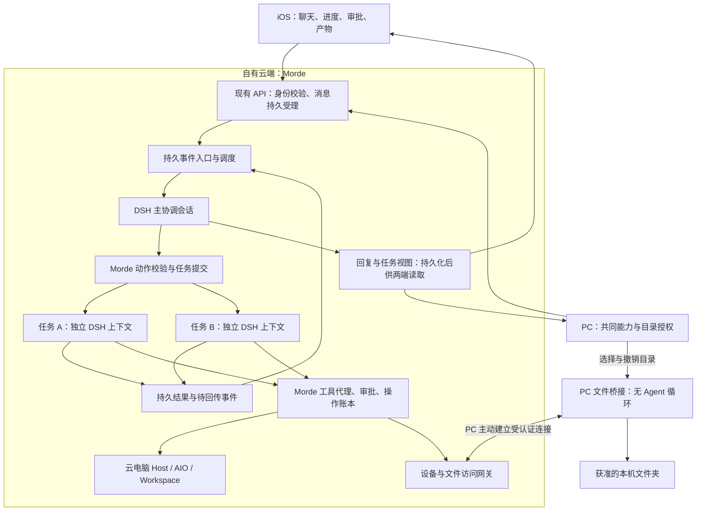
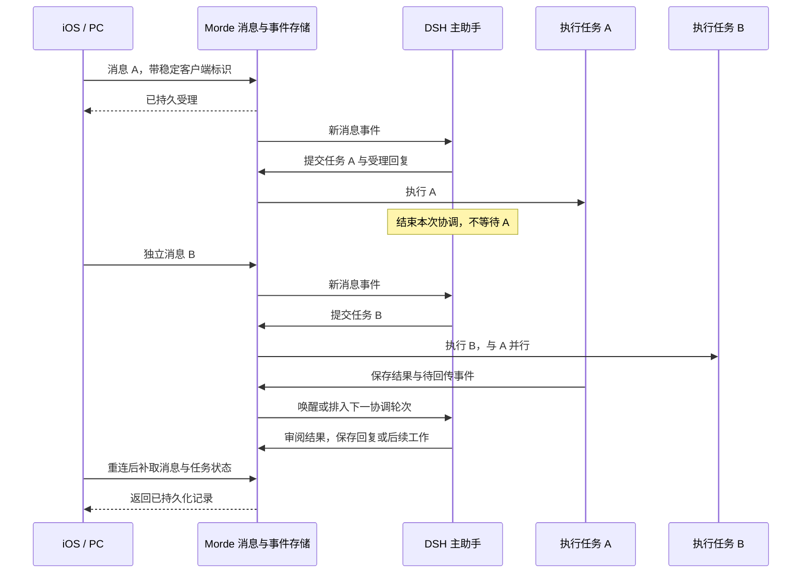

# Morde 个人 Muse 需求与架构设计方案

日期：2026-11-09。状态：需求与目标架构；本轮只保存文档，未启动开发或部署。

本方案依据用户确认的三项要求：云端持续执行、主 Agent 协调连续消息和并发任务、iOS/PC 客户端及 PC 授权文件夹读取。先服务于用户自己的日常使用，再考虑开放给其他用户。用户提供的示意图用于表达期望行为，不作为 Meta Muse 私有实现已被验证的证据。

现状依据本机 Morde `273d300`、morde-muse `44ccf52f4` 工作区的静态检查。下文“已有实现”只表示找到对应代码，不表示本轮运行通过；历史验证记录和测试文件不能代替当前版本的完整验收。

## 1. 产品主线与范围

- **Morde 是唯一产品主线。** `server/` 管理账号、会话、任务、审批、设备授权和产物；数据以 Morde 服务端为权威。
- **DSH 是唯一 Agent Runtime。** 主 Agent、任务执行 Agent 和子 Agent 都使用 DSH 的会话与执行机制，模型经 Morde 模型网关接入，不另外实现模型/工具循环。
- **iOS 与 PC 都属于第一版。** 沿用 `clients/nanoMuse/` 和 `clients/desktop/` 中的工程，在现有客户端内完成链路，不再维护第二套同类产品。PC 额外提供本机目录授权和文件桥接。
- **morde-muse [Desktop/morde-muse]是参考项目。** 学习交互、委派回执、结果回传和电脑授权方式，不把它的完整服务端、账号系统或 Runtime 并入正式运行链路，不新建完整的 `morde-clode`。
- 第一版聚焦聊天、后台任务、并发协调、云电脑、产物、审批和 PC 按需读取。既有功能和数据保留；动态、点子、完整 Space、连接器商城、实时语音、商业计费及 Android 不成为本次交付前置条件。

第一版建议将 PC 文件能力限制为**按需只读**。写回、整目录同步、离线资料镜像是后续独立能力；这个范围取舍是本方案建议，不代表用户已经授权传输任何真实文件。

### 与已有文档的关系

本文是本轮三项需求的统一入口。以下冲突按本文目标收敛，未覆盖的既有产品能力和数据规则继续保留：

| 已有材料 | 本轮处理 |
| --- | --- |
| [云端 Runtime 统一化需求](Morde云端Agent运行时统一化需求文档.md)、[对话体验需求](<Morde AI助手对话与任务执行体验需求文档.md>) | 保留云端执行、会话隔离、连续发送、修订和并发规则；补主协调会话、结果回传及 PC 文件闭环。 |
| [对话体验设计](<Morde AI助手对话与任务执行体验设计方案.md>) | 其分类器、任务修订和结果分组是现有设计基础；“主 Agent 协调”不能仅以分类器加文本拼接视为完成。历史现状以当前代码重新核对。 |
| [客户端合并需求](nanoMuse客户端与Morde服务端合并需求文档.md)、[融合架构](nanoMuse客户端与Morde服务端融合技术架构设计方案.md) | 沿用单一产品、客户端归属和服务端权威；本轮不以全部历史融合清单完成为前置，也不恢复客户端本机 Agent 循环。 |
| [Meta Muse 能力对齐资料](Meta-Muse能力对齐与Morde开源复用方案.md) | 保留为更广范围的参考；其中调研日的缺口描述不能当作当前完成状态。 |
| morde-muse 中以其为主项目、新建 morde-clode、仅先做 PC/Web 的规划 | 不作为本轮实施依据；保留文件作为历史参考，不执行其整体迁移路线。 |

本文不宣称新接口已经存在。实施时，HTTP 契约仍统一登记到 [OpenAPI](../server/openapi/portal.yaml)，跨模块合同和架构决策同步登记到[公共约定](实施/00-总览与公共约定.md)，不另建相互竞争的协议或状态枚举。

## 2. 需求与业务规则

### R1：任务在云端持续运行

1. 用户在 iOS 或 PC 发消息；服务端持久受理后，消息和任务不依赖该客户端连接存活。关闭 App、锁屏、断网或关闭 PC 不等于取消已受理任务。
2. 客户端本地待发送、服务端已受理、Agent 正在处理、任务完成是不同状态。响应丢失后以原消息标识对账，不重复建消息或任务。
3. 主/子 Agent、调度、检查点及工具执行记录位于自有云端；客户端不代跑 Agent 循环。PC 文件桥接只执行获准的设备请求。
4. Runtime 与云电脑 Host 分离。纯问答不依赖 Host 在线；需要特定电脑、审批或 PC 文件时，相关步骤明确等待，其他独立任务继续。
5. 服务端重启后，从已持久化的任务、事件和检查点恢复。已确认完成的操作不重复执行；执行结果未知时先核对，不以“重试整段任务”代替恢复。

### R2：主助手持续接收消息并协调执行

用户面对同一个主助手，不必手动选择“新任务”或“追加任务”。主助手结合当前对话、相关历史、获准记忆和活动任务理解消息；工作繁忙时输入与发送仍可用。

| 收到的信息 | 目标行为 |
| --- | --- |
| 简单问题或短操作 | 主助手直接回答，或调用已有受控工具；不强制为所有问题委派子 Agent。 |
| 较长工作 | 创建持久任务并委派；确认受理或报告实际进展后让出协调轮次，继续接收新消息。 |
| 明确修改正在进行的任务 | 关联到该任务，按消息顺序保存修订；在安全节点停止旧执行并按新要求继续，保留已完成结果。 |
| 新的独立工作 | 使用独立任务与执行上下文，在并发上限内开始，不等待先前任务结束。 |
| 依赖其他结果的工作 | 保存前置任务及所需结果版本，满足条件后再执行；前置失败或取消时说明阻塞原因。 |
| 查询状态或停止某项工作 | 查询不打断执行；停止只作用于指定任务及其所属子任务，不停止主助手或其他任务。 |
| 关联对象不明确 | 消息照常保留，向用户简短澄清，不猜测或中断已有工作。 |
| 子任务结果、审批答复、已授权的定时触发 | 作为事件回到协调入口；主助手检查结果、继续依赖任务或回复用户。 |

话题相同不代表必须串行；话题不同也不代表可以同时修改同一个资源。独立研究可以并行，同一桌面输入、文件写入等冲突操作必须协调访问。

主助手不会因为派出了任务就反复调用模型询问“完成了吗”。运行时在结果就绪后回传事件；主助手空闲或进程重启不应丢失这次回传。进度、原始结果和主助手解释分别留存，不能把“已委派”显示为“已完成”。

### R3：子 Agent 有独立上下文与明确归属

- 每项用户工作有稳定 Task 标识；任务内可以再派子 Agent。跨用户任务、同一会话内的独立任务、一个任务内部的子任务分开记录，不混成一个共享上下文。
- 委派包含目标、相关上下文、可用工具、授权边界和完成条件。只传必要资料；子 Agent 不因继承上下文而获得额外目录、电脑或连接器权限。
- 主助手能够看见运行、等待输入、失败、取消和完成的实际状态。子 Agent 失败时说明影响范围，不把部分结果包装成整体成功。
- 任务修订后，旧版本的迟到结果不能覆盖新要求；停止后不能因结果回传、重复事件或自动恢复重新派发相同工作。
- 主助手可以根据结果补充工作，但次数、嵌套深度、模型预算和并发有界。第一版以主助手加一层执行 Agent 为基本路径，不以多级递归委派为前置。

### R4：iOS 与 PC 访问同一份云端状态

- 两端使用同一账号、会话、任务和审批记录。在任一端发起任务，另一端能接续查看、补充要求和处理审批；打开或刷新页面不会重新启动任务。
- 客户端展示可理解的进度及对应任务，不要求用户启动 Runtime。已有任务未结束时仍可连续发送；停止目标可明确辨认。
- 两端断连后按事件位置补取记录，并以服务端状态对账；审批在一端处理后，另一端更新，重复提交不重复执行。
- iOS 提供聊天、进度、审批、产物及获准云电脑的查看/接管入口；PC 提供这些共同能力，再增加目录授权、在线状态和访问记录。
- 云端任务继续运行与手机通知送达分别验收。第一版必须支持重连后看到结果；App 不在前台时的系统提醒通过 APNs 单独接入，推送不是任务调度或结果存储机制。

### R5：云端按授权读取 PC 文件夹

1. 用户在目标 PC 显式选择目录；客户端展示授权对象、只读范围和撤销入口。选择目录不自动同步全部内容，也不开放整台电脑。
2. PC 在线时，云端助手可在当前任务授权内列出目录并读取所需文件。iOS 可以发起该任务，文件仍由指定 PC 的桥接进程提供。
3. 请求以设备身份、目录授权标识和相对路径定位；PC 每次复核授权和实际目录边界，拒绝通过父目录、符号链接或替换目录身份越界。
4. 完整文件读取应包含普通文本以及本次场景所需的 PDF、办公文档等二进制文件。传输成功与文档解析成功分开反馈；不能用前 32 KiB 文本冒充完整文件，也不能保证所有格式都能解析。
5. PC 离线或休眠时，未取得的资料显示等待设备；其他云端任务继续。已有且仍获准使用的云端副本可继续处理，同时明确副本版本，不冒充 PC 最新内容。
6. 撤销授权后拒绝新的读取，并终止尚未完成的授权传输。撤销不等同于删除已经保存的云端副本或抹去已生成结果；副本保留和删除须可见、可控制。
7. 第一版按需只读，不自动写回、删除本机文件或执行本机命令。已有其他设备授权不能被当作本次目录授权的替代。

## 3. 现有能力：复用依据与待补齐内容

分类采用“已有实现可复用”“需适配或补齐”“仍需完整验收”，三者可以同时成立。下列是本轮检查到的具体路径，未据测试名称推断通过率。

| 能力 | Morde 现有证据 | 本轮复用与缺口 |
| --- | --- | --- |
| 消息持久受理与去重 | [受理实现](../server/internal/store/postgres/conversation_message_routing.go)保存消息、客户端标识、顺序和分流记录。 | 复用单一消息权威及幂等；核验两端连续发送、断网对账和新协调入口，避免另建消息库。 |
| 关联判断与任务修订 | [决策模型](../server/internal/app/conversation_route_decision.go)已有 update/new/status/stop/clarify；[修订实现](../server/internal/store/postgres/conversation_route_revisions.go)管理修订。 | 复用动作和修订提交机制；分类器不是完整主 Agent，需增加主协调上下文、结果事件处理和直接回复路径，并收敛为唯一决策入口。 |
| 云端会话与并发 | [Runtime 归属](../server/internal/app/account_agent_runtime.go)已校验会话、用户和执行租约；[Node 运行端](../runtime/morde-cloud-runtime/src/account-runtime.mjs)有独立任务进程与并发限制。 | 保留隔离和唯一执行者机制。文件名仍含 account 不能据此认定只有账号级隔离；实际以 ConversationID 等合同核验。补主协调会话与长任务生命周期分离的接线。 |
| 子 Agent 与恢复 | [DSH 引擎适配](../runtime/morde-cloud-runtime/src/engine.mjs)已有委派、后台 Job、取消及恢复；[检查点服务](../server/internal/app/agent_checkpoint.go)管理持久检查点。 | 复用现有 DSH；补并验证子结果持久回传、主会话唤醒和重复事件处理。当前父任务结束路径会等待后台 Job，不能据此宣称全局主助手已解耦。 |
| 结果展示 | [汇总存储](../server/internal/store/postgres/conversation_result_aggregation.go)会将邻近结果文本组合，[发布 Worker](../server/internal/worker/conversation_result_aggregation.go)有持久发布机制。 | 复用来源归属、分组和发布去重；补主助手检查结果、继续依赖工作及最终答复。保留子任务原始结果，避免旧发布器与新主助手重复发最终回复。 |
| 云电脑、工作区与受控工具 | [Host](../server/internal/app/host_create.go)、[Runtime 控制](../server/internal/app/runtime_control.go)、[操作账本](../server/internal/app/runtime_operation_ledger.go)、[Workspace](../server/internal/app/workspace.go)。 | 复用 Host/AIO/OpenSandbox、工作区及控制权边界；验证共享资源冲突、用户接管、任务停止和恢复，不新增第二套电脑平台。 |
| iOS 与 PC 工程 | [iOS 工程](../clients/nanoMuse/android/src/ios/Morde.xcodeproj/project.pbxproj)、[iOS 聊天接线](../clients/nanoMuse/android/src/ios/NanoMuse/NanoMuseChatGlue.swift)、[PC 入口](../clients/desktop/harness/desktop/src/morde-main.ts)。 | 沿用现有工程与客户端契约；补一致的任务归属、回传、文件等待及跨端更新。工程存在或内置 fixture 可展示，不代表真服务端已验收。 |
| PC 目录授权与小文件读取 | [PC 受控动作](../clients/desktop/harness/dsh-nanomuse/src/morde-hub-actions.ts)、[云端工具入口](../server/internal/app/hub_task_actions.go)、[Hub 协议](../server/internal/domain/hub/protocol.go)。 | 已有目录身份、授权版本及相对路径校验；当前受控 file.get 返回最多 32 KiB UTF-8 文本。需补完整二进制传输、快照一致性、离线等待和撤销后的传输处理。 |
| 文件传输与附件 | [消息附件](../server/internal/app/conversation_message_attachment.go)、[Workspace 传输](../server/internal/app/workspace_transfer.go)、[同步运行端](../runtime/morde-sync/README.md)。 | 复用分块、校验、限额及存储原语；按需取文件不以双向同步为前置，不直接借用其他上传场景的权限。 |
| 模型、记忆、审批和计划 | [模型与任务契约](../server/openapi/portal.yaml)、[现有 Runtime 设计](Morde-Agent-Runtime与AI能力设计方案.md)。 | 保留网关、审批与获准个人上下文；核验实际接线。已有计划的触发可进入协调事件，不另建 Cron 平台；广泛外部 Hook 和完整长期目标系统后置。 |

DSH 依赖以 [package.json](../runtime/morde-cloud-runtime/package.json)及[锁文件](../runtime/morde-cloud-runtime/package-lock.json)为准，当前相关组件为 `0.2.2-rc.1`。已有 Agent、会话持久化、投影、工具执行、MCP 等组件优先复用。本文未承诺升级或指定未经检查的新插件；实施前按 AGENTS.md 检查对应上游插件与当前版本的兼容性，确认无法满足后才做最小适配。

## 4. 可以参考 morde-muse 的部分

| 参考内容 | 本地来源 | 引入 Morde 的边界 |
| --- | --- | --- |
| 委派关系、结果回传和请求方恢复 | [coordinator](../../morde-muse/server/coordinator.ts)、[runtime-coordinator](../../morde-muse/server/runtime-coordinator.ts)。 | 学习委派标识、结果回到原请求方、停止后不自动再派发等机制；映射到 Morde Task/DSH，不搬入另一套 Runtime 或存储权威。 |
| 委派回执与真实进度 | [peer-delivery](../../morde-muse/server/peer-delivery.ts)、[HandoffReply](../../morde-muse/src/components/HandoffReply.tsx)。 | 区分排队、开始执行、等待用户和完成；两端采用同一服务端投影，不能仅凭模型文案显示成功。 |
| 忙碌期间继续接话 | [steer-queue](../../morde-muse/server/steer-queue.ts)、[恢复测试](../../morde-muse/server/chat-followups-restart.test.ts)。 | 参考待处理消息持久保存和停止后的消息归属；不把其排队策略直接等同于 Morde 的语义关联判断。 |
| 聊天、审批和澄清交互 | [ChatView](../../morde-muse/src/components/ChatView.tsx)、[ApprovalCard](../../morde-muse/src/components/ApprovalCard.tsx)、[QuestionCard](../../morde-muse/src/components/QuestionCard.tsx)。 | 借鉴任务卡、等待原因及答复体验；保留 Morde API、权限和客户端结构，不整体替换前端数据层。 |
| 本机电脑借用的授权意识 | [cloud-lending](../../morde-muse/server/cloud-lending.ts)、[lent-computers](../../morde-muse/server/lent-computers.ts)。 | 参考当前使用者、授权来源和撤销检查；只接本轮需要的目录读取，不引入其云账号、云购买或中继。 |

不纳入 Boat、Composio 托管入口、上游账号/管理后台/页面发布及 `enterprise/`。参考行为不等于直接复制代码；若后续移植具体实现，核对该文件及依赖的许可并保留必要声明。本轮没有复制这些代码。

## 5. 目标架构

### 5.1 服务边界与部署

第一版可部署在一台自有 Linux 服务器：现有 Go 服务、PostgreSQL、DSH 运行环境及所需 Host/工具组件按现有部署边界运行。逻辑角色不要求拆成微服务；不增加独立账号平台、消息平台或另一个业务服务端。

沿用每条个人会话唯一活动逻辑 Runtime 的归属：服务实例、用户、会话明确绑定。主协调会话与 Task 执行上下文分开，但使用同一种 DSH Runtime。进程可以按现有隔离条件复用；“主助手持续可用”不要求模型一直请求，也不要求为所有任务维护一个永不结束的父 Task。

### 5.2 主协调会话与长任务解耦

目标是每个会话只有一个当前有效的协调写入者；消息受理、子任务执行和其他会话不因此被锁住。协调轮次只做必要理解、提交动作或短操作，长工作交给持久任务，不持有数据库锁等待模型或工具完成。

主协调会话和执行会话的模型调用都经过现有网关授权与计量。短工具调用也须绑定现有执行记录和工具所需的 Task 授权；“主 Agent”身份不提供额外权限。普通问答不以模型支持工具调用为前置，需要操作而能力不足时说明原因。

1. 用户消息、子结果、审批答复和获准计划触发先保存事件。复用现有消息/任务/计划记录，仅对缺失的回传消费信息做扩展，不另建一份完整事件历史。
2. 调度器认领事件，恢复主协调会话并提供相关上下文。DSH 产生答复或动作意图；Go 应用层复核身份、授权、目标任务、修订和资源状态后才提交。
3. 创建任务与记录触发事件的处理结果在同一受控事务边界提交；任务执行独立持有租约。主助手发出受理/进度后可结束当前协调轮次。
4. 子任务结束时，原始结果、来源 Task/子任务、修订及待回传信息一起持久化。允许事件重投，通过稳定来源标识和消费记录保证不重复建任务或重复发布结果。
5. 主助手空闲时由结果事件唤醒；正在处理另一条消息时保留结果待处理。它可以交付、澄清或启动后续工作；一个任务完成不必等所有任务结束。
6. 主助手审阅暂时失败时，原始结果仍然可查，客户端显示“结果已产生，待整理”等真实状态，不丢结果、不重复执行子任务。

迁入目标架构时，把现有五类分流决策纳入同一主协调入口；保留底层动作提交和权限检查。不能让旧分类 Worker 与新主 Agent 同时决定同一条消息，也不能让旧结果发布器与主助手分别发布同一最终答复。切换前逐项对齐存量未处理消息与待回传记录，不清空数据重来。

### 5.3 数据归属、修订与依赖

| 对象 | 权威归属与规则 |
| --- | --- |
| 会话和消息 | 现有 Morde 会话/消息记录。客户端消息标识负责重试对账；手机和 PC 不维护第二份可写业务真相。 |
| 协调上下文 | 会话范围的 DSH 上下文与检查点；工作进展仍以 Task/工具记录为准，不只藏在模型记忆里。 |
| Task、子任务和依赖 | 延用既有 Task、子会话、操作记录；按缺口补依赖及回传关联。依赖记录绑定所需结果版本，拒绝循环依赖；失败不会自动满足前置条件。 |
| 记忆与历史 | 复用个人资料和获准历史检索。子任务仅获得相关材料；摘要不能替代原始证据，撤权或删除后不继续检索。 |
| 文件 | 云端文件以 Workspace/附件/产物记录为准；本机文件以目标 PC 为源头。按需取回的副本带设备、授权、相对路径和内容版本。 |
| 状态与授权 | 沿用现有 Task 状态和授权版本，必要时补等待原因或显示投影；“等待电脑上线”等界面文案不自动成为第二套状态枚举。 |

修改任务时保存新的期望修订号，旧执行不再取得新操作授权；确认在途操作处于可核实状态后恢复新修订。停止 A 只影响 A 的执行树；取消、停止请求已受理和实际停止完成必须区分。桌面控制权、文件写入冲突继续由 Morde 执行层裁决，不能只靠主 Agent 的提示词约定。

### 5.4 PC 文件传输设计

产品体验是“云端按需取文件”，连接由 PC 主动发起；不要求给 PC 开公网文件服务。

1. **授权建立：** 延用安装身份、目录身份和授权版本。PC 保存真实根目录；云端获得可显示的目录名称及受限标识，不能自由指定任意本机绝对路径。
2. **控制请求：** 经现有 Hub/工具代理提交目录列表或文件读取意图，绑定用户、设备、目录授权、Task 及修订。服务端与 PC 都核验，不把模型生成的路径直接交给文件系统。
3. **完整文件：** 保留现有小文本读取用途，为完整文件增加受限流式或分块传输合同。Hub 承载控制和回执，不把整份二进制文档塞入现有小消息帧。复用现有附件/Workspace 的大小限制、内容校验和分块存储能力，重新绑定此场景的权限与来源。
4. **一致性与恢复：** 固定本次文件版本和内容摘要，记录已确认的分块。读取中源文件变化时终止该快照并说明原因，不拼接两个版本；断线续传只能接续同一文件版本和有效授权。
5. **交给任务：** 校验完成后再创建可读取的文件引用，解析器按格式处理。任务记录使用哪个版本；生成产物与输入副本分开归属。重复回执不创建第二份产物。
6. **撤销与保留：** 撤销后停止新读取及在途传输的后续数据接收，丢弃未完成副本。完整副本是否保留、删除入口和期限遵循明确的文件策略；目录授权不隐含永久备份或纳入长期记忆。

这是拟补设计，不代表已经存在相应的完整文件接口。仅把 32 KiB 上限提高，不能解决二进制传输、授权、文件变化和恢复问题。

### 5.5 现有接口与拟补合同

| 边界 | 已有接口/机制 | 目标变化与归属 |
| --- | --- | --- |
| 消息输入 | `POST /api/conversations/{id}/messages`；项目对话有对应入口。 | 继续先持久受理，返回消息身份和处理状态；内部接入统一主协调入口。iOS/PC 同步对齐，不增加另一套聊天 API。 |
| 任务与审批 | 会话任务查询、`/api/tasks/{id}`、任务事件、动作及审批答复接口。 | 复用任务控制；补子任务/依赖/回传显示所需的字段或投影。新增字段及等待原因需同步 OpenAPI、实现和客户端。 |
| Runtime | 现有 DSH 启动、消息投递、委派、检查点及取消协议。 | 拟补协调会话角色、结果事件交付与消费确认；实际帧结构先在现有合同中定义，不另起协议栈。 |
| PC 文件 | `/api/hub` 中现有 files/file.get、设备安装与目录授权机制。 | 复用控制链，拟补完整文件取回的开始、分块、完成、取消及版本核对合同；具体 HTTP 路径在实施设计时按现有附件/传输模块确定，不伪称已存在。 |
| 通知与计划 | 现有任务事件、通知与 Schedule 记录。 | 首版保证两端补取；计划触发复用持久事件入口。APNs 是后续可选的通知出口，不改变 Task 是否执行。 |

所有拟补字段和接口仍归 Morde 服务端。客户端只取得所需能力，不接触 AIO/OpenSandbox 管理密钥，不以“同一账号”绕过具体目录或任务授权。

## 6. 分阶段实施顺序

配套任务见 [三会话执行总览](实施/Morde个人Muse三会话并行实施/00-三会话执行总览.md)：按服务端、PC、iOS 分配独占修改范围，共 14 份 TODO，每份 3–4 项任务。本轮仅保存文档，所有实施任务均未开始。

以下是实施阶段与退出条件，不是已开始执行的 TODO，也不提供未经实测的工期承诺。顺序为 **P0 → P1 → P2 → P3 → P4**；每阶段保留可运行成果，不等全部外围功能齐备再验证。

| 阶段 | 目标与修改边界 | 阶段出口 |
| --- | --- | --- |
| P0：固定现有基线与合同 | 在 Morde 内梳理当前正式 PC/iOS 入口、DSH 依赖、消息/任务/设备契约；核对历史记录与现有隔离测试，登记主协调及文件合同缺口。补齐公共约定中的决策记录，不迁入另一个后端。 | 两端能连接隔离测试服务；已有能力、失败项及本机资源条件明确。选定日常使用的 PC 首发验证平台，冻结本轮需求对应的接口变化范围。 |
| P1：两端共用云端执行 | 复用消息受理、Runtime、Task 和恢复；修正 iOS/PC 的发送、状态与重连接线。此阶段可以先用一个执行任务验证，不以 PC 文件传输为前置。 | 任一端发起任务后关闭客户端，服务端继续；另一端能看到相同任务。断线重试不重复提交，指定任务能停止，服务重启后状态可核实。 |
| P2：主协调与并发闭环 | 在既有 DSH/Morde 体系内补主协调会话、子结果持久回传、唤醒和消费；统一分流/发布入口，落实任务修订、依赖及共享资源协调。两端同步展示各任务进度与审批。 | A 执行时可提交 B；相关修改只改变 A；主助手空闲后能因结果恢复处理，停止 B 不影响 A。重复/迟到事件不重复操作或覆盖新修订。 |
| P3：PC 授权目录完整读取 | 复用本机授权、Hub 和文件组件，补二进制文件传输、版本快照、断线恢复、撤销与副本显示；iOS 可调用已授权且在线的 PC。 | 从 iOS 发起读取 PC 合成资料任务，文本和选定二进制格式都能完整取得；目录外访问拒绝，PC 离线有真实等待状态，撤权停止后续读取。 |
| P4：日常使用闭环验收 | 将 P1–P3 与现有云电脑、工作区、产物、接管及审批连成完整流程。仅修复阻碍该流程的缺口，统一两端错误和恢复提示。 | 第 7 节用例在隔离环境通过，再开展用户本人明确授权的日常试用；至少一周记录实际阻碍和重复任务表现，不以页面演示或模块测试代替。 |
| P5：按使用反馈扩展 | P4 后 常用定时例程、跨会话记忆体验、选择性离线副本或新增连接器。之后另行规划多人开放。 | 每项按真实需求单独验收；不把这些选项重新捆成完整 Muse 平台重建。 |

P0/P1 是复用现有能力并验证，不能将它们变成从零重写客户端、账号或 Runtime。P2 是核心产品缺口；P3 的文件协议补齐独立核验后再集成。正式实施时再按文件边界形成精简任务清单，保留已有清单的有效编号和验证记录。

## 7. 第一版验收场景

开发与验证仅使用本地隔离服务、临时数据目录/数据库、合成资料和独立电脑实例，不访问用户真实在线应用，不外发文件。真实模型相关验证须使用已授权环境与合成输入；未经实际验证的环节标记待验证。

主场景：PC 授权一个合成资料目录；用户从 iPhone 要求整理资料，随后发起独立任务并修改第一项任务；关闭 iPhone 后继续执行，再从 PC/iPhone 查看一致的结果。加入 PC 离线、授权撤销和服务重启分支。

| 编号 | 操作与预期结果 | 对应需求/阶段 |
| --- | --- | --- |
| A1 | 两端提交、断线和重试同一消息；只有一条服务端消息和一次对应执行，未受理时不显示已发送。 | R1、R4 / P1 |
| A2 | 服务端确认受理后关闭 iOS 和 PC 界面；不依赖本机资料的任务继续，重连可看到历史进度及结果。 | R1、R4 / P1 |
| A3 | A 未完成时提交独立 B，资源足够时 B 在 A 结束前开始；同一话题下独立工作也能分开。目标不明确时澄清，不误改 A。 | R2 / P2 |
| A4 | 连续修改 A，并注入旧修订的迟到结果；修改按顺序进入最新版，旧结果不能覆盖，B 保持运行。 | R2、R3 / P2 |
| A5 | 主助手已经结束当前回复，子任务随后完成；结果持久回传，主助手可继续依赖工作或交付。重投同一事件不重复派发、回复或执行副作用。 | R2、R3 / P2 |
| A6 | 重启协调/执行服务，停止 B，并使某个工具结果暂时未知；按记录恢复，停止仅影响 B 及其子任务，未知操作先核实而非重做。 | R1、R3 / P2 |
| A7 | 两任务请求同一桌面输入，用户中途接管；控制权受约束，Agent 不在用户接管时继续输入；无冲突任务仍可推进。 | R2、R3 / P4 |
| A8 | iOS 请求读取 PC 授权目录中的合成文本、PDF 和一种办公文档；收到完整、可校验的文件，解析失败如实显示。目录外路径及越界链接被拒绝。 | R5 / P3 |
| A9 | PC 离线、读取中断、源文件改变；任务显示正确等待/失败原因，仅续传相同版本，不能把旧副本冒充最新内容。 | R1、R5 / P3 |
| A10 | 读取期间撤销目录授权；拒绝新读取并停止后续传输，未完成副本不交给任务。已完成副本的保留/删除状态可查看。 | R5 / P3 |
| A11 | 在 iOS 处理审批、在 PC 查看和重试同一答复；只生效一次，范围不扩大，审批通过与工具执行成功分别显示。 | R3、R4 / P4 |
| A12 | 同账号两端接续同一会话；隔离夹具中另一账号不能读取任务、消息、目录或文件；查看和刷新不重新执行。 | R3、R4、R5 / P4 |

验收记录必须说明代码版本、环境、使用真实组件或替身的范围及未通过项。Go/Node 自动化、浏览器/客户端操作、实际 DSH/Host 执行各自说明证据，不互相替代。仅写文档的本轮没有运行上述用例。

## 8. 实施前需要定下的少量参数

这些参数不影响 Morde 主线选择，分别在对应阶段开始前记录，不阻止先完成 P0/P1：

- **PC 首发验证平台：** 选择用户实际日常使用的系统；其他系统逐个平台验收，不因 Electron 可构建就宣称全部支持。
- **完整文件范围：** P3 确定首批文档格式、复用的大小/配额限制、临时副本保留期限，以及任务结束后的清理行为。先做到完整、可核对，再扩展格式。
- **后台通知和离线资料：** PC 关机后仍可用的预存副本均作为后续可选项；默认不把目录授权扩大成整目录同步或永久备份。
