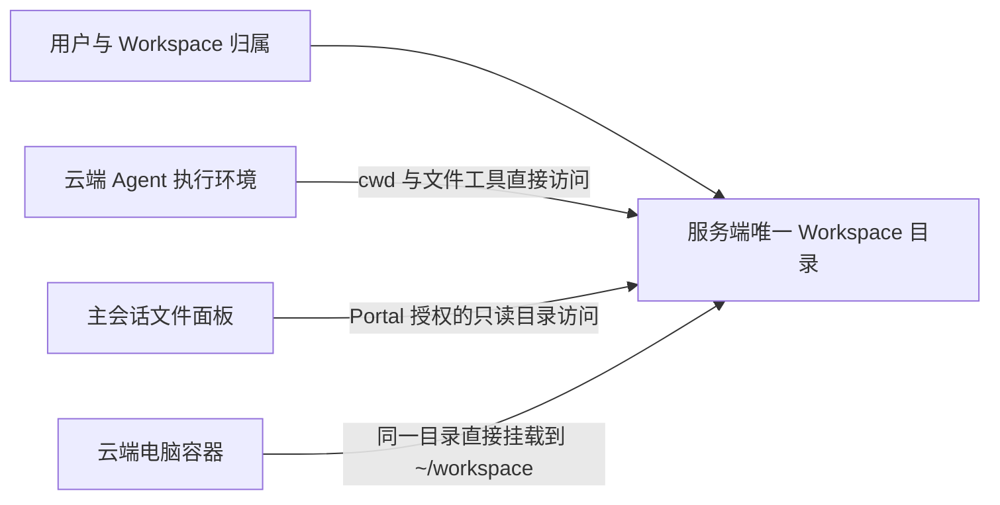

# Morde 主会话云端 Agent 文件空间设计方案

> 对应[需求文档](Morde主会话云端Agent文件空间需求文档.md)，并按用户补充的存储约定修订。本文是目标设计，不代表功能已实现。

## 1. 设计结论

每个用户有且只有一个稳定的云端 Agent Workspace，保存在 Morde 服务端持久存储的真实目录中，也是文件内容的唯一实时数据源。Agent 在该目录中运行并读写文件；主会话文件面板浏览该目录；用户当前使用的云端电脑必须绑定这个 Agent Workspace，并把同一目录直接以读写方式挂载到容器的 `~/workspace/`。用户不能为云端电脑显式选择其他 Workspace。

服务端、Agent 和云端电脑不各自维护工作副本，不通过推送、拉取、revision 物化或后台同步来保持内容一致。Host 停止、构建失败、重建或删除都不删除 Workspace 目录；只有明确删除 Workspace 才能清除用户文件。

## 2. 目录与组件关系

服务端使用配置的 Workspace 根目录和不可由用户指定的 Workspace ID 解析实际路径，例如：

```text
<workspace_root>/<owner_hash>/<workspace_id>/
```

`owner_hash` 和 `workspace_id` 由服务端生成或验证。绝对路径不返回给客户端，也不接受客户端提交的服务端路径。



- Workspace 元数据保留用户归属、稳定 ID、状态和存储配额；文件正文保存在对应目录中。
- 为每个用户保存唯一、稳定的 Agent Workspace 归属记录。它与当前云端电脑强绑定，但目录和 Workspace ID 不依附某台电脑的生命周期。切换电脑时先解除旧 Host 绑定，再把同一个 Workspace ID 绑定到新 Host；只迁移绑定关系，不复制或更换目录。任意时刻最多一个 Host 能活动绑定该 Workspace。
- Agent 若运行在独立容器中，也必须将该目录直接挂载到 Agent 执行容器，并把工作目录设为该根目录；不能只把命令转发到另一份 Workspace 副本。
- 云端电脑容器只能挂载所属用户的 Agent Workspace 子目录到 `~/workspace/`，读写权限按现有隔离和授权规则配置。显式绑定其他 Workspace 必须被拒绝。部署在不同节点时，节点须挂载同一共享文件系统；不支持时启动失败，不降级为复制或同步。
- 服务端按实际共享目录执行容量统计和配额限制；Agent 与电脑容器只获访问该用户目录所需的 UID/GID 或 ACL，不开放其他用户目录或宿主机根目录。
- Workspace 路径在服务端和 Agent 内部使用真实路径；云端电脑及产品界面使用稳定路径 `~/workspace/`。电脑模板的挂载目标必须与运行用户的 home 目录对应。

## 3. 初始化与生命周期

1. **初始化空间：** 在创建用户的云端 Agent Workspace 时，服务端幂等创建 Workspace 归属记录和空目录。这个步骤先于 Sandbox 创建，因此云端电脑尚未启动或构建失败时，文件面板仍可读取该目录。
2. **启动 Agent：** 服务端解析当前用户的 Workspace ID，将 Agent 的工作目录和文件工具根目录设为同一目录。目录不存在或不可访问时报告空间错误，不在其他路径新建空目录。
3. **启动云端电脑：** Sandbox 创建前，服务端确保并解析该用户唯一的 Agent Workspace，校验绑定、目录存在性、真实路径和权限，再把该目录绑定挂载到容器 `~/workspace/`。挂载成功后 Agent、电脑和文件面板读写同一份文件。创建请求不得指定其他 Workspace。
4. **电脑切换、失败或重建：** 停止并解除旧 Host 绑定后，新 Host 绑定同一个 Workspace ID 和目录，不复制文件。Host 构建失败、停止、删除或重建只清理 Sandbox 和临时运行资源，不清理 Workspace 目录及其文件。源目录缺失、身份不符或共享存储不可用时，拒绝启动，不能让容器运行在自动创建的空挂载点上。
5. **删除：** 删除电脑只释放计算资源并解除绑定；Workspace 目录单独按显式 Workspace 删除流程清理，并先验证没有 Agent 或电脑仍在使用它。

## 4. 主会话文件面板

当前 `GET /api/workspaces/{id}/manifest` 返回的是固定 revision 清单，不适合作为实时目录数据源。文件面板应使用 Portal 用户会话调用新的只读目录访问接口，例如：

- `GET /api/me/agent-workspace`：从用户到 Agent Workspace 的稳定归属记录解析空间，返回 Workspace ID、逻辑根路径和空间状态，不返回服务器绝对路径，也不依赖 Host 是否运行。
- `GET /api/workspaces/{id}/entries?path=<relative-path>`：在已授权 Workspace 根目录内读取目录项，支持分页；仅返回名称、类型、大小和修改时间等必要信息。需要文件预览时，通过同一所有权校验和根目录约束的只读流式接口读取。

Workspace ID 通过用户到 Agent Workspace 的稳定归属关系解析，不按名称搜索、不从会话附件推断，也不从任意 Host 中挑选。目录根节点即使为空也始终显示；目录读取失败显示错误，不伪装成空目录。

目录访问使用已打开的根目录句柄和相对路径校验，拒绝路径穿越、符号链接逃逸和越权 Workspace ID。文件面板只读；文件写入通过 Agent 或云端电脑在同一目录直接完成。本机项目的用户触发上传 / 同步仍属独立入口，其目标必须是该 Workspace 目录，但不属于服务端与云端电脑之间的运行时同步。

同一目录的变更在文件系统可见后即可被其他访问方读取，不显示“待上传 / 待 Host 应用”状态。Host 运行状态和 Workspace 可用状态分别展示。Agent 与用户同时写入同一文件仍是对同一文件的直接并发写入，按现有任务、审批和控制规则管理，不生成另一份副本冲突。

## 5. 与现有实现的差异

当前仓库的 Workspace 文件路径并非直接共享目录：正文使用 `workspacefs` 块存储，`workspacecurrent.Store.Materialize` 在临时目录重建完整树并通过目录交换发布，Host 使用独立的 `workspace-<id>` Docker 命名卷。直接挂载这类会被整体替换的目录，容器可能继续看到旧目录 inode；同时挂载命名卷与服务端目录也会产生两份文件。因此不能只把现有路径配置为 Host 挂载源。

落地前须将稳定服务端目录设为唯一实时数据源，文件面板及 Agent 使用直接文件服务，并停止让 revision 物化流程替换这个挂载根目录。已有块库、manifest、Host 命名卷和实时同步链路需按产品范围迁移或退出该实时读写路径，不能双写两份并宣称是同一文件夹。历史版本能力如继续保留，只能作为独立快照，不得替换正在挂载的实时根目录。已有每 Host Workspace 数据切换时，须逐用户核对目录、活动绑定、named volume 与 revision 投影；存在多个来源或冲突时保留原内容并阻止切换。数据核验通过后，把同一 Agent Workspace 绑定到当前 Host；旧数据及卷保留到回退窗口结束。运行期间不启动 Morde 服务端与云端电脑之间的文件同步。

共享存储还要求 Agent 运行节点与 Sandbox 节点能够访问同一个挂载目录。若部署环境不能提供同一文件系统挂载，该环境不满足本方案，需先解决共享存储部署条件，不能改用异步副本作为替代。

## 6. 实施验收

- 创建用户 Agent Workspace 后，即使没有 Sandbox，主会话文件面板也能显示该服务端目录；空目录和存储读取失败状态不同。
- Agent 在该目录新建或修改文件后，面板及已启动的云端电脑直接看到同一文件；云端电脑新建或修改文件后，Agent 与面板也能从同一目录看到变化，不经过上传、revision 应用或同步队列。
- 云端电脑构建失败、停止、删除和重建后，Workspace 文件保持不变；重建的电脑挂载同一 Workspace ID 对应的目录。
- 目录缺失、身份不匹配、跨用户访问、路径穿越、符号链接逃逸及共享挂载不可用时均拒绝访问或启动，不创建空目录掩盖故障。
- 验证同时写入时仍作用于同一目录，并按既有任务和控制规则处理；验证文件浏览只读且其他用户无法访问。
