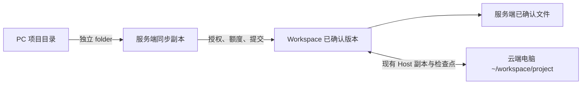

# Morde 云端电脑与项目文件同步设计方案

> 对应[需求文档](Morde云端电脑与项目文件同步需求文档.md)。本文是设计建议，不代表已实现；文末三项产品规则确认前，只开放不依赖它们的功能。

## 1. 需求判断

总体合理：将电脑作为用户唯一选择对象，可以消除重复概念；内部保留 Host、Workspace 和任务版本，能继续使用现有授权与恢复机制。一个电脑内的多个项目采用子目录，不需要多个 Workspace。

需要解决以下现状，不能只改页面：

- [创建电脑](../server/internal/app/host_create.go)要求传入一个已有 Workspace；[PC 映射](../clients/desktop/harness/desktop/src/morde-main.ts)和[设备绑定表](../server/migrations/00080_workspace_sync_device_bindings.sql)都限制一份 Workspace 对应一个同步目录。
- [Workspace 复制](../server/internal/store/postgres/workspace_copy_reservations.go)目前拒绝任何未解除的 Host 绑定，而电脑停机后仍保留绑定。仅调用现有复制接口不能复制正常电脑。
- [任务目标解析](../server/internal/store/postgres/task_deferred_target.go)会读取后续修订消息的电脑选择；如果只是切换输入框的默认电脑，不能让它改变已有任务目标。
- 同步额度与 Workspace 整体存储额度是不同限制。`workspace_sync` 当前未在[能力声明](../server/internal/api/capabilities.go)中发布；目录映射和真实链路未验收前不能开放。

## 2. 对象与目录

一台用户可见电脑固定对应一个 Host 和一个 Workspace。创建时自动建立关系；停机保留关系和文件；用户切换电脑时只更换默认 Host。已确定关系的电脑不能通过旧绑定接口换成另一份 Workspace；历史无绑定或多绑定记录先处理，不能让两个电脑同时使用同一份可写 Workspace。处理旧绑定时保留任务的原目标，无法确认时暂停而不改指向。

同步副本只是受控副本；Workspace 版本和文件块仍是已确认内容的共同依据，Host 工作树可能暂有尚未提交的修改。任何一方未确认的内容不能覆盖已确认版本或其他副本。

例如本机 `blog/README.md` 对应电脑内 `~/workspace/project/blog/README.md`。标准模板目前将 Workspace 挂到 `/home/gem/workspace`；其他模板的挂载路径和实际用户 home 需先核验。不能保证 `~/workspace` 指向该持久空间的模板，不开放此路径的同步入口。

## 3. 创建、选择与任务

- 扩展现有 `POST /api/hosts`：门户会话不传 `workspace_ids` 时，由服务端选择一个可用的自有 Workspace；没有符合条件的 Workspace 时，再创建一个，然后创建 Host 和绑定。选择范围只包括 ready、未删除且没有活动 Host 绑定的 Workspace，以延续已有文件并避免重复绑定；旧客户端显式传一个已授权 Workspace 的合同暂时保留。服务端在权限、配额及幂等检查下持久记录 Host 与绑定身份；卷或电脑准备失败时可恢复，不重复创建 Host 或覆盖已有文件。PC 可沿用现有门户会话；仅持客户端凭据或 API Key 时不自动扩大创建或 Workspace 权限。
- 客户端只提交所选 Host；服务端先保存选择意图，需要实际使用时才按当前用户和绑定解析 Workspace，并分别检查电脑与文件权限。共享电脑不自动授予 Workspace 或项目权限；无文件权限时显示明确状态。
- 新消息受理时保存当时的电脑选择意图；已有任务保留原目标。修订消息携带的输入框默认值不得覆盖既有目标；只有明确针对任务的目标变更才走现有授权、停止与版本检查。尚未使用文件的任务继续延迟固定版本，已固定的 `input_revision` 不随切换改变。
- 纯文字对话不查询或启动电脑。停机电脑的已确认文件通过现有 Workspace 文件权限读取；若任务已固定为无 Host 的文件快照，后续使用电脑仍遵守现有目标变更围栏，不静默转换。

云端 Agent 继续使用 DSH 和 Morde 工具代理，不新增运行时或绕过授权。当前依赖中的 DSH Agent、MCP、工具和会话组件已固定版本；本地上游 `dsh-workspace` 是目录和会话分组注册表，不提供 Morde 的电脑绑定、同步或权限，因此不能替代现有 Workspace。此方案不新增 DSH 插件。

## 4. 多项目同步

### 4.1 目录与授权

每个同步项目有稳定的 `folder_id`、所属 Workspace、服务端确认的相对目录 `project/<项目名>` 和设备绑定；同一云端目录在不同获准设备上使用同一个 folder。PC 的本地记录增加 folder ID、目标电脑、目录身份和同步恢复状态，以文件夹为单位显示进度。

服务端由所选 Host 解析 Workspace，并生成、验证项目目录；不接受 PC 指定的服务端绝对路径。目录名须为合法单级名称，大小写、Unicode、保留名或目标已存在内容存在冲突时先比较并由用户处理。同一电脑中的同步目标不能相互重叠；同一 PC 的本地目录及其父子目录不能重复关联，重新启动时重新核验目录身份和授权。

在现有同步设备注册流程中增加项目 folder 登记，例如 `POST /api/hosts/{id}/sync-folders` 接收项目名并返回 `folder_id` 和相对路径；设备挑战将 folder ID 和路径写入签名证明。登记校验电脑访问权、Workspace 授权和项目名；证书挑战继续使用现有 PC 客户端凭据，受限同步凭据不能因此获得电脑管理权。当前节点仍把 folder 映射到整个 Workspace 根目录，因此项目 folder 的设备注册、同步会话和进度在 CFS-06 改造前保持不可用；挑战通过不代表设备已授权或文件已同步。旧根目录接口在兼容期保持原语义。

### 4.2 文件流与版本

继续按[现有同步方案](Morde%20Workspace%20文件夹同步设计方案.md)优先复用 Syncthing 和 Morde 的设备授权、限额、版本及安全副本机制；PC 端 `morde-sync` 仍是原方案的备选，同一本地目录不能同时由两套引擎写入。Host 继续沿用现有 `morde-sync` 副本链路，所有变更汇入同一 Workspace 版本。

每个项目在服务端使用独立、稳定的同步副本目录，不能在同一 Syncthing 节点上同时配置覆盖整个 Workspace 的旧根目录和其项目子目录。同步控制文件不进入用户文件树、复制或容量统计；符号链接及其他非普通文件不参与同步，须列出未同步项。首次启用前，从已确认版本准备目标副本并检查本机差异；没有共同基线时，一侧缺失不推断为删除，版本变化时重新比较，不直接覆盖任何一方。覆盖或删除本机文件前保留可恢复副本；PC 应用退出时停止本机同步，重新启动后复核目录和授权再恢复。

接收项目文件时，服务端以 `folder_id` 找到已授权的 Workspace 和项目路径，将 folder 内相对路径转换为 Workspace 内相对路径，再通过现有接收预留、额度核算和版本提交；不能信任客户端传入的跨目录路径。Host 或其他设备同时改动时，按共同基线比较并保留冲突，不能用旧版本覆盖新内容。提交后更新服务端文件和该项目同步副本，Host 通过现有 [workspacereplica](../runtime/morde-runtime/workspacereplica/controller.go) 应用版本并报告回执。外部变更涉及运行中任务的输入时，沿用任务检查点和版本围栏，不能让任务继续使用过期输入。

当前 [workspacecurrent](../server/internal/storage/workspacecurrent/store.go) 会整体交换目录，[接收流程](../server/internal/app/workspace_sync_receive.go)还会在文件提交后触发整体物化。不能将活动的 Syncthing 项目目录直接放在这个会被替换的树中；独立副本与物化之间须有版本标记、写入围栏和重启对账，未提交修改或状态未知时停止覆盖。实现前须验证目录标记、断线、并发修改和物化恢复；如果无法证明这一机制安全，保持同步能力关闭。

沿用单文件 300 MiB 和每台电脑参与同步文件总量 5 GiB：多个项目及设备共用额度，同一云端路径不重复计算，冲突副本计入；同时保留现有 Workspace 总量、账号和物理空间限制。任一限制不足都要明确提示；不能用同步额度绕过存储额度。同步状态分别依据本机、服务端提交和 Host 应用回执，不能只凭 Syncthing 传输完成判定电脑文件就绪。

### 4.3 兼容现有绑定

现有表以 `workspace_id` 为主键，设备绑定也按 Workspace 和设备唯一；多项目必须扩展为按 folder 和设备关联，挑战及接收预留同样绑定 folder。按 Expand/Contract 分两次发布：先增加新字段、约束和兼容读取，保留旧唯一约束；确认客户端升级和旧数据归属后，再在独立后续迁移中调整旧主键、唯一索引及外键，之后才启用一电脑多目录。

兼容期内旧根目录映射保持原语义，不自动改成 `project/<名称>`；旧根目录同步和新项目同步不能同时写同一 Workspace。需要转换时先停写、保留原映射与文件，用户确认目标并比较后再切换；结果未知时保持暂停。旧客户端不能将新格式误读或覆盖。

## 5. 复制、删除和历史数据

建议新增 `POST /api/hosts/{id}/copies`，首期沿用 Workspace 复制的门户会话权限，以幂等键创建可查询的复制操作，记录源 Host、绑定版本、源 Workspace 版本及目标身份。用户确认可能停机后，先阻止新写入并排空任务、同步和未决操作，核验 Host 已停止、源当前树与检查点一致，再复制并核对文件、目录和受支持的属性；不支持的类型或元数据直接失败。符号链接只复制链接本身，不跟随目标。

扩展现有复制预留：在同一授权和围栏下允许**仍绑定源电脑但已证明安全停写**的 Workspace 复制，保留原绑定；预留时以事务和绑定版本围栏核验停止证明，并与 Host 恢复、其他写入互斥。现有普通 Workspace 复制接口的限制不能简单删除。复制完成后，使用新 Workspace 创建独立 Host；两步任一步中断时按原操作恢复，不重复创建，半成品不可作为成功电脑展示，源数据保留。PC 离线时提示只能复制云端已确认内容，不能声称包含未知的本机修改；已知未结算写入或旧卷归属不明则阻止复制。

停机继续保留文件。云端数据删除规则未确认前，不执行删除数据的操作；电脑删除入口也不能留下用户无法找到的文件。历史一对一关系保留原 ID；无绑定、多绑定及独立配置/应用卷先盘点、保留并提示用户处理。旧文件和本机映射不自动移动到 `project`，旧路径可继续访问；确认新映射及回退方式后才退役旧入口。

## 6. 验证与开放条件

本地验证覆盖：创建重试与配额失败；切换电脑后已有任务目标不变；同一电脑两个项目及不同设备映射、冲突和根目录变化；300 MiB/5 GiB 与既有存储额度边界；撤权和在途提交；停机后绑定复制、复制与恢复竞争、中断恢复；旧映射升级及不同用户隔离。相关接口、客户端类型、迁移和测试须一起更新。

本次只在本地写设计，不发送文件。项目现有约束下只能做本地文件操作或替身验证，不能将其称为真实 PC—服务端—电脑同步验收；在无法完成必要真实传输验证的情况下，`workspace_sync` 及依赖它的写能力继续关闭。

## 7. 待确认

1. 复制是否只保证持久文件，不保证 Workspace 外的应用、登录和运行状态？
2. 删除电脑时是否同时删除云端文件和历史版本，保留期限如何规定？
3. 旧需求默认排除部分敏感配置，较新同步设计则包含隐藏普通文件；默认排除范围如何确定？

复制、删除和新同步功能分别在其规则明确、对应安全边界完成并验证后开放；不阻塞普通对话和不依赖这些规则的电脑选择。
