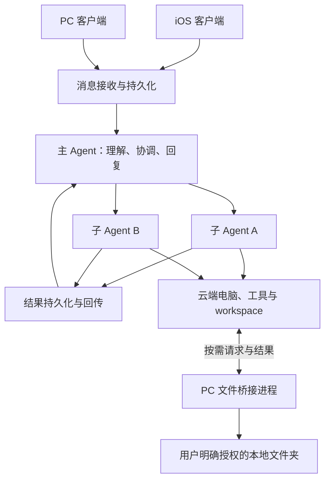

# Morde 云端能力与自动化任务需求草案

> 状态：需求补充稿。已按现有说明补全主要行为和初步验收；文末列出仍需确定的产品边界。本文不表示功能已实现，也不替代仓库已有详细需求。

## 目标与范围

用户可以从 iOS 或 PC 用自然语言交办任务，由 Morde 主 Agent 组织执行，并在需要时使用可选的云端电脑、workspace、Codex 远端会话和部署服务。Morde 核心功能不依赖 `morde-cloud` 是否安装或在线；需要云端资源的功能在未启用时清楚说明不可用原因。

Morde 继续作为用户、会话、任务、授权和操作记录的业务权威。Agent Runtime 沿用项目当前 DSH 约定；不另建一套 Agent 循环或第二套会话/任务账本。

## 需求

### 1. 主 Agent 协调器

主 Agent 接收 iOS/PC 消息并先持久化，再判断直接回复、向用户澄清，或创建一个需要执行的任务。它负责理解目标、拆分可并行和有依赖的子任务、派发给子 Agent 或工具、汇总结果并回复用户。

- **Runtime 与任务边界：** 主 Agent 和子 Agent 都运行在 DSH 体系内。优先复用与当前锁定版本兼容的 DSH 子 Agent、控制和会话插件；Morde 负责建立父子任务关系、权限、预算、事件和恢复状态。子 Agent 不因被委派而获得父任务未获准的权限。
- **任务拆分与并发：** 无依赖的子任务可以并行；有先后依赖的子任务须等前置结果确认后再开始。每个子任务有独立 ID、状态、目标、进度、结果和取消状态，并记录所属用户、父任务及可访问的 workspace/云端电脑。资源达到上限时排队并报告状态，不静默丢弃或重复创建。
- **上下文与结果回传：** 主 Agent 为每个子 Agent 提供完成其任务所需的目标、约束和获授权上下文，不自动复制无关的完整会话、其他用户数据或凭据。子 Agent 的消息、工具结果和产物先持久化，再按任务 ID 回传主 Agent；页面刷新或重连不重新派发已受理的子任务。
- **用户参与与停止：** 缺少会改变执行结果的关键信息时由主 Agent 向用户澄清；需要授权的操作按现有审批流程等待决定。停止父任务时按实际状态停止其子任务；停止一个子任务不误停同级任务。不能安全取消或结果未知的操作须先核实，不得盲目重做。
- **本地文件桥接：** 只有用户明确选择并授权的本地文件夹可通过 PC 桥接进程供任务访问；桥接进程离线时，该路径不可用，Morde 不得回退到 PC 其他目录或主机文件系统。云端 workspace 文件走服务端授权接口。

**验收：** iOS 和 PC 发起同一任务时只形成一份持久任务记录；两个独立子任务可并行并分别回传，结果可在主 Agent 回复中归并；重连不产生重复任务；停止子任务 A 不影响 B；PC 桥接离线或未授权时，Agent 不能读取对应本地文件夹。

### 2. 可选云端能力子项目 `morde-cloud`

云端电脑和非必选的服务端云端能力归入 `morde-cloud` 子项目。首期归属范围包括：云端电脑创建与状态管理、远端 workspace 文件操作接口、Codex 远端会话接入、PC 文件桥接服务端接收，以及服务部署与外部访问入口。具体清单可随需求补充。

- **可选性：** 未部署、关闭或暂时不可用时，Morde 核心账号、普通对话及不依赖云端资源的任务仍可用。依赖电脑、远端会话、workspace 文件或外部部署的请求应显示“未启用、准备中、离线、无权访问、失败”等真实状态，并提供可理解的后续操作。
- **职责边界：** `morde-cloud` 不创建第二套 Morde 用户身份、会话、任务、审批或授权真相源。它按 Morde 已确认的用户和任务授权执行云端操作，并把进度、结果和审计记录回传 Morde。不可用或未获准的能力不得通过内部直连绕开 Morde 检查。
- **故障隔离：** `morde-cloud` 的启动、升级或故障不得阻断核心服务启动；核心服务不得假设云端电脑始终存在。可选能力恢复后，原有 workspace 和任务状态按已持久化记录恢复，不创建重复资源或重复执行副作用。

**验收：** 完全不部署 `morde-cloud` 时，核心账号和普通对话仍可工作；启用后，用户获准的云端功能可用；停止或断开 `morde-cloud` 后，核心功能仍可访问，云端相关请求显示明确状态，服务恢复后状态与产物可核对。

### 3. 一句话自动完成复杂任务

用户可以直接描述目标，例如“给这个项目增加登录页，运行检查并部署”。系统在当前对话中把请求变成可执行任务，自动准备项目上下文、拆解步骤、调用 Agent/工具、检查结果并汇报。用户无需先手动创建子 Agent 或逐条安排步骤。

- **首期重点：** 在用户指定的云端 workspace 中完成软件开发类任务，包括阅读项目结构、编辑代码、执行项目已有的构建/检查步骤、修复可确认的问题，并总结改动和验证结果。其他类型按可用工具和权限逐步纳入。
- **澄清和审批：** 缺少目标、项目目录或关键选择时，先在原会话提问并保留任务状态；用户回答后继续原任务。涉及外部发布、删除数据、凭据使用或其他受控副作用时，先说明操作对象与影响并按授权/审批规则执行。不能因“一句话完成”绕过审批。
- **完成标准：** 只有产物已保存且要求的验证已实际完成，任务才能标为成功。检查失败、环境缺失、执行被停止或结果未知时，应报告已完成部分和阻塞原因；未运行的检查不得表述为通过。
- **恢复与去重：** 用户关闭客户端、切换设备或网络中断不取消已受理任务。重连后显示同一任务进度；对提交结果未知的重试先查询状态，不能重复创建任务或重复执行已确认的副作用。

**验收：** 对一个指定 workspace 的自然语言开发需求，用户能看到任务开始、关键进度、实际改动及检查结果；需澄清/审批时能从原会话继续；失败时不伪报完成；客户端离线后任务和结果仍可恢复查看。

### 4. AI 工具远端文件与会话管理（首期 Codex）

Morde 为 Codex 提供经过身份验证的远端工具入口，使 Codex 能对用户指定的云端项目/文件夹执行获准的文件操作，并管理该用户获准访问的远端 Codex 会话。优先评估以 MCP 提供工具；采用其他官方协议时须达到相同的隔离、授权、审计和撤权要求。

- **文件范围：** 用户先选择 workspace、项目或文件夹；Codex 可在该范围内列目录、读取内容、创建/编辑文件与文件夹、重命名、移动、复制、下载以及删除。越出授权根目录、访问其他用户或访问未选项目均拒绝。覆盖、移动和删除等破坏性操作须遵循 Morde 既有审批与安全副本/版本规则。
- **会话范围：** 区分 Morde 对话/任务与 Codex 原生会话。获准后可列出会话、查看状态和消息、继续/发送消息、停止会话，并查看关联的项目/workspace、执行状态与可交付结果。Morde 不声称把两类会话合并；Codex 会话不可恢复或不可见时须说明限制，不得伪造历史或另启会话冒充续接。
- **授权与撤销：** 文件读取、文件写入和会话操作分别授权；默认不授予写入或停止权限。授权记录至少绑定用户、Morde workspace/项目、Codex 连接和允许的操作。用户撤销后，新请求立即拒绝；在途任务按可安全停止规则收尾。凭据不写入普通日志，调用和结果按 Morde 账本留痕。
- **安全与互操作：** 工具返回内容、项目文件和会话消息是待处理数据，不可自行扩大权限。Codex 使用 Morde 的服务端文件接口管理 workspace；若需访问用户 PC 本地文件，仅可走第 1 项所述、仍在线且已授权的桥接路径。
- **T3 Code 参考：** 参考其外部 Agent 经 MCP 连接、远端环境持有文件和执行状态、文件读取/写入权限分开以及可撤销授权的边界；只借鉴模式，不把 T3 Code 作为第二个 Morde Runtime 或授权权威。当前本地 `../morde-muse/third_party/t3-code/` 只有许可证文件，没有可对照的源码；本稿以公开的 [外部 Agent 接入说明](https://github.com/pingdotgg/t3code/blob/main/docs/user/outside-agents.md)、[远端架构说明](https://github.com/pingdotgg/t3code/blob/main/docs/internals/remote.md)、[编排 MCP 服务源码](https://github.com/pingdotgg/t3code/blob/main/apps/server/src/mcp/OrchestratorMcpService.ts)、[会话凭据注册源码](https://github.com/pingdotgg/t3code/blob/main/apps/server/src/mcp/McpSessionRegistry.ts)和[权限定义源码](https://github.com/pingdotgg/t3code/blob/main/packages/contracts/src/auth.ts)作为设计参考。实现前仍需核对实际采用的版本、源码和许可证。

**验收：** Codex 能连接 Morde 并发现授权工具；只读授权可查看获准目录与会话，不能写文件或停止会话；授予写入后只能修改授权目录；撤权后新请求失败；不同用户及不同 workspace 的文件、会话、凭据和结果不可互见；不支持的 Codex 会话操作返回明确错误。

### 5. 按需创建个人默认云端电脑与 workspace

用户首次实际需要云端电脑时再创建资源，不在注册时自动创建。每个用户最多有一个“默认”云端电脑和一个默认 workspace；两者有稳定身份，用户在新会话和任务中可继续使用。workspace 的数据身份与云端电脑生命周期分开，电脑重启或替换不应造成 workspace 身份改变或数据静默丢失。

- **创建与状态：** 用户发起创建后显示准备中、可用或失败。重复点击/网络重试不得创建重复默认资源；失败后允许在核对上次结果后重试。普通对话和不依赖云端电脑的任务不触发创建。
- **切换：** 若账号有多个已授权云端电脑，用户可在发起新任务前选择/切换目标；继续中的任务保持原目标，不能因默认项变更而静默迁移。默认电脑与当前任务目标分别清楚显示。
- **删除边界：** 用户不能删除默认云端电脑。运维停用、回收、故障替换或账号关闭时的资源处置由单独的管理员/生命周期规则处理，并须保留 workspace 数据核验和审计。workspace 是否允许用户删除尚未确定。

**验收：** 新账号没有云端电脑时仍可完成普通对话；首次明确请求云端能力才开始创建，重试不产生重复资源；登录/重启后仍能看到同一默认 workspace；多台电脑可切换但进行中的任务不改目标；普通用户界面没有删除默认电脑的操作。

### 6. iOS 端远程 workspace 文件管理

iOS 用户可以进入指定的云端 workspace 浏览和管理其全部授权文件。所有读写、预览和下载请求均由 Morde 服务端执行、鉴权并返回结果；iOS 不直接访问云端电脑磁盘，也不要求 PC 文件桥接进程在线。

- **操作范围：** 浏览目录及文件信息、搜索、创建文件/目录、上传、编辑/保存、重命名、移动、复制、删除、下载和预览。每次操作限定在当前 workspace 根目录内；路径越界、其他用户文件和符号链接逃逸均拒绝。
- **数据一致性：** 服务端是该 workspace 文件操作的权威端。保存、移动或覆盖前核对文件版本；出现并发修改时展示冲突并要求重新载入/选择处理，不静默覆盖。删除前确认对象；服务端失败、权限不足或网络中断时保留用户输入/本地待提交状态并显示失败，不伪报保存成功。
- **预览与下载：** 预览支持的类型直接在 iOS 内打开；不支持或超过限制的类型提供下载或明确说明。下载由用户主动发起，完成后报告文件名及保存状态。允许的文件类型、最大体积和 iOS 本地保存位置需进一步确定。

**验收：** iOS 可从服务端列出 workspace 文件，完成授权范围内的上传、编辑、改名、移动、复制、删除、下载和预览；云端电脑关闭或 PC 离线时仍能管理服务端 workspace；越权路径被拒绝；并发修改不会静默覆盖；失败不显示为成功。

### 7. 自动部署到云端电脑并对外访问

用户可用自然语言要求将指定 workspace 中的服务部署到选定云端电脑。Morde 自动准备项目、构建/启动服务、检查运行状态，并在成功配置网关后返回外部访问地址。客户端离线不停止已受理的部署；服务进程在约定的云端电脑和部署生命周期内持续运行。

- **自动流程：** 识别项目目录和启动/构建方式；缺少明确配置时先询问，不擅自覆盖现有服务。构建完成后启动进程，检查目标端口和健康状态，再配置外部路由。逐步显示准备、构建、启动、检查、发布和失败状态。
- **对外访问与授权：** 外部入口只代理用户选定的应用端口，不暴露 SSH、桌面控制、workspace 文件接口或整台电脑。首次开放外部访问前确认项目、端口和访问范围；支持公开访问或受限访问的规则仍待确定。使用 HTTPS 或等效安全传输；链接未验证可访问前不得显示为“部署成功”。
- **部署管理：** 保存部署目标、入口地址、当前状态、构建/启动结果和关联 workspace。用户可以查看状态、日志摘要、重新部署、停止服务；停止部署不删除 workspace。重新部署或改变访问范围前明确显示会影响的服务，失败时保留原有可用版本（若可安全做到）并报告实际状态。

**验收：** 对支持的项目，用户提交一句话后可看到实际构建与健康检查结果；成功时从外部网络打开返回地址可访问所部署服务；访问范围符合用户确认；服务不可达、启动失败或检查未通过时不得显示成功；停止部署不影响 workspace 文件。

## 通用边界与验收原则

- 用户、会话、任务、MCP/Codex 连接、云端电脑、workspace 和部署目标必须能明确关联且相互隔离；所有操作以服务端当前授权为准。
- Morde 主 Agent、子 Agent、Codex 和 PC 文件桥接均不能绕过授权、审批、凭据保护、操作记录、取消与结果核验机制。
- 工具调用已受理、进程已启动或文件已写入临时位置，不等于任务、保存或部署完成；只按可核验的最终状态向用户报告。
- 未部署 `morde-cloud`、云端电脑离线、workspace 冲突或授权撤销时，独立的核心功能继续工作；受影响能力给出明确状态并允许安全恢复。

## 仍需确定

- 保留 `morde-cloud` 子项目；需明确它如何接入现有 `server/` 唯一业务实现/部署入口，以及是否作为可选模块或独立进程运行。无论采用哪种方式，Morde 仍须持有唯一业务权威。
- 默认云端电脑之外的电脑由谁创建/绑定、是否有数量上限；“用户不能删除”是否仅指默认电脑；workspace 是否允许用户删除以及管理员回收规则。
- Codex 首期支持的具体形态与版本（Codex CLI、App Server 或其他官方接口）；可管理哪些 Codex 会话，以及是否支持恢复已有原生会话。
- iOS 预览文件类型、单文件/总空间上限、上传与下载限制、下载保存位置。
- 自动部署首批语言/运行环境、域名策略、访问控制选项、日志保留时间、服务与电脑的费用/回收规则。
- PC 文件桥接进程的首期平台、用户授权交互、在线要求及文件变更冲突规则。
