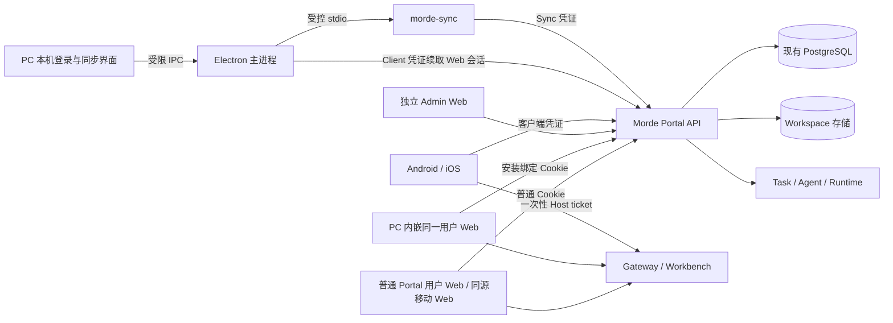

# Morde 基于 nanoMuse 的 PC 与手机端二次开发设计方案

> 客户端授权与 Web/PC 能力边界按[登录即授权精简方案](Morde客户端无感设备授权精简设计方案.md)执行；本设计第 4、5.2 节已同步更新。以下为待实施目标，不代表当前代码已完成。

> 版本：设计稿 v1，2026-10-26。本文是待实施设计，不表示客户端或新增接口已经完成。HTTP 实施契约以 [`server/openapi/portal.yaml`](../server/openapi/portal.yaml) 为准；本文标注“拟新增”的接口须在编码时同步更新 OpenAPI、服务端、客户端与测试。快速了解总体取舍和重复能力，先读[精简决策版](Morde基于nanoMuse多端客户端精简设计与重复能力决策.md)；开发顺序和验收见[实施 TODO](实施/22-Morde基于nanoMuse多端客户端实施任务todo清单文档.md)。关联业务目标见[多端需求](Morde多端托管与共享工作区需求文档.md)和[多端架构](Morde多端托管与共享工作区设计方案.md)。
>
> **源码基线限制：** 本地 `project/nanoMuse` 已从指定仓库克隆，当前 `main` 为 `22eba3f9028c9dea57336d1385f9b405ea4f7211`；`project/openmuse` 是另一个项目，不能代替 nanoMuse。下文目录与行为主要基于此前核对的 v1.0.7 和[上游 v1.0.7 架构](https://github.com/nano-muse/nanoMuse/blob/v1.0.7/docs/architecture.md)、[桌面](https://github.com/nano-muse/nanoMuse/blob/v1.0.7/docs/desktop.md)、[Hub](https://github.com/nano-muse/nanoMuse/blob/v1.0.7/docs/hub.md)文档。开始改代码前须核对当前提交与参考版本的差异、目录和许可证；不得把待核对的文件级操作当作已实施事实。

## 1. 目标、范围和必须遵守的决定

Morde 发布一个基于 nanoMuse 的桌面客户端，以及基于 nanoMuse 的手机 Web、Android、iOS 客户端。它们作为 Morde 的用户入口，连接**现有 Morde Go 服务端**；现有 Portal 用户 Web 负责账户、资源管理、授权和下载，现有 Admin Web 负责平台管理，Gateway/Workbench 负责云端电脑画面与控制。客户端不建立第二套 Morde 用户、Host、Workspace、Conversation、Task、审批或文件真相源。

首个可交付闭环：用户从 Portal 安装或打开客户端 → 输入账号密码登录 → 看同一 Host/Workspace → 与同一 Morde Conversation/Task 对话并处理审批 → 打开云端电脑 → 桌面端把选中的本机项目目录与 Workspace 安全同步。手机端只操作云端 Host 和服务端任务；不把手机自身宣称为 Morde Host，也不在 iOS 承诺系统级本机操控。

本设计作如下固定选择：

1. **产品身份唯一。** Morde 版默认只登录 Morde，nanoMuse Cloud/Hub 的账号、设备、会话和远控协议不进入 Morde 的任务或授权路径。上游 UI/外壳可复用，协议不可直接复用。
2. **服务端唯一。** `server/` 继续执行业务和权限；桌面本机仅保存用户选定目录的副本、同步状态和安全凭证。手机和桌面不直接连接 PostgreSQL、AIO、Runtime 或 Admin API。
3. **两类本机凭证。** 桌面安装持有客户端凭证，供安全续取安装绑定的用户 Web 会话；`morde-sync` 持有仅限 Workspace Sync 的设备凭证。PC 用户页面使用安装绑定的 HttpOnly Cookie，手机原生应用使用客户端凭证，纯 Web 使用普通 Portal Cookie。绝不扩大现有 `KindDevice` 的路由权限。
4. **同步算法不搬家。** 最终桌面安装包使用 nanoMuse `harness/desktop` 外壳，嵌入现有 `project/morde-sync` Go 执行端；从旧 `project/morde-desktop` 移植授权、目录映射、托盘和状态 UI 的已验证逻辑，不用 JavaScript 重写同步协议。
5. **PC 覆盖用户 Web。** Host/Workspace 创建与删除、任务与计划、模型连接、API Key、通知和客户端撤销等全部用户 Web 功能在 PC 窗口内可用，共用 Portal 页面与服务端状态；PC 另有本机同步。Admin Web 仍是独立的管理员入口，不计入用户 Web 覆盖范围。新客户端仅凭本次账号密码登录自动登记，不设批准页。

首期不包括 nanoMuse 跨设备 Hub 操控、本机 nanoMuse Agent 自动执行、手机后台常驻本机工具、JuiceFS 挂载、原生推送、第三方 AI 原会话迁移。这些不是 Morde 核心闭环的前置条件。若以后开放本机 Agent，必须设计独立的执行位置、权限和会话，不得混入服务端 Task。

## 2. 现有能力与差异

| 来源 | 可直接沿用 | 必须改造或补充 |
|---|---|---|
| nanoMuse `web/`、Android、iOS | 聊天、设备、设置等界面结构与原生导航 | API、身份、Host/Workspace 模型、SSE/审批、云端画面入口、品牌；原 `/api/cloud`/`/api/hub` 不等于 Morde API |
| nanoMuse `harness/desktop` + `harness/dsh-nanomuse` | Electron 窗口、托盘、启动/退出和打包链 | 隔离加载完整 Portal 用户 Web/Workbench，单次登录签发安装绑定 Web 会话，保留本机同步界面与 Go 子进程；移除重复任务/Host 页面 |
| Morde `web/portal` | 工作台、Assistant/任务与计划、Host/Workspace、模型连接、API Key、通知、客户端下载；已有设备批准 UI | 同一份用户页面在 PC 内加载；移除码输入和人工批准页，保留安装列表/撤销，补移动 Web 入口 |
| Morde `web/workbench` + Gateway | Host 进入票据、画面、终端、文件、控制权 | 窄屏与触控操作、票据在原生 WebView 的一次性兑换和断线重连 |
| `project/morde-desktop` | 设备码、`safeStorage`、目录重叠检查、设置与交接状态、Go 子进程编排 | 仅供只读参考；新包不读取旧安装状态、凭证或运行时逻辑 |
| `project/morde-sync` | 清单/分块/哈希、续传、`fill_missing`、双向 LiveSync、冲突和交接 | 作为版本固定的伴随二进制打包，增加与新壳的生命周期联动及跨系统验收 |
| `server/` | 会话/API Key/设备身份，Host、Workspace、Task、SSE、控制票据 | 复用账号密码校验，新增客户端登录/安装凭证及允许路由、审计；同步凭证路由边界不变 |

服务端 `KindDevice` 只具 `workspace:sync`，`api.go` 对设备凭证还有方法和路由白名单；API Key 不能拿 `workspace:sync`。Morde 新项目通过客户端账号密码登录，为桌面一次性签发相互隔离的客户端凭证与同步凭证；不再提供 `/api/client-authorizations` 手输配对入口，也不恢复旧 `/api/device-authorizations` 公共入口。这个边界决定第 5 节的授权设计。

## 3. 总体结构与事实归属

| 数据或状态 | 唯一真相源 | 客户端允许保存的内容 |
|---|---|---|
| 用户、角色、授权、设备撤销 | Morde 服务端 | 凭证密文、当前用户 ID 与展示缓存；每次关键操作仍向服务端核验 |
| Host、Workspace、绑定、执行位置 | Morde 服务端 | 列表缓存、最近选择 ID；不得以名称匹配或自行推导访问权 |
| Conversation、Task、消息、审批 | Morde 服务端 | 分页缓存、未发送输入草稿、SSE 游标；审批版本不在本地发明 |
| 本机目录与同步状态 | 用户文件系统 + `morde-sync` 本地状态 + Workspace revision | 目录映射、文件身份、扫描进度、交接检查点；只能同步显式选定范围 |
| Host 画面与控制权 | Gateway/RuntimeControl | 短期画面状态；控制权由服务端 CAS 决定 |
| 设置与通知 | Portal 服务端，少量设备偏好在本地 | 主题、窗口位置、最后打开页面；不能将本地“已读”覆盖服务端状态 |

客户端的“设备”列表分开显示：**本机客户端**（登录/撤销）、**本机同步副本**（Workspace 权限）和**云端 Host**（运行环境）。nanoMuse Hub 的同账号设备不映射成 Host；所有页面用稳定 ID 发请求，并显示执行位置“本机文件同步 / 云端 Host / 服务端任务”。

## 4. 产品页面和跨端流程

**PC 功能必须覆盖用户 Web 的全部可访问路由和操作。** PC 在隔离的 Electron Web 视图加载同一份 Portal 用户页面，用户在应用内直接完成工作台、AI 助手、会话、任务详情/审批/全局执行控制、定时计划、云端电脑创建/续期/释放/恢复/删除/共享、Workspace 创建/绑定/解绑/重试/删除、模型连接、API Key、通知、客户端列表/撤销、注册申请与下载信息。Host 进入同一 Workbench，桌面、终端、VS Code、云端文件及控制权按原权限使用。用户 Web 新增可访问路由时，PC 覆盖测试同时增加，不允许只给 PC 一个外部浏览器深链。

PC 唯一额外的产品页面是「本机同步」：用户选择本机目录和目标 Workspace 后执行上传、补缺、LiveSync、冲突与交接，并查看托盘和恢复点。纯浏览器 Web 可管理服务端 Workspace、绑定云端 Host，并在 Workbench 手动上传所选文件或下载云端文件；它不做本机目录映射、持续监听和关闭网页后的同步。当前 PC renderer 只有会话、电脑、本机同步、通知等简化入口，须被完整 Portal 用户视图取代；不保留第二套 PC Task/Host 页面或状态。详见[功能覆盖清单与源码依据](Morde客户端无感设备授权精简设计方案.md#3-必须覆盖的用户-web-功能)。

手机 Web `/app/` 使用同源 Portal Cookie 作为轻量入口；Android/iOS 在原生页面登录，展示同一 Morde Task/Host 资源，但不把手机伪装成本机 Workspace 同步端。Admin Web `/admin` 是单独角色和页面；用户 Web 完整覆盖不意味着把 Admin 权限带进桌面 Web 会话。

跨端跳转只传资源 ID 和目标路由，不传持久凭证。PC 用户 Web 与普通 Portal Web 共享业务组件和数据源；桌面安装绑定会话在主进程建立，内嵌 Web 只获得 HttpOnly Cookie，不接触 Client/Sync 凭证或本机目录 API。外部网站交给系统浏览器，Morde Host Gateway 使用受控新视图和已校验的一次性 ticket。

**完整复用还要处理浏览器能力。** 当前 Portal 的自有 Host 入口用 `window.open('/host-entry/:id')`，共享 Host 先开 `about:blank` 再用观察票据跳转；当前桌面主进程一律拒绝新窗口。实施时统一为受控的 Portal Host 入口，在 Electron 中仅允许该入口创建隔离 Host 视图，校验票据后再跳 Gateway；不能放开任意弹窗或直接把 Host 送外部浏览器。`/download` 的安装包链接与 Workbench 的 `Blob` 文件下载接系统保存对话框，用户确认目标后才保存，不能静默覆盖；Workbench 的文件上传仍由用户手动选择文件。模型连接/API Key 的复制按钮依赖剪贴板写入，桌面按可信 Portal 页面和用户动作授予所需权限，并验证复制结果；远端页面不得因此获得本机目录 API。管理员链接进入独立 Admin Web 登录，不复用安装绑定用户 Web 会话。

## 5. 身份与授权：最重要的服务端改造

### 5.1 同一账号的四种凭据边界

| 场景 | 凭据 | 存放和可用接口 |
|---|---|---|
| 普通 Portal 与同源手机 Web `/app` | 现有 Portal HttpOnly Cookie | 浏览器会话；按原用户角色与 CSRF/Origin 规则访问 Web API |
| PC 内嵌用户 Web | **拟新增**安装绑定、仅限用户 Web 的 HttpOnly Cookie | Electron 专用隔离会话；可使用全部用户 Web 页面/API，不能进入 `/admin`；每次请求复核安装未撤销 |
| PC 主进程、Android/iOS | `KindClient` 不透明可撤销凭证 | 操作系统安全存储；原生端使用第 5.3 节的明确 API，桌面另可续取其安装绑定 Web 会话 |
| PC `morde-sync` | `KindDevice` Workspace Sync 凭证 | Electron 主进程安全存储并传给受控 Go 子进程；仅 Workspace Sync 白名单和当前账号有权的 Workspace |

**一次登录同时建立 PC 所需的三份凭据**，用户不再登录第二次。客户端凭证不能直接调用文件分块接口，同步凭证不能访问 Task/Host；但桌面 Client 凭证可换取完整的用户 Web 会话，实际风险等级等同用户 Web 登录，应以同等强度保护。手机原生端不能换取桌面 Web 会话。Admin Web 仍需独立登录及角色校验。

### 5.2 客户端登录、安装绑定 Web 会话与撤销

桌面/原生手机直接显示 Morde 登录表单。新增 `POST /api/auth/client-login`，复用 `CredentialService.Login` 的账号密码验证、限流、审核状态与强制改密规则；共享验证步骤，不另外造用户表或第二套密码规则。成功时原子生成安装 ID 和 30 天 `KindClient` 凭证；桌面另生成独立的 `KindDevice` Sync 凭证及短期安装绑定的用户 Web 会话，手机不生成后两者。密码仅经 HTTPS 提交，输入状态立即清空，不写文件、日志或崩溃报告。失败时不生成安装。用户只看到“登录”，没有设备码、浏览器批准或轮询。

桌面主进程接收凭证，把 Client/Sync 凭证保存到系统安全存储；把 Web 会话设为仅配置的 Portal HTTPS origin 可用的 `HttpOnly; Secure; SameSite=Strict` Cookie，放入独立的 Electron 会话分区。Web 会话凭证不发给本地 renderer 或内嵌页面 JavaScript。内嵌 Web 加载同一份 Portal 用户页面；其账号、Host、Task、Workspace、模型、API Key、通知等操作继续使用普通 Web API 和同一业务逻辑。

| 接口 | 调用者与关键输入 | 结果 |
|---|---|---|
| `POST /api/auth/client-login` | 桌面/原生手机；账号密码、平台、安装名、可选续期安装 ID、幂等键 | 安装 ID、Client 凭证；桌面另领 Sync 凭证和一次性 Web 会话秘密；不设置普通 Portal Cookie |
| `POST /api/auth/client-web-session` | 仅未撤销桌面安装的 Client 凭证 | 续取短期安装绑定用户 Web 会话；不生成 Admin 会话、不延长 Client 凭证 |
| `POST /api/auth/client-logout` | 当前安装的 Client 凭证 | 撤销自身安装及关联的 Client/Sync/Web 会话 |
| `GET /api/clients` / `DELETE /api/clients/{id}` | 当前 Portal 用户或 PC 安装绑定用户 Web 会话 | 查询自己的安装与整组撤销；不回传秘密 |

安装绑定 Web 会话可沿用现有 Session token 存储，但必须关联 `installation_id` 并标明 `user_web_only`。鉴权每次检查账号、Session 和安装状态；`/api/admin/*` 与 `/admin` 始终拒绝此会话，即使账号有管理员角色。Host/Gateway ticket 继承安装 ID，撤销时同步关闭活动连接。PC 重启或 Web Cookie 过期时，主进程用仍有效的桌面 Client 凭证续取短期 Web 会话，用户无需再登录；Client 凭证到期才提示账号密码登录。Client bearer 能换取完整用户 Web 会话，因此不能仅用第 5.3 节的直接路由白名单来宣称它“无权操作”用户 Web 资源。

登录尝试用幂等键：超时重试复用同一安装并原子轮换未确认的凭证，避免重复安装或旧秘密留存。续期需账号密码和原安装归属校验，已撤销安装不能续期；凭证 30 天有效并提前 7 天提醒。登出先自撤销再清 Cookie 和本地凭证；断网仅可本地退出且须提示远端安装仍有效、可从 Portal 撤销。撤销或过期时停止 LiveSync、关闭内嵌用户 Web 与 Host 连接，保留本机文件、目录映射和恢复点。

桌面 Sync 凭证只准访问当前账号拥有且 ready 的 Workspace，每次同步实时复核账号、安装和 Workspace 权限；登录不选择 Workspace、不自动扫描文件。本机目录和目标 Workspace 只在 PC 用户启动同步时明确选择。现有安装令牌的静态 `workspace_ids` 判断需改为安装关联的动态权限判断，同时保留 `KindDevice` 的最小路由面。

删除 `POST /api/client-authorizations`、`/token`、`/inspect`、`/approve`、`/deny` 和人工 `user_code/device_code` 字段及页面。已签发安装正常到期/撤销，旧待批准记录过期清理。`client_installations`、token 摘要、审计继续记录账号、安装、登录、Web 会话续取与撤销，但不记录秘密。

### 5.3 `KindClient` 允许面

服务端按 HTTP 方法 + 固定路由白名单给 `KindClient` 放行，再执行细粒度 Host/Workspace/Task 权限。首期允许：桌面专用 `POST /api/auth/client-web-session`、`GET /api/me`、自有 Host/Workspace 的只读列表与详情及 binding、`GET /api/shared-hosts`、Conversation/Task 列表详情和消息、Task SSE、`POST /api/tasks`、`POST /api/conversations/{id}/messages`、`POST /api/tasks/{id}/actions`、通知读/已读、已授权 Host 的 `enter`/`observation-ticket`、用户可见的 Schedule 读，以及仅能撤销自身安装的客户端登出。共享 Host 只按 `desktop:view` 等原有权限开观察票据，不可越权取得所有者的完整 Workbench。若某页面调用其它接口，应先核对产品必要性并补白名单与契约，不提供通配转发。

排除：`/api/admin/*`、API Key、模型连接密钥、用户/成员管理、Host/Workspace 删除、其他安装的撤销与计费或部署设置。PC 通过内嵌用户 Web 的安装绑定 Cookie 完成这些用户级操作；原生手机若需管理则进入 Portal。直接 Client 请求仍受白名单限制，换取 Web 会话后的实际用户级权限不能忽略。客户端凭证不得携带管理者的 Admin 权限；即使持有人是管理员，也只按上述客户端允许面使用。若会话发送要选择模型，新增**只读且无密钥**的可用模型列表（或核对现有接口后复用）；绝不把模型连接的 secret 响应给原生端。

**服务层也要逐点改。** 当前 `server/internal/app/host.go` 的 `IssueTicket` 和预览票据、`host_sharing.go` 的观察票据都显式要求 `KindSession`；`task_service.go` 的 principal 校验、Host 授权、授权快照和重放只认识 Session/API Key。仅让中间件解析 `KindClient` 会在服务层被拒绝。实施时给上述**指定用例**增加 `KindClient` 分支：自有 Host 按用户所有权判断，共享 Host 按现有成员权限判断；Task 按当前用户所有权、任务所选 Host 和当前客户端有效性判断，持久授权快照记录客户端 ID。不得全局把 `KindClient` 当成 `KindSession`，否则 Host 管理与 Admin 角色会被放宽。登出/撤销后服务端在任务的每次授权重核点拒绝该客户端发起新的工具动作，使任务进入已有可追踪的等待或停止流程；已经在途的操作按真实回执展示，不能立刻伪装成“已停止”。Portal 用户可查看并按现有权限处理任务。`identity` 凭证解析、`Principal.HasScope/AllowsHost`、审计 actor 枚举、API 认证指标、OpenAPI security 声明都要同步显式支持新 Kind，并用负向测试防止访问面扩大。

### 5.4 本地秘密边界

桌面本地 renderer、内嵌 Portal 用户 Web、Workbench WebView 都不能读取持久 Client/Sync 凭证。Electron 主进程持有密文与 Web 会话；内嵌 Portal 用户 Web 和 Host 页面无本机 preload/文件 IPC，禁用 Node 集成并启用隔离与沙箱。本地界面只暴露固定的类型化 IPC：登录、查询状态、目录选择与同步控制；禁止 `fetch(url, body)`、任意文件路径读写或任意 shell IPC。每个 IPC 参数再次校验 ID、目录和当前用户，`contextIsolation` 开启，禁止 Node 集成和不受限导航。主进程只向配置的 Morde origin 发带凭证请求；Portal Web 视图仅能导航同一 HTTPS origin，Host Gateway 仅能加载已校验 ticket 的目标域；任意外链交系统浏览器。错误、日志、崩溃报告、分析事件均剔除密码、Authorization、Cookie、安装凭证及含 ticket 的 URL。Android/iOS 使用原生安全存储，HTTP 客户端统一加客户端凭证；WebView 不注入该凭证。

## 6. 会话、流式回复和审批

直接复用 Morde 现有 `POST /api/tasks`、`POST /api/conversations/{id}/messages`、`GET /api/tasks/{id}/events` 和 `POST /api/tasks/{id}/actions`。PC 直接复用 Portal Assistant/Task 页面，原生手机可复用 nanoMuse 聊天外观；消息 ID、任务 ID、执行位置、审批 ID 和状态全部由 Morde 服务端提供，不在 PC 保留第二套聊天/任务实现。

1. 发送前在本地生成并持久保存本次 `Idempotency-Key`。网络超时后用相同键重试或查现有 Task；不能创建第二个任务。未发送草稿按 origin+user ID+conversation ID 隔离；切换账号或服务时不向新账号自动发送。
2. 先记录 Task ID，再订阅 SSE。使用每 Task 单调 sequence 的 `after` / `Last-Event-ID` 续接。`task.message` 按 `message_id`、`turn_id` 拼增量，`done=true` 后以服务端完整消息为准；不展示内部 reasoning 或工具参数。若 `task.snapshot_required`，读 Task 与 Conversation 快照后以给出的 sequence 续订，不能从零重放制造重复文本。
3. 原生进入后台或桌面窗口关闭只断开观看，不取消服务端 Task。返回时先拉快照，再恢复 SSE；终态和 `204` 停止重连。网络错误使用退避；`401` 走重新授权，`403` 刷新资源权限，`409` 按契约恢复，不盲目重试动作。
4. 审批卡显示服务端给出的工具、目标、风险、执行 Host 与当次请求内容。批准/拒绝提交当前 `pending_id` 与 `pending_version`，带动作幂等键；服务端 CAS 冲突后重新取卡片。澄清回答同理。nanoMuse Sentinel 或 Hub 的本地审批不得代替 Morde `TaskAction`，也不得把上一次批准套用到新参数。
5. 会话在多端同时打开时，各端可观察同一状态；操作冲突由服务端版本裁定。客户端只在确定服务端持久化后显示“已批准/已停止”，取消中如有未结束操作显示“停止处理中”。

桌面和手机端的 UI 都显示「任务运行在云端 Host X」；本机同步活动另有独立状态。Portal Assistant 的历史和已读逻辑不复制到 nanoMuse 私有数据库。

## 7. Host、画面与控制权

列表读取现有 Host/Workspace/binding 状态。点击 Host 时先检查在线、当前授权和可进入性，再调用 `/api/hosts/{id}/enter` 或观察票据接口；返回的 ticket 只对该 Host 和用途有效且一次消费。Gateway 使用 Host 专属域名，可能与 Portal 不同源；客户端须校验返回 URL 的 HTTPS scheme、authority 与已从 Morde API 取得的目标 Host URL 完全对应，路径为预期的 `/__ch/auth`，不能接受任意跳转地址。原生 WebView/桌面受控窗口加载 ticket URL，让 Gateway 兑换 Host Cookie 并从地址栏移除 ticket；任何非该 Host Gateway 的页面跳转、外链和新窗口都回到系统浏览器或被拒绝，不能让远端网站得到 ticket。页面关闭只断开画面，云端进程是否继续由 Host/Task 状态决定。

Workbench 保持单一实现：在 `web/workbench` 增加触控缩放、双指滚动、软键盘、组合键和窄屏工具栏；手机端嵌入或打开此页面，不用 nanoMuse 手机录屏/“Hands”协议重建 RFB/WebSocket。Workbench 实际使用 `__ch/api/*` 和 Gateway Host Cookie，不依赖原生客户端凭证。观看状态下不发输入；请求接管走现有 RuntimeControl 的控制权版本 CAS。并发抢占显示当前控制者、版本和可用动作；重连需要重新核对 Host 权限和控制权，不能复用已消费 ticket 或假定仍持有控制权。

**客户端撤销后的 Gateway 边界要补齐。** 一次性 ticket 兑换为独立的、由 Gateway HMAC 签名的 Host Cookie；仅撤销 `KindClient` 或让原生 WebView 清 Cookie，不能使已打开的 Gateway 会话失效。ticket/token 记录带可空 `client_installation_id`；原生 Client 凭证和 PC 安装绑定 Web 会话取得 ticket 时写入该字段，仅普通浏览器 Portal Session 保持空。`ConsumeTicket` 原子消费时返回该 ID，Gateway 为客户端来源签发带 ID 的 Host Cookie，签名覆盖 Host、用户、到期时间和安装 ID。现行 Portal Web 四段 Cookie 仍可验证，新格式严格区分，不能去掉安装 ID 后按四段格式通过。Gateway 验证客户端格式时先验 HMAC、Host/用户/到期，再查询安装是否仍有效；普通请求每次检查，画面/WebSocket/终端长连接按现有权限周期复核，撤销最迟在该周期内关闭连接（目标不超过 5 秒）。服务端不可用时拒绝新的控制和文件请求，既有连接到复核点断开。ticket 继续一次性、短时、限 Host/用途，日志和 Referer 中不得出现其值。对此新增跨 API→ticket→Gateway→撤销、Portal Cookie 回归和篡改安装 ID 的集成测试。

首期手机画面目标是可看、可接管、可输入、可重连；弱网下给出连接质量和“控制是否已确认”的明确状态。若画面带宽或延迟不可用，先测现有 Workbench/RFB 路径，再提出独立传输改造，不能仅因手机接入就重写网关。

## 8. 桌面 Workspace 同步与交接

### 8.1 在 nanoMuse 桌面壳中的进程分工

`harness/desktop` 主进程负责单实例、托盘、安全存储、目录选择、`morde-sync` 子进程、关闭保护与更新；PC 用户功能由内嵌 Portal 页面渲染；打包的本地 renderer 只负责登录和本机同步并调用固定 IPC，不再渲染另一套 Task/Host 页面。Go 子进程继续使用现有 stdio 协议、Morde manifest/revision、块哈希和会话确认；主进程不能直接改同步数据库或伪造“已对齐”。应用隐藏到托盘时，用户已启用的同步仍运行；显式退出、登出、切服、撤权与更新要先停新同步并等待子进程确认退出，超时标记 `shutdown_unknown`，下次启动先核验。崩溃后不能根据旧 UI 缓存宣称“同步完成”。

每个连接固定 `{portal origin, user ID, workspace ID, canonical local directory, directory identity, scope, mode, last verified revision}`。选择目录时沿用旧代码的 `realpath`、Windows 大小写及 macOS 文件系统身份判定，拒绝同一或互相包含的目录映射；拒绝本应用数据目录、系统目录、无权限目录和不存在目录。目录身份发生变化、符号链接指向改变、权限丢失时暂停该连接并让用户重新确认。选择性同步范围按 Workspace 相对路径规范化，阻止 `..`、绝对路径和链接逃逸；具体文件安全以 Go 引擎与服务端校验为准。

### 8.2 操作语义

| 模式 | 客户端行为 | 成功标志 |
|---|---|---|
| 上传 | 扫描明确选择的目录/范围，展示文件数、字节数、待传量，按现有分块与哈希续传，提交 Workspace revision | 服务端确认 revision，Host 另行显示是否已应用 |
| 下载补缺 | `fill_missing`；本地不存在的文件下载，本地同名不同内容保留并报差异，额外本地文件保留 | 所选缺失项补齐；仍有差异时不标“全部一致” |
| 双向 LiveSync | 首次扫描与预览差异后用户显式开启；文件事件 + 周期扫描，断网续传、版本 CAS | 本地和服务端的**已核验** revision 对齐；Host 状态另列 |
| 冲突 | 保留双方版本和摘要，暂停受影响路径并显示选择 | 用户确认后按现有比较/合并协议提交；不静默覆盖或删除 |
| 交接 | 先停止本机写入并等待稳定检查点，等待服务端与 Host 应用到指定 revision；回来时比较新增变更 | 版本和副本回执均核验，才能显示“可在云端继续”或“本机已接回” |

状态至少区分：未授权、未选择目录、待扫描、同步中、离线待续、冲突、服务端已提交但 Host 待应用、双方已核验、交接待核验、停机状态未知。托盘、页面和 Portal 只展示从真实回执推导的状态。Morde 服务端 Workspace 与 Host binding 仍是唯一权限和版本来源；同一目录必须由跨进程锁保护，始终只有一个 LiveSync 写入者。

### 8.3 新装与单实例目录保护

首次启动新包不自动开始同步。用户只需账号密码登录即可绑定客户端；开始同步时在 PC 客户端选择本机目录和目标 Workspace；启动前核对路径、目录身份、范围及重叠，取得单实例目录锁，先做只读清单比对，再由用户选择同步方式。凭证只保存在新包安全存储，不读取 `project/morde-desktop` 的 userData 或凭证。新包的第二实例不能对同一目录同时 LiveSync。

若目录锁不释放、目录身份改变、服务端不可达或凭证撤销状态不明，则新包保持“同步待处理”，允许查看信息但不启动写入。崩溃重启后先核验检查点和目录身份，再恢复 LiveSync；不能仅凭本地 JSON 判定双方已一致。

## 9. 手机 Web、Android、iOS 的具体改造

**手机 Web。** 以 nanoMuse `web/` 的界面结构建立 Morde 专用构建，作为 Portal 同源 `/app/` 静态入口；路由 basename、静态资源和缓存命名与 Portal 分开，`/api` 直接使用现有 Portal Cookie。原 nanoMuse 本地 Python API 与 Cloud/Hub 调用全部改为 Morde API 适配；旧服务 Worker 或缓存不能接管别的 origin 的会话。登录/登出、权限错误、无 Host、无模型、任务恢复均与 Portal 一致。移动 Web 不接受持久客户端凭证。

**Android。** 在 nanoMuse 原生导航与聊天层新增 Morde API client、客户端登录、任务 SSE/恢复、Host/Workspace 页面与受控 WebView；在原生页面输入 Morde 账号密码，登录成功后由 Keystore 保存签发的秘密。WebView 只接受 Morde Gateway 白名单 URL，外链交给系统浏览器；前后台切换断开/恢复流，任务仍在服务端。若有通知，首期通过进入应用后取 `/api/notifications`，不承诺无推送服务时的系统实时推送。

**iOS。** 同样接 Morde API、Keychain、SSE、受控 WKWebView 和后台恢复；遵守 iOS 对后台连接和本机操作的限制。原 nanoMuse iOS Hub 可发送的设备任务、不能提供的本机 shell/文件/录屏能力都不映射为 Morde Host 能力。桌面画面的输入来自 Gateway，审批来自 Morde Task。原生端的 URL scheme / universal link 仅接收已校验服务 origin 和资源 ID，不接收密码或持久凭证。

三端共享一份**行为契约**（OpenAPI、事件样例、错误映射、页面文案与验收样例），不强求跨语言共用网络实现。手机支持名单需按 Android 和 iOS 真机分别验证；nanoMuse 上游可运行不等于 Morde 改造完成。

## 10. 与用户 Web、Admin Web 的具体对接

Portal 用户 Web 是 PC 客户端内的完整用户界面，也是普通浏览器入口；PC 内须可用 Host/Workspace 管理、模型连接、API Key、任务与计划、通知、客户端撤销和下载信息。需保留已登录客户端列表/撤销，删除原手输码和人工批准页；下载与打开客户端入口；`/app/` 同源构建入口；会话/Host/Workspace 的安全深链；客户端状态指示和“继续在电脑/手机打开”提示。Portal 现有 Assistant、Workspace、设备页面在 PC 中直接复用，不另建状态表，只用同一 API 和资源 ID。下载页标明每个平台实际验收状态，未签名或未原生验证的包不能标正式支持。

Admin Web 保持 `/admin` 及现有角色校验；PC 安装绑定用户 Web 会话不得进入管理员页面或 API。必要的新增管理能力只包括客户端安装记录、撤销与审计的只读/受控操作；不直接展示凭证密文，不替客户端登录或绑定设备，不把 Admin Cookie 塞进原生端。后台可查看客户端登录失败、同步失败和客户端版本聚合，但不得从客户端上传用户文件来做诊断。需要查看目录问题时以匿名化错误码与 revision/连接 ID 诊断，文件本身仍按 Workspace 明确同步授权处理。

Portal 的 `/app/`、`/api/` 与用户 Web 保持同一可信 origin；Gateway 的 Host 专属域名继续由现有域名路由提供。`server/internal/api/static.go` 在 Portal 首页回落前分发 `/app` 专用静态路由和 SPA fallback，且只对 `/app/` 生效，不能吞掉 `/api`。`app/index.html` 与 Portal 首页同样应用 CSP 和 `no-cache`，构建产物及缓存名分开。只发布新客户端；Workspace Sync 继续使用现行 `KindDevice` 协议和接口。

## 11. 按目录的增改删清单

下表是**实施目标**；以已克隆的 nanoMuse 构建入口和实际依赖为准。

| 位置 | 改 / 加 | 删 / 禁用及判定 |
|---|---|---|
| `project/nanoMuse/web/` | Morde `/app` 构建入口、API 适配、会话/Host/Workspace/通知和手机布局 | 从 Morde 构建移除 nanoMuse `/api/cloud`、`/api/hub`、本地 Python Agent 状态调用；删除死路由与文案前查调用者 |
| `project/nanoMuse/android/src/android/morde/` | 独立 `:morde` 模块实现登录绑定、Keystore、API/SSE、Host/Workspace/Workbench 入口与前后台恢复 | 默认 Gradle 工程只编译 `:morde`；旧 `:app` 源码仅供参考，不进入 APK |
| `project/nanoMuse/android/src/ios/Morde.xcodeproj/`、`NanoMuse/MordeApp.swift` | 独立 Morde scheme/入口实现登录绑定、Keychain、API/SSE、WKWebView 与状态恢复 | 旧 Minis 工程不参与构建；Morde 目标不引用 nanoMuse Cloud/Hub/本机 Agent |
| `project/nanoMuse/harness/desktop/` | Morde 品牌/app ID、隔离内嵌完整 Portal 用户 Web 与 Workbench、安装绑定 Web Cookie、Client/Sync 安全存储、`morde-sync` 生命周期、托盘/更新、本机同步界面 | 删除重复 Task/Host/通知 renderer；不连接上游 Cloud/更新源，不把本机文件 IPC 暴露给远端 Web，不导入旧 Desktop 数据 |
| `project/nanoMuse/harness/dsh-nanomuse/` | 保留 nanoMuse 上游源码供 UI 参考 | Morde 桌面发行包只打包本机登录/同步 renderer 和受控 Portal Web 视图，不包含上游 dsh/Hub/Reach/本机 Agent |
| `project/nanoMuse/nanomuse/`、`cloud/` | 原则上不接入 Morde 后端；如构建链确实需要局部运行时，仅保留明确依赖 | 不随 Morde 版启动原 Cloud/relay/Python 服务；可在依赖核对和安装包冒烟后从发行物移除，勿先全仓删源 |
| `project/morde-desktop/` | 只读参考安全存储、目录校验与进程管理实现 | 不参与新包构建、首次安装或运行，不引入旧包状态读取路径 |
| `project/morde-sync/` | 保留并随新桌面包构建，必要时加进程接口版本检查与停机确认 | 不复制一套 JS 同步算法，不改变现有 `fill_missing` 默认不覆盖语义 |
| `server/internal/domain/identity`、`app`、`api`、`store/postgres`、`migrations`、`openapi/portal.yaml` | `KindClient`、客户端账号密码登录/撤销、安装绑定用户 Web 会话签发/续取、路由白名单、审计、安装签发事务和无密钥模型列表 | 不扩大 `KindDevice`，不加第二账户表或第二 Task 服务；只追加迁移，不改已发布迁移 |
| `web/portal/`、`web/workbench/`、部署路由 | 用户 Web 同一构建供浏览器和 PC 内嵌视图使用；客户端撤销/下载、`/app` 托管、触控 Workbench；移除人工设备批准页 | 不复制 Admin 页面或 Host/Task 业务逻辑到 nanoMuse 代码 |

发布前把 nanoMuse、其嵌入的组件和 Morde 自有代码的许可证、NOTICE、源码提供方式逐项核对。nanoMuse v1.0.7 仓库提供 [GPL v3 或后续版本许可证文本](https://github.com/nano-muse/nanoMuse/blob/v1.0.7/LICENSE)；品牌改名、应用 ID 和更新地址可改，但不能删除应保留的版权和许可证信息。分发条件由正式发行检查确认。

**包身份和升级。** 新 nanoMuse 桌面包使用独立稳定 ID（设计值 `io.morde.client`）和独立 userData 目录；发布前核对 Windows 安装注册、macOS bundle ID/权限授予、Linux desktop entry 和自定义 URL scheme。图标、应用名、包名、通知来源、深链、文档链接、错误反馈和自动更新元数据一并改为 Morde；更新仅从 Morde 控制的版本源读取并校验签名/哈希，不回退到 nanoMuse 下载镜像。更新前完成第 8 节的同步停机检查，安装失败保留当前版本与本地数据。Android application ID 与 iOS bundle ID 也使用 Morde 独立标识；如无法取得对应签名/发布身份，该平台只标开发构建，不标正式下载。

## 12. 接口、兼容和实施顺序

**新增契约最小集合：** 第 5.2 节客户端登录、安装绑定用户 Web 会话续取与撤销、服务端 `KindClient` 白名单及桌面会话的管理员拒绝规则、按需无密钥模型列表。聊天、Workspace Sync、Host ticket、通知继续复用现有接口；如现有响应缺客户端显示字段，先核对可组合的接口，再补必要字段，不造“移动端专用任务 API”。OpenAPI、错误码、权限表、迁移、测试与文档在同一变更提交。新项目只保留这一套客户端授权路径；现行 Workspace Sync 协议由新包直接复用，不引入旧桌面客户端的独立兼容逻辑。

| 阶段 | 交付物 | 完成判据 |
|---|---|---|
| 0 源码与契约核验 | 核对本地 nanoMuse `22eba3f` 与参考 v1.0.7 的差异；记录实施 commit、许可证、构建入口和上游私有服务依赖；确认 Morde 接口 | 构建原版各目标端，列出需替换的调用点；无 `openmuse` 混用 |
| 1 服务端授权与 Portal | `KindClient`、登录即绑定、桌面用户 Web 会话续取/整组撤销、审计和兼容测试 | PC 一次登录后可访问全部用户 Web API；安装绑定会话不能访问 admin，撤销后所有 Web/Host/Sync 会话失效 |
| 2 桌面闭环 | nanoMuse 壳 + 内嵌同一用户 Web/Workbench + 本机同步界面与 Go 引擎 | PC 内覆盖当前用户 Web 全部路由/操作，无第二次登录或外部浏览器依赖；本机同步、撤权均在目标系统通过 |
| 3 手机 Web | `/app` 同源构建、Task/Host/Workbench | 浏览器登录、发送、审批、重连、查看/控制 Host 通过，Portal 数据一致 |
| 4 Android/iOS | 原生登录绑定、Task/Host/Workbench、前后台恢复 | 各有真机完整闭环；权限和后台限制如实显示 |
| 5 发行切换 | Morde 安装包、签名/公证、版本/更新源和帮助文档 | 上游 nanoMuse 服务零自动连接，安装和更新过程无双同步 |

### 验收矩阵与失败注入

- **身份：** 密码错误/账号待审核/跨账号续期/幂等重试/安全存储失败；Web 会话过期后从有效 Client 凭证续取；服务切换、登出或远程撤销同时断开内嵌 Web、Gateway 与同步。负向测试证明安装绑定 Web 会话不能访问 Admin、原生 Client 不能续取桌面 Web 会话、`KindDevice` 不能访问 Task/Host。
- **PC 与用户 Web 对照：** 枚举 `web/portal/src/App.tsx` 可访问用户路由和 Workbench 操作，在 PC 应用窗口逐项执行并比较相同资源 ID、结果、权限与错误；覆盖任务/计划、Host 全生命周期与共享、Workspace 全生命周期、模型连接、API Key、通知、客户端列表/撤销、手动云端文件和下载信息。Portal 新增用户路由时，PC 覆盖测试随之增加；外部浏览器深链不计通过。
- **任务：** 断网后同幂等键重试、两端同时看同一任务、SSE 断线重放和游标过期快照、并发审批冲突、取消后尚有在途操作。与 Portal 比对消息 ID、任务 ID、最终状态。
- **Host：** 无权限、Host 离线、ticket 过期/已消费、关闭画面后继续运行、重连重新授权、控制权被抢占；手机触控/软键盘/旋转与桌面键鼠分开验。
- **同步：** 首次大目录、4 MiB 边界文件、空文件、重命名/原子保存、符号链接、大小写/Unicode、目录重叠、断网/休眠/强退/磁盘满、冲突不覆盖、Host 未应用、撤权阻止后续 commit、同一新包重复实例争用目录。验证源文件和哈希，不只看 UI 状态。
- **系统：** Windows x64、macOS arm64/x64、明确的 Linux x64 发行版分别安装/卸载、普通用户权限、签名、自动启动、托盘退出、更新中有同步任务；Android/iOS 真机分别测应用内登录、Keychain/Keystore、后台恢复。没有原生环境的项目记“未验证”，不写“已支持”。
- **数据与隐私：** 安装包/网络/日志中无 nanoMuse Cloud、Hub 或更新源的自动请求；无凭证、ticket、用户文件内容出现在日志/崩溃报告；新装和更新不删本机文件，重复实例不双写。

## 13. 当前阻塞与验收前提

1. nanoMuse 源码已在本地，须先完成版本差异、目录、构建配置和许可证核对，再锁定实施 commit；如与此前 v1.0.7 参考不同，先修正实施清单。本文没有修改或外发 nanoMuse 源文件。
2. 桌面签名、公证、Windows 原生运行及 Android/iOS 真机验证需要相应环境和发布身份；当前仓库的旧桌面构建或上游发行物不能替代 Morde 最终包验收。
3. Morde 多端需求里尚待设计的应用托管、网站发布与完整开箱交付，继续由[待重新设计大项](实施/21-待重新设计的大项.md)处理；客户端只接入服务端已兑现的能力，不能用 UI 宣称后端未提供的结果。
