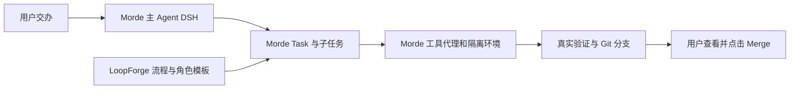

# Morde 复用 LoopForge 可行性分析

日期：2026-11-12。研究对象：[Tencent/LoopForge](https://github.com/Tencent/LoopForge)，源码固定在 [`08e7110`](https://github.com/Tencent/LoopForge/commit/08e71101ddc1fba5c4f74589209a696c678a8ba3)。本文为选型评估，不表示已接入 Morde。

## 结论

LoopForge **值得复用，对 Morde 的自动开发和缺陷修复帮助较大**：它公开了开发流程、角色提示、审查与测试规则、Git 工作区和失败处理代码，还提供 DSH 插件。对第一里程碑的 PC/iOS 对话、云电脑和手动文件夹同步，它不能直接替代 Morde 的现有实现。

推荐**优先复用经过筛选的流程和组件，并适配到 Morde 现有 DSH、Task 和工具代理**；暂不整体内置 LoopForge 平台。它的插件可以作为适配起点，但不能直接安装后就认为与 Morde 的授权和恢复链路兼容。

## 哪些可以用

| 能力 | LoopForge 的现成材料 | 在 Morde 中怎么用 | 判断 |
| --- | --- | --- | --- |
| 缺陷修复流程 | [通用缺陷修复 SOP](https://github.com/Tencent/LoopForge/blob/08e71101ddc1fba5c4f74589209a696c678a8ba3/migrations/seed/001_public_catalog.sql#L11)，包含确认、实现、评审、测试和交付等角色 | 提取角色提示与检查规则，纳入 Morde 受控技能；小问题保持单 Task，复杂问题再拆分 | **优先复用内容，需适配**。SQL 默认绑定 CodeBuddy，不能直接导入当作 DSH 任务 |
| 小问题处理 | [SOLO 规则](https://github.com/Tencent/LoopForge/blob/08e71101ddc1fba5c4f74589209a696c678a8ba3/local/skills/devflow/rules/stages/solo.md)将计划、实现、自审、测试放在一个阶段 | 用于首页样式、刷新按钮等简单任务，按实际影响范围决定是否升级 | **优先复用规则**，不用增加多 Agent 流程 |
| 评审和测试 | [评审规则](https://github.com/Tencent/LoopForge/blob/08e71101ddc1fba5c4f74589209a696c678a8ba3/local/skills/devflow/rules/stages/review.md)、[测试规则](https://github.com/Tencent/LoopForge/blob/08e71101ddc1fba5c4f74589209a696c678a8ba3/local/skills/devflow/rules/stages/test.md)及报告模板 | 复用检查要点，让结果绑定实际改动、执行命令和结果，失败反馈给 AI 修复 | **优先复用内容**；测试成功仍须由 Morde 的执行证据确认 |
| Git 分支与合并 | [`internal/gitwork`](https://github.com/Tencent/LoopForge/tree/08e71101ddc1fba5c4f74589209a696c678a8ba3/internal/gitwork) 有基线、分支、临时 worktree 和冲突检查 | 选取适合的代码和测试思路，接到 Morde 的隔离仓库、版本校验与用户 Merge 按钮 | **适配后可用**。现成的共享分支函数会推送远端，不能直接用于当前不外发文件的流程 |
| 结构化质量结果 | [gate MCP](https://github.com/Tencent/LoopForge/blob/08e71101ddc1fba5c4f74589209a696c678a8ba3/internal/gatemcp/server.go) 定义通过、返工、失败及需人工处理 | 参考其结果格式，接入 Morde 的 Task 结果、真实测试回执和审批 | **按需适配**。该工具使用 stdio 和本地结果文件，不能直接当作 Morde 已配置好的 HTTP MCP 连接器 |
| 复盘改进 | [运行评估](https://github.com/Tencent/LoopForge/blob/08e71101ddc1fba5c4f74589209a696c678a8ba3/internal/runeval/prompt.go)从运行记录生成改进建议 | 稳定后参考它分析失败原因，生成技能或规则修改建议 | **后续再做**。公开版页面应用建议前仍需确认，不应宣传为完全自动、自证有效的进化 |

这些流程可用于之前讨论的四种请求：淘宝类大项目和 Muse 对齐可参考角色与阶段拆分；首页样式和刷新按钮优先使用单任务路径。不能把固定的七阶段缺陷 SOP 强加给每一个小修改。

文章中的交付数量和效率是项目团队自述，不能直接推算 Morde 的收益。[公开范围说明](https://github.com/Tencent/LoopForge/blob/08e71101ddc1fba5c4f74589209a696c678a8ba3/docs/open-source-scope.md)明确不包含私有生产项目、数据和部署资产；公开版的通用 SOP 不等同于文章中 SkillHub 的完整生产门禁。

Git 部分有一个具体差距：上游[临时 worktree 合并函数](https://github.com/Tencent/LoopForge/blob/08e71101ddc1fba5c4f74589209a696c678a8ba3/internal/gitwork/shared.go#L49-L86)发现冲突时中止并返回冲突文件，并不会自行调用 AI；成功时还会向远端推送。Morde 需要接上自己的 AI 处理、重新验证和用户确认合并。相关代码位于 Go 的 `internal` 目录，Morde 作为另一个模块不能直接 import；摘取或封装时还需梳理依赖并做适配测试。

## DSH 插件能否直接接入

LoopForge 提供 [`@tencent/loopforge-dsh` 插件](https://github.com/Tencent/LoopForge/blob/08e71101ddc1fba5c4f74589209a696c678a8ba3/local/dsh-plugin/README.md)，并提供 [DSH 的 Portable Skill 适配器](https://github.com/Tencent/LoopForge/blob/08e71101ddc1fba5c4f74589209a696c678a8ba3/local/skills/devflow/adapters/dsh/adapter.md)。插件声明适用于 DSH 0.2.1 及后续兼容 bundle 的版本；Morde 当前锁定的是 `0.2.2-rc.1`，不能仅凭版本号宣称完整兼容。

本地最小注册探测使用了该固定提交的插件源码和 Morde 已安装的 DSH 包：

- 只有 Morde 当前组合中的工具服务时，插件因缺少 `commands` 服务而未激活；增加命令服务后，`/loopforge` 和 `loopforge_status` 可注册。
- 这只证明注册接口的局部兼容，**没有执行插件命令、工作流、真实模型或 Morde 端到端任务**。`dsh-commands` 即使作为传递依赖存在，也不等于已在 Morde Agent 上启用。
- 插件期待名为 `subagent` 的工具；Morde 当前提供的是 [`dsh_delegate`](../runtime/morde-cloud-runtime/src/engine.mjs)，带任务身份和工具权限。需要适配参数、子任务身份、完成通知、取消与恢复，不能只改工具名。
- 插件直接启动 Python，并在工作目录读写流程状态；其审批命令也不是 Morde 的审批记录。接入时必须通过 Morde 的工具代理、Task 和授权边界执行及对账，不能直接在共享 Runtime 中运行脚本或让插件自行扩大权限。
- Portable Skill 还依赖多份规则、模板和 Python 脚本；单独复制 `SKILL.md` 并不完整。其 [medium/large 流程要求确认需求](https://github.com/Tencent/LoopForge/blob/08e71101ddc1fba5c4f74589209a696c678a8ba3/local/skills/devflow/references/workflow-contract.md#L27-L39)。Morde 应在用户已有明确授权且需求清楚时自动推进，保留真实需要的审批与最终 Merge，而不是机械增加确认步骤。

Morde 已有受控技能目录和 MCP 工具代理，分别见 [技能目录](../server/internal/app/cloud_dsh_skills.go) 和 [MCP 授权与操作记录](../server/internal/app/cloud_dsh_mcp.go)。可先将审过的少量规则适配为现有技能；需要完整工作流时，再评估为其接入符合 Morde 生命周期的 provider。新增或升级任何插件前，固定版本并验证会话、检查点、停止、恢复和授权撤销。

## 为什么不建议整体内置

LoopForge 完整平台自带工作流引擎、MySQL、账号、工作区和执行器；Morde 已有独立的服务端、PostgreSQL、用户体系、Task 和 DSH Runtime。两套同时运行会增加身份、状态、凭据和故障恢复的对接，不能直接获得统一的 PC/iOS 体验。

LoopForge 平台也支持选择 DSH CLI，但其实现会启动独立 headless DSH 进程，并使用自己的凭据和运行配置；直接启动并不等同于使用 Morde 的模型网关、授权与任务账本。见 [执行器实现](https://github.com/Tencent/LoopForge/blob/08e71101ddc1fba5c4f74589209a696c678a8ba3/internal/runtime/provider_agentcli.go#L188-L197)。若未来评估复用其平台调度，必须先让执行接入 Morde 的 DSH 与现有边界，不能新增一套并行 Agent Runtime。

此外，LoopForge 的[默认部署面向可信团队](https://github.com/Tencent/LoopForge/blob/08e71101ddc1fba5c4f74589209a696c678a8ba3/docs/deployment.md#L50-L79)，Docker 部署使用宿主 Docker socket，项目数据的可见范围也与 Morde 的多用户隔离目标不同；它的工作流并发节点还可能共享同一运行工作区。不能把这些默认行为直接当成 Morde 的隔离保证。

公开材料没有显示它实现了第一里程碑要求的“PC 用户点击按钮，将本地项目单向同步到指定云电脑，并安全处理删除和冲突”的完整链路。Morde 的对应能力目前仍有 [CFS-11 真实链路验收门禁](实施/Morde云端电脑与项目文件同步实施任务todo清单文档.md)；本次没有发送文件，也没有执行该传输验收。

## 建议顺序

1. **先完成第一里程碑。** 保持 Morde 现有主 Agent、任务、两端会话、授权和 PC 手动单向同步目标，不因引入另一平台延误闭环。
2. **先做一个小缺陷闭环。** 按现有 DSH Task 接入裁剪后的 LoopForge SOLO、评审和测试规则；补齐受控 Git clone/worktree、提交和用户 Merge。遇错时保留证据，由 AI 尝试修复；修改只进入隔离分支。
3. **再做复杂开发。** 小闭环通过后，以 LoopForge 的前后端与缺陷 SOP 为参考，适配 Morde 的任务依赖、角色和结果回传；只在独立任务有收益时并行。最后再评估完整 DSH 插件及复盘建议。

首个试点可用本机合成 Git 项目：让一个 Task 修复已知缺陷，验证测试失败后的继续处理、分支提交、冲突重试和用户点击合并；确认原工作目录不变，并把测试结果绑定到最终合并版本。合成模型只能验证流程，真实修复能力需要另用符合当前本地限制的可用模型验证。

优先使用现有 DSH 插件与 Morde Broker，不新增独立 Agent 循环。复用源码前保留 [MIT 许可和版权声明](https://github.com/Tencent/LoopForge/blob/08e71101ddc1fba5c4f74589209a696c678a8ba3/LICENSE)，逐项核对 [第三方组件声明](https://github.com/Tencent/LoopForge/blob/08e71101ddc1fba5c4f74589209a696c678a8ba3/THIRD_PARTY_NOTICES.md)。

## 已验证与限制

- 静态对照了 LoopForge 的 DSH 插件、Portable Skill、公开 SOP、Git、门禁、部署与恢复代码，以及 Morde 当前 DSH、工具代理和第一里程碑资料。
- 本机运行 Morde DSH 四项定向测试：子会话委派、后台子任务、取消和检查点恢复均通过；测试使用合成模型与 IPC，不等于真实模型或 PC/iOS 完整链路验收。
- 插件注册探测和定向测试均在本机执行；没有安装 LoopForge、改动 Morde 代码、发送文件或进行真实模型调用。尚未验证完整插件适配、多用户隔离、真实 Git 交付及性能收益。
