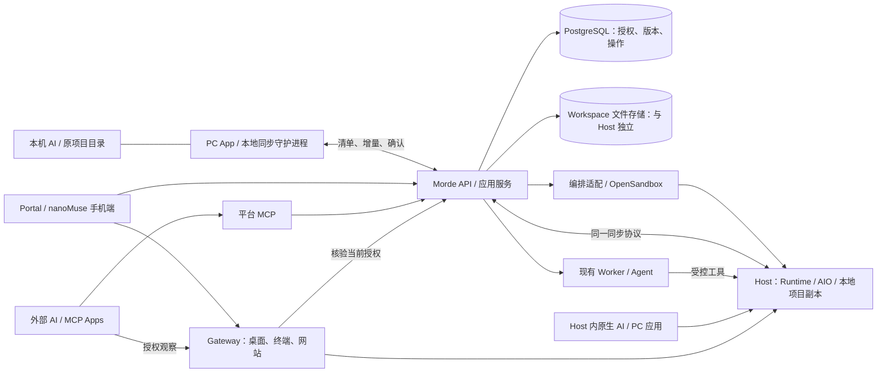

# Morde 多端托管与共享工作区设计方案

> 日期：2026-10-24；实施状态更新：2026-10-25。依据：[需求文档](Morde多端托管与共享工作区需求文档.md) R01–R14、S01–S10。状态：目标设计，未代表功能已实现或验收通过。
>
> 本文统一多端接续、托管、工作区、共享与 Agent 接入的设计；与[原设计](AI与用户共用云端主机设计方案.md)重叠部分以本文为准。任务、定时通知、笔记、模板与交付继续复用原模块。本文描述拟扩展模型和接口职责，HTTP 契约仍以 [OpenAPI](../server/openapi/portal.yaml) 为准；实施时同步代码、迁移与[公共约定](实施/00-总览与公共约定.md)，不并存两套业务逻辑。

> **客户端基线更新（2026-10-26）：** 当前 Web MVP 不实施 nanoMuse 客户端改造；正式手机和桌面客户端均以 `project/nanoMuse` 为二开基线。当前没有 Windows 原生环境，Windows 实测记为环境缺失。应用托管 / AI 操作、网站发布和完整开箱交付拆出重新设计，见[待重新设计大项](实施/21-待重新设计的大项.md)；长期目标与既有实现不在此删除。

> **客户端专项设计：** 先看[精简设计与重复能力决策](Morde基于nanoMuse多端客户端精简设计与重复能力决策.md)；PC、手机 Web、Android、iOS 的模块删改、双凭证授权、旧桌面迁移及 Portal/Admin/Workbench 对接详见[完整版二次开发设计方案](Morde基于nanoMuse的PC与手机端二次开发设计方案.md)。

## 1. 设计决定

- **本地工作优先：** 原 AI 继续使用原项目目录。首选方案是 PC App 在当前用户会话后台把普通目录增量同步到服务端 workspace；离开电脑前以稳定检查点交给云端 Host，回来后比较并接回。文件迁移不迁移 AI 进程、厂商登录或原聊天。该方案不要求改造 AI 工具或安装文件系统驱动，Windows、macOS、Linux 均列为目标平台，逐平台原生验收通过后才声明支持。真正的共享文件系统挂载是后续可选能力，不是“无感同步”的前置条件。
- **两个手机入口：** S09 直接使用云端原生 AI；S05 在 Morde IM 委派服务端 Agent。S10 从应用卡进入同一套委派流程，不新增第三套聊天或执行系统。
- **手机和桌面均基于 nanoMuse 二次开发：** 使用本地 `project/nanoMuse` 的 Web、Android、iOS、桌面外壳和桌面插件。现有独立 `project/morde-desktop` 仅作为 Morde 同步与设备授权能力的移植来源，不作为最终安装包。手机网页先保证可用，原生端按交付范围另验；手机实施仍后置。
- **一个控制面：** 复用现有 Go 分层、PostgreSQL、Portal、Workbench、Agent、Runtime、Gateway 与 OpenSandbox。首期不拆微服务，不增加第二套账号、任务队列或审批系统。
- **状态分别管理：** 代码位置、执行位置、文字连接、画面连接、桌面控制权和文件写入权分别显示。关闭观看不停止计算，接管桌面不代表原生 AI 已停止写文件。
- **先交付三项同步能力：** 上传、只补缺失下载、PC 双向实时同步均为首版必需；绑定已有 Host 也在首版完成。随后验证 S09 同款 AI 接力；集群、JuiceFS、邀请共享和本机 AI 对话桥接分别验收。

| 首版必须完成 | 用户操作与完成结果 |
|---|---|
| 本地 → 服务端 → Host | 选择文件夹及全部 / 部分范围，扫描大小和待传量，显示可续传进度；无需先开 Host。上传后创建新电脑，或绑定已有电脑并打开正确目录。 |
| 服务端 → 本地 | 选择 workspace、范围和本地目录；**默认只补缺失文件**。已有相同文件跳过，已有不同文件保留本地并提示；不删除本地额外文件。 |
| PC 双向实时同步 | 用户明确开启后，两端保存的变化自动增量同步。先核对初始差异；在线无冲突时自动收敛，断网、未应用和冲突可见，不能承诺每一瞬间字节相同。 |

“按需同步”指手动触发或仅选文件 / 子目录；首版不依赖文件占位符、透明懒加载或 JuiceFS。仅补缺失下载不会自动变为双向同步，也不把仍有差异的目录标成全部一致。

## 2. 总体架构与复用边界

**服务端 workspace 不依赖 Host 进程：** 在现有 WorkspaceService 增加文件存储端口，单机落到专用持久存储；清单、版本、会话和回执入 PostgreSQL，正文和分块不入数据库。集群阶段将存储适配为各服务实例可访问的持久后端。大文件走受限流与授权保护的流式通道，避免一次读入内存。

**Host 使用普通文件副本：** Runtime 在现有持久文件根下管理互不重叠的 workspace 目录，监听 AI / 终端的直接修改，与服务端交换增量。Host 是 Workspace 同步协议中的独立副本身份：复用相同的 revision、清单、分块、校验、冲突与确认规则，不另造同步算法；Host 凭据只能访问该 Host 当前绑定且获授权的 Workspace。首次绑定在隔离暂存目录应用指定 `desired_revision`，校验相对路径、文件大小、块哈希与整文件哈希后再安全落盘；只有 Host 确认应用完整 revision，服务端以 Host、Workspace、binding version 和 revision 做 CAS，且 Runtime 已装入对应 binding version，才允许绑定变为 `active`。绑定状态迁移先锁 Host，再按 Workspace→binding 顺序重读并 CAS 检查绑定版本与期望 / 已应用 revision；迁移只改状态和版本，不从旧读取值回写 revision。Host 删除也在 Host 行锁下核验所有绑定均 detached；Host 进入 deleting 后拒绝重新绑定并立即使副本凭证失效。激活要求 `applied_revision == desired_revision == workspace.revision`。应用期间 `desired_revision` 前进、完整性失败或回执未知均保持 `preparing` 并阻止工作区操作，查询同一版本后再恢复。后续 Host 直接写入也由同一副本协议提交；两端改动并存时保留冲突，不得用再次初始化覆盖活动工作区。当前代码已接入 Host scoped 副本凭证、Portal 绑定快照、指定 revision 下载 / 安全应用 / 完整回执、初始激活及 LiveSync，并通过同一协议上传 Host 文件变化。解绑先停 Runtime watcher 和新 Morde 路由，再用 HandoffCheckpoint 核验稳定版本并通过 CAS 标记 detached；缺少初始 LiveSync 基线时只允许不删除文件的 fill_missing。Portal 绑定 / 解绑页面与 API 已接通，真实登录后的内置浏览器流程和真实 Host 联调仍待验收，见实施 TODO。新增绑定只准备独立目录，不替换原项目或重启已开应用；不依赖给运行容器热插 Docker 卷。Morde 文件与 Shell 工具按 binding version 限定目录；但一个 Host 的 GUI 应用和桌面会话共享 `gem` 系统账号，可见该账号能访问的所有 Workspace。Shell bind mount 也不能隔离已存在的跨目录硬链接。因此，同一 Host 上的 Workspace 绑定是工具路由和同步边界，不是相互保密的 OS 租户边界；需要文件保密时应使用不同 Host / OS 身份，不能靠路径或 UI 声称隔离。Runtime 打开目录时核对路径检查与已打开目录句柄是否为同一目录；Shell jail 直接绑定该已核验句柄，避免校验后再按可变路径解析。绑定版本替换或撤销时先暂停该 Runtime 上新的 Workspace 请求，停止旧版本的在途操作并等待 handler 退出；只有停止得到证明后才原子安装新快照。若无法证明停止，保留旧快照并隔离该 Workspace，重试核验后再解除。服务端已提交版本、Host 已应用版本、PC 已应用版本分别记录；打开新绑定必须等所需版本核验完成。Host 停止时上传、下载仍可进行，状态显示“待电脑上线应用”；未上报的 Host 改动不宣称已备份。

| 模块 | 复用基础 | 本次需要补齐 |
|---|---|---|
| 控制面与文件 | [应用服务](../server/internal/app)、[API](../server/openapi/portal.yaml)、PostgreSQL | 独立 workspace 创建 / 文件服务、绑定、版本与传输会话；设备与成员授权、交接、原生会话和网站登记。遵守 [server 分层规范](../server/AGENTS.md)，不另建同步业务系统。 |
| 执行与画面 | [Runtime](../project/morde-runtime)、AIO、[Gateway](../server/internal/gateway)、[Workbench](../web/workbench/src/app/Workbench.tsx) | 原生进程存续、占用核验、应用窗口和结果核实；补连续观看与撤销验收。 |
| 平台 IM | [TaskService](../server/internal/app/task_service.go)、[Agent](../server/internal/app/agent.go)、任务 SSE | 多轮上下文、同一消息的文本增量、对话级恢复和进行中消息处理；不以任务轮询代替流式回复。 |
| 手机端 | [nanoMuse Web](../project/nanoMuse/web)、[Android](../project/nanoMuse/android/src/android)、[iOS](../project/nanoMuse/android/src/ios) | 适配 Morde 身份、Host / 项目 / 应用、消息、审批、画面与重连。原 Cloud / Hub 不直接兼容 Morde。 |
| PC App 与同步执行端 | nanoMuse 的 `harness/desktop` Electron 外壳和 `harness/dsh-nanomuse` 插件；现有 `project/morde-desktop` + `project/morde-sync` 是已实现能力来源，Host 侧继续使用 Runtime | 将 Morde 设备授权、多项目目录映射、上传 / 下载、持续同步、冲突与交接接入 nanoMuse 桌面端，沿用 Go 同步引擎及服务端协议。文件读写只针对用户选择并授权的目录；不安装管理员级服务或文件系统驱动。独立 Morde Desktop 的三端构建不等于最终客户端验收。 |
| 镜像与部署 | [Host 镜像](../images/host/Dockerfile)、[单机部署](../deploy/single/README.md) | 统一软件配方、恢复核验、持续在线部署与连接向导；不把现有手工部署描述为已开箱即用。 |

**nanoMuse 客户端的具体改造边界：** 本轮最初核对的桌面外壳与插件 `package.json` 均为 1.0.7；截至 2026-10-26，`project/nanoMuse` 已从共享工作区移除，实施前须恢复并核对该基线。下表指最终 Morde 客户端，均未因 nanoMuse 上游已有界面而算作完成。Morde 服务端继续管理身份、Host、Workspace、Task、审批与控制权，不迁入 nanoMuse 自带 relay 或本地运行时。

| 功能 | 手机 Web / Android / iOS | 桌面 `harness/desktop` + `harness/dsh-nanomuse` | 复用 / 服务端边界 |
|---|---|---|---|
| 身份与服务地址 | Morde 登录、会话失效与服务切换；隔离本地缓存和未发消息 | Morde 登录与设备配对、系统安全存储、开机恢复、撤权后停同步 | 原 nanoMuse Cloud 登录、模型、Hub 和对话同步不能直接指向 Morde；社区服务不能成为前置或失败回退。Morde 账号和授权是唯一来源。 |
| 项目与云端电脑 | 从 nanoMuse 设备 / 项目界面选真实 Host、Workspace、应用；显示状态与执行者 | 在 nanoMuse 桌面导航加入同一 Host / Workspace / 应用入口，可进入 Portal / Workbench | 原 Hub 设备是账号设备，不等同于 Morde Host；请求带稳定 ID 与授权，不能按名称猜测。 |
| Morde 对话与任务 | 聊天展示连续消息、流式回复、动作、待办、通知和审批；后台恢复同一任务 | 桌面插件展示同一 Morde Conversation / Task、进度与审批，明确本机 nanoMuse Agent 与 Morde 服务端 Agent 的执行位置 | 复用 nanoMuse 的聊天呈现，不复用其会话 ID、审批判定或本地任务状态。Morde SSE、消息游标、幂等键和动作版本是合同。 |
| 云端 AI / PC 应用 | S09 打开目标目录、持久终端或云端 AI；S10 从应用卡委派并核对结果 | 打开同一 Host 的 AI / 应用和就绪状态，处理登录缺项 | 应用安装、状态、执行与结果仍由 Morde Host / Runtime / Agent 管理；客户端不凭“已安装”宣称可自动操作。 |
| 画面与接管 | 在手机界面接入 Gateway 画面、触摸、软键盘、观看 / 接管 / 重连 | 从桌面界面进入受保护 Workbench，区分观看、人工控制和 Agent 执行 | 复用 Morde Gateway / Workbench / RuntimeControl；原 nanoMuse Hands 只可用作交互参考，不能绕过控制权和审批。 |
| 本地文件同步与交接 | 查看项目文件、差异、同步与交接状态，按权限触发服务端动作 | 把 `project/morde-desktop` 的目录选择、设备授权、按需上传 / 缺失补齐、实时同步、暂停续传、冲突与检查点接入 nanoMuse 外壳；继续运行 `morde-sync` | 共用 Morde Workspace 清单、分块、revision 与 Host 副本协议；不使用 nanoMuse 的对话同步代替文件同步。同步进程不因关闭聊天窗口而丢失。 |
| 设置、发布和旧客户端切换 | Morde 品牌、说明、所选服务和权限文案 | Morde 品牌、安装包、更新源、托盘与启动项；已安装独立 Morde Desktop 的目录映射和凭证要先核验再切换 | 记录 nanoMuse 基线版本与 GPL-3.0-or-later 许可；不静默删除旧本地数据、不把凭证写入前端或发送到社区服务。 |

### 2.1 PC App 安装、同步与操作系统支持

**最终 PC App 以 nanoMuse 桌面源码构建，默认用本地普通目录副本，不把挂载当作“无感同步”。** 本机 AI 继续读写本机文件；移入 nanoMuse 外壳的 Morde 同步进程在当前用户会话中后台工作。一个 App 可管理多个项目连接，每个连接绑定一个本地目录和一个已授权 Workspace；重叠目录不允许同时绑定，避免重复扫描与互相覆盖。用户看到项目名和同步状态，不需要复制 Workspace ID 或了解块存储。

这里的“无感”指一次安装、登录、选择目录并明确开启同步后，日常保存自动增量同步；断网仍可在本机工作，恢复后自动续传，托盘和 Portal 持续显示状态。首次目录授权、首轮扫描、冲突处理和跨设备交接确认不能隐藏。PC App 不改造本机 AI，不把它的终端或进程搬到云端。

**把跨平台支持拆成两种能力，避免将安装包或上游客户端支持误当作 Morde 产品已验收：**

| 能力 | 用户实际体验 | 安装负担与支持口径 |
|---|---|---|
| 普通目录副本同步（默认） | 本机 AI 用原有项目路径；PC App 将用户选择的普通目录同步到服务端 Workspace / Host。可管理多个项目；单个项目首次选择本地目录并建立基线后，只有明确启用的连接会在系统登录后自动恢复。离线保留本地工作，联网后续传。 | 不装 FUSE / 文件系统驱动，不要求 root / 管理员权限；需一次登录、选目录并同意该目录访问。设备凭证放系统安全存储，过期才重新登录。Windows、macOS、Linux 为目标平台，逐平台验收安装、文件事件、原子保存、Git、休眠与断网恢复后才能标为“支持”。 |
| 共享文件系统挂载（可选） | AI 仍通过本机路径读写同一份云端管理的文件；这只是文件访问位置透明，终端、浏览器及应用仍在本机运行。 | 依赖各系统的 FUSE / 驱动。JuiceFS 社区版文档覆盖 Linux、macOS、Windows；macOS 需要 macFUSE，Windows 需要 WinFsp，Linux 需要可用的 FUSE 环境。安装权限、系统授权、路径形式和离线行为不一致，故逐平台单独评估、引导和验收；不承诺免配置或离线可写。 |

JuiceFS 上游依据：[安装文档](https://juicefs.com/docs/community/getting-started/installation/)、[Windows 使用说明](https://juicefs.com/docs/community/tutorials/windows/)。Morde 当前 Workspace 使用自身的清单、版本和分块存储；JuiceFS 不能仅靠把现有目录“挂出来”就自动复用这套授权与版本语义。T21.18 必须先证明能接入同一 Workspace 数据和授权事实源，不允许再造一套可写副本或双写；否则不实现挂载。上游支持只说明技术候选可用，不代表 Morde 已集成、已验证或适合默认安装。

**目标操作系统：Windows、macOS、Linux。代码可编译不等于用户可安装，安装成功也不等于同步行为已验收；普通同步与可选挂载分别记录“可编译 / 可安装 / 原生验收通过”。**

| 系统 | 当前仓库证据（2026-10-24） | 可对用户承诺的门槛 |
|---|---|---|
| Windows | 已构建 Windows x64 NSIS 安装器；`morde-sync` 通过 Go 交叉编译。尚未在 Windows 安装运行，签名状态未核验。 | 先验普通用户安装与目录授权；发行包使用稳定发布者签名并在干净用户环境核验。签名不保证新发布者立即没有 SmartScreen 提示。 |
| macOS | 已构建当前 Apple Silicon 架构 DMG；最低系统版本为 macOS 14，未配置 Developer ID 签名 / 公证。尚未完成安装后的同步验收。 | 正式下载包须 Developer ID 签名并公证，再验系统目录授权和原生同步；不要求用户授予不必要的全盘访问权。 |
| Linux | 已构建 Linux x64 AppImage；Debian 包未提供。尚未在目标发行版安装运行。 | 首轮先确定并验收具体发行版 / 架构（建议 Ubuntu LTS x64），安装和首次启动不要求用户开终端；其他发行版通过原生验收后再列为支持。 |

减少首次安装阻力的发布条件：Windows 提供免管理员的用户级安装器并保持稳定签名身份；macOS 提供 Developer ID 签名 / 公证的 DMG；Linux 首批支持发行版提供可从文件管理器完成安装 / 首次启动的格式。Windows 的 SmartScreen 信任会随发布者声誉建立，不能承诺新发行者从第一版起完全无提示；macOS 公证用于让 Gatekeeper 识别已签名并经 Apple 检查的软件。[Apple 公证说明](https://developer.apple.com/documentation/security/notarizing-macos-software-before-distribution)、[Microsoft Windows 签名选项](https://learn.microsoft.com/windows/apps/package-and-deploy/code-signing-options)。

**目标安装流程（普通同步）：** 从 Morde 网页下载已带服务端地址的 Desktop → 登录并在网页明确批准设备及一个或多个 Workspace → 在 App 中为每个项目选择本地目录 → 查看扫描大小并确认同步范围 → 显式开启实时同步。以后只需从项目列表查看状态；用户启用的连接可在登录系统后自动恢复，不新增目录、不扩大授权、不静默覆盖冲突。设备凭证安全保存在系统凭证存储中。首次扫描和传输显示文件数、总量、已完成量与当前状态；状态至少区分本地待传、同步中、双方已对齐、离线、冲突、Host 待应用和需要重新授权。普通同步不要求终端命令、Docker、管理员服务或文件系统驱动；系统目录授权提示不能绕过或隐藏。日常目标是“配置一次后少打扰”，不是零配置或没有故障处理。挂载只作为单独启用的高级选项，安装前检查依赖并说明额外权限和离线限制，不自动改变系统安全设置。

**当前体验缺口（2026-10-25 源码核对）：** [Desktop 页面](../project/morde-desktop/src/renderer/App.tsx)已支持设备获准 Workspace 列表、多个本地目录映射和每个项目独立的实时同步设置；设备授权列表 API 已实现。Desktop 现将本机配对状态与服务端连接 / 授权状态分开：401 / 403 显示授权失效，网络 / 5xx 显示服务不可用；刷新会清空旧授权快照但保留本地目录映射，失败时禁用同步操作，“最近已验证”只代表最近一次授权刷新成功。测试覆盖离线、未授权及恢复连接，但不是实时在线证明。打包器已支持通过 `MORDE_PORTAL_URL` 注入部署地址，安装包首启使用该值，用户保存过的地址优先；开发和普通 build 默认为 `http://portal.localhost`。发布流水线仍须设置真实部署 URL，仓库没有替用户选择生产域名；缺少该值时打包校验会失败。若正式包运行时缺少内嵌地址，Desktop 明确报安装配置错误，不会静默回退至 `portal.localhost`。首次使用仍需在 Portal 登录并明确批准设备与 Workspace、逐个选择本地目录并开启实时同步。目录授权由操作系统明确询问，不能隐藏或绕过。登录自启仅在用户已开启时恢复仍获授权且目录有效的连接；退出时远端停止状态不确定会阻止自动恢复并提示核实。本机临时 macOS arm64 解包验收确认 `Resources/bin/morde-sync` 可执行并能响应 JSON-RPC（测试地址为 `http://portal.localhost`，未覆盖仓库现有安装包）；Portal 安装包下载交付、登录后的完整浏览器流程及 Windows、macOS、Linux 原生安装 / 同步仍待验收，因此当前不能描述为零配置、无感或跨平台已支持；T21.07 / T21.20 继续跟进。

**目录身份校验（T21.07，2026-10-25）：** Desktop 选择本地目录时先解析 canonical path；选择目录 symlink 会保存其真实目标路径，使共用同步引擎接收到它能安全打开的普通目录。设置同时保存文件系统 `dev/ino`，同步、实时同步恢复和交接前复核路径身份；缺少身份的旧设置、路径失效或可检测到的同路径目录身份变化会要求重新选择。修改最初用于选择的 symlink 不会重定向映射，因为保存的是规范目标。Desktop 66 项测试、lint、typecheck、build 通过。**边界：** `dev/ino` 是文件系统提供的尽力身份，不保证永久唯一（删除后可能复用）；路径校验与同步子进程实际打开目录之间也有极短竞态，因此不能作为对抗本机恶意进程的安全隔离边界。当前只在 macOS 验证，其他平台和文件系统行为仍需原生验收。

构建记录来自本地 macOS Apple Silicon：`package:mac`、`package:win`、`package:linux` 均已生成目标包；Windows / Linux 交叉构建不代表可在目标系统安装运行。三种系统的托盘行为、普通权限目录访问、断网恢复及文件系统兼容性仍未验收。

### 2.2 工作区迁移与挂载的选择

工作区是服务端保存版本的项目身份；每个 PC 项目连接把一个本地目录映射到一个已授权 Workspace，同一 PC App 可保存多个独立连接。迁移是把同一工作区的文件安全接到另一设备或 Host，挂载则是让本机通过文件系统驱动访问远端存储，两者不是同一条同步逻辑。

| 场景 | 默认路径 | 数据与执行边界 |
|---|---|---|
| 本地电脑 → 云端电脑 | 在 PC App 选择一个项目连接，先停止本地 AI / IDE 写入并核验稳定检查点，再创建或绑定 Host 并打开该 Workspace。 | 首次传项目范围，后续只传变化块并可续传。AI、登录态和聊天进程不随文件迁移；云端 AI 需在 Host 内单独安装 / 登录。本机 AI 仍在本地运行。 |
| 云端电脑 → 本地电脑 | 将同一 Workspace 下载到选定本地目录。首次恢复可选择“只补缺失文件”；继续接力则使用共同基线做三方比较。 | 只补缺失不会覆盖本地同名差异，也不代表接力完成。三方比较保留两端新增 / 修改 / 删除，冲突由用户选择；只有云端停写并核验后才启用本地写入。 |
| Host A → Host B | 先停止 A 的项目写入，将 A 的待同步变更提交并核验服务端检查点，再解绑 A、把同一 Workspace 绑定 B；B 从服务端补齐缺少块并校验版本。 | 不从 A 到 B 重传整个项目，也不迁移 Host 的 AI 登录、应用状态或未确认数据。A 离线或无法提交变更时阻止解绑并保留原 Host；任一时刻至多一个活动可写 Host。 |
| 需要本地 AI 直接读写远端文件 | 仅在普通副本同步确实不满足需求时评估 JuiceFS 等挂载。 | 挂载不是迁移或手机接力的前置条件，也不迁移命令执行位置。Morde 尚未验证任何平台的挂载；macOS / Windows 需要额外文件系统组件，Linux 依赖 FUSE。挂载必须复用同一 Workspace 授权、版本和容量账本；无法做到时不交付，避免与同步副本形成两套事实源。 |

因此，“用户无感知”的首版目标是**AI 继续使用本机普通路径；完成一次安装、登录、目录授权和连接后，已启用项目在后台增量同步，重启后恢复并显示清楚状态**。不能隐藏首次授权、冲突和跨端停写确认。普通副本同步面向 Windows、macOS、Linux，按平台独立签名 / 打包及原生验收；当前已有交叉构建不等于支持。挂载会增加驱动 / 系统授权和离线语义负担，按平台独立评估，无法保持单一数据源或无法做到低干扰时继续使用普通同步，不把挂载作为首版路径。

## 3. 数据模型与保存范围

下列是需要持久化的逻辑信息，优先扩展既有实体，不要求每行新增一套服务或数据库表。

| 对象 | 关键数据与约束 |
|---|---|
| Workspace / Host 绑定 | workspace 独立拥有身份、归属、文件版本、范围与用量；无 Host 也可存取。绑定记录 Host、独立目录、期望 / 已应用版本及就绪状态；首版支持一台 Host 多个 workspace，一个 workspace 至多一个非 detached Host 绑定，包括 failed 状态；failed 不自动释放 Workspace 独占权。 |
| 本地设备与项目连接 | 每条连接记录设备、已授权 Workspace、唯一选定本地根目录、连接模式与状态；一台设备可有多条连接，重叠本地根目录拒绝启用。文件授权与 AI 会话授权分开；凭证放本机受保护配置，不放项目。Linux 只接受 GNOME Keyring / KDE Wallet；不安全或未知后端禁用配对，并保留已有凭证。 |
| 同步连接与传输操作 | 设备 / Host、workspace、范围、手动或实时模式、权限版本、游标；操作 ID、方向、清单版本、基线、分块校验 / 接收位图、待传与已确认字节、阶段和回执。持久记录可跨进程重启恢复。 |
| 文件版本与检查点 | 相对路径、类型、大小、内容哈希、逐文件版本、来源事件、删除标记；目录版本描述已提交文件集合。稳定检查点另记录范围、写入停止与完整核验结果。应用日志、恢复副本和冲突双方随操作保留。 |
| 写入授权 | 按设备 / Host / workspace / 范围授权并校验递增版本与有效期。实时同步允许两端产生变更，以文件基线检测冲突；PC 同步引擎用目录级 OS advisory lock 串行化 Morde 手动 / 实时 / 交接操作。执行交接、迁移和排他挂载另设写入屏障；该锁不冻结普通目录中的外部 AI / IDE，用户仍须先停写并核验稳定检查点。 |
| Conversation / Message / Task / Event | 沿用现有模型；补可选 workspace / 应用目标、消息送达与版本、授权摘要、可恢复消息事件。任务固定实际 Host、执行者和运行代次；跨 Host 新建关联会话段，保存交接关系，历史任务不改绑。 |
| 软件、应用与原生会话 | 软件来源、版本 / 架构、固定安装配方、恢复方式；应用安装、账号登录、模型可用、工作目录和会话状态分别记录，附最后核验时间；原生会话记录 Host、工具、目录、终端 / 进程标识和实际状态。登录秘密不放业务元数据。 |
| 网站服务 | Workspace、Host、允许端口、不可变来源 revision、release ID、独立启动配置、可变数据位置、访问权限、健康与日志入口、当前及回滚 release。服务身份不依附于 AI 任务或浏览器连接。 |
| 成员授权与连接 | 邀请成员、桌面查看 / 桌面操作 / 终端 / MCP 操作范围、授权版本与撤销状态；不授予 Workspace 文件同步 / 挂载、Host 管理或再分享。活动 SSE、WebSocket、MCP 能按成员与 Host 找到并失效。 |

**网站发布的执行隔离门槛（2026-10-25 核查）：** 现有 Host Shell 的 bubblewrap 隔离带独立网络命名空间，不能用来运行可由 Gateway 访问的长期网站；固定应用的 cgroup 只管理进程与资源，不隔离文件系统或网络。若把 Workspace 代码直接作为 `gem` 子进程运行，代码仍可能读取该账号可访问的其他文件、连接 Host 内 localhost 服务及公网 IPv4。故 T21.13 的正式发布必须把每个 release 放在独立执行沙箱中：只读挂载经校验的不可变发布输入，单独限制可变数据，移除 Host / Runtime 凭证，限制 CPU / 内存 / 进程 / 磁盘，并默认禁止对宿主、私网、链路本地、IPv6 和公网的主动出站；Gateway 仅能访问该 release 已登记的服务端口。构建也要运行在限时独立沙箱，依赖只从预装缓存或 lockfile 校验的受控代理 / allowlist 获取，不能为 `npm install` 等任意开放公网。不得为支持依赖安装而移除 Shell 的网络隔离，也不得把“独立目录 + cgroup”称为文件 / 网络隔离。独立沙箱与 Gateway 的入站通道未实现前，不开放任意用户项目的正式发布入口。当前预览目标端口也必须拒绝 Runtime TLS 控制端口 `8090`。

**网站制品的公开边界（2026-10-25）：** 当前 `sitefs` 为核验与重试会把固定 Workspace revision 的所有文件保存为私有候选制品；它不是可公开的站点目录，可能包含 `.env`、密钥、源码和 `.git`。未来构建输入与公开制品必须分离：只将用户明确指定的构建输出目录（例如 `dist/`）导出到 release；仅接受普通文件，拒绝符号链接和特殊文件；构建容器不得获得 Host 凭证或隐式环境秘密。不能依赖 `.gitignore` 排除秘密，也不能让 Gateway 直接公开当前 Workspace snapshot。candidate 的源 revision 字节数还须先通过单 release 上限，再建立 owner quota reservation；数据库状态与制品状态不确定时保留制品供幂等重试，只有权威记录确认已取消且未物化时才精确清理。

**Site Release 端口边界（2026-10-25）：** 外部服务端口只允许 `1024–65535`，并拒绝 Host 的 AIO、VNC、Runtime / Sandbox 控制端口；Domain 校验复用 `ValidPreviewTargetPort`，迁移 `00035` 在数据库中同步限制 `8080, 5900, 6080, 8090, 8091, 8100, 9222`。若旧数据库已有低位或保留端口记录，迁移会失败，不会自动改写。该校验仅避免持久登记占用 Host 控制端口，不提供站点执行或安全路由；独立沙箱和 Site-aware Gateway 未完成前仍不开放发布入口。

**实现进度（2026-10-25）：**已新增 Site / Release 状态与 PostgreSQL 持久化、候选晋升 / 失败保留 / 回滚事务及 Host drain 占用屏障。候选创建在同一事务读取指定 Workspace revision，以固定的 `SHA256("morde-workspace-manifest/v1\n" + canonical JSON)` 校验文件清单，并核对 revision 的文件数和总字节数；v1 投影按路径排序且明确字段，后续 `File` 新增字段不会静默改变历史摘要。摘要与 PostgreSQL 校验现逐文件读取、逐个编码到 SHA-256，不再保留整份 revision 的文件 / 分块对象或额外的完整 JSON；仍保留路径冲突索引及当前文件的临时编码，未做最大规模容量压测。drain 屏障现已与 Host release / delete 状态转换同事务接通：仅在 Host sandbox 清理完成后停止 Site、取消候选并解除屏障；失败或错误代次会保留屏障。Server 的 PostgreSQL 集成覆盖摘要不符拒绝和匹配摘要接受，以及生命周期与竞态。迁移 00036 持久化物化文件数、字节数和完成时间，并禁止未物化 candidate 晋升为 healthy；迁移 00041 持久化 `health_checked_at`，domain 与数据库均要求健康检查证据后才可晋升。当前只实现证据门禁，生产健康探针仍未接入。仍没有发布进程、隔离构建沙箱、健康探针或 Gateway 站点路由，Host 恢复后 Site 自动重启未实现，也未开放网站执行。

**单机备份补充（2026-10-25）：** `deploy/single/backup/backup.py` 格式 v2 已把 Site 发布物目录纳入校验和、结构校验、原路径恢复及中断恢复，与 PostgreSQL 和 Workspace 块一起作为离线备份单元；本机合成数据的 13 项备份测试通过。目标 Linux 上的 GNU tar / Docker 与真实数据恢复演练仍未完成，当前脚本拒绝格式 v1 bundle，升级前需确认并保留旧备份。备份 / 恢复期间必须停止 Portal 和所有 Site 写入者；sitefs 已使用跨进程共享发布锁与逐写入容量锁，并在启动时回收合法中断 staging，未知条目 fail-closed。本机另以真实子进程强制终止验证锁自动释放和残留 staging 回收；目标 Linux 并发及崩溃注入仍待验收。

**本机隔离网络烟测（2026-10-25）：** Docker Desktop 的一次性 `--internal --ipv6=false` 网络确实阻断了公网、私网、metadata、宿主别名与 IPv6 探针，但 Gateway 从宿主访问该网络容器的 loopback 发布端口失败；另一个可经 `127.0.0.1` 访问的非 internal bridge 没有主动出站过滤。两者都不能同时满足 Gateway 入站与站点默认拒绝出站。测试容器和网络均为独立临时资源并已清理，现有 `cloudhost` 资源未改动。当前机器无 Linux `nftables` / `runsc`，所以没有提交未经验证的 Docker profile；需在一次性 Linux Docker 环境验证独立 bridge + nftables 入站 / 出站规则及 OpenSandbox profile 后，才可开放该发布通道。

**固定 OpenSandbox 1.1.1 网络兼容性审计（2026-10-25）：** 当前 AIO 配置固定 `docker.network_mode="cloudhost"` 与 `secure_runtime.type="gvisor"`。该版本会拒绝给自定义 Docker 网络附加 `networkPolicy`，其 Egress sidecar 又固定加入默认 `bridge`；官方 Egress 文档说明 `dns+nft` 不支持 gVisor。因此不能在现有实例上直接启用 `networkPolicy` / Egress sidecar，也不能把它作为 Site 发布的默认拒绝证明。待验证的最小候选方向是保留 AIO 原实例与网络，另起专用 Site OpenSandbox 实例和 `cloudhost-site` 网络；在宿主网络层默认丢弃该 bridge 发起的新转发 / 入站流量，只允许已建立连接的回包，关闭 IPv6 与容器互通，并把发布端口限制绑定到 `127.0.0.1`。这是 Site 网络级隔离，不能按容器施加不同出站例外，也不能证明本机只有 Gateway 进程可访问 loopback 发布端口。只有目标 Linux Docker / gVisor 实测通过 Gateway 请求与回包、公网 / 私网 / Host / peer / IPv6 拒绝、外部直连拒绝、AIO 网络无回归后，才能实现及开放发布入口；这些组合目前未实测。参考：[固定版网络配置实现](https://github.com/opensandbox-group/OpenSandbox/blob/release-1.1.1/server/opensandbox_server/services/docker/networking.py)、[固定版 Docker 服务实现](https://github.com/opensandbox-group/OpenSandbox/blob/release-1.1.1/server/opensandbox_server/services/docker/docker_service.py)、[Egress 架构与运行时限制](https://github.com/opensandbox-group/OpenSandbox/blob/release-1.1.1/docs/architecture/network/egress.md)。

**Site 出站 DNS 验收门槛（2026-10-25）：** Docker user-defined bridge 会为容器提供 embedded DNS `127.0.0.11`；Moby 安全公告记录了特定 loopback host resolver 配置下，DNS 转发可能绕过网络路由限制的情形，并明确说明 Docker Desktop 不受该公告影响。此风险针对可能使用 Linux Docker Engine 的目标部署；本机 Docker Desktop 烟测不能替代目标 Linux 验证。当前部署没有钉住并核验受支持的 Docker Engine 版本、宿主 resolver 路径或 Site 容器实际 DNS 行为；普通 bridge / nftables 连通性测试不能证明没有 DNS 外传。开放发布前必须使用包含 [Moby GHSA-mq39-4gv4-mvpx 修复](https://github.com/moby/moby/security/advisories/GHSA-mq39-4gv4-mvpx) 的受支持 Engine，核验宿主 resolver 不处于受影响配置，并在目标 Linux / gVisor 组合中测试容器直连 UDP/TCP 53、embedded DNS、DoT 853、DoH 443 与带唯一标记的外部权威域名查询，确认 Site build/runtime 均无外部 DNS 查询离开宿主；另验证 IPv6 与 DNS 失败时均 fail-closed。依赖安装需经独立审计的受限代理或预置缓存，不得为构建放开任意出站。尚无这组 Linux 实测证据，因此不得提交或启用 Site 出站规则，也不开放发布入口。参考：[Docker Engine 网络文档](https://docs.docker.com/engine/network/)。

**现有模型需统一演进：** [Host.WorkspaceID](../server/internal/domain/host/types.go)、[Workspace.AttachedHostID](../server/internal/domain/workspace/types.go) 目前是一对一；首版即将绑定表作为唯一关联来源，统一修改创建、查询、配额、迁移与删除，不长期双写两套关联。现有 Conversation 固定 Host，可先通过关联的新会话段完成跨 Host 接续，不改写历史执行位置。

| 保存范围 | 生命周期 |
|---|---|
| workspace 源码与用户文件 | 服务端保存已确认版本，PC / Host 保存工作副本；停止或解绑 Host 保留服务端数据；detached Host 工作副本暂时保留在 Host 持久卷，不作为服务端最新副本。各副本、暂存块和恢复版本分别计量，不能以逻辑项目大小代替实际占用；删除 workspace 单独确认。 |
| Host 个人配置与账号 | 当前代码为每台 Host 单独挂载 `/home/gem` profile 卷，同一 Host 容器重建可复用，换 Host 需重新授权，删除 Host 会删除该卷。配置卷存在不证明厂商登录或模型仍可用；真实登录恢复、静态加密和共享 Host 内的账号隔离尚未验证。 |
| 软件与系统依赖 | 受支持应用使用固定官方来源、版本与签名 / 校验配方，按镜像重建；普通 AI 不获取任意 root 安装能力。系统层手工安装不自动持久化。不得把已登录 Host 打包为共享镜像。 |
| 发布物、运行数据与数据库 | 发布输入固定到已核验 revision，生成独立 release 目录与受监督进程；可变数据与活动源码分开。源码接回不覆盖线上 release 或数据库。数据库采用一致性备份 / 导出，恢复前核验。 |
| Runtime 日志与操作记录 | 保留运行代次、操作身份和必要结果以对账；缓存、进程内存、未保存编辑内容不声明为已备份。 |

## 4. 核心流程

### 4.1 Workspace 上传、下载与实时同步（首版必需）

**三个入口，共用一套增量引擎：**

1. **上传并打开：** PC 选择本地目录及同步范围 → 创建独立 workspace → 扫描和计划 → 上传 / 核验 → 保存服务端版本。用户随后“创建电脑并打开”或“绑定已有电脑”；绑定幂等、校验所有权与路径占用，Host 收齐该版本才标就绪。已有 Host 原项目与应用保留；已有工作区存在差异时先比较，不以首次上传覆盖云端。
2. **只补缺失下载：** 选择云端版本、文件 / 子目录与本地目标 → 对比文件清单 → 只传本地缺失内容。相同文件不传正文；同名不同内容、文件 / 目录类型冲突均保留本地并提示；本地额外文件和范围外文件不动。应用使用不可覆盖的创建语义，扫描后才出现的本地文件也不能被覆盖。结果显示“补齐完成，仍有 N 项差异”；要接回变化文件，另选明确的“比较并合入”，不偷偷切换策略。
3. **启用实时：** 选定本地目录、workspace 与 Host → 比较双方清单 → 相同项建立基线，两边独有项补齐，同路径差异由用户选择保留哪版或另存双方 → 对已解决的范围开启双向同步。首次没有删除基线，不能把一侧缺失解释成删除。PC 原目录保持普通文件；同一连接中的手动操作与实时批次统一调度，禁止两套任务互相覆盖。

| 环节 | 最小实现与正确性约束 |
|---|---|
| 扫描与计划 | 先显示已扫描文件数 / 字节，扫描未完不伪造总量。完成后显示选定范围逻辑大小、文件数、排除 / 不可读项、已相同量与实际待传量；大小按字节求和，不用压缩后网络流量代替。读取中变化的文件重扫，不把不稳定清单当完整快照。 |
| 增量与速度 | 用清单及内容哈希跳过相同文件；大文件按稳定块边界比较，仅传缺块，块复用限定授权 workspace。小文件有界批量传输，大文件分块流式传输；限制并发、内存、带宽与磁盘占用，增量只扫描受影响范围，定期校准。扫描缓存必须可失效，不能只凭 mtime 判定内容相同。 |
| 断点续传 | 持久化操作 ID、清单版本、块索引 / 哈希和已接收状态；接收端持久保存块及记录后确认。重连或 PC / 服务重启先查询接收位图，只补未确认块；重复块、提交、绑定均幂等。源文件变更则重建该文件计划，禁止混接不同版本。凭证过期重新授权后续传，不丢已确认内容。 |
| 核验与应用 | 块 ACK 只确认数据块已可恢复，不代表目标文件已应用。每个下载 upsert / delete 都持久化为独立动作；完整文件 hash 校验、原子安全应用并 fsync（或安全删除并 fsync 父目录）后才逐项幂等 ACK。提交要求全部块和文件动作确认，覆盖零字节文件、删除及多个文件共用同一块。常规同步是逐文件收敛，不假称整个目录原子更新；构建、发布与执行交接采用稳定检查点。权限、路径越界、链接、大小写冲突、磁盘满、校验失败均阻止受影响项完成。 |
| 进度与恢复 | 分“扫描 → 比较 → 传输 → 核验 → 应用 → 完成”；传输条 = 已持久确认的唯一缺块字节 / 本计划待传字节，重试不重复计数。同时显示完成文件数、速度、估算剩余时间和暂停 / 继续 / 取消；没有可靠估算则不显示。零待传量直接进入核验，不计算百分比；传完不等于整体完成。变化引发新计划时明确重算。 |
| 完成与保留 | 服务端完成、PC 完成和 Host 就绪分别有回执。取消停止后续工作，已应用项如实记录；不删除源文件或回滚目标新变化。暂存与旧版本按可见保留期清理；待恢复、未确认或冲突内容不能被普通缓存清理吞掉。 |

**实时同步协议：** PC 和 Host 都监听真实文件系统，包括外部 AI、终端与编辑器写入。事件去抖后读取稳定内容，加入持久待办；每项带来源事件 ID、文件基线版本与内容哈希。服务端按文件版本条件提交，不同路径独立推进；同一路径双方修改、删除与修改竞争时创建冲突，保留双方，其他文件继续。同一来源事件及内容确认抑制回环，不靠忽略某段时间来跳过真实修改。

监听用于及时发现，版本日志与核验清单用于恢复：首次启动、断网恢复、监听溢出及定期校准补扫；删除 / 重命名保留可追踪标记，滞后端按确认游标补齐，游标过期重新比较。目录离线、权限变化、挂载丢失不是“全部删除”；取消选择或改变排除规则不删除另一端文件。双方实时同步的新增、修改、删除均限于已同意范围；Git 内部状态、凭证、依赖缓存、活动数据库按第 4.2 节处理。

**变更历史保留：** 首版不清理 `workspace_changes`，也没有服务端消费确认游标或最小保留水位，因此数据库会随文件变更记录增长。当前 HTTP 409 表示游标超前等版本冲突，不表示旧游标已过期。增加历史清理前，必须同时实现持久化保留水位 / epoch、明确的过期游标响应、冲突安全的完整清单对账及原子基线推进，并让交接检查点接受恢复后的游标；否则离线端可能漏掉实时通知，交接检查点也可能失败。清理前保留完整日志。

**原生编辑竞态：** 服务器版本比较不能锁住用户本地编辑器。接收端需复核当前文件并用能保留被替换对象的原子应用方式保存恢复内容，记录后再核验；原生程序仍在改写旧对象时继续保留并列冲突。仅“先 stat，再覆盖 rename”不满足无丢改动门槛。平台无法安全保留并发内容时，只暂存该文件等待处理；同文件语义自动合并不在首版承诺内。

**状态与离线：** 持续同步显示“待上传 / 待下载 / 待 Host 应用、当前批次进度、最后确认版本与时间”，不显示一个永远 100% 的总条。断网可继续编辑已有普通文件，恢复先比较；首次缺失下载没有取回的文件离线不可用。暂停保留待办，解除连接保留两端文件；窗口关闭不取消已明确开启的后台同步，退出守护进程则显示离线。文件同步权限独立于桌面观看 / 接管，详见第 6.1 节。

**无感知目标与交接边界：** 日常本地 AI 继续使用原路径，用户无需逐次上传或修改 AI 配置；PC App 在后台增量同步并常驻显示状态。连续同步不要求每次保存都停止 AI。只有把写入执行端从本地切到云端或从云端接回时，才要求先停止旧端写入、核验稳定检查点，再启用新端；系统无法替不可改造的外部 AI / IDE 停写。解绑 API 要求用户显式确认 `writers_stopped=true`，这是用户确认而非进程检测；Host 副本 detached 后仍暂留在持久卷，需另行清理。文件状态可以同步，任意 AI 客户端的对话、登录和运行进程不会随 workspace 自动迁移，需重新登录并通过摘要交接。

**跨平台与安装体验（首版合同）：**

- 本地 AI 继续读写用户原来的普通目录；Morde Desktop 用用户会话内的 `morde-sync` 后台同步到云端 Workspace。它不是把云端目录伪装成本地挂载，也不需要改 Codex、Kiro、Claude Code 等 AI 的项目路径或配置。
- 首次使用只需安装桌面应用、登录并配对设备、选择本地项目目录和云端 Workspace；首次全量扫描与上传会显示数据量和进度。之后用户可显式开启登录后自启和实时同步，平时仍可暂停、继续或只手动上传 / 补齐下载。无法读取的文件、系统权限提示、断网和冲突都要留在状态面板中说明。
- Windows、macOS、Linux 共用同一同步协议与普通目录实现，通过操作系统文件变更通知加定期一致性扫描，不安装 FUSE、内核驱动或管理员级同步服务。仅对用户选择的目录读写；系统保护目录仍按各平台权限流程请求授权。凭证由 Windows DPAPI、macOS Keychain、Linux GNOME Keyring / KDE Wallet 等系统安全存储保护，密钥存储不可用时不降级为明文保存。
- 路径保留用户输入的原始大小写拼写，唯一性按大小写折叠；ASCII 大小写单独改名要作为路径变化处理。本地单向改名按新拼写提交到 Workspace；若云端单独改名而本地仍有同一折叠路径，LiveSync 返回 `case_collision` 并保留本地文件，Desktop 显示云端拼写和手动改名步骤，用户改成本地相同拼写后重开同步即可建立共同基线。首版不自动在各平台执行远端大小写改名，避免通用 rename 覆盖竞态；初始 `fill_missing` 仍只补缺失文件，基线检查会把大小写差异作为可恢复冲突报告。同步清单拒绝大小写折叠后重名，防止本地大小写敏感文件系统上的路径在 map 中互相覆盖。服务端计划、客户端冲突和清单校验回归通过；PostgreSQL 16.15 集成验证了本地改名推进 revision、大小 / 配额不变，以及并发改成不同大小写时返回冲突并保留先提交版本；Fake Portal 实时同步端到端回归也确认远端改名会保留本地文件和共同基线并提示冲突；PostgreSQL 变更游标为改名记录旧路径 delete 与新路径 upsert。Windows、macOS、Linux 原生文件系统、干净安装及 watcher / Git / 休眠恢复仍须分别验收；T21.07 保持进行中。
- 目标构建分别为 Windows x64 安装包、macOS DMG、Linux x64 AppImage。这个目标矩阵不等于三个平台已经可发布：目前构建 / 交叉编译不能替代各平台干净环境安装、权限弹窗、文件 watcher / Git 原子保存、休眠断网恢复、撤权与登录自启实测。Windows 与 macOS 签名 / macOS 公证及 Linux 首发发行版兼容性仍须验收；完成前应向用户显示“预览 / 未验证平台”，不能宣称三端开箱即用。
- 本地目录镜像仍需占用本地磁盘，首次下载范围外或尚未取回的云端文件离线不可用；实时同步是逐文件收敛，不提供整目录瞬时原子切换。若用户确实需要云端文件按需读取或节省本地空间，再单独设计文件系统 Provider / FUSE 能力及权限、缓存和断网语义，不把它混进首版同步逻辑。

### 4.2 S09：本地开发 → 云端继续 → 带回本地

1. **准备一次：** PC App 配对 Morde，先按第 4.1 节保存 workspace，再创建或绑定兼容 Host；工具和环境可提前准备。预检权限、容量、系统 / CPU、依赖、AI 工具与模型可用性。日常可用实时同步缩小离开时的待传量。
2. **完成官方登录：** 在目标环境启动兼容 AI；用户完成厂商支持的登录。程序已安装、账号有效、模型可用、目录正确分别核验；不复制本机凭证。登录和扫码期间暂停 AI 截图、识屏与输入；用户确认完成后再恢复观察。Host profile 卷用于保留同一 Host 的用户资料，不保证登录永不失效；Host 删除会清除该卷，换 Host 要重新登录。没有原会话适配器时，用户提供目标与交接摘要。
3. **形成稳定检查点：** 用户保存并停止相关端的在途写入，完成范围扫描与内容核验；同一同步连接排空或登记未完成项，并在交接屏障下固定已核验版本，避免实时批次穿插应用。生成共同基线，补传最后差异；变化仍在发生时等待，不能标为完整交接。
4. **应用并启用云端：** 取得目标无写入窗口，复核目标版本；完整接收后记录恢复副本与变更日志，再应用、核验。全部成功才启用 AI / 构建；本地旧端后续变化作为新分叉保留。
5. **持续开发：** GUI 连接原桌面会话；终端复用 AIO `/v1/shell/terminal-url` 返回的 `session_id` 与 `/v1/shell/ws`，Workbench / Gateway 只传递和鉴权，不另建 PTY。AIO 终端已验证在 AIO 进程存活时可用同一 ID 跨 WebSocket 意外断连恢复正在运行的 shell；合同探测确认 AIO 拒绝 Morde 自行生成的 UUID，且同一 ID 只允许一条活动 WebSocket，因此跨设备接力要先断开上一端，不支持同时操作同一终端。Gateway 已按 Host / owner 持久登记 ID、运行代次和操作者，`PUT` 幂等复用、`POST confirm_new=true` 显式替换；创建中不允许替换，60 秒无结果转 `unknown`，Host 代次变化转 `interrupted`。Workbench 轮询创建状态，切换标签卸载 iframe，再由下一端按原 ID 接回。AIO 创建后若 Morde 未能保存 AIO 签发 ID，结果不可查询，保持 `unknown` 并由用户显式新建；AIO 单独重启后没有可查询的交互 PTY 清单；Gateway 仅在下一次精确 `/v1/shell/ws` WebSocket 返回 404 且 ID / Host 代次 / 控制版本匹配时标记 `interrupted`，网络错误与 5xx 不作推断。真实 Host 的 AIO 重启行为仍待用户登录后验收。
6. **部署网站：** 从固定且核验过的 Workspace revision 物化独立构建输入，不能在仍被 AI / 同步修改的活动目录直接构建。物化输入和 release 产物存放在单独配置的 `site_storage.root_dir`，与 Workspace 块存储、Docker 数据根和 Portal 静态文件根物理分离；禁止把 release 目录塞进 WorkspaceFS。按单 release 上限、owner 总额度和文件系统剩余空间共同限制用量；current、rollback 及活动候选均保留，旧版本只在数据库确认不再被引用且没有运行租约后回收，不按目录年龄清理。候选 release 先在同一文件系统的私有 staging 中逐页读取 manifest、逐块校验 SHA-256 和大小、核对整文件摘要，再 fsync 并原子 rename 为不可变目录；失败时不暴露可运行路径。物化状态、大小、固定 revision / digest 及跨进程 lease 必须持久化，以便多 Portal 实例和进程崩溃后安全续做。

   **存储合同：** `site_storage.root_dir` 是仅供 Morde 服务账号使用的独立绝对目录；启动检查拒绝与 `workspace_storage.root_dir`、Docker 数据根重叠或包含，root 与 release 子目录拒绝符号链接和未知条目。必须预留最小空闲字节并限制单 release 和每 owner 的总产物字节数；未知或未核验产物占用空间时按已占用处理。发布输入采用普通文件 / 目录，不保留链接、设备节点或执行时可变的 Workspace 路径。`sitefs` 只负责私有 staging、原子定稿和只读产物访问；候选状态 / lease / quota 的唯一事实源仍是 PostgreSQL。未完成 sitefs 跨进程磁盘余量 lease、崩溃恢复与目标 Linux 网络隔离验收前，不开放创建发布入口。

   **实现进度（2026-10-25）：** Server app 层已有固定 revision 的分页物化器，并已接入 `sitefs` 文件系统 adapter：逐页校验 Workspace / revision / cursor，逐块验证 SHA-256 和长度，逐文件验证摘要、清单摘要、大小上限及文件 / 目录路径冲突；文件在独立目录的私有 staging 中完成、fsync 并原子定稿，相同 release 重试会逐文件核对内容；并发写入共用空闲空间预留。app → 真实文件 adapter 的读回集成测试、race、vet、lint 与 Linux amd64 编译通过。Portal 必填配置及启动装配已完成：打开独立根目录，核对与 Workspace、Docker、Workbench / Portal 静态目录分离，并施加单 release 大小与文件系统空闲预留。候选 release 物化后在 PostgreSQL 保存文件数 / 字节 / 完成时间；summary 必须与固定 revision 一致，未物化 candidate 不能晋升。每 owner 总额度与 PostgreSQL 候选 reservation 已实现；单机备份已在 2026-10-25 纳入 Site 发布物（格式 v2，见上文），但真实 Linux 恢复演练未做；sitefs 跨进程共享发布锁、逐写入容量锁与启动 staging 回收已实现（目标 Linux 并发 / 崩溃注入待验收）；独立构建运行沙箱、健康探针、Site Gateway 路由以及 Linux DNS / 网络隔离验收仍缺；因此尚未构成可用发布功能，也不开放发布入口。

   候选 release 使用受限端口、环境、目录与资源启动；健康通过后原子切换服务登记，失败保留原可用版本并允许显式回滚。经既有 `<port>-<host>.<host-suffix>` 私有网关访问已登记服务，验证首页、资源、API、跳转与 WebSocket，优先修复已记录的预览 403。站点进程和发布版本独立于终端、AI Task 与浏览器连接，Host 停止前必须先 drain 站点。
7. **带回本地：** 单独停止 / 确认云端 AI 文件写入；以共同基线、本地当前版本、云端检查点做三方比较。保留冲突双方，复核本地未再变化后应用。交付差异、决定摘要、下一步与运行命令；网站可继续运行既定发布版本。

**执行交接与日常同步分别处理：** 第 4.1 节负责文件传输；切换 AI 执行位置时额外执行“等待停写 → 稳定检查点 → 目标应用 / 核验 → 运行就绪”。不能为每次日常保存要求停止整个 AI。交接期间目标项目暂停运行，逐文件应用失败从日志恢复；回执丢失先查询同一操作和目标版本，目标已新写入时不能直接回滚。普通“只补缺失”下载不代替 S09 的变更合入，接回时明确选择比较并合入。

范围包括已选未提交 / 未跟踪文件及删除、重命名；删除只针对基线内对象，目标额外文件保留。预检越界链接、大小写冲突、权限位与容量；排除凭证和不兼容缓存。保留双方 `.git`，不覆盖活动索引、rebase 或 worktree 内部状态；云端新增提交用明确的历史导入 / 分支合并处理，未实现时标为仅工作树交接。无法停写时保留暂存副本等待，或经明确选择在独立分支 / 副本继续。

### 4.3 S05：手机 IM → Morde Agent → 云端电脑

1. 手机选择项目或应用与 Host，发送带稳定消息 ID 的请求。服务端校验身份、目标、权限与幂等键，落库后才返回“已送达”；不自动切换模型或目标。
2. 根据用户意图区分讨论、补充当前任务与新任务。同一工作区的修改串行；进行中补充在执行器支持的安全边界处理，否则显示“下一轮处理”。模型输入组合获授权历史、可追溯摘要、检查点和任务结果，历史文本不能成为新授权。
3. 复用现有 PostgreSQL 认领、任务租约、预算和 Runtime 操作记录执行。工具选择顺序为文件 / 命令、网页结构化能力、必要的 GUI；长命令返回可查询执行 ID，分批输出，支持取消与结果核实。
4. 扩展模型输出到消息增量事件；每条消息有固定 ID，事件有序号与版本，完成后保存完整正文。任务 SSE 继续表达动作和状态，对话读取负责补齐历史；游标过期则重读权威快照。只传用户可见回复与动作摘要，不要求模型内部思维链。
5. 审批沿用当前任务动作与版本，绑定准确对象、内容、Host 与控制版本。手机只提交决定，服务端重新校验；聊天中的普通“同意”不绕过状态机。画面通过 Gateway 独立连接，仅观看不改变控制权。

**nanoMuse 接入：** 在原客户端请求与事件处理处接入 Morde；沿用聊天、设备选择、进展、审批卡和移动布局。原 Hub 设备列表映射为经授权的 Morde Host / 项目 / 应用入口，不能按名称猜目标。原社区登录、模型和同步路由不成为额外必需服务，也不在失败时静默回退；任务不会误落到手机本地 Agent。Morde 服务端状态是唯一事实来源，手机保留有界缓存及未发送消息；换账号 / 服务隔离缓存与凭证，不自动跨账号重发。

### 4.4 S10：手机交办云端 PC 应用

1. 复用 S09 软件清单管理 AI 工具和普通 PC 应用。提供经验证配方及明确标为未验证的自行安装入口；按实际 Linux 架构、依赖、资源、中文输入和桌面会话验证。安装权限与日常 AI 操作分开，不授予宿主机或编排管理权限；应用更新后复验，卸载与清除个人数据分别选择。Windows / macOS 专用应用不自动纳入支持。
2. 用户在云端完成官方登录；优先离开前准备。密码、验证码与二维码处理期间暂停相关 AI 观察和输入，用户完成后明确恢复；单手机无法完成扫码时说明实际需要的设备或官方替代方式。
3. 手机应用卡的“让 AI 操作”进入第 4.3 节流程，自动带 Host、应用和非敏感账号提示，不要求先关联代码项目。先验证查找指定内容、整理摘要和草稿，所读范围与模型处理范围对用户可见。
4. 一个 Host 同时只有一个桌面自动化写入者。每次输入前核对账号、窗口、焦点与会话对象；同名对象、弹窗或布局变化重新观察。结构化应用接口可用时优先使用，但 API / 网页结果不能代替真实 PC 客户端验收。
5. 授权内阅读和草拟不逐次确认；发送、删除等需具体授权，已有精确授权不重复询问。点击之后核实业务结果；回执丢失转为待核实，不能重发外部动作。应用登录失效、崩溃或无法识别时有限重试并等待处理。

原生 AI 要代操作桌面，必须另外验证桌面工具和可撤销执行通道；仅安装代码 CLI 不算支持。聊天和弹窗内容是数据，不是新指令。整桌面截图不等于单应用隐私隔离；共享同一系统账号的可见范围要明示。当前文件外发限制保持有效，应用验收只使用测试账号与合成内容，不向真实联系人发送文件或测试消息。

## 5. 接口与通信

以下“现有”指路由或源码基础存在，不表示端到端验收完成；“拟扩展”不在本文定义第二份正式 API。

| 能力 | 现有入口 / 设计扩展 | 必须保持的语义 |
|---|---|---|
| 身份与设备 | 现有 `/api/auth/login`、`/api/me`、`/api/apikeys`、设备配对及 `GET /api/device/workspaces` | 配对时用户明确批准一个或多个 Workspace；该设备列表 API 仅返回当前仍获准且未删除项目的 ID、名称、版本和状态，不返回文件数据。设备不能查询未授权 Workspace 或绕过撤权；不把长期管理员密钥交给客户端。登录过期需重新授权。MCP 配置区分密钥值与环境变量名，并检查实际授权。 |
| Host 与项目 | 现有 `/api/hosts`、`/api/hosts/{id}/enter`；Workspace 读写 / 删除；Host 绑定 GET / POST 与解绑 DELETE 已实现。绑定 / 解绑都携带 `expected_binding_version` 做 CAS，防止超时重试误作用于后续 rebind；解绑还需 `writers_stopped: true`，异步返回 `unbinding`，Runtime 稳定检查点与 revision CAS 成功后才会变为 `detached`。Portal 用户界面和真实 Host 验收仍由 T21.08 / .06 完成 | 服务端不启动 Host 即可接收项目；创建 Host 可指定已有 workspace。Workspace、Host 创建以及绑定 / 解绑均使用幂等键；Host 键与初始绑定、API Key 授权在同一事务提交，精确重试返回同一 Host，请求不同则返回冲突。Portal 按用户在浏览器本机保存一条未决创建请求及其幂等键；刷新后恢复原表单并以同键重试，成功后清除。站点数据被清除或换设备时不能恢复，用户应先核对主机列表再放弃恢复；记录不含凭证。 |
| 文件传输 | 拟补清单比较、上传 / 下载计划、分块传输与确认查询、提交 / 取消 / 恢复、统计 | 输入方向、范围、基线与缺失补齐 / 比较合入策略；返回操作 ID、准确待传量、阶段及冲突。只对授权路径和块可读写，恢复不重复计量。 |
| 设备同步进度 | Portal 新增 `GET /api/workspaces/{id}/sync-progress` | 仅 Workspace 所有者的 Portal Session 可读当前仍授权设备的最新活动会话摘要；只返回阶段、已确认块字节及文件应用计数，不包含路径、清单或冲突，不能放宽设备自身的会话查询边界。 |
| 实时与交接 | PC 主动出站连接，Host 复用 Runtime 通道；`workspace_bindings` 保存 Host 实时同步状态；Runtime `POST /api/host-replicas/{host_id}/generations/{generation}/workspaces/{workspace_id}/bindings/{binding_version}/sync-status` 报告状态，所有者通过 `POST /api/hosts/{id}/workspace-bindings/{workspace_id}/retry-sync` 显式恢复 | `healthy / conflict` 与最多 100 个安全相对路径由当前 Host / binding version 校验后持久化。冲突会停止该 Workspace 的盲目重试，其他 Workspace 继续；所有者确认并重试后 Runtime 在下一轮对账恢复 watcher，成功同步再清除冲突路径。Portal 工作区列表在有活动绑定时轮询状态；普通网络故障仍走有界退避，不伪装为文件冲突。冲突、撤权或交接未完成时不覆盖数据。 |
| 会话与事件 | 现有 `/api/conversations/{id}/messages?limit&cursor`、`/api/tasks/{id}/events`；沿用持久消息与任务事件 | 消息历史按 `created_at + id` 稳定分页，Portal 可继续向前加载并保持时间顺序；消息幂等、同一回复增量、任务事件游标与最终正文一致；断线只重连，不重新派发。Portal 对未确认提交重用同一幂等键，同一活跃 Task 只建立一个 SSE。SSE 轮询只读取任务状态、Host 授权信息和一页事件；终态事件回放到最新序号后关闭流，已在最新序号时返回 HTTP 204 停止重连；游标过期时流内发出 `task.snapshot_required` 与最新 SSE id，客户端重读权威任务 / 对话快照并从该序号续读，不暴露缺失的中间回复片段。 |
| 任务与控制 | 现有 `/api/tasks/{id}/actions`、`/api/hosts/{id}/control/actions` | 复用当前状态 CAS、审批版本、控制版本和 Runtime 运行代次；过期动作拒绝，停止未确认不显示已停。 |
| 原生会话、应用与网站 | 拟补准备 / 登录状态、启动 / 附着 / 停止、服务登记 / 发布 / 健康查询 | 原生会话和网站分别管理，动作返回可查询身份；仅允许登记当前 Host 的合法端口，不提供任意内网代理。**当前实现审查：**Gateway 每个代理上游请求都持有 Host 活动租约；释放先关闭新请求接入，续租失败时代理 fail-close，Worker 等现有租约释放 / 过期后再删除 Host，已由 Gateway、PostgreSQL 和 Worker 回归覆盖。MCP 对 Runtime 重启后的旧 fence 操作会先重验 Workspace 绑定，再按原 operation ID 查询持久日志；只恢复身份匹配的终态，未知结果不重派发。每台 Host 已有独立 `/home/gem` profile 卷和启动资料保护；候选 Host 镜像现固定安装 OpenAI Codex CLI v0.164.0（ARM64 / x64）并验证校验和。Portal 删除确认会提示主机资料卷可能含应用登录状态 / 设置并随主机删除，T21.11 已新增一个 Codex 实时状态切片：固定探测 CLI 安装版本 / 登录枚举，并在 Workbench 显示；请求经 owner 授权，Runtime 在探测前后校验 Host fence，原始输出与凭证不离开 Runtime。状态不持久化，也不验证模型或额度；当前仅本地候选镜像实测，未部署到 Portal Host。AIO 交互终端已有 `session_id` 重连能力：本地容器验证同一 WebSocket 会话断开后 shell 进程仍在，Gateway 只接受 AIO 签发 ID 并按 Host / owner 持久登记；`creating` 幂等等待，60 秒后转 `unknown`，Host 代次变化转 `interrupted`，替换需用户确认。固定 AIO 合同确认单一 PTY 同时只允许一个活动 WebSocket；切换页面或设备需先断开前端连接。AIO 单独重启后的 PTY 状态不能主动查询；下一次匹配当前登记的 WebSocket 404 才会按 CAS 标记 `interrupted`，连接结果未知时仍保留原状态。固定微信已补启动、状态查询与受控停止代码切片；应用 GUI、登录状态、真实 Host 恢复和其他应用管理仍未验收。已有固定应用目录及统一受控安装 / 启动 / 查询 / 停止合同，但目前只登记 WeChat；完整支持清单、其他应用安装 / 更新配方及真实 Host GUI、登录和重建恢复仍未验收。网站只有预览代理，尚无不可变发布输入、独立服务 / release 登记、监督进程、版本 / 回滚和健康路由。相关能力仍按 T21.11–.13 验收；镜像中的 CLI 可执行不等于用户已登录或模型可用，不能把配置文件存在当作已登录，也不能把预览状态当作发布或持久会话。 |
| 桌面与终端 | 现有 Gateway + RFB / WebSocket / Workbench | 文字与画面独立；每次新连接都重新鉴权并核对目标 / 控制版本。终端句柄按 Host / owner 持久登记，复用 AIO session ID；标签切换断开前端 iframe 后可顺序重连。Host 代次变化显示中断；AIO 单独重启后只在精确 WebSocket 返回匹配 session ID 的 404 时转为中断，不能主动探测存活状态；同一 PTY 不支持并发 WebSocket。 |
| 原生应用进程 | T21.11–.12 新增 Morde Runtime 应用启动 / 登记 / 停止合同 | 只管理由固定应用清单启动的实例；持久记录 Host、generation、Runtime instance、app ID、launch ID 和专属 cgroup。排空先关闭新启动，再按登记身份停止，并以 cgroup 为空作为完成证据。Runtime 重启后须核对持久记录与 cgroup；登记库、身份或进程状态不确定时不能报告已停止。AIO PTY 继续使用独立的 `session_id`；Supervisor 固定服务和用户绕过 Morde 启动器打开的 GUI 程序不纳入应用清单，也不能按 PID / 进程名猜测后强杀。 |
| MCP 与 MCP Apps | 现有 `/mcp` 继续承载工具与委派；拟补经授权的观察卡资源 | 工具调用由外部 AI 驱动，委派任务由平台继续。新增只读 `host_codex_status`，仅在 `computer:observe` 与 Host 授权、所有者及运行状态检查通过后返回 Codex 版本和登录枚举；不执行命令，也不返回凭证或 CLI 原始输出。卡片默认只读、标出画面时间，折叠不接管或停止任务；断流不把旧图当实时，撤销后停止访问。工具取消只表示本次调用取消，不表示 MCP Apps bridge 断开；能力协商失败返回文字与授权工作台链接，不携带长期密钥。真实 MCP Apps 客户端与负载验收仍未完成。 |

所有变更在现有应用服务内统一授权与审计；API、MCP、Gateway 和手机不能各维护一套判断。长操作的用户可见错误至少包含当前阶段、受影响对象、能否重试及恢复入口，内部错误码不直接替代说明。

**T21.11 应用安装与持久化：**Host 使用唯一的受信应用清单，逐项固定 app ID、版本、架构、官方来源、SHA-256、安装与启动方式。所有者在 Workbench 选择应用后，Server 校验权限并提交幂等安装任务；Runtime 下载到受限暂存区、校验来源和哈希后安装，返回可查询进度与结果。**设计目标：**已安装包和版本清单存入 Host 专属持久应用卷，Host Sandbox 重建后从该卷恢复，不依赖临时容器 rootfs；用户登录资料仍留在独立 profile 卷。当前 Host 创建 / 恢复实现已挂载 `/opt/morde/apps` 到 Host 专属 10 GiB 声明卷 `apps-{hostID}`；入口在 AIO / Runtime 启动前拒绝缺少该持久挂载的环境，并将挂载根规范为 `root:root 0755`。本地 linux/amd64 Docker smoke 已验证缺失挂载、普通目录和符号链接均失败，权限修复与容器重建后标记数据仍在；该模拟尚未验证真实 OpenSandbox 卷绑定及已安装应用恢复。当前固定安装入口只支持微信 amd64；本轮已补该应用的受控启动 / 状态 / 停止与进程登记，其余应用清单、账号登录和真实 Host 可用性仍待实现 / 验收。应用安装 / 更新 / 卸载只允许 Host 所有者，不由共享成员的桌面 / 终端 / MCP 操作权限推导；不接受任意下载 URL 或任意 root 命令。Morde 启动的应用实例交给 T21.12 的进程登记和受管停止，桌面手动启动进程仍不伪装成受管实例。正常 Host 删除会在专属卷全部删除前保留 deleting 状态以便重试；孤儿 Sandbox 清理另使用 `orphan_host_volume_cleanups` 持久记录 `(instance, Host, profile, sandbox, runtime generation)`，先登记后删 Sandbox；仅当 Host 已删除 / 不存在且没有活动 Sandbox 时删除 Runtime、profile、apps 卷，部分失败可由后续 reconcile 重试，完成墓碑防止反复处理。Host ID 在清理完成前不可复用；此路径不删除 Workspace root 卷。迁移 `00034` 的 Down 在存在待清理记录时拒绝回滚。该机制只能接管启用后仍可从 Sandbox 清单识别的孤儿；历史上已无 Host / Sandbox 记录、也没有清理墓碑的卷仍需部署盘点。
**释放竞态（未消除）：** 应用安装请求被 Runtime 接受后会在后台继续执行，但当前 Host 活动租约不覆盖该异步安装任务；释放主机可能中断下载或安装。Runtime journal 与安装包保存在应用卷，主机再次启动时会恢复未完成任务；本轮补上残留下载文件回收，但真实 Host 释放 / 重建恢复尚未验证。若产品要求释放前等待安装任务结束，需要为安装操作增加可恢复的活动租约与明确的 drain / cancel 确认。

**已实现切片（2026-10-25）：** 仅支持 WeChat 4.1.13.26 Linux x86_64 `.deb`。Runtime 固定 HTTPS CDN、SHA-256、Debian 包名 / 版本 / 架构和 `dpkg -i`，下载不超过 250 MiB；包和幂等安装 journal 放在 Host 专属应用卷。Server 的 Host Gateway 要求 `ch_host` owner 会话、Host 运行中，安装接受由 Runtime 在 Host fence 锁内完成并审计；成员不可安装。Workbench 显示安全安装状态、进度、启动 / 运行 / 停止状态与重试；微信登录和 AI 操作仍未完成，应用响应类型统一由 Portal OpenAPI 生成。Host entrypoint 验证挂载后、AIO 启动前尝试重装已缓存包，最多 60 秒；达到上限会标记 `operation_interrupted`，Host 启动后 Runtime 继续重试。此限制为适配部署默认 3 分钟 Host 创建就绪期限，不能直接把恢复超时放宽到 6 分钟。验证包括 Runtime / Server 测试、78 项 Workbench Vitest、lint、typecheck、build、7 项 Chromium mock E2E（含安装后显示版本流程）和候选镜像启动 smoke；真实 Portal Host 未部署，真实微信包的跨 Sandbox 恢复、GUI 启动和登录仍待验。

**微信受控生命周期切片（2026-10-25）：**启动、当前 / 指定状态和停止均使用 `launch_id` 作为唯一幂等键与 Runtime operation ID；current 查询在尚无记录时返回 `operation: null`。Server 以 owner-only Gateway 和持久表登记；Runtime 专属应用卷 journal 与 Server 表保存启动身份。Runtime 重启或 control version 变化时，同一 Host generation 可用当前完整 Runtime fence 查询 / 停止，Server 仍保留启动时的原始 fence；Host generation 改变或 cgroup 状态不确定时维持 `unknown`。仅 Linux amd64 固定启动 `/opt/wechat/wechat`，校验 X11 / XAUTHORITY / gem 会话并运行在专属 cgroup v2（CPU 1 核、内存 2 GiB、PID 上限 256）。停止只向登记 cgroup 的成员通过 pidfd 发送 SIGTERM；确认 `cgroup.events populated=0` 后才返回 `stopped`，不会按 PID / 进程名或 cgroup.kill 强停。Workbench 对未知状态只查询或允许尝试停止同一 ID，不另建实例。Server 在 Host 行锁内按 Host 总量限制并发：先处理同 ID 幂等回放，再让该 Host 上任意应用的 `starting` / `running` / `stopping` / `unknown` 操作阻止新启动；已知终态 `stopped` / `exited` / `failed` 才允许下一次启动。Runtime Catalog 串行化跨应用启动并检查所有应用 journal，未知活动状态或 journal 不可用时 fail-closed。因单应用上限为 1 CPU / 2 GiB、标准 Host 为 2 核 / 4 GiB，这一版每台 Host 最多允许一个 Morde 管理的 GUI 应用处于活动或未决状态；安装多个应用不代表可以并行运行。验证：Workbench 82 项 Vitest 与 7 项 Chromium mock E2E（含安装 / 启动 / 运行 / 关闭），Server 全量 test / vet / build、定向 race，Runtime 全量 test / race / vet / build 与 Linux amd64 / arm64 交叉构建通过。后续 Host 级准入回归覆盖 Runtime 各未决状态、终态放行、journal 故障拒绝，以及 Server fake 中未来 app 状态对 WeChat 的阻止；本轮 PostgreSQL 集成用例因 `CH_TEST_DATABASE_URL` 未设置而跳过，现有 migration 仍只允许 `wechat`，没有跨应用真实数据库行可测。当前 macOS arm64 未执行 Linux cgroup / pidfd opt-in 测试。真实 Portal Host、微信 GUI 启动 / 登录、应用卷跨 Sandbox 恢复和 Linux 资源压力均未验证；故 T21.11 / T21.12 仍进行中。若未来要并行运行多个 GUI 应用，需先设计 Host 级总额度并为 AIO / Runtime 留出余量，不能只提高每应用配额。

**微信中断下载回收（2026-10-25）：**Runtime 每次打开应用管理器时，仅删除应用卷中符合固定 `.wechat-download-` 前缀及 Go 当前 12 位随机后缀的普通文件，且文件所有者必须与应用卷一致；符号链接、目录、异常命名和其他用户所有的内容均保留。这样 Host Runtime 在下载微信安装包时崩溃后，重启可清除残留部分包，再由原幂等安装任务恢复。Runtime 单测、全量测试、应用包 race 和 vet 通过；未在真实 Host / Sandbox 重建中验收，T21.11 仍进行中。

**当前应用包核查（2026-10-25）：**本机 Morde 候选 Host 镜像 `codex-t21-11-amd64` 没有 WeChat、QQ 或飞书，不能把仅存在于 `morde-aio-demo` 的 WeChat 说成 Host 已支持。微信官方 Linux 页当前标出 4.1.13，并提供 x86_64 / arm64 的 deb、rpm、AppImage 下载入口；飞书官方页列出 Linux Beta、deb / rpm，以及 x64 / arm64 等架构。官方页面未发布 SHA-256；微信候选包的本地 SHA 和 Debian 元数据见下表（不构成厂商签名证明），飞书具体包版本 / 哈希 / 依赖仍未核验。Runtime 单测验证缓存包重新安装与操作恢复；候选镜像 smoke 验证挂载及恢复命令先于 AIO 启动，尚未用真实微信包验证 Sandbox 重建恢复，也未验 Host GUI 启动 / 登录。QQ 官方 Linux 下载页的动态配置当前指向 `3.2.34` x64 Debian 包（配置更新于 2026-09-24；候选文件为 `QQ_3.2.34_260924_amd64_01.deb`）；此版本只进入待核验候选，不进入安装清单：官方元数据未给出包大小、SHA-256 或完整依赖，本次对包地址的 HEAD / GET 请求均返回 403，未下载或安装，因此尚不能安全固定构件。参考：[微信 Linux 官网](https://linux.weixin.qq.com/)、[QQ Linux 下载页](https://im.qq.com/linuxqq/index.shtml)、[QQ Linux 安装说明](https://im.qq.com/linuxqq/support.html)、[QQ 官方 Linux 包配置](https://cdn-go.cn/qq-web/im.qq.com_new/latest/rainbow/linuxConfig.js)、[QQ 候选包](https://qqdl.gtimg.cn/qqfile/QQNTV2/9.9.36/release/9ee04bef/QQ_3.2.34_260924_amd64_01.deb)、[飞书客户端下载页](https://www.feishu.cn/download)。

**跨层应用目录与接口收敛（2026-10-25）：** Workbench、Portal Gateway、Runtime client、Runtime handler 和 Runtime OpenAPI 现在使用统一 `{app_id}` 安装 / 启动 / 状态 / 停止路径；Runtime 生命周期入口只保留固定 Catalog 管理器，不另留微信专用启动链。各层仍在自己的信任边界验证应用 ID；当前只允许 `wechat`，并由固定清单校验，不能据此宣称 QQ 或其他桌面应用已支持。Workbench UI 的本地 MSW 浏览器验收走通安装、启动、关闭，Playwright 7 项通过；未连接真实 Host，因此安装状态及视觉画面不能替代 Linux GUI、登录或 Sandbox 恢复验收。Runtime 全量测试及 race、Server 定向 Gateway / runtimeclient / app / store 测试、Portal / Workbench lint、typecheck、build 和 Vitest（113 / 84 项）通过；Server 的 `make it` 因未配置 PostgreSQL / OpenSandbox 测试环境而未覆盖真实集成。**多应用资源准入（已实现保守限制，仍待真实 Host 验收）：** Server 在 Host 行锁内、Runtime Catalog 在进程内共同限制每台 Host 同时最多一个 Morde 管理的 GUI 应用处于启动中、运行中、停止中或状态未知；未知状态 / journal 故障阻止新的启动。当前应用清单仍只有 WeChat，所以尚无真实跨应用 PostgreSQL 行可验证；Host 为 2 核 / 4 GiB，每应用 cgroup 上限为 1 CPU / 2 GiB / 256 PID，未做目标 Linux 资源压力验收。该规则只约束经 Morde 管理器启动的应用，不能约束用户绕过管理器手动启动的程序。未来并行运行多个应用前，需设计 Host 级 CPU / 内存 / PID 总额度并为 AIO / Runtime 留出余量。

**飞书候选包补充核验（2026-10-25）：**官方 Linux 包信息接口返回 x64 Debian `7.72.23` 候选；仅流式读取前 4 MiB 解析 control 元数据，包名为 `bytedance-feishu-stable`、架构 `amd64`、下载体积 `353,992,084` 字节、安装大小 `1,453,359` KiB，依赖含 `libc6`、`libnss3`、X11 / XCB、`xdg-utils` 和音频工具。完整包下载在 CDN 长时间无数据后中断；未落盘、未安装，也未验证官方接口中的 32 位 hash 字段含义或其与包内容匹配关系。该候选体积和依赖超出现有微信安装切片，且安装 / 状态 / 受管进程生命周期目前均固定在微信；要支持飞书必须完整打通安全固定清单、依赖闭包、幂等安装、持久恢复、受管启动 / 停止、登录状态及 GUI 验收，不能只增加 UI 项或下载入口。Portal Host 当前不可用，故不把该候选标为已支持。QQ 已发现较新的官方 `3.2.34` x64 Debian 候选，但 HEAD / GET 均返回 403，包体未取得，大小、摘要和依赖未核验，仍不纳入安装清单。

微信官方 `.deb` 候选包已从其官方 CDN 完整读取并计算 SHA-256，另从 Debian control 元数据核对包版本 / 架构；官网没有发布独立摘要，因此这些是 Morde 固定构件用的本地校验值，不是厂商签名证明。下载内容未保留在仓库；已在无网络临时容器验证 x86_64 包可由 `dpkg -i` 安装。Runtime 持久化重装用合成包单测覆盖；真实包的应用卷恢复及 GUI 登录仍未验。

| 架构 | 官方包版本 / Debian 架构 | 字节数 | SHA-256 |
|---|---|---:|---|
| x86_64 | `4.1.13.26` / `amd64` | 231861976 | `a0db8caeee8d1e6cfe0aa5ce58710270f8d74a90ff4920f53a3fc22aa0956fe9` |
| arm64 | `4.1.13.26` / `arm64` | 211858460 | `374732eda88a6f3a7e4eb315e64e5fac73ef17923d504d242964f19ed1b80c75` |

x86_64 候选包曾在隔离、无网络的本地 Host 镜像容器中用 `dpkg -i` 成功安装，记录到 `/usr/bin/wechat` launcher；厂商 postinst 对缺少 `update-desktop-database` 输出非致命提示。此早期包烟测不证明 Host GUI 启动或登录可用；后续 Runtime 合成包测试与候选镜像 smoke 也不代替真实应用卷重建和 GUI 验收。

## 6. 权限、控制与文件访问

### 6.1 同机共享与接管

- 邀请使用各自 Morde 身份。授权范围为 `desktop:view`、`desktop:control`、`terminal:control`、`mcp:control`；桌面操作自动包含查看。成员不获得 Workspace 文件同步 / 挂载、Host 管理或再分享。终端和 MCP 工具可能触及共享系统用户可访问的数据，不能声称只授权了一个应用窗口或 Workspace。
- Morde 服务端 Agent 在共享 Host 上发起的模型调用，固定使用 Host 所有者配置的模型连接并计入其额度；审计记录仍区分实际发起成员与资源所有者。第三方 MCP 客户端的模型调用不经过 Morde，其费用由该客户端 / 模型服务商承担，Morde 仅校验工具授权。
- 沿用 `ai → taking_over → user → returning → ai` 状态。接管先递增控制版本、阻止新平台 AI 调用，再处理在途工具与旧输入连接；Runtime 确认后才允许用户输入。未完成显示“正在接管”，失败不放开双重输入；交回后重新观察，不能重用旧坐标。
- 任务暂停 / 取消、桌面接管、原生 AI 停写、Host 停止是不同操作。平台接管覆盖受控 MCP、文件、命令、浏览器与桌面访问；原生进程须另行核实，未知进程不标成已停止。
- **同步单独授权：** 普通文件同步不注入 AI 工具调用，观看 / 桌面接管不自动停止用户已开启的同步；“停止外部写入”、迁移屏障或同步授权撤销会暂停对应应用并拒绝旧版本操作。同一普通目录无法区分人和外部 AI 时只能暂停整个同步连接，不能宣称本地 AI 已停止写盘。
- 目标是撤销成员授权后阻止新的桌面、终端和 MCP 请求，并主动关闭相关长连接；设备 / Workspace 同步仍由独立授权控制，不因邀请成员而开放。已读入对方内存或缓存的数据无法收回。同系统账号不提供凭证隔离，涉及私人登录建议用干净协作 Host。**当前实现边界：**Gateway 只给成员开放按权限过滤的 VNC、专用终端入口和终端会话；Workbench、文件、预览、Host 管理仍拒绝成员访问。桌面只读流丢弃键鼠 / 剪贴板输入，桌面操作仍受 Host 当前控制状态及输入许可约束。桌面 / 终端连接每 5 秒复核成员权限，撤权或授权查询失败后关闭。终端复用 AIO 已有 PTY，不另建终端；Host 必须由所有者先切到“用户控制”，且单 PTY 同时只能有一个 WebSocket。MCP 操作同时要求当前 `mcp:control`、API Key 的对应 `computer:observe` / `computer:operate` scope 和 Host allow-list；在途 Runtime 操作每秒复核成员、Key 与 Host 权限，撤权、Key 吊销或过期会触发取消，结果回传前再次鉴权。没有跨实例通知时，在途副作用会继续到下一次成功权限复核；正常查询约一秒，权限源查询阻塞时更久，且已完成副作用不能回滚。只读 `host_codex_status` 也使用共享授权器；`preview_url` 仅限 Host 所有者；现有共享范围没有网页应用访问权限，不能用 `mcp:control` 替代。若要共享网站预览，需先在需求中增加独立权限并定义对应撤权边界。MCP 持久记录区分资源 Owner 与调用成员，Owner 的执行门禁和额度归属不变。

**共享功能落地进度（2026-10-25）：**Server 通过 `host_members` 保存成员权限，Portal 按现有 Morde 账号 ID 邀请、查看和撤销四种授权；共享电脑页面只显示已授权的操作入口。桌面、终端与 MCP 各自使用一次性 / Host scoped 鉴权。MCP Key 要同时受共享授权、Key scope 和 Host allow-list 约束；迁移 `00032` 将 Owner 与 Actor 分开持久化。桌面、终端流每 5 秒重新核验；MCP 在途操作每秒复核并在结果返回前再次鉴权，租约每 10 秒续期。撤权或授权查询失败会拒绝新请求并关闭相关流 / 取消在途 MCP Runtime 操作。没有跨实例通知时，在途副作用会继续到下一次成功权限复核；正常查询约一秒，权限源查询阻塞时更久，且已完成副作用不可回滚。共享成员的只读 Codex 状态探针也校验 `mcp:control`；`preview_url` 仍仅限所有者；成员票据无法在预览域名使用。共享权限不包含通用网页应用访问。终端复用原 AIO PTY，要求 Host 所有者先切换到用户控制；未知会话不会被静默替换。桌面共享会暴露 Host 当前画面，终端 / MCP 会暴露共享系统用户可访问的数据。

Server 全量 `make test race cover` 已在临时 PostgreSQL 16.15（含全部迁移）通过，`make generate`、`make lint`、`go vet ./...` 通过；Portal 全量 112 项测试、lint、typecheck、build 通过。内置浏览器本地 MSW 确认成员可见共享 Host 与 MCP Key 授权表单；mock ticket 使用 `.mock.invalid`，不连真实 Host。真实 Portal 双账号登录、真实 Host 桌面 / 终端 / MCP 调用仍待登录后验收，故实施 TODO 继续标记进行中。

### 6.2 本地挂载与可选 AI 对话桥接

**挂载模式（已评估，首版不交付）：** 普通目录副本同步是默认路径，已足以让不可改造的本地 AI 使用原生文件工具；共享挂载不是“无感使用”的必要条件。当前 `workspacefs` 将不可变 SHA-256 分块保存在每个 Workspace 的私有目录，PostgreSQL 管理 manifest / revision；JuiceFS 使用独立 metadata engine 和 object storage，不能直接复用这套存储。接入需要新增存储适配，同时仍须保留 Morde 的授权、revision、配额和撤权作为唯一事实源，不能靠双写维持。官方文档说明 macOS 需 macFUSE；Windows 需 WinFsp，当前 Windows 客户端为 Enterprise 5.2 Beta，后台挂载需管理员权限且没有原生开机自动挂载，并存在大小写和符号链接限制；Linux 常见挂载流程需要 `sudo` 或可用 FUSE 设备权限（[JuiceFS 安装指南](https://juicefs.com/docs/community/getting-started/installation/)、[Windows 客户端指南](https://juicefs.com/docs/cloud/reference/windows_usage/)、[挂载指南](https://juicefs.com/docs/cloud/getting_started/)、[架构说明](https://juicefs.com/docs/cloud/introduction/architecture/)）。这些条件不符合首版普通用户免驱动、免管理员安装和跨平台代码文件语义要求，因此首版不接入 JuiceFS、不自动安装 FUSE 或改系统安全设置，也不宣传挂载已可用。未来如重开挂载，另立任务验证原子保存、大小写、符号链接、Git、授权撤销、断网与恢复，以及同一存储 / 权限事实源。默认只同步所选项目，不给普通客户端跨租户存储管理凭证。文件共享只影响文件位置，命令、浏览器和 `localhost` 仍在调用它们的机器上；云端执行走明确 MCP / 工作台入口。普通目录同步与挂载状态必须分别显示，不能承诺共享挂载与本机磁盘完全等价。

多个本地目录分别绑定 workspace，权限、同步与故障状态独立；挂载不覆盖或遮住已有非空目录，新增工作区不重启已打开应用。挂载失效须让文件操作失败，不能落到可写的空本地目录；保留未确认写入及恢复入口。无法区分同一挂载中的人和 AI 时，撤销整个挂载会话的后续云端访问。尚不能在实际存储路径强制隔离或停写时，不开放该写入能力，也不宣传排他成功。缓存、文件监听、原子保存、锁、Git、重命名和跨系统依赖按实际客户端验证。

**状态标签：** 沿用需求 R12：仅本地 / 待上传或下载 / 已传输待核验或待 Host 应用 / 已同步并附目标、范围和时间 / 连接中断或暂停 / 失败或冲突。只补缺失完成另报未解决差异；全量一致以双方确认的版本计算，不能用心跳或队列为空代替。无法可靠感知其他写入者时显示“最近核验一致”；环境和 AI 就绪另列。

**Host 同步恢复安全门（2026-10-25 审计新增）：** Runtime 进程内的 `known` 不能作为文件同步基线。活动绑定在 Runtime 重启后必须读取持久化且已初始化的 LiveSync 基线，再安装 Workspace 路由并恢复 watcher；基线缺失、未初始化或损坏时保留现有本地文件并 fail-closed，不能把 `fill_missing` 当作恢复步骤，因为未上传的本地删除会被云端副本复活。Preparing 阶段的第一次补齐仍只用于创建初始副本，活动绑定恢复必须走共同基线的双向比较。恢复失败需给出可人工核对、不会覆盖文件的处理路径。

**Host 同步恢复与提交审计结果（2026-10-25）：** Runtime 已在活动绑定恢复前验证持久化、已初始化且同步范围匹配的 LiveSync 基线；验证失败会保留 Host 文件并阻止下载与 Runtime Workspace 路由。PostgreSQL 接受严格格式的 Host replica ID，并在最终提交事务中按 Host→Workspace→binding→session 锁序重新检查 Host 所有者 / 运行代次、Workspace 归属及 binding version / 状态，因此 detach 或 rebind 后旧副本不能提交 revision。实时客户端的文件应用入口使用已打开并核对身份的 Workspace root，拒绝 symlink root 和根目录替换。代码测试已覆盖这些边界，但真实 OpenSandbox Host 的目录替换攻击与 cgroup v2 隔离尚未验证。

**未引用内容块回收与物理配额（T21.21 已实现，2026-10-25）：** WorkspaceFS 后台 GC 保护全部历史 revision 和活动上传会话 pin；活动会话无更新满 24 小时后标记 expired；同步会话创建、块上传、revision 提交和 GC 使用同一 Workspace advisory lock；每工作区每轮最多删除 256 个未引用块；未知文件、链接和非普通临时文件会使该目录 fail-closed。GC 在引用核对与块删除期间持有 Workspace 行锁；重复运行可继续清理，崩溃遗留的合规临时块也会安全回收。**容量合同：** `max_workspace_bytes` 限制单个 Workspace 当前 revision 的逻辑文件字节；`max_owner_bytes` 限制 owner 归属的 Workspace 块文件已分配数据字节，并计入未落盘新块的并发预留。Linux 以 `st_blocks × 512` 记账；目录 / inode、数据库、Docker 及其他服务不纳入 owner 额度，因此这不是整盘物理限额。全局 `min_free_bytes` 与 owner 额度分开，目前只在创建 Workspace 前检查，不构成上传预留。迁移 `00038` 建立 owner / block 持久账本；上传和旧卷导入在 owner 锁内预留，文件系统写入核验后结算。实测分配超额会留在账本但不确认 block，不能通过重试绕过；GC 和 Workspace 删除仅在 unlink 与目录 fsync 成功后扣账。Portal 启动时持有全局排他存储锁、清理合规临时文件、扫描实际分配量并重建账本；未知、损坏或缺失的受保护数据 fail-closed。启动会恢复此前已批准的活动上传预留，即使现有使用量高于新配额也允许 Portal 启动供用户处理，但不会批准新的超额 reservation。`VerifyAll` 与 CLI 同时报告逻辑字节和已分配字节。没有并存 owner 当前清单逻辑总额 quota。**未完成的验证：** 隔离 Linux ext4 卷上的真实 Workspace 备份 / 恢复演练仍属 T21.03；`min_free_bytes` 不构成上传期间整盘空间保证，owner 额度也不包含数据库或其他服务空间。

> **2026-11-01 F02 容量合同更新（覆盖本节 2026-10-25 的空间准入描述）：** 用户已选择一个共享固定容量、非 thin-provisioned 的独立 Workspace 数据卷；blocks/current/nodes/relay 使用该卷下互不重叠的目录，并与系统、Docker、PostgreSQL、Site 隔离。`min_free_bytes` 除 Workspace 创建外，现在也会在 Syncthing upsert 接收 reservation 前检查“当前可用空间 - 门限 - 本次文件大小”；该检查不是持久全卷容量预留，并发请求可能竞争余量。文件系统硬容量是最终上限，ENOSPC 或恢复结果未知时不得提交 revision 或报告任务完成；拒绝 / 回滚失败须保留 reservation 并失败关闭。Ubuntu 目前没有该专用数据卷，容量、迁移和 ENOSPC 恢复验收仍未完成，`workspace-sync` 保持关闭。准确配置和进度以[融合 02 实施清单](实施/融合02-Morde%20Workspace%20文件夹同步实施任务todo清单文档.md)为准。

**本机 AI 桥接：** 作为可选 PC 适配器，只接用户指定项目与会话的官方接口；历史、事件、追加消息、中断、审批分别声明能力。优先本机 IPC / stdio，经 PC 出站连接传输授权消息，不开放本机公网管理端口、不改私有会话数据库。原会话占用需验证，不能另起进程抢占；本机离线显示等待。没有可用接口时提供用户主动交接的摘要，不能假装原聊天已迁移。**当前评估（2026-10-25）：** Morde 现有 Desktop / Server 没有接入任意 Codex、Kiro、Claude Code GUI / CLI 会话的通用 IPC / 官方会话接口；工作区设备凭证也不等于 AI 会话授权。T21.19 暂不实现通用监听或数据库读取，若重开先选具有正式程序化会话能力的单个客户端做原型，其他客户端提供用户确认的摘要交接。

## 7. 托管、恢复与运行维护

**部署形态：** 单机与集群使用同一应用服务。单机复用现有 Linux、入口代理、PostgreSQL、OpenSandbox、Runtime 与持久卷；只有经鉴权入口对外开放。连接向导依次检查服务地址 / HTTPS、账号、模型、容量、Host、工具、文件和网站；显示本机部署或独立服务器，localhost 不算离家可用。

集群在现有编排适配内增加节点健康、维护、容量与存储可达性选择，Host 记录实际运行节点。多实例通过 PostgreSQL 认领、租约与版本约束协调；源节点失联先确认隔离和旧写入失效，不能只因心跳超时就在另一节点重复运行。多计算节点不等于数据库、网关和存储高可用。

**迁移与生命周期：** 云端节点迁移复用交接检查点与核验规则，先预检目标、停写 / 隔离源端、迁数据、恢复工具并核验，再切换 Host 运行位置和代次，最后恢复允许的任务与计划。保留旧副本至确认；目标有新写入后回退也要比较。停止计算前核查平台任务、原生会话、网站与未知占用；自动回收在这些检查完备前保持禁用。当前 Gateway 每个代理请求均持有数据库活动租约；Host 释放事务与请求接入在同一 Host 锁下串行化，释放先进入 `stopping`，从而拒绝新请求。续租失败关闭已有 Gateway 流，Worker 在活动租约释放或过期前不删除沙箱。 Host 删除也在同一 Host 锁下关闭新租约；Worker 在任何 Sandbox / 卷清理前等待当前 generation 与 control fence 的活动租约释放或过期，查询失败时不清理、下轮重试；未完成控制权交接时拒绝删除。MCP 对 Runtime 重启后的旧 fence 操作会先重验 Workspace 绑定，再查询持久 Runtime 日志；仅完整身份匹配的终态可恢复，`not found`、非终态或查询错误都保持 unknown 且不重派发，因此仍会阻止释放。所有者明确请求停止后，Worker 可用当前 Host fence 查询旧操作，核对身份后尝试取消；Runtime 无法证明已停止时继续保留 unknown 与释放保护。Host 镜像入口现对 Morde Runtime 进程级异常退出采用有界退避重启，AIO 与桌面应用继续运行。AIO 终端已验证可用原 `session_id` 跨 WebSocket 断线恢复同一 shell；Morde 现按 Host / owner 持久登记会话 ID，支持页面 / 设备顺序接回。AIO 同时只允许一个活动 WebSocket；AIO 单独重启后不能主动查询 PTY；精确 WebSocket 返回匹配 session ID 的 404 后会标记中断，连接失败的其他状态不会推断。Host 重建后会话恢复、原生应用进程 drain 仍未实现；网站也未接入 drain。普通 HTTP 代理每个请求各写入并删除一条租约，当前未做高并发数据库写入基准；后续按实际负载评估是否需要跨 Gateway 实例安全的聚合租约，同时保留进程异常退出后的到期回收。停止结束进程、保留声明数据；恢复重建软件、挂回数据并分别核验登录和服务，不承诺内存恢复。

**当前 Host 释放保护：**API 会在 Host 行锁内检查当前运行代次的 Morde 终端登记；存在 `creating`、`ready` 或 `unknown` 会话时，必须带 `confirm_process_termination=true` 才能开始释放，否则保持运行并返回冲突。确认框说明断开 iframe 不会停止 PTY 命令，释放会终止运行中的终端命令、AI / 桌面应用和服务。该登记不等于操作系统进程清单：当前不枚举 / 终止 PTY 或 GUI 进程，AIO 没有 PTY 清单；精确 WebSocket 404 可在连接尝试后将匹配登记标记中断，但这不等于进程自动核验或 drain，该能力仍未完成。

| 故障 / 风险 | 处理方式 |
|---|---|
| 传输、应用或回执中断 | 恢复同一操作、查询块接收记录与目标版本；有新写入则保留冲突，禁止盲目覆盖或重复删除。PC 离线不丢待办，Host 离线不阻塞独立 workspace 上传 / 下载；服务端失联时不能宣称已同步。 |
| Worker / Runtime 重启，操作结果未知 | Runtime 进程退出时由 Host 入口有限退避重启；校验租约、控制版本、运行代次及操作记录，先查询结果，再决定继续或等待用户，不把未知当作未执行。Runtime-only restart 会保留 AIO 进程，因此 AIO PTY 可按原 session ID 重新连接；Morde 持久登记使跨页面 / 设备按序接回。AIO 只接受自己签发的 session ID，创建结果丢失后无法反查；保持 unknown 并等用户显式新建，不能盲目再开 PTY。AIO 同一 PTY 不允许并发 WebSocket，换设备使用前须先断开上一端。Host generation 变化显示 interrupted；AIO 单独重启后的 PTY 不能主动探测；精确 WebSocket 404 仅在下一次连接尝试后将匹配登记标记中断，不能据此宣称会话已恢复。原生应用进程登记仍待实现。 |
| 活动 Host 绑定重启或本地基线缺失 | 只接受持久且已初始化的共同基线；缺失 / 损坏时不下载、不启用该 Workspace 路由，保留本地内容并提示人工核对。Preparing 阶段可对首次副本执行 `fill_missing`，但不能把它用于恢复活动绑定。 |
| Host-scoped 同步与解绑并发 | 服务端在最终提交事务内按统一锁序重新校验 Host、Workspace、binding version 与绑定状态；已授权过但现已 detached / rebind 的旧副本不能提交 revision。 |
| Host Workspace 目录被替换 | Host 的 `gem` 账号可改写 Workspace root 子项；路径先检查后打开存在竞态。文件扫描 / 应用必须以安全目录句柄为根或在隔离环境中阻止替换；完成目标 Host 攻击式回归前，不宣称文件隔离安全。 |
| 上传后取消导致未引用块累积 | 后台 GC 以 Workspace 锁核对全部历史 revision 与活动上传 pin，只删除确定未引用的块；空闲会话 24 小时后过期，最多每 Workspace 每轮删 256 块。GC 尚未运行时，孤儿文件仍会占用磁盘。Owner 额度按其 Workspace 块文件已分配数据字节计量，未落盘上传先占 reservation；只在实际 unlink + fsync 后释放已分配用量。目录 / inode、数据库及其他服务数据不归入 owner 额度。F02 现会在 Workspace 创建及 Syncthing upsert reservation 前检查 `min_free_bytes` 与待写大小，但该检查不持久预留并发容量；共享固定容量卷的文件系统硬上限兜底，ENOSPC 恢复与历史数据演练仍待 Ubuntu / F05 验收。
| 画面断开、手机后台 | 任务和网站继续按服务端状态运行；画面与文字分别提示失联，恢复原会话、补齐事件，不重新启动 Agent。 |
| 登录过期、窗口变化或应用崩溃 | 保存进度，有限重试；需用户验证则暂停相关 AI 观察与输入，恢复后重新定位账号与对象。 |
| Desktop 设备凭证本地有效，但 Workspace API 已撤权或不可达 | 把“本机已保存配对凭证”与“服务端最近连通性”分开展示；401 / 403 标为需要重新授权，网络 / 502 标为不可用。开始刷新时清空旧授权列表、保留本地目录映射并标为未核验；成功态只表示最近一次刷新通过，不承诺实时在线。 |
| 配额、缓存盘或宿主存储耗尽 | 显示实际限制并阻止新增占用，保留已确认数据与未确认恢复材料；不自动清理未提交内容。现有卷声明容量不当作已生效硬配额。 |
| 网站发布失败、Host 停止或到期 | 发布失败保留旧版本；运行不可用如实显示，恢复后检查进程和访问链。不靠公开预览绕过私有鉴权。 |
| 存储恢复与删除 | 备份覆盖数据库元数据、对应文件、软件清单及受保护配置；JuiceFS 元数据与数据一起恢复。个人凭证备份独立保护，不进入普通项目恢复包；卸载、删 Host、删 workspace 分别处理引用和写入。 |

复用现有请求 ID、结构化日志、审计和指标。记录操作 / 任务 / Host / workspace 关联与失败阶段，日志不含凭证、票据或无关聊天。量测首次 / 增量传输、断点补传字节、实时变更发现至目标确认的 P50/P95 延迟、冷 / 热缓存扫描、构建与预览、IM 首段回复、画面与重连延迟；同时记录工具调用、截图、人工介入、传输字节与资源使用，按需求第 4.1 节实测后定阈值。

## 8. 界面、交付顺序与验收

**界面保持少量入口：** PC App 提供“上传本地文件夹 / 下载到本地 / 开启实时同步”，显示数据量、进度与恢复入口；上传完成后提供“创建电脑 / 绑定已有电脑 / 仅保存”。项目另有“准备离开 / 比较并接回”，不与缺失补齐混用；Portal 展示最近项目、会话和待处理；项目中放“文件 / AI / 网站 / 带回本地”；Host 中放应用卡与工作台。工作区显示容量、配额、挂载端与恢复点，删除前列明影响。手机在 nanoMuse 现有交互中接入这两类入口，默认保留用户选定执行者。状态展示目标、实际执行位置、控制者和最后核验时间；错误提供具体下一步，未安装应用不留下必然报错入口。

| 交付范围 | 前置与通过条件 | 对应需求、缺口和验收 |
|---|---|---|
| 首版同步基础 | 无 Host 上传及断点恢复、按需缺失补齐、创建 / 绑定已有 Host 打开、两端真实文件修改的持续同步；界面显示数据量与分阶段进度。原目录保持可用，已有 Host 原项目不被替换；三项都通过才算同步交付。 | R05–R07 / R12；G05 / G08 / G12；A05 / A07 / A13 / A14 / A29–A32。 |
| 首条 S09 桌面基础链 | 上述同步基础与持续在线环境；一个真实 AI 工具 + Go / React 合成项目，完成准备、双向交接、原生会话、网站私有访问、停止恢复及所用持久数据恢复。不等待平台连续 IM。 | R01 / R03 / R05 / R06 / R08 / R12 / R13；G05 / G07–G11；A01 / A03 / A05 / A06 / A08 / A16 / A20 / A22–A24。 |
| 平台 IM 与 PC 应用链 | 复用身份与运行通道，补多轮上下文 / 回复增量，验证一个真实 PC 应用的查找和草稿、停止恢复与接管。应用链不依赖代码同步。 | R10 / R14；G01 / G02 / G06 / G13 / G14；A10 / A17–A19 / A25–A28 的桌面部分。 |
| MCP 与观察卡 | 同一授权、长操作查询、撤销和只读观察；至少一个真实支持客户端，另验不支持卡片的回退。 | R04 / R11；A04 / A11。 |
| 独立扩展 | 分别完善高级存储管理、节点迁移、邀请共享、挂载及本机 AI 适配；每项独立证明权限与故障恢复，不作为全部手机工作的前置。首版的独立 workspace、已有 Host 绑定、实时同步和基本恢复不能推迟。 | R02 / R05 / R06 / R09 / R12、R10.2；G04 / G05 / G12；A02 / A05 / A06 的节点迁移部分、A09 / A12–A15 / A19。 |
| 后置手机交付 | 基于 `project/nanoMuse` 二次开发；针对已选 S09 / S05 / S10 链路做手机浏览器真机验收，Android / iOS 按实际交付端另验。桌面通过不能替代手机通过。 | R01 / R10 / R13 / R14；G03；A01M / A18 / A21 / A22 / A26–A28 的真机部分。 |

每条链至少覆盖正常完成、未授权 / 撤销、断线重连、重复请求与结果未知；同步另覆盖大小统计、零增量、小文件批量、大文件缺块续传、进程重启、监听遗漏、双方并发改删及应用中断，UI 覆盖中文、软键盘、横竖屏和前后台。源码、模拟与文档检查不能代替真实模型、Host、应用和设备验证。

**T21.01 已实现的独立桌面原型合同，供迁入 nanoMuse 时复用：** 原 `project/morde-desktop` 面向 Windows x64、macOS 14+、Linux x64，使用 Electron 45.0.0 + React 本地 UI；该版本和安装包不是最终客户端基线。迁入 nanoMuse 时保留安全边界：主进程只通过系统对话框选择目录，renderer 只能用类型化 IPC，不接触实际路径、任意命令或长期凭证；共用 Go 同步引擎由 Electron main 通过 stdio JSON-RPC 启动，不监听本地 HTTP 端口。Runtime 文件 / Shell 请求携带 Workspace ID 与 binding version；操作幂等指纹包含二者。默认是普通目录副本同步，不包含 FUSE 挂载；目标平台包可构建不代表正式支持，每个平台必须单独通过原生安装与同步验收。

同步数据块固定 4 MiB、每端最多 4 并发，原始数据块缓冲总量不超过 16 MiB；manifest 最多 100,000 个文件且单次请求 16 MiB。服务端 Workspace 正文使用独立持久目录，PostgreSQL 只保存元数据和版本；额度必须由部署配置明确给出，不能把 Docker volume 标称空间当真实配额。首版不自动清理历史版本或未确认块，只有 Workspace 显式删除且所有绑定、传输、恢复引用清零后才能回收。PC 落盘采用同目录临时文件、校验、fsync、原子 no-replace；计划后目标变化时保留冲突双方。首版基准按实际机器 / 网络 / 文件集记录，暂不承诺通用的绝对吞吐值。

**仍须通过实施验证的硬门槛：** 当前 Host Shell 进程以同一个 UID 运行，切换 cwd 本身不能阻止读取另一个 Workspace。T21.06 必须启用并实测 Linux 系统级路径 confinement；安全规则不可用时，workspace-scoped Shell 操作必须拒绝执行。迁移前需逐项核验现有 Host/workspace 指针，并按数据库中实际 `volume_name` 导入旧 Docker 卷；不一致预检中止，旧卷保留到 hash 核验与恢复验证通过。桌面三端已有构建目标及登录自启实现，但未完成原生安装验收；DMG 签名 / 公证与正式图标仍待交付。挂载、平台 IM、真实 AI 登录、nanoMuse 手机发布等各按对应清单验收。账号首条链沿用管理员创建，公开注册另定；记录 nanoMuse 基线版本，保留 LICENSE / NOTICE 与上游修改边界，不将现有源码误写成 Morde 已接通。

**当前本机验收环境（2026-10-24）：** `http://portal.localhost/` 和 `/healthz` 返回 502，`127.0.0.1:5184` 未监听；部署所需 `/etc/cloudhost/cloudhost.env` 缺失，因此无法安全启动 Portal。现有数据库密码、API Key 和数据目录不可用时，不重建本机部署，也不生成替代登录身份。待恢复原部署配置后再做 Portal / Host 浏览器验收；本机代码测试可继续执行。

实施任务见 [21-多端托管与共享工作区实施清单](实施/21-Morde多端托管与共享工作区实施任务todo清单文档.md)：明确独立 workspace / 首版同步与 T18 节点迁移的边界，T19 按 nanoMuse 二次开发及所选桌面链重排依赖。本文档与运行端 wire 类型已按合同更新；其余实施状态以清单和验证记录为准。所有工作只在本地修改，未外发文件或迁移真实项目。
