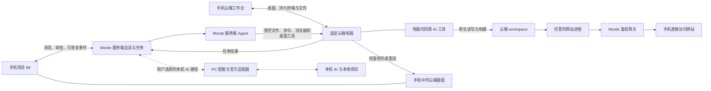
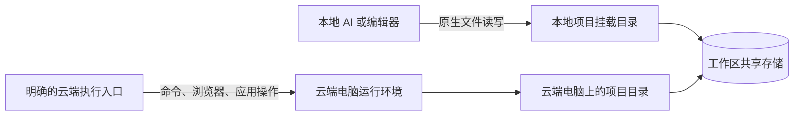

# Morde 多端托管与共享工作区需求文档

> 日期：2026-10-24。状态：已完成本轮需求与源码对照审核，仍为需求草案；用户确认的场景与本文建议的首批范围分别标明，不代表功能已实现或通过验收。
>
> 本文统一原 12 项需求、S09 / R13“同款 AI 云端接力开发”及 S10 / R14“手机委派 AI 操作云端 PC 应用”场景。与[原总需求](AI与用户共用云端主机需求文档.md)重叠的定位、多端、托管、工作区、存储、迁移、共享和外部 Agent 接入，以本文为准。原有任务、定时通知、笔记、模板及交付要求作为补充继续有效，不保留两套产品逻辑。
>
> 产品客户端基线：**Morde 手机端和桌面客户端均基于本地 `project/nanoMuse` 源码二次开发**。先完善桌面与接续基础，手机端后置；现有独立 `project/morde-desktop` 是已实现的同步能力来源，不作为最终交付的桌面客户端。复用 nanoMuse 现有客户端，接入 Morde 后再验收。手机是第二个核心使用场景，重要性与实施顺序分别表达。下述体验建议尚未经过实际用户测试。

> **客户端基线更新（2026-10-26）：** 当前 Web MVP 不开发手机端或 nanoMuse 客户端；后续手机与桌面正式客户端都必须基于 nanoMuse 二开。当前没有 Windows 原生环境，Windows 安装与同步验收暂缓，不代表取消长期平台目标。大型应用托管 / AI 操作、网站发布和正式全平台交付已从快速收尾范围拆出，见[待重新设计大项](实施/21-待重新设计的大项.md)。

对应技术设计见 [Morde 多端托管与共享工作区设计方案](Morde多端托管与共享工作区设计方案.md)，包含架构、数据、接口、交接与恢复、nanoMuse 接入及分阶段验收；需求与设计均不代表实现状态。

## 0. 本次审核结论

**场景有实际价值，可以分阶段实现；当前还不能按本文直接完成“本地 → 手机云端开发 → 本地”的完整闭环。** 主要缺口是双向文件交接、云端原生 AI 的持久会话与停写管理、网站鉴权及独立托管；已有工作台和容器启动不能替代这些能力。

首版先完成用户指定的三项能力：**本地文件夹上传为独立 workspace 后创建 / 绑定电脑、云端按需只补缺失文件到本地、PC App 双向实时同步**。扫描大小、待传量、进度、断点续传、冲突保护均为必要部分。再以一个兼容 AI 工具完成 S09 往返；JuiceFS、原本机聊天桥接、集群与同机邀请另验，手机界面仍后置。完整路径见第 2.5 节，风险见第 6 节。

新增 S10 可独立于代码同步推进：**在云端安装兼容 PC 应用并登录 → 手机交办 → AI 操作指定应用 → 手机上看进展与核对结果**。应用本身、账号和桌面操作能力分别检查；先跑通一个应用的阅读与草拟流程，不能把“安装成功”当作“AI 已可稳定操作”。流程与兼容性见第 2.6 节，规则见 R14。

本次只审核与修订本地文档；下述源码发现是静态证据，未执行应用安装、登录、迁移、部署或真机验收。

## 1. 目标与已确认范围

**日常用本机 AI 写代码；离开前准备带同款 AI 工具的云端电脑，同步 workspace 并完成云端 AI 登录；手机直接打开这台电脑里的项目和 AI，继续写代码、部署并访问网站；回来再安全同步到本地。手机 IM 委派 Morde 服务端 AI 的既有需求继续保留，两种入口明确选择、共用项目与权限。**

**手机也能交办云端办公：用户在云端电脑安装微信、QQ、飞书等兼容 PC 应用并登录，再从手机让具备桌面操作能力的 AI 查找内容、整理信息、准备草稿或完成已授权操作。应用实际运行在指定云端电脑，用户能观看、接管和核对结果。**

本轮已确认：

- 第一场景是“本机 AI + 本地代码”，继续使用原有客户端和项目目录。只做本地开发的用户无需创建云端电脑、迁移代码或配置 MCP。
- **首版同步最低范围（2026-10-24 确认）：** workspace 可以先独立上传到 Morde 服务端，不依赖 Host 运行；随后创建新电脑或绑定已有电脑打开。同步前统计选定文件夹大小及实际待传量，过程中可看进度、暂停和续传，可只选文件 / 子目录按需同步。PC App 必须支持普通本地目录与云端目录的双向实时同步。
- **云端下载默认规则（用户已确认）：** 只补本地缺失文件；已有相同文件跳过，已有不同内容保留本地并提示差异，不删除额外文件。实时同步另行明确开启并先处理初始差异；“补齐完成”不代表全目录一致。
- 本轮新增关键场景：**本地开发 → 同步到带同款 AI 工具的云端电脑并登录 → 手机直接操作云端 AI 写代码、部署网站 → 同步回本地**。AI 工具的执行进程在云端电脑内，直接读写该机 workspace；本机离线后仍可继续，前提是云端环境保持在线。
- 新增 S10：允许用户安装其他兼容 PC 应用，微信、QQ、飞书作为首批评估对象；从手机选择电脑和应用交办给 AI，也可手动接管。无需为单纯的云端应用任务先同步本机代码或迁移全部聊天记录。应用由云端运行，本机可离线，云端仍须持续在线。
- 手机另一入口保留为 **IM → Morde 服务端 AI → 指定云端电脑**，使用平台已配置模型。项目明确选择“打开云端 AI 工具”或“交给 Morde AI”，不因切换设备自动更换执行者。前者需要登录云端工具，后者不要求在每台电脑登录该工具。
- 接续本地项目时，选定代码与所需运行环境先准备到云端；直接处理已有云端项目或创建云端任务时，无需先同步一份本机 workspace。手机交互不以远程观看本机桌面为默认方案。
- 本机 AI 对话能否由 Morde PC 应用接到手机，属于本轮要求评估的**可选增强**；第 2.3 节给出可行范围与必要性。它不是服务端 AI 路径的前置条件，也不保证保留任意原客户端的全部能力。
- 持续在线的 Morde 服务、模型访问和目标电脑可用时，云端任务才具备离开本机继续工作的条件。本机承载的演示环境会受本机休眠、关机影响。
- 桌面与接续基础先行；桌面最终客户端基于 nanoMuse 的 Electron 外壳和插件二开，手机端后置并基于 nanoMuse 的 Web、Android、iOS 客户端二开。现有 `project/morde-desktop` 的同步、授权和交接实现可复用，但其独立安装包不算最终客户端交付。手机网页必须可用；Android / iOS 的实际交付范围分别验收。本轮不把源码已具备或文档更新算作多端客户端交付。
- 本地支持多个独立项目目录，按项目关联云端；云端项目可选挂载到本地。支持单机与集群托管、存储管理、迁移、MCP、MCP Apps，以及邀请别人查看或操作同一云端电脑。
- Codex、Kiro、Claude Code 等按现成客户端考虑；不修改其源码，不伪造登录。JuiceFS 保留为优先验证的共享文件访问候选，它不负责对话或进程迁移。
- 第 2、3 节给出目标规则，第 5 节逐项记录实现缺口。以下流程方案是基于用户已提出场景的设计建议，尚未经过用户测试或整栈验收。

### 1.1 统一术语

| 名称 | 本文含义 |
|---|---|
| 本地项目目录 | 本机 AI 日常读写的目录；可以是普通本地文件，也可以是明确连接的云端挂载目录。 |
| 项目接续 | 将获授权的目标、进展、代码检查点与执行结果关联起来；不自动等于迁移原 AI 会话、内存和登录状态。 |
| AI 执行者 | 负责推理与调用工具的 Agent；区分本机 AI、云端电脑内的 AI 工具、Morde 服务端 Agent。模型推理仍可由各自连接的模型服务提供。 |
| 同款 AI 工具 | 相同产品及经验证的客户端形态、版本和必要配置；不自动意味着同一聊天、相同订阅权限或完全一致的能力。 |
| 云端电脑（Host） | 用户从手机或电脑网页访问的运行环境，包含应用、终端与桌面。 |
| 承载节点 | 为云端电脑提供 CPU、内存等资源的服务器。 |
| 工作区（workspace） | 独立于云端电脑生命周期的服务端项目数据；具有稳定身份、归属、权限与版本，本地目录、Host 工作副本及检查点关联可追踪。 |
| 按需同步 / 实时同步 | 前者是手动触发或选部分文件 / 子目录；后者是明确开启后自动同步已保存变化，在线无冲突时低延迟收敛，不承诺瞬时强一致。 |
| 缺失补齐 / 变更合入 | 补齐仅新增目标不存在的文件，已有差异保留并提示；合入需比较基线、目标和来源，明确采用变更及处理冲突，不能由补齐静默升级。 |
| 项目交接 | 在选定本地设备与云端电脑间切换后续工作位置，包含数据核验、运行准备和写入权交接；项目身份保持稳定，Host 身份不混用。 |
| 对话 / 任务 | 对话保存多轮交流和授权背景；任务记录某次实际执行、目标电脑及结果。新消息不必等于并行启动一个新任务。 |
| 本地挂载 | 本地路径与云端共享数据的访问关联；不意味着数据已完整保存在本机。 |
| 桌面控制权 | 谁可输入云端桌面；与 AI 会话、文件写入及资源管理权限分别控制。 |

AI 执行者与程序运行位置分别展示：本机 AI 可以通过明确的工具在云端运行程序。手机看到云端桌面，不要求负责推理的 AI 也运行在云端。同一数据挂载到两个路径仍是同一个工作区，不凭目录名称声称项目隔离。

### 1.2 手机与桌面客户端二次开发基础（已确定）

二开目标源码为 `project/nanoMuse`。本轮最初核对了其 1.0.7 源码；截至 2026-10-26，该目录已从共享工作区移除，实施前须恢复并核对基线。这是一项开发基础约束，不是仅参考其视觉风格；手机和桌面最终安装包均从该源码二开构建，不另起一套客户端重做相同功能。

| 源码范围 | 可复用基础与 Morde 接入边界 |
|---|---|
| [Web 客户端](../project/nanoMuse/web/package.json) | 已有 React / Vite 客户端、[聊天与审批展示](../project/nanoMuse/web/src/screens/ChatScreen.tsx)、[设备页](../project/nanoMuse/web/src/screens/DevicesScreen.tsx)。手机网页基于这些实现调整；设备页需接入 Morde Host、项目与应用，不能把原 Hub 设备直接当成云端电脑。 |
| [Android](../project/nanoMuse/android/src/android)、[iOS](../project/nanoMuse/android/src/ios) | 已有原生客户端源码；需要原生交付时在对应实现上适配，分别验证构建、登录和真机流程。源码存在不代表本轮承诺两端上架或已可用。 |
| [桌面外壳](../project/nanoMuse/harness/desktop)、[桌面插件](../project/nanoMuse/harness/dsh-nanomuse) | 已有 Windows / macOS / Linux 桌面应用、聊天、设备、权限和托盘基础。Morde 正式 PC App 在这两层接入 Morde 身份、项目、会话、任务和本机同步；不得只重新包装独立 Morde Desktop。 |
| [现有 Morde Desktop](../project/morde-desktop)、[同步引擎](../project/morde-sync) | 已有设备配对、目录选择、按需/实时同步、进度、冲突和交接逻辑。将这套能力接入 nanoMuse 桌面端，复用现有同步协议与引擎，不另造文件同步系统。 |
| [现有请求层](../project/nanoMuse/web/src/api.ts)、[Cloud](../project/nanoMuse/docs/cloud.md)、[Hub](../project/nanoMuse/docs/hub.md) | 已有账号、中继与设备交互协议，和 Morde 的协议不同；复用适用代码并完成协议适配，不能仅改服务地址就宣称接入完成。 |

- **统一业务归属：** Morde 账号、Host / workspace、Conversation / Task、授权和控制权仍由 Morde 服务端管理。手机与桌面展示同一 Morde 会话与任务，复用 nanoMuse 聊天、进展和审批交互；不引入第二套相互独立的账号、任务或审批状态。保留 R01 的两种执行入口，云端原生 AI 的聊天仍按 R13 管理。
- **明确执行位置：** S05 / S10 委派任务由 Morde 服务端 AI 在指定 Host 执行；S09 在选定云端 AI 工具内执行。不能误落到 nanoMuse 的手机本地 Agent 或未选中的 Hub 设备。手机退到后台不主动停止云端任务，恢复后查询原任务，不重新提交一份。
- **接入所选服务：** 用户只需连接自己的 Morde 服务并使用 Morde 身份，不要求额外注册 nanoMuse 社区账号。手机和桌面的原有社区中继、模型、Hub、对话同步与更新入口需按 Morde 配置适配或停用，不能静默回退到其他服务或把项目、会话、凭证传往未选服务。
- **复用与补齐分别说明：** 移动布局、聊天、设备选择与审批呈现有源码基础；Morde 登录、Host / 项目 / 应用选择、增量回复、画面、文件 / 终端入口、控制权和异常恢复仍需贯通。审批仍由 Morde 校验当前动作与版本；本地卡片不能自行批准云端动作。
- **交付边界：** 记录采用的 nanoMuse 源码版本，保留其 LICENSE / NOTICE 与上游修改边界。桌面 macOS / Windows / Linux、手机网页、Android、iOS 按实际交付端分别报告验收结果；保持手机后置，不把已有界面、上游安装包或静态源码检查算作 Morde 多端验收通过。已有独立 Morde Desktop 的本地目录映射与凭证在切换客户端时不得静默丢失或复制到不受控位置。

## 2. 用户使用场景

保留既有场景编号，按日常使用顺序展示：

| 场景 | 用户要完成的事 | 完整体验 | 相关需求 |
|---|---|---|---|
| S03 本地 AI 日常开发（第一场景） | 用熟悉的本机 AI 处理本地项目。 | 打开现有目录 → 修改 → 本机运行与预览；需要接续时一次关联项目、设备与授权。 | R01、R03、R07、R10、R12 |
| S09 同款 AI 云端接力（新增关键场景） | 离开后继续使用熟悉的 AI 写代码、部署网站，回来继续本地开发。 | 上传独立 workspace → 创建或绑定带兼容工具的电脑、完成登录 → 手机打开文件和 AI → 修改、部署、经 Morde 地址访问 → 核对后同步回本地。 | R01、R03、R06、R12、R13 |
| S05 手机 IM 委派（第二场景的另一入口） | 用手机聊天直接交办给 Morde。 | 本地项目先交接，已有云端项目直接进入 → IM 发消息 → 服务端 AI 在明确电脑上执行 → 回复、动作与画面更新 → 回来核对差异。 | R01、R03、R06、R10、R12 |
| S10 手机委派 PC 应用（新增关键场景） | 离开电脑后，继续让 AI 使用微信、QQ、飞书等 PC 应用处理具体事项。 | 云端安装兼容客户端 → 用户官方登录 → 手机选电脑、应用和目标 → AI 操作、回传进展 → 核对结果，必要时人工接管。 | R01、R02、R03、R05、R08、R09、R10、R14 |
| S04 多项目并行 | 同时处理多个本地项目，并按项目启用云端能力。 | A/B 目录独立，分别显示云端关联与同步状态；切换不串数据、不重置应用。 | R03、R07、R12 |
| S01 个人自行托管 | 准备可从手机访问的持续在线服务。 | 单机部署、账号与设备连接、准备云端电脑；本机演示与持续在线部署明确区分。 | R02、R03、R05、R08 |
| S02 团队集中托管 | 按权限使用多台服务器的资源。 | 管理员安排节点与容量；成员围绕项目工作，故障与容量不足可处理。 | R02、R03、R08 |
| S06 邀请同事协作 | 让同事观看或操作同一台电脑。 | 邀请 → 授予查看或操作 → 交接控制 → 撤销后停止后续访问。 | R08、R09、R10 |
| S07 保存数据并更换环境 | 空间不足或维护时继续项目。 | 查看容量与备份 → 核验数据 → 安全迁移 → 恢复原项目入口。 | R05、R06、R12 |
| S08 在 AI 对话中看电脑 | 本机 AI 操作时直接观察云端结果。 | 兼容客户端显示 MCP Apps 卡片；不支持时提供状态与授权链接。 | R04、R11 |

### 2.1 体验评审与改进

**控制面板围绕“当前项目、继续交流、需要我处理的事”组织；日常从原有本机 AI 开始。**

| 环节 | 用户可能遇到的问题 | 目标体验 |
|---|---|---|
| 开始工作 | 被要求先建电脑、搬项目、配多种凭证。 | 原有本地开发直接继续；启用接续时只选择一个项目，向导处理关联并提示必要授权。 |
| 准备离开 | 临走才安装工具、找文件、重新登录。 | 首次集中完成环境与登录，后续复用；分别显示工具可用、文件核验、登录有效和开发环境就绪。只处理缺项，不重复创建。 |
| 使用手机 | 找不到文件、AI 或要操作的应用；不知道由谁处理。 | S09 进入项目与 AI；S05 进入 Morde IM；S10 从电脑的应用卡交办。显示执行者、目标电脑、应用账号和就绪状态，保留明确选择。 |
| 保留强本机 AI | 希望手机继续原会话，而不重新交代项目。 | 可选择经过验证的本机 AI 连接；按客户端显示可续接、仅查看或需摘要新会话。该选择要求本机在线；不冒充服务端 AI 与原 AI 等价。 |
| 回到电脑 | 手机期间的改动与本地新变化冲突。 | 交接摘要、文件差异与待办一次可见；核对版本后接回，不静默覆盖。 |
| 连接异常 | 把画面断开当任务停止，或误以为排队就是执行。 | 对话、同步、执行、画面分别报告状态；先核实未知结果再重试。 |
| 管理资源 | 普通用户需要理解节点、存储后端、迁移阶段。 | 常用页面只提供项目与必要状态，部署和资源管理放在管理入口。 |

### 2.2 同款 AI 云端接力：建议的完整使用流程

本节对应用户新提出的 S09，建议项目提供“准备离开 / 在手机继续 / 带回本地”三个动作。手机界面仍按既定计划后置，不把记录需求等同于立即实施。

1. **第一次准备：** 选择本地目录和同步范围，查看大小与进度，将 workspace 存到 Morde；可先不创建电脑。需要运行时选择创建新电脑或绑定已有兼容电脑，准备 AI 工具及 Go / Node 等依赖，完成官方登录并打开正确目录。已有工具与有效登录直接复用；日常可启用双向实时同步减少离开时的待传量。
2. **离开前交接：** 提前同步获授权文件，处理在途修改后核验最后一批变化。确认“工具可用、项目一致、AI 登录有效、开发环境就绪”；交接目标、决定、已改内容、启动命令与下一步。原会话有受支持的恢复方式才恢复，否则明确在云端新会话继续。
3. **手机直接使用云端工具：** 打开同一电脑，能查看同步范围内全部项目文件；点击“打开 AI”进入正确目录的 GUI 或持久终端会话，直接向该工具提需求并批准其操作。工具本身读写云端代码、执行构建，不依赖 Morde 先监听本机 AI 或把聊天接进平台 IM。
4. **部署并直接访问：** 云端 AI 构建并启动网站；平台记录服务、端口、运行版本与状态，检查成功后提供 Morde 网关地址。从手机普通浏览器打开该地址即可看网站，无需始终停留在远程桌面。
5. **回来继续本地开发：** 结束或暂停云端 AI 的相关写入，生成返回检查点；选择“比较并合入”，与本地当前文件比较，处理冲突后接回变化文件。普通下载仍默认只补缺失，不替代此步骤。本机 AI 从实际文件和获授权摘要继续；是否恢复原聊天依客户端能力而定。

**优化目标：** 安装与登录主要发生在首次或失效时；日常只传变化、核验并打开已有环境。同步回本地不默认停止已部署网站，网站继续运行的条件及运行版本独立显示。

云端电脑在这里提供实际执行环境：本机关机后，用户仍可在手机上使用云端 AI 工具、修改文件并访问部署结果。只在本机开发且不需要跨设备或持续运行时，无需启用云端。只想远程继续本机 AI、愿意保持本机在线的用户，仍可选择第 2.3 节路径。

### 2.3 Morde PC 应用接入本机 AI：可行性与必要性

**结论：可以针对受支持的运行时建立消息连接；不能承诺“安装 PC 应用就能监听并控制任何现有 AI 应用”。** 要分别证明历史读取、增量事件、追加消息、中断/审批，以及正在运行的原会话的连接能力。能读记录不等于能接管会话。

以下依据截至 2026-10-23 的官方资料；结论是接口评估，**未在 Morde 内接通**：

| 对象 | 已公开的接入依据 | Morde 可评估的路径与限制 |
|---|---|---|
| Codex App Server | 提供 thread 读取/恢复、turn 启动/干预/中断及事件；官方仍提示 App Server 命令与 WebSocket 传输的实验性限制。[官方文档](https://learn.chatgpt.com/docs/app-server) | 先验证 Morde 管理的本机运行时；连接当前桌面应用的既有会话需单独验证身份、进程、配置与版本。不能以接口存在宣称当前桌面会话一定可接。 |
| Kiro CLI V3 | ACP 提供会话发现、加载、消息与更新；能力需协商，禁止依赖私有会话文件布局。[ACP 说明](https://kiro.dev/docs/cli/v3/acp-migration/) | 可作为 PC 适配器候选。会话只允许一个活动进程占有，已有进程需受控交接，不能另起进程抢占。[会话限制](https://kiro.dev/docs/cli/chat/session-management/) Kiro IDE 既有窗口的续接仍需独立验证。 |
| Claude Code | Agent SDK 提供会话枚举、消息读取、恢复及分叉。[会话接口](https://code.claude.com/docs/en/agent-sdk/sessions) | 可验证 SDK 管理的本机运行时和获授权历史；与已运行会话的共同控制另验。Claude Code 与普通 Claude 聊天应用分开评估，不能泛化到所有 Claude 窗口。 |
| 其他客户端，包括尚未明确具体产品的 DS | 当前没有足以承诺兼容的已核验依据。 | 获取实际产品、版本与公开接口后再列入支持范围；无接口时提供用户主动交接的摘要，不自动读取私有数据库。 |

**有无必要：**

- S09 的云端 AI 工具与 S05 的服务端 AI 都可在本机离线后工作，均不依赖本机聊天监听。S09 应先验证工具安装、登录和项目接力；平台 IM 按 R10 补齐。
- 用户确实要保留原客户端配置与会话、并愿意让本机保持在线时，本机连接有价值。建议先做一个受支持 Codex 运行时的验证，再决定是否增加 Kiro / Claude Code 适配。
- Codex Remote 与 Claude Code Remote Control 已提供各自的远程交互路径，可先满足只需远程续聊的用户；这些产品功能不等于可嵌入 Morde 的开放接口。[Codex 官方说明](https://developers.openai.com/blog/mastering-codex-remote-for-engineering)、[Claude Code 官方说明](https://code.claude.com/docs/en/remote-control)
- “监听”限定为用户选定项目/会话后的官方事件订阅；Hooks 或日志只能补充其实际暴露的进展。屏幕 OCR、模拟键盘、修改私有会话数据库不作为主通道。

**建议连接方式：** 手机 ⇄ Morde 服务 ⇄ 本机配套连接 ⇄ 官方 AI 接口。PC 通过主动发起的受保护连接传递获授权消息；AI 的文件读写与命令仍在该运行时所在机器执行。会话恢复、代码交接与云端执行分别授权，文件挂载不会自动改写原生工具的执行位置。

PC 应用需显示设备在线状态、选定会话与权限，支持撤销；不得默认读取全部聊天、项目或凭证。优先用本机 stdio / IPC 连接适配器，不对公网裸露本机控制端口。原生登录留在受支持的运行时，不把登录文件上传为服务端 AI 的通用凭证；托管集成的账号与模型使用条件需分别确认。

### 2.4 更简洁的交互与实现建议

- **一个项目入口：** S09 优先展示“打开 AI / 项目文件 / 打开网站 / 带回本地”；S05 展示 IM 与画面。用户明确选择后保留入口，顶部显示 AI 所在位置和目标电脑；共用项目、存储、鉴权及网关，不增加第二套平台任务系统。
- **沿用现有后端：** 在现有 Conversation、Task、Agent、任务事件、Gateway 与授权上补齐能力；不另建手机专用后端、第二套 Agent 或重复任务状态。现有会话固定绑定 Host 的规则需统一演进为可追踪的项目交接；历史任务保留真实执行 Host，不能改写历史。
- **文字与画面分开传：** 消息发送走现有鉴权 API，文本和任务进展扩展现有可恢复 SSE；画面先复用现有 RFB / WebSocket。只有实测证明延迟、带宽不达标再评估其他视频方案，首版无需重写桌面传输。
- **执行与观看分开：** S05 依靠服务端任务与事件恢复；S09 依靠云端持久桌面/PTY 会话和进程托管恢复。关闭画面不主动结束 AI 或网站，重连进入原会话；云端主机停机则不能宣称进程仍在运行。手机前后台恢复必须实测。
- **按结果定义连续对话：** 新一轮需要读取授权历史、已确认决定、最新文件检查点及任务结果；摘要必须可追溯。历史消息只是背景，不能沿用过期权限或把其中的文本当作新授权。
- **实施依赖：** S09 先按第 2.5 节贯通工具、文件、进程和网站；S05 另补 G01/G02 后复用同一项目与网关。S09 手机验收无需等待 S05，本机适配器和集群迁移也非前置。手机界面仍后置；具体任务拆分另行更新实施清单。

### 2.5 怎样先跑通：先验必需同步，再验 AI 接力

三项同步能力及绑定已有 Host 是首版必需范围（R06.3 / R07 / R12），先通过 A29–A32。其后的 AI 接力测试环境为建议，不表示用户已选定工具或接受客户端替换。

- **环境：** 一个已有本地项目、一台持续在线 Linux 云端电脑、所有者本人使用；本地首测 macOS。以带假数据的 Go + React 博客作为合成项目，无活动数据库迁移。
- **AI：** 优先选一个可在两端运行的 CLI 形态，例如 Codex CLI，先核验具体版本、登录和模型访问。用户原来使用桌面 GUI 时，必须另验同款 GUI，或由用户明确接受 CLI；两者不能合并标为兼容。
- **文件：** 使用普通本地目录 ↔ 独立服务端 workspace ↔ Host 工作副本的同一增量机制。先验无 Host 上传、只补缺失下载、同机新增 workspace 不替换原项目及双向实时同步，再验停写检查点与执行交接。两端各自重建依赖，JuiceFS 与多人权限独立验收。
- **本地配套：** PC App 负责设备授权、选择目录、扫描大小、传输进度、断点续传与持续同步；Host 侧也要发现原生 AI / 编辑器的直接文件修改。读取原 AI 聊天、发送消息是另一项可选能力。
- **会话：** 首次云端独立登录，默认从真实文件和用户确认的摘要开新会话；官方恢复经验证后才启用。同款工具的安装、登录、可用模型与聊天恢复分别判定。
- **运行：** 原生 AI 会话和网站分别托管；源码交接不影响明确选择保留的发布版本。服务有持续计算资源要求；本机关机前，Morde 服务与 Host 都要部署在不随本机关机的位置。

| 顺序 | 用户操作与需要补齐的能力 | 通过后才显示的结果 | 相关缺口 |
|---|---|---|---|
| 0. 三项同步闭环 | 无 Host 上传并验证服务端重启后续传；按需下载只补缺失；创建或绑定已有 Host；两端修改、断网恢复、同路径冲突及监听遗漏。 | 数据量、分阶段进度、目标版本和未处理项准确；已有目录和已开应用保留，符合 A29–A32。 | G05、G08、G12 |
| 1. 环境与网络可达 | 按单机部署说明准备服务、账号、网关域名 / HTTPS、Host 与模型出站访问；检查已有预览鉴权链。 | 电脑网页可进入工作台；后置真机阶段从移动网络也可登录和访问受保护入口。localhost 只算本机演示。 | G07、G08 |
| 2. 工具可用 | 模板安装所选工具与项目工具链；官方登录后做一次真实模型请求和合成文件修改。 | 工具、账号、模型、目录分别就绪；会话重新连接不产生第二个 AI。 | G09、G10 |
| 3. 交给云端 | 预同步至暂存区 → 本机保存并停写 → 核验最后差异 → 在目标启用检查点。 | 来源保留；云端显示确定的项目版本、执行者与交接完成时间。只收到文件还不能显示“可以离开”。 | G05 |
| 4. 云端继续开发 | 本机关闭后，在另一台设备的网页进入原云端会话；修改、构建 Go + React。 | 实际文件与构建结果对应；断开观看再连接仍能继续，等待审批时如实显示等待。 | G06、G10 |
| 5. 网站独立可用 | 把检查点构建为独立发布目录，登记并托管服务，返回 Morde 鉴权网关地址。 | 从普通浏览器可访问页面、资源和 API；关闭 AI 终端不关站；无权限者无法进入。 | G07、G11 |
| 6. 带回本地 | 云端停写 → 返回检查点 → 与共同基线及本地现状比较 → 应用并核验；再次用本机 AI 修改。 | 本地收到本轮成果，原有变化和 Git 数据未丢失；云端网站仍对应原发布版本。 | G05、G10、G11 |
| 7. 手机产品验收 | 后置基于 `project/nanoMuse` 二次开发并接入 Morde，再用真实手机完成步骤 3–6 的相关操作。 | 触摸、软键盘、登录、审批、前后台和移动网络均通过，才宣称手机接力可用；按实际交付端记录结果。 | G03 |

步骤 4 的电脑网页验证只能证明云端执行与会话基础；**不能替代步骤 7**。手机 UI 后置期间可提前做所选工具的输入与登录可行性验证，避免最后才发现客户端在手机无法操作；这不算手机功能交付。

基础绑定与三项同步通过后继续 S09；S05 连续 IM、共享挂载、同机协作和集群分别推进。现有 T18 仅是云端节点迁移，T19 的旧 T18.06 依赖需按实际入口重排；不能等所有扩展完成才验证 S09，也不能把 S09 通过算作全部需求完成。

### 2.6 手机委派 AI 操作云端 PC 应用（S10）

**场景示例：** 用户外出时，在手机交办“打开云端办公电脑的飞书，整理我指定群今天讨论的待办，并准备回复草稿”。也可让 AI 在已登录的微信查找指定会话中的约定，或在 QQ 查找某个群公告。示例只说明目标体验，不授权本轮读取真实聊天或执行发送。

1. **准备应用：** 在选定电脑的“应用”入口选择或自行安装兼容客户端；显示来源、系统、架构、版本及恢复方式。用户完成官方登录，并确认实际可见的账号和内容。
2. **从手机交办：** 点应用卡上的“让 AI 操作”，说明具体对象与目标。建议默认进入 Morde IM，自动带上 Host、应用和已选账号；不要求手填电脑 ID，也不强制关联代码项目。
3. **AI 在这台电脑执行：** 检查登录、控制权与工具能力，定位真实窗口或受支持的应用接口后执行。手机展示当前动作与按需展开的画面；用户可以补充要求或接管，旁观与锁屏不主动取消任务。
4. **遇到登录或不确定操作：** 转为“需要你处理”，直接进入对应电脑完成扫码、验证码或确认；处理后重新观察应用状态，不在旧坐标上继续点击。
5. **返回可核对结果：** 展示内容来源、摘要 / 草稿或动作结果，明确“已准备”“已执行”“结果待核实”；未授权的发送不执行。下次复用已安装应用与仍有效的登录，失效时只修复缺项。

**兼容性依据（2026-10-23，仅官网发行信息，未在 Morde 内安装验收）：**

| 应用 | 已核对官方入口 | 本场景需要继续验证 |
|---|---|---|
| 微信 | [Linux 官网](https://linux.weixin.qq.com/) 提供 X86 / ARM 版 deb、rpm、AppImage。 | 目标容器 / 架构下安装与启动、官方登录、中文输入、实际可见聊天范围、窗口定位与停止恢复。 |
| QQ | [Linux 官网](https://im.qq.com/linuxqq/index.shtml) 提供 X86 / ARM 等发行选项。 | 目标版本的登录、窗口操作、群 / 会话身份核对、恢复和界面更新后的适配。 |
| 飞书 | [官方下载](https://www.feishu.cn/download?from=navigation_bar_app_download) 提供 Linux X64 / ARM64 等选项；[安装说明](https://www.feishu.cn/hc/zh-CN/articles/360025035993-%E4%B8%8B%E8%BD%BD%E5%92%8C%E5%AE%89%E8%A3%85%E9%A3%9E%E4%B9%A6%E5%AE%A2%E6%88%B7%E7%AB%AF)要求按系统与架构选包。 | 企业登录条件、选定账号 / 租户、客户端可操作性，以及组织允许的模型与数据访问。 |

当前 Host 方案是 Linux 容器；“有 Linux 安装包”只证明存在候选发行版，不能推断在当前沙箱、桌面依赖及资源限制下可用。Windows / macOS 专用应用需另有匹配运行环境；网页或兼容层可作为明确说明的选项，不能冒充 PC 客户端已经支持。

**最小实现建议：** 复用 R13 的软件与个人配置管理，以及既有 Conversation / Task / Agent、Runtime 窗口与输入工具、Gateway 画面和控制权；补应用清单、安装恢复、账号就绪与实际动作核验。先验一个官方 Linux 客户端的“安装 → 登录 → 阅读指定内容 → 生成草稿 → 停止恢复”，再扩展应用。手机端仍后置基于 `project/nanoMuse` 二次开发；S10 不依赖 S09 的文件同步、JuiceFS、原本机聊天桥接或完整集群，选择 Morde IM 时需补 G01/G02 的连续交流能力。

## 3. 功能需求

### R01 桌面日常工作与后置手机接续

- 桌面阶段以本机 AI 与本地代码为默认工作入口；Morde 提供选定项目的连接、云端准备与状态，不要求每次工作进入控制面板。
- 网页与本地配套使用同一项目身份、任务与授权；多个标签或设备只观察时不抢控制权，不重复创建资源。
- 手机提供 S09“打开云端 AI 工具”和 S05“与 Morde AI 聊天”两个执行入口；S10 从电脑的应用卡进入所选执行入口，带上应用与账号，不新建第三套会话系统。支持项目文件、应用操作、进度、画面与成果；仅读取获授权且已接收的数据，未同步和过期状态可见。
- 桌面和手机端都必须按第 1.2 节基于 `project/nanoMuse` 二次开发，复用既有客户端与交互，补齐 Morde 接入。桌面需迁入现有 Morde 同步与交接能力；手机网页仍需可用。验证窄屏、触摸、软键盘、横竖屏与前后台恢复，原生端交付另有对应真机记录。手机实施仍后置，已有独立桌面原型不算正式客户端交付。
- 画面断开、消息断开、同步中断与执行停止分别显示；恢复连接先读取实际状态，避免重发重复执行。

### R02 单机与集群托管

- 单机模式可在声明支持的一台服务器上部署必要服务、运行电脑并保存数据；提供初始化、重启恢复、升级和备份说明。
- 集群模式可接入多个承载节点，查看健康、容量和资源使用，按可用资源及兼容条件安排电脑；容量不足时明确排队或失败原因。
- 管理员能停止向维护节点分配新电脑，并处理已有电脑的迁移或停止。节点失联时标记受影响资源，不把旧进程仍可能存活的电脑直接当作已安全迁走。
- 单机与集群使用同一业务规则，扩容不要求用户重建账号和项目。平台应检查是否具备数据可达性，不能只新增计算节点就宣称可迁移。
- 展示真实部署位置。部署在用户本机时，明确本机关机将影响服务；多节点部署不自动等于控制服务、数据库和存储都具备高可用。
- 生命周期操作说明具体影响：“断开观看”保留进程；“停止计算”结束 AI 与网站进程、保留声明的持久数据；“删除电脑”另列个人配置和工作区的去留。停止前检查平台任务、已登记原生 AI 与网站，不能用“没有平台任务”推断电脑空闲。
- 展示持续运行、续租结果及资源占用；网站或原生 AI 需要持续运行时不能只按网页活跃度回收。未知占用先核实，不能自动停止；用户明确停止时列出影响，恢复后核对文件、登录和服务，不承诺恢复进程内存。

### R03 控制面板优化

- 控制面板突出最近项目、项目会话、进展与待处理事项；日常仍从原 AI 客户端开始。电脑、存储、托管与分享作为对应项目的补充入口。
- 电脑卡片显示名称、运行状态、资源规格、关联工作区、当前控制者及可操作入口。创建、恢复、连接、运行失败需区分，不只显示内部错误码。
- 工作区卡片显示本地路径、云端归属、最近代码核验、当前 AI 和程序运行位置；连接、权限、消息、同步与执行状态分别表达。S09 提供打开文件、打开 AI、打开网站和带回本地的入口；AI 工具、登录、开发环境的就绪状态分别可查。
- 桌面、浏览器、终端、文件和已提供的编辑器入口都指向同一电脑；未安装或不可用的应用给出原因，不保留必然报错的入口。
- S10 的应用卡提供“安装 / 打开 / 让 AI 操作 / 处理登录”，显示目标电脑、账号提示、应用状态和最后核验时间。安装完成、已登录和 AI 可操作分别表示；隐去敏感账号信息，不能只用一个绿色“可用”掩盖缺项。
- 创建、挂载、迁移等长操作能看到真实阶段，刷新或重复点击不重复创建资源。失败显示原因、受影响范围及重试或恢复入口。
- 状态不能只靠颜色区分；桌面布局、键盘操作和错误文案都要可用。手机布局在后置阶段单独处理。

### R04 MCP 控制云端电脑

- 外部 AI 客户端通过受支持的 MCP 接入方式发现已授权电脑，执行命令、读写文件、操作浏览器或桌面，并查询执行结果。
- 每次操作绑定明确电脑、相关工作区或应用及权限。应用操作还核对账号和窗口；多台电脑时不能凭最近打开的页面静默更换目标。
- 用户可创建、查看权限范围和撤销连接凭证；配置引导能区分密钥值与环境变量名，完成后检查连接和实际授权。凭证不进入普通日志或可共享的卡片内容。
- 长命令应返回可继续查询的执行标识，支持增量输出、取消、退出状态和中断后核实；结果未知不能直接当作失败重跑。
- MCP 与网页使用同一授权、控制权和生命周期规则；撤销授权、接管、停止电脑后，既有会话不能继续绕过限制。
- 外部 Agent 逐步调用与委派 Morde 持续执行的任务明确区分；本地 Agent 退出后，不能承诺尚未提交给云端的步骤继续执行。

### R05 存储管理

- 用户可独立创建和保存 workspace，无须先开云端电脑；Host 停止时仍能上传、浏览清单和下载。工作区列表展示逻辑文件大小、实际存储占用、配额、关联电脑及同步设备；区分服务端已保存版本与 Host 待应用变化，副本、暂存及恢复材料分别计量。
- 创建、挂载、卸载、备份、恢复和删除有明确含义：卸载本地目录不删除云端数据，删除电脑不隐式删除仍需保留的工作区。
- 源码、用户文件及声明支持的配置纳入持久化；进程内存、未保存编辑内容和临时缓存不得冒充已备份数据。PC 应用的程序与依赖、个人配置及应用内数据分别列出保存 / 重建范围；仅保存用户目录不代表安装在系统目录的应用也已保存。
- 分开记录项目数据、个人应用配置与凭证、网站发布物与可变数据的归属和保留规则。源码交接只同步选定项目；复用、备份和删除某台电脑时分别展示其范围。个人凭证不得进入共享模板、项目导出或普通恢复包。
- 接近配额时提示，达到限额或本地缓存盘满时报告具体原因；保留已确认保存的数据，不能以清空未提交内容恢复空间。
- 恢复点显示范围、时间、大小、保留期限和可恢复状态。恢复必须核验；恢复旧版本前说明会影响哪些现有变化。
- 采用 JuiceFS 时，备份应覆盖文件元数据及对应数据内容，能够一起恢复；不能仅备份对象存储就宣称工作区可恢复。该要求基于其元数据与数据分离的[存储结构](https://juicefs.com/docs/community/architecture/)。
- 删除被电脑、挂载或共享使用的工作区前展示影响并处理活动写入；保留与清理规则可见，不把解除关联当作永久删除。

### R06 本地与云端双向交接，以及云端迁移

#### R06.1 范围与使用动作

- 首版支持“上传文件夹”“下载到本地”“开启实时同步”；上传后可只保存在服务端，再创建或绑定云端电脑。另有“交给云端继续”“比较并接回”，以及云端电脑 / 节点 / 存储迁移。统一使用文件版本、核验和恢复机制，但不混用补齐、变更合入与执行交接，也不混用设备、项目和 Host ID。
- 本地配套只访问用户选定目录，主动建立经设备授权的出站连接，按项目与目标接收 / 传送文件；无需开放本机管理端口。同步身份与 AI 消息身份分别授权，设备撤销阻止后续传输，不能通过网页登录默认取得全部本地文件权限。
- 迁移范围是用户选择的源码与文件、可重建的环境声明、获授权的任务背景。包括已选范围内未提交/未跟踪文件、删除和重命名；不能只推送 Git 已提交记录就声称完整交接。
- 初次接入展示包含/排除清单。依赖缓存、构建产物按平台重建；密钥和账号重新授权。浏览器登录、未保存编辑内容、进程内存和活动网络连接不承诺迁移。数据库需一致性导出或受支持快照，不能复制正在写入的文件后假报完整。
- 默认排除账号文件、含秘密的环境配置和依赖缓存；不能只凭文件后缀保证无秘密，用户能检查范围并为云端单独配置必需环境变量。源码中的普通点文件不全部忽略。链接不得隐式带出所选目录之外的数据，目标路径、文件名大小写冲突和空间不足在应用前报告。
- Git 工作树与仓库内部状态分别处理：普通文件交接包含未提交和已选未跟踪内容，不要求先提交；保留双方原有仓库、索引和配置，不把 `.git` 整目录覆盖到活动仓库。首条链不自动迁移暂存区、rebase 或 worktree 内部状态；新增云端提交需要通过明确的历史导入 / 分支合并保留。未实现历史接回时显示限制，不能把只同步工作树称为完整仓库迁移。
- 目标预检覆盖权限、容量、系统/CPU 架构、工具版本、数据可达性和启动方式。macOS 本地项目到 Linux 云端可能需要重新安装依赖；环境不支持时给出缺项，保留来源。

#### R06.2 执行位置切换与可恢复交接

本节的停写和完整检查点用于 AI 执行位置切换、迁移及构建 / 发布；日常实时保存按 R06.3 / R12 收敛，不为每次文件修改要求整个项目停工。普通缺失补齐下载不替代变更接回。

| 阶段 | 本地 → 云端 | 云端 → 本地 |
|---|---|---|
| 提前准备 | 初次传完整选定项目，后续把增量写入暂存区，预装环境、预热依赖；不覆盖云端正在使用的目录。 | 保留共同基线，接收云端变化到暂存位置，不覆盖本地工作目录。 |
| 交接检查 | 处理本地在途写入，确认保存，生成完整检查点，传最后一批差异并核验。 | 处理云端在途写入，形成检查点；比对基线、本地当前版本与云端版本。 |
| 启用目标 | 在同一核验版本上检查运行环境；S09 检查云端工具与登录，S05 检查服务端 Agent；确认执行者后才继续工作。 | 保留冲突双方，处理差异后恢复本地依赖与运行；向受支持 AI 提供获授权背景，否则提供摘要。 |
| 完成与失败 | 成功记录目标、范围、时间、版本；失败保留来源与可重试阶段。 | 不把收到文件当作已安全合入；应用失败可从暂存与检查点恢复，源数据不自动删除。 |

- 每次交接记录唯一操作身份、来源与目标、共同基线、范围清单、内容校验及阶段。重试续用同一操作，不能重复创建电脑、重复应用删除或启动第二个 AI；状态与检查点应可在客户端重启后恢复。
- 确认来源保存并停写后生成稳定检查点；先完整接收和核验，再在目标无并发写入的窗口内应用。应用中不启动 AI、构建或发布；全部核验并记录完成后再启用目标。不能把逐文件复制当成整个项目原子切换。
- 应用前复核目标仍是比较时的版本；本地新增、修改、删除 / 重命名均参与三方比较，两端都变更的对象保留双方并请求处理。删除只针对基线中明确存在且属于同步范围的对象，不扫掉目标额外文件。无法获得停写窗口时保留暂存副本，等待处理。
- 状态至少区分“准备 / 传输 / 核验 / 等待停写或冲突处理 / 应用 / 完成”。应用中断保留变更记录与恢复副本，恢复时读取实际阶段；完成回执丢失时先核实目标是否已启用。目标有新写入后不得直接恢复旧备份。
- 快速的主要手段是**提前准备、只传变化、复用目标缓存**，不承诺整机秒迁。传输应可续传和核验；忽略规则、链接、权限位、大文件和大小写冲突需在声明支持的范围内验证。
- 切换前核对来源未继续变化；受管理的执行端拒绝过期写入授权。普通本地目录里的外部 AI 不受平台租约强制约束，首批交接要求用户保存并停止相关写入。无法确认时等待，或在独立副本 / 分支继续并标明“待合并”；切换后若旧端仍有修改，按新分叉保留，下次比较处理，不自动覆盖任一端。
- 同一共享存储可通过重新关联和缓存预热减少复制，但仍要建立一致检查点并核验；不等于文件天然多端即时可见或无需网络传输。
- 切换后目标已产生新写入，回退先处理差异；来源清理需明确确认。各阶段显示真实进度，不以心跳或队列为空标“迁移完成”。
- 分别记录首次准备耗时、热交接耗时、传输字节、核验、环境恢复及预览可用耗时；在真实项目与指定网络下确定目标，不先编造秒数。

#### R06.3 首版必须交付的同步体验

| 能力 | 必须满足的规则 |
|---|---|
| 先上传再开电脑 | 选择本地目录与全部 / 部分范围，先保存为独立 workspace；成功后可创建新电脑或绑定已有电脑。服务端上传完成与 Host 项目就绪分别确认；Host 收齐所需版本后再打开。不得替换已有 Host 的原项目或强制关闭应用。 |
| 数据量可知 | 扫描时显示已发现文件数和字节；结束后显示选定逻辑总大小、文件数、排除 / 失败项、已相同量及实际待传量。不可读或持续变化的项明确列出，不能假报扫描完整；用户在开始传输前能核对范围和容量。 |
| 快速增量与按需 | 相同内容不传正文，只传缺失 / 所需变化；小文件批量、大文件分块且只补缺块，并发、内存与缓存占用有界。支持仅选文件 / 子目录或手动触发，不要求透明懒加载；范围外文件不受影响。 |
| 断点续传 | 网络中断、休眠、PC / 服务重启后沿原操作恢复，查询已持久确认内容并补传缺块。文件来源变更重新比较，不混合旧新内容；重复请求不重复提交、删除或建电脑。授权失效先重授权，再续传。 |
| 进度可信 | 依次显示扫描、比较、传输、核验、应用；进度条按当前计划已确认的唯一待传字节计算，重试不重复累计，显示文件数、速度和可估算的剩余时间。扫描未知总量和零待传量分别处理；传输 100% 后尚需核验时不显示整体完成。可暂停 / 继续 / 取消，阶段与可恢复状态保留。 |
| 下载只补缺失 | 用户选择云端版本、范围与本地目录；已有同内容直接跳过，已有差异、类型冲突保留本地并提示，不删除本地额外文件。应用时再次保护本地新出现文件，不能覆盖。报告补齐数量、跳过数量、差异与失败；仍有差异不标全部一致。需要采用变化文件时，用户另选比较并合入。 |
| 实时同步 | PC App 关联目录与电脑，明确开启双向同步；首次相同内容建立基线，两侧独有项补齐，同路径差异先处理或保留双方。之后自动同步新增 / 修改 / 重命名及范围内有基线的删除；无初始基线时一侧缺失不推断为删除。冲突保留双方，其余文件继续。 |
| 失败与关闭 | 校验失败、空间不足、权限失效、路径不兼容不误报完成，原文件和未确认内容可找回。暂停同步或解除关联不删除任一端文件；关闭管理窗口不取消已开启的后台同步，守护进程退出则离线。未完成项、同步积压与最后确认时间可见。 |

### R07 本地多个工作区

- 用户能管理多个已有本地项目目录，分别关联 workspace 及同一台或不同云端电脑；首版支持新增 workspace 绑定到已有 Host，独立管理范围、手动 / 实时模式和状态。选择云端共享挂载则另用独立目录，例如 `~/Morde/blog`、`~/Morde/admin`，不与副本同步重叠。
- 每个目录都可由原有 IDE、终端和 AI 客户端通过普通文件路径打开，无需改造 Agent。同一用户、同一云端环境内的有效工具登录可复用；新电脑、不同系统用户或授权失效时仍需登录。
- PC App 必须能选择目录、上传 / 下载、创建 / 绑定电脑、开启 / 暂停实时同步、查看数据量与进度、打开目录、恢复和解除关联；一处故障不使其他工作区全部不可用。挂载管理作为独立扩展。
- 云端电脑上已打开的应用和项目不因新增或切换本地工作区被强制关闭；从工作区入口打开应用时，指向正确项目目录。
- 普通同步允许选择非空本地目录，先比较并按所选补齐 / 合入策略处理；不覆盖已有差异或静默隐藏文件。挂载不能遮住非空目录。重复关联、根目录重叠、其他 workspace 占用和路径越界须拒绝或明确解除原关联后处理。
- 关闭工作区窗口不隐式停止云端电脑或删除文件。多个工作区不等于多个独立桌面，同一电脑上的 GUI 操作仍共享焦点与控制权。
- 每个项目的身份、独立目录和 Host 关联必须明确。当前模型是一对一；首版即需统一扩展绑定、路径、配额、创建与删除规则，让已有 Host 可新增 workspace，不能只加前端标签或保留两套关联逻辑。首版一个 workspace 至多一个活动可写 Host，一台 Host 可绑定多个 workspace；路径分开不等于同系统账号权限隔离。

### R08 用户登录系统

- 电脑网页、本地配套能力及后续手机网页使用统一用户身份；支持登录、退出、会话过期处理及账户恢复或管理员重置流程。
- 用户登录后看到自己的资源和明确共享给自己的资源。平台管理员、电脑所有者和受邀成员的权限分开，不能因猜到资源链接获得访问权。
- 本地配套能力通过用户可理解的授权流程连接账号；不要求把长期管理凭证写入项目目录。用户可查看并撤销已授权设备和 MCP 凭证。
- 登录状态在不同入口应可解释；页面退出、设备解绑、撤销 MCP Key 分别说明影响，不暗示退出网页就已吊销所有其他会话。
- 账号开通采用管理员邀请还是开放注册，在实施前确定；本轮不自动扩展为支付、组织 SSO 或完整身份平台。

### R09 基于同一台云端电脑共享

- 所有者邀请指定用户进入同一台电脑；受邀者使用自己的 Morde 账号进入，无需共用所有者的平台账号密码。
- 至少区分“查看”和“操作”：查看者可观察授权桌面但不能输入或执行命令；操作者可申请控制，同一时刻只有一个桌面控制者。
- **共享权限范围（用户已确认）：**成员权限只提供桌面查看，以及经授权的桌面、终端和 MCP 操作；不提供 Workspace 文件同步 / 挂载、Host 管理或继续分享。终端和 MCP 工具仍可能访问该系统账号可访问的文件，不能承诺权限只限于某个应用窗口。
- 所有者能查看受邀成员和当前控制者，修改或撤销权限。撤销应作用于现有工作台、桌面 Gateway 和 MCP 会话的后续访问，不能只阻止新登录；独立设备的 Workspace 同步授权不随成员授权隐式增加或变更。
- 展示共享范围：同一桌面可能包含已登录的应用、网页和文件，观看共享桌面并不形成独立系统账号隔离。已被对方读取或复制的内容无法通过撤销收回。
- 共用系统账号的操作者可能读取 AI 配置或使用已有登录；未实现系统账号或独立环境隔离前，不能承诺多人各自凭证互不可见。**Morde 服务端在该 Host 上发起的模型调用使用 Host 所有者的模型配置与额度**，成员不能切换为自己的平台模型配置；所有者需能查看相应用量。外部 MCP 客户端自己的模型调用由其客户端 / 模型服务商计费，Morde 只授权工具操作，不能代扣到 Host 所有者额度。
- 操作记录能区分所有者、受邀者和 AI 身份。共享不自动创建独立副本；原有模板与副本能力继续作为另一种明确入口。

### R10 服务端 AI 会话与可选本机 AI 接续

#### R10.1 手机 IM 与服务端执行

- 用户选择 S05 的 Morde IM 时，使用服务端 Agent 与已配置模型；每个任务固定目标电脑、相关工作区或应用、发起者与权限；应用任务不要求用户先准备代码项目。用户可看清“谁在处理、在哪执行”；更换执行者或迁移目标必须明确交接，历史记录不改写。
- 同一对话的后续要求能使用必要的授权上下文与此前结果；能够理解“继续上一项”“把刚才的目录放右边”。项目迁移后，通过已记录的交接关联继续，不能仅把消息排在同一页面就算连续会话。
- 区分讨论、补充当前任务与新任务；建议进行中的任务默认接收为补充或排队，不自动并行修改同一工作目录；共享桌面焦点的应用任务按 Host 串行执行。当前执行者支持即时干预时才显示该能力；不支持时准确显示“下一轮处理”。中断需回报实际停止边界。
- 消息具有稳定身份与送达状态，复用既有幂等机制；服务端已接收后才显示送达。断线重试复用同一身份，重复网络请求不能重复派发任务；对工具执行结果未知先核实，不能声称网络层实现了所有副作用的恰好一次。
- 持续回传用户可见回复、工具动作摘要、必要日志、等待确认和结果；文字增量属于同一条消息，结束后有持久完整记录。这里的“对话过程”不要求暴露模型内部思维链。
- 复用任务事件游标与补发机制，补齐对话级历史/增量读取和最终消息刷新。断线恢复合并事件、避免重复与乱序，事件已过期时重新读取权威状态。
- IM 内可以处理具体动作的审批、继续、暂停与取消；授权仍绑定当前动作和版本，消息中的普通“同意”不能绕过既有审批状态机。消息与实时画面分别显示连接和新鲜度。
- 画面绑定同一 Host，经既有 Gateway 鉴权；仅观察不接管，画面关闭或网络中断不取消任务。视图恢复后重新鉴权并核对目标；用户明确接管才处理在途 AI 操作与控制权。
- 本机离线时，已由持续在线服务接收的任务按实际状态继续。服务端 AI、模型或目标电脑不可用则给出原因；不自动换模型、电脑或宣称排队任务已执行。

#### R10.2 可选本机连接与回来交接

- PC 应用按设备、项目、会话授权接入官方接口；分别检测历史、事件、发消息、中断、审批能力。显示“原会话可续接 / 基于摘要的新会话 / 仅查看 / 不支持”，不能用单一“已连接”掩盖限制。
- 已运行的原会话只有经过受支持的连接方式与占用核验才可控制；不能启动第二个进程竞争同一会话。由 Morde 创建的新运行时须明确区别于用户原来打开的应用。
- 本机离线或适配器失联，消息显示等待而非已执行。用户明确切到服务端 AI 时，核对代码、背景和权限并显示新的执行者，不承诺模型效果等价。
- 回来展示对话与决定摘要、文件差异、实际结果和待办。原客户端不能接收时提供可检查的摘要；不编辑客户端私有数据或复制账号凭证。

#### R10.3 操作效率与控制权

- 优先使用文件、命令和浏览器结构化能力完成适合的操作；需要图形界面时再使用桌面输入和截图。减少重复截图、逐字符输入和为复制代码反复切换窗口。
- Agent 能获取当前电脑、工作区、权限、控制者、连接状态和可用能力；能力不可用时返回明确原因，不通过无限点击或重试补偿。
- 读取文件、运行命令、浏览器和桌面操作的结果应可核对，含目标、实际完成状态及必要错误信息；一次工具返回成功不等于整个任务完成。
- 支持长操作查询、有限重试、取消及重连。发送、删除、启动进程等结果不确定时先核实，不盲目重复。
- 用户仅观看时不打断 AI；接管生效前处理平台 Agent / MCP 的在途操作，并暂停对应受控访问。重新交回后读取当前状态，不使用过期画面或坐标。S09 中用户主动启动的云端 AI 应用进程按 R13 独立管理，不能把接管桌面误报为已停止所有 AI。
- 接管和撤销还要覆盖授予 Agent 文件访问的本地挂载会话。无法区分同一挂载内的人与 AI 时，按挂载会话整体限制后续云端读写；不能假设不可改造的 Agent 会自行停下。
- PC 文件同步使用独立的设备 / workspace 授权，桌面观看或接管不默认中断用户主动开启的同步。“停止外部写入”、迁移屏障或同步授权撤销应限制相关文件提交 / 应用，旧版本请求不能继续写入；无法区分目录中的人与 AI 时，暂停整个同步连接，不声称已叫停原生进程。
- 平台不能收回 Agent 已读入内存或缓存的内容，也不能保证外部 Agent 的本地计算停止。尚未隔离的访问须明确显示，不能宣称已经全面停止。

### R11 MCP Apps 云端电脑卡片

- 在兼容客户端的 AI 对话中展示目标电脑的画面、名称、运行与连接状态、当前控制者，并提供打开完整工作台的入口。
- 卡片默认用于观察；展示应可持续更新，断流、暂停更新或仅有历史截图时明确标识时间与状态，不能把旧图当作实时画面。
- 打开、折叠、重新打开卡片不抢控制权、不关闭云端任务；本轮不要求在卡片内实现完整桌面操控。
- 卡片使用与工作台一致的授权与共享规则。授权过期、撤销和目标停止后及时终止访问，不将长期密钥放进卡片资源。
- MCP Apps 是需要客户端支持的界面扩展，不能由“支持 MCP”推断“支持卡片”。不兼容时返回文字状态和受权限保护的工作台链接，并明确卡片不可用。依据 [MCP Apps 概览与能力协商说明](https://apps.extensions.modelcontextprotocol.io/api/documents/overview.html)。

### R12 本地代码接续与可选云端挂载

#### R12.1 使用方式与能力边界

日常使用普通本地项目目录，原 AI 的扫描、搜索和写入继续走本地磁盘。首版通过 PC App 选择按需同步或双向实时同步，两者共用同一增量与恢复机制；服务端 workspace 可独立存在，绑定 Host 后同步其实际工作目录。实时同步用于日常文件收敛，切换 AI 执行位置与构建 / 发布再使用完整核验检查点。直接处理已有云端项目不必先复制本机目录；本机 AI 远程续聊也不以代码迁移为前提。

同一项目路径明确选择“普通副本同步（手动 / 实时）”或“共享存储挂载”，不能同时叠加两种写入机制。切换方式先停写、核验和明确数据归属；JuiceFS 作为可选访问方式单独验收，不能阻塞普通目录的 S09 闭环，也不因首次网络写入成功就默认启用。两种方式共用项目身份、权限和检查点规则。

选择云端共享项目时，可在本地配套界面将工作区挂载到独立目录，再用已有 Codex、DS 等客户端打开。客户端继续使用原生文件工具，不要求改造源码。下图仅描述选择挂载方式时的文件访问，不代表所有项目必须迁入共享存储。

- JuiceFS 将共享文件系统提供为本地路径；云端与本地应访问同一份受管理的数据。已有普通目录首次接入时需明确迁入范围、核验及回退，不能直接假设挂载会同步原目录。依据 [JuiceFS 架构](https://juicefs.com/docs/community/architecture/)。
- **文件可通过本地路径读写，不意味着本地终端、`localhost`、浏览器和应用会自动在云端运行。** 界面和执行结果必须分别显示“代码位置”和“执行位置”。
- 云端构建、启动和浏览器验证使用明确支持的远程执行入口，例如平台 MCP 或经过验证的远程连接能力。客户端没有该能力时，用户可从工作台终端执行；不能承诺任意现成 Agent 全部工具都已透明远程化。
- 默认挂载选择的项目数据，不包含整台电脑的用户目录、浏览器登录和全部密钥。源码、依赖、构建产物与本机缓存的保存位置需明确，避免不同操作系统或 CPU 架构共用不兼容产物。

#### R12.2 同步状态标签

已开启云端文件连接的本地工作区与对应云端工作区显示同步状态；普通未关联目录显示“仅本地”，不能标成已同步。连接、读写权限、对话与同步状态分别表达。详情可查看核验范围、最近确认时间、待处理项及失败原因。

| 标签 | 准确含义 | 用户能做什么 |
|---|---|---|
| 仅本地／未连接 | 尚未关联云端；挂载模式下也可能尚未建立文件访问。 | 继续本地工作，或关联选定项目。 |
| 有待同步改动 | 存在未确认的本地或云端变化；分别展示待上传、待下载与待 Host 应用。 | 查看积压和当前批次进度，不按云端最新版本发布。 |
| 已传输，待核验 / 待应用 | 服务端已接收但指定目标尚未完成核验或应用；Host 离线单独提示。 | 查看各目标状态，不能仅凭上传完成打开未就绪项目。 |
| 已同步 · 确认时间 | 指定范围和版本已由目标确认；展示目标与时间，新增变化后更新。 | 构建 / 发布仍需稳定检查点；不代表已完成环境与 AI 交接。 |
| 补齐完成 · 仍有差异 | 缺失下载已完成，已有差异或未选范围未被覆盖；列出保留项。 | 保持本地版本，或另选比较并合入；不能视为全目录一致。 |
| 连接中断／状态未知 | 无法确认当前同步进度或数据新鲜度。 | 查看最后成功时间并重连，不沿用绿色成功状态。 |
| 同步失败／有冲突 | 某项写入、核验或并发修改需要处理。 | 查看具体对象、保留未确认内容、恢复或解决冲突。 |

- “只读”“权限撤销”“迁移暂停”作为独立权限或操作状态显示；正常连接不等于拥有写权限。
- 标签不能只根据本地保存成功、上传队列为空或心跳正常判断。实时模式按当前批次显示进度、积压及最后确认版本；暂停和离线单独显示。读取不到可靠进度时显示未知，不伪造百分比。
- 已同步只代表明确核验过的范围和检查点。新增写入后状态应更新；若无法可靠感知其他写入者，只显示“最近核验一致”及时间，不能声称当前全部文件始终一致。
- JuiceFS 的跨客户端一致性需考虑关闭后重新打开文件及缓存；文件变化不自动等于每个编辑器收到变更事件。必须验证重新读取、目录刷新和热更新。依据 [POSIX 兼容性](https://juicefs.com/docs/community/posix_compatibility/)与[缓存说明](https://juicefs.com/docs/community/guide/cache/)。
- 本地缓冲或异步写缓存中的数据不能标成已持久保存。JuiceFS 的 `writeback` 会改变确认与上传顺序；是否启用须以数据可靠性验证为前提，不用它掩盖网络性能问题。依据 [JuiceFS 写缓存说明](https://juicefs.com/docs/community/guide/cache/)。
- 一次修改多个文件时，构建与发布要基于完整且可核验的一批变化，不能混用一半新、一半旧的内容；文件系统的单文件语义不自动提供整个项目的事务。

#### R12.3 稳定性、性能与鲁棒性

- 断网、存储故障、客户端崩溃、电脑休眠及配额耗尽都有明确结果和恢复入口。已确认保存的数据不能因本地缓存清理丢失；未确认写入不得静默丢弃或覆盖其他人的新版本。
- 挂载失效后不自动退化为可写的空本地目录，避免 Agent 把代码写到与云端脱离的路径。重新连接后核对工作区身份和版本再恢复写入。
- 实时同步允许两端产生改动：不同文件分别收敛，同文件双改、删除与修改竞争保留双方并提示冲突，不采用最后写入覆盖。首次无基线的同路径差异不自动选新时间戳者；接收应用要保护扫描后出现的本地写入。无法安全保留并发内容时暂存该项等待处理，其他文件继续。
- PC 与 Host 均需发现原生 AI、终端和编辑器直接修改；监听丢失、重命名式保存、重启及重新连接时补扫核验，防止同步回环。删除仅限已跟踪范围；根目录暂不可达、权限不足、排除规则变化或取消选择不解释为批量删除。
- 执行交接期间才要求所选项目停写 / 保留分叉；日常同步不要求逐次停 AI。共享挂载首批建议一个受管理写入端，实际无法限制时不宣称排他成功。构建 / 发布读取核验检查点及独立输出目录，不把多文件中途状态当完整版本。
- **建议首版云端挂载以在线写入为范围，不承诺挂载目录离线持续编辑；** 缓存读取标注可能过期，断线前未确认的数据保留恢复入口。普通本地目录仍可按本机能力编辑，但不能因此标为云端已同步；重连先核对版本与差异，不隐式合并或覆盖。
- 授权与撤销须在真实文件访问路径上生效；不能只隐藏网页入口。不得把可读写所有租户数据的底层管理凭证交给普通挂载客户端。
- 在声明支持的操作系统和客户端版本上验证目录扫描、搜索、小文件读写、原子保存、重命名、符号链接、文件锁、Git、文件监听与构建。未经验证不宣称所有原生 Agent 都兼容。
- 分别评估冷缓存、热缓存和不同网络条件下的速度；避免对每次界面刷新或文件保存进行全量扫描。缓存的磁盘与内存上限应可控。
- 性能收益按完整开发流程衡量：Agent 读取与修改、存储提交、云端核验、构建及预览；只比较一次文件写入耗时不足以证明整体更快。

### R13 同款 AI 工具在云端接力开发（S09）

#### R13.1 工具、登录与项目就绪

- 选择工具后，记录产品、GUI / CLI / 编辑器插件形态、版本、系统与 CPU 支持范围。工具模板只包含可分发的软件及环境配方，不包含用户账号。目标不支持本机的桌面应用时说明限制；用户确认兼容形态后再继续，不静默换成另一个工具。
- 只安装或登录缺失项。预装成功还需验证能以目标用户运行、打开正确 workspace，以及所选账号可访问需要的模型；镜像存在不等于“AI 可用”。同款工具不保证模型、插件和订阅权益完全一致。
- 登录在目标云端环境发起，优先使用工具官方支持的浏览器或设备授权；设备码和回填码只在当前授权会话展示，注明输入位置、目标电脑与有效期。密码、验证码与 MFA 由用户在官方流程完成；失败保留已同步文件，支持仅重试登录。
- 云端凭证存于该用户的受保护个人配置位置，依厂商规则复用与刷新；过期后明确重新登录。不把本机登录文件当作 workspace 一起同步，也不把云端凭证同步回来、写进模板或普通日志。同机共享下的实际暴露范围按 R09 明示，不以目录命名宣称隔离。
- 复用范围以实际持久化为准：现有 Host 已单独挂载 `/home/gem` 个人配置卷，workspace 卷另存；个人配置卷按 Host 命名。同一 Host 停止后恢复可核验登录是否仍有效；只把 workspace 迁到新 Host 不会自动带走工具登录。删除 Host 会清理其个人配置，必须提前说明；换 Host 按官方流程重新授权，不能靠复制整个用户目录恢复登录。
- 普通恢复至少分别确认文件、工具配置、账号有效性与会话结果。登录失效只修复登录；进程已经结束时从工具支持的记录或项目摘要继续，不把持久化账号文件等同于保存整个运行现场。
- “全部项目文件”指用户确认范围内的完整 workspace，包含已选隐藏文件、未提交文件、删除与重命名；缓存和凭证等排除项事先可见。核验完成前不得显示“全部同步完成”。打开 AI 必须传入经过核对的目录，路径差异与非敏感项目配置在交接时处理。
- 同步代码之外提供可检查的交接摘要，包含目标、决定、已改内容、下一步及构建/启动命令；有官方支持且获授权的会话导入/恢复才尝试原会话，不能通过复制项目目录推断聊天也已恢复。
- 没有聊天适配器时，由用户在原 AI 中生成并主动提供摘要，再补充项目检查点和启动命令；也可直接填写下一步目标。不默认读取全部聊天，不把从文件推测的背景标成用户已经确认的决定。

**登录可行性依据（官方资料，2026-10-23；Morde 尚未联调）：**

- Codex CLI 提供设备码登录；需要账号或工作区允许该方式。在手机或本机浏览器完成授权后，由云端登录进程确认结果。见 [Codex 认证](https://learn.chatgpt.com/docs/auth)。
- Kiro CLI 有远程设备授权流程，组织可以禁用；应以目标账号实际允许方式为准。见 [Kiro 认证](https://kiro.dev/docs/getting-started/authentication/)。
- Claude Code 支持浏览器登录；回调不可达时，官方说明可将登录页给出的码填回对应终端提示。见 [Claude Code 认证](https://code.claude.com/docs/en/authentication)。
- 没有适用设备流程时，可在云端桌面浏览器完成该工具的正式登录；手机上的 localhost 回调不会自动到达云端。Morde 只引导支持的流程，不另造登录协议或自动改用收费方式。

#### R13.2 手机使用与会话存续

- 手机直接控制云端桌面、文件及终端，打开该机 AI 应用；AI 原生读写、命令和浏览器操作的执行位置就是云端电脑，无需通过 Morde MCP 逐步搬运代码。平台不把该应用的聊天记录自动宣称为 Morde IM 历史。
- GUI 使用可重连的桌面会话；CLI 使用与网页连接分离的持久终端会话，可先验证现有终端配合 [tmux 的分离 / 重连能力](https://github.com/tmux/tmux/wiki)，记录会话身份、目录和进程状态。断开、锁屏、刷新只断观看，重连返回原会话，不另起第二个 AI 进程。进程退出、容器重建与观看断线分别报告；主机重启后不承诺恢复内存中的原会话，不能只靠 nohup 冒充交互会话恢复。
- “接管桌面”管理桌面输入和平台工具权限；“停止云端 AI”管理用户启动的应用会话，两者分开。原生 AI 文件写入不经过 Morde 工具网关，必须单独确认已停止写入，才能迁移、接回或让平台 Agent 修改同一目录；无法控制时等待用户在工具内结束，或隔离副本。
- S09 原生 AI 运行时桌面可仍由用户控制，不要求为了让它工作而交给平台 AI；用户点击“交给 Morde AI”修改同一项目，须先完成原生 AI 停写和上下文交接。“交回 AI”不能暗示自动迁移工具会话。
- 支持从手机完成该工具的必要输入、审批和终止；保留项目路径与会话提示。软键盘、触摸、终端缩放及重连属于后置手机验收，不能用桌面浏览器通过代替。
- 回到本机后默认只交接源码写入；云端已部署网站可继续使用明确的发布版本。发布目录与活动工作树分开，发布数据、日志和数据库也不随普通源码双向覆盖。首条链使用假数据；有真实可变数据时明确继续留在云端，或单独完成一致性导出与切换，不能既保持写入又复制数据库文件当作接回。

#### R13.3 通过 Morde 地址访问部署网站

- 云端 AI 构建启动后，记录服务名、所属项目与 Host、允许端口、启动方式、发布检查点、访问权限及健康状态。入口只能指向该 Host 的已允许服务，不能用登记功能代理任意内网地址。项目页提供“打开网站”；通过 Morde 网关地址在手机普通浏览器直接访问，不能只给云端 localhost。
- 沿用现有端口预览路由与鉴权网关，补服务登记、访问入口与端到端检查；现有路由形态为 `<port>-<host>.<host-suffix>`，不强行把所有应用改成门户子路径。门户可链接到该域名，但应用页面与管理门户保持独立来源。
- 自托管配置需让手机网络能访问网关，配齐对应 DNS / HTTPS；不要求把每台电脑的应用端口直接开放到公网。默认仅授权用户可访问；“能在浏览器打开”不自动等于公开发布。
- 网关检查必须覆盖实际首页、前端静态资源、API、跳转和应用需要的 WebSocket；不只检查容器内端口。优先修复现有预览鉴权 403，复用目标范围和短时票据规则，不放宽通用鉴权。
- AI 会话与网站进程分别托管；网站不能依附于要结束的 AI / 终端进程组，需由持久服务配置启动明确发布物。发布失败保留原可用版本；关闭终端、断开手机或同步回本地不默认停止网站。平台应显示重启后的恢复结果、日志与失败原因，不对有副作用的初始化命令盲目自动重跑。
- 云端电脑停止、到期或网络不可达会影响网站；入口显示准确状态与恢复方式。本地后续改动需再次发布才改变线上版本，不默认同步保存即上线，也不把开发环境声明为生产高可用托管。

### R14 可安装的 PC 应用与手机 AI 委派（S10）

#### R14.1 安装、保存与恢复

- 允许用户在云端电脑安装微信、QQ、飞书等兼容应用；提供少量经验证的安装配方，同时保留从官方或管理员批准来源自行安装的入口。自行安装标为“未验证”，不能因不在推荐清单就隐藏已安装应用，也不能一概承诺其可恢复或可由 AI 操作。
- 复用 R13 的软件清单：记录应用标识、包来源与校验、版本、系统 / 架构、依赖、启动入口、安装位置及保存 / 重建方式。AI 工具和普通应用共用安装及生命周期规则；根据实际 Host 检查资源、显示会话、中文字体和输入。
- **安装持久化必须落地：** 用户目录内的程序仍需核验依赖；系统目录内的安装应由无账号的固定配方或镜像重建。现有 Host 恢复会重建容器，不能仅凭个人配置卷存在就保证手工安装仍在。不得把已登录电脑整体打包为共享镜像；可恢复状态以一次真实停止 / 恢复后能打开应用为准。
- 安装与更新记录真实阶段和失败原因，失败不删除个人数据；更新后重新核验操作能力。卸载软件与清除账号 / 聊天数据分别说明范围，不能把用户要求卸载理解为自动销毁历史。
- 应用安装需要的权限与日常 AI 操作分开；普通 AI 不因此获得宿主机或容器编排管理权限。手工安装不受支持时给出具体缺项，不通过无限重试或关闭关键隔离措施冒充支持。

#### R14.2 登录与用户数据

- 用户在该云端客户端完成官方登录、扫码或验证码；Morde 账号登录、应用账号登录和 AI 的模型授权是三个状态。优先在离开电脑前检查账号；登录失效保留任务，手机给出实际可用的验证入口。
- 仅一部手机时，扫码不一定可完成；只有客户端明确支持才提供同设备识别或替代验证。需要另一台设备时如实提示等待用户处理，不承诺所有应用都能手机单设备登录；不代填未知验证码或绕过验证。
- 个人配置、消息缓存及厂商可恢复数据按 R05 保存，登录能否复用、历史是否齐全以实际客户端为准；不从本机复制登录文件或读取私有聊天数据库来补齐。换 Host、退出账号、删除配置和应用升级的影响分别提示。
- 登录接管期间暂停相关 AI 观察与输入；密码、验证码、二维码和认证信息不进入模型上下文或普通任务日志。完成后用户明确恢复，执行端重新检查账号、目标与控制权。
- 应用内容与屏幕可能包含私人或企业数据；交办前明确选定应用 / 会话范围，以及将用于所选模型处理的内容类型。整桌面截图不等于应用级隔离：没有可靠窗口隔离时说明实际可见范围，避免暴露无关窗口；共享电脑的账号可见性沿用 R09。

#### R14.3 AI 操作、授权与结果

- **推荐入口：手机 IM → 现有 Morde 服务端 Agent → 受控 Runtime → 指定应用。** 手机能看进展、展开同一 Host 的画面和处理必要输入。也可选择云端原生 AI，但必须先验证其窗口观察、输入与结果核验能力；只会读写文件的 CLI 不标为能操作 PC 应用。
- 原生 AI 若要自动操作桌面，须有可撤销且遵守控制仲裁的执行通道；未接入时仅开放用户手动操作。不能因为它运行在云端就假定已受平台接管规则管理；这一兼容能力单独标记。
- 优先复用可验证的应用接口、可访问性或结构化控件；需要时使用窗口定位、截图、键鼠与中文输入。网页 DOM 不能直接当作原生 PC 控件树。可用的官方接口须单独授权并标出执行方式，不能用网页 / API 成功代替真实 PC 客户端验收。
- 每次输入前核对 Host、应用账号、当前窗口与目标会话 / 文档；同名联系人、账号切换、弹窗抢焦点或界面变化时重新观察，无法确认则等待处理。同一 Host 同时只允许一个桌面自动化写入者，跨应用任务共享该规则；用户观看不抢焦点，明确接管先处理在途输入。
- 授权范围内的查找、阅读、整理与草拟无需每一步重复确认。对外发送消息、删除内容等改变外部状态的动作必须有具体授权，包含对象、内容与范围；已有明确授权不重复询问，内容或目标变化时再确认。当前文件外发限制保持有效，不能从“帮我处理”推导出上传 / 发送文件的授权；首条验收采用不外发的阅读和草稿任务。
- 普通聊天内容、通知和弹窗属于待处理数据，不是用户新指令；不因其中的文本扩大访问范围或批准操作。结果区区分“已定位 / 已阅读 / 草稿已准备 / 已执行 / 待核实”；发出一次点击不能证明业务操作成功。
- 动作前后记录必要的对象、状态与核验依据；发出操作后连接中断，先查应用中的实际结果，不盲目重复发送或删除。不承诺仅凭请求去重就能保证第三方应用副作用恰好一次。
- 登录过期、风险验证、应用退出、权限不足、窗口无法识别或任务超时均有明确停止点与下一步；限制重试。手机关闭画面不主动结束任务；云端停机后的恢复仍按 R02 / R13 核验，不伪造应用和账号一直在线。

## 4. 验收场景

以下是实施后的验收要求，本次编写文档不代表已经执行。用合成项目和隔离账号验证；每项记录环境、版本、结果及失败原因。A01M、A21、A22 / A26 / A28 的真机部分为手机后置验收，不作为当前桌面基础版本的交付门槛；S09 的工具、同步与网关可先用电脑网页验收并标明阶段。最终声称手机完整可用前，必须完成这些真机验收。

| 验收项 | 通过条件 |
|---|---|
| A01 桌面日常工作 | 原有 AI 打开已有本地目录完成修改、运行与预览；不强制迁项目或先建云端电脑。接入 Morde 后项目身份正确，多窗口观察不抢控制。 |
| A01M 手机 IM 使用（S05，后置） | 基于 nanoMuse 二次开发的手机入口使用 Morde 身份与同一会话 / 任务，向 Morde 服务端 AI 提交需求，在指定 Host 完成操作；回复、动作与画面持续更新，支持审批与查看成果。不依赖社区账号，不把任务发给手机本地 Agent；切换账号 / 服务不串数据，失效审批被拒，重连不重复执行。分别验证已有云端项目和从本地交接的项目，以及触摸、软键盘、横竖屏、前后台恢复；手机网页必验，原生端按交付范围另验。 |
| A02 两种托管 | 单机可独立部署恢复；至少两个承载节点的集群能按容量安排电脑。节点失联、维护与容量不足时状态正确，数据不被误删或双写。 |
| A03 控制面板 | 能从最近项目找到会话、进度、同步、执行者、云端页面与异常入口；桌面、终端、文件、编辑器指向同一环境，无悬空入口。 |
| A04 MCP | 在一个实际客户端上完成目标选择、文件读写、命令、浏览器及桌面操作；撤销和接管对既有会话有效，长命令断线后能核实结果。 |
| A05 存储 | 配额与使用量可查；卸载、停止电脑不丢持久数据；备份能恢复出核验一致的项目；空间不足时不误报成功。 |
| A06 双向交接与迁移 | 完成本地 → 云端工作 → 本地接回；未提交文件、删除 / 重命名、依赖重建与 Git 保留范围符合 R06。传输中断、应用中断、回执丢失及重复点击均可恢复；无未确认覆盖或重复删除。旧端新修改保留为冲突 / 分叉，受管理端拒绝过期写入；另验云端节点迁移。 |
| A07 多工作区 | 本地 A/B 两个目录分别连接云端项目，数据、配额、同步与删除范围不串；绑定到同一 Host 时须验证两个工作区身份和持久化关联。单个挂载失效不影响另一工作区，已打开应用不被无故重置；不把不同目录当作系统账号隔离。 |
| A08 登录隔离 | 两名用户独立登录；私有资源不能越权访问；会话过期、设备撤销、凭证撤销都有对应结果，重登不重复创建资源。 |
| A09 共享协作 | 所有者邀请查看者和操作者；查看者不能输入或执行命令，操作者交接后才控制桌面；撤销后现有连接和文件授权不继续生效。使用合成凭证确认同系统账号的可见范围与提示一致，不能宣称未实现的凭证隔离。 |
| A10 Agent 稳定操作 | 完成同一开发任务，记录工具调用、截图次数、人工介入和总耗时；用户旁观不导致中断，取消、结果未知和接管不触发重复危险动作。 |
| A11 MCP Apps | 在至少一个经验证支持的客户端内看见更新画面，断流和权限失效正确提示；不支持扩展的客户端获得可用文字状态及授权链接。 |
| A12 原生文件工作流 | 在不修改源码的目标 AI 客户端中打开挂载项目，使用原生文件工具修改 Go + React 代码；云端重新读取核验一致，通过明确云端入口构建启动，预览显示本次改动。 |
| A13 故障与同步标签 | 注入断网、休眠、挂载进程退出、配额耗尽和云端离线；无假成功，挂载失效不退化为可写空目录。普通副本可继续离线编辑并显示待同步。保留可恢复内容，明确报告无法恢复或结果未知的写入；正常路径可回到已同步。 |
| A14 并发与权限 | 验证两个写入者、Git 操作、共享撤销、接管和迁移同时发生时的边界；过期会话不能把旧内容覆盖新版本，已缓存内容的限制如实告知。 |
| A15 本机 AI 接入（可选增强） | 在明确版本的真实客户端逐项验证历史、事件、追加消息、中断与审批；核对原会话/新运行时身份和占用。本机离线不假报送达，不支持时给出准确限制；不得越过未授权会话。 |
| A16 离线与回来交接 | 连接持续在线服务后关闭本机，已接收的云端任务继续；选择本机 AI 时则如实等待。回来遇到本地新修改保留冲突双方，不能自动覆盖；仅本机部署时正确说明关机影响。 |
| A17 连续会话与实时事件 | 连续三轮使用前文结果完成修改；文本增量归入正确消息，结束后刷新或重登仍可读完整对话。断线重连恢复事件与状态，不产生重复任务或重复副作用。 |
| A18 观看与执行分离 | 任务执行时手机旁观、展开/关闭画面、切后台和重连，任务不被意外取消或抢占。文字/画面失联分别提示；审批过期不可重放，恢复不重启任务。 |
| A19 目标与权限隔离 | 两个项目/电脑的对话、画面、审批不串；迁移保留历史实际 Host。撤销设备、成员或会话权限后，现有文字与画面连接后续访问均受限；凭证不出现在事件与日志。 |
| A20 同款工具准备与交接 | 用一个声明支持的真实工具 / 形态 / 版本完成准备、官方登录、模型请求与正确目录操作；同一 Host 有效登录可复用。分别验证观看断线、停止恢复、workspace 换 Host 和登录失效；文件、登录、进程恢复结果准确，无凭证复制。删除 Host 的个人配置影响事先可见，原聊天无法恢复时提示摘要新会话。 |
| A21 手机直接开发（后置） | 在真实手机查看同步范围内全部文件，打开云端 AI 修改一个 Go + React 项目并完成必要输入/审批；本机关机后仍可用。手机锁屏、刷新、断线后返回同一会话，不重复启动 Agent；检查实际文件变化。 |
| A22 部署地址与存续 | 通过 Morde 生成的受保护地址，在手机独立浏览器打开网站；首页、资源、API、必要 WebSocket 正常，未授权访问被拒。关闭 AI 终端、断开桌面、源码接回后，选择保留的网站仍运行于记录的版本；主机停止时入口如实报告不可用。 |
| A23 回来继续本地开发 | 暂停或结束云端 AI 写入，核验并同步回原目录；覆盖本地期间另有修改、删除 / 重命名与中断恢复，保留冲突双方；核验后再次修改也不能被旧计划覆盖。本机 AI 可基于文件和摘要继续；云端凭证不带回，已部署版本不被未发布变化覆盖。 |
| A24 停止计算与原生进程 | 无平台任务但有原生 AI 或网站时，停止入口仍能说明影响并按 R02 处理；观看断线不触发停止。明确停止后进程实际结束、数据保留范围正确；恢复显示真实登录、会话和网站状态，不标成进程无损恢复。 |
| A25 PC 应用准备与恢复 | 对每个标为支持的应用记录系统、架构、客户端版本与操作范围；至少一个真实 PC 客户端完成安装、启动、官方登录和停止 / 恢复后再次打开。程序、个人配置及账号状态分别正确，未验证应用不冒充支持。 |
| A26 手机委派 PC 应用 | 后置真机从应用卡交办，在持续在线 Host 的真实客户端中查找指定内容、生成摘要和草稿；本机关闭仍可执行。手机可见目标、账号提示、动作和结果；不以网页 / API 操作替代 PC 客户端证据，不向真实联系人发送测试消息或文件。 |
| A27 目标、授权与隐私 | 使用测试账号和合成内容覆盖同名对象、切换账号、抢焦点、界面变化、登录验证及聊天内恶意指令；未经授权不输入 / 发送，认证内容不进入模型与日志。共享暴露范围准确，模型处理范围有明确授权；已有精确授权不重复询问。 |
| A28 应用操作恢复与接管 | 应用任务执行时锁屏、断线、重连和人工接管不重复派发；模拟操作回执丢失后先核实实际状态，不能重复外部副作用。第二个桌面任务排队，登录过期与不可识别窗口准确等待，手机阶段另验前后台与触摸。 |
| A29 上传、统计与续传（首版） | 无 Host 时选择文件夹及部分范围，文件数、选定大小、已相同量与待传量核对准确；零增量、小文件批量与大文件缺块均覆盖。中断网络、重启 PC / 服务、源文件中途变化和回执丢失后可续传，无混合内容或重复计量；进度阶段准确，可暂停 / 继续 / 取消，磁盘满与校验失败不报完成。 |
| A30 按需缺失补齐（首版） | 指定本地非空目录，仅下载选择范围内缺失文件；已有相同文件不下载正文，已有差异 / 类型冲突保留并提示，本地额外文件不删。扫描后才出现的文件也不覆盖；部分失败可恢复，仍有差异不能标全目录一致。另选合入才处理已有变化。 |
| A31 基于 workspace 创建 / 绑定电脑（首版） | 上传可不启动 Host；随后基于该 workspace 创建新 Host，或绑定已有其他项目的 Host 并从文件 / 终端 / 编辑器打开正确目录。旧项目和已开应用不被替换或重启；重复请求无重复绑定，离线 Host 显示待应用，上线核验后就绪。解除绑定保留数据，越权 / 重叠路径拒绝。 |
| A32 双向实时同步（首版） | PC App 明确启用后，在普通本地目录和 Host 中由原生 AI / 编辑器 / 终端新增、修改、重命名和删除，双方内容自动收敛，积压和确认延迟可见。首次差异、双方双改 / 改删、原子保存、监听遗漏、断网 / 休眠 / 重启、权限撤销和回环均覆盖；无静默丢改动或误删。关闭窗口、暂停和解除连接符合 R06.3，构建基于稳定检查点。 |

### 4.1 性能验收记录

实施前固定项目规模、文件数、总大小、变更量、机器配置与网络条件；首条链记录基线，再据实确定性能阈值，未定阈值不标“快速迁移达标”。首次与增量交接分开报告，至少覆盖小文件较多和大文件变更的项目。正确性门槛先明确：核验范围无内容遗漏、重复恢复无额外副作用、冲突双方可找回；不能用速度收益抵消数据错误。

| 维度 | 需记录的指标 |
|---|---|
| 文件使用 | 首次打开项目、目录遍历、全文搜索、Git 状态、批量修改的 P50/P95 耗时；区分冷、热缓存。 |
| 同步与交接 | 扫描文件数 / 逻辑大小、计划待传 / 唯一确认 / 实际网络字节、断点补传量、双向首次 / 增量耗时及核验应用耗时；实时保存至服务端确认、Host / PC 应用的 P50/P95、积压与收敛延迟；范围与失败比例。环境恢复和预览另计，不用带宽峰值替代完整链路。 |
| 云端运行 | 同一版本的构建、服务启动、预览可用耗时；明确执行机器及依赖缓存位置。 |
| 资源与网络 | 本地与云端 CPU、内存、缓存空间、网络流量；记录带宽、往返延迟、并发和运行时长。 |
| 故障恢复 | 断线检测、重连、恢复未确认写入的耗时；人工恢复步骤及数据核验结果。 |
| IM 与画面 | 消息接收、首段回复、动作事件、画面端到端延迟及带宽；重连补发耗时、遗漏/重复事件与后台恢复结果。分别记录，不用任务轮询冒充流式回复。 |

### 4.2 建议补充的连续工作体验验收

针对第 2.1、2.2 节的建议流程，后续用原型和实际版本验证：

- **新用户能开始：** 原有本地开发直接继续；服务已准备好时，可沿一次向导为选定项目启用接续，无需填写内部电脑 ID 或理解存储后端；缺项有明确下一步。
- **连续修改不折腾：** 同一 Go + React 项目连续完成三轮修改、云端运行和预览；有效授权期内不重复登录，日常保存不反复切换挂载模式，文件由系统核验。每轮都能确认运行的是本次修改；交接停写与冲突需要用户处理时明确提示。
- **回来能继续：** 手机期间的决定、代码变化与待办集中显示；能核对当前本地状态，安全接回成果。既有关联不重复创建，过期授权不自动恢复。
- **异常知道怎么处理：** 断网、云端停止、无操作权限、同步失败分别给出准确状态及下一步；用户不会误以为断流就等于任务停止，也不会因为恢复连接重复执行命令。

## 5. 实现缺口与依据（2026-10-24 补核同步基础）

以下来自本地源码、现有 TODO / 验证记录和官方接口资料；未运行新的产品集成测试。同编号同步到 [HTML 的实现缺口](morde-user-guide.html#availability)。代码存在不等于真实模型、手机与网络条件下已验收。

| 编号 | 现状与缺口 | 用户影响 / 完成结果 | 依据 |
|---|---|---|---|
| G01 连续上下文与项目交接 | 已有会话存储；追加消息会新建任务，初始模型输入只有本次 Objective；同一任务内恢复已有检查点。会话固定 Host，不能直接实现跨目标项目接续。 | “继续刚才”可能缺此前背景。需补授权历史/摘要、进行中消息处理和可追踪交接；通过 A17、A19。 | [TaskService](../server/internal/app/task_service.go)、[Agent 初始输入](../server/internal/app/agent_batch.go)、[Agent](../server/internal/app/agent.go) |
| G02 回复与事件回传 | 已有带游标的任务 SSE；ModelClient 为 Complete 整段响应。Assistant 收事件刷新任务，未同时刷新会话消息；尚缺贯通模型到 IM 的文本增量。 | 任务进展可更新不代表回复实时可见。补同一消息增量、持久最终回复、对话补发和刷新；通过 A17。 | [ModelClient](../server/internal/app/model_client.go)、[任务事件](../server/internal/api/task_events.go)、[Assistant](../web/portal/src/routes/Assistant.tsx) |
| G03 nanoMuse 二次开发与 Morde 接入 | `project/nanoMuse` 已有 Web、Android、iOS、桌面外壳和插件；原有 Cloud / Hub 协议不能直接当作 Morde 接入。S09 工具与文件、S05 IM、S10 应用与画面均待贯通；桌面还需迁入 Morde 同步能力，T19 未开始。 | 手机与桌面均复用 nanoMuse 客户端，适配 Morde 身份、Host / 项目、会话事件、审批、画面和控制权；桌面复用现有 Morde 同步引擎，不另建账号、任务或文件同步系统。各交付端分别验收。 | [nanoMuse 源码说明](../project/nanoMuse/README.md)、[桌面外壳](../project/nanoMuse/harness/desktop)、[Morde 同步引擎](../project/morde-sync)、[手机 TODO](实施/19-手机端实施任务todo清单文档.md) |
| G04 PC 配套与本机 AI 接入 | 未形成可交付的设备配对、会话授权、适配器与兼容矩阵；第 2.3 节是官方接口评估。 | 不能自动把任意原客户端聊天带到手机。先验一个运行时再承诺兼容；通过 A15、A19。 | 第 2.3 节；现有产品入口中未见该闭环 |
| G05 独立 workspace 与同步 | 当前 workspace 服务 / API 只有列表与删除；独立创建、文件清单 / 传输、PC 配对、双端监听、版本比较和续传未交付。T18 仅覆盖云端节点迁移。 | 首版补上传统计与进度、按需缺失下载、双向实时同步、冲突及恢复，验 A29/A30/A32；执行交接验 A06/A23，挂载另验 A12–A14。 | [WorkspaceService](../server/internal/app/workspace.go)、[OpenAPI](../server/openapi/portal.yaml)、[迁移 TODO](实施/18-跨主机迁移实施任务todo清单文档.md)、R06/R12 |
| G06 真实执行与连续观看验收 | 有 Agent、Worker 和桌面实现；现有记录仍未完成真实模型 + Host 的完整闭环。用户报告的旁观断线也需专项复现，本文未判定其根因。 | 不能将源码与模拟验证当作手机连续可用。补真实执行、旁观、重连、接管与故障恢复；通过 A10、A16–A18。 | [Agent TODO T11.03](实施/11-云端Agent与任务执行实施任务todo清单文档.md)、[首个流程记录](验证记录/13-首个完整流程.md) |
| G07 私有预览鉴权 | 已有标准预览链接自动鉴权返回 403 的问题记录；携带一次票据的访问可成功。影响同一预览鉴权链路，范围不局限单个博客。 | 手机可能看不到成果。需统一会话/票据鉴权后回归权限与撤销；不能靠公开预览绕过。 | [问题证据与影响范围](验证记录/博客预览鉴权问题-2026-10-23.md) |
| G08 开箱接入与在线条件 | 当前单机部署是源码构建与手工配置；设备连接向导、PC 安装包和项目就绪检查未交付。localhost 演示不构成离家可用服务。 | 用户仍需部署与网络准备。向导应检查地址、模型、目标电脑、环境和项目，并准确显示缺项；自托管有可跟随的部署说明。 | [单机部署说明](../deploy/single/README.md)、[HTML 部署](morde-user-guide.html#deploy) |
| G09 同款工具与个人配置 | 镜像缺工具选择、兼容性、登录就绪闭环。已有 Host 级个人配置卷，并非没有持久化；其生命周期与 workspace 不同，删除 Host 会清理该卷。 | 验一个工具的真实调用、同 Host 恢复、新 Host 重新授权；准确说明个人配置与项目数据去留；通过 A20。 | [镜像](../images/host/Dockerfile)、[卷挂载](../server/internal/app/host_create.go)、[挂载常量](../server/internal/app/sandbox.go)、[删除清理](../server/internal/app/worker.go) |
| G10 原生 AI 会话与生命周期 | 终端依赖用户控制；原生 AI 不受平台工具围栏直接约束。停止计算检查平台任务与控制态，未见原生会话 / 网站占用检查；停止时删除运行容器，保留卷。 | 补会话重连、真实停写、停止影响和恢复边界；不能误报“接管即全停”或“暂停保留进程”；通过 A21/A23/A24。 | [Workbench](../web/workbench/src/app/Workbench.tsx)、[停止条件](../server/internal/store/postgres/tx_lifecycle.go)、[停止与恢复](../server/internal/app/host.go)、[容器处理](../server/internal/app/worker.go) |
| G11 网站服务登记与外网可访问闭环 | 已有端口代理及 G07 问题；未形成从 AI 部署到独立服务托管、发布版本保存与手机访问的完整验收。 | 服务脱离 AI 终端进程组，发布物与活动源码 / 数据分开；验证手机网络、权限、停止恢复与 A22/A24。 | [路由解析](../server/internal/gateway/host.go)、[反向代理](../server/internal/gateway/proxy.go)、[网关策略](../server/internal/gateway/gateway.go) |
| G12 多工作区绑定与邀请授权 | 当前 Host 只有一个 WorkspaceID，workspace 记录单一 AttachedHostID；进入票据及工作区访问按所有者校验。团队模板 / 副本 TODO 也不等于同机邀请。 | 首版绑定已有 Host 必须扩展唯一关联来源、路径和生命周期，通过 A07/A31；不能推迟到集群阶段。同机邀请另贯通成员、票据、文件与撤销，通过 A09；共用系统账号不具备私人 AI 凭证隔离。 | [Host 模型](../server/internal/domain/host/types.go)、[workspace 模型](../server/internal/domain/workspace/types.go)、[Host 授权](../server/internal/app/host.go)、[workspace 授权](../server/internal/app/workspace.go)、[团队 TODO](实施/17-团队模板交付与副本实施任务todo清单文档.md) |
| G13 PC 应用兼容与安装恢复 | 已核验固定微信 4.1.13.26 amd64 包，并实现安装、受控启动 / 状态 / 停止代码切片；尚未在真实 Host 启动 / 登录、跨 Sandbox 恢复，也无 QQ / 飞书完整兼容记录。系统目录手工安装不等于可随容器重建恢复。 | 共用软件清单，补真实 Host GUI 启动、优雅停止、Sandbox 恢复和真实账号状态；逐项通过 A25，不能按官网有安装包或 mock E2E 直接标为支持。 | [Host 镜像](../images/host/Dockerfile)、[卷范围](../server/internal/app/host_create.go)、[停止恢复](../server/internal/app/worker.go)、第 2.6 节官方来源 |
| G14 手机 PC 应用委派 | 已有窗口枚举 / 激活、桌面截图与输入工具及任务审批；这些原语不等于已能在目标客户端稳定完成业务操作。应用目标、账号、语义授权、结果核验与手机入口尚缺闭环。 | 复用 Agent / Runtime / 工作台，补应用就绪、焦点核验、串行输入、登录接管、结果未知处理与手机结果卡；通过 A26–A28。 | [桌面工具映射](../server/internal/app/runtime_tool_executor.go)、[任务与审批](../server/internal/app/agent.go)、[Workbench](../web/workbench/src/app/Workbench.tsx) |

原有存储管理、集群托管与 MCP Apps 要求继续保留，按对应清单和实际记录验收。T18/T19 的范围与依赖需覆盖 S09/R13；手机范围还需覆盖 S10/R14，并区分 G12 与团队模板副本；本次不代写实施 TODO，也不将任何未完成任务改为完成。S09 不依赖平台 IM 的 G01/G02；两种手机入口均不等待完整集群迁移或本机监听适配器。

## 6. 审核风险、优化决定与交付边界

等级表示相关能力上线前的处理优先级，**不把规划缺口当作已经发生的事故**。以下规则已回写对应需求；解决情况以验收结果更新。

| 等级 / 风险 | 具体发生条件与影响 | 本轮优化与放行条件 |
|---|---|---|
| 阻断首版同步：未独立存储 / 错报同步（G05/G12） | 文件服务依赖 Host 运行、绑定替换旧目录、进度只算上传、遗漏 Host 原生修改，用户看到已完成却无法使用或丢改动。 | R05/R06.3/R07/R12 规定独立 workspace、双端监听、大小 / 待传量、缺块续传和分目标确认；A29–A32 必须通过。同文件竞态保留双方，未取得安全应用窗口则暂存。 |
| 阻断 S09：交接覆盖或混合版本（G05） | 两端同时写、应用到一半断线、旧计划在目标变化后重放，会丢改动或构建出混合版本。 | R06 规定暂存、稳定检查点、三方比较、应用前复核和恢复记录。先验正常往返，再验各阶段故障；无法停写则保留副本待处理。 |
| 阻断 S09：工具 / 登录 / 原聊天混为一谈（G09） | 桌面工具不支持云端系统、账号无法授权、复制文件后以为原对话也在，临走才发现不能使用。 | R13 分开检查产品形态、版本、模型、登录与会话；默认文件加摘要，新环境独立官方登录。第 2.5 节先验一个工具。 |
| 阻断独立网站访问：网络与鉴权（G07/G08/G11） | localhost 离开本机不可用；标准预览链有 403 记录；本机托管随电脑关闭而离线。 | 持续在线部署与可达网关是前提；修复定向票据链，从移动网络验证真实页面、API 和权限。公开预览不能作为修复方式。 |
| 阻断可靠接续：原生进程与停止计算（G10/G11） | 网页断开、桌面交回、终端关闭和停止 Host 的含义不同；仅查平台任务可能遗漏原生 AI 或网站。 | 观看、AI 会话、网站、计算分别管理。增加占用检查和独立服务托管；停止后按持久数据恢复，A24 不接受“进程一直还在”的错误状态。 |
| 高：凭证与数据去留（G09/G12） | workspace 换 Host 没带登录；删除 Host 清理个人配置；协作者用同系统账号看到或使用私人 AI 登录。 | R05/R09/R13 明确数据归属、删除影响与共享暴露范围；复用现有个人配置卷，另验隔离与登录恢复，不能把所有内容混进同步包。 |
| 高：多项目 / 共享超出现有模型（G12） | 多个工作区只能在界面上显示；发邀请后网关仍按所有者拒绝，或直接放宽所有者校验而越权。 | 统一扩展关联和授权全链路后验 A07/A09；保留一个实现来源，不能用额外前端状态绕过服务端模型。 |
| 高：挂载与手机体验未证实（G03/G05） | 文件缓存、监听和网络延迟影响 Agent；手机无法完成输入 / 登录 / 审批，即使桌面上可用也接不了力。 | 先用普通副本按需 / 实时同步及交接跑通；JuiceFS 单独验证一致性、撤销与完整开发耗时。手机 UI 后置，但不跳过最终真机与前后台验收。 |
| 高：平台 IM 能看进度却不能连续聊（G01/G02） | S05 后续消息缺前文，事件更新任务但回复未实时刷新。 | 补授权上下文、消息增量与断线恢复；通过 A17/A18 后再称连续 IM。S09 可独立推进，不能因此把 S05 标为完成。 |
| 阻断 S10：应用恢复与操作能力（G13/G14） | 应用装在临时系统层，停止恢复后丢失；AI 只有文件 / 终端工具，无法可靠操作窗口；更新或焦点变化导致输入到错误对象。 | 程序、配置、登录与操作能力分别核验；复用安装配方和桌面通道，应用更新后复验，A25–A28 通过才标支持。 |
| 高：PC 应用登录与信息外发（G14） | 手机无法完成当前扫码方式，登录失效后盲点；同名对象或错误账号导致内容外发，整桌面观察暴露无关信息。 | 离开前核验登录，验证时人工接管；按对象、范围与内容授权并核实结果，身份未知时停下。文件外发继续禁用，测试只读或生成草稿。 |

### 6.1 还需用实际选择和结果定稿的内容

- **首批兼容清单：** AI 工具形态、PC 应用及版本、可用操作、账号授权方式和系统 / 架构分别确定。S10 先验一个 Linux 客户端，微信、QQ、飞书逐项扩展；当前仅核验官方发行信息。未联调时不能承诺所有 AI 和 PC 应用开箱即用。
- **性能与恢复承诺：** 按第 4.1 节量测首次 / 增量交接，再定耗时阈值、配额、备份保留期和恢复目标。没有演练记录前只说明保留范围，不承诺任意故障下零丢失。
- **部署与身份入口：** 首条链建议管理员创建个人账号；公开注册、团队加入方式及生产长期托管另定。持续在线服务器、可达域名 / HTTPS、模型访问与真实账号须具备后才能做完整外部验收。

### 6.2 本轮审核覆盖与未验证项

已对照文件交接规则、Host / workspace 模型、个人配置卷、停止 / 恢复逻辑、工作台终端、预览票据链、平台任务输入与既有实施记录；本地文档检查不等于产品验收。更新 [HTML 指南](morde-user-guide.html#review-path) 中的首条路径与缺口，使用户说明保持一致。

本轮补充 S10 的官网发行信息、安装持久化边界与桌面工具映射，并同步 [HTML 应用场景](morde-user-guide.html#pc-apps)。相关文档的本地链接、HTML 结构与脚本语法、场景 / 需求 / 验收 / 缺口编号检查通过。应用安装、账号登录、真实内容读取、发送和手机操作均未执行；文档检查不代表兼容性或产品验收通过。

本轮补充核对 `project/nanoMuse` 的客户端目录、Web 请求与交互、Cloud / Hub 文档，确定手机端二次开发基础及 Morde 接入边界；未修改 nanoMuse 源码、构建客户端或执行真机联调。现有 T19 的实施落点仍需按第 1.2 节重排，不将任务状态改为完成。

2026-10-24 补核 WorkspaceService、workspace 路由与绑定模型，将三项同步和已有 Host 绑定提升为首版必需，确认下载默认只补缺失；具体设计见设计方案第 4.1 节，验收增加 A29–A32。实现、传输性能、原生文件并发应用与故障恢复尚未验证。

本轮只修改本地文档，未外发任何文件、迁移真实数据、监听 AI 会话或进行登录。用户当前限制外发文件，因此独立云端部署与跨设备传输验收仍需要已获授权且已准备好的目标环境；不能在本轮代传文件或标为跑通。本轮不交付或上架手机原生应用，也不要求任意客户端全部工具透明远程化、整机进程无中断迁移或同文件多人实时合并。
