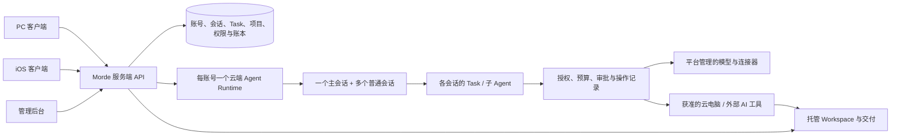

# Morde 定位对齐与功能精简设计方案

> 状态：设计方案，供后续实现和验收；本文不表示功能已经完成。  
> 日期：2026-11-02  
> 依据：[Morde 定位文档](morde-positioning.md)、[云端 Agent 运行时统一化需求](Morde云端Agent运行时统一化需求文档.md)、[客户端与服务端合并需求](nanoMuse客户端与Morde服务端合并需求文档.md)，以及当前工作区代码。

## 1. 目标和使用方式

Morde 以 Muse 的能力为基础，为个人提供可离机的 AI 托管工作间，为团队提供围绕项目、多台云电脑和多个 AI 的交付工作台。PC 和 iOS 是客户端；Agent Runtime 只在云端运行。同一账号的 Runtime 支持多个会话，但只有一个主会话。

本文的列表按优先级和依赖顺序排列，每项标明**修改、新增、删除或保留**。定位文档中的 P0、P1、P2 不变：P0 再分成 A、B、C 三批，以便先打通共同底座，再完成个人和团队闭环。此分批不表示团队 P0 被降为 P1；定位文档没有明确排期的功能，本文标记为建议优先级。

删除清单描述最终应清理的范围，不授权直接删除当前文件、历史数据或已部署能力。替代能力、升级路径、受支持客户端和数据验证通过后，才能实际移除对应代码、接口或发行入口。

### 1.1 设计约束

1. 一个产品、一套服务端：PC 与 iOS 在现有 nanoMuse 原工程基础上交付；业务权威在 `server/`。管理后台属于服务端配套界面。Android 本期不开发、不作为验收门槛。
2. 一个账号一个云端个人 Runtime：以服务实例和账号确定归属；客户端关闭不停止已受理任务。Runtime 与被操作的 Host 分离。
3. 一个账号一个主会话、多条普通会话：主会话是服务端业务会话身份；Task 内部根会话和子 Agent 会话不能代替账号主会话。
4. 同一会话的多轮消息有连续上下文；多个会话可以在配额内并行，同一 Task 同时只有一个有效执行者，停止一项不误停其他项。
5. 个人内容默认私有；项目内容按项目成员和资源权限访问。共享电脑不自动共享个人会话、记忆、凭据或整个 Workspace。
6. 保留 Muse 功能的产品目标，按 P0/P1/P2 分批落地。不能因关闭客户端本机执行，就永久删除记忆、目标、媒体等用户能力。
7. 使用现有 Task、Workspace、模型网关、MCP、权限与审计链路；不另建第二套账号、会话、任务调度或文件写入权威。
8. 创建和运行云端电脑必须绑定且只能绑定一个 Workspace；一个 Workspace 同一时刻只能绑定一台电脑。解绑后无 Workspace 的历史电脑只能处于不可运行的过渡状态，选择可用 Workspace 前不能恢复或打开。
9. Workspace 是 AIO Sandbox 用户工作和下载数据的唯一持久化边界；电脑的工作、下载及用户文件入口统一指向同一个 Workspace 根目录。其余容器状态是临时状态，不能承诺重建后保留。
10. 同一电脑可授权多人同时打开和观察，但同一时刻只能有一个获准用户操作；Workspace 支持完整复制和由接收方确认的移交，移交等待期间锁定使用。

## 2. 当前代码基线

| 范围 | 当前事实 | 设计判断 |
| --- | --- | --- |
| PC 客户端 | `project/nanoMuse/harness/desktop/package.json` 当前入口为 `out/morde-main.js`；`electron-builder.yml` 的文件白名单是 Morde 入口和同步组件。旧 `src/main.ts` 仍有本机 dsh 启动代码，但不能据此认定当前 Morde 安装包会启动该旧入口。 | 保持正式入口无本机 Agent，迁入原 Muse 界面，之后按引用清理旧执行代码。 |
| iOS 客户端 | 原 `Minis` 工程接入了 Morde 聊天；`MordeLocalExecutionPolicy.isEnabled` 为 `false`，旧 Agent 源码和部分 target 仍存在。 | 保留关闭门禁直至运行时、provider 和相关调用从正式 target 安全移除。 |
| 云端执行 | `account_agent_runtimes` 已按服务实例/账号约束；dsh account runtime 可并发管理多个 Task。默认部署 `cloud_dsh.enabled: false`；关闭时启动流程会执行旧 Task 退役逻辑。 | 复用现有实现，补齐可用性、生命周期和目标环境验收；不能只修改默认开关。 |
| 会话 | `conversations` 和 `conversation_messages` 已是统一业务存储；没有账号级主会话字段或指针。Task 内部已有“一 Task 一个根 Agent Session”，不是账号级主会话。 | 主会话应在业务会话层唯一表达。 |
| 多轮上下文 | 一轮完成后追加消息会创建新 Task；新执行生成新的 Agent Session，启动消息目前只包含本轮 `objective`。 | 需要把同一会话的授权历史或已确认摘要带入新执行，并保持 Task 内恢复与跨 Task 接续的边界。 |
| 个人基础 | `personal_objects` 已包含 profile、memory、goal、feed 等对象类型；已有 Goal、Schedule、Notification 服务和部分客户端页面。 | 不是从零开始；补齐云端 Agent 读取/写入、项目范围和端到端体验。 |
| 工作区和团队 | 已有 Workspace 版本/文件块、Host 成员分享和 Task 事件；当前创建 Host 允许不绑定或绑定多个 Workspace，一个 Workspace 已有非解绑状态下的单 Host 约束；当前 Host 仍有 `workspace-root`、`profile-data`、`runtime-data` 和 `host-apps` 等按 Host 持久化的卷。未看到完整项目实体、Workspace 完整复制/移交和单人操作闭环。 | 与新定位有差距：改为一个 Host 一个 Workspace、统一路径和唯一持久化边界；迁移现有数据及控制权，不把 Host 分享直接等同于项目或假定现有卷可以直接删除。 |

关键代码：[`desktop/package.json`](../project/nanoMuse/harness/desktop/package.json)、[`electron-builder.yml`](../project/nanoMuse/harness/desktop/electron-builder.yml)、[`MordeCredentialExpiry.swift`](../project/nanoMuse/android/src/ios/Morde/MordeCredentialExpiry.swift)、[`00073_account_agent_runtimes.sql`](../server/migrations/00073_account_agent_runtimes.sql)、[`conversation/types.go`](../server/internal/domain/conversation/types.go)、[`cloud_dsh_session_tree.go`](../server/internal/worker/cloud_dsh_session_tree.go)、[`personal/content.go`](../server/internal/domain/personal/content.go)。

## 3. 目标结构

图中 Runtime 是账号级进程或容器；会话是可持久访问的业务对象；Task 是一次需要执行的工作。现有实现中一个 Task 可以使用独立 dsh 进程和根 Session，这属于执行隔离，不要求把所有模型循环塞进同一个进程。Agent 可以通过受控工具操作 Host，但 Host 不是维持账号 Runtime 的前提。

项目和账号不相互取代：项目保存成员、项目资源、项目记忆和交付；具体操作仍由有权成员发起并归因到其账号及云端 Runtime。成员离开、账号停用或授权撤销时，项目数据保留，相关执行按现有停止和交接规则处理。

## 4. 设计要点

### 4.1 唯一主会话与多会话

- 为每个 `(service_instance_id, owner_id)` 保存一个主会话指针，并通过数据库约束和事务保证指针指向该账号有权使用的有效会话；新账号在创建、首次启用或首次确保时原子建立主会话。历史候选归属不明确时暂处于待选择状态，选择完成后有且只有一个主会话。主会话默认是个人会话。
- 账号可以创建多条普通会话。切换或恢复会话只读已有会话，不创建 Task，也不重跑工作。设备可缓存最后查看的会话，但该缓存不是主会话权威。
- 对主会话的创建、切换、归档和删除明确服务端规则：并发操作至多保留一个主会话；删除或归档前须先在同一事务中指定替代主会话，或阻止操作并提示。不得静默清空会话历史。
- 已有账号升级时，能确定旧主会话映射的直接绑定；存在多个无法确定的候选时保留全部历史，并要求用户在客户端选择，不按设备最近访问记录静默覆盖。旧 nanoMuse Cloud 线上账号及历史按既有确认不迁移；本机历史保留供用户查看或选择导入。
- 项目会话按项目权限共享；访问项目会话不自动公开成员的个人主会话。若之后允许将项目会话设为个人主会话，仍须保持每个账号的主会话指针唯一，并明确共享范围。
- 在 API 返回会话类型/主会话身份及项目范围；PC、iOS、Portal 过渡入口从同一服务端读取。新增或修改合同与调用方、OpenAPI、生成的客户端类型和测试一起更新。

### 4.2 多轮上下文、补充指令与恢复

- `Conversation` 和 `conversation_messages` 继续保存唯一业务历史。每条需要执行的消息关联一个 Task；保留原 Task、模型、Host、Workspace、授权版本和事件，不因会话切换而修改历史事实。
- 新 Task 启动时，服务端按会话和访问范围提供有界的已保存上下文，包括所需消息、明确授权的个人或项目记忆及附件引用。上下文摘要可以作为历史的补充，但不能覆盖或替代权威消息。超出模型上下文限制时要有可追溯的截断/压缩策略。
- 当前 Task 运行时追加指令先持久化，再按消息序号送入该 Task 的云端执行器，并记录已接收/待处理状态；重试不重复应用。若当前状态无法安全接收，界面明确显示待处理或拒绝，不能只保存消息却让用户误以为 Agent 已执行。
- Task 内断点恢复沿用已确认的检查点和操作账本；不因为跨 Task 接续会话而重放已经执行过的工具。未知外部副作用先对账，无法确认时暂停并提示用户。
- 一个会话同时只推进一个活动 Task；不同会话可按账号和全局配额并发。审批、暂停、继续、取消和补充指令只影响指定 Task；多人同时响应时按版本和幂等键处理。

### 4.3 项目、个人数据与权限

- 增加最小项目实体及成员关系，并让项目会话、项目记忆、目标、Task、交付和资源关联到项目。优先扩展现有业务对象及其权限，不再复制一套 Task/Workspace 状态机。
- 个人数据继续以账号为边界；项目数据以项目为边界。模型上下文只能装入本次任务获准的范围：个人会话读取个人资料，项目任务读取该项目获准资料；个人记忆不能因为用户参加项目而自动进入项目上下文。
- 至少区分项目负责人、可执行成员和只读成员的必要权限；项目成员资格不替代 Host、Workspace、模型和连接器各自的授权。资源被撤销时，后续读取和新工具调用立即拒绝，正在进行的操作按现有停止/未知状态处理。
- 项目会话需记录发起人、项目、任务、工具、审批与产物关联。项目负责人离开或账号停用时，通过显式交接变更负责人；不能以其他账号身份悄悄继续执行。

### 4.4 工作区、审计与交付

- 复用 Workspace 不可变版本、文件块、提交和读回机制。每台正在运行的电脑必须有且仅有一个 Workspace；工作、下载和持久化以该 Workspace 为准。文件级 diff 比较两个已确认版本；回滚是基于用户确认和当前版本校验创建一个新版本，不直接覆盖历史版本。并发修改、同步中或未知副作用时暂停回滚并保留数据。
- 允许获准用户同时打开同一电脑观察；电脑的操作权按实际用户身份互斥，切换与 AI/用户控制模式复用并扩展现有围栏。复制 Workspace 得到完整、独立的文件树；移交等待接收期间冻结使用，接收或取消后按结果恢复。
- 手机文件默认只读；用户明确切换到可写并获得服务端权限后，才允许重命名、移动和删除。敏感文件按服务端策略限制显示、预览和下载；客户端隐藏按钮不能代替服务端检查。
- 模型、Host 操作和外部 AI 调用在既有授权、预算及操作账本内执行。记录人、项目/会话/Task、指令或其受保护引用、目标、结果及费用依据；普通审计日志不存凭据或未经授权的私人正文。
- 文档要求每次改动和外发可追溯：对 shell、浏览器和外部 AI 等可能产生间接操作的路径，需要可验证的执行范围、网络和文件变更边界；无法归因或核对时，显示未知或阻止该能力，不能把部分 API 审计描述成全面覆盖。
- 完成前核验交付已经保存到授权 Workspace；项目交付关联实际文件版本和任务结果。个人数据默认不对项目成员或管理员可见；额外完整记录继续遵守已有单独同意、授权、撤销与审计规则。

## 5. 按优先级排列的完整变更清单

说明：**改**为调整已有实现，**增**为确实缺少的能力，**删**为满足前置条件后移除，**留**为明确不能当作冗余删除的能力。每项的验收是该项的最小结果，不代替第 8 节端到端验收。

### P0-A：统一云端执行与会话底座

| 顺序 | 类型 | 事项及主要范围 | 完成条件 / 删除前置 |
| --- | --- | --- | --- |
| A01 | 改 | 云端启动与部署：`server/cmd/portal/main.go`、`server/internal/worker/cloud_dsh_*`、`deploy/single/portal.yaml`。 | 目标 Linux 环境完成 Guardian、隔离、恢复和停止验收后开放执行；运行时不可用如实报告。升级不能因默认关闭而意外退役新版本的正常 Task/计划；旧任务的安全退役仍保留。 |
| A02 | 改 | 账号 Runtime 生命周期与状态：`account_agent_runtime.go`、`cloud_dsh_account_runtime.go`、执行控制 API。 | 已启用账号拥有独立云端 Runtime；空闲、客户端离线及服务重启后的状态可核对；支持独立任务停止、配额和故障状态。不能仅靠惰性启动代码宣称全部账号已常驻。 |
| A03 | 增 | 服务端唯一主会话：`domain/conversation`、`conversation_service.go`、`task_conversation.go`、迁移和会话 API。 | 同账号并发创建/切换仍只有一个有效主会话；两个端看到同一 ID；旧数据映射不确定时不静默合并。 |
| A04 | 改 | 新 Task 读取同一会话上下文：`task_service.go`、`cloud_dsh_executor.go`、`cloud_dsh_session_tree.go`、`morde-cloud-runtime/src/engine.mjs`。 | 第一轮提供的信息在第二轮可用；不同会话、不同账号及不同项目不能串上下文；原有 Task 检查点恢复不被破坏。 |
| A05 | 改 | 运行中补充指令：会话消息、Task 事件、worker 与 dsh 输入。 | 追加消息可追踪接收状态并按序交给对应执行；断线重试不重复，不能接收时明确反馈。 |
| A06 | 改 | PC 正式客户端：`harness/desktop/src/morde-main.ts`、`harness/dsh-nanomuse/src/client/`、Portal 会话组件。 | 在同一正式应用提供 Muse 风格界面及 Morde 会话、进度、审批和电脑入口；会话状态来自服务端；安装包无本机 Agent Runtime。 |
| A07 | 改 | iOS 正式客户端：`NanoMuseShell.swift`、`Morde/MordeApp.swift` 和原 `Minis` target。 | 主/普通会话来自服务端；从会话发送与接续，不以“新任务”作为主要入口；后台、退出和切端不停止云端 Task。 |
| A08 | 删 | PC 旧本机 Agent 启动和旧 Hub `task/delegate` 执行路径：`harness/desktop/src/main.ts`、`harness/dsh-nanomuse/src/task.ts` 及 `cloud.ts` 中对应注册。 | A06 及该路径关联的保留功能已完成迁入；构建、安装包及调用链确认不再依赖后，删除旧本机 Agent 代码和专属打包脚本。保留仍被云端或界面使用的插件代码。 |
| A09 | 删 | iOS 本机 Agent 循环、直连模型执行和本机例程执行：`Agent/Chat`、`Providers`、旧 Hub/调度中的专用路径及 target 编译项。 | A07 和云端替代能力可用；旧历史可读、数据迁移通过；先证明调用方已迁移，再移除对应代码。清理完成前保留 `MordeLocalExecutionPolicy` 门禁。 |
| A10 | 改 / 删 | 旧 nanoMuse Cloud、Hub 账号与同步：PC `cloud.ts`/`sync.ts`，iOS `NanoMuseCloud.swift`/`NanoMuseSync.swift`。 | Morde 接管账号、会话、个人数据和获准设备调用后，删除独立 Cloud 登录、业务同步和委派本机 Agent 的路径；不删除本机历史或 Morde 的 Hub 服务。 |
| A11 | 改 / 删 | 用户自带模型 API Key：Portal `Connections.tsx`、`model_connections.go`、PC/iOS 旧 provider 设置。 | 停止用户自带模型密钥的新增和使用；平台管理员模型连接保留。按既有确认仅清理可识别的设备内旧模型 key，保留登录、同步和 MCP OAuth；服务端已有个人连接先保护并按升级策略处理，不能静默删数据。 |
| A12 | 改 / 删 | 会话兼容入口：`task_chat_compat.go`、`api/instant_chat.go`、旧客户端调用与 OpenAPI。 | 迁移期兼容入口只调用统一会话/Task；确认受支持客户端升级和幂等重试窗口结束后退役旧路由及兼容代码。已迁移历史和旧数据不随代码删除。 |
| A13 | 删 | 旧 Go Agent 模型/工具循环：`server/internal/app/agent.go` 及只服务该循环的代码。 | 全量调用方核对后移除未装配到生产的旧循环及专属测试；`CloudDSHToolBroker` 正在复用的 Task 刷新、提交、核验等方法先保留或归入现有职责，不能删除整个文件。 |
| A14 | 改 / 有条件删 | 客户端直调模型入口：`server/internal/api/model_gateway.go` 的 `/api/model/v1/chat/completions`。 | 正式客户端不依赖它驱动本机工具循环；先核对受支持客户端和外部消费者，再限制或退役对应对外入口。保留服务端内部模型网关、计量和管理员模型检查能力。 |
| A15 | 删 | 第二套独立发行入口和重复用户页面：`project/morde-desktop/`、iOS `Morde.xcodeproj`/`MordeStandaloneApp.swift`，以及已被正式客户端替代的 Portal/Workbench 用户页面。 | PC/iOS 正式入口完成能力迁入和数据升级验证后，退役重复产品的打包、下载和专属代码；保留正式客户端共用的 Morde 模块、必要的云电脑操作页面、管理后台和 `morde-sync` 文件能力。 |
| A16 | 改 | 文档与契约：`README.md`、本定位文档引用的合并/运行时需求、`server/openapi/portal.yaml`、客户端 schema 和验收记录。 | README 删除允许客户端承载本机 Agent 的过时表述；`morde-positioning.md` 的现状区分“已有代码”和“端到端完成”。已有历史实施记录保留，不改写成已验收。 |

### P0-B：Muse 基础能力与个人托管

| 顺序 | 类型 | 事项及主要范围 | 完成条件 |
| --- | --- | --- | --- |
| B01 | 改 | 个人资料、记忆、SOUL、日记：`domain/personal`、`personal_service.go`、个人同步与客户端页面。 | 云端 Agent 可按账号授权读取必要资料和记忆，写入走同一业务用例；跨账号拒绝，冲突不静默覆盖。 |
| B02 | 改 | 个人目标及进度：`goal_service.go`、客户端 Goals 页面。 | 可创建、更新目标及状态；Agent 按授权引用或更新进度，并在会话中反馈；个人数据与项目数据分开。 |
| B03 | 改 | 云端定时/例程：`schedule_service.go`、`domain/schedule`、`schedule_worker.go`。 | 复用一套 Schedule 和触发去重；纯文本例程不强制绑定 Host，需要电脑时才校验 Host；时区、错过执行、撤权和重启不产生重复 Task。 |
| B04 | 改 | 主动提醒：`notification_service.go`、`notification_worker.go`、PC/iOS 通知入口。 | 目标阻塞、任务待批和完成等场景产生有权限的提醒；离线后可读回，处理后状态一致。通知分级增强属于 P1。 |
| B05 | 改 | Workspace 托管、版本与恢复：`workspace_sync.go`、`project/morde-sync`、现有同步节点与产物提交。 | 客户端离线时已受理的云端工作可继续；保留文件、不可变版本和冲突保护；释放 Host 不删除唯一文件副本。 |
| B06 | 增 | 文件级 diff 与回滚：Workspace 版本 API、Workbench/客户端。 | 选定两个已确认版本可查看文件差异；确认回滚后生成新版本，遇并发改动不覆盖他人数据；可核对回滚结果。 |
| B07 | 改 | 会话内实时过程：Task 事件流、Portal Assistant、PC/iOS 页面和 Host 观察入口。 | 对话中能看到已授权的进度、操作、结果与当前状态；事件断线可续读；画面、文件变化与消息归属可辨认。完整操作回放按可审计边界接入，未记录部分不伪造回放。 |
| B08 | 改 | 手机文件管理：`MordeApp.swift` Workspace 页面及服务端文件权限。 | 浏览、预览、搜索、下载、重命名、移动和删除有真实服务端结果；默认只读、显式授权写入；敏感文件限制在服务端执行。删除云端文件与删除本机副本明确区分。 |
| B09 | 改 | 手机审批与干预：会话消息、`task_action_service.go`、PC/iOS 审批控件。 | 对同一 Task 可暂停、继续、提交变更指令、批准或拒绝；界面显示服务端确认而非本地猜测，重复响应只生效一次。 |
| B10 | 改 | Host 与 Workspace 一对一：创建、恢复、绑定、默认电脑、数据库约束和客户端。 | 创建和运行时恰好一个 Workspace；同一 Workspace 不同时归属多台 Host；解绑后无 Workspace 的旧 Host 不可运行；所有入口并发时仍守住约束。 |
| B11 | 改 / 删 | AIO Workspace 统一路径与唯一持久化：Host 编排、镜像、文件/工具和旧卷迁移。 | 默认工作和下载指向同一 Workspace 根；保留用户卷和必要的平台操作账本；只在真实目标环境证实持久性、版本和空间边界后切换，历史卷迁移核验后才退役。 |

### P0-C：团队项目与 AI 交付

| 顺序 | 类型 | 事项及主要范围 | 完成条件 |
| --- | --- | --- | --- |
| C01 | 增 | 项目、成员与授权：`server/internal/domain`、`app`、`api`、PostgreSQL 和客户端项目入口。 | 最小项目可创建、邀请/移除成员、区分负责人/可执行/只读权限；关联已有 Host、Workspace 和会话；个人内容默认不共享。 |
| C02 | 改 / 增 | 项目记忆、项目资料及目标：扩展个人数据与 Goal 的业务范围。 | 项目背景和目标可供获准成员及其项目 AI 读取；个人记忆不自动混入；版本冲突、撤权、删除和项目交接可核对。 |
| C03 | 改 | 多电脑总览和共享：复用 `host_sharing.go`、Host API、现有控制围栏与工作台。 | 多名授权用户可同时打开并观察同一电脑；全路径保证同一时刻只有一名用户拥有操作权，交接、撤权与 AI 执行不绕过围栏。 |
| C04 | 增 | 基于 Workspace 副本的电脑复制：Host、Workspace、存储和资源配额。 | 完整复制已确认的 Workspace 持久文件，创建绑定该副本的新 Host，源不变；运行中进程和 Workspace 外的临时状态不复制，系统身份重新生成。旧电脑仍有未迁移的独立持久卷时不能宣称已完整复制。 |
| C05 | 改 / 增 | 项目 Todo 与多 AI 分工：现有 Task/Step、云端 dsh 子 Agent、Host 上 Codex/Claude 接入。 | 项目需求可形成带验收标准的工作项，受控分派给支持的 AI/电脑，查看状态、阻塞、取消与结果；沿用 Task 权威，不能把同模型子 Agent 直接称为多工具编排。 |
| C06 | 改 / 增 | 阻塞处理和交付：Task 事件、项目目标、Workspace 产物。 | 阻塞原因、所需资料/授权和负责人可见；确认后可继续或重新分派；项目交付引用已保存的文件版本，能被成员评审。 |
| C07 | 改 / 增 | 项目预算及对账：`model_gateway.go`、`model_usage_admin.go`、Host 资源计量及项目记录。 | 项目执行前检查可用预算和权限；账本关联人、项目、任务、模型/电脑、用量及费率依据；金额未知或无法核算时明确显示，不能用 token 冒充实际费用。已配置账号预算与历史账本保留，不自动发放奖励或免费额度。 |
| C08 | 改 | 项目隐私和可追溯性：权限、审计、MCP/Host 工具与完整记录。 | 个人、项目、管理员三个访问边界分开；撤权生效；外部 AI 与可产生文件/网络副作用的操作能够归因和核对，未知状态不能报成功。 |
| C09 | 增 | Workspace 完整复制：Workspace、版本/块存储、容量账本及客户端。 | 从停写并确认的当前文件树建立独立副本；首选普通复制，COW 是可选优化。文件类型、容量和版本无法完整处理时明确阻塞，不伪报成功。 |
| C10 | 增 | Workspace 移交：所有权、授权、配额、设备/项目关系及客户端。 | 只允许未被电脑使用的 Workspace 发起移交；申请后冻结，接收方确认才改变所有权，取消保持原主；并发、撤权、失败和历史记录均可恢复、可追溯。 |

### P1：定位文档明确后置的能力

| 顺序 | 类型 | 事项及主要范围 | 完成条件 |
| --- | --- | --- | --- |
| P1-01 | 改 | 跨设备接力增强：Hub、设备状态和客户端。 | 在 P0 同一云端会话跨端查看/操作的基础上，补设备间接力体验。已确认的目标 PC 单次截图、文件查看、命令及已选 Workspace 写入继续按既有授权与 F02-T10 等门禁实施，不因本文被删除或自动开放。 |
| P1-02 | 改 | 通知分级：现有 Notification 和客户端设置。 | 按用户/项目偏好区分紧急、待办和普通提醒，撤权后不泄露项目正文。 |
| P1-03 | 改 / 增 | 团队共享技能库与常用连接器：`cloud_dsh_skills.go`、MCP connector 服务与项目授权。 | 复用现有技能和连接器；按项目授权、撤销和审计，不复制个人连接器凭据。 |
| P1-04 | 增 | 文档产物模板：Workspace 交付与客户端。 | 模板生成的文件仍进入项目 Workspace 并可评审，不建立独立文件权威。 |

### P2：后续能力

| 顺序 | 类型 | 事项及主要范围 | 完成条件 |
| --- | --- | --- | --- |
| P2-01 | 改 / 增 | 行级批注、跨项目搜索。 | 继承项目和文件权限；无权限内容不能通过搜索、摘要或批注泄露。 |
| P2-02 | 改 / 增 | 语音输入及图片、视频、语音等媒体生成与处理。 | 用户功能保留并逐步迁到云端；使用平台管理的模型连接，产物归入获准的个人或项目 Workspace。不能恢复客户端本机 Agent/直连模型循环。 |
| P2-03 | 改 | Feed、Ideas、Library、简报等 Muse 基础体验。 | 定位文档未明确这些功能的排期，建议在 P0 闭环后分批完善；保留现有产品入口和可读数据，涉及模型生成时走云端。若某项是 P0 场景的必要入口，应随对应 P0 提前接入。 |

## 6. 必须保留与单独判断的内容

### 6.1 必须保留或复用

| 范围 | 原因 |
| --- | --- |
| `project/morde-runtime/` | 这是云电脑内的 Host 工具运行端，负责文件、浏览器、桌面和命令等受控操作；它不等同于客户端 Agent Runtime。 |
| `project/morde-sync/`、Workspace 历史版本、同步回执和安全副本 | 仍承担文件同步、恢复或迁移；只收敛重复写入权威，不按目录名称整体删除。 |
| Guardian、Task 租约、停止证明、操作账本、审批和撤权 | 用于隔离、防止重复副作用和安全恢复；不能为了精简移除。 |
| 内部模型网关、模型连接、用量账本、MCP 与工具权限 | 云端 Agent 和外部 AI 管理仍需要；删除用户自带密钥入口不等于删除模型多供应商能力或平台凭据。 |
| 用户已有会话、Workspace、上传文件、本机历史、个人资料和已配置预算 | 新旧应用切换不得清空；不确定归属的数据先保留。 |
| 完整记录的同意、授权、撤销和审计 | 属于已确认的个人数据边界；不能因为项目要审计就默认打开个人正文给管理员。 |
| 批次、子 Agent 与后台任务中仍服务云端交付的代码 | 应复用现有权限与 Task 机制；按调用关系清理重复代码，不能因名称相似直接删除。 |

### 6.2 暂不认定为必须删除

- `server/internal/app/site_service.go` 及站点发布：定位文档 P0 没有列为必需，但已有 API 和存储。先停止扩建；是否退役需看实际用户和已有站点，不能连同 Workspace 产物提交一起删除。
- 其他原 Muse 用户功能：定位要求以 Muse 为基础，并列有后续能力。应逐项归入 P0/P1/P2 或证明重复后合并；不因为当前尚未接入云端就认定无用。
- `project/cua`、`project/OpenSandbox` 等参考或依赖源码：不属于客户端 Agent 的判断范围；先核对构建、许可证和部署引用，再决定仓库整理方式。

## 7. 迁移和依赖顺序

1. **建立可回退基线。** 盘点当前服务实例、账号、会话、Task、Workspace、安装及版本；验证备份可读。记录仍受支持的客户端、旧路由和模型连接使用情况。
   特别盘点无 Workspace 或绑定多个 Workspace 的 Host，以及 `workspace-root`、`profile-data`、`runtime-data`、`host-apps` 内的旧数据；未核验迁移前不得删除旧卷或改变其唯一副本。
2. **先改服务端会话与执行合同。** 完成主会话唯一性、历史上下文、追加指令及项目数据边界；数据库迁移只增不改已发布迁移，接口、客户端类型与测试同步。旧历史保持可读。
3. **按真实环境验收云端 Runtime。** 验证账号隔离、Host 分离、任务并发、停止证明和重启恢复；完成部署与运维门禁后才切换正式入口。旧 Task 的未知副作用先对账。
4. **切换 PC/iOS。** 正式客户端统一到服务端主会话和消息入口；保留必要本机文件选择、同步和获准设备操作。旧界面及本机数据先验证去向，再停止旧发行入口。
5. **分批补个人与团队 P0。** 先用同一账号贯通个人流程，再让项目成员共享获准背景和资源，接入多 AI、预算和交付。各项沿用同一授权和账本。
6. **最后清理兼容路径。** 在受支持客户端升级、历史迁移与回退窗口结束后，移除 A08～A15 中已满足条件的旧代码和接口。清理前逐项核对调用方、测试、生成代码、打包和部署配置；不删除用户业务数据。

实现过程中若发现现有实施文档、OpenAPI 与本方案冲突，先按 `server/AGENTS.md` 在所属实施文档记录冲突和归属，再同步修订合同、实现与测试；本设计不自动改写已有历史记录。

## 8. 整体验收

| 场景 | 必须看到的结果 |
| --- | --- |
| 客户端运行边界 | 检查 PC/iOS 正式启动链、安装包和请求：不启动本机 Agent、模型/工具循环或子 Agent；获准的同步和单次设备动作仍正常。 |
| 一主多会话 | 本机模拟两个客户端并发进入或切换，服务端始终只有一个有效主会话；多个普通会话保持独立，不同账号隔离。真实跨设备结果单列。 |
| 多轮上下文 | 同一会话第一轮给出事实、第二轮引用该事实，云端 Agent 可正确获得；切换其他会话或账号不能读取原上下文。 |
| 离机与恢复 | 手机提交后关闭客户端，Task 继续；重新登录读取同一会话、状态和产物；服务或 Runtime 重启后按检查点恢复，未知副作用不重跑。 |
| 并发和停止 | 同一账号两个会话的任务在配额内并行；停止其中一个不会结束另一个；同一会话不产生两个同时推进的 Task。 |
| 追加与审批 | 运行中追加的指令有服务端接收和应用状态；双端并发审批只生效一次；断线重试不重复执行。 |
| 工作区与手机 | 产物可从已确认版本读回；文件 diff/回滚、只读与可写切换、敏感文件限制和冲突保护真实生效。 |
| 一电脑一工作区与持久化 | 创建/恢复不能绕开一个 Workspace；并发绑定保持一对一；各工作和下载入口指向统一根目录；销毁重建后 Workspace 文件可读，Workspace 外状态不承诺保留。 |
| 多人查看、单人操作 | 多名获准用户可同时观察；抢占、切换、撤权、断线及 AI 交接期间，桌面、终端和工具等写入口始终只有一名当前操作者可用。 |
| 工作区复制 | 对确定的当前文件检查点完成独立复制，源与副本修改互不影响；普通复制必须覆盖，COW 仅在本机实际支持且启用时另测，不作为硬件门槛。 |
| 工作区移交 | 使用中的 Workspace 不能发起；申请后双方均不可读写或绑定，只有取消或接收成功才解锁；接受后新所有者可用、原所有者不再可用，历史审计保留。 |
| 项目隔离 | 项目成员能访问获准的项目背景、会话和电脑；非成员及被撤权成员不能访问；个人主会话、记忆和凭据不因项目共享而泄露。 |
| 多 AI 与交付 | 本机用两种受控执行目标的替身覆盖分派、阻塞与版本关联；真实第三方工具和外部副作用单列待验证，不要求购买账号或接入外部服务。 |
| 预算与审计 | 项目事前限制生效；事后可关联人、任务、工具、用量和费用依据；未知账目与不可归因操作如实显示，不伪报成功。 |
| 升级与清理 | 老数据可读、升级和回退有验证；受支持客户端无旧接口依赖后才退役兼容；平台、登录、同步和 MCP 凭据不被误删。 |

## 9. 明确不在本次设计中的内容

- 不创建第二套 Agent 平台、第二套业务数据库或独立项目调度服务。
- 不把第三方 AI 的所有实现搬进 Morde；优先通过受控适配接入现有工具。
- 不开发 Android、不做手机端完整 IDE、不自动迁移旧 nanoMuse Cloud 线上账号和历史。
- 不因为定位变化立即删除既有站点、用户数据、文件、凭据或数据库迁移。

## 10. 五会话实施所需的合同补充

本节是目标合同，不代表接口、字段或数据表已经存在。实现时先核对当前 OpenAPI 和调用方，由对应文件所有者同步落地；已有实施文档的状态和验收记录不因本节自动改变。

### 10.1 主会话的初始化、读取和切换

业务主会话按 `(service_instance_id, owner_id)` 唯一保存，和 Task 下的 dsh 根 Session 使用不同 ID。首期主会话为账号自己的个人会话，项目会话不自动变为主会话；项目是否可作为主会话不在本次范围。存储须通过外键和事务校验主会话真实存在、归属当前账号且未归档；事务锁按既有账号/会话锁顺序执行，迁移不得修改已发布迁移。

拟新增以下接口，均要求已授权的用户会话或安装凭据：

| 接口 | 请求与结果 | 规则 |
| --- | --- | --- |
| `GET /api/me/main-conversation` | 返回 `status`（`ready`、`uninitialized`、`selection_required`）、`conversation_id`（未就绪时为空）及 `version`。 | 只读，不创建会话或 Task。客户端不能把本地最近会话当作主会话。 |
| `POST /api/me/main-conversation/ensure` | 请求无业务字段，要求 `Idempotency-Key`；返回上述状态。 | 无候选会话的新账号在事务内创建并绑定一条主会话；已有明确绑定则返回原值；仅有一个可用个人历史候选时原子绑定；多个无法确定的候选返回 `selection_required`，不创建或合并候选。待选择候选通过会话列表读取，并限定为本人未归档的个人会话。 |
| `PUT /api/me/main-conversation` | 请求 `conversation_id`、`expected_version` 和 `Idempotency-Key`；返回当前主会话和新版本。 | 指定本人可用的个人会话，比较版本并原子替换；版本不匹配返回冲突并刷新，不同请求复用幂等键拒绝。未初始化版本使用 `0`。 |

`GET /api/conversations` 与 `GET /api/conversations/{id}` 的响应补充当前账号视角的 `is_main` 和会话范围；`POST /api/conversations` 在项目阶段补充可选 `project_id`。主会话删除或归档在首次提供该功能时必须先事务内更换主会话，或拒绝并提示；当前没有实现的删除/归档接口不得当成已存在。

### 10.2 消息上下文和执行中的补充

- 继续使用现有 `POST /api/conversations/{id}/messages`，其 `202` 仅说明服务端已持久受理，返回原有 `message`、`task`，并在消息上增加 `delivery_status`（`pending`、`applied`、`unknown`）。`applied` 表示该消息已进入经过持久确认的 Agent 会话，不表示任务结果已完成；`unknown` 需要对账，不能自动重放工具。
- 现有 `POST /api/tasks/{id}/inputs` 保持澄清答复语义，不作为普通追加消息的第二个入口；审批继续走现有审批接口。排队、运行、暂停或等待用户时可持久接受普通补充，但不会仅因补充而绕过待处理审批/澄清或自动解除暂停；正在停止的 Task 拒绝追加并保留客户端输入。已结束的 Task 之后发新消息创建新 Task。
- 一个会话同一时刻最多一个**未结束** Task，包括 `queued`、`running`、`waiting_user`、`pausing`、`paused`、`cancelling`。当前数据库活动索引不含 `paused`，升级需先盘点可能存在的多条未结束记录；冲突需显式处理，不能静默取消或合并。将暂停纳入唯一约束后，恢复与追加必须共享相同事务边界。
- 新 Task 接收的上下文按已确认消息序号固定边界、授权范围和摘要；当前消息只加入一次，未完成或中断的助手输出不能冒充已完成回答。超出可用上下文时明确使用有界截断或已确认摘要，不覆盖原始会话历史。读取历史和附件时重验账号/项目授权。
- 追加指令以原消息 ID 为去重身份：先在业务事务中保存消息、事件和待投递状态，再由持有有效 Task/Agent 租约的 worker 按序投递；只有消息 ID 与 dsh 会话事件的映射及对应检查点都持久确认后才标 `applied`。当前代码在恢复时遇到非空 `next-turn`/`next-step` inbox 会拒绝恢复，尚未确认 dsh 支持附带消息 ID 的在线注入；R04 必须先用现有 pinned 依赖和本机模型替身验证安全注入、检查点事件及恢复，缺少能力就扩展本项目的 IPC/持久映射和恢复逻辑，不假设外部库已有接口。不能可靠判断是否应用时保持 `unknown`，不重复追加或重派已有副作用。

### 10.3 项目身份、权限和预算

项目是持久业务对象，不新建账号或另一套 Task。项目成员最低分为 `owner`、`member`、`viewer`：`viewer` 可读取获准项目数据，`member` 可在自身已有资源与预算授权范围内发起工作，`owner` 管理成员、资源关联和项目预算；资源使用仍需各自授权。项目任务中的操作人/执行账号、项目负责人、会话创建者是不同身份，不能用项目负责人身份代替实际发起人。

拟新增 `GET/POST /api/projects`、`GET /api/projects/{id}`、`GET/POST /api/projects/{id}/members`、`PATCH/DELETE /api/projects/{id}/members/{user_id}`、`GET/POST/DELETE /api/projects/{id}/resources` 和 `GET/PUT /api/projects/{id}/budget`。写操作携带幂等键；成员、资源和预算变更携带期望版本，过期返回冲突。资源关联只记录已获权的 Host/Workspace，不能通过关联扩大权限；成员撤销后重新检查正在执行任务的授权。

成员邀请首期限定同一服务实例内的已有账号：`POST /api/projects/{id}/members` 由 owner 创建待接受邀请，带目标账号、拟授予角色、期望版本和幂等键；受邀人通过拟新增的 `GET /api/me/project-invitations` 查看本人邀请，调用 `POST /api/project-invitations/{id}/accept` 接受后才成为成员。owner 可用 `DELETE /api/projects/{id}/members/{user_id}` 撤销待接受邀请或移除成员；非受邀人不得查看或接受，重复请求不重复授权。这里仅定义产品内记录，不依赖邮件或外部消息。拟新增 `POST /api/projects/{id}/owner-transfer`，由现任 owner 显式转交给已接受邀请的有效成员，原子保证项目恰有一个 owner，转交前后版本及权限可核对；负责人离开前先转交。账号被停用时保留项目并停止以该账号继续执行，授权恢复或交接须经过有权管理员的显式、可审计操作，不能自动读取私人内容或冒用身份。

项目会话是单份共享历史。当前 `conversations`、`tasks`、`conversation_messages` 的复合外键及大量查询以 `owner_id` 假设同一用户；实现项目共享前必须迁移并区分会话归属与消息/Task 实际发起账号，调整外键、Store 查询、事件/附件授权及隔离测试。不得只放宽 `owner_id` 查询、复制多份可写会话，或让一个成员的 Task 在项目负责人 Runtime 下冒充其身份执行。

项目预算以明确的币种、额度和版本表达；模型和 Host 费用保留来源、费率版本、用量及可核对的计算结果。仅 token 可知、实际费用未知的记录标为未知；无法得到可接受的费用上限时不放行需要事前预算控制的项目执行。项目限制与账号既有预算同时生效；保留账本及已经配置的账号额度。

### 10.4 Workspace 版本操作与电脑复制

拟新增 `GET /api/workspaces/{id}/diff?from_revision=…&to_revision=…`，只比较两个已提交的获准版本并返回文件增删改及可安全展示的差异；过大或不可展示的文件返回明确状态。拟新增 `POST /api/workspaces/{id}/restore`，请求包含目标版本、当前期望版本、已选择路径及幂等键；核对权限、资源和在途操作后提交**新**版本。当前版本变化、在途写入或停止不明时返回冲突，不改动历史。

手机文件复用现有 Workspace 读/同步权威；拟新增一个受版本约束的 Workspace 文件操作入口，处理重命名、移动和删除，返回新版本与操作结果。服务端分别核对读写权限、默认只读状态和敏感路径策略。敏感路径的具体规则和例外应在实现任务中列出并通过用户/管理员可理解的提示；未知敏感内容不能承诺已全面识别。

拟新增 `POST /api/hosts/{id}/copies` 创建受控电脑复制请求：先按 10.9 完整复制唯一 Workspace，再使用独立身份创建并绑定新 Host；Workspace 外的容器进程和临时状态不复制。系统注入的 Host/平台凭据不属于 Workspace，必须重新生成；Workspace 内的用户文件包括隐藏文件或用户自行保存的凭据，按完整复制处理，不能悄悄删改，界面须提示复制范围。若需要给其他用户使用，先按 10.10 完成新 Workspace 的移交并由接收方接受，再由接收方创建/恢复绑定电脑。源电脑尚有未迁移的独立持久卷时，不得把 Workspace 副本声称为完整电脑持久数据。

### 10.5 本地执行边界与已有验收记录

五个实施会话只在本地工作，不上传、外发或发送文件；涉及业务文件内容的测试使用进程内模拟或本机读写，不向服务、其他进程或设备传送真实或合成业务文件。页面验收只加载本地页面与内存模拟数据。Mac 可用本地 Docker/PostgreSQL 测数据库元数据，不发送文件；需要真实文件传输、外部服务或目标 Linux 才能确认的链路记录为待验证。不得连接或修改远端来补测，不得伪报通过，也不得据此开放生产能力。执行方法和设备边界见第 11 节。

F02-T10 已按用户此前要求豁免运行验收并关闭实施项，但已有 Ubuntu peer 连接超时记录；这不是同步联通成功的证据，面向客户端的 `workspace-sync` capability 保持关闭。Host 内 `workspacereplica` 使用 `morde-sync` 的 LiveSync/HandoffCheckpoint 与 Portal 的版本提交属于另一条链路；W04/W18 必须核对该链路的授权、依赖和关闭节点时的行为，不能把 F02 关闭等同于 Host 检查点已可用，也不能为了证明 Host 检查点重开 F02。后续只做不发送文件的本地验证，真实传输不在当前操作范围内。

### 10.6 旧数据约束与分阶段迁移

遵守 `server/AGENTS.md` 的 Expand/Contract 和显式迁移规则：先以新增列/表等兼容方式扩展，并交付能够读取旧数据、维护新字段的代码；首个发布不删除旧列或外键，也不对已有数据直接施加破坏性约束。完整发布物中对应的公共约定、OpenAPI、实现和测试同步交付，不将只有目标合同的本地中间状态当作上线版本。

对同会话未结束 Task，先预检含 `paused` 的历史冲突，运行时创建/恢复统一使用数据库事务和会话锁，保证兼容期间的跨进程互斥；待兼容版本已生效且冲突由用户明确处理后，再在独立的后续收缩发布中增加覆盖 `paused` 的数据库唯一约束。预检失败不得自动取消或合并历史 Task。对项目共享，先扩展会话归属和消息/Task 实际发起人字段并兼容旧读写，核验历史外键和权限；确认所有受支持调用方完成切换后，才在独立后续发布移除或调整阻塞共享的旧约束。严格约束尚未完成时，相关上线条件及待处理风险必须保留，不能宣称迁移和项目共享已全面完成。本轮不部署，分期方案及隔离数据库演练不等于生产迁移完成。

### 10.7 一电脑一 Workspace 与唯一持久化

- **对象关系与接口：** Host 新建、启动或恢复须有且只有一个可用 Workspace；Workspace 的 `preparing / active / unbinding / failed` 绑定最多指向一台 Host。保留现有 `POST /api/hosts` 的 `workspace_ids` 字段并改为恰好一个，零个或多个返回明确错误；所有创建、默认电脑、绑定、恢复和认证入口执行相同权限与互斥校验。默认电脑可以幂等创建 Workspace；失败时提示，不创建无 Workspace 电脑，也不阻断普通登录。纯云端聊天可不选 Workspace。
- **解绑和恢复：** 释放计算资源保留绑定，不满足移交条件。要解绑时先停止新写入、排空在途 Task/同步、取得并核验检查点、确认旧 Sandbox 已停止，再完成解绑。未知结果保持冻结。解绑后的 Host 可留作停止/待绑定记录，允许先绑定一个新 Workspace 再恢复，但不能无 Workspace 启动或打开。
- **先用现有命名卷通路：** 当前 `orchestrator/client.go` 发送的是 PVC `claimName`，OpenSandbox Docker 后端映射为 Docker named volume；这不是服务端路径的挂载。目标改成以 Workspace ID 命名和登记的独立卷，例如 `workspace-<id>`，挂到 `/home/gem/workspace`，以数据库绑定和停止证据确保同一卷不被两台 Host 同时使用。卷与 Host/Sandbox 生命周期分离，释放或删除 Sandbox 不删除卷。此方案需要新增卷创建、身份校验及迁移代码，不是当前已有能力；当前适配器始终设置 `createIfNotExists=true`，必须改造：只有首次创建可创建，已登记卷缺失、身份不匹配或状态不明时一律失败，不自动建空卷。卷标识须由服务端可信记录和 Docker 卷元信息校验，不能依赖 Workspace 内用户可改文件。
- **当前文件树与版本：** Workspace 卷是运行中的用户工作树；现有 `workspacefs` 块和 PostgreSQL revision 继续保存已确认检查点，`workspacecurrent` 只是已确认版本的服务端投影。当前 Host 的 `workspacereplica` 仍按 `/<workspace_id>` 工作，须改为唯一根并调整 Task 视图、文件工具和同步路径；不能把可被原子交换的 `workspacecurrent` 目录直接挂进 Sandbox，也不能只改路径。普通应用写入卷后文件留在卷内，但只有检查点提交并确认才是可供版本、同步和交付使用的已确认版本；同步失败或存在不受支持文件时标记未同步，保留卷上当前树，禁止拿旧 revision 覆盖它。文件 API、设备同步和回滚不能独立修改旧快照后直接覆盖正在写入的卷：首期在存在写入者或未同步变更时拒绝这些可能覆盖文件树的操作；排空后核对当前检查点及期望版本，只有经同一受控提交流程才能改变当前树与 revision。复制、移交、回滚与恢复只能在写入已排空且检查点可靠的状态进行。
- **默认路径和临时状态：** 将浏览器默认下载、桌面、终端、IDE 及工具的默认工作目录配置到 `/home/gem/workspace` 下，适配旧 `/<workspace_id>` 路径。用户仍可能在应用内手动选择其他路径；路径在 Workspace 外的内容是容器临时数据，界面明确提示，不能宣称已拦截任意应用的所有写入。Task 私有视图、平台密钥和控制 socket 不放进用户可读文件树。卷保留只覆盖宿主存储未丢失的 Sandbox 重建，不等同于宿主磁盘故障备份。
- **平台账本和镜像必须先改：** 现有 `/var/lib/morde-runtime` 的独立持久卷承载 operation journal、恢复等状态，不能直接删掉；目标把必要的平台操作记录放到现有服务端 PostgreSQL，经受认证、代次围栏、幂等和持久确认的服务接口读写，Sandbox 不再依赖额外持久卷。需先改 `operationstore` 及调用方：执行副作用前服务端必须持久确认操作及幂等身份，执行后再持久记录结果；崩溃处于两者之间时保持未知并对账，不能盲目重复执行。证明重启恢复和原有日志迁移后才能移除旧卷；服务端不可用时相关操作失败关闭。当前 `images/host/morde-host-entrypoint.sh` 要求 `/opt/morde/apps` 必须是持久挂载，需改为镜像内预装或容器内临时目录并验证启动；Workspace 外用户安装和配置在重建后不保留。目标路径尚未实现；兼容期间旧卷先保留，但不把该状态称为满足唯一持久化。
- **容量和旧数据：** 现有 Docker named volume 忽略 PVC `storage` 请求，现有创建 Host 时的剩余空间检查也不能限制普通应用持续写入；已提交块的逻辑配额不等于卷硬配额。W18a 先核对现有资料，目标 Linux 的文件系统与权限仅在本机执行条件具备时验证；隔离未证明时只做封闭开发验证，不开放对容量安全有依赖的正式能力，也不删除已有保护。单盘上若要尝试预分配固定大小的 loopback 文件系统和受控卷目录，须事先实测底层空间确实分配、权限、满盘处理及停止/重启；它最多限制该文件系统的总量，不自动实现每 Workspace 配额或系统盘独立备份，失败即可记录阻塞，不能要求额外服务器或磁盘。旧 `workspace-root`、`profile-data`、`runtime-data`、`host-apps` 先盘点和保留；歧义交用户选择，验证文件、检查点、平台账本和回退后再分阶段退役，禁止自动清理唯一副本。

### 10.8 多人观察、单人操作

现有 Host 成员的 `desktop:view`、`desktop:control`、`terminal:control` 等权限只表示获准范围；现有 AI/用户控制状态没有完整表达“当前是哪一个人持有操作权”。复用并扩展现有控制围栏：以 `host_id + 实际 user_id + control_version/lease` 表示唯一有效的人类操作者，并在同一事务竞争获取、释放或交接；Host 所有者与当前操作者分别记录，拥有相应操作授权的共享成员也能获得控制权。需调整现有仅按 owner 发起的控制用例，不能把成员伪装成 owner；同一用户跨设备仍是同一个人，不能让另一人的旧连接继续写入。权限和控制权是两道检查，有权限不代表自动持有控制权。

沿用 `GET /api/hosts/{id}/control`，目标响应增加当前操作者账号（无人持有时为空）与租约到期状态，并保留控制模式、版本和切换状态；获准观察者可以读取。沿用 `POST /api/hosts/{id}/control/actions` 的 `take_over/release`、`request_id` 和 `expected_control_version`：当前无人持有时由有操作权限的请求人取得，另一人已持有或版本过期返回冲突；释放只由当前持有人发起，Host owner 可按现有成员撤权流程撤销共享权限，旧操作先完成围栏。拟新增 `POST /api/hosts/{id}/control/lease/renew`，由当前持有人携带期望版本续租，身份从认证上下文获取；过期或撤权后续租拒绝。其他用户须等安全释放后再申请，不静默抢占。

可授权多人同时打开只读画面；明确提示桌面画面可能显示该电脑上的文件内容，但桌面观察权限不自动赋予 Workspace 文件 API 或个人数据权限。人发起的桌面键鼠、终端输入、浏览器、MCP 及可写文件操作等副作用入口均检查当前用户、租约和代次；AI/外部 AI 路径使用既有 AI 模式及自身授权和执行围栏，不能冒用人类操作权。老 WebSocket/终端等长连接在交接、撤权、超时或代次变化时须停止输入或断开，不能仅在连接建立时检查。用户取得操作权前沿用 AI→用户的阻断、在途排空和停止证明；用户释放后才允许 AI 在既有授权与围栏下继续。状态未知时保持禁止写入、允许获准观察，不伪报已释放。逐一盘点桌面键鼠、终端、浏览器、文件写入、MCP、外部 AI 和已有长连接的实际入口；本机用两个逻辑账号并发验证，不能只靠页面按钮或连接建立时的检查宣称覆盖全部路径。容器内已启动的自主后台进程及绕过 Morde 的宿主机操作，不属于已由租约证明互斥的入口，须停止/排空或明确作为未证明范围。

### 10.9 Workspace 完整复制和可选 COW

拟新增 `POST /api/workspaces/{id}/copies`，请求名称、当前版本/代次和幂等键，返回新 Workspace ID、来源检查点及准备/完成/失败状态。首期只在源 Workspace 没有写入者并已完成同步检查点时复制；源绑定运行中的电脑时，先阻断新操作并停掉用户应用、后台进程与其他写入者，保留必要的同步进程提交检查点，再停止 Sandbox。确认停止后由受控存储操作核对卷当前树与检查点一致；若停止前仍有写入导致不一致，则重新执行安全检查点或保持冻结并报错，不能复制旧 revision 冒充当前文件树。无法证明写入者全部停止时拒绝，不尝试在线快照。未绑定的 Workspace 仍须排空设备同步和其他在途写入。

基线是同一台 Ubuntu 上的普通文件复制：由受控服务端存储操作读取已停写的 Workspace 卷并写入新建、独立的目标卷；具体访问方式须先在 W18a 证明目标 Docker 卷及所用服务账户可安全访问，不能假定服务进程可直接访问 Docker volume 私有路径。先锁定源及目标、预留可核实的容量，再逐项复制并核验目录、普通文件、隐藏文件、空目录、内容、权限、时间戳和符号链接本身；需要保留的硬链接关系、ACL/扩展属性及特殊文件也要按目标文件系统和现有业务模型逐项核查。发现无法安全表示或保留的类型时明确失败，源保留、半成品不对用户开放，不能静默跳过或声称“完整”。链接复制时不解引用，文件 API 仍要防止经链接越过 Workspace 根；不能据此声称普通桌面应用被限制在根内。用户自行保存在 Workspace 的凭据也是文件树的一部分，复制前提示并原样保留。

现有 `workspacecurrent` 和同步模型拒绝符号链接，Workspace 文件清单只记录路径、大小、摘要、权限位和分块，不记录时间戳、ACL、扩展属性或硬链接关系，并拒绝大小写折叠后冲突的路径；因此仅在文件系统层复制不能证明版本、恢复和再次复制也能原样保留。要达成完整要求，W20 必须同步扩展清单、版本、读取、复制和恢复链并验证安全性；Linux 允许 `A` 和 `a` 共存，而大小写不敏感的 Mac 同步客户端无法原样落地，相关客户端必须明确拒绝并保护原文件，不能为了云端复制直接放宽所有设备的安全约束。在这些能力补齐前遇到不支持的文件或元数据应明确拒绝，完整复制功能仍未完成。副本有新 ID、独立授权和后续版本，不自动复制历史会话或平台身份，复制成功后任何一方改动或删除不影响另一方。

COW/reflink 是可选优化，只有目标文件系统实际支持且写入隔离验证通过才启用；默认普通复制，不要求容器镜像层支持 COW，也不要求专用磁盘。不能用可变硬链接冒充 COW。共享不可变块若另行实现，还需证明跨 Workspace 引用、回收和容量账本正确；当前 `workspacefs` 按 Workspace ID 存块，没有现成的跨 Workspace 零拷贝能力。

### 10.10 Workspace 移交、锁定与所有权变更

- **接口与状态：** 拟新增 `POST /api/workspaces/{id}/transfer-requests`（接收账号、期望版本、幂等键）、`GET /api/me/workspace-transfer-requests`（当前账号发出和收到的申请）、`POST /api/workspace-transfer-requests/{id}/accept` 和 `/cancel`。首期为同一服务实例的有效用户间移交，通过产品内记录处理；只有当前所有者可发起/取消，只有指定接收方可接受。同一 Workspace 只允许一个有效请求，取消和接受按版本、幂等键竞争，只有一个结果生效。
- **发起和锁定：** Workspace 必须没有任何非 `detached` 的 Host 绑定；停止但仍绑定的 Host 不算空闲。服务端在同一权限/事务围栏下核对版本、旧 Host 停止证据、设备及 Task/同步/复制/回滚等在途活动并阻止新的访问。不能安全排空或确认时拒绝发起并提示先处理。申请受理后即冻结，不论发起方还是接收方都不能读取、写入、下载、绑定、执行、复制或删除该 Workspace；仅允许查询申请状态、原所有者取消或指定接收方接受。旧凭据和长连接同时失效或阻断；已经下载到其他设备的历史副本无法远程收回，界面应明确。
- **接受和取消：** 取消成功后原所有者解锁使用；接受前核验接收方状态与配额，完整文件树、Workspace ID 和版本历史随所有权转移，原所有者及其旧设备/项目授权不自动保留，接收方按新授权使用。完成前审计和界面明确文件树可能包含用户凭据；不在移交时静默删文件。接收失败、配额不足或结果未知保持冻结；确定仍为待接受时可取消，提交结果未知时先对账，不允许并发取消，不能让双方同时获得使用权或丢失唯一副本。
- **历史与崩溃恢复：** 当前 `workspace_bindings`、`tasks`、同步 session/cursor、设备绑定、Site 等有 `(workspace_id, owner_id)` 外键，`workspacecurrent` 投影按账号组织；不能只更新 `workspaces.owner_id` 或修改历史 Task 的实际发起人。先分阶段建立持久的 Workspace 所有权历史并把必须保留的历史引用改到该历史或等价模型，当前访问仍按当前 owner 和授权检查；分别盘点并处理活动绑定、设备、项目、Site 和配额，不能安全处理则阻塞。接受时先通过短数据库事务竞争并提交 `pending → accepting` 和操作 ID，使取消无法与接受同时成功；之后在冻结状态准备并校验接收方的已确认版本投影，Workspace ID 和以其命名的工作卷不变。再用数据库事务重新校验旧 owner、申请版本、配额及撤权，原子提交新 owner、账本和可恢复步骤；只有数据库结果及所需投影确认后才标 `accepted` 并解锁。准备失败或事务确定未提交可恢复为待接受；提交结果不明或重启时保持 `accepting` 冻结并按持久记录对账，不能直接取消或重跑副作用。绝不拿旧投影覆盖工作卷，不删除历史记录来强行移交。

## 11. 可行性复核与单机验收边界（2026-11-02）

本节是本次对当前工作树的代码复核，区分已存在、需要实现和尚未证明；不表示任何新的功能或 Linux 环境已经验收。优先级为先解决影响数据安全和主链路的 P0，再做可选优化。对应执行顺序和文件所有权见五会话入口。

| 优先级 | 判断及代码依据 | 可执行处理 / 缺口 |
| --- | --- | --- |
| P0 | **一对一约束可实现，现状未满足。** [`host_create.go`](../server/internal/app/host_create.go) 仍按 Host 创建多个卷；现有绑定规则不能替代“创建必须恰好一个”。 | W17 用现有数据库事务和约束改各入口；用两个逻辑账号/Host 并发测试，不需要两台客户端。 |
| P0 | **Workspace 卷挂载有现有通路，但原方案直接挂 `workspacecurrent` 不成立。** [`client.go`](../server/internal/orchestrator/client.go) 当前仅传 PVC 卷名且自动创建；[`workspacecurrent/store.go`](../server/internal/storage/workspacecurrent/store.go) 会交换目录；[`workspacereplica/controller.go`](../project/morde-runtime/workspacereplica/controller.go) 仍使用 ID 子目录。 | 按 10.7 改为 Workspace 名称的 Docker 卷、缺卷失败、唯一根和检查点同步；W18a 先核对并交接能力条件，W18 可先实现不依赖目标环境的部分；固定镜像和服务账户卷访问未经验证时不能宣称目标可用。不要依赖尚未证实的 hostPath/subPath。 |
| P0 | **“只留 Workspace 持久卷”不能靠删卷实现。** 当前 [`morde-host-entrypoint.sh`](../images/host/morde-host-entrypoint.sh) 强制持久 apps 挂载，`runtime-data` 上有操作恢复状态。 | 先改镜像启动并把必要操作账本迁至现有服务端持久存储，验证重启/未知副作用；旧卷只在迁移、回退证据齐全后退役。 |
| P0 | **真实硬容量隔离尚未具备。** [`deploy/single/README.md`](../deploy/single/README.md) 明确 Docker PVC 的 `storage` 不构成硬配额，当前 Ubuntu 只有一块系统盘且未准备 F02 的独立固定容量文件系统。 | W18a 做目标机预检；可评估本机单盘预分配 loopback 方案但不能假定权限/底层已满足，也不能把共享上限说成每 Workspace 配额；未证明则标阻塞，保留现有准入及数据副本。 |
| P0 | **完整复制需要补文件类型与元数据模型。** [`workspacecurrent/store.go`](../server/internal/storage/workspacecurrent/store.go) 拒绝符号链接，[`sync.go`](../server/internal/domain/workspace/sync.go) 的文件清单不存时间戳等元数据、会拒绝大小写冲突；`workspacefs` 按 Workspace ID 存块。 | 优先普通复制；升级版本、同步、恢复和复制模型，处理链接、元数据和大小写不敏感客户端，不能原样保存时明确拒绝，不要求 COW。 |
| P0 | **移交是跨权限、外键和文件投影的迁移，不是改一列。** `00021`、`00023`、`00033`、`00054`、`00080`、`00083` 等迁移存在旧 owner 引用。 | 按 10.10 先冻结、处理历史引用、持久记录接受步骤，再原子变更所有权；通过两逻辑用户及崩溃点测试。 |
| P0 | **单人操作需要扩展服务端围栏。** 现有分享授权和控制状态不能证明具体哪位成员是操作者，长连接不能仅在建连时校验。 | W19 对受支持的每个写入口及旧连接执行围栏并排空；用本机两个账号/连接模拟并发与撤权，不把未知后台进程算作已受控。 |
| P0 | **运行中补充指令不能假设 dsh 已支持。** [`engine.mjs`](../project/nanoMuse/harness/morde-cloud-runtime/src/engine.mjs) 的恢复逻辑目前拒绝非空 inbox。 | R04 先确认 pinned dsh 的安全注入及检查点协议，再补 IPC、去重和恢复；无法证明时消息保持待处理或未知。 |

### 11.1 设备与不外发边界

1. 本次只有本机 macOS 和一台 Ubuntu；不要求额外电脑、手机、真实第二个人、两台 Linux、专用盘、云服务账号、真实第三方模型或 COW 文件系统。多人、多端竞争用同一进程/本机的两个逻辑账号、两个请求或两个浏览器状态模拟。iOS 使用本机现有模拟器；真机不是开发验收前置。
2. 用户要求不外发、不发送文件，只在本地位置修改。本轮及五个会话不连接远端修改，不上传、外发或发送真实/合成文件；不自动拉取镜像、包或仓库。页面用本机内存替身；本机临时目录只在本机进程内读写；本机 PostgreSQL 只用于不包含文件传输的元数据/事务测试。禁止把这些替身结果表述为真实同步、真实多设备或真实第三方通过。
3. Ubuntu 验证**不是本轮已执行**。只有该机已在本地具备同一版本的代码/镜像、依赖、允许操作的环境且由用户授权在该机本地运行时，才运行 Linux 本地检查；不得通过发送文件、远程修改或下载依赖来满足前提。否则记录 `待验证`，继续 Mac 上不依赖它的开发。历史 F02-T10 的豁免结项与 peer 超时事实不变，`workspace-sync` 保持关闭；不重开该历史任务，也不以替身结论开放 capability。

### 11.2 这台 Mac 能直接执行的检查

| 要验证的内容 | 可执行方式及判定范围 |
| --- | --- |
| 业务状态、权限、卷名、生命周期、消息恢复、文件算法 | 定向 Go/Node 单测使用内存替身和 `t.TempDir()`；当前 Go 与依赖可离线使用时设置 `GOTOOLCHAIN=local GOPROXY=off GOSUMDB=off GOFLAGS=-mod=readonly`。测试覆盖真实输入与失败分支，但不证明 Linux 挂载或真正传文件。 |
| DB 唯一约束、两账号竞争、移交事务和历史外键 | Mac 已有 Docker Desktop 和 `postgres:16` 镜像；本次实际以 `--pull=never --network=none` 启动临时 PostgreSQL 容器并在容器内完成纯 SQL 查询后删除，未运行项目数据库迁移或联测。依赖齐备时可另在本机配置临时 PostgreSQL，仅对已检查的定向测试传入 `CH_TEST_DATABASE_URL`、模拟账号和元数据。无需第二台机器；不要把未设置数据库导致跳过的测试记作通过。 |
| PC/Workbench 和 iOS 状态 | 本机页面使用内存响应；iOS 用已存在的模拟器和本机构建，分别记录构建/模拟器是否运行；同一 Mac 模拟多个登录状态即可。真实网络文件传输及真机只记录未验证。 |
| Node 版本 | 当前默认 `/opt/homebrew/bin/node` 是 26，而 Portal/Workbench 要求 24；本机另有 `/Users/zhongxuan_li/.cache/codex-runtimes/codex-primary-runtime/dependencies/node/bin/node`，本次只读检查为 v24.19.0。运行前以该路径的目录临时放在 `PATH` 前，并核对 `node --version`、既有包依赖及项目锁文件；该目录没有 npm，仍需已安装的兼容 npm，缺依赖不联网安装，记待验证。 |
| Linux 专属行为 | macOS 的 `workspacecurrent` 目录交换实现不支持 Linux `renameat2`；本次用本机临时目录验证其大小写不敏感，不能在该目录创建仅大小写不同的两个文件，可用内存清单测碰撞逻辑。普通 Mac 测试不能替代 Linux 容器/文件系统检查。Docker Desktop 的 Linux 容器只能证明其自身环境，不等于已验证 Ubuntu 的固定镜像、权限、挂载和磁盘。 |

本次已实际以 `-count=1` 离线运行 `server` 下 `go test -count=1 ./internal/domain/workspace ./internal/domain/host`，以及 `project/morde-runtime` 下 `go test -count=1 ./internal/operationstore`；它们只证明原有单测通过，不是上述新设计的验收。

### 11.3 目标 Ubuntu 若已具备条件，再做的最少检查

均只在 Ubuntu 本机隔离测试环境执行，使用当地新建的空测试 Workspace，不读取真实业务文件、不跨设备传文件；不改现有用户资源。缺任何工具、权限、空间或固定镜像则标明未验证，不能换一个产品配置假装已通过。

1. 本地核对固定 OpenSandbox/AIO 镜像、Docker 卷机制、服务账户及磁盘实际能力；验证新 Workspace 卷创建、唯一身份、重复启动、缺失时拒绝和 Sandbox 重建后同一卷仍在。固定版本与当前上游源码不同步时，以实际镜像行为为准。
2. 对已停止写入的本地测试文件树，验证普通复制、隐藏文件/空目录、链接、大小写冲突文件及支持的元数据、独立修改与失败回收；不支持项明确拒绝。COW 仅在该机实际支持且选择启用时补测。
3. 若选择实现受限容量的文件系统，先验证其预分配与限额，再用本地合成写入测达到上限后的失败、释放空间和重启；区分总容量上限、单 Workspace 限额与系统/数据库磁盘保护，不能混称。
4. 在已有本地依赖下验证 Linux Guardian/恢复、Host 模式切换和操作账本重启对账；不需要真实外部 AI，不能据此声称外部模型或用户文件传输通过。

这些是可以在一台 Ubuntu 上完成的**目标环境检查**，不是要求本轮远程访问；Mac 替身和 Ubuntu 实测结果要分开记录。

### 11.4 检查顺序与状态

先做不依赖网络的定向检查；共享代码稳定后，遵循 `server/AGENTS.md` 对最终 `make lint`、`make test race cover`、`make generate` 和需要时 `make it` 的要求。由于 Makefile 中 lint/generate 使用 `go run`、`make it` 实际执行 `go test ./...`，运行前检查本机缓存与测试作用范围、关闭自动下载并避开文件传输及远端访问；无法安全执行就记录具体阻塞，不能把局部测试写成全量通过。生成文件由会话 5 串行处理。每项分别记录“实现”“Mac 检查”“Ubuntu 检查”和“未覆盖范围”；COW、真实外部服务、真机或第二台设备不属于当前开发的必测前置。
