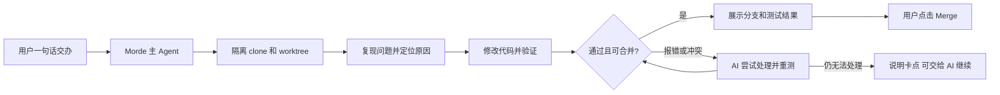

# Morde 对比 LobeHub 与 LoopForge 复用评估

日期：2026-11-12。依据用户提供的 LobeHub 文章、公开源码和 Morde 当前代码进行静态评估；本文不表示相关能力已经接入或通过端到端验收。

## 结论

**LobeHub 对 Morde 的帮助较大，主要是多 Agent 协作和用户体验；LoopForge 对项目开发、缺陷修复和 Git 交付的帮助更直接。** 两者可以互补。建议 Morde 保持现有 DSH、任务和授权体系，借鉴 LobeHub 的交互与验收方式，按需复用独立的 Lobe UI 组件；自动开发流程优先参考 LoopForge，先把零号客户的小问题闭环做好。

LobeHub 已经提供 DSH 接入，但它的适配器启动的是用户自行安装的 DSH CLI，不能直接等同于接入 Morde 的云端 DSH、工具代理和模型网关。LobeHub 本身也有 Agent Runtime，整套引入会与 Morde 的唯一 Runtime 约定冲突。具体接入和许可证限制见下文。

## 三者对比

| 方面 | LobeHub | LoopForge | 对 Morde 的建议 |
| --- | --- | --- | --- |
| 主要方向 | 通用 AI 助手、Agent 团队、对话和任务协作 | AI 软件开发流程、代码修改与交付 | 用户体验参考 LobeHub；开发流程参考 LoopForge |
| 任务协作 | 有主管、成员、子任务、依赖、并行执行与验收机制 | 有角色、阶段、评审、测试和开发流程 | 小任务单独执行；只有工作独立且值得并行时才拆分 |
| DSH | 通过 ACP 连接独立安装的 DSH CLI；自身另有 Agent Runtime | 有 DSH 插件和适配资料，整个平台也能启动 DSH CLI | 保留 Morde 现有 DSH；两者都需适配，不能视为已接通 |
| Git 修复交付 | 文章展示了参与真实 PR 开发和评审的例子 | 公开了开发 SOP、worktree 和冲突检查代码 | 参考 LoopForge，补齐用户点击 Merge 和 AI 冲突修复 |
| 交互界面 | 对话、Agent 团队和任务体验较丰富，有独立 UI 组件库 | 偏研发任务管理 | 优先沿用 Morde 现有界面，确有缺口时评估 UI 组件 |
| 首期专属需求 | 没有证据表明可直接满足 Morde 的全部 PC/iOS、指定云电脑和手动单向文件夹同步验收 | 同左 | 继续完成并验证 Morde 自身闭环，不因引入新平台替代验收 |

协作能力可在 LobeHub 的[团队管理工具](https://github.com/lobehub/lobehub/blob/3b1d853275085cc457ea8ac27f2801541df9b823/packages/builtin-tool-group-management/src/manifest.ts)和[任务工具](https://github.com/lobehub/lobehub/blob/3b1d853275085cc457ea8ac27f2801541df9b823/packages/builtin-tool-task/src/systemRole.ts)中看到。LoopForge 的复用边界及其 DSH 插件的本地注册探测见 [Morde 复用 LoopForge 可行性分析](Morde复用LoopForge可行性分析.md)。

## LobeHub 可以给 Morde 带来什么

### 1. 借鉴交互，收益高

LobeHub 将创建任务、启动任务、成员协作和结果验收区分开。Morde 可以借鉴这种清晰的状态，而让用户继续只面对一个主 Agent：

- 普通问题直接回答；小改动由一个任务完成；复杂任务才按实际依赖拆分，独立部分可以并行。
- 在原对话里展示任务卡：正在做什么、是否需要用户、已完成和失败的内容；需要时展开各子任务，状态以 Morde 已持久化的执行记录为准。
- 子任务完成后由主 Agent 汇总并核对证据。创建或派发任务不等于完成，AI 自报成功也不等于测试通过。
- 任务失败或发生冲突时，先让 AI 在授权范围内尝试解决；仍无法处理时解释原因，并允许用户选择继续交给 AI。用户的追问、停止和修改要关联正确任务。

这与 [Morde 自动化项目开发设计方案](Morde自动化项目开发设计方案.md)已有方向一致，不必为了模仿 LobeHub 再做一套独立的任务系统或要求用户手动组建团队。第一里程碑仍需实际验证 PC/iOS 同会话、复杂任务至少两个子 Agent 并行、云电脑操作和 PC 手动单向文件夹同步。

### 2. 复用独立 UI 库：有条件，先做小范围验证

独立的 [Lobe UI](https://github.com/lobehub/lobe-ui/tree/b261c3b680a3f7b5787a0aca246e52078e75c6fd) 使用 [MIT 许可证](https://github.com/lobehub/lobe-ui/blob/b261c3b680a3f7b5787a0aca246e52078e75c6fd/LICENSE)，可评估其 [`ChatList`、`ChatItem` 和输入组件](https://github.com/lobehub/lobe-ui/blob/b261c3b680a3f7b5787a0aca246e52078e75c6fd/src/chat/index.ts)。保留版权和许可声明，并核对实际引入版本及其第三方依赖。

不过不能说“安装就能用”：该版本 [peerDependencies 要求 React 19](https://github.com/lobehub/lobe-ui/blob/b261c3b680a3f7b5787a0aca246e52078e75c6fd/package.json)，Morde 的 Web Portal 使用 React 19，而当前桌面 `dsh-nanomuse` 使用 React 18。库为 ESM，且引入较多前端依赖；iOS 原生界面也不能直接使用 React 组件。建议先复用 Morde 已有组件，确有明确缺口时在适用的 React 19 界面试一个组件，检查样式、体积、无障碍和实际打包兼容性，再决定是否引入；不为此升级桌面端 React 或重写 iOS。

### 3. DSH 适配器：值得研究，不能直接接入

[LobeHub 的 DSH 适配器](https://github.com/lobehub/lobehub/blob/3b1d853275085cc457ea8ac27f2801541df9b823/packages/heterogeneous-agents/src/spawn/dshAcpSession.ts)通过 `dsh --profile acp` 使用独立安装的 CLI，支持会话恢复，并将事件转换给 LobeHub。其检查逻辑要求 DSH 0.2.0 及以上；Morde 云端锁定 DSH 组件 `0.2.2-rc.1`，但目前是嵌入这些组件，并不因此拥有适配器要求的 CLI 或已验证的 ACP 链路。

该实现创建会话时使用空的 MCP 列表；处理 DSH 的权限请求时，会优先选择一次允许或始终允许。Morde 需要的是绑定用户、会话和任务的授权、审批、模型网关、操作回执、检查点及取消恢复。**直接启用此适配器会绕过或无法证明满足这些边界，不能用于 Morde 正式任务。** LobeHub 对未匹配的请求模型还可能使用 DSH 自身默认值；Morde 需要验证模型选择始终遵守自己的网关配置。

如果以后确需 ACP 互通，可以先看 [DSH 上游 ACP 插件](https://github.com/deepseek-ai/deepseek-harness/tree/e8f7b93a344964de3dca1ace9e72b6e4d6de87cb/packages/acp)和当前版本兼容性，再把 LobeHub 的事件映射和会话交互作为参考；所有实际执行仍须接入 Morde 的权限与任务账本，并验证版本、会话、取消、恢复和重复执行。**ACP 是可研究的集成线索，不是已经可用的 DSH 插件。**

### 4. LobeHub 主仓库的许可证：先确认再复制

[LobeHub 主仓库 LICENSE](https://github.com/lobehub/lobehub/blob/3b1d853275085cc457ea8ac27f2801541df9b823/LICENSE) 是基于 Apache 2.0 并增加条件的 LobeHub Community License：其商业使用条款允许不修改源码作为服务使用，对开发和分发基于 LobeChat 的衍生作品要求商业授权。主仓库的 [`package.json`](https://github.com/lobehub/lobehub/blob/3b1d853275085cc457ea8ac27f2801541df9b823/package.json) 又标为 MIT，部分子包也有 MIT 元数据，存在需要厘清的声明差异。

因此，不应把整个主仓库视为普通 MIT 或 Apache 项目；复制适配器、任务代码、提示词等之前，应针对具体文件及商业分发方式核对适用许可，必要时取得权利人明确授权。独立 Lobe UI 仓库的 MIT 许可与主仓库分开判断。只参考公开的产品思路、按 Morde 现有架构实现，可避免把不明确授权的主仓库代码直接带入产品。

## 零号客户场景

假设用户说：“Morde 首页刷新按钮点了没反应，帮我修好。”

任务较小，一个 DSH 任务即可；界面借鉴 LobeHub 的清晰进度和验收，修改、测试与 Git 环节参考 LoopForge。过程只在隔离仓库的分支中进行，不覆盖用户原工作目录；最终由用户点击合并。目标分支或候选版本变化后重新验证，合并内容改变时由用户再次查看并点击。当前本地约束下不推送分支或外发文件。以上是目标流程，尚不表示已经实现。

## 实施顺序和验收

1. **先完成第一里程碑的基础闭环。** 复用当前 DSH 与 Morde 的 Task、会话、工具代理和两端界面，把进度、失败和恢复展示清楚；按约定验证至少两个独立子 Agent 的并行与汇总。当前 [PC 项目同步的真实传输仍有 CFS-11 验收门禁](实施/Morde云端电脑与项目文件同步实施任务todo清单文档.md)，默认关闭，不能当作已完成。
2. **再做一个 Git 小问题闭环。** 在本机合成仓库验证 clone/worktree、复现、修改、测试、分支、冲突处理与用户点击 Merge；状态和证据复用现有 Task，实际模型能力另行验证。
3. **最后按需扩展。** 复杂开发再增加有边界的并行工作单元和独立验收；发现现有界面确有缺口时，再评估 Lobe UI。不要在首版引入完整 LobeHub、复杂 Agent 市场或第二套任务/运行时。

要判断是否真的变快、变好，选刷新按钮、小缺陷和一个需要前后端协作的任务，在相同项目基线、模型、工具、环境和预算下，对比 Morde 原方案与改进方案。记录核心验收通过率、从交办到可合并的时间、全部尝试的总成本、返工与错误恢复；先跑通样例，再扩大样本。没有实际对照数据前，不承诺提效比例。

## 如何看文章里的成绩

文章介绍的 [PR #21852](https://github.com/lobehub/lobehub/pull/21852) 真实存在，标注为 AI 辅助并已由维护者合并；这一证据能说明该 PR 的情况，不能单独证明文章描述的全部派工过程或所有项目都能自动交付。

文章提到 LobeHub 在 FrontierHarness 上完成 21/30 项、成功任务成本中位数 1.68 美元。应将其视为特定实验的自报结果，而非 Morde 可以直接达到的指标。[FrontierHarness 官方资料](https://github.com/frontier-harness-eval/eval)使用 30 个软件工程任务，并要求对照模型、环境和成本口径；公开的 LobeHub 比较涉及选择性重试和执行环境差异，[独立分析](https://ai.thesatyajit.com/articles/lobe-rsi-harness)也指出这些限制。成功任务的中位成本不能替代包含失败和重试的总成本比较。Morde 需要使用自身真实模型、真实项目和一致条件做验证。

## 本次核对范围

- LobeHub 主仓库以 `canary` 提交 `3b1d853` 为源码快照；其 DSH 适配器及主仓库许可也在当时 `main` 提交 `47bd681` 中核对。独立 Lobe UI 以 `b261c3b` 为快照。版本可能变化，实际引入前重新核对。
- 检查了 Morde DSH 依赖、委派代码、MCP 工具代理、现有设计和 PC 文件同步门禁；没有安装 LobeHub 或 Lobe UI，没有启动真实模型或进行 PC/iOS 端到端联调。本次只读公开资料并在本地新增报告，没有发送或上传用户文件。
