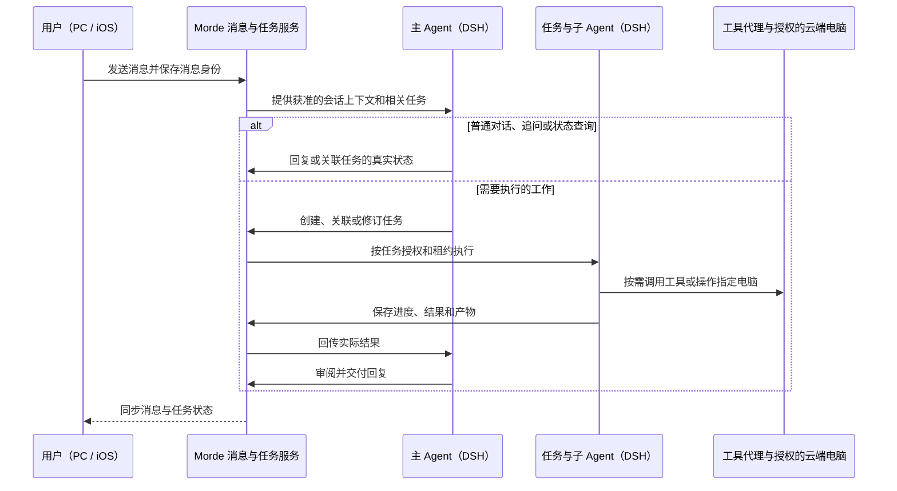

# Morde 对话体验与 DS-Bot 融合设计方案

> 依据：[Morde 开发约定](../AGENTS.md)、[DS-Bot 高优先级功能需求](Morde参考DS-Bot高优先级功能需求文档.md)、[原 DS-Bot 设计方案](Morde参考DS-Bot高优先级功能设计方案.md)及[对话体验优化参考稿](../../../Downloads/morde-ai-dui-hua-you-hua-zui-zhong-fang-an.md)。本文描述整合后的目标和改造方式；已有代码或本地替身结果不代表真实场景已经验收。

## 1. 目标与范围

Morde 对标 Muse 的个人 Agent 体验：用户在 PC 的长期主会话中与主 Agent 自然对话，主 Agent 按需使用工具、操作已授权的云端电脑，并协调子 Agent 完成工作，再把实际结果交回原会话。保留用户创建和切换多个会话、旁聊的能力；各会话由自己的主 Agent 负责，记录、任务和结果独立。

PC 使用以对话为中心的工作界面，借鉴 DS-Bot 的布局、消息、输入框和任务卡片；iOS 与 PC 使用同一账号下的云端消息、任务、进度和结果。子 Agent 是主 Agent 委派的执行者，不作为独立聊天对象；不引入 Bot 群聊、Bot 团队、IM 或本地 Agent CLI。

云端主 Agent、任务和子 Agent 统一使用 DSH。模型通过 Morde 网关接入，工具执行继续经过 Morde 的授权、审批、凭据、操作记录和产物校验。沿用已有消息路由和任务执行链路，不新增第二套 Agent 循环、任务系统或会话事实来源。PC 文件夹同步遵循用户手动触发、从本机单向同步到指定云端电脑的规则。

当前项目已有消息路由、Task、DSH 子会话、会话摘要、任务事件、电脑控制及项目同步代码；部分能力已有本地验证。以下工作以检查和补齐实际缺口为主，真实 PC/iOS、模型、Host 和文件数据面仍以实际验收为准。

### 五条设计原则

1. **主会话保持自然、简洁。** 主 Agent 在对话中给出必要的受理、简短进展、答疑、审批或澄清及最终结果；工具调用、子 Agent 活动和执行步骤在任务动态查看。用户主动追问时及时答复，不以等待最终结果为由保持沉默。
2. **主 Agent 持续交互并按需协作。** 普通对话直接回复，简单操作按需使用工具；复杂或较长工作可拆分并委派给 DSH 子 Agent。一个任务运行时，主 Agent 仍能处理其他消息，独立且资源不冲突的任务可以并行。
3. **任务过程按任务归属。** 进度、工具调用、审批、产物、结果和费用与实际任务关联；普通聊天仍按会话消息保存。同一目标的补充可关联原任务，同一话题本身不作为自动合并依据。
4. **真实过程可追溯。** 任务动态按实际记录呈现阶段、工具调用、子任务、审批、失败、修订和恢复；尚未记录或无法确认的信息明确标示，不伪造完整过程。
5. **工具操作可按权限下钻。** 对实际存在且获准查看的信息提供对象、输入、操作和结果详情；文件修改可展示可用差异，命令可展示获准的输出。搜索、截图等不适用代码或命令的工具按其类型展示；凭据和模型内部推理不进入详情。

## 2. 总体架构

图中表示职责边界，不要求所有消息都创建 Task。消息先由服务端持久受理，再通过已有路由区分直接回复、关联请求、修订、状态查询、停止、独立任务和澄清。任务执行期间，主会话可以继续接收消息；任务与子 Agent 各自保有受控的执行上下文。

## 3. P0：第一里程碑

### 3.1 PC 对话工作界面

沿用 `web/portal` 和 Desktop 外壳，参考 DS-Bot 的布局和组件，适配 Morde 的数据与操作：左侧提供导航、主会话和旁聊，中间显示当前会话，右侧提供当前会话的任务动态、云端电脑和文件。保留个人数据、目标与计划、模型与工具及设置等已有入口。侧栏可切换、收起或放大；窄窗口、键盘和系统窗口控制沿用[PC 布局需求](<Morde PC端布局与云端电脑体验需求文档.md>)。

主会话保留主 Agent 面向用户的自然语言回复：必要的受理提示、关键进展、对追问的回答、澄清、审批和最终结果。可公开的计划、处理步骤、工具调用过程与子 Agent 中间活动进入任务动态，不在主会话逐条刷屏；模型内部推理不展示。可流式展示面向用户的回复；所有状态以服务端事实为准。

切换会话或页面时保留对应草稿，任务、待处理事项和文件按当前会话显示。面板收起时仍有待审批或待补充的可见入口。滚动、分页和输入框在新内容到达或侧栏变化时保持可用；先解决真实跳动和卡顿，再按需要选择骨架或长列表优化。

**主要改造位置：** `web/portal/src/routes/Assistant.tsx`、`AssistantSidebar.css`、`web/portal/src/components/PortalLayout.tsx` 与必要的 Desktop 窗口/桥接代码。可参考 `project/DS-Bot/ds-bot/src/client/` 中的布局、消息、输入和卡片组件，数据与权限继续使用 Morde 接口。

### 3.2 发送、连发与任务关联

PC 和 iOS 先保存用户发送的每条消息及其会话归属，再显示发送、受理或失败的真实状态。网络重试使用原消息身份对账，不重复创建消息、任务或已确认的操作；用户多次主动发送的内容仍作为多条原始消息保留。

主 Agent 结合最新消息、获准上下文和实际任务状态判断：

| 用户意图 | 处理方式 |
| --- | --- |
| 普通对话 | 直接回复；无需创建 Task 或选择云端电脑。 |
| 相同请求或补充 | 目标、范围、附件和执行对象一致时关联已有请求；补充会改变执行内容时按原任务修订。 |
| 追问或进度查询 | 关联明确时及时回复已有事实；任务继续执行。 |
| 修改或停止 | 只作用于明确的目标任务；在安全边界处理在途操作，服务端确认后更新状态。 |
| 独立请求 | 目标、范围或用户意图不同则创建独立工作；资源不冲突时可并行。用户明确要求重做时允许新执行。 |
| 关联不明 | 保留消息，询问实际缺少的任务或条件，不擅自中断其他工作。 |

同一话题或相近发送时间不能单独决定归并；不同账号、会话、项目、电脑、附件或授权范围不得误合并。任务已开始后到达的补充仍能通过已有修订链处理。连发消息先逐条持久受理，再在现有队列和路由上对同一目标、范围明确的补充提供有上限的短时聚合；等待时间通过实际样本验证并可提前结算。普通对话、明确的停止和独立任务不因聚合无谓延迟；窗口状态须可恢复、结算须幂等。

**主要改造位置：** `server/internal/app/conversation_route_*`、`server/internal/store/postgres/conversation_route_*`、Portal 消息 outbox 及 iOS 消息投影。沿用现有 `reply`、`join`、`update`、`status`、`stop`、`new`、`clarify` 路由及版本、幂等和授权校验。

### 3.3 主 Agent、规划与子 Agent

主 Agent 直接处理普通对话；简单操作按需使用工具；复杂或较长工作按需拆分、委派和汇总。用户可以要求查看计划，但不为所有复杂任务增加强制的计划确认步骤；具体操作仍按已有授权和审批规则处理。

沿用 DSH 子会话、任务租约、授权工具子集、检查点和结果回传。可并行的子任务必须资源不冲突；有依赖的工作在所需结果到达后继续。同一电脑或文件存在冲突时由现有执行和控制机制协调。派发只代表已开始，主 Agent 应检查子任务的成功、失败、停止或未知结果后再交付，不编造完成。

任务动态展示真实子任务、状态和结果。恢复时保留已确认的结果，未知副作用先核实，不因重试重复执行。现有 `task_dependencies` 表记录的是**任务之间**的依赖，不能直接当作计划步骤依赖；需要结构化步骤计划或单步骤重试时，先另行明确数据和恢复语义，不新建独立执行循环。

**主要改造位置：** `runtime/morde-cloud-runtime/src/engine.mjs`、`server/internal/worker/cloud_dsh_session_tree.go`、现有任务、子会话和结果汇总代码；参考 DS-Bot 的委派、结果回传及恢复行为。

### 3.4 任务动态、审批与恢复

PC 和 iOS 使用当前会话内 Task 的快照及有序事件，展示排队、执行中、等待用户、完成、失败、停止和结果未知。断线按事件游标续读；游标失效时重新获取快照，并重新核对账号和授权。关闭客户端不取消已受理的云端任务。

任务详情按实际记录展示阶段、子任务、工具调用、审批和结果。工具详情只展示该用户有权读取且实际保存的内容：例如命令或输出摘要、可取得的文件差异；没有记录或不适用的内容如实说明。凭据、未经授权的文件内容和模型内部推理不进入任务视图。事件流继续使用现有安全字段投影与类型校验，未知事件不应破坏续读。

审批或澄清说明操作对象、影响及所需决定，答复绑定原任务和请求版本。用户批准计划不等于批准后续所有操作；涉及现有授权或审批要求的动作继续逐项校验。停止、拒绝和恢复均显示服务端确认状态，结果未知不能显示为完成或直接重做。

**主要改造位置：** `web/portal/src/routes/Assistant.tsx`、`clients/nanoMuse/android/src/ios/NanoMuse/MIFTaskViews.swift`、现有 Task 快照/事件和步骤详情接口。

### 3.5 指定电脑与常用工具

主 Agent 只在完成请求需要时使用搜索、浏览器、桌面、终端或文件工具。纯文字对话不依赖云端电脑。用户指定电脑时，执行目标必须是该已授权 Host；目标不明确、失联或撤权时说明实际状态，不自动切换到其他电脑。

PC 右侧展示电脑名称、连接、画面及实际控制权，沿用接管与交还。搜索结果提供可核查来源；终端和文件操作返回实际结果或失败原因。工具代理继续核对任务、Host、Workspace、授权和控制版本。

**主要改造位置：** `server/internal/app/runtime_tool_executor.go`、`server/internal/app/cloud_dsh_*`、`runtime/morde-runtime/` 中的浏览器、桌面和命令能力，以及 PC 电脑面板。

### 3.6 PC 手动文件夹同步

用户在 PC 选择本地文件夹和目标电脑，确认项目名与同步范围后点击同步。项目名默认取本地文件夹名，目标为指定电脑的 `~/workspace/project/<项目名>/`，保留相对目录。文件新增、修改或删除只有在用户再次点击同步后才应用；云端变化不反向修改 PC。

复用 Desktop 的 `projectUploadTargets`、`selectProjectDirectory`、`uploadProject`、`onSync` 和现有项目上传 session。删除只作用于该来源已确认同步的对应内容；目标存在未协调内容、本地删除与云端独立修改冲突、根目录不可访问或授权失效时，保留受影响内容并提示，不能静默覆盖或误删。校验项目名和路径，不能越出目标目录。

完成状态必须有**该次 session 的 Host 应用回执**，核对指定 Host、Workspace 绑定、目标版本、清单摘要和运行代次；服务器提交完成或较大的聚合版本本身不等于 Host 已应用。界面区分进行中、完成、待处理和失败。

**主要改造位置：** `clients/desktop/harness/desktop/`、`server/internal/app/workspace_sync_project_upload.go`、`runtime/morde-sync/` 和 `runtime/morde-runtime/workspacereplica/`。PC 同步目录与 Morde 的项目对象不是同一个概念，不能仅凭目录名自动读取项目记忆或获得项目权限。

### 3.7 长会话与跨端接续

PC 和 iOS 连接同一账号后，可打开同一会话并查看原始消息、任务进度和结果。使用已有会话摘要、上下文压缩和授权历史检索处理超过模型上下文容量的对话；摘要不能替代原始记录，所需历史不可用时应说明。不同用户、会话和项目的消息及任务不混淆，跨会话读取个人资料和历史仍须遵守授权及记忆开关。

客户端断线、关闭或重新连接时，以服务端消息、任务、事件和检查点恢复，不重复创建任务或执行已确认完成的操作。已有的恢复和隔离能力需以当前版本的真实链路验收，不仅依据代码存在判断完成。

## 4. P1：对话与产物补强

### 4.1 会话搜索

PC 会话侧栏接入已有 `GET /api/conversations?q=...` 标题搜索，只查询当前账号有权访问的会话。查询变化时重置分页并丢弃过期响应；空结果与请求失败分别提示，切换搜索和会话不清除草稿。消息正文全文搜索不作为本期前置条件。

### 4.2 记忆来源与历史

复用现有个人记忆对象、`personal_memory_sources` 和个人数据同步，增加来源、变更时间、历史版本及恢复入口。没有来源的旧记录显示“未记录”；没有保存正文的旧版本不可恢复，不补造内容。恢复提交历史正文时沿用当前 `base_revision` 和幂等键，发生并发冲突时保留当前内容并提示。

为保存历史正文，拟新增 `GET /api/personal-data/{type}/{id}/history`，本期仅支持 `type=memory`，按账号和记忆授权分页读取版本、可用正文、可恢复状态与获准来源。历史正文、对象版本、来源与个人数据配额在同一事务中处理；旧记忆首次修改时保存修改前可用正文。删除沿用现有墓碑和历史抑制，清理该记忆历史正文并释放对应配额；删除前告知用户，已删除记忆不能通过历史恢复。

关闭个人记忆后，新任务不读取受该开关控制的个人记忆或历史片段。项目范围已有内容和上下文能力，仅在任务关联相应项目且当前用户获授权时使用；不把项目数据自动混入个人会话，也不新增团队功能或第二套项目记忆系统。

### 4.3 Office 文件处理与交付

主 Agent 可按用户要求创建、检查或修改授权范围内的 Word、Excel 和 PowerPoint 文件。先评估与当前 DSH 版本兼容的 Office 技能及其执行依赖，再按需适配 DS-Bot 的 Office 处理模块；插件接入遵守项目的版本、许可、模型网关、工具代理和 Workspace 授权约定。

所需解释器、文档库和渲染组件须在任务授权的执行环境中可用。结果通过现有已核验 Task 产物链路交付：PC 提供查看可用检查/预览结果和下载入口，iOS 可看到同一已确认产物，并在既有预览条件满足时预览；能力不可用或处理失败时如实说明。

## 5. 十项对话与任务机制

以下保留参考稿的十项机制。P0 是第一里程碑所需的基础闭环，P1 是在基础闭环上补强；涉及计划、成本和按步骤重试的新增合同须先与现有实现对齐。

### 5.1 事件流与任务过程（P0）

任务状态变化、工具调用、审批、修订、结果和失败沿用现有按 Task 有序保存的事件及步骤记录。统一已有事件类型、含义和展示映射；写入继续使用类型校验，读取保留安全的未知类型和游标兼容。任务详情可按时间查看实际事件，也可按子任务或步骤分组；两种视图使用同一份记录。

事件流只发送获准的安全投影，任务正文、审批和可查看的工具详情按原资源授权读取。模型内部推理、凭据和未经授权的内容不作为事件正文展示。断线或序号缺口按游标续读或重新获取快照，不凭旧缓存显示完成。

### 5.2 会话持久化与断点续跑（P0）

使用现有消息、outbox、任务租约、检查点和结果记录保存会话与执行状态。刷新、断线、关闭客户端或服务重启后，按实际状态恢复；已确认的步骤和操作不重复执行，不能核实的副作用显示结果待确认。恢复、等待或失败提示放在合适的对话状态或任务动态中，不反复刷屏。

### 5.3 幂等与安全重试（P0 基础、P1 补强）

同一消息重试沿用原身份和幂等键；用户主动发送的新消息单独保存。P1 为**可确认、可独立重试**的失败步骤补错误类型、原因、尝试次数和重试入口，使用任务版本、授权与幂等记录核对前置结果，只重跑满足条件的失败步骤。不可重试或结果未知时显示原因并先核实，不提供会重复产生未知副作用的重试。

消息的重新生成、编辑重发和继续生成作为 P1 对话操作补齐：保留原消息及回复版本，明确新请求与既有任务的关系；不会因重新生成文字而自动重做已完成的工具操作。

### 5.4 审批关口（P0 基础、P1 补强）

沿用 Morde 的授权、审批、暂停与恢复链路。需要审批时展示实际操作对象、影响和可用的风险原因；预计费用、累计费用、替代方案、撤销方式和到期时间仅在有可靠依据时显示，否则标明未知或不适用。审批与具体任务、请求版本和动作绑定；对已定义有效期的请求，过期后不执行，并显示实际过期状态。

确认任务计划不等于批准后续敏感操作。账户或平台硬限额不能被普通任务审批绕过；需要补充授权或提高额度时按现有权限处理。审批或澄清完成后继续原任务，拒绝或超时不伪报成功。

### 5.5 成本与预算（P1）

复用模型调用记录、项目金额账本和已有预算，按任务展示可取得的调用次数、Token、运行时长和预算使用情况。金额基于可核实的币种与费率快照计算，区分已结算、估算、未知和用户自带模型等情况；历史使用所对应的费率不会因后续调价被悄悄改写。任务结束时可查看用量汇总；审批页仅在有关联且数据可信时显示本次预计与累计。

个人任务、项目任务和不同模型提供方的账单能力可能不同；缺数据时不显示虚构的精确金额。新增金额上限或计费接口须在保留当前 Token 预算和隔离规则的基础上单独明确合同。

### 5.6 记忆连续（P0 基础、P1 管理）

使用会话摘要、授权历史检索和个人记忆支持长会话及跨会话理解；原始消息仍可查看。P1 补记忆来源、历史、修改、删除和可用版本恢复，具体规则见 4.2。项目上下文只在任务关联该项目且获授权时读取；来源已删除或撤权时不得继续当作可访问的历史证据。自动整理只处理获准的信息，不将无来源的事实默认写入记忆。

### 5.7 布局与流式展示稳定（P0 基础、P1 优化）

消息与任务使用稳定身份更新，阅读历史时新消息不强制把用户拉回底部。对话输入、状态提示和侧栏在发送、断线、审批和恢复时保持可用；长内容提供可访问的分页或滚动。按实际需要使用骨架占位、控制输入框最大高度和拆分组件；大量消息确有性能问题时再进行虚拟化，并保持阅读锚点、键盘操作与无障碍能力。

### 5.8 多任务并发、排队与能力匹配（P0 基础、P1 补强）

独立任务使用各自的状态、租约、事件和审批；取消或失败只影响对应任务，超出并发上限时显示真实排队状态。主 Agent 根据任务要求与实际授权，为子 Agent 选择可用的工具和执行上下文；不创建面向用户的独立 Bot 或团队。

P1 在现有任务领取机制上补公平与优先级：用户明确置顶、普通工作和后台工作可有不同优先级，同等级保持可解释的顺序，按用户限制并避免长期饿死。仅在服务端能够计算时展示队列位置；资源冲突仍由现有 Host、文件和授权机制裁决，不新建并行调度系统。

### 5.9 复杂任务规划（P0 按需拆分、P1 可查看计划）

复杂任务由 DSH 主 Agent 按需形成计划，包含目标、步骤、预期产出、必要依赖和可验证的完成条件；能够可靠确定时补充预计费用量级和所需审批，无法确定时标明未知。任务动态中提供可查看的计划及实际进度。用户可通过对话或任务入口修订未完成工作；已完成产物与历史记录保留。简单对话和简单操作无需生成计划，复杂任务也不一律要求用户先批准计划。

计划是一种任务范围内的持久展示与协调信息，由 DSH 和现有任务链路执行；如果当前 Task 快照不足以表达计划，先扩展任务计划投影及存储合同。现有 `task_dependencies` 表只表达任务之间的依赖；步骤之间的依赖需要单独明确，不能直接借表冒充。步数、时间与模型预算沿用现有机制，超限或计划无法执行时说明实际原因。

### 5.10 同一对话的任务更新（P0）

执行中的消息先判断属于追问、补充、修改、停止还是独立任务；可以在输入框引用或指名任务，用户不指名时仍由主 Agent 结合上下文判断。关联不明时提供清楚的澄清及可用候选；修改走原任务修订和安全边界，保留来源消息、旧结果和修订记录。迟到的旧修订结果不能覆盖新要求。

## 6. 接口和数据约定

| 接口 / 数据 | 处理方式 |
| --- | --- |
| `POST /api/conversations/{id}/messages`、消息列表 | 已有。`Idempotency-Key` 与 `client_message_id` 一致；服务端受理消息后异步关联或创建任务。 |
| Task 快照、`GET /api/tasks/{id}/events`、动作/输入/审批 | 已有。按 Task 与事件序号恢复；修改、停止和审批沿用现有版本、幂等与授权规则。 |
| `GET /api/conversations` | 已有 `q` 标题搜索；补 Portal 调用、搜索状态和分页。 |
| Task 快照和步骤详情 | 已有。P1 拟补任务计划、错误类型、可重试状态和尝试记录；计划步骤与实际工具步骤分别表达，并按授权提供已记录的可用详情。 |
| 单步骤重试 | 拟新增任务步骤级操作合同，仅允许满足可确认、可独立重试和当前授权条件的失败步骤；请求绑定任务修订、步骤和幂等键，受理不代表执行成功。具体接口和错误码在 OpenAPI 中确定。 |
| 审批与模型用量 | 复用已有审批和账本。P1 按实际能力扩展风险原因、费用、替代方案及到期信息；数值未知或不适用时明确返回状态，账本需保留费率快照。 |
| `GET /api/personal-data/{type}/{id}/history` | 拟新增，仅 `memory`。请求使用 `cursor`、`limit`；返回历史版本、时间、可用正文、可恢复状态、已授权来源与 `next_cursor`。游标绑定账号和记忆；参数无效返回 400，凭证无效返回 401，不存在、已删除或无权访问返回 404。 |
| `PUT /api/personal-data/memory/{id}` | 已有，复用作历史恢复；提交 `body`、当前 `base_revision` 和幂等键，成功产生新版本，冲突不覆盖。历史记录需新增数据库迁移，并同步 OpenAPI、Client 凭证路由白名单和调用方类型。 |
| 项目上传 session、Host 应用回执与 Desktop IPC | 已有。继续按具体 session 和指定 Host 确认应用结果；缺失、冲突和未知状态不报完成。 |
| `GET /api/tasks/{id}/artifacts/{artifact_id}/content` | 已有 Portal Session 产物下载接口。PC 复用固定版本、路径、大小和摘要校验；iOS 首期复用 Task 产物信息及已有受限预览。 |

现有项目预算账本已有费率快照、币种和金额字段，个人模型账本主要记录 Token。后续若增加任务费用展示，应先复用已有账本并区分实际结算、估算和未知；不得用估算值冒充实际收费，也不能用一次普通审批绕过账户硬限额。

### 6.1 规模、隔离与可观测

保留参考稿中万人同时在线对话的规模目标，后续压测需分别明确在线连接数、消息速率、并行任务数和模型调用量，混合覆盖短对话、连发、长任务、审批及断线恢复。支持多少规模以实测延迟、错误率和资源占用为准；压测完成前不宣称已达到该规模，也不把万人压测作为第一里程碑功能开发的前置条件。

消息聚合状态、任务、审批、检查点和账本以数据库或现有共享持久存储为准，多实例重启后可恢复；查询与订阅持续校验账号、会话和授权。记录必要指标，包括消息聚合等待、关联纠正、任务排队、事件续读、审批等待、重试结果及模型用量；不把用户正文、凭据或原始工具输出写入指标。容量不足时可降级非必要展示或排队，不能丢失已受理任务、篡改结果或跳过审批。

## 7. 对标与参考项目

以下保留两份参考稿涉及的项目及考察方向。它们提供可借鉴的交互和实现思路；接入时对齐 Morde 的数据、授权和 DSH Runtime，不因参考项目引入另一套 Agent 执行系统。

| 参考项目 | 在 Morde 中的参考方向 |
| --- | --- |
| [Muse 资料](muse_docs/muse-all-materials/00-README.md) | 长期主会话、主 Agent 协调、子 Agent 结果回传、任务动态与持续对话体验。 |
| [DS-Bot](../project/DS-Bot/README.zh.md) | PC 布局、消息与输入框、任务卡片、委派/恢复及 Office 处理；不引入其群聊、团队或 IM。 |
| [DeepSeek Harness（DSH）](https://github.com/deepseek-ai/deepseek-harness) | 唯一 Agent Runtime；优先评估其会话、技能、MCP、工具、子 Agent 和压缩等插件，再通过 Morde 授权和 provider 机制接入。 |
| [hermes-agent](https://github.com/NousResearch/hermes-agent) | 忙碌期间消息接纳、跟进交接、中断与恢复的交互思路；不引入其独立运行时。 |
| [LibreChat](https://github.com/LibreChat-AI/LibreChat) | 断线续流、回复重新生成、编辑重发、活动分组及失败态展示。 |
| [OpenHands](https://github.com/OpenHands/OpenHands) | 事件分层、执行活动到任务界面的映射及分组。 |
| [bolt.diy](https://github.com/stackblitz-labs/bolt.diy) | 流式内容解析、超时和结构化错误的处理方式；执行仍走 Morde 和 DSH。 |
| [AnythingLLM](https://github.com/Mintplex-Labs/anything-llm) | 工具调用去重、防递归及重试边界。 |
| [assistant-ui](https://github.com/assistant-ui/assistant-ui) | 对话组件、工具状态与审批交互；按需评估组件，不与另一套聊天界面全量重复引入。 |
| [LobeHub](https://github.com/lobehub/lobehub) | 消息与工具分组、界面细节及可理解的错误状态。 |
| [Dify](https://github.com/langgenius/dify) | 工作流节点和执行日志的呈现；不展示模型内部推理。 |
| [Open WebUI](https://github.com/open-webui/open-webui) | 状态历史、多版本回复及消息切换体验。 |
| [Chatbox](https://github.com/chatboxai/chatbox) | 审批提示、超时状态以及重新生成时的滚动体验。 |

## 8. 验收与实施顺序

先完成 P0 的 PC 界面、持续对话、任务与工具链路及同步规则，再推进 P1 的搜索、记忆、Office、计划、重试和成本等补强。继续使用[已有实施任务清单](实施/Morde参考DS-Bot高优先级功能实施任务todo清单文档.md)时，须先按本方案同步任务和验收边界，并保留已有实施状态。涉及 PC 的界面验收必须覆盖实际 PC 客户端，并使用内置浏览器检查相关页面；跨端结果以同一账号、同一服务端事实核对。

| 场景 | 验收结果 |
| --- | --- |
| 普通对话与多会话 | PC 和 iOS 均能发送并获得真实回复；普通问答无需电脑，两个会话的消息、草稿和任务归属正确，不同账号隔离。 |
| 连发、追问与修订 | 同一任务的重复或补充消息保留原文并正确关联；执行中追问能得到真实答复；同话题但不同目标的请求独立处理；歧义先澄清。 |
| 消息聚合与重连 | 连发消息逐条受理；短时聚合重启后可恢复且不重复结算；普通问答、明确停止和独立请求不被不必要地等待。 |
| 子 Agent 与并发 | 主 Agent 实际委派至少两个互不冲突的子任务并汇总真实结果；取消一个任务不停止其他任务，失败和未知状态如实展示。 |
| 进度、审批与恢复 | 任务动态可查看实际步骤、审批和结果；刷新、断线重连后恢复，必要的审批或澄清继续原任务，已确认操作不重复。 |
| P1 计划与安全重试 | 复杂任务可查看实际计划与结果，修订保留已完成产物；满足条件的失败步骤可单独重试，未知副作用不重复执行；消息重生成保留旧版本。 |
| P1 审批与成本 | 需要审批时能看到有依据的对象、影响和可用费用；审批只作用于对应操作；用量汇总区分已结算、估算和未知，历史费率变更不改写旧记录。 |
| 云端电脑与工具 | 在指定且已授权的电脑上完成可观察的界面操作和终端命令；搜索给出来源，失败、失联或撤权时显示真实状态。 |
| 长会话 | 超过模型上下文窗口后仍能结合获准的关键历史回答，原始记录可查看，历史不可用时明确说明。 |
| 文件夹同步 | 首次点击后指定电脑出现文件和子目录；本机增改删在再次点击前不影响云端，再次点击后才应用；冲突、根目录不可访问和撤权时不误删、不误报完成。 |
| P1 | 标题搜索分页正确；记忆来源、恢复冲突和删除规则正确；分别创建和修改 DOCX、XLSX、PPTX，文件可打开，PC/iOS 可见同一已确认产物。 |

当前工作约束是文件只在本地修改，不向服务、电脑、设备或远端发送文件。可使用不传文件的本地替身和合成元数据；涉及真实文件传输或安装/发送应用包的验收保持待验证，`project_upload_enabled` 保持关闭。此约束不改变产品最终需要支持的手动同步和文件交付功能，也不能用替身结果冒充真实验收。
