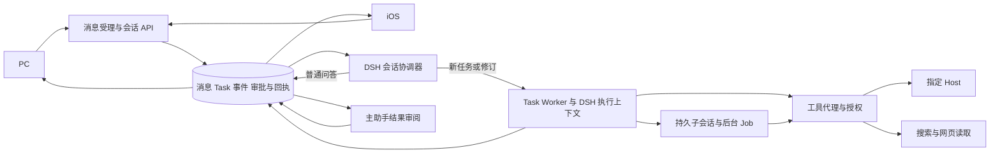

# Morde 第一里程碑收口技术设计方案

日期：2026-11-12

## 1. 目标与结论

第一里程碑交付 PC、iOS 与云端 Agent 的基础闭环：用户在任一端持续对话，Agent 在授权范围内使用指定云端电脑、搜索、项目文件和子 Agent，实际结果在同一会话交付。PC 文件夹同步由用户手动触发，单向写入指定电脑的 `~/workspace/project/<项目名>/`。

沿用现有 Morde 服务端、DSH Runtime、Task、Workspace 和 Host，不重建 Agent 循环、传输协议或通用任务编排平台。需要重点收口的不是再增加一套入口，而是：

1. 在当前会话协调器与 Task 执行上下文之间，补齐两个后台子 Agent 的结果回收和最终交付证明。
2. 对齐消息、任务事件、审批和产物的展示与恢复，避免客户端重连或副作用结果未知时虚报完成。
3. 排查指定 Host 的 `shell.exec` 能力、修复失联状态显示，并验证真实电脑和搜索工具链。
4. 补齐长会话的有界续查，以及 PC 同步版本与 Host 实际落盘之间的确认边界。
5. 在同一冻结候选上完成 A1–A8 验收。同步真实数据面和涉及发送文件的验收受当前“任何情况都不外发或发送文件”约束，不能执行，项目上传能力保持关闭。

本文以 [第一里程碑约定](../AGENTS.md) 和两份输入文档为范围依据；`docs/` 中较早的 PC 只读方案不覆盖本次手动单向同步要求。这里的改动均为设计，不表示已经开发或通过验收。

## 2. 现状与需要解决的差距

本次静态核对的 Git HEAD 为 `c3fb8cf09f194eb7d85bca0b6ab1ee90b2a1668e`，工作树含未提交且仍在变化的内容。以下结论描述这次看到的代码和已有本地验证，不作为最终候选版本。

| 范围 | 当前可复用的实现 | 收口差距 |
|---|---|---|
| 消息与任务 | `client_message_id`、消息持久受理、会话路由、Task 事件和结果审阅已经存在。 | 最终候选仍需验证两端真实模型对话、重连、任务修改/停止和重复副作用保护。 |
| 主 Agent 与子 Agent | DSH 会话协调器负责文本决策；Task 内有 `dsh_delegate`、后台 Job 和持久子会话。 | 两个子 Agent 同时运行及主 Agent 基于双方实际结果交付，尚缺完整证据；后台子任务结束后还需确保父执行者消费结果。 |
| 长会话 | DSH 压缩、授权摘要、原文分页与当前会话检索已有实现。 | 当前检索调用最多扫描 800 条，工具参数没有续查游标；摘要未覆盖更早细节时，需要可续查或明确说明历史不完整。 |
| Host 与工具 | Host 目标围栏、操作账本、桌面/浏览器工具、搜索和 Shell Handler 已有实现。 | 测试 Host 曾未提供 `shell.exec`；Host 断网时卡片曾仍显示运行正常。真实模型操作、搜索和指定电脑完整链路待验。 |
| PC 同步 | 项目目录登记、上传会话、版本基线、冲突规划和 Host 副本应用已有实现，发布开关默认关闭。 | Workspace 版本不等于本机同步归属清单；服务端提交与 Host 应用是不同阶段，PC 现有完成判断未绑定本次 `target_revision`。真实内容、冲突、撤权和恢复未验收。 |
| 客户端与事件 | PC 和 iOS 已消费消息、Task 快照、事件流、审批及子任务投影。 | 需在同一候选上验证事件分流、审批、两端对账和真机/锁屏恢复。 |

主要代码依据：[消息合同](../server/openapi/portal.yaml)、[子会话](../server/internal/app/agent_sessions.go)、[DSH 执行](../runtime/morde-cloud-runtime/src/engine.mjs)、[长会话检索](../server/internal/app/cloud_dsh_history_tools.go)、[PC 同步](../clients/desktop/harness/desktop/src/morde-main.ts) 和 [项目上传提交](../server/internal/store/postgres/workspace_sync.go)。

## 3. Muse 参考与 DSH 复用

本地 `muse-docs` 是对材料和观察的整理，其中也包含推测，并不是 Muse 私有实现的完整源码。本方案只借鉴可见的交互原则，不假设其内部队列、数据库或执行协议与 Morde 相同。

| 参考点 | Morde 的具体做法 |
|---|---|
| 主助手保持响应，独立工作可后台委派，派发不代表完成。 | 继续使用文本协调器受理后续消息；实际委派发生在已有 Task 的 DSH 执行上下文。子会话的状态和结果通过现有账本返回。 |
| 用户只看到需要其理解或处理的信息。 | 主助手消息显示在聊天；工具和子 Agent 过程进入任务详情；审批单独显示并等待决定。 |
| 先验证再交付，未知结果不猜测。 | 以 Task 结果、Host 操作回执和产物核验为事实；主助手说明成功、失败、部分结果或仍需处理的内容。 |
| 长会话先查授权历史；后台工作结束后回到发起会话。 | 使用已有摘要、原文检索、结果审阅和会话归属围栏；结果审阅失败时保留原始结果和可重试状态。 |

参考材料：[Muse 子 Agent 与工具](../../muse-docs/muse解析资料/06-工具执行-子Agent-浏览器.md)、[Muse 后台恢复说明](../../muse-docs/muse-all-materials/docs/chat/scheduling-and-watching.md)、[Muse 系统提示](../../muse-docs/muse-all-materials/system_prompt.md) 和 [公开与推测边界](../../muse-docs/muse解析资料/11-未公开与推测边界-复现路线图.md)。Muse 材料中的具体工具限制、审批范围和运行时指令不自动成为 Morde 的规则；Morde 继续遵守自身授权和第一里程碑要求。

当前 Runtime 依赖以 [`package.json`](../runtime/morde-cloud-runtime/package.json) 和锁文件为准，核心 DSH 包为 `0.2.2-rc.1`；已接入 Agent、Session、Checkpoint、MCP、工具执行及压缩相关组件。压缩源码来源和 MIT 许可记录见 [UPSTREAM.md](../runtime/morde-cloud-runtime/vendor/deepseek-harness/UPSTREAM.md)。本地上游 checkout 的 [`dsh-tool-subagent`](../project/deepseek-harness/packages/subagent/tool-subagent/README.md) 提供 provider 接口，[`dsh-jobs-local`](../project/deepseek-harness/packages/jobs/jobs-local/README.md) 明确是进程内 Job，owner 或进程结束后不能跨进程恢复；两者的本地上游版本均为 `0.2.2-rc.1`、MIT，但当前不在 Morde Runtime 的直接依赖中。它们不能直接替代 Morde 的持久 Task、授权子集、操作账本和恢复围栏。本期继续复用现有 DSH Agent/Session 与 Morde 的委派适配，不增加第二套 Agent 循环，也不单独启用本地 Job 来冒充持久执行。

若实施时确需引入或升级插件，先复核锁定版本、上游合同与许可证，再验证用户/会话/任务隔离、授权、检查点、取消、恢复和操作账本；兼容性未证明前保持旧路径及发布门禁。

## 4. 总体链路

PC/iOS 只读取同一服务端事实，不因页面退出取消已受理 Task。普通文字消息通过协调器直接回复，无需选择或启动 Host。涉及电脑的请求固定目标和授权，调用时再次检查；找不到目标、授权失效或能力不可用时等待或失败，不切换到其他电脑。

### 4.1 消息受理与持续交互

1. 客户端生成并保存稳定的 `client_message_id`，与 `Idempotency-Key` 一致；服务端在账号、会话和请求内容范围内持久受理。重复同一内容返回原回执，标识相同但内容不同返回冲突。
2. 受理与路由分开。复用现有 `reply`、`new`、`update`、`status`、`stop`、`clarify` 决策；只有明确指向某任务的修改或停止才改变该任务。关联不明确时澄清，独立工作可创建独立 Task。
3. 任务的模型、Host 选择意图、权限及输入版本按现有围栏固定。输入框切换默认电脑只影响新请求，除非用户明确要求变更既有任务目标并重新经过授权和版本检查。
4. 网络失败或客户端关闭只影响客户端连接。客户端重开后先对账原消息 ID 和任务状态；不以重新提交代替状态查询。停止时沿目标 Task 的执行树传递，等待停止证明；其他 Task 不受影响。

例如用户说“查一下 A 和 B，分别给我来源”，协调器创建一个 Task，执行者可委派两个只读子会话；用户随后问“进度怎样”时，协调器读取当前任务事实并答复。用户再说“停止 A”时，只有能明确映射到独立可停止对象才执行，否则先澄清。

## 5. 子 Agent 并行与结果回传

### 5.1 身份与执行

当前会话协调器是无工具的 DSH 文本上下文，不直接调用 `dsh_delegate`。它将需要执行的工作落到 Task；Task 的 DSH 执行上下文再使用 `dsh_delegate`。子 Agent 是同一 Task 下具有独立 `session_id`、`parent_session_id`、`spawn_key`、TaskStep 和检查点的子会话，不能把两个独立顶层 Task 的并行当成“两个子 Agent 并行”的证明。

对可并行工作，父执行者分别提交两个 `run_in_background: true` 的委派请求，任务书包含目标、预期输出、所需事实和授权工具子集。已有 `delegateQueue` 串行化创建过程；后台子会话启动后可以并行执行。前台委派会等待当前子会话结束，不应把两个前台委派当作并行。子会话继续使用父 Task 的身份、预算和工具代理；共享桌面输入、同一路径写入及其他有冲突的资源仍由现有围栏串行，无法安全并行时明确等待。

相同 `(task_id, parent_session_id, spawn_key)` 和相同参数复用原子会话；参数改变返回冲突。保留现有每 Task 的子会话数量上限和权限子集，不为验收扩大权限或增加多级递归。

### 5.2 完成后的二次核对

现有 `waitForBackgroundJobs()` 等待后台工作结束，但父执行者可能已经生成了一段早于子结果的文本；仅等待 Promise 结束不能证明父执行者读过并汇总了子结果。

在现有 DSH 会话/检查点和 Task Worker 内补齐以下闭环：

1. 子会话 `succeeded`、`failed` 或 `unknown` 先写入既有 TaskStep、子会话检查点和有序 Task 事件；`spawn` 回执只表示已启动。
2. 当父执行者准备结束而仍有后台子会话时，等待它们达到可确认状态。每个子结果以任务 ID、子会话/步骤 ID、Task 修订和结果事件序号为来源，使用现有 `dsh_job_get` / `dsh_job_output` 或等价的 DSH 会话后续输入交给父执行者。
3. 父执行者在结果到达后进行一次 DSH 后续轮次，检查成功、失败与来源；将结果文本和检查点持久化后，Task 才可进入可交付状态。子结果尚未确认时，父执行者提前生成的文本不能作为最终成功消息发布；流式展示也不得把它标为已完成。会话协调器沿已有结果审阅路径生成面对用户的最终回复。若结果整理失败，保留原始结果并显示失败/重试，不重跑已完成的子工作。
4. 用现有消息、事件和检查点机制记录已消费的子结果；必要时增加最小的消费标识，以 `(task_id, revision, child_session_id, settlement_event_sequence)` 去重。恢复时先核对已提交的模型响应、检查点和操作回执，不能因重放事件再次执行子操作或重复发最终消息。
5. 子结果为 `unknown`、授权或修订已变化时暂停并说明，不能把它合成成功。用户修改父任务后，旧修订的迟到结果只保留为旧事实，不覆盖新结果；停止父任务只影响其子树。

实现上优先扩展 [`engine.mjs`](../runtime/morde-cloud-runtime/src/engine.mjs)、[`cloud_dsh_executor.go`](../server/internal/worker/cloud_dsh_executor.go) 及既有子会话/结果审阅逻辑，不另建轮询服务。若现有持久消息无法表达“子结果已消费”，只增加这一必要合同，不把它扩展为通用 DAG 系统。

验证至少两个不同子会话：以屏障证明两者执行区间重叠，分别持久化结果及来源，再断言结果到达父执行者和最终回复；另覆盖一个失败、父任务修订、目标取消、进程在结果交付前后重启及重复事件。仅有两个顶层 Task 或一个子会话的测试不满足此项。

## 6. 聊天、任务详情与审批

### 6.1 展示分流

事件先由服务端持久化并按当前账号、会话、Task、项目及授权过滤，再向客户端提供允许展示的投影。优先使用现有类型和身份，不凭正文猜测事件归属：

| 服务端事实 | PC/iOS 展示 | 去重与恢复依据 |
|---|---|---|
| 用户消息、主助手面向用户的消息及结果审阅发布 | 聊天气泡；流式消息显示生成中，终态以持久消息校正。 | `message.id`、会话内 `sequence`、结果来源 Task/修订/事件序号。 |
| `task.step`、`task.operation`、子会话状态及工作进度 | 任务详情或任务动态；不把工具参数、原始输出或子 Agent 内部消息直接刷进聊天。 | `(task_id, event_sequence)`，子会话/步骤使用各自稳定 ID。 |
| `task.waiting_user` 中需要审批的操作 | 同一审批卡展示范围、影响和等待状态；澄清与审批区分。 | `approval_id`、版本及绑定操作；重放只更新同一张卡。 |
| 已核验的 Task 结果、产物或明确阻塞 | 结果由主助手在原会话说明，产物引用指向有权访问的已确认对象。 | 复用 Task 结果审阅来源和发布状态；未知结果不能变成成功回复。 |

当前 `TaskEvent` 的身份是 `task_id + sequence`，现有公开事件结构没有通用 `event_id`，不必为了展示再造一个全局事件 ID。服务端已有的 `task.step` 输出字段清理须保留；其他事件也应按各类型明确允许字段并复核权限，不能假设原始 payload 均可直接公开。

### 6.2 重连、审批和一致性

- 获取 Task 快照时保存同一快照中的 `event_sequence`，再从该游标续接事件；收到 `task.snapshot_required` 时重新取快照及其游标。每个 Task 独立维护游标，不用一个全局序号合并不同任务。会话消息另按会话序号读取。旧快照不能覆盖更新的状态。
- 重复事件只更新已有记录；聊天结果、Task 详情和产物使用同一结果来源。若 Task 已完成而结果审阅仍在处理，显示“结果整理中”，不能把待整理文本当成最终交付。
- 审批绑定当前用户、操作、参数摘要、授权范围、版本及有效期；等待期间暂停受约束操作及其所属 Task 的安全执行，独立 Task 可继续。批准后在派发前重新检查权限、任务修订、Host 控制和操作身份，按操作账本执行一次；拒绝、过期或撤权不执行。审批回放不等于重新执行。
- 跨端切换、账号切换、撤权和事件重放时重新做读取授权；不把工具输出、凭据、内部提示或其他账号数据带到聊天或日志。

涉及 [`task_events.go`](../server/internal/api/task_events.go)、Task 详情/K2 投影、结果审阅、[`Assistant.tsx`](../web/portal/src/routes/Assistant.tsx) 和 [iOS Morde 界面](../clients/nanoMuse/android/src/ios/Morde/MordeApp.swift)。若公开 DTO 或事件字段变化，同步 OpenAPI、生成类型和两端调用方；不改变合同的纯展示修复无需新增 API。

## 7. 长会话与原文续查

继续使用现有 DSH 压缩、摘要来源证明和原文存储。摘要是经过授权的工作上下文，不替代可分页查看的原始聊天记录；项目成员、个人记忆开关或来源发生变化时沿用现有失效和恢复围栏。

当前 `morde_current_conversation_history_search` 每次从第一页开始扫描，最多 800 条，其 `partial` 同时可能表示扫描或命中结果被截断。重复调用同一个查询不会自动越过这 800 条。

建议最小扩展该工具：

1. 在工具参数增加可空的续查游标，响应增加 `next_cursor` 和明确的截断原因。新工具目录首次调用传空游标；兼容旧检查点中没有该参数的调用和原 `partial` 含义，新的工具目录/检查点合同按既有版本兼容规则发布。
2. 游标不接受用户或模型指定其他会话；由服务端生成并校验，绑定服务实例、owner、发起者、会话、Task、固定历史序号边界、查询、授权/来源版本及有效期。每次续查重新执行当前授权和删除/抑制检查；异常、过期或作用域变化时拒绝并报告不完整。
3. 续查按固定消息序号倒序扫描，每次继续保持扫描、结果数量和输出大小上限。达到结果上限时，游标必须从最后已处理的消息继续，不能丢弃已扫描但未返回的匹配；达到扫描上限时从最后扫描位置继续。仍有未扫描内容则返回 `partial` 和可继续的游标。若无法继续或仍有未授权内容，只说明无法完整查到，不推断历史不存在。结果片段是引用数据，不是额外操作授权。
4. 覆盖 800 条之外的关键消息、重复/过期游标、两个会话与账号隔离、授权撤销、来源删除和旧检查点恢复。最终还需用真实模型构造超过其实际上下文窗口的会话，验证能回答早期关键要求并从客户端查看原文。

主要修改边界为 [`cloud_dsh_history_tools.go`](../server/internal/app/cloud_dsh_history_tools.go) 及其 Broker/授权测试。是否需要新的公开字段取决于客户端是否展示续查状态；工具内部续查本身不要求新增公共 HTTP 接口。

## 8. 指定电脑、终端与搜索

### 8.1 Host 可达状态

Host 生命周期 `running` 和 Runtime 网络可达是不同事实。现有 Host API 已有 `workspace_runtime_online`、`workspace_runtime_last_seen_at`，心跳按当前 `runtime_generation` 判断，现有新鲜度为 15 秒；[`Hosts.tsx`](../web/portal/src/routes/Hosts.tsx) 卡片主要显示 Host 生命周期。

PC 和 iOS 在原生命周期旁显示 Runtime 连接状态：心跳新鲜显示可连接，过期显示“运行环境连接中断或待确认”，字段缺失显示“连接状态未知”；不把心跳过期改写成电脑已停止。桌面/noVNC 连接状态单独显示，因为 Runtime 心跳新鲜不证明桌面服务可用。服务端读取失败时保留最后观测时间并提示状态未知。

PC 复用 Host 列表现有查询，在列表或电脑面板前台可见时按 10–15 秒刷新，并在连接恢复、Host 操作或页面重新进入时立即刷新；iOS 使用同等的前台刷新策略。页面不可见时停止周期刷新。连接判断以服务端当前 generation 的心跳结果为准；请求失败或数据过期时显示未知，不依赖客户端时钟推断 Host 已停止。

恢复连接先重新取目标 Host、授权、generation、控制权和未决操作，再查询原操作账本；对已确认完成的动作不重派，对结果未知的有副作用动作先核对或等待用户。界面可以重连观察通道，但不自动重启 Host、不替用户重新发起操作。回归覆盖心跳过期、恢复、generation 变化、Host 仍在运行但桌面断开、失联期间 Task 不误报完成及其他电脑不受影响。

### 8.2 Shell 和图形操作

`shell_exec` 经 [`runtime_tool_executor.go`](../server/internal/app/runtime_tool_executor.go) 映射为指定 Host 的 `shell.exec`；[`NewShellHandler`](../runtime/morde-runtime/runtimeactions/shell_linux.go) 只在 cgroup v2、资源控制、`bubblewrap`、`setpriv`、Workspace 等隔离探针满足时通告能力。先在目标 Host 核对镜像、有效绑定和能力探针，按失败类别给出不含敏感信息的诊断；不通过关闭沙箱、放宽权限或转到本机来“修复”。若环境不满足，保持不可用并说明原因。

图形操作继续使用现有 Host 授权、截图/窗口和控制权围栏，操作后重新观察实际结果。当前绑定 Workspace 的 Task 对桌面输入有安全限制；本期验收可以在同一指定 Host 分别执行图形操作和文件/终端任务，不为组合演示移除现有限制。终端记录 Host 身份、操作 ID、退出码、标准输出/错误的安全摘要及超时状态。

### 8.3 搜索与文件工具

搜索继续走现有 `morde_web_search`、`morde_web_read` 和受控 MCP/Broker；模型引用可核查的来源，搜索片段不能单独证明网页中的最新事实。搜索失败、限流或来源不可读取时说明实际情况。项目读写继续使用既有 Task Workspace 视图、授权和版本围栏；指定 Host 的任务不得在另一个环境执行。普通问答不依赖 Host 或搜索服务。

## 9. PC 手动单向文件夹同步

### 9.1 对象与边界

沿用现有 `POST /api/hosts/{id}/sync-folders`、`POST /api/workspaces/{id}/sync-sessions`、`morde-sync`、Workspace 版本/文件块和 Host `workspacereplica`。PC 只在用户点击并确认后启动上传，不启用监听、定时上传或云端到 PC 的下载。

确认框展示本机目录名称、指定 Host、项目名、目标相对路径和实际范围。当前实现以完整选定目录为范围；不为首期引入一套通用范围配置。项目名默认本机目录名，只允许一个合法目录名；服务端依据 `folder_id` 解析 `project/<项目名>`，不接受客户端提供任意云端绝对路径或删除列表。隐藏/敏感文件的默认范围仍需形成明确产品规则；开放前确认框必须准确展示会纳入及排除的范围，不得静默扩大范围。

目录及每次读取、写入使用受限根目录句柄和路径校验；拒绝绝对路径、`..`、符号链接/硬链接逃逸和目录身份替换。对不支持的条目列出原因并保持待处理或失败，不能跳过后说整批完成。项目目录更名、更换 Host 或扩大范围要重新确认并建立相应绑定，不能沿用旧目标的删除基线。

首期每个云端项目只允许一个已确认的 PC 安装与本机目录绑定作为自动删除的来源。PC 给该绑定保存稳定随机标识，服务端将其与已验证的安装、owner 和 folder 关联，不保存本机绝对路径；选择了不同目录身份时必须生成新的绑定标识并重新确认，不能沿用旧目录的删除权限。其他 PC 或新目录首次接入现有项目时走冲突/明确迁移处理，不把旧来源中缺失的文件视作新来源的删除。现有根目录同步不受此限制变化影响。

合同上，在现有项目上传会话请求中增加 `source_binding_id`，安装身份从服务端已验证的客户端凭据或带安装绑定的会话取得，不能由请求自报；无可验证安装身份的旧项目上传请求不能获得删除权。PC 主进程及 `morde-sync` 的 stdio/HTTP 调用要一起传递该随机标识。项目上传仍只接受相对清单，服务端自行推导删除；旧客户端及缺少来源证明的既有 folder 保持待处理，不根据旧 `last_upload_revision` 猜测归属。

### 9.2 基线、比较与冲突

`last_upload_revision` 和 Workspace 版本用于服务端并发比较，但不能证明哪些路径由该 PC 同步拥有。当前 [`createProjectUploadSession`](../server/internal/app/workspace_sync_project_upload.go) 从上次 Workspace 版本读取整个项目清单，再交给 `ProjectSnapshotDeletions` 推导删除。本地只用合成元数据调用删除推导和三方规划，模拟这一版本变化：先同步 `a.txt`，云端独立新增 `cloud-only.txt`，本机再次更新 `a.txt` 并形成包含两者的新版本；下一次本机扫描仍只有 `a.txt` 时，规划器把 `cloud-only.txt` 列为删除项且无冲突。该检查没有创建同步会话、提交修改或传输文件，但足以证明删除候选来源需要调整。

增加**上次确认同步清单**作为 `B`：只包含当前来源曾由 PC 提交且已在指定 Host 确认应用的相对路径、类型、内容哈希和所需目录元数据。本次完整本地扫描为 `L`，当前已确认 Workspace 为 `R`；Host 工作树可能存在尚未进入 `R` 的独立修改，应用前仍要核对 Host 实际状态。

优先复用已有 `workspace_sync_sessions.files`、空目录及 `workspace_sync_session_directories` 作为原始 PC 快照，在 folder 记录其最后一次**已确认应用**的 session ID、来源绑定及清单摘要，并保护该快照不被过期或清理；如现有记录不足以证明每个路径的归属，则只补缺失的归属记录。删除候选只能来自 `B` 中存在而 `L` 中确认不存在的路径，再与 `R` 和 Host 当前状态逐项比较；云端独立新增的路径不能因出现在某个 Workspace 版本而成为同步拥有项。目录仅在已同步子项处理完且实际为空时删除，不能递归删除未知内容。清单缺失、损坏、来源变更或旧数据归属无法证明时禁止推导删除，显示待处理并要求重新确认。

根目录无法访问、目录身份变化、扫描不完整、存储卷不可用或授权失效时暂停，不把缺失根目录转换成空清单。服务端在 Host 确认本次完整应用后才把该次 PC 快照设为新的 `B`；云端独立变更的路径需先安全处理，不能用新的 Workspace 版本把它们自动纳入或覆盖 `B`。

| 情况 | 处理 |
|---|---|
| 首次上传，目标项目非空且没有共同基线 | 列为冲突；即使内容相同也不自动接管归属。 |
| PC 新增或修改，服务端及 Host 对应项仍符合基线 | 校验后允许本次授权内的写入。 |
| PC 删除，且路径属于 B；服务端和 Host 对应项均未独立修改 | 允许删除该项；目录中其他云端新增内容必须保留。 |
| PC 删除但云端已修改，或两侧对同一路径有不同改动 | 保留受影响内容并提示冲突；再次点击同步不等于同意覆盖。 |
| PC 未变而 B 中的云端路径被改动或删除 | 不反向写 PC；保留云端实际状态，提示差异并保持待处理，不能推进该路径的共同基线后在下次同步覆盖它。 |
| 目标被替换为目录、链接或其他类型 | 按冲突处理，不跟随链接、不递归删除未知内容。 |

计划生成后到提交前，服务端在原事务内复核 folder、绑定、基线和 Workspace 修订；Host 实际应用前再核对本地对应状态和授权。若提交前发现冲突，项目上传采用保守整批等待：保存冲突结果，不提交该批新的文件树变更；这避免现有按 folder 的单一基线被当成逐文件成功基线。当前提交代码可能先应用非冲突项再将会话标为冲突，因此必须在应用任何树变更前完成冲突判断，不能把上述规则当作已有行为。若 Host 在提交后部分应用或结果未知，不声称整批回滚；记录已确认项、冲突项和未知项，保留现有内容并等待对账。旧 Workspace 根同步合同不因项目上传改变。

### 9.3 提交、应用与回执

现有服务端代码在 `SyncCompleted` 的 Workspace 提交事务中推进 `last_upload_revision`，随后排队物化；它表示**服务端已提交的版本基线**，不等于 Host 已应用。文件树发生变更时，同一事务也会推进已绑定 Host 的 `desired_revision`。但现有 PC `projectHostApplyStatus` 只比较当前 `desired_revision` 和 `applied_revision`，没有显式绑定本次上传的 `target_revision`，也没有检查 `sync_state`；不能仅凭该判断证明本次版本已在目标 Host 安全应用，需补足围栏并验证旧响应或绑定变化等边界。

收口方案保留服务端提交基线的并发控制，同时持久区分本次 session 的提交版本和 Host 应用确认：

1. 在现有项目 folder 或 session 上增加最小的服务端待应用关联，记录 `session_id`、目标 Host、Workspace 绑定版本及 `target_revision`；与提交及基线更新在同一事务持久化。PC 同时保存该 session 的待应用恢复信息；服务端完成传输后不能立即丢掉唯一恢复依据。
2. 服务端提交成功显示“云端已接收，等待电脑应用”。创建后续项目上传时锁定同一 folder 并检查待应用关联；未对账时拒绝新的破坏性同步，但允许读取状态和按原幂等键查询原 session。这样 PC 崩溃或换客户端也不能绕过门禁。身份和范围变化不复用旧来源的归属清单。
3. Host 副本以现有绑定、generation、版本和操作围栏应用；应用前比较实际文件，暂存、校验并尽量原子替换。删除只针对仍符合基线的已同步内容。Host 返回可核验的应用回执；`sync_state=conflict`、缺少回执、撤权或连接未知均不算应用成功。
4. 服务端以本次 `target_revision` 与同一 Host/Workspace/绑定的确认回执对账，在事务内重验当前授权、绑定版本和实际应用时的 Host generation；确认后才将本次 PC 快照设为已应用归属清单并清除待应用关联。旧绑定或旧 generation 的迟到回执不能放行。客户端按该结果展示；仅在目标版本及相关路径的应用结果可证明时显示完成。若 Host 已推进到更高版本，不能仅凭 `applied_revision >= target_revision` 推断目标文件仍匹配，应依据版本谱系及受影响路径/哈希复核；无法证明则显示待处理或冲突。
5. 现有 Host 回执若只能确认整版，先复用整版确认；遇到部分落盘、丢回执或路径冲突时，扩展该会话的必要逐项结果或核验能力，而不是把未知项当成功。冲突处理前保留两侧内容；覆盖或另存等选择应有明确范围与重新授权，首期无需自动覆盖。

查询优先扩展已有同步会话 `GET` 投影：返回本次目标版本、待应用/已确认/冲突/未知状态及可安全展示的受影响项。新字段与来源绑定合同需同步 OpenAPI、生成类型、PC 调用方和迁移；旧字段保留原有服务端提交语义，旧客户端不得据其宣称 Host 应用成功。新项目上传能力只在新合同、旧数据保护和真实验收通过后发布。

显示状态可沿用现有同步会话状态并在 PC 投影为：扫描/传输/应用中＝**进行中**；已提交但等待 Host、冲突、根目录不可访问或结果未知＝**待处理**；全部项目项及指定 Host 应用已确认＝**完成**；明确终止且无待核对副作用的错误＝**失败**。同时展示受影响路径或“范围尚无法确认”和下一步，不以 HTTP 受理、分块结束或服务端提交代替 Host 成功。

网络在同一次已授权执行内中断时，先按同一 session 和幂等键查询回执；若执行已经中止、授权变化或需要重新开始传输，由用户再次点击重试，不能监听文件变化自动续传。已应用但回执丢失时先对账，不能重放删除或覆盖。撤权后停止新文件操作并保留部分结果，不做未经授权的回滚。

涉及 [`workspace_sync_project_upload.go`](../server/internal/app/workspace_sync_project_upload.go)、[`workspace_sync.go`](../server/internal/store/postgres/workspace_sync.go)、[`morde-sync`](../runtime/morde-sync/README.md)、[Host 副本控制器](../runtime/morde-runtime/workspacereplica/controller.go) 和 PC 主进程。若回执或状态对客户端新增字段，需同步 `portal.yaml`、生成类型、PC/iOS 调用方及迁移/兼容测试；不得通过打开现有开关绕过这些条件。

## 10. 修改边界与实施顺序

| 顺序 | 设计落点 | 完成该阶段的条件 |
|---|---|---|
| 1 基线与诊断 | 固定源码、PC/iOS 构建、Portal/DSH/Host 镜像、数据库迁移、模型及开关；保留工作树现状。复现 Host Shell 和心跳显示问题。 | 候选可识别；旧 A40 记录不冒充当前版本；问题有可复现证据或明确阻塞原因。 |
| 2 对话与协作 | 消息路由、Task Worker、DSH 子会话、结果审阅及两端投影。 | 恢复去重、执行中追问/修改/停止、两个实际子会话并行与结果回传的本地验证通过。 |
| 3 电脑与长会话 | Host liveness 展示、Shell 能力诊断、图形/搜索工具、历史续查。 | 指定 Host 不换机、断连不虚报；续查与权限隔离有定向回归。 |
| 4 同步安全与回执 | 项目上传规划/提交、PC 待应用记录、Host 对账和冲突处理。 | 本地无文件传输的合同、故障和状态测试通过；`project_upload_enabled` 继续为 `false`。 |
| 5 最终验收 | 使用同一冻结候选执行 A1–A8，记录实际与预期。 | 全部必需真实验收通过才可宣布里程碑完成；受当前文件禁令限制的用例保持未完成。 |

阶段可以按依赖衔接，不为“完成设计”提前部署、修改用户目录、打开同步或操作现有线上电脑。服务端、Runtime、PC、iOS 和公共合同的变更必须随对应调用方和测试一起完成。

## 11. 验收矩阵与放行

| 用例 | 必须观察的结果 | 本地可先验证的部分 |
|---|---|---|
| A1 两端对话与恢复 | PC/iOS 同账号双向接续真实回复、进度和结果；关闭/断连/锁屏后任务继续，重试不重复。 | 稳定消息 ID、快照/事件游标、断连后的幂等及模拟器恢复；真实模型和真机分别记证据。 |
| A2 历史与隔离 | 两个会话和两个账号不串；真实模型超过实际窗口后找回早期要求，缺失历史时如实说明。 | 授权分页、800 条后续查、摘要和旧检查点恢复；原文可查看。 |
| A3 工具与电脑 | 指定 Host 可观察界面操作、执行 `shell.exec` 并记录退出码；项目读写和搜索来源真实可核查。 | Host 目标/授权围栏、能力缺失、操作账本及工具替身；本地 X11/代理证据与真实 Host 分别记录。 |
| A4 并行与干预 | 一个复杂任务内至少两个真实子 Agent 执行区间重叠；主助手汇总各自结果及失败；追问、修改和指定停止正确。 | DSH 子会话屏障、来源/检查点、同会话独立 Task 和取消隔离回归。 |
| A5 同步基本路径 | 手动点击后目标结构与哈希匹配；本机增改删在下次点击前不传输，云端变化不回写 PC。 | 目录映射、按钮触发、空清单/元数据和状态合同；实际文件传输在当前禁令下不得执行。 |
| A6 同步安全 | 首次非空、双侧变更、本机删除与云端修改、云端新增及路径逃逸均安全处理。 | 以合成元数据和本地规划验证冲突、删除归属和目录越界；不发送文件。 |
| A7 同步故障 | 根目录或独立盘不可用、Host 中断、撤权及应用回执丢失时不误删、不虚报，重试不重复。 | 故障注入、会话/回执对账和状态机；真实数据面保持未验收。 |
| A8 事件与审批 | 聊天、任务详情、审批卡和结果各归其位；审批未决不执行，重复事件/跨端切换不重复卡片或副作用。 | 事件类型白名单、Task 游标、审批版本、权限和结果审阅的本地测试。 |

关键回归应包含以下可判定的边界：

- 两个子会话均未完成时父执行者提前产生文本；必须等两个结果到达并经过后续核对，不能先发布成功。重启和重复交付后最终回复仍只有一条。
- 本次同步的 `target_revision=9`，但 PC 收到旧的 `desired_revision=8、applied_revision=8`；必须保持待处理。另覆盖 `sync_state=conflict`、绑定变化、Host 应用后回执丢失和更高版本已改写同一路径。
- 一批项目上传同时含冲突项和非冲突项；提交前发现冲突时本批不产生新的文件树变更，基线不前移。Host 已部分应用时只报告可确认的项，不假设自动回滚。
- 本机已同步 `a.txt` 后，云端独立新增 `cloud-only.txt`；本机修改 `a.txt` 并完成一次同步，再次点击同步时 `cloud-only.txt` 必须保留，不得进入删除计划。另覆盖更换本机目录或 PC 安装后旧清单不能授权删除。
- 某关键消息位于 800 条扫描范围之外，或单页命中数超过结果上限；续查能覆盖未返回的匹配，授权变化或游标失效时明确返回不完整。
- 同一审批和 Task 事件重复到达两个客户端；卡片、聊天消息与副作用各不重复，换账号后旧事件不可见。

验收记录至少包含候选指纹、组件/迁移/模型及开关版本、账号与设备、操作步骤、预期和实际、会话/Task/操作标识、状态及必要输出或哈希。区分本地替身、真实组件、模拟器与真机；跳过、失败和无法执行都不得记为通过。

在当前约束下，不能通过发送合成文件、安装包或其他文件到服务、设备或他人来完成真实同步/真机传输验收；因此 A5–A7 的真实数据面以及任何依赖此类发送的环节必须保持待验，项目上传开关继续关闭。其他不发送文件的本地设计、静态检查和替身验证可以继续。

放行要求：冻结候选上的 A1–A8 全部通过，且没有未解决的越权、跨用户泄漏、误删、重复副作用或结果未知却显示完成。源码、镜像、迁移、模型或关键配置变化后，重新冻结并复跑受影响用例；真实证据缺失时不宣布第一里程碑完成。

## 12. 依据

- [第一里程碑收口需求文档](../../../Downloads/Morde_第一里程碑收口需求文档.md)
- [第一里程碑收口设计文档](../../../Downloads/Morde_第一里程碑收口设计文档.md)
- [Morde 第一里程碑与 DSH 约定](../AGENTS.md)
- [项目上传实施与发布门禁](实施/Morde云端电脑与项目文件同步实施任务todo清单文档.md)
- [主协调与消息分流](实施/Morde个人Muse三会话并行实施/A20-主协调会话与消息分流实施任务todo清单文档.md)
- [结果回传与恢复](实施/Morde个人Muse三会话并行实施/A21-结果回传依赖与恢复实施任务todo清单文档.md)
- [服务端最终集成状态](实施/Morde个人Muse三会话并行实施/A40-服务端整体验收与集成实施任务todo清单文档.md)
