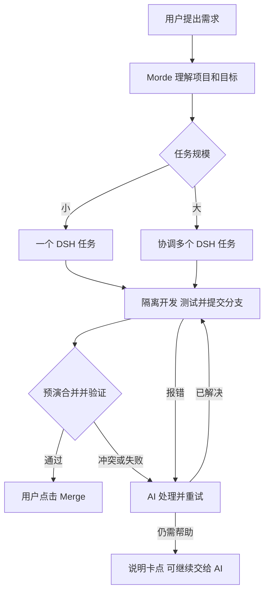

# Morde 自动化项目开发设计方案

日期：2026-11-11

状态：目标设计，文中新增能力均需实现和验收；依据 [自动化开发调研报告](Morde自动化开发与多Agent协作调研报告.md)，沿用 [对话与任务体验](<Morde AI助手对话与任务执行体验设计方案.md>)和 [Workspace 设计](Morde多端托管与共享工作区设计方案.md)。

> 零号客户的 Git 项目开发与缺陷修复，统一使用 [Git 自动处理方案](Morde零号客户小问题自动处理方案.md)中的独立 clone/worktree、分支提交和用户点击 Merge；后文涉及 Workspace 快照和写回的规则仅适用于非 Git 场景。用户是项目负责人，Morde 负责协调和执行。

## 1. 目标与范围

用户用自然语言提出项目需求，Morde 自行理解、拆解、开发、测试和交付。用户可以随时查看进度、试用已有功能、补充要求或停止；只在缺少必要信息、权限不足或遇到无法自行解决的问题时参与。

首版支持**新建或改造有源码的 Web 项目**，以及对已有 Git 项目自动查找、确认和修复缺陷；可操作用户有权开发的个人或项目 Workspace。已有项目优先沿用其技术栈；新建 Web 项目默认使用 TypeScript、React、Node.js 和 SQLite。已有项目的交付以修复和验证结果为准，不要求它必须是 Web 应用或提供网页预览。

Morde 自身是多技术栈仓库，首版需覆盖其 Go 服务与 Runtime、TypeScript/Node 客户端和 iOS 代码；各语言按原项目规范使用对应工具和测试环境。iOS 编译、模拟器或真机测试需要已授权且可用的 macOS 环境，缺少时如实列为未验证，不把 Linux 检查替代为 iOS 验收。

**交付标准：** 约定的核心场景真实跑通，或已确认缺陷在修复版本中得到验证；源码已安全保存，适用时用户能打开预览或按说明启动。Git 项目先交付通过验证的分支，由用户点击 Merge；合并到本机目标仓库不等于原仓库、远端或运行中的产品已更新。缺少的凭据、外部服务或未完成能力明确列出。构建成功、页面好看或 Agent 自报完成，都不能单独作为交付依据。

当前本地约束下，不向外发送文件或向远端部署。首版不自动购买资源或配置第三方服务；涉及这些能力时先明确条件，不能绕过本地约束。

## 2. 用户体验

1. **直接交办。** 用户说“做一个库存管理系统”或选择现有项目后说“增加入库功能”。Morde 先查看已有项目和授权上下文；只有项目位置、关键业务规则等无法合理推断时才提出简短问题，其余假设写进任务并可随时修改。模型或工具不可用时保留请求，并引导用户处理具体缺项。
2. **先做起来。** Morde 在对话中简要说明理解和正在做的事，直接开始；不要求用户先挑选 Agent、模型、技术架构或逐项批准内部开发步骤。首次访问 Git 项目选择并授权仓库和目标分支；非 Git 项目沿用 Workspace 授权，已有授权继续使用。
3. **进度真实可见。** 在原对话展示一个开发任务卡：当前阶段、最近完成的事、正在处理的事、可试用版本和需用户处理的问题。详情中可展开变更和测试记录；不显示无意义的 Agent 内部调度，也不虚构百分比或完成时间。用户可正常继续聊天。
4. **尽早可试用。** 对可预览的应用，第一条核心流程经过验证后展示“打开预览”；开发继续时预览标为“进行中”，只展示最近一次验证通过的版本。PC 与手机都可打开，预览不可用时显示真实原因和重试方式。代码缺陷修复任务展示已确认问题、修复进度和验证结果，不强制生成预览。
5. **随时调整。** 用户可自然语言补充需求，或在任务卡明确停止。Morde 识别目标后保存修订，仅停止和重做受影响工作；其他独立工作继续。若无法判断影响范围，保守地重新检查相关工作，不覆盖已保存的用户修改。
6. **一次清楚交付。** 完成时在对话提供项目位置、源码和适用的启动方法，列出已验证场景、测试结果与已知限制。Git 任务展示分支、目标仓库和 Merge 按钮，用户合并前显示“待合并”。任务进行中断网、关闭客户端或切换设备，不等于取消；重新打开后恢复状态和入口。

预览是私有的、可重新启动的体验环境，不是生产发布。预览实例闲置 **30 分钟**后停止并显示“点击重新打开”；源码与用户在预览中产生的数据分别持久化，重启预览不清空数据。自动化测试使用独立数据；预览升级涉及数据迁移时先保留原数据，迁移失败回退并说明，不静默重置。

### 2.1 四类自然语言请求怎样处理

Morde 先结合当前对话、选定项目和代码判断目标及范围，再选择执行方式。能从上下文确定的事项直接决定；只有缺失信息会改变业务结果、目标项目或必要权限时，才简短提问，并继续不依赖答案的分析。用户不用指定 Agent 或拆任务；实际复杂度根据代码和影响范围调整。

1. **“帮我写一个完整的淘宝功能到项目中。”** 先检查现有项目；如果无法判断是自建类似淘宝的商城，还是接入已有淘宝店铺，就只问这一关键问题。明确后按买家、商家、后台等业务拆分，先完成“商品 → 购物车 → 下单”的可验证流程，再扩展其他约定能力。真实支付、物流等缺少接入条件时继续可独立完成的工作，并列出未完成项；本机模拟通过不代表真实服务已接通，也不能把部分功能说成完整交付。
2. **“把 Morde 改成跟 Muse 一模一样。”** 默认使用项目已有的 Muse 资料，比较界面、交互和功能；资料不足以识别影响交付的目标版本或关键业务行为时，说明缺口并询问。先对齐“对话 → 任务 → 结果回传”等核心流程，再按依赖处理其他差距；保持现有数据及 DSH 唯一 Runtime 约束。最终逐项展示已验证、未验证和受限内容，不能把外观相似称为功能完全一致。
3. **“修复和优化首页的样式。”** 从当前页面或项目上下文确定首页，查看并修复布局、文字、间距和适配问题，沿用现有设计风格；检查相关屏幕尺寸和实际交互。只有无法判断是哪一个首页时才问。通常一个执行任务即可。
4. **“添加一个刷新页面的按钮。”** 默认针对当前页面，在合适位置复用现有样式，真正实现页面刷新并验证；存在未保存输入时复用现有保护机制，缺少时提示或保留输入。目标页面无法从上下文确定时再问；通常一个执行任务直接完成。

简单请求复用一个 DSH Task；复杂请求由 Morde 协调多个有明确边界的 Task，用户在对话中仍看到一个任务及真实进度。从克隆、环境准备到开发、测试和合并，任一步遇错时 AI 先尝试处理并重新验证；仍需用户参与时说明原因、已尝试的动作和缺少什么，并提供“让 AI 继续处理”。用户自行修改后重新验证；模型不可用时提示等待，恢复后继续，不能伪称已处理。

## 3. 选定的总体方案

零号客户的 Git 项目按以下流程执行：

- **用户看到一个开发任务。** 小问题直接复用一个 Task，不新建项目开发运行记录；复杂需求才增加一条开发运行记录，关联目标、需求修订和内部 Task。内部任务复用现有事件、检查点、预算和模型网关，不各自生成最终聊天回复。
- **DSH 仍是唯一 Agent Runtime。** Morde 的协调、开发和验收使用 DSH 引擎及隔离的有界任务上下文；GPT、DeepSeek 等仍通过 Morde 模型网关。程序只校验计划、调度已就绪任务和处理可靠性，不实现第二个 Agent 循环。用户始终是项目负责人。
- **用 Task 作为长期项目的工作单元。** 当前 `dsh_delegate` 适合单 Task 内有界委派，但后台子级不具备本方案所需的独立项目工作区和完整的结果唤醒语义，单 Task 也有时间、工具和 token 上限。因此项目开发的长期并行与恢复选用现有 Task 扩展，而不依赖嵌套子 Agent；有界只读研究仍可使用当前子会话。
- **优先复用 DSH 插件。** 当前核心包固定 `0.2.2-rc.1`。上游 subagent 插件具备委派和通知，但现有评估显示其 provider 生命周期、授权子集和恢复合同不能直接覆盖 Morde 需求；首版沿用已有 DSH 会话和 Morde Task 围栏。命令入口选用同版本 `dsh-tool-bash` 并适配自定义执行器，经 Morde Broker 进入独立沙箱；不启用未接通的上游后台作业或提权，受管长命令走第 5 节的 Morde 沙箱账本。若合同测试证明插件无法通过现有工具授权或恢复边界，则保留 Morde 现有受控工具注册路径，不绕过 Broker。DSH 文件沙箱本身不提供网络和进程隔离。插件接入前固定版本、核对许可证，并通过会话、授权、停止和恢复验证。

## 4. 任务怎样拆分和推进

### 4.1 Morde 的工作方式

Morde 先读取需求、项目结构、现有规范与可用环境。小需求明确目标和验证方式后直接开始；复杂需求整理简短的目标、核心用户场景及验收条件，先完成一条“界面 → 业务逻辑 → 数据保存”的纵向功能，再结合结果滚动拆分，不一次把所有任务定死。

每个工作单元至少包含：**目标、输入版本、依赖、可修改路径或接口、验收方式、工具范围和预算**。模型给出的任务计划是建议，服务端校验归属、路径、依赖、预算和工具授权后才能创建 Task；计划不能给自己增加权限。子任务只接收本次需要的事实、文件和约束，不假设自动继承完整对话。

例如库存系统先跑通“新增商品并保存”，再并行开发入库/出库和界面；接口、数据模型、迁移和内部集成由 Morde 协调处理，最终目标分支由用户点击合并。依赖未满足的工作不启动；一个任务失败时只修复受影响部分。

### 4.2 已有 Git 项目的自动查缺陷和修复

用户说“检查这个项目有哪些缺陷，并自动修复”，或本次对话、已保存的用户授权明确包含自动修复意图时，Morde 在授权范围内持续工作，不需要逐条确认；单独询问“有哪些缺陷”且没有自动修复意图时，只做审查并报告。

1. **建立基线。** 独立 clone 选定仓库和目标分支，在 worktree 中读取适用的 `AGENTS.md`、构建和测试命令，记录基线提交及原有测试失败。clone 只包含已提交内容；原仓库的暂存、未暂存和未跟踪文件不被复制或修改。若缺陷仅存在于未提交内容，说明无法从当前基线确认。
2. **查找并确认。** 并行检查关键业务、权限与数据边界、任务恢复、前后端交互及现有测试，结合静态检查和真实执行结果提出候选缺陷。每项记录触发条件、影响、代码位置及证据；通过可复现用例或足以证明实际行为的代码与工具证据确认。无法证实的保留为“待验证”，不把推测或测试跳过当成已确认问题。
3. **拆分并修复。** Morde 按根因合并重复发现、排序并拆成有明确修改边界和验收方式的工作单元；小问题由一个 Task 完成，相互独立的大任务可以并行，共享接口或相同文件串行处理。每项修复覆盖受影响调用方和必要的回归测试，优先验证修复前失败、修复后通过；不删除测试、放宽断言或绕过权限来换取通过。
4. **集成并回归。** 在隔离分支中汇总提交，按仓库约定运行必要的构建、测试和跨组件验证；需要临时数据库、浏览器或平台环境时使用隔离环境。区分原有失败、新增失败、跳过和未执行，相关门禁未通过时继续修复或明确报告阻塞。
5. **分支交付。** 提交通过验证的修复分支，预演合并并验证候选版本，向用户展示改动、测试与 Merge 按钮。目标或修复分支变化时重新验证；冲突先由 AI 尝试处理，改变合并内容后请用户重新查看并点击。只有用户点击后才更新指定目标分支，不写回原工作目录，不推送或外发文件；未证实项不冒充已修复。

小问题复用一个 Task，复杂问题复用开发运行、多个 Task 和验证门禁。以 Morde 仓库为例，可按实际需求检查 Go 服务与数据层、DSH 运行时、Web/桌面与 iOS 客户端；这些是检查方向，并不预设相应模块存在缺陷。

### 4.3 并发与集成

默认最多 **2 个**独立实现任务并行；实际数量再受账户、模型和沙箱资源限制。只读调研、边界清楚的模块可以并行；公共契约、同一文件、依赖锁文件和数据迁移由一个任务负责。小需求直接由一个 DSH 任务完成，避免为并行付出额外协调成本。

**Git 项目：** 每个并行任务基于指定提交，使用独立 clone 和 worktree，在自己的分支中修改和提交；本机 clone 使用 `--no-local`，不共享可写 Git 元数据或目标仓库。集成任务在独立仓库内按依赖合入任务提交并测试，输出一条待用户合并的集成分支。目标分支始终只能在用户点击后更新；合并前核验目标、修复提交及已验证的候选版本。遇到冲突，AI 在隔离分支解决并重测，无法判断业务意图时请用户说明。

**非 Git 项目：** 使用 Workspace 快照及文件清单，在隔离视图中集成；保存时核对基线和当前 revision，冲突则保护双方内容并重新验证。Workspace CAS 及保存回执不用于绕过 Git 场景的用户合并步骤。

### 4.4 可持续运行与恢复

- 仅复杂需求新增开发运行记录，保存目标与修订、Git 基线提交或非 Git Workspace 基线、授权版本、总预算、当前阶段、已验证候选版本和最终交付来源；任务关系记录每个工作单元的 ID、Task、依赖与结果版本。**Task 仍是执行状态的权威来源**，开发记录只管理项目整体，不另建一套 Agent 或工具账本。
- 复用 `task_dependencies` 表达工作单元依赖，扩展现有“会话消息引用活动任务”的创建校验，使其可由同一开发运行的计划创建并绑定已完成的指定版本。单节点直接依赖仍不超过现有上限 4；更多依赖拆成多个汇合步骤。服务端检查环、归属和修订，只有前置结果及其验收有效才派发。
- 内部任务的完成事件先持久化，再由现有 Worker 消费；以“开发运行 ID + 需求修订 + 工作单元 ID + 尝试号”去重。Morde 根据可核验结果继续规划、集成或修复。重启后从持久记录、Task 检查点、操作回执与候选版本恢复，不依赖内存中的 Promise 或循环查询模型。
- 每个工作 Task 遵守现有单任务上限；新增开发运行级预算预留和用量汇总，个人 Workspace 复用账户预算，项目 Workspace 同时复用项目预算和账户配额。派发前原子预留，完成后结算；与现有模型调用账本使用同一笔调用身份，不能重复计费。达到总预算或资源上限时停止新增工作并提示，不通过创建新 Task 绕过额度。保留验收和必要修复的预算。
- 用户修改需求时递增开发运行修订，标记受影响工作及验收证据失效；停止旧执行并核对在途操作后再启动新版本。迟到结果、重复事件和旧授权不得更新当前结果。用户停止时停止整个开发运行的活动 Task 和沙箱；停止确认前显示“正在停止”。结果未知的操作先对账，无法确认时暂停并说明，不盲目重做。

## 5. 开发环境与私有预览

### 5.1 开发环境

选用现有 T08 的 **Task Sandbox / OpenSandbox / Guardian 路线**，补齐生产 Worker、Broker、Execd、私有项目快照和停止证明；当前这些链路尚未完整接通，不能表述为已有可用开发沙箱。

每个工作 Task 使用独立沙箱、临时文件系统和资源上限，按 Task、用户、授权版本与租约代次绑定。沙箱只获得该任务授权的项目快照、必要工具链和离线依赖缓存，不挂载共享 DSH Runtime、宿主凭据或其他用户目录。默认拒绝网络出口；缺少依赖时保留现有进度并说明，不伪报已构建。

零号客户的 Git 场景在本机运行 Morde 服务、同一套 DSH Runtime、本机模型和隔离环境；模型继续经过 Morde 网关。本机模型接入须在不放开云端网关地址校验的前提下单独适配和验证；环境不可用时暂停并说明，不把项目内容发送到外部。对指定远端仓库如需 clone/fetch，只允许受控只读访问；不推送分支或外发文件。

当前 T08 的部分沙箱合同只支持个人 Workspace。支持项目 Workspace 时须扩展并校验 Workspace owner、项目、发起人及成员授权，并让撤权立即阻止新派发和结果提交；在项目隔离与恢复验收通过前，项目 Workspace 不开放该能力。

用户已经授权的项目开发可在上述受限环境内连续读写、构建和测试，不对每条内部命令重复询问。为此需扩展现有逐次 Shell 审批合同：授权记录绑定用户、项目、仓库或工作区范围、Task、复杂需求的开发运行、资源预算和可撤销版本；程序在每次执行时校验。该授权只覆盖隔离环境内的开发，不授权外发文件、操作用户其他目录或执行外部发布；不能用命令字符串白名单代替隔离。

现有 Host `shell_exec` 和 Task Sandbox Execd 单次均最多 5 分钟，不足以覆盖大型仓库的完整回归。首版必须补齐**受管长命令**：通过 Broker 和现有沙箱调用账本记录进程身份、输出游标、截止时间及结果；断线或重启后查询和对账，用户停止时确认进程树退出，结果未知时不重复执行。命令仍受 Task 剩余预算和沙箱资源限制；超过单 Task 上限的测试按可恢复的工作单元分片，不能分片且环境不支持时如实阻塞。预览应用由独立的沙箱生命周期管理，不依赖命令退出后保留进程。

### 5.2 预览

为已验证的候选版本启动独立预览沙箱，通过 Morde 鉴权网关访问；复用现有 Host 预览鉴权思路，新增 Task Sandbox 预览路由和生命周期，不能假定现有 Host 端口代理已支持该沙箱。预览应用由沙箱生命周期管理，不依赖 `shell_exec` 结束后保留进程。预览绑定用户、Task 或开发运行及候选版本，使用独立来源与受限网络，不向应用转发 Portal 凭据或暴露宿主内部地址。

开发中的新版本先在隔离环境验证，通过后才切换预览；失败时保留上一个可用版本并提示。预览使用的数据与自动化测试数据分开，预览实例回收和重启不得删除用户数据。源码与预览数据的保存位置、配额和状态在交付时可查看。

启用前必须在目标 Linux 环境验证：控制通道可达、沙箱对外和对宿主拒绝访问、DNS/IPv6 不绕过、资源限制生效、任务停止与重启有可信证明。现有 T08 的候选配置、数据模型和单元测试不等于这些条件已满足。

## 6. 验证与交付

每个验证结果绑定**需求修订、Git 提交或非 Git 项目快照、执行环境和真实操作回执**；代码或相关需求变化后对应证据失效。验收条件与任务规模相称，复杂需求在实现前固定核心条件，变更时记录原因，不能由实现任务自行降低门槛。小需求运行与改动相称的必要检查；复杂项目集成后，由独立 DSH 验收任务和确定性测试检查实际运行结果：

| 门禁 | 必需证据 |
| --- | --- |
| 构建 | 按改动范围运行必要的构建和项目约定检查；记录命令和结果。 |
| 功能 | 验证本次涉及的核心行为、错误处理及必要的数据保存；不能只检查页面上存在文字。 |
| 用户操作 | 界面任务实际操作相关流程，并检查受影响的页面状态和屏幕尺寸；预览不可用时说明未验证的内容。 |
| 项目交接 | Git 项目可查看目标仓库、修复分支、提交、候选合并版本及测试结果；非 Git 项目提供源码清单及保存回执。适用时提供启动说明、配置说明和已知限制，不包含密钥。 |

现有文件验证主要接受有限数量的 `file_write` 证据。Git 场景需接入实际提交、候选版本、测试与合并回执的核验；非 Git 场景需扩展 Broker/Workspace 验证链，核对完整项目清单和保存回执。不能靠补写说明文件或 Agent 自报冒充项目已保存、合并或验证。

Git 场景全部必需门禁通过且修复分支提交成功后，结果显示“待合并”；用户点击并确认目标仓库更新后，才显示“已合并”。本机目标合并成功不等于源仓库、远端或运行版本已更新。若某项无法验证，交付卡明确列出“已完成 / 待完成 / 用户需要做什么”，不称为完全可用。

## 7. 修改边界

| 范围 | 改动 |
| --- | --- |
| 服务端 | 复用现有 Task、授权和结果回传；小需求单 Task，复杂需求接入开发运行、任务依赖与恢复。接通隔离 Git clone/worktree、候选版本核验和用户触发合并；非 Git 场景继续使用 Workspace 快照和 CAS。 |
| DSH Runtime | 增加受控的项目开发技能与工作单元提示；工具继续走现有 Broker 和模型网关，不增加第二种 Agent Runtime。 |
| PC / iOS / Web | 复用对话和任务卡展示一个开发任务、真实进度、变更、测试、目标仓库、Merge 和“让 AI 继续处理”；适用时提供私有预览，重连后恢复。 |
| 契约 | 涉及任务关联、开发状态、预览和产物的接口，同步 OpenAPI、数据库迁移、实现和测试；旧客户端继续可读普通 Task，不接受不兼容字段后静默失败。 |

先打通单 Agent 的开发、预览和交付闭环，再启用两个隔离工作任务并行，最后接入跨多个工作单元的恢复与长项目调度；各阶段复用同一套 Task 和授权体系，Git 与非 Git 的版本来源分别遵守第 4.3 节。

## 8. 验收场景

1. 在已有授权的 Workspace 中用一句话新建库存管理项目：无需人工写代码；用户可新增商品、入库、出库，刷新与重启后数据正确；预览、源码和启动步骤可用。
2. 修改已有 Git 项目：基于已提交版本独立 clone/worktree，原工作目录及用户未提交改动不变；需要并行时两个工作任务独立执行，同文件冲突不会丢失任一方内容；最终结果基于正确提交。
3. 开发期间补充要求、关闭客户端、重启服务并重新打开：最新要求生效，已确认工作不重复执行，旧结果不覆盖新版本，对话只出现一次最终交付。
4. 预算耗尽、依赖缺失、构建失败、权限撤销、取消及操作结果未知时，任务停在真实状态；已完成内容可查看，不重复副作用，也不宣称全部完成。
5. 项目超过 16 个文件或通过 Shell 生成文件时，Git 提交及候选版本、或非 Git 文件清单及保存回执，与测试证据一致；故意改变已验证文件后不能直接交付。
6. 预览空闲停止后重新打开：代码版本正确、用户预览数据仍在；测试不会污染预览数据，其他用户无权访问。
7. 与同样需求、环境和预算的单 Agent 基线比较总交付时间、核心场景通过率、冲突/返工和模型成本；只有在同一质量门槛下更快，才提高默认并发。
8. 使用真实可用模型完成涉及商品、库存、订单与权限的较复杂项目，跨多个工作 Task 持续推进并经历一次中断恢复；每个已承诺的核心场景在同一最终版本上通过。合成模型只能用于验证系统链路，不能替代此项。
9. 在隔离的多技术栈 Git 项目样例中预置可复现缺陷及一条无法证实的候选问题；一次“检查并修复”指令后，自动完成确认、拆分、修复和回归，未证实项不冒充已修复。
10. 从含已暂存、未暂存和未跟踪文件的原仓库 clone：只使用已提交基线，原内容及暂存状态保留；问题仅存在于未提交内容时明确说明。长测试超过 5 分钟、进程重启和取消均能恢复或给出明确阻塞状态。
11. 对 Morde 仓库隔离副本，用真实可用模型执行多模块查缺陷及修复，覆盖实际涉及的 Go、Node 和 iOS 验证；缺少所需平台时列明未验证项，不以合成结果代替真实运行。
12. 对第 2.1 节四条请求：商城含义无法确定时只问关键问题并继续独立分析；Muse 对齐区分已验证与资料不足；首页样式和刷新按钮在目标明确时直接由单 Task 完成，验证实际页面行为。
13. Git 候选准备好后，用户未点击前目标分支不变；点击前目标变化或发生冲突时，AI 尝试处理并重测，结果改变后需用户再次点击。报错卡可交给 AI 继续处理；合并结果未知时先对账，不重复执行。
