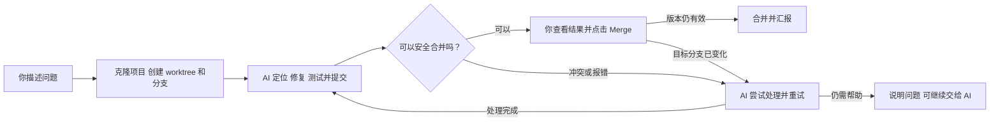

# Morde 零号客户 Git 小问题自动处理方案

> 目标设计，不代表功能已实现。你是项目负责人，Morde 负责处理小问题；最终由你点击 Merge。

不同规模的自然语言需求如何判断和拆分，见 [自动化开发设计：四类请求的处理](Morde自动化项目开发设计方案.md#21-四类自然语言请求怎样处理)。

## 1. 使用方式

首次指定 Git 仓库和目标分支。以后你只需说：

> Morde 设置保存后没有成功提示，帮我修好。

Morde 自己克隆项目、创建独立 worktree 和修复分支，确认问题、修改、测试并提交。准备好后，在对话中展示改动和验证结果，由你点击 **Merge**。

修复过程不改动你原来的项目目录、暂存区或未提交文件。Git 克隆只包含选定分支**已提交**的内容；如果问题只存在于你未提交的代码，Morde 应说明当前版本无法复现，不擅自复制或提交这些改动。

## 2. 自动处理流程

1. **准备。** 为本次任务克隆指定仓库，从目标分支的提交创建独立 worktree 和修复分支，例如 `morde/fix-settings`。一个小问题由一个 DSH 执行任务处理。
2. **修复。** 阅读项目约定，先确认问题，再修改并运行相关验证。AI 优先处理能自行解决的报错；通过后自动创建修复提交，保留可查看的差异和测试结果。
3. **检查合并。** 根据目标分支的最新提交，在隔离环境预演合并，并验证实际候选结果。记录双方提交和候选合并版本；无冲突且验证通过后，显示 **Merge** 按钮。未确认缺陷、测试失败或结果未知时，说明原因，不显示为可合并。
4. **用户合并。** 你点击按钮后，Morde 再核对目标分支和修复分支是否仍是已验证的版本。版本变化则重新预演、测试并请你再次点击；版本一致才合并已验证的候选版本，确认结果后汇报。

## 3. 报错和冲突怎么处理

Morde 不只给出错误信息，还要结合任务上下文分析原因，优先尝试修复和必要的重新验证，直到完成或达到任务预算。比如测试失败就检查代码与测试；合并冲突就比较两边修改的意图，在隔离分支中解决，再重新测试。

如果仍需你处理，对话中显示**发生了什么、已尝试什么、还需要什么**，并提供 **「让 AI 继续处理」**。你也可以自行在该隔离 worktree 中处理，Morde 检测到新修改后重新验证。需要新权限、凭据、缺失环境或业务取舍时，AI 说明具体卡点；不能猜测业务规则、忽略测试或擅自取得权限。模型本身不可用时先提示等待，恢复后再继续。

解决冲突产生了新的提交或改变了待合并内容时，需要你查看更新后的结果并再次点击 Merge；AI 不能替你合并。取消或执行结果未知时，先确认现状，再决定是否重试，避免重复提交或合并。

## 4. 模拟一次

1. 你说：“设置保存成功后没有提示，修好它。”
2. Morde 克隆项目，创建 `morde/fix-settings` worktree，确认问题并增加成功提示；相关测试通过后提交。
3. 预演合并时发现，目标分支刚修改了同一段设置保存逻辑。Morde 比较两边的改动，在修复分支解决冲突并重新测试，确认原有新逻辑和成功提示都生效；如果无法判断业务意图，就展示差异并请你说明，也可以继续让 AI 分析。
4. Morde 展示修复内容、冲突处理和验证结果。你点击 **Merge**，Morde 确认版本未变化后合并，并返回实际合并结果。

以上是模拟流程，不代表现有代码已经存在这个缺陷或已执行上述操作。

## 5. 本机 Git 边界

根据当前“不外发文件”的要求，首版的 Merge 按钮合并到**明确指定的本机 Git 仓库**。为避免干扰正在打开的项目，该目标使用 Morde 管理的独立本机裸仓库；可以从指定源仓库克隆建立，也可以指定已有的本机裸仓库。修复任务再克隆该目标并创建 worktree：本机克隆使用 `git clone --no-local`，不使用共享对象池或硬链接，也不将目标仓库的 Git 元数据暴露给任务；任务不能直接修改目标分支。

这意味着：如果目标仓库是从源项目克隆出来的，Merge 只更新这个本机副本，不会更新原仓库。如果源项目在 GitHub 或其他远端，本机合并**不会更新远端仓库**，也不是远端 PR 的 Merge。推送修复分支或在远端创建 PR 会发送代码，当前约束下不能执行；界面必须明确显示真实合并目标和结果。远端来源如需读取，只允许对指定仓库的受控只读 clone/fetch。

服务、DSH、模型和执行环境继续留在本机；代码修改和测试在隔离环境中进行，不能访问其他用户目录、凭据或外网。模型通过现有网关接本机模型；环境不可用时说明原因，不转发项目内容。macOS/iOS 原生验证不能由 Linux 环境替代。

## 6. 需要补齐什么

1. **Git 隔离执行。** 复用现有 DSH Task、工具代理和任务隔离，接通本机 Git clone、worktree、分支、提交及相关测试；对用户开放可查看或处理该 worktree 的入口。对所选项目和任务授权后，隔离区内的修复、测试和提交连续执行，不逐条弹窗；保留任务预算、停止、授权和操作记录，不能直接放开现有通用 Shell 审批。
2. **合并与结果卡。** 对话中展示分支、目标仓库、差异、测试和 Merge 按钮；预演并验证候选合并。新修改使原结果失效；点击时冻结修复提交，以目标分支的已验证提交为条件原子更新，只合入已验证的候选版本。任一版本变化、冲突或结果未知时停止并重新核验，不能覆盖目标分支的新提交。
3. **AI 处理错误。** 将 Git、测试和环境错误连同上下文交给现有 Agent；复用任务结果与恢复机制提供「让 AI 继续处理」。自动处理不能绕过授权、放宽测试或把未验证结果标记为成功。

现有 DSH Task 和部分电脑工具可复用，但 Git worktree、合并按钮与本机模型执行链尚需接通验证。现有电脑命令在 Mac 端仍关闭，见 [PC 能力实施记录](实施/融合03-05五会话并行实施/会话1-PC/PC-05实施任务todo清单文档.md)；现有 Task Sandbox 也不是已完成的开发环境，见 [自动化开发设计](Morde自动化项目开发设计方案.md)。

首版用本机测试仓库验收：从已有提交修复并提交；证明原工作目录及未提交改动不变；验证正常合并、目标分支变化、冲突交给 AI、测试失败、取消和合并结果未知；全过程不向外发送文件。
