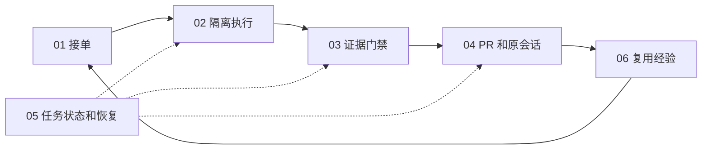

# Morde MVP：模块设计导航

**基线：**《Morde MVP》v1.5。原 PRD 不变。这是一套设计拆分，不代表已经实现。

**一句话：** 用户在原对话交代一个小 Bug 或需求，Morde 交回一份带实测证据的待审 PR；人决定合不合并。P0 只用一个 Agent、一个仓库。并行、自动合并、语音和独立知识图谱不进入这条首版交付链。

| 文档 | 负责什么 | 什么时候看 |
|---|---|---|
| [01 接单与需求价值](01_intake.md) | 确认做什么、为什么做、怎样才算做对 | 创建任务前 |
| [02 隔离执行](02_execution.md) | 一个 Agent 在独立分支复现、改动、运行检查 | 任务已受理 |
| [03 证据与验收](03_verification.md) | 判断这个提交是否有足够证据 | 标记 PR 就绪前 |
| [04 PR 与原会话交付](04_delivery.md) | 创建一份待审 PR，交回原会话 | 有授权且达到门槛 |
| [05 任务状态与恢复](05_reliability.md) | 记住跑到哪里，处理中断、撤权和预算 | 贯穿整条链 |
| [06 项目记忆与纠错](06_memory.md) | 让下一单复用规则，把反复出错变成测试 | 有真实案例之后 |
| [Morde 工程任务闭环实施方案](Morde_工程任务闭环实施方案.md) | 将六份模块设计映射到 Morde 现有能力和可执行任务 | 开发代码任务到待审 PR 的闭环时 |

**建议开发顺序：** 先把 01–04 串成一条真实链路，同时用 05 做最低限度的任务持久化、授权和 PR 对账。第一单跑稳后，再用 06 验证第二单是否真的少交代。首版不允许「先上线，之后补权限校验或去重」。

**同一个验收案例：**「重连后进度重复显示。」第一次验证旧 Bug、修复、拿一份 PR；再故意在 PR 创建响应丢失时重启；第二个同类任务只给新目标和提交，观察是否少教一次。用同仓库、难度相近的真实任务跟你现在最顺手的工具比较，记录通过验收并合并的任务数、人工时间、复核返工和失败成本。没有实测，不宣称提效。

**复用口径：**「直接复用」指调用现成接口或依赖，不复制源码；「移植」指明确复制并适配代码，要先核对许可证、依赖和测试；「仅借鉴」指借做法，不引入项目。默认优先复用已经在 Morde 里的能力。
