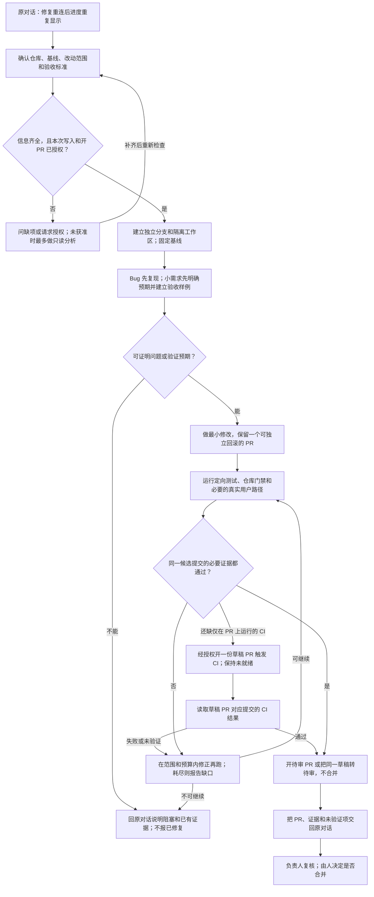
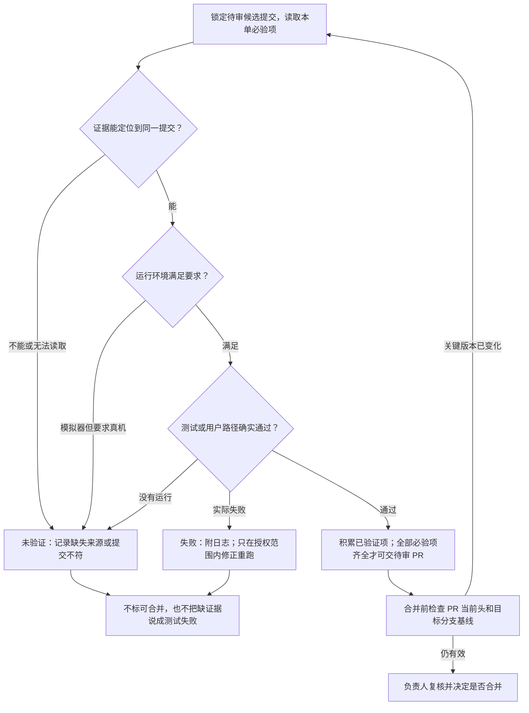
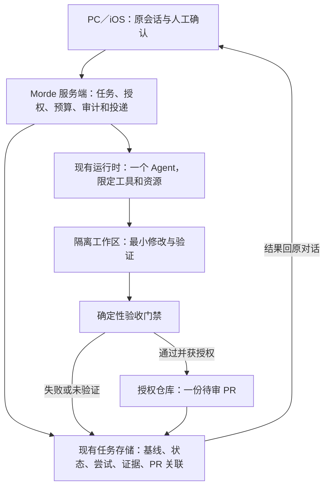
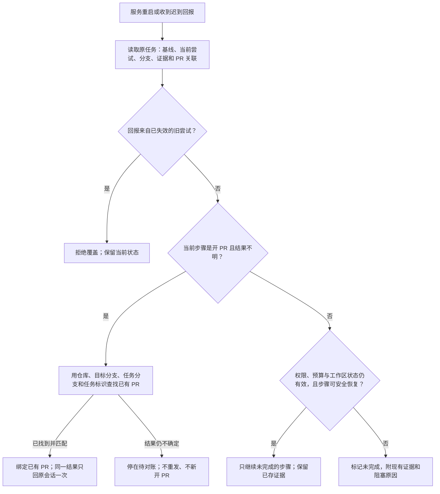
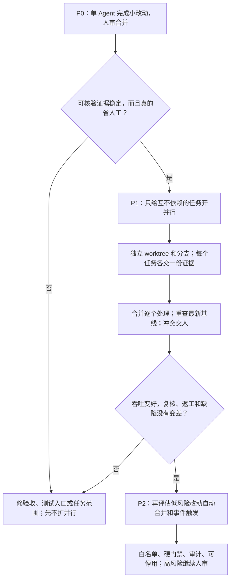
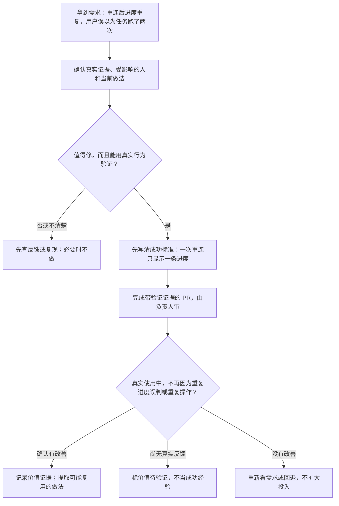
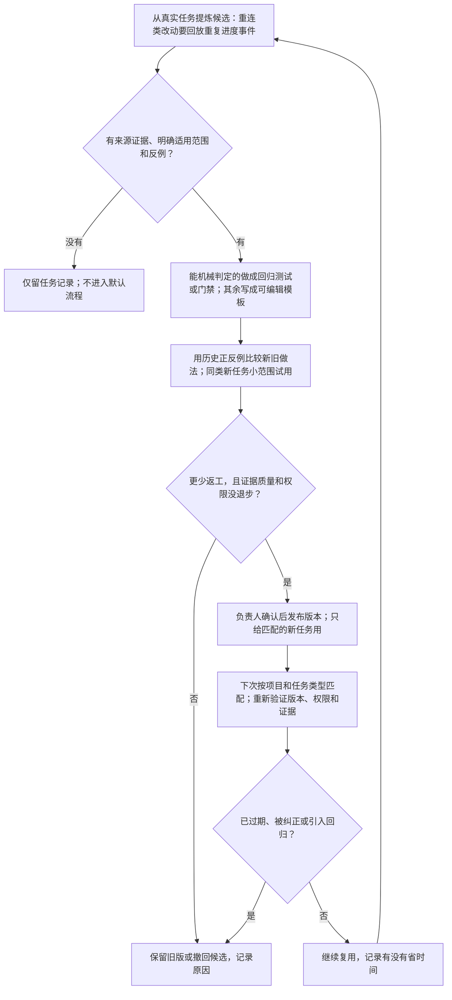
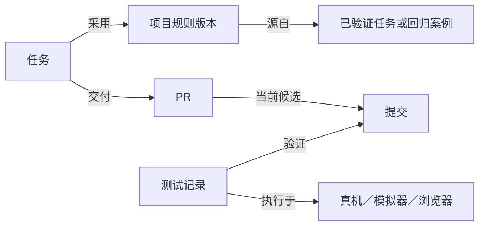

# Morde MVP：从一句需求到可验收的 PR

**版本：** v1.5 · 2026-11-20 · 需求评审稿，不代表已实现  
**这次调整：** P0 从「只读核查能不能发」改为「交付一个小需求或 Bug 的待审 PR」。只读核查保留为交付门禁，不是另一项独立 MVP。

## 1. 产品目标：少盯过程，多完成事情

Morde 是从原对话接活并交回证据的工程助理。用户不用自己拆步骤、盯运行、找日志再拼成 PR。**首版只证明一件事：单 Agent 能把一个边界清楚的小任务做到可供人合并，而且比现在的做法少花人工时间。**

- **输入：** 一个仓库、一个明确基线、一个可独立验收的小改动。例：「修复断线重连后，同一条任务进度出现两次。」
- **输出：** 一份待审 PR，附复现或预期、改动说明、当前提交的验证证据、未验证项；结果回原对话。
- **不做：** 大范围重构、自动合并或部署、通用可视化编排、跨仓协调、外部 A2A。PC 发起；同一会话能在 PC/iOS 查看。关窗口不等于取消已受理的任务。
- **护城河假设：** 用户确认过、可复用的验收规则，加上由真实失败沉淀的回归测试，让相同类型的工作越交越省心。模型、Agent 数和 PR 数本身不是护城河。

## 2. P0 主流程：一个 Agent 做完一件小事

| 步骤 | P0 验收 |
|---|---|
| 接单 | 明确目标、非目标、实际基线和权限。信息不全就问，不擅自主张。「修一个小 Bug」不授权顺手重构，也不授权合并。 |
| 修改 | 使用隔离工作区和任务专属分支，不写主分支，不覆盖用户本地修改。每个任务只交一个逻辑完整的改动，不拆成多个 PR 刷数量。 |
| 验证 | Bug 要有修前复现、修后同一场景通过；能自动化就留回归测试。小需求用可执行的验收样例。UI 有关键变化时，要走实际用户路径；环境要写清真机、模拟器或浏览器。 |
| 开 PR | 不缺必要证据时，才交付待审 PR。若门禁只能在 PR 上跑，经授权可先开草稿触发 CI，直到通过都不标就绪，且沿用同一 PR。PR 包含简明改动、证据链接、候选提交、未验证项与风险。开 PR 只在已授权的仓库与范围内；不合并、不部署。 |
| 原会话 | 先显示接单和进度，成功给 PR；失败或授权失效给缺口和可追溯记录。提交 PR 前后保存关联；不确定上一次创建是否成功时先对账，不再开一份。 |

## 3. 只读核查变成硬门禁

模型可以挑验证顺序和解释失败；**Morde 的服务端和仓库工具决定是否通过**。建议按候选提交读取 CI、测试报告及运行环境，把状态分成通过、失败、未验证。不靠 Agent 自述填补证据。

**证据跟着当前提交走。** 每个必验项都显示预期行为、实际结果、运行记录链接、提交和环境，由门禁判定。若 PR 推了新提交，旧结果仍可追溯，但「可合并」立即失效，变为「待重新验证」；必要检查受目标分支变化影响时，也要重验。缺证据是「未验证」，不是「通过」或「失败」。

**把重复纠错变成回归。** 例如 Agent 两次把模拟器标成真机，就给证据加环境字段，由门禁拒绝错配，并加一个故意输入模拟器证据的反例。按照 Lauren 的做法，先让错误能被程序挡住，再考虑加更多提示词。[Lauren 的演讲](https://ai.engineer/code/2026/talks/lauren-tan) · [P-Stack /correct](https://github.com/cursor/plugins/blob/main/pstack/skills/correct/SKILL.md)

## 4. 架构边界：用现有 Morde，不先造编排器

- **Workflow 首版可以写在现有任务逻辑里。** 固定接单、修改、验证、交付的边界，Agent 在范围内决定怎么查和怎么改；不需要可视化编排器或 A2A。
- **中断处理只做必要的。** 接单后保存基线、分支、候选提交、验证和 PR 关联。恢复前重查权限、工作区和预算；只恢复能确定安全重跑的步骤，迟到结果不覆盖新尝试。开 PR 等有外部影响的动作若状态不明，先按任务和分支对账，查不到确定状态就停下。原双 Agent 恢复和去重测试移到并行阶段，不挡 P0 验收。
- **权限和预算在动作发生时检查。** 写入、推送、开 PR 前都重新核验当前权限；中途撤权后禁止下一次写动作，对已在途请求先查结果，不承诺能撤回已发生的副作用。每次启动或重试前检查剩余时长、次数和用量预算，需要时预留额度；重试和恢复沿用同一任务预算。耗尽就停止发起新动作，保留证据并说明停在哪一步。
- **从 PR 能回查到任务。** 用关联标识定位发起人和授权范围、候选提交、当前尝试、测试来源及发生时间；审计仅对有权访问的人开放，不把凭据或原始敏感日志写进 PR。

### 中断处理：先对账，再决定重跑

- **证据状态：** [Morde 当前项目说明](https://github.com/lizhongxuan/morde#readme)支持对话优先和 PC/iOS 的方向；[历史验收记录](https://raw.githubusercontent.com/lizhongxuan/morde/ba649b1/docs/实施/Morde对话体验与DS-Bot融合实施任务todo清单文档.md)中的模型替身、局部验证不等于真实端到端交付。本文中的改代码、门禁与 PR 交付是待开发和验证的需求，不是现有能力声明。

## 5. 跑稳后再提速，不让并行增加返工

正在跑的任务不换规则；权限或验收门槛的改变由人批准。并行阶段只借 [Noodle](https://github.com/poteto/noodle/blob/main/docs/concepts/scheduling.md) 的隔离和合并顺序，不照搬它的动态项目调度。

## 6. 验证需求价值，把有效经验留给下一单

**「有价值」和「实现正确」要分开验收。** PR 合并只证明这次改动被接受，不证明用户真的更省心。P0 不需要先建实验平台；一张任务卡就能记录这三道关：

| 什么时候 | 要回答什么 | 最小证据 |
|---|---|---|
| 接单前 | 谁遇到什么问题？值得现在做吗？ | 一条真实工单、复现或重复反馈；记下当前做法、可观察的改善目标、谁负责验收。没证据就先做最便宜的验证，不直接写代码。 |
| 交付时 | 代码有没有按预期工作？ | 修前复现、修后通过、证据对应待审提交；负责人决定合并。不把合并写成价值已验证。 |
| 使用后 | 真实用户是不是受益？ | 用一次实际任务、用户确认或前后数据核对。没拿到使用反馈就标「价值待验证」；不改善则调整或停止，不把做法升为默认。 |

**记住的是能重复验证的做法，不是整段聊天。** 每个候选经验只记：适用项目和触发条件、建议步骤或检查、来源任务/PR/测试、确认人、版本、何时失效。默认限制在原工作区或仓库，不保存凭据或多余原始日志，不复用旧授权、旧证据或旧结论。

**P0 最小验收：** 两个同类任务。第一单留下一个真实反例、一个测试或模板；第二单只给新目标和基线，Morde 能说明自己复用了哪条规则、为什么适用，并拿到该提交自己的证据。再用一个不相关或已过期的任务验证它不会套错规则。只有复用后少追问、少漏验或少返工，才算能力在积累。试点只做项目内可编辑的规则和回归测试，不先建全局记忆库或自动改门禁。

## 7. 记忆、本体和知识图谱：先解决具体问题

**记忆在 P0 就有价值；轻量本体也有价值；独立知识图谱暂不做。** Morde 要记住的是可核验、可更正、对下一单有用的工作经验，不是把所有聊天存下来再凭相似度猜。

| 能力 | 对 Morde 的价值 | 首版怎么做 |
|---|---|---|
| **项目记忆** | 下次不用从头教，能解释为什么沿用某条规则 | 在现有存储记录「适用范围、规则、来源、确认人、版本、失效条件」。新任务只取与当前项目和任务类型匹配的已确认规则；显示用的是哪条，允许用户修正或停用。 |
| **轻量本体（术语和关系约定）** | 避免把「PR 已合并」当「已上线」，把「模拟器通过」当「真机通过」 | 先固定任务、规则版本、提交、测试运行、执行环境、PR 这几类，以及它们允许的关系和状态。用结构化字段和校验实现，不建通用本体平台。 |
| **知识图谱** | 当用户经常要跨任务查影响或追溯时，关系查询能比翻聊天快 | P0 只保留可查询的关联 ID，用现有 PostgreSQL 即可。先验证能否回答「这条规则拦过哪些 Bug」「哪个 PR 跑过这项真机测试」。只有跨仓、多跳问题反复出现，而且现有查询可测地成了瓶颈，才评估图索引或图数据库。 |

**三类数据不混用：** 任务和证据是事实记录；已确认规则是可复用经验；模型提取的关联只是候选。候选没有来源或与来源冲突时，不成为规则；来源更正后可停用或回退规则。记忆不授予权限，旧「通过」也不替新提交验收。首版用一个同类任务和一个不适用的反例，验证能解释复用、不会跨项目泄露或套错规则。

## 8. 验收与止损

| 用户的价值验收单 | 首版怎么证明 |
|---|---|
| **交付到底能不能验收？** | 同一个真实小 Bug：能复现、修改后同一用例通过、证据绑定候选提交、只开一份有出处的 PR。把别的提交的绿灯故意混进来，门禁仍要拒绝。 |
| **下一次要不要从头教？** | 再给一个同类任务，只说目标和新基线；复用确认过的验收模板，不复用旧结果或权限。 |
| **出错时有权限、追溯、恢复和成本控制吗？** | 拒绝越权写入；从 PR 回查任务、尝试、测试和提交；断线后可见原任务；开 PR 响应超时时先对账防重复；预算用尽就停并保留证据。 |

### P0 必测反例

| 故意制造的情况 | 必须看到的结果 |
|---|---|
| CI 绿灯属于旧提交、真机项只有模拟器记录，或验证后 PR 又推了新提交 | 拒绝沿用旧绿灯；无当前证据时取消「可合并」，明确需要补哪项。 |
| 第二单只给新目标和基线；第三单换成不适用的任务或过期模板 | 第二单展示复用的规则版本和理由，且产出本单自己的证据；第三单不套规则，缺关键信息时才问。 |
| 任务执行中撤销写权限 | 后续推送或开 PR 失败或不发起，并记录原因；不能静默换凭据。 |
| GitHub 已创建 PR，但回复丢失，Morde 随后重启 | 对账后绑定原 PR，只回一份结果；查不清就显示待对账，不重复创建。 |
| 从一份 PR 倒查交付；或重试将超过预算 | 能定位任务、授权、提交和测试；预算不足不启动新尝试，保留证据，恢复不重置预算。 |

**成本口径：** 单次任务显示实际用量和重试开销。试点按「所有尝试的模型、工具和运行费用 ÷ 验收成功的任务数」算每单费用，失败也计入分子；人工交代、复核和返工另记分钟数。没有成功任务就报告总花费与零交付，不报虚假的单价。

**试点建议：** 同一个仓库、两周、约 12 个真实小任务，和用户现在最顺手的做法按难度对照。主指标是**每周通过验收并合并的任务数**，不是 PR 打开数。辅看从交办到可合并的时间、人工复核和返工时间、缺陷逃逸、回滚及每个成功任务成本。建议先以人工时间中位数降低至少 30%、证据质量不低于对照为通过线；遇到越权、错会话或虚假验证立即停试。PR 翻倍但人工复核也翻倍，就不扩并行。
