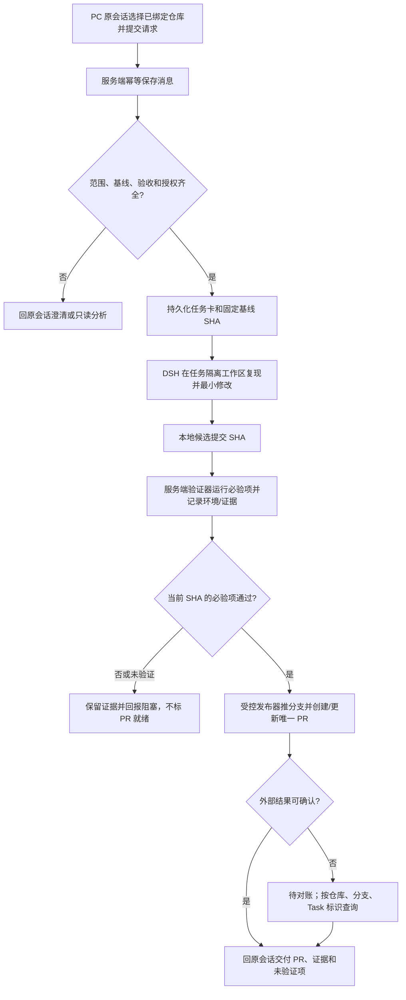

# Morde 工程任务闭环实施方案

> 来源：[Lauren 工程 MVP PRD](MVP_PRD.md) 及模块设计（`01_intake`–`06_memory`）。这是面向开发的方案，不代表已实现或验收。
> 范围判断依据：[Morde 开发约定](../../AGENTS.md)、[AI 对话能力实施清单](../design/Morde-AI对话能力实施任务todo清单文档.md)及当前服务端接口/代码。

## 1. 结论与范围

这组材料适合变成 Morde 的一条**代码任务工作流**：用户在原对话交办一个边界清楚的小 Bug 或需求；Morde 在隔离环境里复现、修改并验证；经授权后交付一份待审 PR；最终状态和证据回到原会话。

Morde 不需要再造 Agent Runtime、通用工作流引擎或第二套任务/事件存储。沿用服务端 DSH、Task、审批、事件、步骤、产物、预算和恢复机制，补齐代码仓库接入、每任务 Git 隔离、提交绑定的验证和受控 PR 交付。

**首版（P0）范围：**

- 一个用户、一个已授权 GitHub 仓库、一个小任务、一个 DSH Agent、一个候选提交。
- PC 提供仓库绑定和任务确认入口；仓库已绑定后，PC/iOS 都可在同一原对话发送补充消息并查看同一 Task 的进度、证据和结果。普通用户入口留在 `morde-pc` 与 iOS，不新增独立 Web 用户端。
- 修复或实现后交付一份草稿/待审 PR，由人决定是否合并。Morde 不合并、不部署。
- 权限、预算、任务状态、证据、审批和恢复都以服务端记录为准；关闭客户端不取消已受理任务。
- P0 固定 GitHub。没有仓库绑定或写入授权时，最多做只读分析并说明缺项。

**暂缓：**多仓库、多 Agent 并行、自动合并/部署、可视化编排、A2A、独立知识图谱和通用记忆平台。项目规则记忆放在首个闭环跑通后的 P1 小试点。

Lauren、Noodle、P-Stack 和 Issue Forms 在原材料中提供的方法只作参考；P0 不移植它们的插件、调度器或表单引擎，也不复制第三方源码。

## 2. 原材料转成 Morde 的任务

| 来源 | 对 Morde 是否需要 | 落地方式 |
|---|---|---|
| 01 接单 | 需要 | 在现有会话/Task 路径中形成结构化任务卡；缺少仓库、范围、验收标准或授权时只追问缺项。没有足够复现或价值依据时先做最小只读核查，不直接开写。 |
| 02 隔离执行 | 需要 | 用现有 DSH Task 执行一次任务专属 checkout/分支/worktree；不写用户 PC 工作目录或共享主分支。Git worktree 只隔离文件和分支，执行命令仍须受现有运行环境的安全边界限制。 |
| 03 证据与验收 | 必需门禁 | 每项必验给出通过、失败或未验证，并绑定候选 commit SHA、运行环境和可信执行记录。沿用现有 Task 验证能力；不能用 Agent 自述、旧提交绿灯或缺失证据放行。 |
| 04 PR 交付 | 需要 | 由服务端受控 GitHub 发布器推送候选分支并创建/更新同一份 PR；只在授权仓库和范围内执行，最终回原会话。 |
| 05 可靠性 | P0 横切要求 | 复用持久 Task、授权/预算版本、租约和事件；为 push/创建 PR 的未知结果增加先记意图、后对账的恢复路径。不能盲目重试外部写操作。 |
| 06 项目记忆 | P1 | 先在真实任务中验证有可复用规则，再用现有 PostgreSQL/项目内容保存带来源、适用条件、确认人和版本的规则；不建立全局记忆库或图数据库。 |

## 3. Morde 当前基础与缺口

| 能力 | 当前可复用基础 | 本方案仍需补齐 |
|---|---|---|
| 对话、Task 和断线恢复 | `POST /api/conversations/{id}/messages` 已持久受理；`Idempotency-Key` 与 `client_message_id` 对齐；Task 有状态、预算、授权、租约、修订、步骤和事件。 | 新增仓库上下文并把它固定到本 Task；确认代码任务的接单、运行和恢复在 PC/iOS 上共享同一个 Task。HTTP `202` 只表示消息已受理，不能直接显示为任务已创建。 |
| Runtime 与执行工具 | 云端 Agent 使用现有 DSH；可复用 Task Worker、工具 Broker、Workspace/Host 授权和结果产物路径。 | 尚无代码任务的仓库 checkout、每任务分支/worktree 和 Git 发布器。工作区位置与执行沙箱必须分别定义。 |
| 授权、预算和审批 | Task 有授权快照、预算、审批和审计机制；审批接口按 Task 版本处理。 | GitHub 仓库绑定、仓库权限检查、写入/PR 的任务级授权，以及授权变更后停止后续副作用。 |
| 验证 | Task 事件已有结果证据映射的实现记录；当前 AI 对话清单将 T01 标为完成、T02 独立复核进行中、T03 事实驱动门禁未开始。 | 代码任务的证据必须增加 commit SHA 和真实测试运行身份。不得把当前 `validation.state=pending` 的能力描述成可信通过门禁。T02/T03 的复核结论要落到同一候选 SHA。 |
| GitHub | 现有 GitHub MCP 被服务端限定为只读工具（搜索、读取 PR 等）。 | 无服务端 GitHub App 写入、分支推送、创建 PR 或任务与 PR 的持久关联。不得直接放开现有只读 MCP 白名单来实现写操作。 |
| 项目规则记忆 | 已有项目内容/记忆和 Task 数据关系，可供未来复用。 | 还没有证据表明存在“已确认、版本化、可失效”的工程规则闭环；不作为 P0 阻塞项。 |

以上“当前”来自仓库代码和本地设计/TODO记录。工作区有大量未提交改动；设计记录中的本地完成状态不能单独证明已发布或通过真实端到端验收。

## 4. 目标流程

### 任务卡

一个 Task 固定以下信息：

- 原会话/触发消息、任务发起人、仓库绑定 ID 和仓库权限版本。
- 仓库 ID、目标 base 分支、服务端读取的 baseline SHA；不信任提示词中的 URL、权限声明或 Agent 自报的基线。
- 目标行为、允许改动范围、明确不做的事、修前复现或验收样例、必验项。
- 本 Task 的代码写入与创建 PR 授权、授权版本、现有 Task 预算。
- 当前尝试、隔离分支/工作区标识、候选 commit SHA、测试运行记录、PR 关联及最终结果。

缺少关键字段时沿用现有 Task 等待用户输入的路径。权限未获准时允许只读分析，不创建可写工作区或 PR。请求被受理但 Task 尚未持久创建时，客户端显示真实的“处理中/待确认”状态。

## 5. 状态、数据与接口

### 5.1 复用现有状态与 API

- 继续使用 `POST /api/conversations/{id}/messages` 和消息查询/对账接口；重复提交保持相同 `client_message_id`。不新增第二套聊天入口或消息幂等规则。
- 继续使用 `/api/tasks`、`GET /api/tasks/{id}`、Task events、steps、approvals 和 artifacts。澄清、等待授权、运行、失败、取消仍映射到现有 Task 生命周期；工程阶段放在既有步骤/安全事件投影中，不新建另一套 Task 状态机。
- `validation.state` 保持独立于 `Task.status`。可复用现有 `pending / PASS / PASS+NOTES / FAIL` 展示合同，但只有服务端门禁能生成终态 verdict。
- GitHub 发布是服务端内部动作，不提供可被模型任意调用的通用写入 API。现有 GitHub MCP 继续只读。

### 5.2 最小新增数据与接口

1. **仓库绑定（拟新增）**：账户所有者、GitHub repository ID、安装 ID、默认分支、允许的仓库范围、权限版本和撤销状态。只存安装关联，不把长效 GitHub 凭据写入 Task 或交给 Agent。P0 先支持个人对话；共享项目仓库授权以后续需求再扩展。
2. **Task 仓库快照（拟新增字段/引用）**：绑定 ID/版本、repo ID、base ref/SHA、任务分支、候选 SHA。运行中仓库权限或绑定版本变化时，旧授权不能自动沿用。
3. **Task PR 投递记录（拟新增持久记录）**：每个 Task 最多一条当前投递，保存仓库、base、head 分支、候选 SHA、请求意图/尝试、状态和 PR ID/URL。Task ID 唯一约束用于拦截并发重复创建；GitHub API 的外部效果仍须对账。
4. **验证记录（扩展现有 Task 证据/详情）**：每个必验项的预期、三态结果、命令或 CI 运行 ID、退出码/结果、可信环境标识和 commit SHA。PR head 变化后，原 SHA 的验证仍可追溯但不再能放行新 head。
5. **接口变化**：新增受用户授权的 GitHub 仓库绑定/选择接口；在会话/Task 输入契约中传递 `repository_binding_id`，服务端校验所有者和权限后快照到 Task；扩展 Task 详情返回仓库、提交、验证和 PR 的安全摘要。PR 创建、推送、对账仅由服务端发布器调用。所有 schema 更新同步到 OpenAPI 和生成类型。

### 5.3 关键运行规则

- 任一写动作前重查授权、仓库版本和 Task 预算；用户撤权后不发起下一次写动作。在途请求先查询实际结果，不能承诺已撤回。
- Agent 无 GitHub 写凭据。服务端发布器使用仓库范围和最小权限的短期安装令牌，令牌不得出现在工具环境、Task 事件、日志、PR 正文或客户端。
- 任务代码只在任务专属 checkout/branch/worktree 中执行。worktree 不构成安全沙箱；测试命令仍需运行在 Morde 批准的受限执行环境。
- 先持久化发布意图，再 push/创建 PR。响应丢失后按 repo ID、base、head branch、Task 标识和当前 head SHA 对账；找到唯一匹配则绑定原 PR，查不清就保持待对账，绝不盲目再建。
- 若仓库要求 PR CI 才能验证，可在授权范围内创建一份草稿 PR 触发 CI；全部必验通过后把同一份 PR 转待审。任何时候都不自动合并或部署。
- 验证绑定到候选 SHA。新 commit、PR head 变化或会影响结果的 base 变化时，撤销当前就绪结论并重跑受影响检查。缺证据记“未验证”，不能包装成失败或通过。
- 重试和恢复沿用同一 Task 预算。客户端关闭、重连或重复消息只读取服务端事实，不重建已确认完成的提交或 PR。

## 6. 可执行实施任务

状态均为“未开始”；这些任务是建议新增的独立工作项，不更改现有 `Morde-AI对话能力` TODO 编号。

- [ ] **ET1（未开始）接入 GitHub 仓库绑定与授权**
  - 修改范围：服务端集成配置、仓库绑定存储/授权服务、OpenAPI；PC 内设置/对话入口提供绑定或选择。所有权由登录账号/项目授权解析，不信任模型或用户文本中的 repo URL。
  - 行为：只允许绑定仓库 ID 白名单；记录权限版本、默认分支和撤权状态。Agent 不获得 GitHub 写凭据。未绑定或失效时拒绝写执行并提供只读/澄清状态。
  - 验收：未授权仓库、他人仓库、撤权后请求均不能读取私有内容或写入；用户只能看到自己有权访问的仓库；接口重试不重复创建绑定。

- [ ] **ET2（未开始，依赖 ET1）从原会话生成可确认的工程任务卡**
  - 修改范围：会话路由输入、Task 建立/投影、PC 仓库选择/任务确认 UI；iOS 复用同一会话发送消息和查看状态。首次仓库绑定通过 PC 设置完成。
  - 行为：把 repo binding、目标、基线 SHA、验收、范围、写入/PR 权限和现有预算绑定到单一 Task。信息缺失时只问缺项；缺少写授权时只读。消息重复仍由原 `client_message_id` 对账。
  - 验收：同一消息只产生一条任务路由/Task；受理未建 Task 时 UI 不误报已接单；用户补齐后在原会话继续，PC/iOS 都能发补充消息并看到同一 Task。

- [ ] **ET3（未开始，依赖 ET2）建立任务隔离的 Git 工作区**
  - 修改范围：现有 DSH Task Worker、Workspace/执行器工具边界和清理路径；为每个 Task 从固定 baseline SHA 建分支/工作目录。开发前按 `AGENTS.md` 核对当前 DSH 版本与上游插件，优先复用现有能力。
  - 行为：Agent 先复现 Bug 或落下验收样例，再作最小修改并产出本地候选 commit；不操作用户 PC 目录、共享主分支或其他 Task 工作区；Agent 环境不含发布凭据。
  - 验收：两个 Task 的文件互不影响；候选提交只含授权范围内改动；中断恢复继续同一 checkout 或安全终止；不满足范围时保留证据并停止。

- [ ] **ET4（未开始，依赖 ET3）增加 commit SHA 绑定的验证门禁**
  - 修改范围：现有 Task 证据/`validation.state`/详情投影和验证执行记录；与现有 AI 对话 T02/T03 合并为同一服务端门禁，不复制一套质量框架。
  - 行为：修前复现/验收样例、定向测试、仓库必需 CI 和必要真实用户路径按任务卡执行；结果绑定 commit SHA 与可信运行环境。适用项全部通过才可就绪；未验证不算通过。
  - 验收：旧 SHA 绿灯、Agent 自报通过、验证后 head 变更、模拟器结果冒充真机均不能让新 head 通过；有效的当前 SHA 证据可正常放行。复核者若由现有 T02 要求，必须独立于实现会话且只能只读。

- [ ] **ET5（未开始，依赖 ET1、ET4）实现受控分支发布、PR 与未知结果对账**
  - 修改范围：服务端 GitHub App/provider、Task PR 投递记录、权限/审批边界、外部回执事件。复用现有审批和审计，不开放通用模型写工具。
  - 行为：授权后由发布器 push 候选并创建/更新一份草稿或待审 PR；公开 PR 内容只带简明说明、Task 标识和已获准的证据引用，不带敏感日志。创建未知时按任务和分支对账。
  - 验收：模拟“GitHub 已创建、Morde 未收到响应”后重启，只绑定一份 PR、只发送一条最终结果；无法唯一确认时显示待对账且不重发；撤权阻止后续写入；任何路径不合并、不部署。

- [ ] **ET6（未开始，依赖 ET2–ET5）完成 PC/iOS 结果闭环和端到端验收**
  - 修改范围：`morde-pc` 对话入口与 iOS 原生对话/详情展示、Task 状态和安全摘要、服务端验收夹具。遵循现有冰淇淋蓝规范。
  - 行为：展示接单、复现、修改、验证、发布/待对账的真实状态；最终回传 PR、当前候选 SHA、证据、未验证项和需用户处理事项。关闭客户端不取消任务。
  - 验收：从实际 `morde-pc` 完成“绑定一个测试仓库 → 修一个小 Bug → 修前复现 → 当前提交验证 → 一份待审 PR → 原会话查看”；iOS 打开同会话发送追问后，看到相同历史/状态/结果。再覆盖撤权、客户端重启、响应丢失、PR head 变化和未验证检查。不得以浏览器单测或构建代替 PC 实际验收。

- [ ] **ET7（未开始，P1；依赖 ET6）试点项目规则记忆**
  - 修改范围：现有项目存储/内容与 Task/证据引用；不新增知识图谱、全局记忆库或自动修改政策。
  - 行为：第一单形成带来源和适用条件的规则候选；负责人确认后才用于同项目同类第二单；规则版本失效、跨项目或证据不匹配时不复用。旧权限/旧验证不继承。
  - 验收：第二单能指出复用规则并生成自己的当前 SHA 证据；不适用的第三单不套规则；无实际省时/少返工证据时停用候选。

## 7. 开发顺序与放行条件

1. **先满足基础依赖：** 当前 Morde 的持久会话/Task、授权、幂等与断线恢复可用于 PC；GitHub App 的仓库范围和服务端密钥管理已有明确部署方式。PC 文件夹同步仍按 [AGENTS.md 第一里程碑](../../AGENTS.md)独立推进。
2. **ET1–ET2：** 固定仓库、基线、范围和用户写入授权；这一步完成前只允许只读分析。
3. **ET3–ET4：** 在隔离执行环境完成单任务代码改动，并把证据与独立复核绑定到同一 SHA。已有 `validation.state` 仍是 `pending` 时，不得对用户宣称验证通过。
4. **ET5：** 最后接外部写入；先建投递意图和对账能力，再启用 push/PR 权限。P0 只给人审 PR。
5. **ET6：** 从实际 `morde-pc` 主流程验收，再在 iOS 原生客户端验收同会话续看。未覆盖真实模型、目标仓库或实际 PR 的验收应明确标注。
6. **ET7：** P0 试点后再做。只有第一单和第二单能证明规则复用有用，才继续积累。

P0 放行条件：同一真实小 Bug 完成修前复现、最小修复、同一 SHA 的必验、唯一待审 PR 和原会话结果；再通过“响应丢失后服务重启”反例证明不会重复开 PR。试点是否节省人工时间单独评估，合并 PR 本身不算价值已验证。

## 8. 假设与风险

- **GitHub 授权是上线前置条件。** 采用服务端 GitHub App、按仓库限制的短期安装令牌；App 未安装、权限不足或撤权时暂停，不降级使用用户粘贴的 token，也不把凭据放入 DSH。
- **工作目录不等于安全隔离。** Git branch/worktree 解决并发和覆盖问题；命令权限、密钥和网络仍由已有沙箱/运行环境控制。需要先确认现有执行入口能提供任务级安全边界。
- **本方案是 Morde 第一里程碑上的一个新任务类型。** 它不替代 PC/iOS 对话、授权云电脑/工具闭环或 PC 文件夹同步；代码仓库执行也不要求 Agent 选择用户的云端电脑。只有 `T07` 一类持久会话/跨端状态可用后才进入真实用户试点；`T08` 的 GUI/Host 验收仅在选用 Host 作为代码执行环境时成为直接前置。
- **验证方案需和现有质量设计合并。** 不复制另一套 Judge/评测平台。当前设计清单记录的 T02/T03 尚未闭环；代码任务还须在该门禁中补入提交 SHA、CI/命令运行身份和 head 变更失效条件。
- **只用一次真实仓库试点。** 建议同一仓库、小范围任务；记录人工复核/返工分钟、成功交付数、失败成本和用量。未有真实任务对照前不宣称节省时间。
