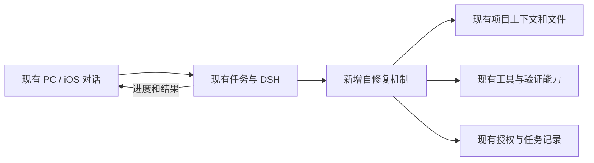
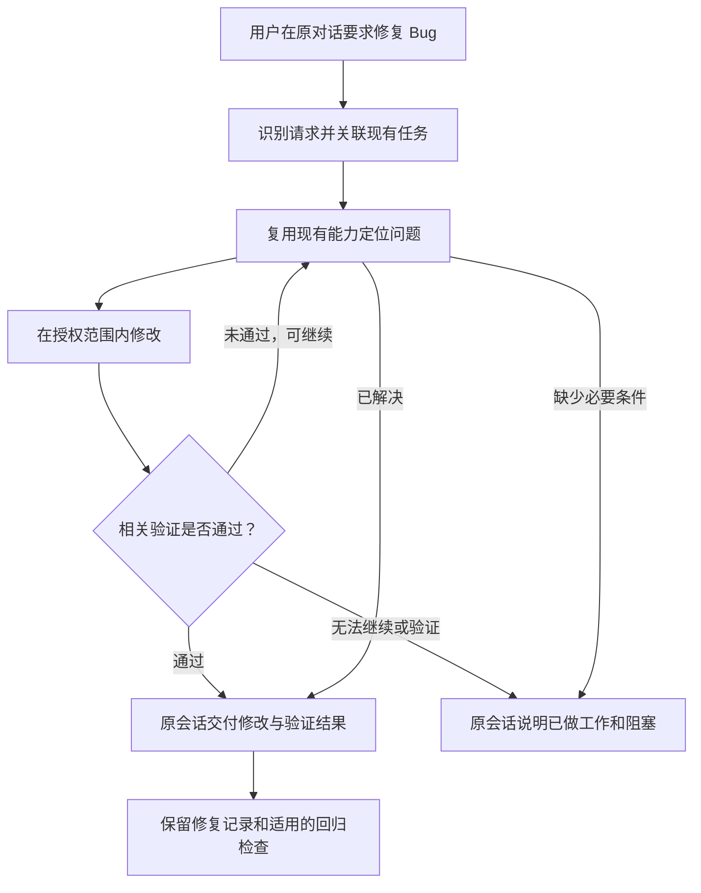

# Morde Bug 自修复机制需求

> 本文是新的需求依据，取代此前的 Bug 自修复设计方案和实施清单。

## 目标与范围

在 Morde 已有能力的基础上，增加一套 Bug 自修复机制：用户在现有对话中说明 Morde 的 Bug 并要求修复后，Morde 自动组织定位、修改和验证，在原会话交付实际结果。

机制复用现有对话、任务、DSH、授权、工具和测试能力，不重新设计现有功能或新增界面，也不预设更换模型或部署方式。用户明确要求修复后，授权范围内的常规工作直接开始，不增加选目录、确认开始或确认应用的步骤。

本次不改界面是指接入自修复机制时不设计或调整界面；以后用户明确要求修复界面 Bug 时，可在该请求范围内修改相应代码。

## 用户体验

用户在现有 `morde-pc` 或 iOS 对话中输入：“帮我修复 Morde 的会话切换 Bug，切换后有时看不到历史消息。”

Morde 开始检查并修复，在当前会话反馈实际进度；完成后说明修改了什么、验证结果以及是否还有未完成项。缺少真正阻碍修复的信息时，才在原会话追问。

## 机制与规则

| 机制 | 作用与行为 |
|---|---|
| **识别与接单** | 识别用户明确提出的 Morde Bug 修复请求，关联当前会话和相应任务并开始处理。普通问答或没有修复、操作诉求的讨论不自动改代码。 |
| **定位问题** | 结合用户描述和已有项目上下文，按授权检查相关代码、日志、现有改动和测试，确定问题及影响范围；不要求用户重复提供已有上下文。无法取得必要信息时说明缺口。 |
| **修复与自我纠错** | 在授权范围内直接修改与 Bug 相关的内容，保留已有工作。验证未通过时，根据失败信息继续排查和调整；达到现有任务限制、无法安全继续或缺少必要条件时停止，并说明已做的工作。 |
| **验证与防回归** | 使用现有工具和适合该问题的检查验证修复，必要时增加或复用回归测试。区分真实通过、失败和未验证；无法复现或无法验证时如实说明，不能只凭 Agent 的判断宣称修复成功。 |
| **结果与经验** | 在原会话说明问题原因、实际修改、验证结果和未完成项；原因未确认时明确说明。将有用的修复与验证记录留在现有任务或项目记录中，供同类问题参考；新任务仍须使用自己的证据。 |
| **持续交互与恢复** | 执行期间，用户可以继续追问、补充要求或停止该任务。断线、重连或恢复沿用现有任务机制，不重复执行已确认完成的操作，也不影响其他任务。 |

修复遵循当前账号、项目、工具和审批的既有规则；用户明确的修复请求是授权范围内开展常规修复的依据，不得因此绕过现有权限或自动批准越权操作。遵守项目“只在本地修改、不外发文件”的要求，不自行上传、发送文件或推送代码。结果须说明实际修改和生效的环境；云端副本的变化不等于 PC 文件已自动更新。

## 机制与现有能力的关系

自修复机制依托现有任务执行，不另建一套任务系统或 Agent Runtime。

## 流程

## 验收条件

1. 在实际 `morde-pc` 中，对一个可复现的 Morde Bug 发出自然语言修复请求；Morde 在原会话开始定位、直接修改授权范围内的相关代码并运行验证，不新增页面、选目录或开始/应用确认。
2. 验证失败时，Morde 能依据失败结果继续排查；无法安全继续或验证时，在原会话说明原因和已完成内容，不把未验证结果说成修复成功。
3. 修复后的相关验证真实通过，结果能对应本次修改；适合自动化的回归检查被新增或复用，不使用旧任务的通过结果代替本次验证。
4. 修复过程中保留用户已有工作，不操作其他未授权项目或电脑，不外发文件；普通讨论不会触发代码修改，其他会话和任务不受影响。
5. 执行中追问、补充或停止能关联正确任务；断线后重连可查看实际状态，不重复执行已确认完成的操作。
6. 同一账号可在原生 iOS 客户端查看同一会话的进度和结果，并可通过现有对话提出新的修复请求；PC 相关行为在实际 `morde-pc` 验收，不用构建或独立浏览器代替。
