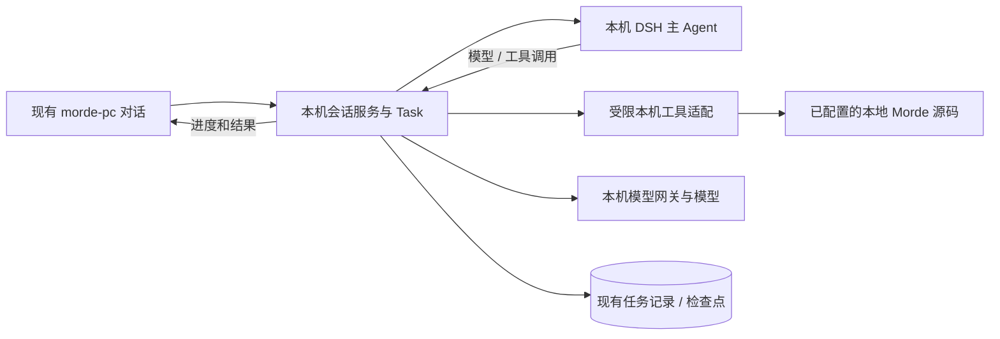
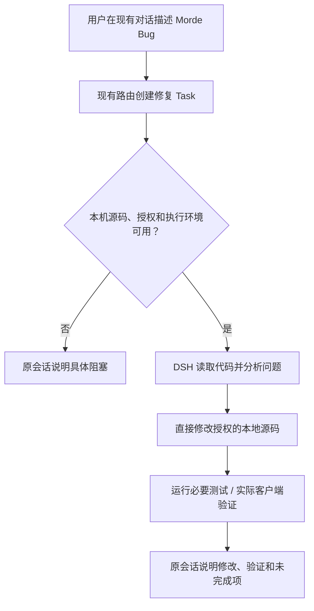

# Morde Bug 自修复精简设计方案

> **已作废：** 本方案不再作为实施依据，请以新的 [Bug 自修复机制需求](Morde-Bug自修复机制需求文档.md)为准。

> 状态：设计建议，尚未实现或完成端到端验收。按用户要求，复用现有对话和任务界面，本次不新增或修改页面、按钮或交互流程。

## 1. 目标与范围

用户在现有 `morde-pc` 对话中说“帮我修复 Morde 的某个 Bug”，Morde 直接理解问题，使用已授权的本机源码进行分析、修改和验证，再在原会话说明结果。明确的修复指令即授权本次范围内的常规本地代码修改和必要测试；不逐项要求选目录、查看差异或确认开始。

首版处理已授权的本机 Morde 开发/测试源码中的 Bug；源码、日志、测试材料及模型输入只留在本机，不上传或发送文件。服务端仍以 DSH 为唯一 Agent Runtime，模型经 Morde 网关接入。本方案不替代第一里程碑的 PC/iOS 对话、云端电脑和文件夹同步。

本次接入自修复能力不修改或重新设计界面。以后用户明确要求修复界面本身的 Bug 时，再按那次请求确定代码改动，并按项目规范验收；这不改变本次范围。

### 用户如何使用

1. 在现有对话输入：“帮我修复 Morde 的会话切换 Bug，切换后有时看不到历史消息。”
2. Morde 直接检查相关代码，能够安全定位时修改并测试；进度继续在原会话中显示。
3. 在原会话说明修改内容、测试结果和未完成项。只有缺少确实阻塞的信息时才追问。

### 现有能力与待接通部分

- **已有代码：** PC 会话消息、Task 路由、DSH、模型网关和工具代理均已有实现；现有文件和终端工具主要面向 Host Workspace。
- **仍需开发和验收：** 让同一套 DSH 和工具代理在授权范围内安全操作本机源码，接通本机模型及必要测试。已有代码不等于这条自修复流程已经跑通。

## 2. 架构图

图中沿用现有用户入口和消息协议；本次修复的会话服务、DSH、网关、模型、源码操作和任务记录在同一可信本机运行。若当前 PC 会话连接的是云端服务，本方案不自动切换服务或迁移会话；本机部署和连接未就绪时在原会话说明阻塞，不发送源码到云端。

## 3. 处理流程

如果描述不足以定位问题，先在授权范围内检查；只有缺少确实阻塞的内容时才追问。若问题已修复或无法安全定位，应说明依据，不为制造改动而改代码。

## 4. 各部分的作用与开发方式

| 部分 | 作用 | 开发方式 |
|---|---|---|
| **现有对话接单** | 用户一句话即可开始，不增加操作步骤。 | 优先沿用现有会话消息与 Task 路由，只补足实际验证出的缺口；沿用消息幂等、用户身份和任务预算。`202` 仍只表示消息已受理；任务创建和实际执行按现有状态显示。 |
| **确定本机源码** | 让 Agent 修改正确的本地 Morde 项目。 | 本机开发服务在部署/启动时固定一个已授权的 Morde 源码根目录和维护者身份；任务启动时校验实际路径、账号、进程和授权版本，不从模型输出或用户文本信任任意路径。目录缺失或本机执行器不可用时在原会话说明，不搜索或切换其他电脑。 |
| **直接修复** | 用户说修 Bug 后，常规改动直接落到本地工作区。 | 将明确的修复请求作为本次受限授权的依据，经现有工具代理接通本机读取、精确代码修改和必要测试；授权绑定用户、Task、目录及版本，并通过现有身份校验和操作记录。隔离条件能保证时，按当前文件内容直接修改，不需要先生成候选再等人工应用。受限工具的授权方式需开发，不能伪造已有逐条审批或放宽其他任务的权限。 |
| **保护已有工作** | 不覆盖用户或其他任务的改动。 | 修改前读取当前文件并记录本次基线；有未提交或未跟踪文件时仍可在现有内容上安全修复，不自动 `stash`、`reset` 或 `clean`。写入前核对目标文件与路径；并发变化或无法排除覆盖时保留已有内容并报告冲突。只允许本次修复相关的改动。 |
| **测试与结果** | 如实说明改了什么、是否解决问题。 | 自动运行相关检查；需要写构建产物时使用与当前源码一致的本机临时副本，避免测试覆盖工作区。影响 PC 的修复从实际 `morde-pc` 验证，影响 iOS 的修复使用原生客户端验证。复用 Task 步骤和原会话回复，汇报改动、测试与未验证项；不能把构建、Agent 自述或浏览器测试冒充真实客户端通过。 |
| **复核与恢复** | 保留现有质量门禁，故障后不重复修改。 | 沿用 Task、操作记录和 DSH 检查点：重连、重试或服务恢复先对账已执行的操作，未知结果不盲目重做。现有独立复核在 Task 完成后运行；无法取得符合要求的本机复核模型时保持 `validation.state=pending` 并如实说明，不阻止已授权的源码修改。 |

### 本机与运行版本边界

- 只接入本机会话服务、模型、源码和受控命令执行；任务记录、模型请求、工具及子进程均不得外发源码、日志或文件内容。隔离或本机模型不可用时直接报告失败或阻塞，不切换远端模型。
- 本次授权只覆盖当前任务在本地源码范围内的常规修改与必要测试；删除用户已有数据、越权操作或其他不可逆动作继续遵循现有规则，不因修 Bug 放开其他工具权限。
- 文件修复与运行版本生效是不同事实。需要运行验证时在本机隔离实例构建和启动；如需重启正在使用的实例，按已有授权和任务恢复机制处理，在原会话说明是否已生效。不新增更新页面或默认部署线上。
- PC 文件夹同步仍是用户手动触发的单向同步；云端副本的改动不会自动回写本机，不能把它当作本地源码修复。

## 5. 验收

1. 在实际 `morde-pc` 现有对话中发送清楚的修复请求，Morde 创建同一 Task 并开始读取、修改已配置的本地源码；过程中没有新增选目录、差异预览或逐项确认步骤。
2. 使用带未提交和未跟踪文件的测试仓库，验证目标文件能在原有内容上安全修改，其他改动不丢失；遇到真实并发冲突时停止相关写入并说明。
3. 运行相应本地测试；受影响的 PC 功能从实际 `morde-pc` 验证，结果回原会话。复核模型不可用时显示待复核，不阻塞已经授权的代码修改、不误报通过。
4. 源码路径、权限、本机模型或隔离条件不可用时，原会话显示具体原因；不访问其他电脑或将文件/内容发往外网。重连和重试不重复执行已确认的修改。

本方案为目标行为。真实本机模型、工具接入和客户端端到端流程不可用时，应记录阻塞或未验证，不能据设计宣称已完成。
