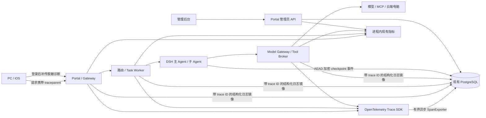

# Morde Harness 可观测系统设计方案

## 1. 目标与现状

在管理后台提供统一的可观测入口，让管理员能从一次 PC / iOS 请求追到服务端、DSH 主/子 Agent、模型、工具、云端电脑和最终交付，定位错误、耗时与资源消耗。覆盖 Harness 各类实际执行事件；记录不存在或不可用时明确显示，不能推断成功。

现有代码已具备 `X-Request-Id`、结构化日志、进程内 Prometheus 指标库，以及由任务、模型、操作、审批等账本构建的[只读 Workflow Trace](../../server/internal/api/admin_workflow_trace.go)。目前没有独立 Prometheus 服务，也没有贯穿客户端、异步任务和 DSH 的分布式追踪。现有 Workflow Trace 的 `trace_id` 是任务流程快照 ID，**不是**本方案的 W3C 分布式 `trace_id`；管理页面需分别标识，通过业务 ID 关联，保留现有接口语义。

DSH 会话事件包含每轮 Agent 消息、模型思考块、工具请求及结果，当前 Worker 也能传递 `reasoning`；这些能力尚未组成管理员可检索的完整视图。[Z.AI 适配](../../server/internal/model/zai.go)能解析 `reasoning_content`；当前 [Responses 适配](../../server/internal/model/responses.go)尚未解析返回的思考摘要，需补齐并按实际模型验收。

## 2. 总体方案

采用 OpenTelemetry Trace SDK 做标准上下文、父子 Span 和异步链接；Portal 用有界 `BatchSpanProcessor` 将低敏 Span 写入**现有** PostgreSQL，并以 zap Core 包装器将带有效 trace ID 的结构化日志经独立有界队列写入 `observability_logs`。日志只保留字段白名单及经凭据 scrub 的消息；Span 与关联日志均保留 7 天。不额外运行 Collector、Phoenix、Loki、Tempo 或 Prometheus 服务。指标复用进程内现有 registry 和任务 / 模型账本。DSH 的完整会话事件直接读取现有 AEAD 加密 checkpoint，管理员页面由 Morde 自己展示，不引入第二个 Agent 可观测平台。Span 属性只存脱敏路由、状态、耗时及关联 ID；完整思考/工具文本不进入 Span，保持 checkpoint 原样加密。所有页面只经 Portal 管理 API 访问，后端和数据库不对客户端暴露。

**资源边界：**现有 4 核 / 8 GiB 主机不增加独立容器或进程，但新增 Span 写入会占用现有 PostgreSQL 资源。必须限制 exporter 队列、单 Span 属性、批量写入、查询超时和 7 天 Span 保留；checkpoint 属于 DSH 恢复数据，不由观测清理任务删除。超过队列/存储门槛时保留业务执行，后台显示缺失原因。主 PostgreSQL 故障仍会影响管理登录和观测查询。

**架构决策已登记：**用户已明确授权在 `server/AGENTS.md` 允许 OpenTelemetry Trace SDK，并同步固定依赖和数据边界；实现状态见[实施 TODO](Morde-Harness可观测系统实施任务todo清单文档.md)。

## 3. 标识与关联

- 每次 PC / iOS 发起请求前创建分布式 `trace_id`，用 W3C `traceparent` 传给服务端；服务端解析、校验并创建子 span。无有效上下文时服务端生成新链路；所有响应通过 `X-Trace-Id` 返回最终 ID。PC 页面、桌面主进程及本地桥接、iOS 和服务端的相关日志均记录 `trace_id`、`span_id`；继续保留 `X-Request-Id` 及其原语义。
- 请求接收、路由和 Task 入队时保存追踪上下文；Worker、DSH IPC、Model Gateway、Tool Broker 和可观测的云端电脑调用继续传递。单个异步任务可沿用来源链路；长任务恢复、重试、多个消息合并或并行分支可以建立新链路并用 span link 关联来源。后续状态查询、SSE 重连和审批请求各有自己的请求链路，通过业务 ID 与原任务关联。持久化消息 / Task / attempt 与链路的多对多映射，支持重启后查询。
- 每次 Worker claim 建立独立的 Task attempt root span，并用 Span Link 指向接受消息的 HTTP span；attempt 使用持久 lease claim version 标识，不把 HTTP span 生命周期伪装成 Task 父 Span。管理员 Trace 详情按 attempt link 合并显示源请求、Task spans 与日志，并保留各 Span 的原 trace ID。
- 同时记录 `user_id`、`conversation_id`、`message_id`、`task_id`、`agent_session_id`、`parent_agent_session_id`、`model_call_id`、`tool_call_id`、`attempt` 等适用字段；普通问答无需 Task 的字段留空。ID 只用于关联，不作为授权、幂等或执行成功的依据。外部传入的追踪头不影响权限或采样策略。
- 客户端请求未送达时保留本地 trace 与脱敏错误，登录后通过有界诊断批次接口补传；无法补传时显示缺口，不伪造服务端记录。客户端本地队列限量/加密并在服务端按当前账号核验，登录前数据保持匿名，不跨账号归属；补传接口不生成递归诊断。

## 4. 采集内容

对已接入范围的链路、执行事件和客户端 / 服务端结构化日志不采样，以 **100% 为采集目标**；每次开始、结束、等待、失败、取消、结果未知及重试均可区分。覆盖率以实际收到的数据和账本核对，不把目标当作无丢失保证。

| 范围 | 主要记录 |
| --- | --- |
| 客户端与请求 | PC / iOS 请求、响应码、耗时、连接 / 重连、投递及接收状态，客户端版本和错误；不记录认证凭据。 |
| 收件与路由 | 消息接收、幂等命中、上下文来源、路由决定及失败、关联或新建 Task、排队与调度。 |
| DSH 与协作 | 主 / 子 Agent 的会话树、每轮思考 / 发言、turn / step、委派与回传；上下文读取与压缩、checkpoint 写入 / 恢复、等待、取消和重试。 |
| 模型与工具 | 每次模型调用的输入、返回的思考内容或摘要、输出、版本、耗时、token / 已知成本；每次工具 / MCP / 技能调用的参数、准入 / 审批、执行过程、输出和错误。区分模型提出调用、实际执行和结果未知。 |
| 验证与交付 | 验证范围、实际结果与缺口，结果持久化、推送 / 客户端接收情况；保留失败、待用户、未知和未验证状态。 |

对模型实际返回的思考文本 / 摘要、Agent 发言、工具文本参数和输出，默认保留经授权和脱敏后的完整内容，按会话、Task、Agent、调用 ID、时间及关键词检索；大文本分页展示，不能只留下摘要。已持久化的内容可引用既有账本，其余存入受控的诊断详情存储，span 只保存引用。文件及截图按授权提供来源引用或预览。过滤在产生源上报前执行，无法安全过滤、超过限制或来源不可用时标注原因与缺口。密钥、令牌、密码和认证头不进入遥测存储。

思考内容须区分“模型返回的思考文本”“模型返回的摘要”和“Agent 显式发言 / 计划”。对支持返回摘要的模型，在允许的配置范围内请求并保存摘要；未开启或模型未返回内部推理时说明原因，不用生成的解释冒充原始思考。中断时保留实际收到的前缀并标记不完整。不同模型的内容可用性须逐一实测，例如 [OpenAI 推理模型](https://developers.openai.com/api/docs/guides/reasoning)不返回原始推理 token，可按支持情况请求摘要。

DSH 接入优先复用当前 `0.2.2-rc.1` 的 `session/event`、checkpoint 和既有 activity / Broker / Model Gateway 边界，增加只读、非阻塞的事件投影；保留 Agent Runtime 唯一性及原有权限、审批和操作账本。[同版本上游 `dsh-session-telemetry-otel`](https://unpkg.com/@deepseek-ai/dsh-session-telemetry-otel@0.2.2-rc.1/README.md)仅支持反馈触发或禁用，不能覆盖持续全量采集，也不能伪造反馈绕过其授权。新增适配前检查依赖与许可证，遥测出口只指向 Morde 内部。

## 5. 管理后台

在现有管理后台新增“可观测”入口，样式遵循 Morde UI 规范：

1. **概览：**请求 / 任务量、失败率、耗时分位数、排队与审批等待、模型 token / 成本、工具失败和采集缺口趋势。
2. **链路检索：**按时间、`trace_id`、请求 ID、用户、会话、消息、Task、Agent、模型、工具、状态或错误码筛选；从结果进入链路详情。
3. **链路详情：**展示请求到交付的时间线和 span 树、主子 Agent 关系、阶段耗时、关联日志及业务账本；支持跳转相关重试、恢复和其他来源链路。运行中的状态取自业务事实，不能等待长 span 结束才显示。
4. **诊断详情：**按顺序展开每轮模型实际返回的思考、Agent 发言、工具参数 / 过程 / 结果及后续模型反应，展示并行子 Agent 和失败重试；明确标记未发生、未接入、已截断、丢失及结果未知。管理员可以从现有 Workflow Trace 跳到关联链路，反向亦可。

所有页面及查询、详情 API 在服务端校验管理员身份；隐藏菜单不代替鉴权。记录管理员查看详情的审计信息，不将查看内容写入审计日志。非管理员不能通过 API、存储端点或猜测 ID 访问。

管理员 API 包含 `GET /api/admin/observability/traces/{trace_id}/logs`，按 trace 必选、request/task 可选过滤并使用不透明游标分页；空结果、队列丢弃、写入失败和查询错误分别提供 coverage 原因，不允许用空数组暗示完整。

## 6. 可靠性与保留

- OpenTelemetry SDK 使用有界 `BatchSpanProcessor`；自定义 exporter 复用现有 pgxpool、单事务批量写入并限制 SQL 超时。Span 失败或队列满不阻断业务，健康接口 / 管理页面报告 dropped/error 和不完整范围。Span 写入/查询必须有独立连接预算或并发门槛，不能耗尽业务连接池。
- 结构化日志镜像使用一个后台 writer、512 条非阻塞队列、每批最多 64 条、单条属性最多 8 KiB 和 3 秒 SQL 超时；关闭时先排空。只存有效 trace ID 日志，未关联日志继续留在 stdout；队列或数据库故障不阻断请求并在 coverage 中显示缺口。
- DSH checkpoint 事件以 `(task_id, agent_session_id, seq)` 去重，管理员只读端校验授权、AAD、digest 和连续水位；只允许读取已提交 checkpoint。恢复 checkpoint 原文密文不被观测系统改写。最后 checkpoint 之后的数据、进程崩溃前尚未 flush 的内容和无法解密的数据均显示缺口原因。
- OpenTelemetry Span 与关联日志保留 7 天，定时批量清理只作用于 `observability_spans`、`observability_logs` 及两类 trace link 表；业务账本和 DSH checkpoint 按既有保留规则处理。请求量、错误率和耗时趋势由 HTTP Span 计算，进程重启后历史保留在表中；没有足够 Span 或日志覆盖时显示 `partial`，不能用零填充。主机资源历史不作为首期能力。Span 标签使用有限维度，用户、任务及 trace ID 仅作查询字段。

## 7. 实施顺序与验收

1. 完成架构约定与固定依赖；打通 PC / iOS → Portal 的 `trace_id`、本地 PostgreSQL Span 存储与管理员检索。
2. 贯通异步路由、Task、DSH 主 / 子 Agent、模型、工具和交付，复用账本及 Workflow Trace，补齐缺口核对与恢复关联。
3. 完成概览、详情、权限、脱敏和采集健康监控，按实际吞吐调整容量与保留时间。

验收时分别从实际 `morde-pc` 和 iOS 发起请求，用同一 `trace_id` 找到客户端和服务端日志；对一个含子 Agent、模型、工具与交付的真实任务，逐轮对照 DSH checkpoint 中模型实际返回的思考、工具调用参数 / 结果、Span 和业务账本，验证检索与缺失提示。再验证失败、审批等待、取消、重试 / 恢复、客户端离线、Span 导出失败和队列满：关联不断链或明确显示缺口，业务不重复执行；非管理员查询被拒绝，敏感内容未泄露。PC 受影响交互必须使用实际 `morde-pc` 验收。

参考：[OpenTelemetry 上下文传递](https://opentelemetry.io/docs/concepts/context-propagation/)、[span link 与异步链路](https://opentelemetry.io/docs/specs/otel/trace/data-model/)、[Harness 总流程](../muse_docs/muse_steps/Morde%20复刻%20Muse%20最终流程与开发设计.md)。
