# Morde Hermes 会话与上下文机制移植设计方案

> 状态：移植设计草案；本地已有 Hermes 源码快照，待确认版本并做逐模块对照。 
> 日期：2026-11-21 
> 范围：Morde 服务端会话、上下文装配、摘要压缩、历史恢复、并发和 DSH Runtime 适配。 
> 约束：本方案移植 Hermes Agent 的机制与代码逻辑；Morde 仍只使用 DSH 作为 Agent Runtime。

## 1. 结论

应该借鉴 Hermes 的**单一持久会话、有限上下文投影、双层压缩、原文检索恢复、稳定会话 ID、按会话互斥与安全提交**这一整套机制，而不是只调整某条消息的长度上限或错误文案。

迁移原则是：**能复用 Hermes 的流程、数据语义、边界和失败状态就按其实现；只替换 Morde 必须不同的基础设施接口。** Hermes 的 Python Agent Loop、Gateway、SQLite 和工具运行时不直接搬进 Morde。Morde 的 Agent Loop 仍由 DSH 执行；PostgreSQL、现有会话/任务/检查点、授权和事件机制继续作为事实源。

目前 `project/hermes-agent/` 已有 Hermes 源码，但没有独立 Git 元数据，无法确认上游 commit。本文基于官方资料并核对了部分本地关键模块，仍未完成逐行代码对照。编码前应确认来源版本或记录关键文件哈希，并更新下文的模块映射、默认值和兼容性结论。

## 2. 目标与当前问题

目标是让 PC 与 iOS 的每条消息都能独立受理、正确关联到长期会话，并在历史超过模型窗口后仍然做到：

- 当前请求有界地进入模型，而不是把整段历史原样塞入 Prompt。
- 摘要用于维持连续性，原始消息和工具结果仍可按授权查回。
- 压缩、检索或并发写入失败时，不丢历史，也不把不完整上下文伪装成完整。
- 一条很长的旧消息不会让后续短消息失效；消息因果关联不变成会话发送锁。
- 同一 DSH Session 的历史读写保持一致；不同会话/任务仍可并发执行。

### 2.1 已观察到的根因案例

此前“先发一个大问题，再说‘你用英语回答我’”得到“消息上下文暂时无法读取”，不是英文指令本身有问题。排查记录显示，后续消息仅 21 字节，而它尝试关联的上一条用户消息有 18,017 字节；当前路由快照读取路径在 `server/internal/store/postgres/conversation_route_actions.go` 对候选正文设有 4,096 字节拒绝条件，Worker 再将读取失败映射成通用 `routing_context_unavailable`。因此，一条旧消息的大小能够让新消息无法分类。

这暴露的是上下文机制的边界混用：**因果关联候选被当成模型上下文，历史正文大小又被当成会话可用性的门槛。** 不能只把 4,096 改大；那会把更大的正文继续塞入路由请求，也不能解决长期会话、历史找回、并发快照和摘要一致性问题。

### 2.2 Morde 已有能力与缺口

| 能力 | 当前实现基线 | 本方案处理 |
|---|---|---|
| DSH 同一任务会话内压缩 | `runtime/morde-cloud-runtime/src/engine.mjs` 注册 DSH `BasicCompactionEngine` 适配，含上下文容量校验、摘要模型调用和检查点落盘 | 继续由 DSH 负责；对照 Hermes 算法调整 Morde 适配，不增加第二个 Agent Loop |
| 跨 Task 会话摘要与历史快照 | PostgreSQL 中有版本化摘要和任务对话上下文；新 Task 会装配摘要、近期记录和当前请求 | 明确摘要的覆盖范围、版本和源消息序号，压缩与读取都按同一稳定会话身份处理 |
| 当前会话历史搜索 | 已有 `morde_current_conversation_history_search`，并按 Task 的会话、账号、项目权限限制 | 复用并对齐 Hermes 的“摘要是索引、原文可查”流程；不新建第二个历史搜索库 |
| 路由前序关联 | 以 `PreviousClientMessageID` 及候选消息帮助路由判断 | 该 ID 只作消息因果线索；不得因旧正文过长而阻断独立的新消息 |
| 并发 | 路由消息和多个 DSH coordinator 可并发；任务槽位另行限流 | 保留消息受理/路由并发；只对共享的同一 DSH Session transcript 加会话级租约 |

## 3. Hermes 机制基线

本节记录设计时可查到的 Hermes 行为；实现搬运时以之后放入 `project/` 的固定源码 commit 为准。

### 3.1 会话是事实源，模型上下文只是投影

Hermes 将完整对话作为持久 Session 保存，由 Gateway 作为 transcript 的唯一写入者；其他 CLI、桌面端、API 和后台 Worker 把消息提交给会话所有者。模型请求只携带当前 Context Window 所需的系统信息、当前消息、近期上下文和显式召回内容，不会每次把历史全量重放。压缩和摘要不能删除原始会话记录。

**映射到 Morde：** 一个 Morde `conversation_id` 是 PC/iOS 共用的稳定逻辑会话；服务端 PostgreSQL 是原始消息事实源；DSH Session/Checkpoint 是执行状态和任务上下文，不取代会话历史。客户端断线、Task 创建、Task 完成、上下文压缩都不生成“新会话”或丢掉前文。

### 3.2 双层压缩

Hermes 使用两道独立保护：

1. **会话入口 Hygiene**：Agent 开始处理新消息前，用上次 Provider 实际 Token 用量、持久用量锚点和保守估算依次估计上下文压力；较高阈值作为防止空闲期间历史增长导致 API 超限的安全网。公开配置说明的阈值为上下文容量的 85%。
2. **Agent 内 Context Compressor**：Agent 执行期间优先基于 Provider 返回的实际 Token 用量，在较低阈值启动常规压缩；公开默认值为 50%，并支持模型级阈值和绝对 Token 上限。没有实际用量时使用有标识的估算值，不把估算伪装成真实 Token 数。

**映射到 Morde：** 入口保护处理跨 Task 的历史投影；DSH `BasicCompactionEngine` 处理单个 DSH Session 的运行中上下文。两者范围不同，不可相互替代。Hermes 的 85%/50% 是目标行为基线；DSH 当前适配使用 0.8 自动压缩，实施时应在 DSH 插件真实支持的参数下逐项比对，并决定是否覆盖为 Hermes 默认值。不得同时运行两套 in-loop compressor。

### 3.3 Lean 摘要和恢复指针

Hermes 的 `lean` 压缩策略保留受限的近期 Tail，并用同一次摘要生成保留会话连续性信息：

- 结构化记录目标、决策、任务状态和结果。
- 用程序规则提取 PR 编号、SHA、路径、错误文本等精确锚点，不要求模型改写这些字符串。
- 在预算内按新到旧保留真实用户原话，避免摘要改写需求。
- 明确留下 `session_search` 恢复入口，能从压缩过的概览跳回原始消息。
- 过长的历史区域可带省略标记送入摘要，不因单条历史过长就拒绝整个会话。

**映射到 Morde：** 复用现有会话摘要和 `morde_current_conversation_history_search`。摘要中保留源消息 ID/序号、覆盖边界和“不完整”状态；工具搜索返回原文摘录、消息 ID、时间和分页状态。旧消息继续受当前用户、会话、项目与 Task 授权约束；不照搬 Hermes Profile 级跨用户搜索权限。

### 3.4 原位压缩、保留原文、先计划后提交

Hermes 默认在同一个稳定 Session ID 内替换活动上下文中的已摘要中段，旧记录软归档但仍可检索。压缩规划是只读的；只有摘要生成成功后才提交压缩变更。被移出活动上下文的工具结果会保留原始内容，并用可追溯的引用替代上下文中的大结果。准备中的摘要只有在同一 Session、覆盖边界和消息结构仍匹配时才能拼接使用。

**映射到 Morde：** 不改 `conversation_id`；用户消息、任务事件和原始工具/产物按现有存储保留。跨 Task 摘要使用版本号、源序号范围和摘要校验值；DSH 内压缩继续以 DSH 检查点为写入单位。所有异步/后台摘要在提交前校验当前摘要版本、消息水位和授权版本；基线已变化就丢弃旧摘要或重新规划，禁止覆盖新消息或新授权状态。

### 3.5 Session Search 与忙碌输入

Hermes 的 Session Search 提供发现、在命中消息附近翻页、读取会话，以及大历史的头尾视图；搜索结果是原始消息视图，不是新生成的摘要。Gateway 对同一解析后的 Session ID 使用 Turn Lease，串行化 `[读取历史 → 执行 → 写回]`，避免多个路由别名同时写坏同一个 transcript；不同 Session ID 各自独立。忙碌输入有 redirect/steer、queue、interrupt 等处理方式，语义区分“继续引导当前工作”“排队作为下一轮”和“硬停止”。

**映射到 Morde：** 复用已有授权历史搜索与分页契约；对 DSH Session 采用以解析后的 `session_id` 为键的租约/栅栏，不按客户端路由键或前序消息 ID 加锁。Morde 消息仍先幂等落库并立即给出受理状态；独立 Task 可并行。新消息是追问/修改、停止某个 Task，还是新工作，按现有主 Agent 路由契约识别；只有明确属于同一可变 DSH Session 的执行回合才依赖该 Session 租约。必要时使用“排队/在安全边界引导/停止指定任务”的语义，不把模型执行占用变成消息拒收。

### 3.6 失败冷却与压缩恢复

Hermes 对摘要超时、空响应、长度截断和 Provider 证明的上下文溢出分别处理；失败时有按 Session 持久化的冷却，避免每轮重复撞同一故障。Provider 明确报 Context Overflow 时允许有限次绕过常规冷却做恢复压缩。摘要输出未完整结束时不会直接把它当成有效摘要。

**映射到 Morde：** 首次压缩失败不得覆盖旧摘要或继续宣称历史完整；保留原文、记录可重试失败状态，并对重复失败做有上限的冷却/退避。Context Overflow 允许一次有界恢复压缩。若项目已有可验证的确定性降级摘要，可附显式“不完整/需查原文”标记；否则将当前输入保留为可重试状态，明确报错，不静默跳过历史。错误码应区分摘要服务失败、超限、版本冲突、权限失效和会话记录不可读。

## 4. Morde 目标架构

下图中的浅蓝、冰淇淋蓝和石板灰使用 Morde 冰淇淋蓝规范的色板。长期历史仍在服务端；PC 和 iOS 只提交消息并查看进度/结果。

```mermaid
%%{init: {"theme":"base","themeVariables":{"primaryColor":"#DBEAFE","primaryTextColor":"#334155","primaryBorderColor":"#60A5FA","lineColor":"#60A5FA","secondaryColor":"#F8FAFF","tertiaryColor":"#EFF6FF","fontFamily":"Inter, -apple-system, BlinkMacSystemFont, sans-serif"}}}%%
flowchart LR
  C[PC / iOS 客户端] -->|幂等消息 ID| API[服务端会话入口]
  API -->|身份授权 / 顺序号 / 原文追加| DB[(PostgreSQL 会话原文)]
  DB --> PRE[入口 Hygiene 与上下文预算]
  PRE --> PROJ[Context Projection：摘要 + Tail + 锚点 + 检索片段]
  PROJ --> ROUTER[会话协调 Agent：DSH Coordinator]
  ROUTER -->|普通对话或结果汇总| REPLY[持久化回复]
  ROUTER -->|创建独立工作| TASK[会话下的 Task：可有多个]
  ROUTER -->|查询 / 修改 / 停止指定任务| TASK
  TASK --> RUN[该 Task 的 DSH 执行 Agent]
  RUN -->|按需调用| TOOLS[工具 / DSH 子 Agent]
  TOOLS -->|执行结果| RUN
  RUN -->|任务状态与结果| TASK
  TASK -.结果事件触发协调.-> ROUTER
  RUN -->|检查点 / 压缩| CP[(DSH Checkpoint / 工具结果)]
  PROJ -.缺少旧细节时按授权检索.-> SEARCH[当前会话历史搜索]
  SEARCH --> DB
  TASK -->|任务进度| C
  REPLY --> C
  classDef blue fill:#DBEAFE,stroke:#60A5FA,color:#334155,stroke-width:1.5px;
  classDef pale fill:#F8FAFF,stroke:#93C5FD,color:#334155,stroke-width:1.5px;
  classDef ink fill:#EFF6FF,stroke:#60A5FA,color:#334155,stroke-width:1.5px;
  class C,API,PRE,PROJ,ROUTER,REPLY blue;
  class DB,CP pale;
  class TASK,RUN,TOOLS,SEARCH ink;
```

### 4.1 组件职责

1. **会话入口与 PostgreSQL**：验证 Owner/Actor/Conversation/Project 权限；通过 `client_message_id` 幂等写入原始消息；分配稳定序号；持久化后即确认受理。该事实源不随压缩改变。
2. **入口 Hygiene 与 Projection Builder**：读取本模型上下文窗口和 Token 预算；选择最新摘要、有限近期 Tail、活跃 Task 摘要及必要检索片段。旧消息 Candidate 不能因为正文大小直接判定会话不可用。
3. **主 Agent 与 DSH**：主 Agent 和子 Agent 均在 DSH 中运行。主 Agent 判断普通回复、澄清、任务更新/停止或新任务，并汇总实际任务结果；Task 有各自的 DSH Session/Checkpoint，可并行。
4. **摘要与压缩**：跨 Task 会话摘要服务与 DSH Session 内 compaction 按各自边界工作；通过模型网关总结，不调用工具、不修改历史事实源。
5. **原文检索**：缺失具体事实时，DSH 可调用现有的当前会话历史搜索工具，按消息 ID 和时间返回有限原文；结果须标记为引用/不可信用户数据，不能当作系统指令。
6. **租约与栅栏**：仅保护同一解析 DSH Session 的 history read/run/flush 区间，以及会话摘要的并发提交；不持有全局 Agent 锁，不按整个账号串行化。

#### 会话、消息和任务的关系

| 对象 | 关系与职责 |
|---|---|
| 会话 | 用户持续对话的容器，拥有消息历史和零个或多个关联 Task。PC 和 iOS 可以接续同一会话。 |
| 消息 | 属于一个会话；可以直接得到回复，也可以发起新任务或关联已有任务。多条后续消息可以查询、修改或停止同一任务。 |
| 会话协调 Agent | 基于当前消息、授权历史和任务状态作出路由决定。任务运行时，它仍能处理后续消息；它是会话层的逻辑职责，不表示必须常驻同一个进程或持有同一个 DSH Session。 |
| Task | 一个可持续跟踪的工作单元，记录目标、状态、授权、事件和结果；同一会话中的独立 Task 可并行，实际资源冲突或依赖关系另行约束。 |
| 执行 Agent、子 Agent 和工具 | Task 内的 DSH 执行 Agent 按需调用工具或委派 DSH 子 Agent。子 Agent 有自己的执行会话，但归属于该 Task；一次工具调用或一个子 Agent 不自动等于一个新的用户 Task。 |

例如：用户先说“整理报告”，形成任务 A；执行中再说“报告改用英语”，这条消息在目标设计中应关联 A，并按安全边界送达正在执行的 Agent；随后说“讲个笑话”，可以直接回复而不创建任务；再说“另外整理预算”，可形成独立任务 B。A 和 B 的状态分别记录，停止 A 不应停止 B。任务进度进入任务详情，最终结果按实际来源关联到会话，由会话协调 Agent 在需要时汇总给用户。

**当前代码基线：**会话消息中已有 `TaskID`、`RelatedTaskID` 和结果来源字段，[Task 有 `ConversationID` 与 DSH Session 标识](../../server/internal/domain/task/types.go#L141)。路由实现区分直接回复、新建、关联、更新、状态和停止等动作，见[路由动作](../../server/internal/store/postgres/conversation_route_actions.go#L942)。当前每条分类消息使用独立 DSH coordinator session；Task 完成后的结果汇总通过结果事件再次进入协调路径，见[结果汇总入队](../../server/internal/store/postgres/conversation_result_review.go#L28)。因此上图的“会话协调 Agent”表示同一会话的逻辑职责，而不是证明一个常驻的主 Agent 实例一直等待 Task。

当前代码还有一个实质差异：[修改任务的路径](../../server/internal/store/postgres/conversation_route_revisions.go#L21)会先隔离旧执行、请求暂停并取消该任务仍在运行的子 Agent 和连接器操作，待停止得到确认后再应用新版本。它不是不中断的实时引导。一个消息是否进入这条路径取决于路由分类；不能断言所有语言要求都会触发暂停。

目标设计应按意图区分：

1. **普通对话或回答语言偏好**：直接回复或保存会话偏好，不因为正在运行任务就重启该任务。
2. **查询任务进度**：读取指定任务状态并回复，不改变执行状态。
3. **补充或轻量修改已有任务**：将消息关联到目标 Task，优先在 DSH 支持的安全边界投递给执行 Agent，并记录是否已接收；不能保证安全接入时明确等待或使用受控版本切换。
4. **需要替换执行计划的修改**：按任务版本隔离、停止确认和恢复流程处理，只影响目标任务及真实依赖它的工作。
5. **独立新工作或停止**：新工作建立独立 Task；停止仅作用于指定任务，不停止其他独立任务。

第 3 项是目标行为。当前版本 DSH 的 Agent 接口已有 `steer()` / `followup()` 和持久化收件箱；Morde 的 `message_delivery` 通道当前使用 `followup()`，仍需扩展以支持 `steer()`，并校验授权、执行版本、投递确认与中断恢复。上面的当前暂停路径不能当作已经实现了该行为。跨端同步和并发效果也需按目标验收。

### 4.2 与 Hermes Agent、DS-Bot 和 nanoMuse 的对话流程对比

[打开四种 AI 对话处理流程图（冰淇淋蓝 HTML）](ice-cream-blue/morde-ai-conversation-architecture-comparison.html)

图中的 Morde 流程突出会话、协调 Agent 和多个 Task 的关系；三个参考项目的流程按入口、会话、上下文、Agent、工具和结果排列。Morde 是**目标设计**，不代表图中的全部能力已落地；其他三条是所核对范围内的实现概括。直答无需创建 Task，工具或协作结果回到所属执行上下文。

| 对比维度 | Morde 目标 | Hermes Agent | DS-Bot | nanoMuse |
|---|---|---|---|---|
| 入口和会话 | PC/iOS 经服务端鉴权、幂等受理；PostgreSQL 保存产品会话，Task 有各自的 DSH Session | 多个客户端经 Gateway 操作同一权威 Session；SQLite 保存会话 | 用户与 Bot 或群聊交互；长期 Bot 对话由一段或多段 DSH Session 承载 | 每个 Thread 有收件箱、Worker 和 MuseAgent；有事件时间线及本地会话文件 |
| 模型上下文 | 按预算装配会话摘要、近期记录、当前输入和按需取回的原文；DSH 运行中另处理本 Session 压缩 | Gateway 前置 Hygiene 与 Agent 内压缩两层保护；默认原位压缩，保留尾部、锚点和恢复指针 | 达到检查线后，独立上下文管家判断继续原位检查点还是切到新段并交接 | `context_messages()` 默认选择最近 80 条消息并处理工具调用边界，图片数量另有限制；系统提示还注入相关记忆 |
| 历史找回 | 目标是复用当前会话历史搜索，按消息 ID/序号、授权范围和分页结果取回原文 | `session_search` 查询 SQLite 中的真实消息，包括默认原位压缩前的记录 | `read_own_chat` 搜索 Bot 私聊各段，索引来自 DSH Session 日志；可按锚点读附近消息 | 本次核对的 `context_messages()` 是近期窗口；`recall_for()` 注入相关记忆。不能把这两者等同于对全部旧会话原文的检索 |
| Agent 与协作 | 主 Agent 和子 Agent 只使用 DSH；独立工作使用独立 Task/Session | 由 Hermes 自身的 AIAgent 执行；`delegate_task` 可启动隔离上下文的子 Agent | Bot 使用 DSH Agent；`message_bot` 将工作交给另一个 Bot，回复作为后续消息返回 | 本地 Python `MuseAgent` 执行模型—工具循环；工具经 Sentinel 检查。设备委派等工具有各自的目标和限制 |
| 运行时新消息 | 目标是先受理，再识别追问、修改、停止或独立新任务；不拿前序消息当发送锁 | 同一解析 Session 的读取、执行和写回受 Turn Lease 保护；忙碌输入可 redirect、queue 或 steer | 可向工作中的 Bot 发引导，独立工作可排队；Bot 间消息根据投递语义异步返回 | 普通追加入队可在下次模型调用前被合入当前回合；指定单次模型或后台投递的消息等待单独回合 |
| 恢复与记录 | 目标是消息、Task 事件和 DSH 检查点可追溯；重连重试不重复执行 | Session transcript 持久化；默认原位压缩保留旧记录并可搜索 | DSH Session 日志与 DS-Bot 的 `inflight.json` 共同支持中断回合和未领取消息恢复 | 时间线记录 UI 事件；Agent 会话文件在 `run()` 收尾时保存，加载时修复悬空工具调用。这里不推断运行中崩溃具备完整的持久队列保证 |

**对 Morde 的取舍：**沿用 Hermes 的稳定产品会话、原文搜索、压缩和会话写入一致性；参考 DS-Bot 的工作未完成时保留连续上下文、跨 Agent 结果作为消息返回的做法；参考 nanoMuse 在运行期间接收用户补充的交互。DS-Bot 的“换段”是 DSH Session 级策略，不能直接理解成更换 Morde `conversation_id`；是否采用换段应在核对 DSH 检查点、恢复和授权后单独决定。nanoMuse 的 Python Agent Loop 仅作交互参考，Morde 仍使用 DSH。

**核对依据与版本：**

- Hermes：[Session Storage](https://hermes-agent.nousresearch.com/docs/developer-guide/session-storage)、[Context Compression](https://hermes-agent.nousresearch.com/docs/developer-guide/context-compression-and-caching)、[Messaging Gateway](https://hermes-agent.nousresearch.com/docs/user-guide/messaging)、[`turn_lease.py`](https://github.com/NousResearch/hermes-agent/blob/main/gateway/turn_lease.py) 和 [Subagent Delegation](https://hermes-agent.nousresearch.com/docs/user-guide/features/delegation)。本地 `project/hermes-agent/` 目前没有可核对的源码 commit。
- DS-Bot：本地仓库 commit `a66cc737cfb6c3d8a2597e748cded6cab1206dd3`；[上下文管家](../../project/DS-Bot/ds-bot/src/host/steward.js#L1)、[会话分段](../../project/DS-Bot/ds-bot/src/host/parts.js#L1)、[历史搜索](../../project/DS-Bot/ds-bot/src/host/chat-index.js#L1)、[Bot 间消息工具](../../project/DS-Bot/ds-bot/src/host/tools.js#L167) 和 [中断恢复](../../project/DS-Bot/ds-bot/src/host/resume.js#L1)。
- nanoMuse：以 Morde 仓库内 `clients/desktop/nanomuse` 为核对对象；[Agent 窗口、收件箱和保存](../../clients/desktop/nanomuse/agent/core.py#L57)、[线程受理与 Worker](../../clients/desktop/nanomuse/server/service.py#L1098)、[默认窗口配置](../../clients/desktop/nanomuse/config.py#L220) 和 [设备委派工具](../../clients/desktop/nanomuse/tools/devices.py#L424)。该目录不是独立的上游 Git checkout，本次不推断其他 nanoMuse 版本的行为。
- Morde：[DSH Runtime 适配](../../runtime/morde-cloud-runtime/src/engine.mjs#L1127)、[当前会话历史搜索工具](../../server/internal/app/cloud_dsh_history_tools.go#L31) 和 [统一技术设计](Morde-PC与AI对话统一技术设计.md#3-目标架构)。

## 5. 上下文构建与压缩算法

### 5.1 一次请求的上下文构成

装配上下文时只组合：

1. 版本化系统指令、模型和工具定义；
2. 当前用户请求（完整或明确分块/摘要后的表示）；
3. 当前消息序号之前、符合授权的最新摘要；
4. 按 Token 预算从新到旧选取的近期完整消息组，至少保留最近的真实用户消息；
5. 按需取回的历史原文片段和活跃 Task 的状态摘要；
6. 明确的省略标记、覆盖范围和搜索恢复指针。

`PreviousClientMessageID` 是因果线索，不是“必须原文注入”的承诺。路由器不得沿前序 ID 链递归读取并把所有前序正文直接放进模型输入。独立的短消息（如“用英语回答我”）要能够基于稳定会话摘要和最近上下文正常处理；旧消息很长时，摘要与历史检索承担连续性。

当前用户输入即使很大也先持久化，不能套用“历史候选超限”规则。需要压缩当前输入时，保留原文和稳定消息 ID，生成带覆盖标记的分段/摘要，并允许 Agent 对未覆盖部分检索；确实无法在模型预算内安全表示时返回明确、可重试的限制状态。

### 5.2 自动压缩步骤

1. **测量**：优先用当前模型的实际 `prompt_tokens`；未提供时用带 `estimate` 标识的保守估值。计入系统提示、工具 Schema、近期消息、图片/附件估值和 DSH Checkpoint 中模型可见的内容；不把不透明二进制按字节误算成 Token。
2. **入口保护**：消息进入 Agent 前，如果最近一次 Token 锚点加新增消息估值显示接近硬窗口，运行一次入口 Hygiene；默认阈值行为按 Hermes 当前 85% 参考值对齐。
3. **正常触发**：模型执行中按 Hermes 当前 50% 默认阈值行为启动常规 Context Compressor，支持模型特定窗口/阈值和绝对上限；具体值通过 DSH 插件配置实现，不另写第二套 Agent 循环。
4. **廉价修剪**：先对已结束、可回查的大型工具结果做摘要 Stub，保留工具调用 ID、结果 ID 和原文存储引用；不得破坏工具调用/结果配对。
5. **规划压缩窗口**：只读选择待摘要中段，保护最近 N 条消息、至少一条真实用户消息，并按工具调用组边界裁剪。当前 Hermes `lean` 尾部策略（约窗口 2.5%，10K 下限、25K 上限）作为上游默认算法参考；Morde 应从本地 DSH 插件实际限制重新校准，不能为了照搬数字突破模型窗口。
6. **生成摘要**：通过模型网关发起无工具摘要请求；保留目标/约束/决策/事实/未完成项/Task 与产物 ID/明确错误/来源消息 ID。机械提取精确锚点；在摘要预算内保留真实用户原话。摘要需要有明确覆盖起止序号和可检索原文指针。
7. **验证**：检查 Provider 正常结束、摘要非空、输出在预算内、来源序号连续、上下文身份与授权版本一致；失败的部分摘要不能生效。
8. **原位提交**：在同一 Morde `conversation_id` 中更新摘要版本和覆盖水位；事务内核对读取时的 summary generation、through sequence、source digest。若有新消息/并发更新，丢弃或重算，不能覆盖更新后的状态。
9. **恢复**：摘要以外的细节通过当前会话历史搜索取回；搜索结果附消息 ID/时间/局部前后文和 `partial` 标记。Agent 依据证据作答，不能根据摘要臆造。

### 5.3 不完整与失败的语义

- 原始消息永久按现有保留策略留存；压缩不删除、不重写用户原文。
- 摘要失败时保留旧摘要和原文，给当前路由安排有限重试/冷却；不得以旧摘要假装覆盖到最新序号。
- 检索权限失效、历史损坏、摘要覆盖中断、模型窗口未知等情况分别记录，不统一伪装成“消息上下文暂时无法读取”。
- 对用户承诺的状态区分“消息已收到”“处理中/可重试”“历史部分可用”“已回复”；消息受理与 Agent 完成分离。
- 若只有估算 Token 数，则日志、任务详情和诊断都必须标为估算；模型 Provider 的硬超限可触发一次有界压缩恢复，不能无限重试。

## 6. 并发与会话一致性

Hermes 的 Turn Lease 解决的是**同一个已解析 Session transcript 的读写竞态**，不是“上一条消息必须确认之后下一条才能发送”，也不是全局并发限制。Morde 应保留这一层次区分：

| 资源/边界 | 并发规则 |
|---|---|
| PC/iOS 消息受理 | 立即幂等追加；用会话内服务端序号形成确定顺序；不等待前一条 Agent 完成 |
| 路由分类 | 保留现有独立消息并发；使用消息自己的 DSH coordinator session 和版本化快照 |
| 同一 DSH Session | 以解析后的稳定 `session_id` 获取租约，串行化 `[load history → run → flush]`；在 `finally` 释放，只允许当前租约 token/generation 的持有者释放 |
| 不同 DSH Session/独立 Task | 各自租约、Checkpoint 和 Task 状态，可并行；并发容量只在实际运行资源处限流 |
| 同一会话摘要 | 使用数据库事务/版本 CAS/栅栏 token 防止旧摘要覆盖新消息；后台摘要与前台写入可并行计算但需校验后提交 |
| 用户意图关系 | `PreviousClientMessageID` 仅作路由证据；消息相同也不能作为会话锁。追问、修改、独立新任务和停止按明确 Task ID/消息关联处理 |

Morde 服务可能有多个 Worker/Runtime 进程，因此不应直接复制仅进程内有效的 Python `asyncio` 锁。照搬的是 Hermes 的**锁定键、获取时机、租约持有范围、超时 fail-closed、身份校验释放和空闲回收语义**；存储原语适配 PostgreSQL 事务/租约或已有的跨进程 Worker 锁。租约等待超时只能阻止进入冲突的 Session 写入区，不能撤销已持久化消息，也不能阻止其他独立会话和 Task。

新消息到达时，客户端能继续发送且服务端能先受理。任务运行中，Morde 主 Agent 可按用户意图将消息解释为引导当前 Task、排队的下一轮、独立新 Task 或停止指定 Task；选择不明时澄清。正在执行的电脑/工具调用到达安全边界后再应用修改；“等待同一 DSH Session 租约”不能向用户显示为前序消息未确认。

## 7. DSH 与 Morde 的边界

### 继续使用

- DSH Agent Loop、工具调用、子 Agent、MCP、会话投影、检查点/恢复和 `BasicCompactionEngine`。
- Morde 模型网关、PostgreSQL 原始消息/摘要/Task 事件、权限、授权、审批、日志、产物和多端 API。
- 当前会话历史搜索工具、其 Task Scope 权限和带签名的分页 Cursor。

### 不直接移植

- Hermes Agent Loop、Gateway 请求服务器、工具调度器、Profile 体系、SQLite Session Store。
- Hermes 的跨 Profile/共享 Bot 会话读取权限；Morde 必须继续按 Owner、Actor、Conversation、Project、Task 授权。
- `asyncio` 进程内锁作为多实例 Morde 的最终并发保证。
- Hermes 独立 Context Engine 作为第二个 Runtime；只参考其接口职责和压缩算法，由 DSH 承载。
- Hermes 的客户端 UI、聊天平台适配和配置页；本方案是服务端机制设计，不新增普通 Web 聊天端。

这是适配底线：若 DSH 插件当前无法提供某项上游语义（例如软归档原文、稳定会话内替换或 Token 实际用量），先审查 DSH 上游插件/接口，再在 Morde 的 Provider、Session Store 或压缩适配层做最小桥接；不得绕过 DSH Agent Loop另起一个 Agent Runtime。

## 8. Hermes 源码移植对照表

### 移植保真规则

这次移植以**保留上游处理逻辑**为目标，不做一次“参考 Hermes 后重新设计”的实现：

- 源码可直接复用且不与 Morde 边界冲突时，优先按上游结构复制并保留版权/许可头。
- 跨语言实现时保持状态机、触发顺序、边界条件、失败/重试分支、摘要字段、压缩标记和原文恢复语义一致；只替换语言运行时、持久化驱动、模型网关和 DSH 插件接口。
- 原实现的默认值、算法常量和提示模板在固定 commit 对照表中逐项记录。只有 DSH 参数语义、模型窗口或 Morde 授权边界不兼容时才改；每处差异都写出原因和对应回归用例。
- 为摘要窗口、裁剪结果、失败冷却、压缩事件和检索视图建立从 Hermes 固定版本导出的 golden fixtures，以相同输入核对 Morde 输出。不要用“感觉相同”或只测最终答案代替逻辑对照。
- 不先抽象一套新的通用框架，也不将多个上游流程合并成一个提示词；先按功能边界移植，只有 DSH 已有接口能够承接时才收敛到已有组件。

| Hermes 上游逻辑/模块（以本地源码确认路径） | 需要保留的行为 | Morde 落点/适配边界 |
|---|---|---|
| `agent/context_compressor.py` | 触发条件、两阶段压缩、摘要失败和溢出恢复、模型窗口解析 | `runtime/morde-cloud-runtime/src/engine.mjs` 中现有 DSH `BasicCompactionEngine` 适配；参数化扩展由 DSH 插件提供 |
| `agent/context_compressor_window.py` | 无写入的窗口规划、保留尾部、消息/工具组边界、摘要覆盖范围 | DSH Session compaction 输入窗口；跨 Task 摘要使用相同窗口语义和源序号 |
| `agent/context_engine.py`、`agent/compression_facade.py` | 压缩职责接口、触发/执行分离 | 只映射到 DSH compaction 插件接口；不复制 Runtime 选择器或 Agent 循环 |
| `gateway/run_turn_hygiene.py` | 进入 Agent 前的第二道上下文压力检查、Usage 锚点及估算降级 | Morde Task/路由前置 Context Projection；复用模型窗口和真实 Usage 数据 |
| `gateway/turn_lease.py` | 按解析 session id 获取租约、serialize load/run/flush、超时 fail-closed、token 校验释放 | Morde PostgreSQL/现有跨进程 Worker 锁适配；不得只用单进程内存锁 |
| `agent/prepared_compaction.py` | 后台准备摘要，下一次压缩时检查消息 UID/边界/结构是否仍吻合 | 后续可在核心正确后接入 DSH 空闲期摘要；第一版不为性能提前增加一套后台队列 |
| `agent/prompt_caching.py`、`agent/micro_compaction.py` 与相关生命周期 | 缓存稳定前缀、廉价移除冗余工具结果 | 先确认 DSH/Provider 已有功能；缺失时作为后续优化，不能改变授权或原文留存规则 |
| `persistence/`、`persistence/sqlite/conversation/search.py` | 唯一 transcript writer、消息搜索、可分页原文视图和会话生命周期 | PostgreSQL 继续做事实源；复用 Morde 历史搜索 API，不移入 Hermes SQLite |

模块名取自 Hermes 官方开发文档和本地源码，目录结构和职责可能随上游变化。实施前要把表中每行补成：来源版本或文件哈希、源文件/符号、Morde 文件/符号、逻辑差异、测试 fixture、许可证记录。没有完成对照前，不按记忆直接复制代码。

DSH `BasicCompactionEngine` 的子类扩展点主要是 `summarize()`；如果需要复刻的 Hermes 窗口选择或触发逻辑不能通过现有参数表达，应在 DSH `CompactionEngine` 接口内实现兼容插件，同一 Session 只启用一个压缩决策实现。

## 9. 复制与授权约定

Hermes 仓库当前公开 `LICENSE` 标为 MIT，版权行为 Nous Research。MIT 允许复制、修改和分发，但复制文件或实质代码片段时必须保留版权和许可声明。移植步骤：

1. 确认本地 Hermes 源码的 Git URL、commit SHA 或关键文件哈希，并记录 LICENSE 原文；保留用户放置的源码和本地改动。
2. 直接复制或包含实质上游代码的 Morde 文件，保留 Hermes 版权/许可声明，并在项目的第三方许可清单记录来源文件和 commit。
3. Python → Go/JavaScript 的逻辑移植，即使没有照抄语法，也在实现注释/变更记录中注明对应上游符号与 revision；golden fixtures 验证行为一致。
4. 不把整个 Hermes Agent 依赖或运行时接入 Morde。依赖固定、许可证复核和 DSH 插件兼容仍按仓库开发约定执行。

许可事实以 [Hermes Agent LICENSE](https://github.com/NousResearch/hermes-agent/blob/main/LICENSE) 为准；本地开始移植时重新核对固定 commit 中的 LICENSE 和涉及源文件的附加版权头。

## 10. 验收测试用例

以下是实施后的必须验证项。此设计稿本身没有运行测试或修改代码。

| ID | 场景 | 期望结果 |
|---|---|---|
| HCTX-01 | 一条 18 KB 以上的历史消息后发送“你用英语回答我” | 新消息照常受理并按上下文用英语回答；不因历史候选超过固定字节门槛显示上下文不可用；原始消息和序号未变 |
| HCTX-02 | 很长的历史正文超出模型预算 | 以摘要/尾部/锚点进入 Context Projection；有明确原文搜索指针；不能把整条旧正文硬塞入路由 Prompt，也不能默默丢失 |
| HCTX-03 | 当前用户消息本身超过普通消息预算 | 原文先持久化，Agent 获得可追溯分块或有覆盖标记的输入摘要；无法安全处理时返回明确可重试限制，不假装已经理解全文 |
| HCTX-04 | 远早于保留 Tail 的精确事实被问题引用 | 主 Agent 调用当前会话历史搜索，取回正确消息的 ID/时间/原文局部窗口；搜索结果受授权隔离 |
| HCTX-05 | 用户/任务/会话/项目权限被撤销后请求历史 | 不读取摘要或原始搜索结果；返回权限状态，不从其他 Profile、会话或账号补数据 |
| HCTX-06 | Provider 返回真实 Token 用量，达到常规压缩阈值 | 按选定模型阈值启动 DSH 压缩；实测 Token 用量和实际窗口在摘要/日志中一致 |
| HCTX-07 | Provider 不返回 Token 用量或窗口信息 | 走带 `estimate` 来源标识的降级策略；模型窗口未知时不拼造容量或宣称上下文完整 |
| HCTX-08 | 入口时已接近上下文硬限制 | 入口 Hygiene 先运行；只保留有效摘要和有限 Tail，再调用 DSH，避免首次 API 调用就 Context Overflow |
| HCTX-09 | 摘要模型超时、返回空文本、被截断或超过预算 | 原始历史和前一摘要保持不变；当前消息可重试；触发有上限冷却；不将失败摘要推进覆盖水位 |
| HCTX-10 | 摘要计算期间追加新消息或授权版本变化 | 旧计算因序号/版本/授权栅栏不匹配而不能提交；重算或标记旧覆盖边界 |
| HCTX-11 | DSH 工具大结果被压缩移出活动上下文 | Tool Call/Result 配对仍合法；活动上下文是明确 Stub；原结果从现有授权产物/检查点读取；不得丢弃批准、命令或实际输出证据 |
| HCTX-12 | 原位压缩后关闭客户端，再从另一端恢复会话 | `conversation_id` 不变，历史、摘要版本、活动 Task 和 Task 结果一致；原始消息仍可查看/检索 |
| HCTX-13 | 两个客户端用相同幂等 ID 重试同一输入 | 只保留一个用户消息和一份 Task 效果；返回同一受理结果 |
| HCTX-14 | 同一解析 DSH Session 通过两个路由键并发访问 | 同一 Session 的 load/run/flush 不交错；租约超时不进入写入区；错误持有者不能释放新租约 |
| HCTX-15 | 同一会话内两个独立 Task 和另一个会话同时运行 | Task 执行可以并行；不共享 Prompt、DSH Session、摘要或权限；不被其他会话租约阻塞 |
| HCTX-16 | 当前任务运行时用户发送语言修正、独立问题或停止命令 | 会话回答偏好不强制重启任务；任务补充按安全边界投递或明确等待，独立问题可独立受理，停止只作用于指定 Task；不能因“前条未确认”统一拒收 |
| HCTX-17 | Worker/Runtime 在压缩生成和提交之间重启 | 重放可识别已提交版本或安全重试；消息、Task 与压缩检查点不重复、错序或丢失 |
| HCTX-18 | 长会话跨 PC 和 iOS 多轮接续 | 会话摘要与消息历史共享；各客户端的任务进度和原文读取遵守同一授权边界 |

实施验收仍须通过真实 `morde-pc` 客户端验证受影响的消息交互；浏览器页面或单测不能代替 PC 客户端验收。涉及 iOS 跨端结论时在 iOS 客户端另行覆盖。

## 11. 先后次序与范围界定

实现任务不在本设计稿重复拆成 TODO，后续应并入现有 [Morde AI 对话能力实施任务清单](Morde-AI对话能力实施任务todo清单文档.md)。建议按以下顺序：

1. 固定本地 Hermes 源码版本或关键文件哈希、审许可证、补模块对照；确认实际上游压缩默认值和租约边界。
2. 先修上下文根因：原始消息持久化与输入受理不再被前序正文大小阻断；Context Projection 使用序号和 Token 预算；当前消息和超长历史区分处理。
3. 复用当前会话历史搜索做精确恢复；修摘要覆盖水位、完整性状态、模型窗口/用量的事实来源。
4. 在现有 DSH compaction 适配中移植 Hermes 窗口规划、lean 摘要、工具结果引用和失败/溢出策略；摘要原位提交并加版本栅栏。
5. 将 Turn Lease 行为适配到 Morde 多 Worker 及稳定 DSH Session ID；压测同会话和独立 Task 并发，不引入全局锁。
6. 通过 HCTX 用例和现有会话、授权、Task 恢复回归后再考虑准备摘要、微压缩、缓存前缀等优化。

首期不增加独立知识图谱、独立向量库、第二个历史数据库、第二个 Agent Runtime、新聊天客户端或新 Task 生命周期。若 Hermes 某项优化需要 Morde 当前存储不具备的能力，先评估 DSH 插件或 PostgreSQL 中最小桥接，不将它提前扩成平台重构。

## 12. 设计风险与待源代码确认项

- Hermes 上游会持续变化；官方 `main` 与之后放入 `project/` 的 commit 可能不是同一版本。必须以固定本地 revision 为移植对象，不能引用浮动默认值做长期规范。
- Hermes 文档中的 50% / 85% / Tail 数字是特定实现的策略。Morde 使用 DSH `BasicCompactionEngine` 和模型网关，最终值要确认 DSH 参数语义和 Provider 上下文计量范围，但目标是复刻其双层职责和状态机，不是随意另造一套。
- 当前 Morde 已有多个摘要、Task Context 和 History Search 路径。实施前需要确认它们的事实来源与覆盖序号，避免同一会话被重复压缩、错误合并或跨 Task 越权。
- Hermes 某些部署允许共享 Profile 内跨用户查历史；Morde 不采用该权限模型。移植时必须保留 Morde 的账号、Actor、Project、Conversation 和 Task 授权检查。
- 摘要具有损失性；精确事实必须能搜索原文，摘要不完整时要如实传递状态。
- 本文已核对部分本地 Hermes 源码，但尚未完成逐文件对照；本地源码缺少独立 commit，开始代码移植前须固定来源版本或关键文件哈希。

## 13. 上游参考

- [Hermes Sessions 与 session_search](https://hermes-agent.nousresearch.com/docs/user-guide/sessions)：完整历史持久化、历史搜索、会话恢复和访问范围。
- [Hermes Context Compression and Caching](https://hermes-agent.nousresearch.com/docs/developer-guide/context-compression-and-caching)：双层压缩、Lean Tail、阈值、原位压缩、工具结果归档和 prepared compaction。
- [Hermes Session Storage](https://hermes-agent.nousresearch.com/docs/developer-guide/session-storage)：唯一会话写入者、持久化边界和消息搜索。
- [Hermes Messaging Gateway](https://hermes-agent.nousresearch.com/docs/user-guide/messaging)：忙碌输入的 redirect/queue/steer 语义。
- [Hermes `turn_lease.py`](https://github.com/NousResearch/hermes-agent/blob/main/gateway/turn_lease.py)：按解析 Session ID 保护 transcript load/run/flush 的租约实现。
- [Hermes Agent LICENSE](https://github.com/NousResearch/hermes-agent/blob/main/LICENSE)：MIT 许可和版权声明。
- Morde 当前基线：[对话问题诊断与修复方案](Morde-AI对话问题诊断与修复方案.md)、[PC 与 AI 对话统一技术设计](Morde-PC与AI对话统一技术设计.md)、[AI 对话实施任务清单](Morde-AI对话能力实施任务todo清单文档.md)。
