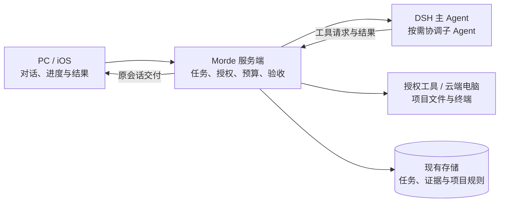
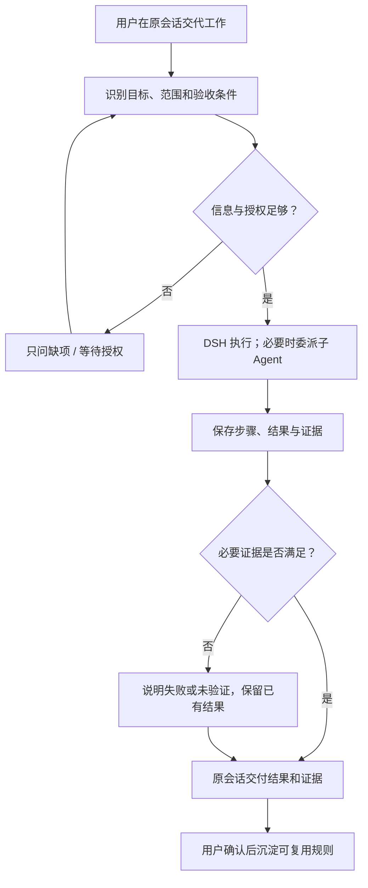

# 可以融入 Morde 的任务能力与开发思路

> 状态：思路说明和开发建议，不代表已经实现或验收。本文提炼可用于多种任务的能力；代码任务只是其中一个应用场景。

## 1. 两组材料分别提供什么

| 材料 | 主要作用 | 对 Morde 的启发 |
|---|---|---|
| [Morde_MVP_PRD](../Morde_MVP_PRD.md) | 以提交核查为例，说明任务如何后台执行、并行查证、中断恢复并带证据交付 | 让用户放心交办：结果可核查，出错可恢复，下次不用重讲 |
| [copy_lauren_engineering](../copy_lauren_engineering/00_README.md) | 把工程任务拆成接单、隔离执行、验证、交付、恢复、项目记忆六个环节 | 把“一句话”逐步变成有边界、可执行、可验证、可复用的工作 |

两份材料的试点选择不同：前者用双 Agent 只读查证，后者的 v1.5 用单 Agent 完成小型代码任务。它们是不同场景的示例，不应把 Morde 整体限定为代码助手，也不改变第一里程碑中 PC/iOS、云端电脑、工具、文件夹同步及双子 Agent 的要求。

## 2. 放进 Morde 后的整体关系

其中，**服务端管事实和边界，DSH 负责理解与执行**。优先扩展现有会话、Task、步骤、事件、检查点、工具代理和项目内容，不另造一套 Agent Runtime、任务系统或通用编排平台。带冰淇淋蓝样式的[架构图与流程图](ice-cream-blue/morde-task-ideas-diagrams.html)可离线打开。

## 3. 值得融合的 10 个想法

### 1）把一句交代变成有边界的任务卡

- **作用：** 防止 Agent 只知道“做什么”，却不知道操作范围、交付要求和怎样算完成；用户换端或任务恢复时，也不需要重新交代。
- **怎么开发：** 在服务端现有[会话路由](../../server/internal/app/conversation_route_worker.go)和 Task 路径中，为需要执行的请求保存目标、关联会话、允许资源与范围、预期结果和必要验收条件。缺阻塞信息时只追问缺项；普通问答直接回复，不强制创建任务卡。工程任务额外记录仓库和基线提交；资料整理任务记录授权目录和输出要求。

### 2）按任务类型形成轻量工作流程

- **作用：** 让长任务有清楚的开始、检查和交付节点，又允许 Agent 在授权范围内决定具体做法。
- **怎么开发：** 在现有 Task 步骤中表达“理解 → 执行 → 验证 → 交付”，只为适用任务选择必要步骤；可复用的模板记录版本，在途任务保持原版本。简单问题不走完整流程；不把每个技能都固化成同一条流水线，也不单独引入 Workflow 引擎或 A2A。

### 3）主 Agent 负责到底，子 Agent 按需协作

- **作用：** 复杂任务能分头处理，用户仍只需要向一个主 Agent 交代和接收结果；失败的一路不会被“已经委派”掩盖。
- **怎么开发：** 复用现有 [DSH 委派和后台子会话](../../runtime/morde-cloud-runtime/src/engine.mjs)，给独立子任务保留各自的目标、授权范围、执行状态和结果；主 Agent 等待并检查实际结果后汇总。互不冲突且有收益的工作并行，有依赖的顺序衔接。单 Agent 可处理简单任务；第一里程碑仍须真实验收至少两个子 Agent 并行。现有本地测试不代表真实模型和客户端链路已通过。

### 4）执行环境隔离，权限跟着任务走

- **作用：** Agent 可以完成文件、终端和电脑操作，同时避免越过用户授权、覆盖已有工作或误操作其他电脑。
- **怎么开发：** 通过现有工具代理、Task 授权和审批控制可用电脑、目录、命令及写入范围，操作前检查当前授权。代码任务可在专属 worktree/分支隔离改动，但 worktree 不是安全沙箱，命令、凭据和网络仍需运行环境约束。PC 文件夹仍由用户手动同步到固定默认云端电脑的项目目录；Agent 读写和同步各守自己的授权与冲突边界，不自动反向同步到 PC。

### 5）用证据判断完成，而不是只看 Agent 的总结

- **作用：** 用户能检查“做了什么、哪些被验证、哪些还不确定”，避免把推测或旧结果当成完成。
- **怎么开发：** 扩展现有 Task 的[证据与验收记录](../../server/internal/app/task_validation.go)，把每项结论关联实际来源、操作结果、版本和环境，区分通过、失败、未验证；需要独立复核时沿用现有质量门禁。资料任务保留来源或文件位置；电脑操作记录实际操作结果；代码任务的测试必须对应当前提交，不能用旧提交或模拟器结果冒充必需的真机证据。证据只向有权用户展示。

### 6）任务可以恢复，也不会因为重试重复执行

- **作用：** 关闭客户端、断网或服务重启后，用户能继续看到同一任务；出现不确定结果时不会盲目再做一次。
- **怎么开发：** 复用现有 Task、事件、租约和 [DSH 检查点](../../server/internal/app/agent_checkpoint.go)，记录每一步的状态、尝试、已完成结果和剩余预算。恢复前重新核权，只重试确认安全的未完成步骤；旧尝试迟到不能覆盖新结果。涉及副作用且结果未知时先对账，无法确认就等待处理；消息和最终结果使用稳定标识去重。

### 7）结果回原会话，PC 和 iOS 看到同一份

- **作用：** 用户不需要从日志里拼答案，也不用因为换设备重新找任务；失败和缺口同样可见。
- **怎么开发：** 沿用服务端现有[任务结果汇总与投递路径](../../server/internal/store/postgres/conversation_result_review.go)。主会话显示结论、产物入口、已验证/未验证项和下一步；任务详情承载步骤、审批和可授权查看的证据。两端读取同一个服务端 Task 和会话，结果投递前再次检查访问权限。工程任务先保留可审阅的本地差异；如果将来单独规划 PR，可由服务端受控发布器记录目标和操作意图、在明确授权后发布并对账，保留人工审核，现有 GitHub MCP 仍限只读。当前工作不推送或发送文件。结果汇总不自动等于独立复核通过。

### 8）记住项目规则，而不是复用旧结论

- **作用：** 下一次同类任务少追问、少漏验，同时能解释这条规则来自哪里、适用于什么情况。
- **怎么开发：** 先复用现有[项目内容与 Agent 上下文](../../server/internal/app/project_service.go)，保存用户确认过的规则、适用项目/范围、来源、版本和失效条件；允许查看、修改和停用。新任务重新核验授权并取得自己的证据。任务、规则、产物、证据之间先用现有数据库关联记录；模型推测的关系只是候选，不先建设独立知识图谱。

### 9）把重复错误变成检查

- **作用：** 当 Agent 反复犯同一种错时，系统不只是“记住”，而是能在下一次提前发现。
- **怎么开发：** 从用户纠正和失败记录提取候选规则，能程序判断的落成服务端校验或回归测试，其余做可编辑的任务模板；用真实反例和正例对照旧规则，再小范围试用，负责人确认后才对新任务生效，效果变差则回退。比如连续两次把模拟器当真机，就增加环境字段和错配检查；不能由 Agent 静默修改默认门禁或扩大权限。

### 10）衡量是否真的帮用户省事

- **作用：** 把“功能做出来了”和“用户确实受益”分开，避免用任务数、Agent 数或演示效果代替价值。
- **怎么开发：** 接单时记录问题与期望，交付时记录验收结果，试用后记录实际反馈；基于现有 Task 用量补充耗时、人工介入、返工、重试和可核计费用，无法核算时标未知。用同类真实任务对照现有做法，失败单也计成本；未取得使用反馈就标“价值待验证”，效果不佳则调整或停止扩展。

## 4. 一次任务怎样流转

过程中的追问、修改和停止按现有会话路由关联正确任务；断线恢复和权限检查贯穿流程，不是单独启动的一份新任务。

## 5. 两个落地例子

| 任务 | 使用哪些想法 | 用户拿到什么 |
|---|---|---|
| **整理资料**：整理已授权项目目录并生成摘要 | 任务卡明确目录与格式；Agent 按权限读取；结论引用来源；原会话展示结果；用户确认后可记住输出格式 | 一份本地可查看的摘要，附来源和未能读取的内容；下次同类任务可复用格式 |
| **修复小 Bug**：修复重连后进度重复 | 任务卡固定目标和基线；在隔离工作区复现、最小修改、运行必要检查；证据绑定当前提交；结果回原会话 | 可审阅的本地改动、复现与测试记录、未验证项。材料中的推送或创建 PR 属于额外交付能力，在当前本地工作约束下不实施外发 |

代码任务的开发细节可参考已有[工程任务闭环实施方案](../copy_lauren_engineering/Morde_工程任务闭环实施方案.md)；只读并行查证也可作为第一里程碑的协作验收案例。两者共用上述通用能力，不应各建一套任务、证据和记忆系统。

## 6. 建议的落地顺序与验证

1. **先收口基础：** 在现有 PC/iOS 对话、Task、授权、证据、恢复和原会话交付上接通任务卡及真实状态；并按第一里程碑完成云端电脑、文件夹同步和真实双子 Agent 验收。
2. **再做一个完整场景：** 选资料整理或小型代码任务，验证目标、执行、证据和结果能串起来；本地保留成果，不上传或发送文件。
3. **再积累经验：** 从真实用户纠正中试点项目规则和回归检查，对照实际人工时间、证据质量与成本，确认有价值后再扩大。

验收时至少覆盖：正常交付；执行中断后恢复且不重复；授权失效和证据缺失时不误报完成；第二个同类任务复用已确认规则但不用旧证据。涉及 PC 的交互必须从实际 `morde-pc` 操作验证，iOS 使用原生客户端；替身测试或构建成功不能代替真实端到端验收。
