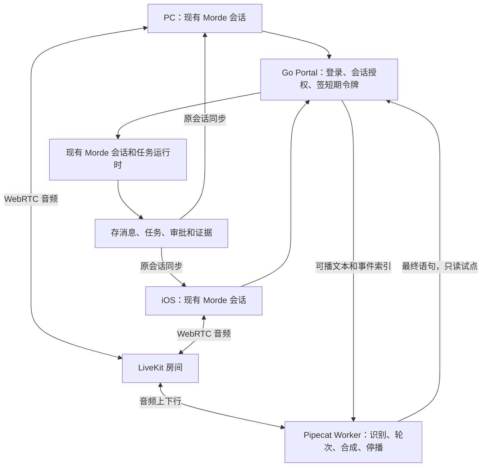
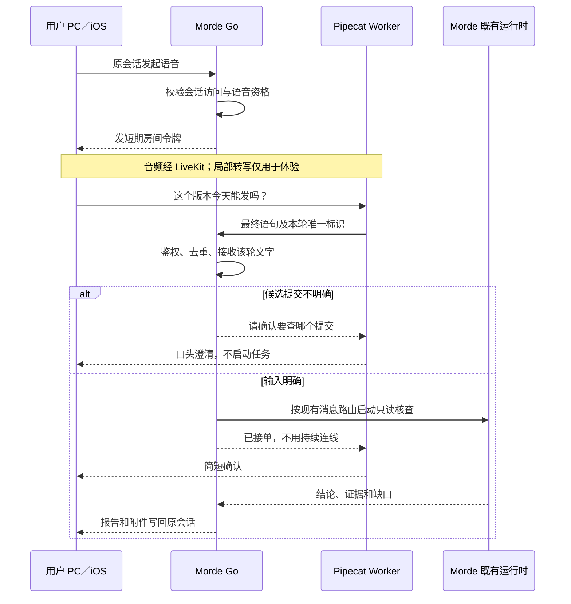
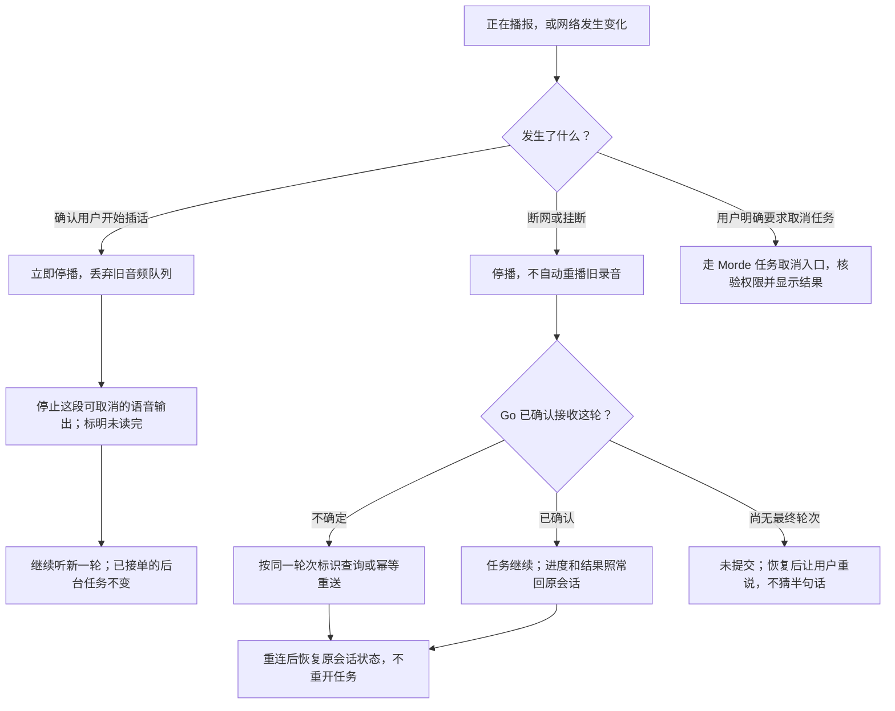

# Morde 实时语音接入设计：Pipecat + 现有 Morde 会话

**结论：选 Pipecat 做语音层，LiveKit 仅做 WebRTC 音频传输。** 不引入 LiveKit Agents，也不改 Morde 的任务编排。这个方案是待验证的接入设计，不代表已经实现或部署。

## 1. 为什么选 Pipecat

[Pipecat](https://github.com/pipecat-ai/pipecat) 是 BSD-2-Clause 开源 Python 框架，适合把流式语音识别、轮次判断、可中断的播报和合成拆开调。2026-11-20 官方 GitHub 仓库快照：Pipecat 约 17.3k Star，[LiveKit Agents](https://github.com/livekit/agents) 约 15.3k；LiveKit 音视频服务器约 22.3k，属于传输层，不与 Agents 合算。Star 是社区关注度参考，不是普通话体验证明。选择它的主要原因是：**先把中文的停顿和插话磨顺，还能替换任一语音组件，而不用跟着改 Morde 的会话和任务系统。**

采用 [Pipecat 的 LiveKit Transport](https://docs.pipecat.ai/api-reference/server/services/transport/livekit)；[LiveKit Server](https://github.com/livekit/livekit)、[Swift SDK](https://github.com/livekit/client-sdk-swift) 和 [JS SDK](https://github.com/livekit/client-sdk-js) 只管房间和音频。Swift 用于原生 iOS，JS 用于 PC 渲染层；麦克风权限、音频会话和后台行为需要真机验证。传输层可以换，首版不做第二套传输。

## 2. 兼容边界：Pipecat 只做耳朵和嘴

| 层 | 归谁 | 边界 |
|---|---|---|
| PC/iOS | Morde 客户端 | 从已登录的现有会话发起；展示听取、已提交、播报、重连。审批、报告、证据和附件仍在原会话。 |
| WebRTC | LiveKit | 每通电话独立房间，两端分别持短期、限定房间和身份的令牌。房间不是权限来源，也不是会话数据库。 |
| 语音 Worker | Pipecat | 普通话流式 STT、判定说完、TTS 和打断。自定义适配器把最终文字提交给 Go；不另起对话大脑、不直接调业务工具。 |
| 会话和任务 | Morde Go Portal／应用层 | 账户和原会话鉴权、文字消息入口、审批、任务、状态及产物；现有运行时继续执行。Go 为唯一记账方，Worker 不直连数据库或 DSH。 |

**接法：** Pipecat 的接收端做 STT 和轮次判断；在转写聚合之后，用[自定义 Frame Processor](https://docs.pipecat.ai/guides/fundamentals/custom-frame-processor) 把最终轮次提交给 Go，再把 Go 返回的可播文本交给 TTS。不直接把半句话、STT 局部更新或 TTS 文本注入 Morde 聊天。不为首版引入 Pipecat 自己的 LLM 对话记忆；Morde 的原会话是唯一上下文。

## 3. 从说话到交付

以「这个版本今天能发吗？」为例。用户从原会话里点通话，继续沿用发布核查的只读验收标准。读代码、查测试、交付都是既有会话上的工作，不变成一个独立语音任务箱。

**建议契约（不是现有 API）：**

- **开通话：** 客户端只携登录凭据、目标 `conversation_id`；Go 校验归属与可用能力后，绑定 `call_id → 账户 / 会话 / 房间`。给 Worker 签单通话、单会话的服务授权，不能用客服式全局令牌。刷新令牌与重新入房都重新查权限；撤权或挂断时禁止新轮次，必要时移出房间。
- **提交最终轮次：** `call_id + turn_id + transcript`；`turn_id` 在该轮第一次形成最终句时生成并稳定保存，网络重试复用。Go 从绑定解析会话，不信任客户端自报的路由；同一键返回原消息／任务收据，不产生第二条。缺少提交号、目标或判断口径时先澄清。不同客户端同时发起通话的首版策略：同会话只允许一通活动语音。
- **回放与回填：** Go 持久接收后显示「消息已提交」，收到真实任务 ID 才显示「已接单」，任务结果只由 Go 回写。未核实助手 token 流前，只消费已提交的助手消息；等待时可短确认，不捏造进度或结果。语音可念短确认或普通回答；语音不能代替审批，仍用现有审批控件。只读不是一段提示词：Go 和工具授权层必须实际限制；如不能按调用范围限制已有路由，试点只开放无写工具的测试会话。附件不转成语音链接，不转发到新目的地，权限与原会话一致。对 CI 失败、真机记录缺失保留明确状态，不口头说「可以发」。用户始终能在 PC/iOS 看到同一份报告。

## 4. 打断和断线：停得快，但不丢任务

- **听得顺：** 用流式 STT + VAD（声音活动）+ [Smart Turn](https://github.com/pipecat-ai/smart-turn) 或可替代的轮次判断。普通话长句、犹豫、数字、中文夹英文仓库名都要实测；「嗯」「对」可能只是附和，不等同新指令。高风险转写（如版本号难辨）在界面或下一轮确认，不默认猜中。
- **说得顺：** 立即停止未播音频；若能得到真实的播放进度，就记录听到哪儿，否则只记「播报被打断」，不声称用户听了完整段落。文本是可回看的按现有规则可回看的记录，播报状态单独标。插话停播**不是**业务任务取消。
- **隐私和成本：** 默认不录原始音频；STT/TTS 供应商的数据处理和日志保留单独评审。局部转写不持久化，最终文字沿用 Morde 会话规则。令牌、原始音频和敏感全文不进调试日志；首版统计每通音频分钟、STT/TTS 用量、Worker 成本和原任务成本，空闲自动结束通话，不重置任务预算。

## 5. 怎么落地和验收

1. **先打通一台 PC 的普通话实时对答。** 用一条现有测试会话做只读接入；先不接业务写工具，不引入第二套工作流。确认声音能正确停、最终轮次只进原会话一次。
2. **再接真实任务和 iOS。** 复用现有消息／事件和任务状态路径；跑一次只读发布核查，挂断后在同一 iOS 会话查看真实报告；真机验证耳机、消回声、切 Wi-Fi／蜂窝、收回麦克风权限。
3. **最后验证值不值得加。** 只有语音在开任务或追问时明显比手打顺，而且文本证据质量不降低，才扩大试用。首版不做持续监听、外呼、全双工抢话优化或语音即批准。

**试点门槛（提议，不是实测）：** PC/iOS 各完成至少 20 轮中文用例，覆盖半句停顿、附和、真正插话和中英混说。稳定网络下，从判定用户说完到听到首段短回复 P95 ≤ 2.5 秒；从确认真正插话到停播 P95 ≤ 500 毫秒。同时单列自然停顿到判断说完、以及到第一段有实质内容的时间，短确认不计入实质响应指标，避免靠延迟判定做漂亮数字。20 次重复提交／换网／挂断故障用例中，**零重复任务、零错会话、零越权，已接单任务不因通话结束丢失**。记录每次通话的误抢话、漏打断及费用；任一越权或任务串线先停止试点。

## 6. 已核实与待工程确认

- **源码证据：** [Morde README](https://github.com/lizhongxuan/morde#readme) 描述对话优先、PC/iOS、Go/PostgreSQL 任务归属和统一运行时。这证明了接入方向，不证明语音 API 或真机验收已存在。
- **现有接口（[固定版 Portal OpenAPI：ba649b1](https://raw.githubusercontent.com/lizhongxuan/morde/ba649b1/server/openapi/portal.yaml)）：** `POST /api/conversations/{id}/messages` 持久接受对话消息，`202` 不代表任务已经创建；把通话／轮次派生的稳定键同时用作 `client_message_id` 与 `Idempotency-Key`。通过 `GET /api/conversations/{id}/messages` 对账；`GET /api/conversations/{id}/tasks` 可查任务，`GET /api/tasks/{id}/events` 是任务事件流，不是通用助手文本 token 流。Worker 使用新增的绑定授权，不能直接拿用户的 Portal 凭证。
- **待确认：** 候选线上环境的接口、事件补拉和授权效果，PC/iOS 真机 SDK 行为、中文 STT/TTS 的实测与合规。会话和任务入口已存在；尚无证据表明它们已有通话授权机制或可播文本 token 流，新增部分在 Go 应用层做最薄适配。
- **许可证：** Pipecat 框架与传输、语音模型、托管服务分别核对。不要把框架开源等同于模型权重、普通话 TTS 或托管推理都开放或免费。
