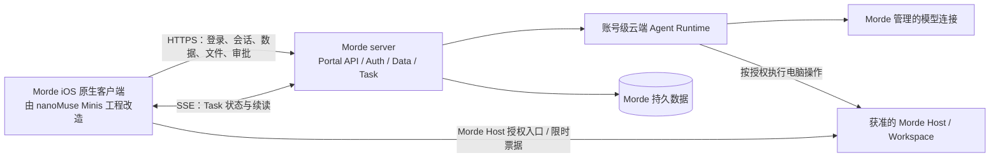

# iOS 端迁移到 Morde 服务端方案

> 日期：2026-11-03。状态：迁移方案，按仓库现有需求、OpenAPI 与 iOS 源码盘点整理；本文本身不表示迁移已完成。
>
> **目标约束：**Morde iOS 正式客户端只连接 Morde `server/` 提供的业务服务，不登录、调用或回退到任何 nanoMuse Cloud、nanoMuse Hub 或其他 nanoMuse 服务端。客户端需要的云端能力统一在 Morde 服务端实现。本文细化并收敛 iOS 侧执行边界；如旧实施记录仍写有保留 nanoMuse Cloud 登录入口，以本方案的单服务目标为准。

## 1. 目标与边界

- 继续以 `project/nanoMuse/android/src/ios/Minis.xcodeproj` 的 nanoMuse 原生界面、存储和交互为迁移底座，在该工程内改造并发行唯一的 Morde iOS App；桌面图标和系统应用名称显示为小写 `morde`。不使用独立 `Morde.xcodeproj` 的客户端界面或应用壳，也不发行第二个 Morde iOS App。
- 为兼容已安装的 nanoMuse App，建议首个迁移版本保留现有 Bundle ID `io.github.nanomuse.app`、App Group 和 Keychain access group；更换这些标识会让 iOS 将其视为新应用，不能自动继承旧容器数据。若发布身份要求更换 Bundle ID，须另做安装迁移和数据恢复方案。
- Morde 服务实例是账号、安装、会话、Task、设备、Workspace、个人数据和云端例程的唯一权威来源。iOS 仅保存必要的本地界面状态、待同步变更和旧数据副本。
- iOS 不运行 Agent、模型/工具循环或旧 Hub 任务执行器。会话消息由 Morde 持久受理，云端 Runtime 执行；关闭 App 不代表取消 Task。
- 正式客户端不得保存或使用用户自带模型 API Key，不得以旧 Cloud 凭证、旧 Cloud URL、旧 Hub WebSocket、CloudKit 业务同步或旧服务不可用时的备用链路恢复旧服务依赖。
- 切断范围也包括可配置的 nanoMuse Relay 地址，以及更新清单、下载页、隐私/帮助页和 OAuth 客户端资料中的 nanoMuse 官方域名；发行检查改用 Morde 自有渠道或 App Store。
- 不迁移 nanoMuse Cloud 的线上账号、云端聊天记录或其他云端数据。设备上的本地数据不因切换服务被清空；跨设备上传仅按已确认的数据类型、授权和用户操作进行。

本方案承接[合并需求](nanoMuse客户端与Morde服务端合并需求文档.md)、[融合架构](nanoMuse客户端与Morde服务端融合技术架构设计方案.md)及[融合 03/04 实施清单](实施/融合03-PC与iOS客户端融合实施任务todo清单文档.md)。Android 不纳入本次迁移。

**当前源码基线：**原工程已经接入 Morde 登录、会话/Task、Hub Relay、Workspace 与个人数据模块，但旧 `NanoMuseCloud.swift` 仍定义 `cloud.nanomuse.cn` 默认地址和可配置 Relay；Cloud 账号、旧 Hub、旧同步和 Morde 账号因此仍是并存路径。迁移重点是收敛身份、数据和网络入口，不只是改一个 base URL。

**目标区分：**上一轮小写显示名和默认服务地址改动位于独立 `Morde.xcodeproj`，不会改变原 `Minis` target 的 `nanoMuse` 名称或旧 Cloud 登录。本文规定将 Morde 登录与默认 origin 接入 nanoMuse 原生工程，并把它改造成唯一发布的 `morde` App；独立 Morde 客户端不作为迁移结果。

需逐项审查的 iOS 入口包括：`NanoMuseCloud.swift`、`NanoMuseCloudHeaders.swift`、`NanoMuseHub.swift`、`NanoMusePresence.swift`、`NanoMuseSync.swift`、`Agent/Sync/CloudSyncEngine.swift`、`Agent/Sync/ICloudBackupManager.swift`；`NanoMuseUpdateCheck.swift`、`NanoMuseSettings.swift` 和 `NanoMuseConnectors.swift` 中还存在旧版本、政策/帮助或 OAuth 客户端 URI。`NanoMuseImageGen.swift`、`NanoMuseVideoGen.swift` 与 Provider 实现会直连模型厂商；它们不都是 nanoMuse 服务，但云端模型能力应改由 Morde 受管连接执行，iOS 不再携带厂商模型 Key。

## 2. 目标架构

客户端启动先请求 `GET /api/capabilities`，校验服务实例、API 版本和所需能力后，才允许登录或使用相应页面。账号登录、业务 HTTP、事件流、Morde Hub 连接及嵌入式 Portal 均以同一个配置的 Morde 服务为边界；Host 页面或控制请求必须使用 Morde 签发的限时授权。客户端不得内置第二个 nanoMuse 服务地址，也不得根据能力缺失转到旧服务。

## 3. 功能与服务端迁移映射

| iOS 功能 | 迁移后的唯一数据/执行路径 | Morde 服务端范围与当前边界 |
|---|---|---|
| 注册、账号密码登录、安装身份与撤权 | 注册 `POST /api/auth/register`；登录 `GET /api/capabilities`、`POST /api/auth/client-login`；凭证保存在设备本地 Keychain | 注册仅提交用户名和密码，无邀请码/短信验证；账号先进入 pending，不建立 session/client installation。后台管理员首次批准时自动分配默认模型额度，之后才能登录使用。登录使用 Morde 安装级 Client 凭证及有序登录合同；按服务实例、账号、安装隔离。iOS 不保留 nanoMuse Cloud 账号登录页或 Token。 |
| 聊天、会话、云端任务与审批 | `/api/conversations`、`/api/conversations/{id}/messages`、`/api/tasks/{id}`、`/api/tasks/{id}/events`、任务 actions/approvals | Morde 服务端持久保存会话和 Task，云端 Runtime 执行并提供事件恢复。提交、补充、审批、停止均遵循 Morde 幂等键、版本冲突及服务端回执；不在 iOS 直接调用模型提供商来执行 Agent。 |
| 模型选择与推理 | `/api/available-models`、Morde Task/模型网关 | 使用 Morde 管理的连接、预算和计量。`/api/model/v1/chat/completions` 是 Morde 模型网关能力，不取代云端 Task/Agent 执行。若要保留独立图片、视频等生成入口，须由 Morde 补齐服务端适配、鉴权、额度和 OpenAPI 能力后再开放；当前契约未定义独立媒体生成路由。 |
| 电脑、Workspace 与文件 | `/api/hosts`、`/api/workspaces`、Workspace 同步/文件接口、受限 Host 页面与票据 | Host 授权、Workspace 版本、传输限制和写入安全副本由 Morde 管理。iOS 只能上传用户明确选择的文件，下载先核验完整性再落盘；不借 nanoMuse Hub 做电脑文件操作。 |
| 设备在线状态和跨设备基础操作 | Morde `GET /api/hub` WebSocket，使用当前安装凭证 | 当前 Morde Hub 契约支持同账号安装之间的 `info`、`open`、`notify`。需要保留的其他 Hub 动作必须先在 Morde 服务端定义具体动作、目标权限、授权版本、审计和拒绝行为。手机不作为本机 Agent/远程 shell 执行节点；电脑操作走获准 Morde Host 能力。 |
| 资料、记忆、动态、点子、资源库及附件 | `/api/personal-data/{type}/{id}`、`/api/sync/snapshot`、`/api/sync/changes`、附件分片接口 | 使用 Morde 账号隔离、revision 冲突、变更游标、幂等 outbox 和个人数据额度。类型/字段未纳入 Morde 白名单前，不能退回 nanoMuse Cloud 或把本地资料标记为已同步。 |
| 目标、例程与提醒 | `/api/goals`、`/api/schedules` 及 Morde Schedule 授权 | 计划触发和云端运行由 Morde 服务端负责；导入旧本地计划须由用户选择，导入后不自动重复运行本地提醒。站内通知使用 Morde `/api/notifications`；若产品需要 APNs 推送，安装令牌管理与推送投递也由 Morde 服务端新增，不能调用旧 Cloud 推送。 |
| 版本检查、隐私与帮助入口 | Morde 发行渠道/App Store 和 Morde 自有政策、帮助页面 | 不再请求 `nanomuse.cn/dl/index.json`、打开其下载/隐私/Key 文档，也不以 NanoMuse GitHub Release 作为 Morde 版本来源；Morde OAuth 客户端资料不得继续使用 nanoMuse 官方 URI。 |
| 本地偏好、语音输入、系统文件选择 | iOS 本地存储和系统能力 | 继续由 iOS 自身处理；不需要为了“迁移后端”把纯本地设置上传。语音、图片或其他模型请求若要访问云端，均经 Morde 服务端和其受管模型连接。 |

服务端接口的存在不代表目标部署已开放该功能。客户端只能依据 `/api/capabilities` 实际声明的能力开放入口；缺少能力、模型、配额或权限时显示明确不可用状态，不伪造成功，也不使用兼容性回退。

## 4. nanoMuse iOS 功能处置清单

下表描述迁移完成时的目标状态，不表示现在立即删除代码。任何旧入口都要先确认替代接口、调用方和数据去向，再从正式 iOS target 移除。只保留 nanoMuse 原生客户端中对 Morde 有用的交互和本地数据，不保留 nanoMuse 服务依赖。

### 4.1 从正式 iOS App 删除的旧功能

| 旧功能 | 代表代码或入口 | 迁移后处理 |
|---|---|---|
| nanoMuse Cloud 登录、注册、手机号/邮箱验证码、旧账号、余额/邀请及旧 Cloud 设备管理 | `NanoMuseCloud.swift`、`NanoMuseCloudView.swift`、`NanoMuseAccount*.swift`、`NanoMuseCloudHeaders.swift`、`NanoMuseRelayPicker.swift` | 从正式 target 和设置页删除；Morde 登录、安装管理、退出和撤权走 Morde Auth。旧 `/v1/auth/*`、`/v1/me` 与 Cloud Token/Header 不能留作回退。 |
| nanoMuse Cloud 中继、可配置 Relay 地址、旧 Hub 与 Presence 服务 | `NanoMuseRelay*.swift`、`NanoMuseHub*.swift`、`NanoMusePresence.swift`、旧 `cloud.nanomuse.cn`/`nanomuse.cn` 常量和 WebSocket 路由 | 删除旧服务地址、帧协议、重连与静默回退。需要保留的跨设备动作按 4.2 交给 Morde Hub/Host 合同实现。 |
| nanoMuse Cloud 数据同步与旧 CloudKit 自动跨端业务同步 | `NanoMuseSync.swift`、`Agent/Sync/CloudSyncEngine.swift` 及旧 `/v1/sync/*` 调用 | 删除 nanoMuse Cloud 请求；CloudKit 是 Apple 服务而非 nanoMuse 后端，但自动业务同步也应在 Morde 数据迁移后停用，避免同一对象出现第二个可写权威。保留本机历史和 outbox，直到用户选择迁移且 Morde 明确确认。 |
| 手机本机 Agent、模型/工具循环、iSH Shell 和仅面向旧 Hub 的远程执行 | `Agent/Chat/` 执行路径、`Agent/ISH/`、`iSH/`、`NanoMuseCoding.swift`、本机 Hub tasks、`NanoMuseRemoteApproval.swift`、本机 Agent Intents/Offload | 从正式 App 执行链和 target 移除；手机只提交 Morde 会话/Task 并展示审批。确需电脑操作时走授权 Morde Host/Workspace，不把本机执行直接等同云端 Host 能力。 |
| 手机直连模型厂商、用户自带模型 Key、旧 Provider 登录/模型中继 | `Providers/`、`NanoMuseModels*.swift`、`NanoMuseProxy.swift`、`NanoMuseImageGen.swift`、`NanoMuseVideoGen.swift` 及相关 Keychain 项 | 移除客户端厂商凭据、直连请求和旧模型计费逻辑；聊天和生成能力按 4.2 经 Morde 服务端。已确认清理的用户自带模型 Key 不迁移到 Morde。 |
| nanoMuse 专属品牌与服务入口 | nanoMuse 吉祥物/品牌资源、`NanoMuseNudges.swift`、旧首次启动 Cloud 页面、`NanoMuseUpdateCheck.swift`、隐私/帮助/下载链接及旧 OAuth redirect URI | 去除 nanoMuse 品牌、域名和旧 Cloud 引导；改用 Morde 名称、图标、发行渠道、政策页和 Morde OAuth 回调。通用聊天、Feed、Ideas、Library 等原生页面不因品牌文件名而整组删除。 |
| 独立的旧 Morde iOS 客户端 | `android/src/ios/Morde.xcodeproj`、`Morde` scheme 的独立应用入口和 `MordeEmbeddedView` 壳 | 不作为迁移底座或发行 App；nanoMuse 原生工程完成迁移验收后，退役独立 target/scheme。不得因文件位于 `Morde/` 目录就直接删除仍被 nanoMuse 原生 target 引用的 API、DTO 或安全逻辑。 |

### 4.2 需要 Morde 服务端实现或补齐的能力

| 用户能力 | Morde 已有基础 | 迁移前的服务端工作/开放条件 |
|---|---|---|
| 注册申请、管理员审核、安装登录和撤权 | `/api/auth/register`、`/api/auth/client-login`、`/api/admin/users`、`/api/admin/users/{id}`、`/api/capabilities` | 服务端已有用户名/密码注册、pending 状态和管理员用户状态管理；生产注册保持审核必需。注册限流，不要求或校验短信；iOS 与公开注册表单只收用户名/密码，不显示或发送邀请码。注册响应不建立 session/client credential；pending/rejected/disabled 登录均不得签发凭证。管理员首次批准新账号时，服务端须自动分配管理员配置的默认模型额度；额度未配置时提示先设置，既有预算不覆盖，重试或恢复账号不重复发放。接口兼容期可以接收可选 `invite_code`，但不得将其设为注册门槛。 |
| 对话、消息、Task、审批、停止和断线恢复 | conversations、tasks、actions、approvals、SSE events 已有路由 | 确保移动 Client 凭证可按合同访问所需接口，云端 Runtime/worker 已装配；明确幂等、unknown 回执、快照恢复和通知导航。手机关闭后已受理的任务由 Morde 持续执行。 |
| 模型目录、选择、使用量和额度 | available models、模型连接、Model Gateway、usage 管理 | 只公布当前服务实例可用且已装配的模型和额度；供应商密钥保存在服务端。独立图片/视频/音频生成与聊天附件接口尚未形成完整合同，若保留需新增请求、授权、额度、产物归属和 OpenAPI/capability。个人 Library 附件接口不得代替 Task/聊天附件接口。 |
| Host、Workspace、项目和手机文件操作 | Host/Workspace/Project 与文件操作路由已存在 | 当前 capability 未声明 Workspace 的读、写、恢复、复制、移交粒度能力；需要时补齐 `workspace_read/write/restore/copy/transfer` 并按对象授权。另需手机 revision 时间线、项目负责人待处理邀请列表、接收方 Workspace 移交收件箱、连接器 `active/grant_version` 读取及 Host 根目录/迁移就绪合同。缺口交付前保持入口关闭。 |
| Feed、Ideas、个人资料、记忆、日记、目标、Routine/Schedule 与冲突恢复 | Personal Data CAS、snapshot/change feed、部分对象 allowlist、Goals/Schedules | 逐对象冻结 schema、分页/游标、删除/导出、quota、revision 冲突与账号 scope；确认部署能力后才开放。切账号或撤权后，不得提交旧账号 outbox。 |
| Hub 状态、设备接力和电脑控制 | Morde Hub WebSocket 当前支持 `info`、`open`、`notify`；Host 有限时票据/控制入口 | 仅保留这三类已定义动作；其他旧 Hub 动作逐项补充目标资源、权限、租约/版本、审计和拒绝语义。电脑工具只由授权 Morde Host 执行，不为 iOS 增加远程 Shell。 |
| 通知 | Morde 站内通知读取/已读接口 | 若保留 APNs，新增设备推送令牌注册、撤销、投递和权限合同；现有站内通知路由不等于 APNs 已支持。未交付时保留站内刷新，不连旧 Cloud 推送。 |
| 一次性本地数据导入 | `/api/personal-data/history/import` 及个人对象/附件接口 | 仅接收用户在本机明确选择并预览的数据，定义格式、对象归属、大小限制、幂等、校验和失败恢复。按既有决策不导入 nanoMuse Cloud 线上账号或云端历史。服务端确认前保留本地原件。 |

Morde 当前动态 capability 主要覆盖有序登录、安装、可用模型、Hub、个人同步、模型网关、Task/Cloud Task，项目预算能力为条件开放；Workspace 粒度能力、APNs、通用聊天媒体附件/生成等仍未声明或未形成完整合同。`portal.yaml` 中有路由，不等于目标部署的 capability、权限和依赖已经就绪。服务端必须先完成装配和授权测试，再发布 capability；iOS 不能通过旧 nanoMuse 服务补洞。

### 4.3 在 nanoMuse 原生 iOS 工程中改造并保留

| 保留的用户体验 | iOS 改造内容 |
|---|---|
| 原生主壳、会话/聊天、消息列表、Composer、语音输入、Feed、Ideas、Goals、Library | 保留可用页面和无障碍行为；统一显示 `morde` 品牌。所有账号数据通过 Morde 账号 scope 读取；没有服务端能力的入口展示未就绪或暂不可用。 |
| 注册、登录、服务地址和账号设置 | Minis 原工程只保留 Morde 账号密码注册/登录。注册页只需用户名、密码和确认密码，不提供邀请码、手机号或短信验证码字段；提交后显示“等待管理员审核”，审核通过后再登录。默认 HTTPS origin 使用 `https://portal.120.25.178.93.sslip.io`；同一 origin 用于注册、capabilities、登录、API、SSE、Hub 和 Portal session。禁止默认裸 IP、nanoMuse 地址和自动 fallback。 |
| ChatStore、本地历史、个人资料、附件和例程草稿 | 本地记录保持可读；首次登录不自动上传。按类型让用户查看/选择后导入，使用 Morde revision/outbox；冲突保留本地草稿，按账号和服务实例隔离。 |
| 模型/用量/个人数据设置 | 移除 nanoMuse Cloud、Provider Key 与旧余额页；改为 Morde 服务端返回的模型、使用量、账号、安装和 quota 状态，不把服务端未知状态显示为已同步/已结算。 |
| 用户主动创建的 iCloud 备份（`Agent/Sync/ICloudBackupManager.swift`） | 这是 Apple iCloud 文件备份，不是 nanoMuse 服务端；本次迁移不自动删除。检查恢复流程不重新写回已退役的 NanoMuse Cloud 地址或已清理的模型 Key。 |
| Share Extension、File Provider、Deep Link、通知和系统权限入口 | 保留确有 Morde 使用场景的系统入口；改名称、URL scheme、回调、凭证获取和资源权限。旧本机 Agent 快捷指令移除；需保留的快捷指令只提交 Morde Task，并展示受理结果。 |
| Xcode 工程、scheme、图标与发行配置 | 将原 `Minis` target/scheme 重命名并收敛为唯一 Morde App，`CFBundleDisplayName` 为 `morde`；同步改扩展名称、启动资源、权限说明、测试和隐私文案。首版建议保留 bundle/App Group/Keychain 标识以支持升级。 |

## 5. 数据处理与旧服务退场

1. **nanoMuse Cloud 云端数据：**按已确认决定不迁移线上账号和历史云端记录。移除 Cloud 注册/登录、账号余额/邀请、Cloud 设备管理、Cloud 数据控制、旧 Relay 登录与请求 Header、可配置的旧 Relay 地址及 nanoMuse 官方域名链接；不尝试把旧账号映射成 Morde 账号。
2. **设备本地数据：**保留现有 ChatStore、个人资料、附件和历史副本。未归属历史不因首次 Morde 登录自动上传。用户可在本地预览并明确选择允许的数据；聊天历史如需导入，可使用 Morde `/api/personal-data/history/import`，以 taskless 记录写入，不创建或重跑任务。此入口不能被用于导入被明确排除的 nanoMuse Cloud 云端历史。
3. **普通个人数据：**服务端和客户端先按对象类型定义字段白名单，再逐类迁移。同步状态按 `(service_instance_id, account_id)` 隔离；本地 outbox 先持久化 mutation ID，服务端确认后推进游标。冲突保留本地草稿，交由用户处理；撤权、切账号或离线时不得把旧账号待处理内容提交到新账号。
4. **例程和设备操作：**旧本地例程只作为待选择数据保存。转为 Morde Schedule 前，展示运行内容、目标和权限，由用户确认；Morde 受理后由服务端执行。App 关闭、登出或“关闭同步”不取消已受理 Task/Schedule。
5. **密钥与备份：**按既有决策定向删除旧自带模型 API Key，保留登录、MCP OAuth 和用途明确的其他凭据。停用旧 CloudKit 自动业务同步路径；不删除本机快照或远端独有数据，不以 iCloud 替代 Morde 同步。导入旧备份时禁止恢复被清理的模型 Key。
6. **失败与撤权：**401 清理当前安装凭证并重新登录；403 显示权限不足；409 保留草稿并刷新服务端版本；断网时保留已确认本地数据和 outbox。撤销安装后，服务端拒绝后续调用；客户端清除对应可用凭证和账号态。

## 6. 分阶段实施

| 阶段 | 工作内容 | 退出条件 |
|---|---|---|
| A. 注册、审核与登录收敛 | 确认 `/api/auth/register` 仅凭用户名/密码创建 pending 账号；管理员后台可批准/拒绝，并在首次批准时自动分配配置好的默认模型额度；核验 `ordered_client_login`、安装绑定、能力发现、版本兼容与 Morde Web Session；删除 nanoMuse Cloud 登录入口 | iOS 和公开注册表单不要求邀请码或短信；注册不签发会话，管理员批准及额度分配完成后登录可用；重复批准不重复分配；旧服务不可访问时不影响 Morde 注册/登录；能力缺失时安全失败 |
| B. 主聊天与云端任务 | 将主聊天统一到 Morde 会话/Task，补齐幂等提交、快照、SSE 续读、审批/补充/停止和通知导航；清理本机 Agent 执行路径 | iOS 与 PC 读写同一会话/Task；App 关闭后任务仍在 Morde 服务端运行；无本地模型/工具循环 |
| C. 资源与文件闭环 | 接入获准 Host/Workspace、明确选择的文件上传下载和 Morde 限额；只在能力声明后显示入口 | 服务端资源权限、revision、大小/摘要、断点恢复和失败提示通过验收 |
| D. 个人数据、目标与设备能力 | 按类型接入 Morde 同步、附件、Goals、Schedules、Hub 和站内通知；缺失的服务端能力先在 Morde 实现并更新 OpenAPI/能力列表 | 两设备数据一致且不漏变更；冲突、撤权、关闭同步和本地计划导入边界符合本方案 |
| E. 旧服务切断与发行验收 | 从改造后的唯一 Morde iOS target 清除 nanoMuse 服务 URL、认证、请求头、CloudKit 业务写入和旧 Hub 回退；检查更新、政策/帮助链接、OAuth 客户端资料、扩展、快捷指令、备份恢复及 WebView 路由；退役独立 Morde App target | 静态依赖检查与模拟器/真机网络记录确认业务及应用内链接不再访问 nanoMuse 官方服务；Xcode 发行入口只有由 nanoMuse 原生工程改造的 Morde App |

若某个功能尚无 Morde 服务端实现，先补齐 Morde domain/service、持久化、API/OpenAPI、授权和测试，再接 iOS 页面；不得临时保留旧 nanoMuse 服务以维持界面可用。

## 7. 验收清单

- SpringBoard 显示应用名 `morde`；唯一发布 scheme 从 nanoMuse 原生工程构建，默认连接 `https://portal.120.25.178.93.sslip.io`。升级路径保留原 Bundle ID/App Group/Keychain 标识，除非另有经确认的数据迁移决定。
- 新用户只输入用户名和密码即可提交注册；注册响应显示待审核且不获得 session/client token。管理员从后台批准时一次性分配默认模型额度，账号随后可以登录；重试及禁用后恢复不重复分配，已有人工预算不被覆盖。拒绝或禁用账号不能登录，注册流程不调用短信服务，也不要求邀请码。
- 冷启动、登录、切账号、登出、撤安装和 Morde 服务端不可用时，均不会请求 nanoMuse Cloud/Hub、可配置 nanoMuse Relay 或 nanoMuse 官方更新/政策/帮助地址；不存在旧 Token/Header 的重试或回退路径。
- 在本地模拟器及目标真机记录网络目的地：核心 API、SSE、WebSocket、Portal Session、Host 操作都归属配置的 Morde 服务及其授权 Host；模型调用由 Morde 后端发起。
- 相同 Morde 账号在 PC 与 iOS 看到相同云端会话、Task、Host、Workspace、个人对象和 Schedule；不同账号、不同服务实例、撤销安装互相隔离。
- 网络丢包、重复提交、SSE 游标过期、附件中断、数据冲突、权限撤销和 App 关闭均不丢已确认数据、不重复执行 Task、不把未知状态显示为成功。
- 本地已有数据升级后仍可读取；没有用户选择的本地资料、附件、历史或例程不会自动上传或启动；旧 Cloud 历史按决定保持不迁移。
- Morde 关闭 Hub、个人同步或媒体等单项能力时，iOS 对应入口被能力门禁关闭；其他 Morde 会话和数据不会切到旧服务。

## 8. 当前服务端能力与待补项

依据当前 [Portal OpenAPI](../server/openapi/portal.yaml)，Morde 已有能力包含客户端能力发现/安装登录、会话与云端 Task、Host/Workspace、Hub 基础中继、Goals/Schedules、个人数据同步/附件、站内通知和 Morde 管理的模型入口。上线前仍需核对目标部署是否在 capability 中声明且依赖已就绪。

当前 API 契约的 Morde Hub 仅承诺 `info`、`open`、`notify`；Chat Completions 是模型网关接口，不应被 iOS 用作本机 Agent 循环；没有独立媒体生成 API 描述；OpenAPI 声明站内通知，但未声明 APNs 注册/投递接口。要保留这些未覆盖的旧产品行为，应分别在 Morde 服务端补充受限 Hub 动作、云端媒体生成或 APNs 服务及其数据/权限/计量合同，再更新 OpenAPI、能力清单和验收项。超出本方案已确认的用户价值时，先不迁移这些入口。

## 9. 用户补充：移除三个 iOS 板块

用户明确要求移除截图中的动态（Feed）、点子（Ideas）和目标（Goals）三个 iOS 板块；目标页中的追踪、例程和创建目标入口一并移除。此前第 3、4 节要求在 iOS 保留这些板块的内容，以本节为准；实施任务见[会话 3 的 MI-08/MI-09](实施/nanoMuse与Morde合并五会话并行实施/03-iOS原工程实施任务todo清单文档.md)。实际删除前按用户要求先列出具体清单并取得确认。

保留 iOS 聊天、资源库和无关功能；移除相关导航、旧深链、板块专属操作及自动生成路径。不要清除已有本地/云端数据或取消云端 Schedule，也不要删除 Morde 服务端或 PC 的相关能力。超出这三个板块范围的旧功能删除和任何用户数据清除，仍需另行明确范围并取得用户确认。
